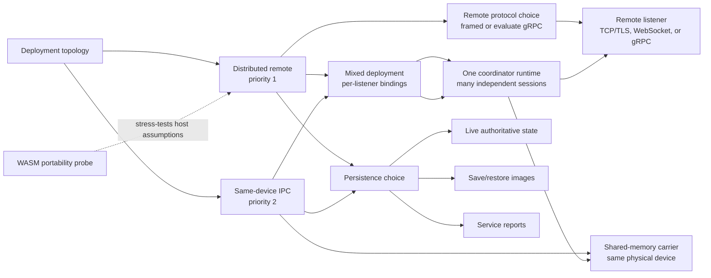
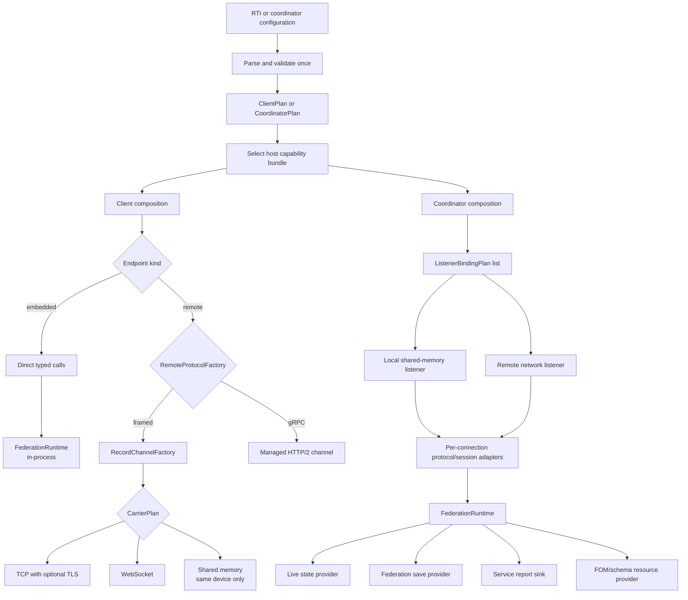
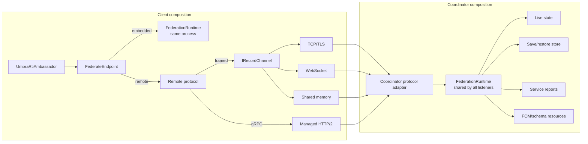

# Host and transport portability goals

## Status and scope

This document records internal implementation direction for Umbra. It is not
part of IEEE 1516.1, does not add or interpret normative requirements, and is
not conformance evidence. The transport choices and host boundaries described
here are architectural goals; individual capabilities remain unimplemented
until delivered and verified in code.

The goal is to let the same RTI behavior run across native in-process,
distributed remote, and same-device high-throughput deployments, with
independent choices for state persistence. Browser/WASM work began as a
portability thought experiment: it is a useful way to expose hidden OS and
synchronous-runtime assumptions, not a commitment to ship a browser-hosted
coordinator. The HLA API and HLA service semantics remain the behavioral
authority.

## Goals

1. Keep federation behavior and protocol semantics independent of OS-specific
   sockets, browser APIs, process lifecycle, and persistence mechanisms.
2. Separate remote protocol/session choice from physical carriage. The current
   framed protocol may run over TCP/TLS, WebSocket, or local shared memory; a
   higher-level remote protocol such as gRPC may use its own HTTP/2 channel and
   generated service contracts.
3. Keep endpoint identity, request/event semantics, heartbeat, replay, and
   recovery in the protocol/session layer. Keep carrier-specific framing,
   ordering, backpressure, and failure reporting in the carrier layer. Do not
   reimplement HLA behavior for each combination.
4. Make execution and callback scheduling explicit enough to support native
   threads and browser event loops while preserving documented callback order
   and reentrancy behavior.
5. Separate coordinator logic from process hosting and durable storage so a
   native process remains the initial host and other hosts can be evaluated
   without rewriting federation behavior.
6. Keep public standard API bindings stable. A browser-facing JS/TypeScript
   facade is an optional follow-on if the WASM portability probe demonstrates
   value; it must delegate to the same RTI behavior.

## Intended boundaries

- `cpp/src/internal/federation/` owns protocol frames, session state, service
  semantics, sequencing, replay, and federation coordination.
- `cpp/src/internal/platform/` owns native facilities such as sockets, TLS,
  shared-memory allocation, and process notifications.
- A possible browser probe/package owns Emscripten configuration, JS bindings,
  Worker/event-loop integration, and browser WebSocket adaptation. Keep this a
  portability experiment until a product decision is made. Browser APIs should
  not become dependencies of the portable RTI core.
- Build targets should eventually separate portable RTI/client logic from
  native host implementations and any selected remote-protocol adapters.
  Refactor target composition after dependencies and seams are demonstrated,
  rather than creating empty target layers in advance.

## Deployment topologies and independent choices

Treat deployment topology, remote protocol, carrier, and persistence as
separate dimensions. They compose, but one must not be used as a proxy for
another.

| Topology / concern | Intended use | Protocol and carrier candidates | Persistence relation |
| --- | --- | --- | --- |
| **1. Distributed simulation** | Federates and coordinator run on different machines or network zones; this is the first target topology. | Preserve the existing private framed protocol over TCP/TLS or WebSocket while evaluating gRPC (or another remote protocol) against compatibility, operability, generated API needs, streaming, browser reach, and performance. gRPC normally brings HTTP/2 channel behavior and generated RPC contracts, so it does not automatically fit inside the current raw-record channel. | Coordinator persistence is selected independently. Network reachability, authentication, authorization, versioning, and reconnect policy are required design inputs. |
| **2. Same-device high-throughput** | RTI coordinator and all participating native federate processes are on the same physical device; optimize local IPC latency/throughput. | Shared-memory record channel with bounded rings and OS notifications. The configuration must state/enforce local-only peer assumptions and must not silently fall back to network transport. | State may be volatile or persistent independently of IPC choice. Shared memory is transport, not durable federation state. |
| **Mixed deployment** | Local federates use the fast same-device path while remote federates or observers connect over the network at the same time. | One authoritative federation runtime exposes multiple listener bindings. Each binding selects its own protocol/carrier; accepted sessions share the coordinator runtime while retaining per-connection identity, callbacks, and failure handling. | This should be a supported composition of the first two topologies, not a third runtime or a global transport mode. Authorization and observer privileges are independent of carrier choice. |
| **Persistence choice** | Retain required federation/save/restore/report state across operation or restart, with selectable durability/performance tradeoffs. | Not a transport. Use a state/report store boundary beneath the runtime and select memory, filesystem, or database implementation according to actual data and transaction needs. | A database may improve selected workloads or operational needs, but it is not inherently faster. Benchmark read/write patterns, transaction boundaries, recovery guarantees, and durability settings before selecting it. |
| **Browser/WASM portability probe** | Find hidden assumptions around blocking I/O, threads, native TLS/filesystem, process lifecycle, and callbacks. | Initially test a browser federate using outbound WebSocket. SharedArrayBuffer/MessagePort are same-browser mechanisms. Browser-hosted coordination remains exploratory. | Browser persistence is not required for the probe unless a specific client/coordinator state requirement is identified. |

Persistence planning must distinguish live authoritative federation state,
HLA save/restore images, service-report output, and static FOM/schema
resources. They have different transaction, recovery, and access patterns.
A database-backed save-image store can be a bounded provider change; a
database-backed live state repository changes Level 2 transaction and
concurrency ownership and requires a separate design.

The mixed case assumes per-connection transport selection at admission: local
federates attach through shared memory, while remote federates use a network
listener concurrently. A remote HLA observer still joins as a federate and is
governed by HLA declarations and authorization. A dashboard/diagnostic observer
is a different read-only product interface; it should not be treated as an HLA
federate or granted control services because it arrived over a particular
carrier.

The first two rows are alternate deployment topologies, in the expected
priority order. The persistence row is an independent coordinator capability
and may be paired with either topology. The WASM row is an architecture
validation exercise. A successful probe may lead to a browser product, but
that decision is separate.

## Provisional abstraction levels

The goals span different levels and should not be implemented as one large
"platform abstraction." This stack is the proposed ownership model. It is a
planning aid, not a claim that the current source tree already has these
boundaries.

| Level | Owns | Examples / candidate location | Portability goal |
| --- | --- | --- | --- |
| **1. Standard API and HLA behavior** | Official API surface, validation, state transitions, callback meaning and ordering | `cpp/include/RTI`; `UmbraRtiAmbassador`; federation registry/services | Same externally visible behavior regardless of host or transport. Do not add Umbra-specific public API requirements here. |
| **2. Federation runtime and coordination** | Federation/federate state, routing, time coordination, declarations, persistence model and coordinator policy | `cpp/src/internal/federation/`; registry and service code | Separate transition logic from process startup and concrete storage. Inject a state/report store where required. |
| **3. Remote protocol/session** | Typed remote service and event semantics, peer/session identity, request correlation, sequencing, heartbeats, replay/reconnect policy, protocol compatibility | `ProcessTransportSession`, `ProcessFederationClient`, private transport protocol; possible gRPC service adapter | Allow multiple remote protocol implementations (current framed protocol, possibly gRPC) while preserving Level 1 behavior. A protocol may use Level 4 records or its own managed carrier. |
| **4. Physical carrier** | Moving bounded records/bytes; carrier-specific framing, ordering, send completion/backpressure, close and transport failure | TCP/TLS/WebSocket, native shared memory, browser WebSocket/worker adapters | Select a carrier independently where protocol supports it. Shared memory is restricted to same-device native IPC; gRPC may own its HTTP/2 carrier rather than use `IRecordChannel`. |
| **5. Host runtime services** | Scheduling, waits/wakeups, timers/clocks, filesystem/storage, process lifecycle, TLS/credentials, logging, entropy | Existing `cpp/src/internal/platform/`; future native and browser host adapters | Inject capabilities needed by runtime/session/coordinator. Browser event-loop support belongs here, with an explicit async session integration rather than fake blocking. |
| **6. Product composition and language bindings** | Which implementations are assembled and exposed in a deployable artifact | CMake targets; native process executable; possible WASM portability probe | Build native clients/coordinator from shared lower layers. Keep public IEEE bindings authoritative; decide separately whether a browser facade is worth productizing. |

The main dependency direction should be downward for capabilities and upward
for events: HLA endpoints depend on federation/runtime and remote-protocol
contracts; a framed protocol depends on a record channel and scheduling
capabilities; platform implementations provide carriers and host capabilities.
Lower levels should not call back into a specific RTI service implementation.
Encoded records flow through carriers; remote protocols decode service meaning
above the carrier.

Some placement is intentionally unresolved. Federation coordination may
straddle Level 2 and Level 3 today; request/replay recovery may need a distinct
session coordinator; and callback dispatch crosses HLA semantics and host
scheduling. The dependency/ownership map in the investigation should resolve
these before code is moved. Persistence is a Level 2 state model backed by a
Level 5 storage capability, rather than treating a filesystem as part of the
coordinator logic.

## How the current implementation fits

The current implementation has two execution compositions, not two
implementations of one interchangeable transport interface:

| Current path | Current composition | Planned interpretation |
| --- | --- | --- |
| **Embedded/default path** | `UmbraRtiAmbassador` invokes embedded federation services and the process-local `EmbeddedFederationRegistry` directly. `CallbackDispatcher` owns the public callback model. `EmbeddedTransportHub` tracks connection lifecycle/fault injection. | Level 1/2 local runtime, with direct in-process service calls. Keep this as a valid composition. It can later be adapted to an endpoint/session contract if that proves useful, but should not gain fake serialization or IPC just to look like the process path. |
| **Configured process path, client** | `UmbraRtiAmbassador` creates `ProcessFederationClient`; it owns service request calls, request correlation, response validation, pushed-event buffering, callback bridging, reconnect handling, and reader/dispatch/heartbeat threads. | Level 1 adapter over a process client endpoint; split Level 3 session/client responsibilities from host scheduling. Keep service methods and callback bridge above the physical channel. |
| **Configured process path, connection/session** | `ProcessTransportConnection` owns native socket plus optional TLS/WebSocket, reads/writes encoded `TransportFrame`s, sequence and message-history state. `ProcessTransportSession` encodes service messages into transport frames and handles heartbeat, sequence validation, resume, replay, and request/response session behavior. | `ProcessTransportSession` is Level 3. The connection should become a carrier/channel plus session state owned above it. The current connection mixes Level 3 history/identity with Level 4 native I/O and needs decomposition, not a blind interface rename. |
| **Configured process path, coordinator** | `ProcessTransportListener` accepts native connections. `ProcessFederationServiceHost` owns listener, worker and maintenance threads, session records, heartbeat timeouts, and shutdown. `ProcessFederationService` dispatches operations against the shared registry and retains per-session event state. | Service behavior/state belongs at Level 2; host/listener/workers belong at Levels 4/5/6; wire session state belongs at Level 3. Split only after tracing the shared ownership and callback/event lifetimes. |
| **Coordinator listeners** | `ProcessFederationServiceHost` has constructors that let multiple listener hosts share one `ProcessFederationService`, and therefore one authoritative registry/runtime with independent accepted sessions. The current `runProcessFederationService` composition chooses exactly one transport mode for one listener. | There is a useful same-runtime/multiple-listener seam, but no current configuration that composes shared memory and remote listeners simultaneously. Promote listener bindings into the coordinator plan and give each its own protocol/carrier configuration. |
| **Process executable** | `runProcessFederationService` resolves schema/MIM resources, constructs FOM validators/composers, selects a listener mode, creates the registry and service, and requires a service-report directory. | Level 6 native composition wiring Level 2 FOM/coordinator/service behavior to native Level 5 resources and Level 4 listener implementation. |

The registry and some federation behavior are shared between the embedded and
process compositions, but the service invocation and callback routes are not
uniform today. Treat this as an incremental convergence opportunity: first
make boundaries explicit, then share behavior where the call patterns and
ownership are genuinely common. Do not force the embedded path through the
process wire protocol by default.

### Similar names that must remain distinct

`TransportConnection` in `embedded_transport.hpp` is currently a lifecycle
control handle: close, fail, forced resignation, open state, and owner lookup.
It moves no bytes or frames. `ProcessTransportConnection` is a concrete
socket-backed data connection. The former must not be assumed to implement a
future frame-channel interface merely because both use the word “transport.”
Before introducing the new interfaces, rename or document the lifecycle handle
more precisely (for example, `FederateConnectionControl`) and keep its fault /
resignation semantics separate from data carriage.

Likewise, TCP, TLS, and WebSocket are not three equivalent layers. TCP is a
byte stream; TLS secures a stream; WebSocket adds an HTTP upgrade and
message-framing protocol over a stream (possibly secured by TLS). The current
native process connection composes these details internally. A future carrier
contract should define whether it delivers bytes or complete records, then
make each backend responsible for adapting its physical semantics to that
contract. A shared-memory ring can naturally carry records; native TCP needs
length-prefix framing; WebSocket can map each record to a binary message.

### Candidate interface ownership

These are conceptual interfaces to validate against the dependency map; names
and exact signatures are intentionally open.

| Planned interface | Responsibility | Existing code to adapt or leave above it |
| --- | --- | --- |
| **Federation service/runtime API** | Operations and events between the RTI ambassador/client endpoint and federation behavior, without choosing direct calls or process messages. | Embedded direct ambassador service calls and `ProcessFederationClient` service methods currently diverge. First identify common operation/result/event types; do not wrap every current method mechanically. |
| **Remote protocol/session** | Typed remote operation/event mapping, peer identity, request/response correlation, pushed events, heartbeat, sequence/replay/recovery. | Extract current framed protocol from `ProcessTransportSession`, parts of `ProcessTransportConnection`, and parts of `ProcessFederationClient` / `ProcessFederationServiceHost`. A future gRPC adapter is a separate protocol implementation, not necessarily a record channel. |
| **Record carrier** | Send and receive bounded opaque records, report queue/backpressure and peer closure/failure, and define sender concurrency and ordering. | `ProcessTransportConnection::sendFrame/receiveFrame` currently combines frame codec and native carrier I/O. Adapt current native TCP/TLS/WebSocket first; add shared memory as another carrier for record-based protocols. |
| **Host scheduler/runtime** | Spawn/run work, wait or notify, provide timer/deadline and shutdown semantics, and own callback-dispatch execution. | Client reader/heartbeat/callback threads, host accept/maintenance/session threads, and public `CallbackDispatcher` currently use different mechanisms. Preserve callback rules while exposing host scheduling explicitly. |
| **Host resource providers** | Storage, resource lookup, TLS credentials/trust, logging, entropy/identity, and process lifecycle. | `std::filesystem` paths and operations, compiled FOM resource directories, OpenSSL configuration, `steady_clock`, native socket startup, and signal handling are currently selected at concrete call sites. Inject only capabilities required by each composition. |
| **Composition/factory** | Select an in-process, native process, shared-memory process, or browser client implementation and validate compatible options. | `Connect` configuration parsing currently selects either `ProcessFederationClient` or the embedded path; the process runtime selects listener security/framing flags. Consolidate selection after the contracts are clear. |

The most important migration is **not** to make the current embedded and
process paths pretend to be identical. The embedded path can remain a direct
service adapter; the process path can remain a remote endpoint adapter. They
should share Level 1 behavior and protocol/service semantics where possible,
while plugging into common session, scheduling, or carrier contracts only
where those contracts match their real needs.

## Plans for the six abstraction realms

This section turns the six-level model into a concrete design proposal. Each
realm defines its contract, where implementations are injected, how current
code maps to it, how it is introduced, and what proves the boundary is sound.
The first implementation milestone is still a design/source-map task; the
contract proposals below should be reviewed against actual call paths before
interfaces are extracted.

### Level 1 — Standard API and HLA behavior

**Boundary.** The official IEEE C++ API remains the only normative public RTI
surface. `UmbraRtiAmbassador` translates API calls into an internal federate
endpoint and translates endpoint events into official ambassador callbacks.
HLA validation, exception mapping, state visibility, and callback ordering
must be equivalent whichever endpoint implementation is selected.

**Injection plan.** Inject one private `FederateEndpoint` implementation into
the ambassador connection state at successful `Connect`. The endpoint exposes
the supported service operations and an event/callback sink; it does not
expose sockets, process options, or wire messages. The ambassador owns the
official `FederateAmbassador` lifetime and callback controls; the endpoint
borrows a callback sink/bridge with an explicit detach/close lifecycle. An
internal endpoint factory selects the implementation before committing the
connected lifecycle transition. Failed creation must leave the ambassador
disconnected and release all partial resources.

`FederateEndpoint` should be a service-level seam, not a duplicate of all 181
RTI ambassador methods and not a generic `std::any` command bus. Start with
operation groups that already have both paths (lifecycle, federation
management, declarations, object/interaction services, time, callbacks), and
add an operation only when its request/result/event contract is concrete.
Unsupported operations keep their current standard exception behavior.

**Current fit and migration.** The official adapter is
`UmbraRtiAmbassador`. In embedded mode, many operations currently reach
`EmbeddedFederationRegistry` and helpers directly. In process mode,
`processFederationClient_` is consulted and owns corresponding remote calls.
First inventory and centralize endpoint selection for one complete vertical
slice, preserving public exception and callback behavior. Then move operation
groups behind the private endpoint seam incrementally; leave pure standard
value types and API validation in their current owners unless a demonstrated
duplication requires a shared helper.

**Acceptance.** Existing embedded behavior remains unchanged. The same public
API scenario against embedded and process endpoints yields equivalent results,
standard exceptions, callback order, callback enable/disable behavior, and
clean disconnect. The endpoint interface is private and adds no new normative
mapping.

### Level 2 — Federation runtime and coordination

**Boundary.** Federation state transitions and HLA routing/policy are owned by
one runtime service, independent of how a caller reaches it. The runtime
accepts typed operations and returns typed results/events/plans. It does not
accept sockets, sessions, file paths, threads, browser objects, or serialized
protocol payloads. Durable save/restore and reporting state are separate
capabilities around the state model, not properties of a specific transport.

**Injection plan.** Construct a shared concrete `FederationRuntime` with
explicit collaborators for federation definition/FOM preparation and, if
required, a narrow `IFederationSaveStore`. If live authoritative state must
move to a database, first define a separate `IFederationStateRepository` with
atomic operation boundaries and concurrency semantics; do not treat that as
the save-image store. The embedded adapter calls this
runtime directly. The process service decodes a request, invokes the same
runtime operation, and encodes the result and emitted events. The runtime
returns event plans or publishes through a typed event sink; it must not know
which session, socket, or browser tab delivers a callback. Inject the runtime
into embedded and process compositions at construction, rather than use a
process-global singleton. Service-report output is injected into its reporting
owner separately. Add an `IFederationRuntime` only if a second real
implementation or a specific substitution need justifies it.

Do not try to turn the entire current registry into a mockable interface.
Start by identifying state transition ownership currently shared between
`UmbraRtiAmbassador`, `EmbeddedFederationRegistry`,
`FederationManagementCoordinator`, and `ProcessFederationService`. Extract
cohesive operation groups and state ownership; retain concrete value/state
types where polymorphism adds no value. Treat persistence as snapshots/state
records plus a Level 5 save-store provider, so memory, filesystem, database,
or browser-backed storage can be considered without placing storage semantics
in transition code. Keep service-report output and static FOM/schema resource
lookup as separate capabilities; they have different ownership and durability
needs from live federation state or save data.

**Current fit and migration.** `EmbeddedFederationRegistry` already backs
process service behavior and a large portion of embedded operations, making it
the strongest shared-state starting point. However, embedded service
orchestration is partly in `UmbraRtiAmbassador`, and
`ProcessFederationService` has per-session state, event queues, and service
report file ownership. First make a call/event ownership map and move one
operation group with both embedded and process callers through the same typed
runtime method. Keep session-specific pending callback leases and delivery
acknowledgements in the endpoint/session side unless they are intrinsic to
federation state.

**Acceptance.** A runtime operation has the same state/result semantics when
invoked directly and through the process protocol. It has no dependency on
`ProcessTransportSession`, native socket types, or host file paths. Existing
save/restore and service-report durability behavior remains explicit and
covered by the provider used in the native composition.

### Level 3 — Remote protocol/session

**Boundary.** This realm implements one remote protocol for a logical peer
relationship, independent of physical deployment where possible. It owns
typed service request/event mapping, endpoint/session identity, request
correlation, protocol version negotiation, heartbeat, sequence acknowledgement,
replay, reconnect/resume, and close semantics. The current private framed
protocol uses an explicit session and record channel. A future gRPC adapter
could use generated RPCs and streaming for the same typed endpoint operations;
it may rely on the gRPC runtime for HTTP/2 carrier details and does not need to
pretend to be the private framed session. Both adapters must preserve Level 1
HLA outcomes and callbacks.

**Injection plan.** Define a common typed `RemoteFederateProtocol` endpoint
contract only for operations/events used by a client. Implement
`FramedFederateProtocol` over `IRecordChannel`; implement `GrpcFederateProtocol`
only if gRPC is selected, using its generated client and stream facilities.
On the coordinator side use corresponding protocol handlers/adapters. Keep
client and coordinator roles explicit; do not hide role-dependent behavior
behind booleans. The framed session owns pending request IDs and replay state;
the gRPC adapter owns its RPC correlation and stream recovery policy. The
federation service handler owns HLA operation execution in both cases.

Before selecting gRPC, define the versioned protobuf contract: whether
operations are individual unary RPCs or typed envelopes, how pushed callbacks
are streamed, how callback acknowledgements map to delivery, how identity and
credentials are carried, which calls are safe to retry, and how standard RTI
exceptions map to RPC status/details. Measure generated-code/runtime size and
operational complexity as well as throughput. These are protocol design
decisions, not carrier-factory options.

The first extracted framed session may remain blocking and use a native
executor behind the interface. Its contract must define close/cancel and
delivery acknowledgement now, so an async host does not require a second wire
implementation later. Browser support should first exercise outbound
WebSocket against the current framed protocol. A gRPC browser client has
additional runtime/proxy requirements and is a separate option. Do not promise
synchronous browser service calls that block the JS event loop.

**Current fit and migration.** `ProcessTransportSession` already owns much
heartbeat, sequencing, resume, and replay behavior. `ProcessTransportConnection`
also owns session ID, sequence state, and `ProcessTransportMessageHistory`.
`ProcessFederationClient` owns request IDs, pending responses, pushed-event
queues, reconnect loops, and callback threads. `ProcessFederationServiceHost`
owns server session records and inactivity policy. Move responsibility only
after documenting the invariants and locking boundaries. First extract
protocol/session state from the physical connection without changing behavior;
then define which recovery policy is symmetric versus client- or
coordinator-specific.

**Acceptance.** A deterministic framed-session contract suite passes over an
in-memory record channel and the existing native channel: request/response
correlation, interleaved pushed events, duplicate/out-of-order rejection,
heartbeat, replay/resume, peer loss, cancellation, and close. If gRPC is
implemented, protocol-parity scenarios verify equivalent HLA results and
callbacks while separately testing RPC stream loss/retry semantics. One
framed-protocol session survives carrier replacement only when its identity
and replay state match the current protocol rules.

### Level 4 — Physical carrier

**Boundary.** A record carrier transfers bounded, opaque framed-protocol
records and reports send acceptance/failure, receive availability, peer
closure, and backpressure. It owns carrier-specific connection setup and
record boundaries but knows no HLA service, request IDs, replay policy, or
callback behavior.
Define send completion precisely: accepted into a bounded local queue, written
to the carrier, or acknowledged by the peer are distinct outcomes. The session
must not infer peer processing from a local write.

Use a record-oriented internal contract (`send(record)`, `receive`, `close`,
failure/closed event) as the initial target. TCP's implementation adds/removes
the existing length prefix; WebSocket maps one binary message to one record;
shared memory stores length-delimited records in bounded rings. TLS is a
security layer around the TCP byte stream, not a separate HLA protocol. If
later measurement requires a reusable byte-stream primitive, factor it below
the record channel without changing the session contract.

**Injection plan.** A carrier factory receives a validated `CarrierPlan` and
host capabilities, then returns one connected record channel. Inject the
factory into the framed protocol/client or composition; the session never
branches on TCP/WebSocket/shared-memory enum values. A listening
`RecordListener` is a
separate server-side factory because browser federates only initiate outbound
connections. TLS credentials/trust configuration is supplied by the host
security provider. Shared memory has its own named rendezvous/permissions
configuration and is only offered for same-host endpoints.

For shared memory, start with one client/coordinator connection represented by
two bounded single-producer/single-consumer byte rings and OS wakeups. Specify
record-size limit, ring-full behavior, memory ordering, ownership/cleanup,
stale endpoint recovery, peer death detection, version compatibility, and
access control before implementation. Add multi-client broker topology only
if a use case requires it. Browser `MessagePort`/`SharedArrayBuffer` gets a
browser-specific channel adapter and never reuses native shared-memory layout.

**Current fit and migration.** `ProcessTransportConnection` currently performs
frame wire encoding/decoding and directly composes native sockets, optional
`TlsSocket`, and optional `WebSocketSocket`. First wrap this path as the native
record channel while preserving the exact wire bytes and socket ownership.
Keep `decodeTransportFrame` and `encodeTransportFrame` in the protocol/session
codec layer, not in a generic carrier, where feasible. Add a test-only in-memory
channel; then use it to validate the contract before implementing native
shared memory. Do not implement a shared-memory transport by sharing C++
connection objects.

**Acceptance.** Channel conformance checks cover record boundaries, maximum
size, ordering, concurrent sends, backpressure, peer close, partial native
stream reads/writes, malformed lengths, cancellation, and exactly-once
failure reporting. The existing TCP/TLS/WebSocket deployments preserve their
wire compatibility and security behavior. Shared-memory tests use separate
processes and cover startup races, capacity exhaustion, peer crash, permissions,
and cleanup.

### Level 5 — Host runtime and resource services

**Boundary.** The host supplies capabilities the portable runtime cannot
assume: task execution/wakeup, monotonic and wall clocks, timers/deadlines,
federation save storage, service-report output, FOM/schema resource lookup,
credentials/trust material, logging/diagnostics, entropy/identity, and process
lifecycle. Keep these as small capability interfaces grouped by consumer, not
one giant `Platform` interface. Do not abstract pure computation or
standard-library value types without a real portability need.

**Injection plan.** Define a `FederateHost` capability bundle for client/session
needs and a separate `CoordinatorHost` bundle for server/runtime needs. Bundles
contain references to narrow interfaces, for example `Executor`, `Clock`,
`TimerService`, `CredentialProvider`, `ResourceProvider`, `FederationSaveStore`,
`FederationStateRepository` when live-state persistence is selected,
`FederationSaveStore`, and `ServiceReportSink`.
Native composition provides thread-backed executors, steady/system clocks,
filesystem resources, OpenSSL credential configuration, and process signals.
The WASM probe can provide Worker/event-loop scheduling, browser WebSocket
events and browser-managed TLS, and JS diagnostics. Browser storage is only
added if the probe has a defined persistence requirement. Missing optional
capabilities are explicit and produce a supported configuration error rather
than silent fallback.

Do not inject time when code only needs `std::chrono` value types; inject a
clock/timer only where current logic reads the real clock or waits. Do not
inject storage into a browser federate client unless it persists RTI state.
Keep security identity separate from transport security: TLS protects a
channel, credentials authenticate a peer, and WebSocket origin policy is not
peer authorization.

**Current fit and migration.** Concrete dependencies include thread creation
and waits in `ProcessFederationClient` and `ProcessFederationServiceHost`,
`steady_clock` heartbeat/deadline reads, `std::filesystem` resource and report
paths in the process coordinator/service, OpenSSL TLS configuration, socket
runtime initialization, and executable signal handling. Existing
`cpp/src/internal/platform/` APIs already isolate some socket/filesystem
syscalls, but policy and lifecycle still live in federation/runtime classes.
Inventory call sites, then inject only the smallest first-needed service (most
likely executor/clock for a browser-compatible session, and a federation save
store or resource provider for coordinator portability).

**Acceptance.** Native behavior remains stable under native providers. Unit
tests can use deterministic clock/executor and in-memory store providers where
timing or persistence needs control. Each composition declares its capabilities
and unsupported features. No portable Level 1/2/3 header includes browser APIs,
native socket handles, or platform file paths merely to reach a host service.

### Level 6 — Product composition and bindings

**Boundary.** Composition parses deployment configuration once, validates
compatible options, constructs Levels 2–5 in dependency order, and exposes the
right API/binding. It owns no HLA state transition and no protocol policy.
Avoid runtime plugin discovery until there is a real third-party extension
need; explicit typed factories are easier to validate and test.

**Injection plan.** Parse public `RtiConfiguration` into a validated private
`ClientPlan` variant: `EmbeddedClientPlan` or `RemoteClientPlan` with a
`RemoteProtocolPlan` and protocol-specific `CarrierPlan` when applicable. The
coordinator uses a separate `CoordinatorPlan` with a collection of
`ListenerBindingPlan`s and independent `LiveStatePlan`, `FederationSavePlan`,
`ServiceReportPlan`, and resource plan. Each listener binding selects its own
protocol, carrier, address, and security configuration; all accepted sessions
are attached to the same coordinator runtime unless an explicit future
multi-runtime plan says otherwise. The native composition factory creates host
providers, endpoint, protocol, and carrier.
The WASM/browser composition is initially a portability probe and can reuse
the same planning model if pursued. Pass the resulting `FederateEndpoint` into
`UmbraRtiAmbassador` only after all construction and connect handshakes
succeed. A client connect plan must not carry listener, storage, or
process-lifecycle responsibilities.

Build targets should follow proven dependency boundaries: retain the current
`umbra_rti` target while extracting, then split portable protocol/runtime code
and native host/carriers when each is independently buildable. Create a
browser binding/WASM package only if the portability probe shows practical
value. Keep the 2010 RTI target and source ownership separate. Any browser
package would own generated JS glue and its TS API; the standard C++ API
remains the authoritative HLA binding.

**Current fit and migration.** Configuration parsing is in
`ambassador_connection_support`; `Connect` currently branches between a
`ProcessFederationClient` and embedded direct state. The process executable
chooses listener mode through boolean flags and constructs FOM resources,
registry, service, and host in one runtime entry point. First compare remote
protocol options without changing the current wire protocol. Then replace
boolean transport selection with validated typed plans and extract native
client/coordinator composition functions. Add shared-memory and persistence
providers according to their independent contracts. Use WASM as a focused
portability probe for identified host assumptions; decide on a browser product
separately.

**Acceptance.** Invalid or incompatible plans fail before partial RTI state is
committed. A composition test can substitute fake host/channel providers and
verify the selected graph. Native embedded and process configurations retain
their current behavior. Each product artifact states which API surface,
transport, security, persistence, and callback modes it supports.
The coordinator can bind shared-memory and network listeners at the same time,
route both to one authoritative runtime, and retain isolated session identity
and failure handling per accepted connection. Losing or restarting one
listener/session does not close unrelated sessions or select a different state
owner.

### Candidate types and factory selection across the six levels

Use polymorphism where a consumer needs to run against multiple interchangeable
implementations. Use ordinary concrete services for shared HLA behavior. Put
selection in composition factories; lower levels receive an already selected
dependency and never inspect global configuration or decide their own
transport. The following type names are proposals, not committed ABI.

| Level | Abstract contract(s) | Concrete implementation(s) | Factory / injection point | How the option is selected |
| --- | --- | --- | --- | --- |
| **1. API and HLA behavior** | `FederateEndpoint` for the service operations supported by a connected ambassador; typed `FederateEventSink` for callbacks/events. Keep `RTIambassador` and `FederateAmbassador` official concrete API types. | `EmbeddedFederateEndpoint`, `FramedProcessFederateEndpoint`, potentially `GrpcFederateEndpoint`; each translates to the same official outcomes and callbacks. | `FederateEndpointFactory`, called by client composition during `Connect`; result injected into `UmbraRtiAmbassador` after successful initialization. | A validated `ClientPlan` chooses embedded or remote; `RemoteProtocolPlan` selects framed protocol or gRPC when available. The HLA API surface itself is never selected or replaced. |
| **2. Federation runtime** | Initially no virtual `IFederationRuntime` unless multiple runtime implementations justify it. Keep typed operation contracts and event plans stable. `IFederationSaveStore` covers save images; add `IFederationStateRepository` only if live state moves behind an alternate persistent backend. | One shared `FederationRuntime` over the current in-memory `EmbeddedFederationRegistry` and FOM/coordinator collaborators; `ProcessFederationService` is an adapter/dispatcher, not another HLA runtime. | Construct runtime in coordinator/runtime composition and inject into direct embedded service adapters and process service adapter. Select live state repository only if designed; inject save-image provider where required. Keep report sinks and FOM resource lookup separate. | No user-selected runtime strategy initially: both embedded and process access use the same runtime behavior where proven common. Live state, save-image, reporting, and resource choices are independent. |
| **3. Remote protocol/session** | `IRemoteFederateProtocol` for typed remote requests/results/events and lifecycle. Framed protocol injects `IRecordChannel`; gRPC uses its managed RPC channel. | `FramedFederateProtocol` over current protocol; optional `GrpcFederateProtocol`; role-specific coordinator handlers. Embedded endpoint may bypass this level. | `RemoteProtocolFactory` called by endpoint/composition factory. For framed protocol it calls `RecordChannelFactory`; for gRPC it constructs generated client/server and stream adapters. | `RemoteProtocolPlan` selects framed or gRPC. Framed protocol selects a `CarrierPlan`; gRPC configures its HTTP/2 endpoint/TLS through its library. |
| **4. Physical carrier** | `IRecordChannel` for bounded opaque records and `IRecordListener` for inbound accept, used by record-based protocols. | `TcpRecordChannel`; `WebSocketRecordChannel` over TCP/TLS; `SharedMemoryRecordChannel`; later `BrowserWebSocketRecordChannel`. gRPC owns its HTTP/2 channel unless deliberately tunneled through records. | `RecordChannelFactory::connect(CarrierPlan, HostServices)` and `RecordListenerFactory::listen(ListenerPlan, HostServices)`. Inject the result into framed protocol/host. | `CarrierPlan` selects TCP with optional TLS, WebSocket with ws/wss, or same-device shared memory. Browser WebSocket exists only in a browser build. Reject incompatible protocol/carrier combinations before constructing resources. |
| **5. Host services** | Small capability contracts only where needed: `IExecutor`, `IClock`, `ITimerService`, `IResourceProvider`, `ICredentialProvider`, `ILogSink`, optional `IFederationStateRepository`, `IFederationSaveStore`, and `IServiceReportSink`. Do not create an all-purpose `IPlatform`. | Native thread executor, native clocks/timers, in-memory live registry, filesystem save store, file report sink, OpenSSL credential provider, native logging; database providers only after requirements; browser Worker/event-loop executor for the probe. | `NativeHostServicesFactory` or a browser probe host factory constructs a typed capability bundle; inject each provider into its actual owner. | Host selection is primarily a build/runtime composition fact. Persistence plans separately select live-state repository (if supported), save-image provider, and report sink; static FOM resources have their own provider. |
| **6. Composition and bindings** | Typed plans (`ClientPlan`, `CoordinatorPlan`, `ListenerBindingPlan[]`, nested `RemoteProtocolPlan`, `CarrierPlan`, `ResourcePlan`, `LiveStatePlan`, `FederationSavePlan`, `ServiceReportPlan`) and composition entry points. No abstract plugin registry is needed initially. | `NativeClientComposition`, `NativeCoordinatorComposition`; browser client composition remains a portability probe until product value is established. | `ClientCompositionFactory::create(ClientPlan, HostServices)` and `CoordinatorCompositionFactory::create(CoordinatorPlan, HostServices)`. Coordinator factory creates one runtime/service and one listener/session adapter per configured binding. | Parse public `RtiConfiguration` once into a validated client plan. Coordinator config contains a list of listener bindings; each selects its protocol/carrier/security. All bind to one runtime by default, while persistence/resource providers are selected independently. Reject duplicate/incompatible addresses and impossible combinations early. |

The composition call flow should be:

Factories return fully constructed objects or a typed construction error; they
do not partially mutate `UmbraRtiAmbassador` or registry state. Options are
immutable after construction except for explicitly modeled reconnect state.
For native sockets, the channel owns the native handle and security/framing
wrappers. For shared memory, the channel owns or joins the named segment
according to a documented creator/joiner policy. For browser channels, JS owns
the WebSocket object and delivers events through the host adapter; C++ owns
protocol/session state.

Avoid one factory per class. The six levels do **not** imply six factory
hierarchies: Level 1 needs endpoint construction, Level 3 protocol construction,
Level 4 carrier/listener construction, Level 5 host capability construction,
and Level 6 composition. Level 2 should initially be a shared concrete
runtime, with abstraction added only if a second legitimate runtime
implementation appears. Level 1 standard API types remain fixed.

### Intended end-to-end wiring

The client and coordinator are separate compositions. This is the target
dependency direction; `FederationService` and the exact endpoint/session
interfaces remain subject to the source-map review.

The embedded composition may bypass `FederateSession` and the record channel
when direct calls are the simplest truthful representation. If an endpoint
service contract can unify direct and remote calls without forcing wire-level
semantics into the embedded path, inject that contract at Level 1. Otherwise
keep two endpoint adapters and share the Level 2 runtime behavior beneath
them.

### Initial adaptation order

1. Confirm topology requirements: distributed remote first, same-device
   high-throughput second, and persistence as an independent coordinator
   choice. Document expected trust, failure, recovery, throughput, and
   durability needs for each.
2. Draw ownership for one service request, one pushed callback, one
   reconnect/replay, one coordinator shutdown, and save/restore. Mark what is
   currently split across API adapter, runtime, process client/session,
   connection, host, and filesystem store.
3. Rename/document the embedded lifecycle `TransportConnection` so it cannot
   be mistaken for a data carrier. Decide the remote protocol seam and compare
   preserving the framed protocol with gRPC before selecting a remote option.
4. Extract an `IRecordChannel` for the existing framed protocol. Preserve
   current TCP/TLS/WebSocket bytes and behavior. Move sequence/message history
   and peer/session identity out of the physical socket owner where the
   ownership trace confirms they are session responsibilities.
5. Validate the framed session over a local in-memory record channel, then
   implement same-device native shared memory and measure representative
   throughput/latency against the socket path.
6. Define a persistence provider only for state that must be retained. Keep
   current filesystem behavior, then evaluate database storage using actual
   save, restore, report, recovery, and durability workloads.
7. Separate client service/event handling from thread ownership. Preserve the
   native scheduler first; use a focused WASM/browser federate probe over
   outbound WebSocket to expose host assumptions. Make a separate product
   decision before building a browser-facing package or hosted coordinator.

At each step, retain a working native composition. Do not move the full
registry or refactor the 2010 implementation as a prerequisite for the 2025
transport seam; review that compatibility boundary separately if genuinely
shared code is proposed.

## Protocol, carrier, and persistence model

The protocol contract and physical carrier are separate choices. A
record-based protocol sends complete encoded records over an `IRecordChannel`
and receives carrier lifecycle, failure, and bounded backpressure. It exposes
no socket handles or HLA service meaning. A higher-level protocol such as
gRPC may use an RPC runtime and managed HTTP/2 channel instead of this record
contract.

- **Remote protocol:** first preserve the existing private framed protocol
  over TCP/TLS or WebSocket. Evaluate gRPC or another remote protocol against
  wire compatibility, streaming callbacks, version negotiation, authentication,
  reconnection, browser reach, operations/deployment, and measured throughput
  before selecting it. Do not choose gRPC solely because it is familiar or
  assume it is faster without representative measurements.
- **Same-device carrier:** shared memory is a local native IPC carrier for
  deployments where coordinator and all federate processes share one physical
  device. Use bounded byte rings in each direction plus platform notification
  and peer-liveness mechanisms. Store versioned protocol bytes and indices,
  never C++ objects, pointers, or STL containers. Define ownership,
  initialization, backpressure, crash recovery, permissions, and cleanup.
- **Network carrier:** TCP with optional TLS and WebSocket are existing
  carrier paths for the current framed protocol. WebSocket is a likely browser
  client route; the native listener alone does not provide a browser adapter.
  A gRPC implementation normally selects HTTP/2 through its runtime.
- **Persistence:** choose coordinator state/report storage independently from
  protocol and carrier: volatile memory, filesystem, database, or another
  provider as requirements justify. Define consistency, transaction,
  durability, recovery, migration, and performance expectations for the actual
  saved data. Shared-memory transport does not persist federation state.
- **Browser worker channels:** `MessagePort` or `SharedArrayBuffer` may support
  same-browser worker communication under browser security constraints. They
  are separate host mechanisms, not native IPC shared memory or remote
  network transport.

## Staged introduction

1. Record the two target deployment topologies and persistence requirements;
   map the current protocol and host assumptions to them.
2. Compare keeping the current remote framed protocol with adding gRPC or
   another protocol. Decide whether to preserve, extend, or replace the wire
   contract based on compatibility, callback streaming, security, operations,
   browser access, and representative performance needs.
3. Extract a record-channel contract for the current framed protocol. Adapt
   current TCP/TLS/WebSocket without changing its wire bytes, sequencing,
   replay, or failure behavior. Keep gRPC as a distinct Level 3 implementation
   if selected; do not force it through the record channel.
4. Add native shared memory as a same-device carrier for the framed protocol,
   with lifecycle, capacity, process-crash, and cross-process checks.
5. Define a persistence contract only for state/report data that requires
   alternate storage. Preserve current filesystem semantics, then prototype a
   database provider and benchmark representative save, restore, reporting,
   and recovery workloads before selecting it.
6. Make scheduling and callback dispatch host-provided where needed, first
   preserving native thread behavior. Use a focused WASM/browser federate
   probe over outbound WebSocket to expose remaining host assumptions; treat
   browser productization as a separate decision.
7. Consider browser-hosted coordination only if a concrete use case justifies
   its storage, lifecycle, networking, and durability work.

## Work needed before committing to implementation tasks

The staged introduction is a direction, not yet a task breakdown. Before
changing production interfaces, produce a bounded architecture investigation
that answers the following questions and turns the answers into a transport
contract, a dependency map, and reviewable acceptance criteria.

### 1. Name the deployment/use cases

Keep these as separate cases because they have different constraints:

- embedded RTI in one process;
- native federate process connecting to a native coordinator process;
- two native processes on one host using shared memory;
- browser federate connecting to a native or hosted coordinator over
  WebSocket;
- multiple browser tabs/workers communicating within one browser;
- coordinator hosted in WASM, if a concrete use case still motivates it.

For each case, identify who creates the endpoint, whether it must be
discoverable, whether peers reconnect, and what failure means to the RTI.
Shared-memory IPC is same-host only; browser worker channels are same-browser
only; neither replaces network transport.

### 2. Draw the live ownership/dependency map

Trace one request and one unsolicited callback through the current path:

`RTIambassador -> UmbraRtiAmbassador -> ProcessFederationClient ->
ProcessTransportSession -> ProcessTransportConnection -> platform socket`

Then trace the coordinator side through `ProcessTransportListener`,
`ProcessFederationService`, and the embedded registry. Mark which layer owns
each of: frame encoding, sequence numbers, pending request correlation,
unsolicited-event queues, callback thread, heartbeat, reconnect/replay,
connection identity, and shutdown. Record concrete socket, thread, clock,
filesystem, and TLS dependencies at their call sites. This map determines
whether a frame-channel interface is sufficient or whether a client-session
boundary also needs redesign.

### 3. Specify the channel contract and its semantics

Decide whether a channel is a byte stream or complete-frame message channel;
what owns frame encoding and size limits; how send completion and backpressure
are reported; whether receive is blocking, callback-driven, or pollable; how
close, half-close, peer loss, and cancellation surface; and whether ordering
and atomic message delivery are guaranteed. Include concurrency rules for
multiple senders and exactly-once failure notification. A channel should
transport opaque protocol frames, not expose HLA service operations.

Keep retry, replay, heartbeats, request IDs, and peer/session identity in the
session layer unless the dependency map shows a specific concern belongs in
the channel. Define the delivery guarantee at each boundary; a successful
local enqueue is not the same as peer receipt or service completion.

### 4. Decide shared-memory topology and failure model

Choose whether shared memory connects one client to one coordinator, multiple
clients to a broker/coordinator, or peers directly. Specify rendezvous and
ownership (creator, joiners, stale segment cleanup), version/ABI compatibility,
ring capacity and full behavior, memory ordering, wakeup mechanism, process
crash detection, security/permissions, and behavior across process restarts.
Use serialized protocol frames in bounded rings; do not share native pointers
or object layouts. Start with a single-producer/single-consumer ring per
direction unless measured requirements justify a more complex design.

### 5. Decide synchronous and asynchronous session strategy

Document which RTI services must return synchronously, which incoming events
must be delivered asynchronously, and the callback ordering/reentrancy rules
that must remain invariant. Choose how native blocking I/O and browser
WebSocket events feed one logical session: a portable event queue with host
wait/wakeup, separate native and async session adapters, or another explicit
model. Define cancellation, timeout, shutdown, callback dispatch ownership,
and behavior when the browser worker is suspended or terminated. Avoid a
blocking facade that can deadlock the browser event loop.

### 6. Inventory host capabilities separately from transport

For the client and coordinator independently, identify uses of wall and
monotonic clocks, timers, thread/executor creation, random/unique IDs, TLS and
credential sources, logging, process signals, filesystem paths, atomic file
replacement, durable save/restore, and dynamic loading. Classify each as
portable core, host service, or optional capability with a defined unsupported
result. Browser client support may not need filesystem or coordinator
persistence; browser coordinator support would.

### 7. Set compatibility and security requirements

Decide which protocol versions may interoperate, how capability negotiation
works, and what is stable across transports. Specify authentication and peer
authorization independently from TLS, WebSocket origin policy, shared-memory
permissions, denial-of-service limits, and secret lifetime. Transport choice
must not silently weaken authorization or change the meaning of a service.

### 8. Plan validation and staged acceptance

Each new channel must pass the same session contract tests for ordered frames,
disconnect, backpressure, corruption/oversize input, cancellation, and
shutdown. Add channel-specific tests for shared-memory multi-process startup,
peer death, cleanup, and contention; browser tests for Worker lifecycle,
asynchronous sends/receives, callback delivery, and reconnect policy. Keep
these as internal architecture tests unless they directly exercise a mapped
IEEE behavior; do not present transport parity as conformance evidence.

Use a small vertical slice to validate the abstraction before broad migration:
connect, issue one request/response, receive one unsolicited event, and close
over the existing native socket channel. Then add shared memory as a second
channel. In parallel, measure whether this boundary can be driven by an
event-loop host; only then choose the browser session refactor. Keep protocol
compatibility and existing native behavior as explicit regression gates.

## Proposed planning artifacts

The architecture investigation should produce:

1. a prioritized topology matrix and request/event plus save/restore sequence
   diagrams;
2. a source-level ownership map for client, coordinator, protocol/session,
   callback dispatch, carrier, and persistence;
3. a remote protocol comparison and decision record for current framing vs
   gRPC/another protocol;
4. a record-carrier contract with error, ordering, backpressure, and lifecycle
   semantics, plus a same-device shared-memory topology decision;
5. a persistence contract/decision for filesystem, database, or other
   providers, based on durability and representative performance needs;
6. a host capability/injection map and a WASM portability-probe scope;
7. an incremental refactor sequence, acceptance checks, and explicit
   unsupported capabilities for every step.

Do not split the entire library into speculative targets up front. Let the
dependency map and first working alternate channel reveal the stable build
boundaries.

## Constraints and decision notes

- Browser networking is client-initiated; a browser cannot host the current
  native listening socket for remote peers. Remote access therefore needs a
  reachable service or relay.
- Browser WebSocket APIs are asynchronous. The current synchronous,
  thread-oriented process session/client may need an event-driven adapter or
  dispatcher; do not hide this mismatch behind blocking emulation.
- Native shared-memory transport is for cooperating local processes. It has
  different lifetime and security properties from network transport and from
  browser `SharedArrayBuffer`.
- Keep protocol/session correctness transport-independent, but do not require
  every transport to provide identical durability or security properties.
  State those properties in endpoint configuration and deployment docs.

## Current implementation context

The current `ProcessTransportConnection` directly owns native socket/TLS/
WebSocket details, and `ProcessTransportSession` sends and receives
synchronously. The process federation client owns reader, callback-dispatch,
and heartbeat threads. `TransportConnection` is an existing private runtime
interface, while embedded and process transport paths are distinct. These are
starting points for the staged refactor, not evidence that the goals above are
already met.

See also [Architecture](ARCHITECTURE.md) for the current implementation
snapshot.
