# IEEE 1516.1-2010 Reference RTI: Implemented Flow Guide

> **Edition and profile boundary:** this page describes Umbra's separate IEEE
> 1516.1-2010 C++ binding and its small in-process reference RTI, version
> `0.2.0-reference`. It is not a 2025 behavior guide and does not claim that
> this reference slice is a complete or production-ready RTI.

This guide makes the 2010 implementation's current behavior legible without
projecting behavior from the 2025 runtime onto it. The [IEEE 1516.1-2010
Federate Interface Specification](https://standards.ieee.org/ieee/1516.1/3745/)
is the authority for normative service behavior. The diagrams describe only
the source-backed Umbra slice; they are not a substitute for that standard or
a conformance claim.

## Read the two layers separately

The IEEE 1516.1-2010 API groups services around federation execution
management, declaration management, object management, synchronization, and
time management. Umbra's current 2010 shell implements a bounded subset. The
generated ambassador shell delegates that subset to `ReferenceRuntime2010`;
services outside it throw `RTIinternalError` with a not-implemented
diagnostic.

| Service concept | What the 2010 profile currently demonstrates | Important limit |
| --- | --- | --- |
| Connection and federation lifecycle | Connect, create/list/destroy an execution, join, resign, and disconnect. | The execution is process-local; destroy is rejected while members remain. |
| Declaration management | Publish and subscribe to object-class attributes and interaction classes. | Names are registered lazily by the provider directory; they are not checked against a loaded FOM. |
| Object information | Register an object, discover it for matching class subscribers, update values, and reflect subscribed attributes. | The owner is tracked per object, not per attribute; region filtering and time-managed delivery are absent. `deleteObjectInstance` and `localDeleteObjectInstance` are unavailable; resignation silently erases owned records without a removal callback. |
| Interaction information | Send a published interaction to members subscribed to that exact interaction-class handle. | No region filtering, timed send, or queued callback pump is modeled. |
| Synchronization | Register a point, announce it to its set, collect successful achievements, then report completion. | This path is source-backed but not exercised by the focused binding-shell smoke test found in this survey. |
| Time management | 2010 integer/float logical-time and interval values plus encoding/marshalling tests exist. | The RTI shell's time-management services are unavailable; value types do not imply a working time-advance state machine. |

### One exercised binding-shell path: Connect to reflection

The binding-shell smoke crosses the guide's separate connection/membership and
object-information sections in one two-member 2010 reference-profile scenario.
This is a trace of that implementation and test, not a required IEEE
1516.1-2010 call sequence. In particular, the shell accepts but does not load
the FOM path, names become handles through a lazy provider directory, and the
smoke happens to supply `HLA_IMMEDIATE`; the current runtime calls callbacks
inline, while the shell does not implement an evoke pump.

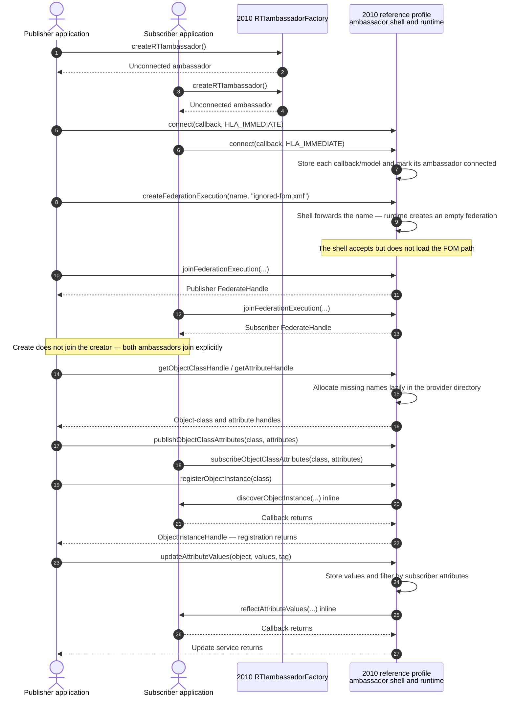

The [binding-shell smoke](../../cpp/tests/ieee1516_2010_binding_shell_smoke.cpp#L115)
asserts discovery before `registerObjectInstance` returns and reflection before
`updateAttributeValues` returns, including the object, received values, tag,
and producing-federate fields. The generated shell's [Connect](../../cpp/generated/rti_ambassador_shell_2010.hpp#L17)
and [Create/FOM forwarding](../../cpp/generated/rti_ambassador_shell_2010.hpp#L40)
show that connection is ambassador-local and the supplied FOM path is not
passed to the runtime. The [reference runtime](../../cpp/src/internal/runtime/reference_2010.cpp#L83)
creates an empty execution; its [Join](../../cpp/src/internal/runtime/reference_2010.cpp#L213),
[lazy object-class lookup](../../cpp/src/internal/runtime/reference_2010.cpp#L292),
[publication](../../cpp/src/internal/runtime/reference_2010.cpp#L448) and
[subscription](../../cpp/src/internal/runtime/reference_2010.cpp#L476),
[registration/discovery](../../cpp/src/internal/runtime/reference_2010.cpp#L502),
and [update/reflection](../../cpp/src/internal/runtime/reference_2010.cpp#L549)
complete the source trace. The smoke does not test `HLA_EVOKED`, FOM loading,
other RTIs, or every service precondition. The detailed state and callback
limits remain in the sections below; no 2025 behavior is inferred.

## Subscription update-rate API and reference-profile behavior

The pinned 2010 API exposes an `updateRateDesignator` on ordinary and
regional attribute-subscription signatures, and declares queries for a
designator's value and an object's attribute value. Those signatures describe
the binding surface, not behavior implemented by this reference profile. The
ordinary subscription shell receives both `active` and the designator but
forwards only the class and attribute set; the runtime stores class-to-
attribute membership without rate state. The regional overload and both
queries are unavailable in the shell.

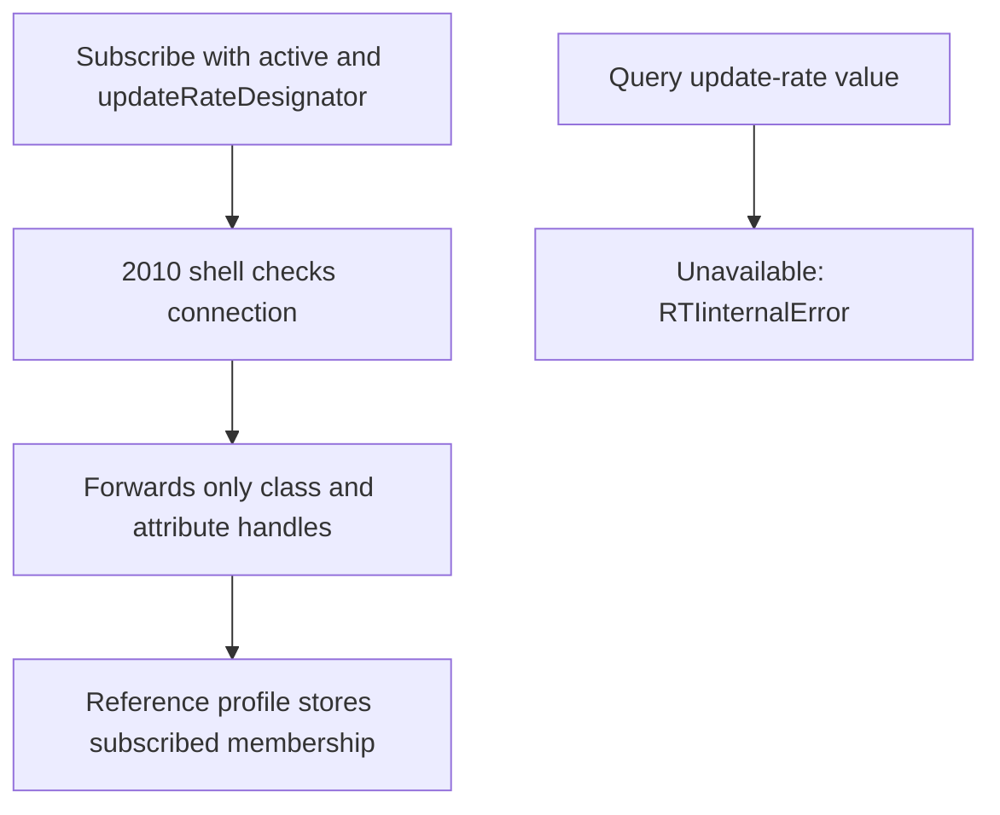

The bounded scan of 2010-named test files found no matching update-rate
designator or query coverage. That is a coverage observation, not proof that
all possible test locations were searched. This section describes only the
current Umbra reference profile; it does not claim that IEEE 1516.1-2010 lacks
update-rate semantics or establish conformance.

Source: [ordinary subscription signature](../../third_party/ieee1516.1-2010/include/RTI/RTIambassador.h#L380),
[regional signature](../../third_party/ieee1516.1-2010/include/RTI/RTIambassador.h#L1224),
[update-rate query signatures](../../third_party/ieee1516.1-2010/include/RTI/RTIambassador.h#L1454),
[ordinary subscription forwarding](../../cpp/generated/rti_ambassador_shell_2010.hpp#L174),
[unavailable regional subscription](../../cpp/generated/rti_ambassador_shell_2010.hpp#L429),
[unavailable query overrides](../../cpp/generated/rti_ambassador_shell_2010.hpp#L508),
[reference-profile membership storage](../../cpp/src/internal/runtime/reference_2010.cpp#L476).

## Callback delivery and failure boundaries in the 2010 reference profile

This is a source-derived description of the bounded Umbra 2010 reference
runtime, not a statement of the standard's general callback contract.

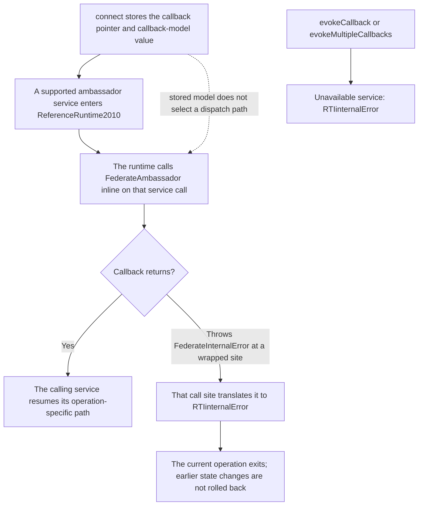

The generated 2010 shell stores the callback model supplied to `connect`, but
the field is not consulted to choose how the reference runtime delivers these
callbacks. `ReferenceRuntime2010` calls the callback object directly; it does
not enqueue work for a callback pump. The shell's two evoke methods are
unavailable. Therefore the source does not implement an HLA_EVOKED delivery
path, even though the smoke scenario connects with `HLA_IMMEDIATE`. Do not read
the stored enum as proof that both callback models work, or infer that direct
callback re-entry is safe merely because invocation is synchronous.

The `FederateInternalError` conversion is local to particular callback call
sites, not a universal wrapper around every callback. Registration/announcement,
synchronization completion, object discovery, reflection, interaction receive,
and ownership reporting each catch it and throw `RTIinternalError`. The
`reportFederationExecutions` callback is also called directly, but that call
site has no corresponding local conversion. In the wrapped cases, unwinding
stops the current service and any remaining recipient iteration; state already
mutated before the callback is not generally rolled back.

That ordering has concrete consequences: registration stores the point before
calling registration/announcement callbacks; object registration inserts the
object before discovery; and attribute updates store values before reflection.
For synchronization completion, all successful achievements are retained and
the point is erased only after the entire callback loop returns. Thus a thrown
completion callback leaves the fully achieved point available for a later
retry, which repeats the callback loop from its first selected member. The
dedicated [synchronization retry sequence](#4-synchronization-point-barrier)
shows that operation-specific case; this chart is the wider 2010 dispatch
boundary, not a second barrier diagram.

Source: [callback-model storage and unavailable evoke services](../../cpp/generated/rti_ambassador_shell_2010.hpp#L17),
[registration callbacks and catch](../../cpp/src/internal/runtime/reference_2010.cpp#L123),
[completion callbacks and catch](../../cpp/src/internal/runtime/reference_2010.cpp#L164),
[discovery and reflection callbacks](../../cpp/src/internal/runtime/reference_2010.cpp#L502),
[interaction and ownership callbacks](../../cpp/src/internal/runtime/reference_2010.cpp#L584),
[uncaught report callback](../../cpp/src/internal/runtime/reference_2010.cpp#L106),
[unavailable evoke methods](../../cpp/generated/rti_ambassador_shell_2010.hpp#L624).

The [2010 binding-shell smoke test](../../cpp/tests/ieee1516_2010_binding_shell_smoke.cpp#L10)
observes direct discovery, reflection, ownership, and interaction callbacks in
its HLA_IMMEDIATE scenario. It does not test callback exceptions, the HLA_EVOKED
setting, synchronization, re-entry safety, or recipient-loop behavior after a
callback throws. No 2010 test or CI run is claimed here.

### Callback payload lifetime: inspect now or copy what must outlive the call

The 2010 callback declarations pass reflection/interaction value maps and the
user tag by `const&`. The pinned `VariableLengthData` declaration permits the
source object to be deleted after copying and warns that a `data()` pointer is
not promised past the value object's lifetime or its next data replacement.
In this reference profile, callbacks are invoked inline by the service
implementation, so a consumer can inspect values during the callback;
retaining them for later requires copying the needed value objects before
returning.

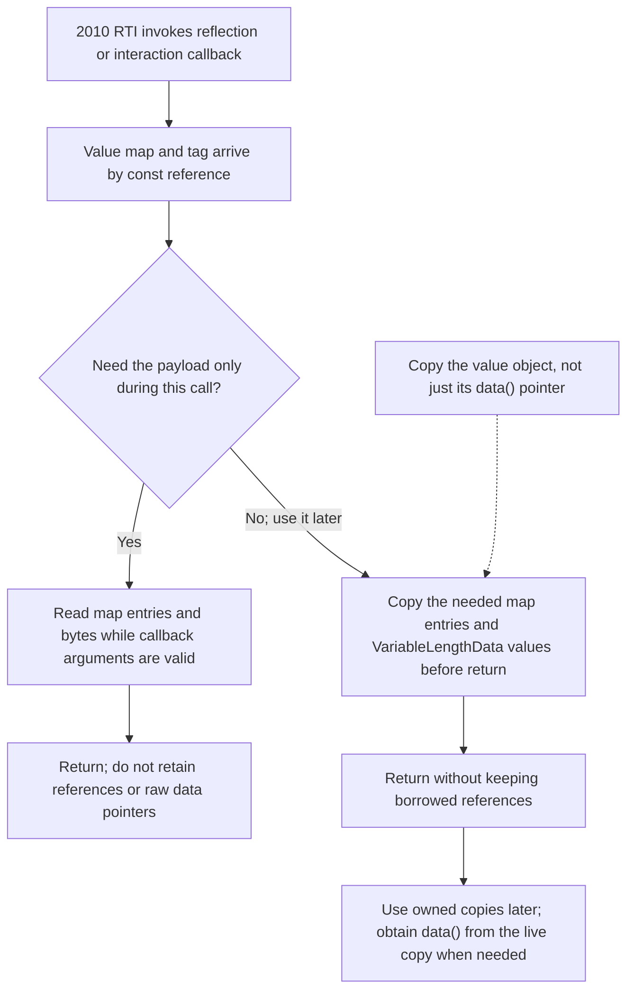

This is 2010 C++ API-use guidance, not a claim that callback signatures
specify process or transport lifetime. The pinned API gives the callback
arguments as const references ([reflection](../../third_party/ieee1516.1-2010/include/RTI/FederateAmbassador.h#L225),
[interaction](../../third_party/ieee1516.1-2010/include/RTI/FederateAmbassador.h#L261)),
allows the source to be deleted after a `VariableLengthData` copy
([copy constructor](../../third_party/ieee1516.1-2010/include/RTI/VariableLengthData.h#L44)),
and limits the raw pointer's validity ([`data()` lifetime note](../../third_party/ieee1516.1-2010/include/RTI/VariableLengthData.h#L56)).
The [reference reflection](../../cpp/src/internal/runtime/reference_2010.cpp#L502)
and [interaction receive](../../cpp/src/internal/runtime/reference_2010.cpp#L584)
call sites plus the [binding-shell smoke](../../cpp/tests/ieee1516_2010_binding_shell_smoke.cpp#L10)
establish this profile's inline callback path, but the reviewed smoke does not
test retaining copied callback payloads after return. No 2025 behavior is
inferred.

## 1. Ambassador connection and execution membership

The 2010 ambassador has its own connected/joined flags. Federation existence
is separate global runtime state: connecting does not create an execution, and
resigning does not disconnect the ambassador.

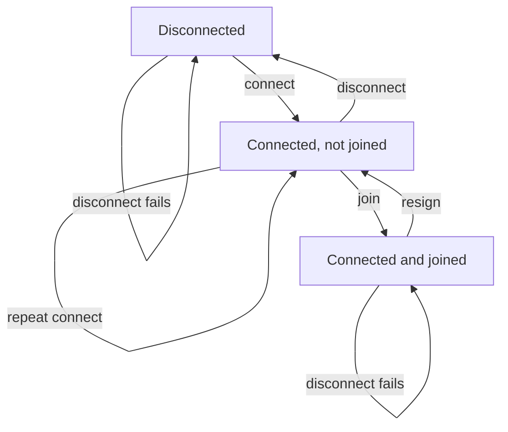

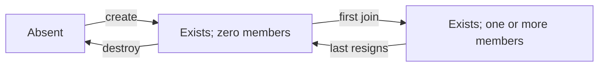

These are separate state machines, not one combined lifecycle. A successful
Join advances the ambassador from connected/not-joined to joined and adds it
to the execution's membership. Resign returns that ambassador to connected;
the execution returns to zero members only when the departing federate was
the last member. Read these transitions with the implementation guards below:

- In this reference shell, the first `connect` stores the callback object and
  callback-model value but does not validate that model; it also ignores the
  `localSettingsDesignator`. A second call checks connection state first and
  throws `AlreadyConnected`. The pinned API declares
  `UnsupportedCallbackModel` and `InvalidLocalSettingsDesignator`, but this
  shell does not check either input. The smoke case uses `HLA_IMMEDIATE` and
  the default designator, so invalid-input behavior is source-observed only;
  it is not a claim about required 2010 semantics.
- `join` requires an existing execution and rejects a duplicate non-empty
  federate name or a session that is already a member.
- `disconnect` while joined fails with `FederateIsExecutionMember`; resign
  first. The shell remains connected after a successful resign.
- Calling `disconnect` while already disconnected throws `RTIinternalError`
  in this shell, matching its pinned 2010 exception specification; the smoke
  case asserts that outcome. This is a reference-binding behavior, not a
  general HLA state-machine rule.
- `destroyFederationExecution` succeeds only when the execution's member map is
  empty.
- Object-class, attribute, interaction-class, and parameter handles are
  allocated lazily by name lookup. A name accepted by this directory is not
  thereby proven to exist in an input FOM.
- The reference `resign` implementation ignores the requested `ResignAction`
  and erases objects owned by that member. It does not send a removal callback
  before erasing them. The binding-shell smoke uses only `NO_ACTION` for its
  two resign calls ([case](../../cpp/tests/ieee1516_2010_binding_shell_smoke.cpp#L195));
  it does not exercise action-specific behavior. Do not interpret this as the
  standard's general resign semantics.
- FOM module arguments are accepted by the public shell but are not loaded by
  this provider. The test deliberately passes `ignored-fom.xml`; the runtime
  header describes a deterministic provider directory pending a 2010 FOM
  loader.

Source: [pinned 2010 `ResignAction` values](../../third_party/ieee1516.1-2010/include/RTI/Enums.h#L34),
[pinned Connect/Disconnect declarations](../../third_party/ieee1516.1-2010/include/RTI/RTIambassador.h#L45),
[generated 2010 ambassador shell](../../cpp/generated/rti_ambassador_shell_2010.hpp#L17),
[Connect/Disconnect smoke assertions](../../cpp/tests/ieee1516_2010_binding_shell_smoke.cpp#L99),
[execution creation and teardown](../../cpp/src/internal/runtime/reference_2010.cpp#L83),
[join](../../cpp/src/internal/runtime/reference_2010.cpp#L213),
[resign and disconnect](../../cpp/src/internal/runtime/reference_2010.cpp#L262),
[lazy class lookup](../../cpp/src/internal/runtime/reference_2010.cpp#L292),
[FOM-input forwarding](../../cpp/generated/rti_ambassador_shell_2010.hpp#L40),
[reference-runtime profile note](../../cpp/src/internal/runtime/reference_2010.hpp#L14).

### This profile accepts, but does not load, FOM paths

The public creation overload accepts a FOM module path, but this shell
currently forwards only the execution name to the reference runtime. After
joining, `getObjectClassHandle` consults the runtime's provider directory and
creates a name/handle entry on first lookup. The 2010 binding-shell smoke test
passes `ignored-fom.xml` before looking up its object class. This is a narrow
implementation observation: the returned handle is not evidence that a FOM
was loaded or that the name was validated against one.

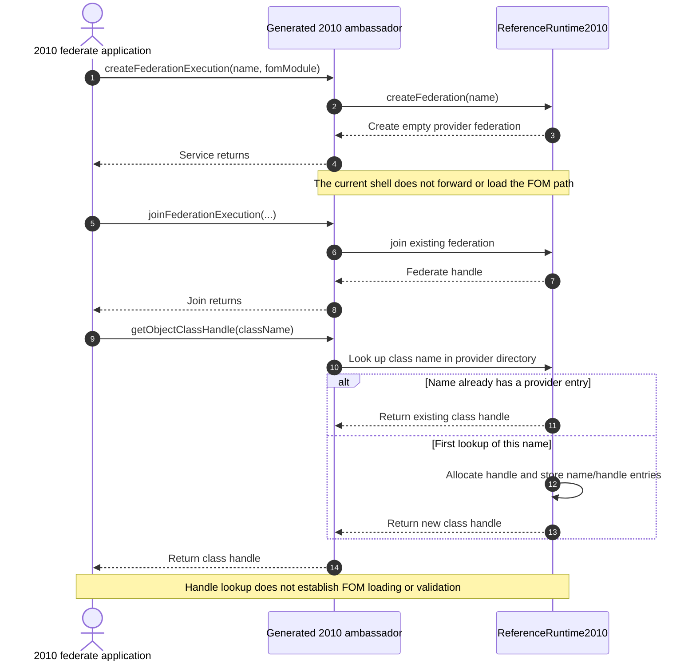

The sequence is source-backed by the [2010 shell overload](../../cpp/generated/rti_ambassador_shell_2010.hpp#L40),
the [reference runtime's class lookup](../../cpp/src/internal/runtime/reference_2010.cpp#L292),
and its [provider-directory profile note](../../cpp/src/internal/runtime/reference_2010.hpp#L14).
The [2010 binding-shell smoke](../../cpp/tests/ieee1516_2010_binding_shell_smoke.cpp#L122)
exercises the accepted `ignored-fom.xml` argument followed by class lookup; it
does not establish standard FOM-loading semantics.

## 2. Object publication, discovery, update, and reflection

The object path is synchronous in this reference runtime. A matching
subscriber's `FederateAmbassador` method is called from the service
implementation before that service returns.

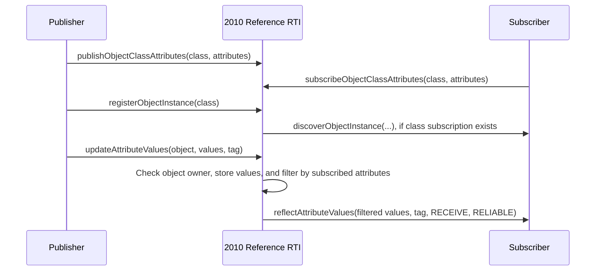

Important implementation details:

- Registration requires the member to have published the object class. The
  object is recorded with one owning federate.
- Discovery is sent to other members that have a subscription entry for the
  object's class. Reflection values are then filtered against the receiver's
  subscribed attribute handles; an empty filtered map produces no callback.
- An update is accepted only from the recorded object owner. Values and the
  user tag are forwarded to matching subscribers; the implementation uses
  `RECEIVE` order and `RELIABLE` transportation for this callback.
- `queryAttributeOwnership` reports the object's owning federate through
  `informAttributeOwnership`. `isAttributeOwnedByFederate` also compares the
  object's single owner. These are not per-attribute ownership states or
  ownership-transfer support.
- The object callbacks are direct calls, not queued events. See [Callback
  delivery and failure boundaries](#callback-delivery-and-failure-boundaries-in-the-2010-reference-profile)
  for the profile-wide callback-model and exception limits.

Source: [attribute publication](../../cpp/src/internal/runtime/reference_2010.cpp#L448),
[attribute subscription](../../cpp/src/internal/runtime/reference_2010.cpp#L476),
[register and discover](../../cpp/src/internal/runtime/reference_2010.cpp#L502),
[update and reflect](../../cpp/src/internal/runtime/reference_2010.cpp#L549),
[ownership query](../../cpp/src/internal/runtime/reference_2010.cpp#L619),
[object-owner check](../../cpp/src/internal/runtime/reference_2010.cpp#L646),
[callback-model storage](../../cpp/generated/rti_ambassador_shell_2010.hpp#L23),
[unavailable evoke methods](../../cpp/generated/rti_ambassador_shell_2010.hpp#L624).

### Empty attribute set: a source-only discovery edge

The reference runtime creates the per-class subscription entry before
iterating the supplied attributes. Registration later tests whether that
class entry exists, not whether its attribute set is nonempty. Therefore, in
this profile, subscribing with an empty attribute set can still make a later
matching registration call `discoverObjectInstance`; a later update projects
no values through that empty set and produces no reflection callback. This is
a source-derived edge, not a statement about IEEE 1516.1-2010 semantics. The
cited binding-shell smoke path subscribes one attribute and does not cover an
empty set, so the edge remains untested.

Source: [subscription entry creation](../../cpp/src/internal/runtime/reference_2010.cpp#L476),
[registration's class-entry check](../../cpp/src/internal/runtime/reference_2010.cpp#L502),
[update projection and empty-map suppression](../../cpp/src/internal/runtime/reference_2010.cpp#L549),
and the [nonempty smoke subscription](../../cpp/tests/ieee1516_2010_binding_shell_smoke.cpp#L133).

### Object existence, receiver knowledge, and removal limits

As a reader, track three questions separately: what object state the RTI
currently holds, what each federate application has learned through callbacks,
and what result the caller received from the service. Those can diverge. This
is an analysis lens, not a normative 2010 or 2025 service rule; the profile
observations below are specific to this 2010 reference runtime.

The reference runtime stores one federation-wide object record containing its
owner, class, name, and values. A matching member is told about registration
through a direct `discoverObjectInstance` callback; the member structure has
no per-receiver known-object set. Later owner updates are stored in that same
record and reflected inline with only the receiver's subscribed attributes.
The subscriber application's own reaction to those callbacks is outside the
RTI's stored federation state.

The standard 2010 API declares both `deleteObjectInstance` and
`localDeleteObjectInstance`, and declares the `removeObjectInstance` callback.
In this reference profile, both ambassador services route to `unavailable()`
and throw `RTIinternalError`. The implemented removal-like path is different:
when an owner resigns, the runtime ignores the requested `ResignAction` and
erases that member's object records as cleanup, but does not call
`removeObjectInstance` on members that previously received discovery. This is
an implementation limitation, not a description of the standard's
object-deletion or local-forget semantics.

Registration also separates state commit from callback observation. The
reference runtime inserts the federation-wide record before iterating matching
subscribers and calling them inline. If one discovery callback throws
`FederateInternalError`, that registration call reports `RTIinternalError`,
the record remains stored, and the callback loop stops: earlier recipients may
have observed discovery while later recipients are not called. The bounded
smoke case checks only the successful discovery/reflection path; this partial
fan-out failure is source-observed, not test-confirmed.

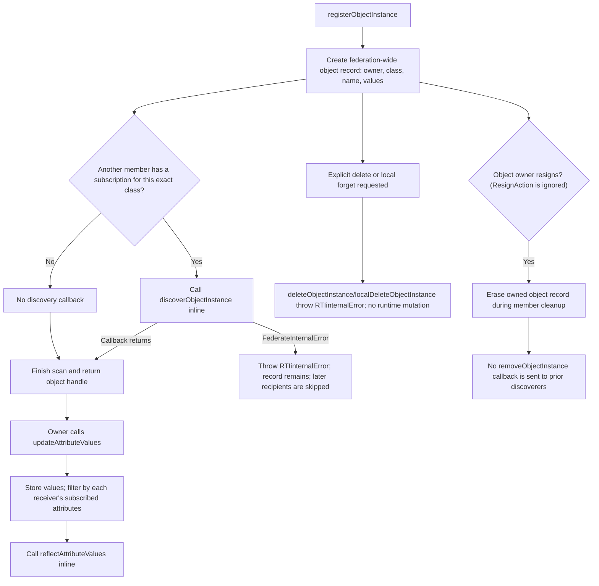

The source shows there is no per-member known-object set and no removal
callback on this resignation cleanup path; it does not show what a federate
application retains in its own memory after learning no further information.
The [binding-shell smoke case](../../cpp/tests/ieee1516_2010_binding_shell_smoke.cpp#L134)
asserts discovery and reflection before unsubscribe/resign cleanup, but does
not exercise the unavailable deletion calls or assert a resignation/removal
callback outcome. Source references: [object state and member state](../../cpp/src/internal/runtime/reference_2010.cpp#L43),
[registration/discovery](../../cpp/src/internal/runtime/reference_2010.cpp#L502),
[update/reflection](../../cpp/src/internal/runtime/reference_2010.cpp#L549),
[resignation cleanup](../../cpp/src/internal/runtime/reference_2010.cpp#L262),
[delete service stub](../../cpp/generated/rti_ambassador_shell_2010.hpp#L243),
[local-delete service stub](../../cpp/generated/rti_ambassador_shell_2010.hpp#L251),
and the [2010 API's removal callback](../../third_party/ieee1516.1-2010/include/RTI/FederateAmbassador.h#L297).

## 3. Interaction send and receive

The 2010 API exposes two different information models. A useful HLA mental
model is that an object-attribute update changes state associated with a
registered instance, while an ordinary interaction is an event-like message
identified by its class and parameters, without an object-instance target.
The table separates that API-level distinction from the reference runtime's
particular delivery behavior below.

| | Object-attribute update | Ordinary interaction |
| --- | --- | --- |
| Service identity | [`updateAttributeValues`](../../third_party/ieee1516.1-2010/include/RTI/RTIambassador.h#L518) names an `ObjectInstanceHandle`. | [`sendInteraction`](../../third_party/ieee1516.1-2010/include/RTI/RTIambassador.h#L549) names an `InteractionClassHandle`; no object instance is an argument. |
| Value map | `AttributeHandleValueMap` associates values with attributes of that instance. | `ParameterHandleValueMap` associates values with parameters of the interaction class. |
| Receiver callback | [`reflectAttributeValues`](../../third_party/ieee1516.1-2010/include/RTI/FederateAmbassador.h#L225) includes the object instance. | [`receiveInteraction`](../../third_party/ieee1516.1-2010/include/RTI/FederateAmbassador.h#L261) includes the interaction class and parameters, not an object handle. |
| This reference profile | Writes accepted values to its federation-wide object record, then projects subscribed attributes to receivers. | Checks publication and parameter handles, then calls exact-class subscribers inline; it does not retain the send as an object record. |

This is a conceptual comparison of the pinned 2010 API surfaces, not a
complete statement of every standard routing or ordering rule. The synchronous
callbacks and exact-handle subscription behavior in the final row are specific
to this reference profile.

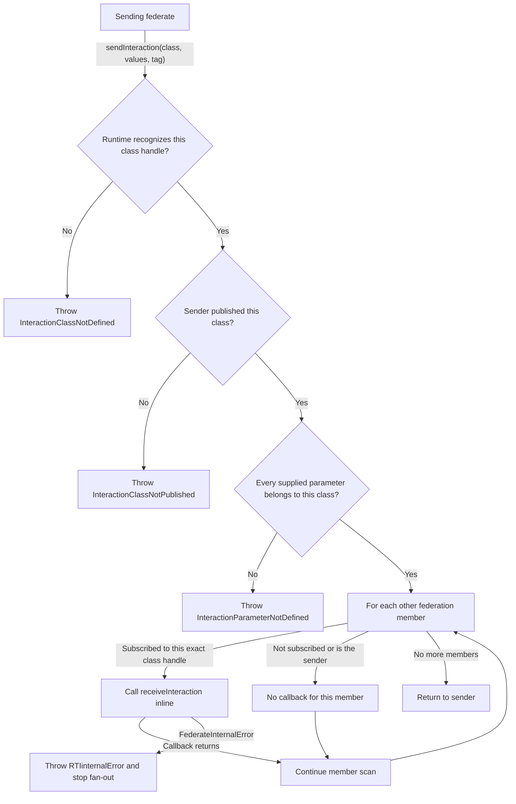

The implementation validates the interaction-class handle, requires the
sender's publication, and validates each supplied parameter handle. It then
delivers to other members subscribed to that exact interaction-class handle.
As with object updates, delivery is synchronous and uses `RECEIVE` / `RELIABLE`
with producing-federate supplemental information. This slice does not model
class-hierarchy subscription matching, regions, transportation selection, or
time-stamped interactions.

The three validation branches name the distinct send-specific exceptions in
the pinned 2010 API: `InteractionClassNotDefined`,
`InteractionClassNotPublished`, and `InteractionParameterNotDefined`
([ordinary `sendInteraction` declaration](../../third_party/ieee1516.1-2010/include/RTI/RTIambassador.h#L549)).
The chart focuses on those checks and recipient routing; it is not the complete
service-entry exception list or a claim that this reference slice implements
every save/restore or connection-state condition in that API. Here, “class
handle is registered” means present in the reference runtime's lazy provider
directory, not validated against a loaded FOM. See [this profile accepts, but
does not load, FOM paths](#this-profile-accepts-but-does-not-load-fom-paths);
the lookup creates a directory entry on first use
([interaction-class lookup](../../cpp/src/internal/runtime/reference_2010.cpp#L340),
[parameter lookup](../../cpp/src/internal/runtime/reference_2010.cpp#L366)).
The successful smoke case follows that same path after passing
`ignored-fom.xml`; it verifies one receiving callback, not FOM-based class
admission or multi-recipient fan-out
([interaction assertions](../../cpp/tests/ieee1516_2010_binding_shell_smoke.cpp#L173)).

The receiver calls are inline, not queued. If a receiver throws
`FederateInternalError`, the service translates it to `RTIinternalError` and
stops visiting recipients. Earlier callbacks have already run and are not
undone; later recipients are not called. Thus this reference profile can return
a service error after partial receiver observation. The successful
[binding-shell smoke path](../../cpp/tests/ieee1516_2010_binding_shell_smoke.cpp#L176)
checks a single subscriber's completed callback only; it does not test a
callback failure, partial fan-out, or general HLA delivery guarantees.

Source: [interaction publication](../../cpp/src/internal/runtime/reference_2010.cpp#L404),
[interaction subscription](../../cpp/src/internal/runtime/reference_2010.cpp#L426),
[send and receive](../../cpp/src/internal/runtime/reference_2010.cpp#L584),
[smoke-case assertions](../../cpp/tests/ieee1516_2010_binding_shell_smoke.cpp#L176).

## 4. Synchronization-point barrier

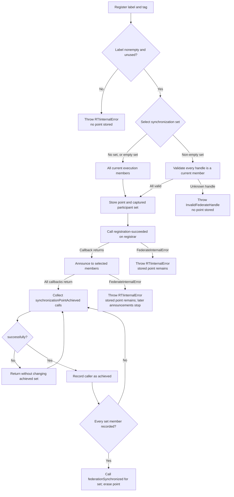

The no-set overload constructs the current member set. In the explicit-set
overload an empty set also expands to all current members, so this profile
cannot express an empty-participant barrier through that overload. Only
`successfully = true` inserts the caller into the achieved-member set. A
false call neither inserts nor erases: if the member previously reported true,
that achievement remains recorded. The false call also returns before checking
whether the set is already complete, so it cannot itself trigger
`federationSynchronized`. This is an observation of the 2010 reference source,
not a normative claim or a tested edge. On a successful call that finds the set
complete, the runtime calls `federationSynchronized` for the set and erases the
point after callbacks return. Callback exceptions are translated to
`RTIinternalError`; inspect the source before relying on retry or reentrancy
behavior around a throwing callback.

Less-obvious consequences of the current code:

- Empty or duplicate labels are rejected as `RTIinternalError`; an explicit
  set containing an unknown handle is rejected as `InvalidFederateHandle`.
- A member outside the selected set cannot achieve the point and receives
  `FederateNotExecutionMember` from that service.
- The participant set is captured at registration. A later join does not join
  the pending barrier.
- The registering member receives `synchronizationPointRegistrationSucceeded`
  even when it is not in the explicit synchronization set; only set members
  receive the announcement callback.
- Resignation removes the member but does not edit pending point sets. If a
  participant leaves before achieving, the stored set can therefore remain
  incomplete and prevent the success-size check from completing.
- The point is inserted before registration callbacks. If one throws, the
  registration service reports `RTIinternalError` but the point remains stored,
  potentially with announcements not yet delivered to the whole set.
- The point is erased only after all completion callbacks return. If one throws
  after all achievements, the operation reports `RTIinternalError` and retains
  the point; a repeated successful achievement can retry the completion
  callback loop, including callbacks that returned earlier.

Source: [point registration and announcement](../../cpp/src/internal/runtime/reference_2010.cpp#L114),
[achievement barrier](../../cpp/src/internal/runtime/reference_2010.cpp#L164).

The public 2010 [`FederateAmbassador` API](../../third_party/ieee1516.1-2010/include/RTI/FederateAmbassador.h#L62)
also declares `synchronizationPointRegistrationFailed`, but this reference
runtime path never calls it. Empty/duplicate labels and an unknown explicit-set
member instead exit through service exceptions; callback failures after point
insertion return `RTIinternalError` with the stored/partially announced state
described above. This is a source-only profile boundary, not a claim about
which outcomes the standard requires to use the failure callback. No focused
2010 barrier test was found, so the diagram's error branches remain
source-observed rather than test-confirmed.

The normal path is not the whole callback story. The source stores a point
before registration callbacks and removes it only after every completion
callback returns. A completion callback failure therefore leaves a fully
achieved point stored, and a later successful achievement retries the callback
loop from its first current set member. This is an implementation observation,
not a claim about the normative retry contract.

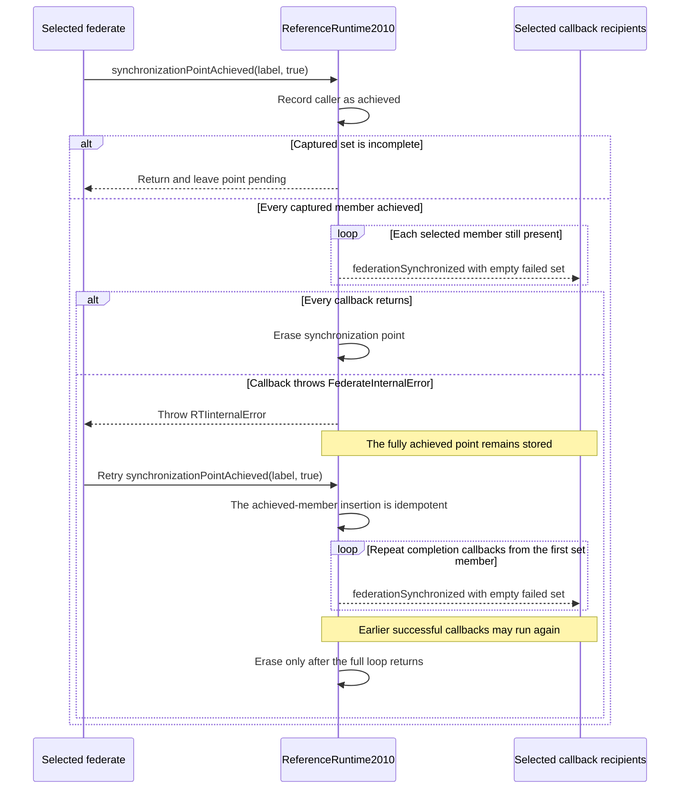

The public calls and callbacks are declared in the pinned 2010
[`RTIambassador` API](../../third_party/ieee1516.1-2010/include/RTI/RTIambassador.h#L173)
and [`FederateAmbassador` API](../../third_party/ieee1516.1-2010/include/RTI/FederateAmbassador.h#L57).
No focused 2010 synchronization-barrier test was found in this survey, so the
retry and duplicate-callback path above is source-observed only.

## 5. Timing values are not time-managed execution

The 2010 stream contains `HLAinteger64Time` and `HLAfloat64Time` value and
interval implementations, plus encoding and marshalling smoke tests. Those
artifacts establish value construction, arithmetic, comparison, and
serialization behavior only; they do not provide an RTI time-advance service.

The generated ambassador shell routes every method in its time-management
group to `unavailable()`: `enableTimeRegulation`, `disableTimeRegulation`,
`enableTimeConstrained`, `disableTimeConstrained`, `timeAdvanceRequest`,
`timeAdvanceRequestAvailable`, `nextMessageRequest`,
`nextMessageRequestAvailable`, `flushQueueRequest`,
`enableAsynchronousDelivery`, `disableAsynchronousDelivery`, `queryGALT`,
`queryLogicalTime`, `queryLITS`, `modifyLookahead`, `queryLookahead`, and
`retract`. The time-stamped overloads of `updateAttributeValues`,
`sendInteraction`, `deleteObjectInstance`, `sendInteractionWithRegions`, and
`requestFederationSave` also route to that stub. The three
`createFederationExecution` overloads accept a
`logicalTimeImplementationName`, but forward only the execution name to
`ReferenceRuntime2010`; the reference runtime does not select a time factory
for the federation.

The generated [`time-service overrides`](../../cpp/generated/rti_ambassador_shell_2010.hpp#L325),
[timestamped update/send/delete overloads](../../cpp/generated/rti_ambassador_shell_2010.hpp#L230),
[regional send overload](../../cpp/generated/rti_ambassador_shell_2010.hpp#L449),
[time-bounded save overload](../../cpp/generated/rti_ambassador_shell_2010.hpp#L105),
[single-module creation](../../cpp/generated/rti_ambassador_shell_2010.hpp#L40),
[module-list creation](../../cpp/generated/rti_ambassador_shell_2010.hpp#L45),
[MIM creation](../../cpp/generated/rti_ambassador_shell_2010.hpp#L50),
and shared [`unavailable()` implementation](../../cpp/generated/rti_ambassador_shell_2010.hpp#L691)
establish this as an implementation boundary: those calls throw
`RTIinternalError` rather than advancing logical time or scheduling TSO work.
The cited integer-time, float-time, and time-marshalling smoke programs call
value/factory operations; they do not exercise the ambassador stubs or assert
their runtime exceptions. There is consequently no source-backed 2010
time-advance or timestamped-delivery state machine to diagram yet.

Keep two layers separate. The pinned 2010 C++ API defines abstract
`LogicalTime` and `LogicalTimeInterval` values and says the federation supplies
the representation/factory; the RTI uses that factory to create matching
values. Umbra's 2010 reference library supplies integer64 and float64 models.
Those values support comparison, time-plus/minus-interval arithmetic,
time-difference-to-interval, and value serialization. This is value algebra,
not an RTI time-advance state machine.

In this reference profile, the create-execution overload accepts a logical-time
implementation name but the runtime does not connect it to a selected factory.
The generated ambassador time-management and timestamped service methods
route to `unavailable()`. The diagram separates that implementation boundary
from the portable value API; it does not describe all conforming 2010 RTIs.

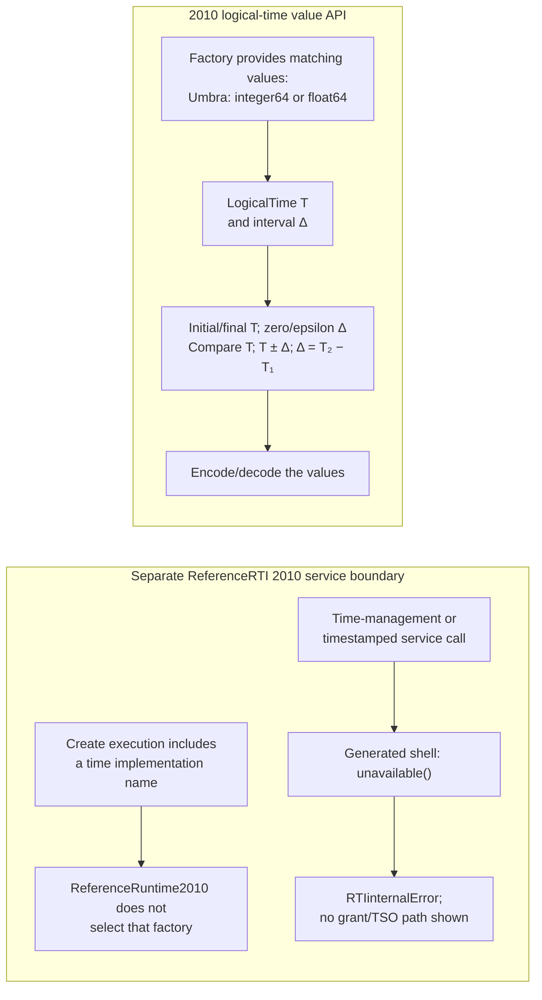

The abstract [2010 LogicalTime API](../../third_party/ieee1516.1-2010/include/RTI/LogicalTime.h#L17)
and [LogicalTimeFactory API](../../third_party/ieee1516.1-2010/include/RTI/LogicalTimeFactory.h#L34)
define the value/factory contract. Umbra's bounded implementation evidence is
the [factory selector](../../cpp/src/ieee1516_2010_integer_time.cpp#L438),
[integer value implementation](../../cpp/src/ieee1516_2010_integer_time.cpp#L128),
and [float value implementation](../../cpp/src/ieee1516_2010_float_time.cpp#L109).
The [integer smoke](../../cpp/tests/ieee1516_2010_integer_time_smoke.cpp),
[float smoke](../../cpp/tests/ieee1516_2010_float_time_smoke.cpp), and
[marshal smoke](../../cpp/tests/ieee1516_2010_time_marshal_smoke.cpp) exercise
selected value/factory operations. They do not test ambassador service calls.
The service boundary is grounded in the [generated time-service overrides](../../cpp/generated/rti_ambassador_shell_2010.hpp#L325)
and shared [`unavailable()` implementation](../../cpp/generated/rti_ambassador_shell_2010.hpp#L691);
the smoke sources do not prove every stub throws the expected error at runtime.

Likewise, federation save/restore, regions/DDM, and broad ownership services
are outside the implemented reference slice. The generated shell's header
comment states that services outside the bounded slice intentionally throw.
Keep these absent flows visible as gaps rather than borrowing a diagram from
the 2025 runtime.

## Evidence and confidence boundaries

| Claim | Evidence | What it does not prove |
| --- | --- | --- |
| The 2010 binding provides a connected, two-member publisher/subscriber path for discovery, reflection, ownership query, and interaction receive. | [`ieee1516_2010_binding_shell_smoke.cpp`](../../cpp/tests/ieee1516_2010_binding_shell_smoke.cpp#L91), registered as [`umbra.ieee1516e_2010.binding_shell`](../../CMakeLists.txt#L423). | Full API conformance, synchronization callbacks, callback-evoked behavior, or omitted services. |
| Supported 2010 reference-runtime callbacks are invoked directly; selected call sites translate `FederateInternalError` into `RTIinternalError`. | [callback model is stored](../../cpp/generated/rti_ambassador_shell_2010.hpp#L17), [direct runtime callback sites](../../cpp/src/internal/runtime/reference_2010.cpp#L123), and the [HLA_IMMEDIATE smoke path](../../cpp/tests/ieee1516_2010_binding_shell_smoke.cpp#L119). | A working HLA_EVOKED path, callback-exception behavior under test, re-entry safety, or uniform exception conversion at every callback site. |
| The reference shell accepts a FOM path without loading it, then obtains object-class handles through its provider directory. | [2010 shell forwarding and provider profile](../../cpp/generated/rti_ambassador_shell_2010.hpp#L40), [lazy class-name lookup](../../cpp/src/internal/runtime/reference_2010.cpp#L292), and the [binding-shell scenario](../../cpp/tests/ieee1516_2010_binding_shell_smoke.cpp#L122). | Normative FOM behavior, validation against a loaded FOM, or behavior of the separate 2025 implementation. |
| 2010 integer/float time values and binary marshalling have isolated smoke coverage. | [`integer-time`](../../cpp/tests/ieee1516_2010_integer_time_smoke.cpp), [`float-time`](../../cpp/tests/ieee1516_2010_float_time_smoke.cpp), and [`time-marshalling`](../../cpp/tests/ieee1516_2010_time_marshal_smoke.cpp) smoke programs. | Federation logical-time advancement or ordering of time-stamped messages. |
| Synchronization-point state and callbacks exist in the reference runtime. | [Registration](../../cpp/src/internal/runtime/reference_2010.cpp#L114) and [achievement](../../cpp/src/internal/runtime/reference_2010.cpp#L164) source. | A focused 2010 test of the barrier; none was found in this bounded survey. |
| The 2010 API is intentionally a bounded shell. | [Generated shell profile comment](../../cpp/generated/rti_ambassador_shell_2010.hpp#L1) and its [`unavailable()` path](../../cpp/generated/rti_ambassador_shell_2010.hpp#L691). | That unsupported services are acceptable for every user or use case. |

The focused binding-shell test uses C `assert` checks and one linear scenario.
Treat it as evidence for that scenario, not an exhaustive state-machine test.
The project test target is an executable smoke test, not a Catch2 lane.

## Deliberate boundary and next evidence

This guide is about the 2010 reference profile only. It does not claim
equivalence with the IEEE 1516.1-2025 implementation and does not import any
2025 timing, callback-queue, region, ownership, or lifecycle behavior. The
Requirements Lab remains outside this documentation goal.

Next useful 2010 evidence, if this profile is expanded, is focused coverage for
synchronization-point registration/announcement/achievement, callback-exception
conversion and partial-recipient effects, the selected callback-model behavior,
and the currently unavailable service families. The existing smoke test only
exercises successful direct callbacks with `HLA_IMMEDIATE`; keep the uncovered
cases as explicit gaps and keep the separate 2010 CI disabled unless it is
deliberately re-enabled.
