# IEEE 1516.1-2025 Attribute Ownership: Flow Guide

In HLA, ownership identifies who currently has authority to update a particular
object-instance attribute. It is distinct from publication, subscription,
receiver knowledge, and whether an update is presently eligible for delivery.
Acquisition and divestiture services are separate protocols that can change
that authority; an accepted request and a completed transfer are not the same
event. This guide explains those distinctions first, then uses selected 2025
Umbra paths and tests as bounded examples—not as an implementation contract or
a conformance claim.

## Scope and authority

- **Standard boundary:** IEEE 1516.1-2025 only. The official [IEEE standard
  page](https://standards.ieee.org/ieee/1516.1/6688/) identifies the document
  that defines the RTI services and interfaces. Consult the standard itself
  for normative requirements.
- **Implementation boundary:** current 2025 C++ API scenarios exercised by
  Umbra's non-installable development profile, including focused embedded and
  process-boundary tests. Some private runtime components are shared
  implementation machinery; this guide does not infer 2010 behavior from them.
- **Edition separation:** IEEE 1516.1-2010 is deliberately outside this guide.
  It has separate public API and compatibility tests. No equivalence with its
  ownership behavior is asserted here.
- **Evidence boundary:** source describes current implementation behavior;
  focused tests demonstrate only their named scenarios. Neither overrides the
  standard or proves full feature support, interoperability, or conformance.

The service anchors used here are the 2025 ownership-management services,
including Attribute Ownership Acquisition (§7.8), Attribute Ownership
Acquisition If Available (§7.9), Attribute Ownership Release Denied (§7.12),
and Attribute Ownership Divestiture If Wanted (§7.13). The implementation
source cites these service sections; use the official standard for the
normative text and exact requirements.

## Start with the unit of state

Ownership is tracked for an **object-instance attribute**, not as one indivisible
property of the object. An object can therefore have attributes owned by
different federates, unowned attributes, and attributes with requests pending
at the same time. A single API call containing several attributes can produce
different outcomes for different members of its set.

Keep these concepts separate:

| Concept | What it tells you | What it does not tell you |
| --- | --- | --- |
| Publication | Whether a federate has declared it can produce an object-class attribute. | That it currently owns a particular instance attribute. |
| Subscription/discovery | Whether an instance is relevant and known to a receiving federate. | That the receiver owns any of its attributes. |
| Ownership | Which federate owns a particular instance attribute, or whether it is unowned. | The attribute's current value, whether an update was delivered, or—by itself—the privilege to delete the object. |
| Accepted request | The RTI admitted a service call and recorded or scheduled its work. | That the requested ownership transition has already completed. |
| Ownership callback | A public outcome for the request; in the current 2025 profile, some ownership state is committed at callback dispatch. | A guarantee that every requested attribute will resolve the same way. |

### Unpublishing can also end update authority in this profile

Publication and per-instance ownership are distinct state, but do not assume
that unpublishing only changes the declaration. In the current embedded 2025
path, unpublishing an owned attribute set synchronously removes the caller's
owner entries for those attributes and clears associated update metadata
([registry transition](../../cpp/src/internal/federation/federation_registry_object_attribute_declarations.cpp#L170),
[public whole-class route](../../cpp/src/internal/runtime/umbra_rti_ambassador_object_class_publication.cpp#L149)).
The focused receive-order update test first accepts an update, then calls
`unpublishObjectClass`, after which another update fails with
`AttributeNotOwned` ([before](../../cpp/tests/receive_order_attribute_update_catch2.cpp#L249),
[after](../../cpp/tests/receive_order_attribute_update_catch2.cpp#L332)). This
is a bounded embedded implementation/test observation, not a complete
interpretation of normative §5.3 or a statement about the 2010 stream; consult
an authorized standard copy before generalizing it.

Ownership also does not settle what happens to an already accepted timestamped
update if its producer later divests or resigns. The [TSO/ownership comparison](HLA-2025-TSO-RETRACTION-FLOW-GUIDE.md#ownership-changes-and-an-accepted-tso-update-are-separate-timelines)
shows selected embedded cases and their limits.

### Service return, transfer outcome, and callback time are separate

The 2025 C++ acquisition services return `void`; synchronous precondition
failures are typed exceptions. A normal return therefore carries no
"ownership granted" value. The per-attribute outcome is reported separately
through callbacks such as `attributeOwnershipAcquisitionNotification` and
`attributeOwnershipUnavailable`. See the pinned
[`attributeOwnershipAcquisition` and `attributeOwnershipAcquisitionIfAvailable` signatures](../../third_party/ieee1516.1-2025/include/RTI/RTIambassador.h#L1042)
and the corresponding [`FederateAmbassador` callbacks](../../third_party/ieee1516.1-2025/include/RTI/FederateAmbassador.h#L432)
([Unavailable](../../third_party/ieee1516.1-2025/include/RTI/FederateAmbassador.h#L440)).

### Compare the call, per-attribute outcome, and observed ownership

The public call result, a transfer callback, and an ownership query answer
different questions. This comparison is limited to the selected embedded
`HLA_EVOKED` cases below; the API exception lists are broader than the examples
exercised by those tests, and this is not process-profile parity evidence.

| Boundary | Acquisition If Available | Divestiture If Wanted |
| --- | --- | --- |
| Synchronous call outcome | The service returns `void`: a normal return admits pending work, not ownership. A typed exception such as `ObjectClassNotPublished`, `AttributeNotPublished`, `ObjectInstanceNotKnown`, or `AttributeNotDefined` rejects the call at the service boundary; the focused case also checks `FederateOwnsAttributes`. | The service returns `void` and fills `divestedAttributes` with the subset transferred synchronously. The focused case sees an empty output set and retained ownership when no acquirer is pending; with eligible acquirers, the output set is replaced with the transferred subset. Typed exceptions such as `ObjectInstanceNotKnown`, `AttributeNotDefined`, and `AttributeNotOwned` are service failures, not transfer callbacks. |
| Per-attribute callback | Pending members resolve separately as acquisition notification or unavailable. A mixed set can produce both outcomes. | A committed transfer can queue acquisition notifications to the new owners; those notifications are separate from the owner's output set and carry the divestiture tag in the focused case. A queued release request made stale by the transfer is suppressed. |
| Ownership observation | `isAttributeOwnedByFederate` is false for the unowned member after the call returns, then true after its notification callback begins; the unavailable member remains unowned by the requester. | In the selected `HLA_EVOKED` case, `isAttributeOwnedByFederate` already reflects the new owners after the normal service return and before their notifications are evoked. |

The links identify the exact public signatures and bounded test assertions:
[If Available API](../../third_party/ieee1516.1-2025/include/RTI/RTIambassador.h#L1047),
[If-Wanted API](../../third_party/ieee1516.1-2025/include/RTI/RTIambassador.h#L1082),
[If-Available exception checks](../../cpp/tests/ieee1516_2025_attribute_ownership_acquisition_if_available_catch2.cpp#L80),
[If-Available callback/query checks](../../cpp/tests/ieee1516_2025_attribute_ownership_acquisition_if_available_catch2.cpp#L112),
[If-Wanted exception checks](../../cpp/tests/attribute_ownership_divestiture_if_wanted_pending_catch2.cpp#L172),
and
[If-Wanted transfer and callback checks](../../cpp/tests/attribute_ownership_divestiture_if_wanted_pending_catch2.cpp#L252).
The table distinguishes the synchronous typed-exception gate, each
per-attribute callback, and the state query; it does not assert that callbacks
must always wait until a public call has returned.

Do not read the sequence diagrams as a universal promise that every callback
begins after the API call that caused the protocol transition has returned.
Callback delivery follows the selected model; see the
[callback/service-ordering guide](HLA-2025-CALLBACK-AND-SERVICE-ORDERING-FLOW-GUIDE.md#hla_immediate-callback-work-can-be-on-the-service-stack).
For example, the focused If-Available case checks that the service has returned
while an attribute is still unowned, then checks ownership after its
acquisition-notification callback begins
([pre-callback](../../cpp/tests/ieee1516_2025_attribute_ownership_acquisition_if_available_catch2.cpp#L118),
[post-callback](../../cpp/tests/ieee1516_2025_attribute_ownership_acquisition_if_available_catch2.cpp#L178)).
The process-boundary negotiated-divestiture case uses `HLA_IMMEDIATE`, but its
requester's acquisition notification is dispatched during a subsequent
`getObjectClassHandle` response, before that lookup returns—not inside the
owner's earlier `confirmDivestiture` call
([test](../../cpp/tests/attribute_ownership_acquisition_catch2.cpp#L2268)).
These are two bounded timing observations, not a global callback-order rule.

### Four ownership paths: who initiates, and what reports the outcome?

Use this as an orientation map, not an exhaustive ownership-service catalog or
a callback-order diagram. Ordinary Acquisition, release/denial, cancellation,
and ownership queries have their own paths below. First identify which side
starts one of these four transfer paths; then follow its established detail:
[Acquisition If Available](#if-available-evaluate-at-the-result-callback),
[Negotiated Divestiture](#negotiated-divestiture-adds-a-confirmation-stage),
[Unconditional Divestiture](#unconditional-divestiture-and-assumption-offers),
or [Divestiture If Wanted](#divestiture-if-wanted-has-an-output-set-result-and-later-notifications).

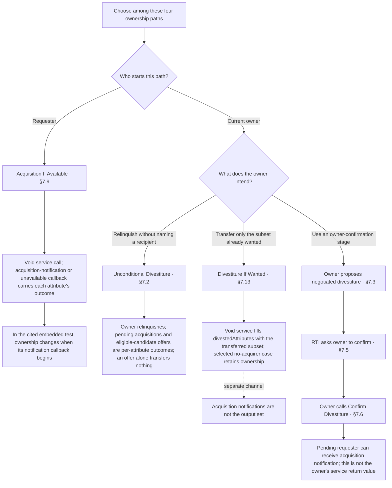

The RTIambassador operations in these four paths are `void` (including both
negotiated-divestiture calls); Divestiture If Wanted additionally fills
`divestedAttributes`. The chart's outcome notes are bounded to the linked
detailed evidence, not universal timing: the selected embedded If-Available
case observes ownership at notification-callback entry; the If-Wanted and
unconditional tests observe their own state/result boundaries; the process
Confirm Divestiture case does not assert an ownership-query timestamp. Consult
the detailed sections and their tests before applying one profile's state
timing to another.

The pinned signatures are at [§§7.2–7.3](../../third_party/ieee1516.1-2025/include/RTI/RTIambassador.h#L989),
[§7.6](../../third_party/ieee1516.1-2025/include/RTI/RTIambassador.h#L1024),
[§7.9](../../third_party/ieee1516.1-2025/include/RTI/RTIambassador.h#L1061),
and [§7.13](../../third_party/ieee1516.1-2025/include/RTI/RTIambassador.h#L1093);
the selected evidence is the [If-Available test](../../cpp/tests/ieee1516_2025_attribute_ownership_acquisition_if_available_catch2.cpp#L112),
[If-Wanted test](../../cpp/tests/attribute_ownership_divestiture_if_wanted_pending_catch2.cpp#L252),
[unconditional-divestiture test](../../cpp/tests/ieee1516_2025_unconditional_attribute_ownership_divestiture_catch2.cpp#L170),
and [process Confirm Divestiture case](../../cpp/tests/ieee1516_2025_confirm_divestiture_process_assumption_catch2.cpp#L62).
These tests are profile-bounded examples, not one cross-service conformance
matrix. The checkout lacks full normative clause prose, so this service-
selection map does not claim to replace it.

## Ownership transfer and update-region association are separate boundaries

Ownership answers who currently has authority over an object attribute;
`associateRegionsForUpdates` configures the source-region side of that
attribute's DDM path. Keep these as separate questions. The pinned API exposes
ownership transfer (§§7.9 and 7.13) and update-region association/removal
(§§9.6–9.7) as different services. Its declarations identify the service
boundaries, but do not replace the normative clause text.

The selected embedded 2025 cases expose a useful implementation nuance at the
transfer boundary: the former owner's committed association is cleared, not
inherited by the new owner. In two other focused cases, the prospective owner
can establish a deferred association before acquiring the attribute; that
association is inactive while another federate owns the attribute, is promoted
if still present when ownership transfers, and is not promoted if it was
unassociated first. With no association left, the first update after transfer
uses the default source region. If the former owner later reacquires the
attribute, it must explicitly associate its region again. These are selected
embedded test observations, not a claim of process-profile parity or a complete
normative rule for every acquisition path.

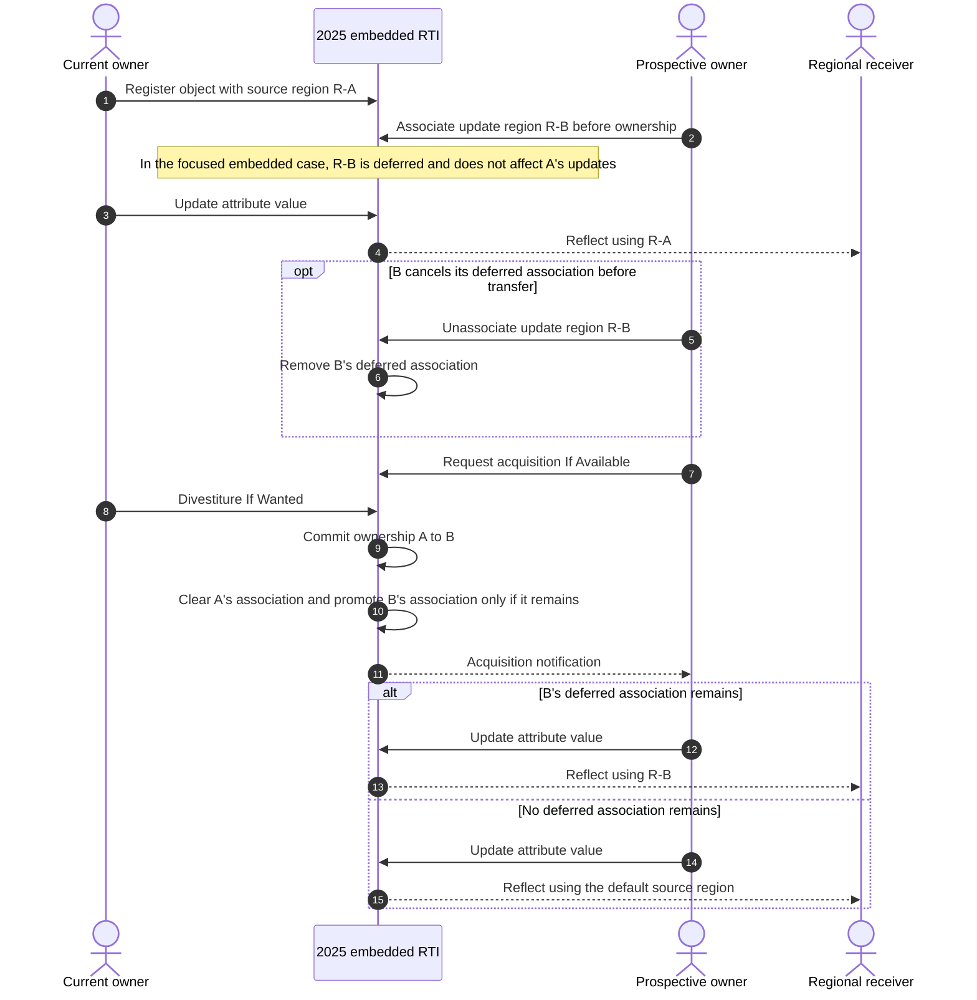

This is a comparison of separate focused scenarios, not one end-to-end test:
the [association-clearing/reacquisition case](../../cpp/tests/ownership_transfer_update_region_catch2.cpp#L142)
observes the former owner's region disappear, the new owner's first update use
the default source, and explicit association be needed again after reacquisition;
the [deferred-association promotion case](../../cpp/tests/ownership_transfer_update_region_catch2.cpp#L478)
observes a retained prospective-owner association become active at transfer;
and the [canceled-deferred-association case](../../cpp/tests/ownership_transfer_update_region_catch2.cpp#L692)
observes that unassociation prevents later promotion. The pinned API locates
these services at [acquisition If Available §7.9 and divestiture If Wanted
§7.13](../../third_party/ieee1516.1-2025/include/RTI/RTIambassador.h#L1048),
and [associate/unassociate regions for updates §§9.6–9.7](../../third_party/ieee1516.1-2025/include/RTI/RTIambassador.h#L1514).
The [selected transfer path](../../cpp/src/internal/federation/federation_registry_attribute_ownership_divestiture_if_wanted.cpp#L286)
clears and then promotes association state; the [association planner](../../cpp/src/internal/federation/federation_registry_update_region_associations.cpp#L75)
keeps non-owner associations deferred. For the broader HLA source/receiver
region model, see the DDM guide's
[object-attribute source-association flow](HLA-2025-DATA-DISTRIBUTION-AND-REGIONS-FLOW-GUIDE.md#object-attributes-source-association-discovery-relevance-and-updates).

The checkout does not contain the complete normative clause text needed to
independently verify every ownership-loss rule. Read the IEEE standard before
generalizing the source comment or these embedded test outcomes to all RTIs.

### 2025 process-endpoint boundary

The pinned API declares Attribute Ownership Divestiture If Wanted, but this
checkout does not expose it through the 2025 process service route. The public
adapter method directly checks membership in `embeddedFederationRegistry()`
and calls that registry's plan; it does not delegate through the process
client. The process transport/client/server inventory does contain explicit
Confirm Divestiture and Unconditional Divestiture routes, but no corresponding
`attribute_ownership_divestiture_if_wanted` operation or handler. Therefore,
the transfer and update-region results above describe selected embedded
behavior only; they are not evidence that this service is usable through the
process endpoint. This is an Umbra source-inventory finding, not a claim that
IEEE 1516.1-2025 makes the service optional or unavailable. See the pinned
[API declaration](../../third_party/ieee1516.1-2025/include/RTI/RTIambassador.h#L1093),
the [public adapter implementation](../../cpp/src/internal/runtime/umbra_rti_ambassador_ownership_services.cpp#L1507),
and representative [process protocol](../../cpp/src/internal/federation/transport_service_protocol.hpp#L211)
and [service handler](../../cpp/src/internal/federation/process_federation_service_ownership_handlers.cpp#L610)
routes.

### Process ownership routes at a glance

This is an Umbra 2025 route/evidence index, not an HLA callback-order table.
The public service outcome, private process response, event-transport mode,
and recipient callback model are separate boundaries.

| HLA service | Umbra process route | Focused process evidence and limits |
| --- | --- | --- |
| Acquisition If Available | Explicit request and registry plan; private status/count is separate from pushed events or the pull result slot. See the [detailed process path](#process-endpoint-private-result-and-callback-event-are-separate). | The configured-process `HLA_EVOKED` case covers one unowned attribute through default pull delivery; it does not cover mixed/unavailable results or pushed delivery. |
| Confirm Divestiture | Explicit request and registry plan; private status/count is separate from queued recipient notifications. See [negotiated divestiture and confirmation](#negotiated-divestiture-adds-a-confirmation-stage). | The focused process-boundary case observes selected callbacks and tags under `HLA_IMMEDIATE`, not update-region behavior or an ownership-query timing guarantee. |
| Unconditional Divestiture | Explicit request and registry plan; private acceptance is separate from acquisition work and assumption offers. See the [process route below](#process-endpoint-unconditional-divestiture-and-recipient-work-are-separate). | A portable C++ TCK scenario source covers a general standard path, but the checked-in package notes do not record a process-specific execution. The cited focused Catch2 case is embedded. |
| Acquisition cancellation | Explicit request; its private acceptance result is distinct from the later confirmation event. See [process cancellation](#process-endpoint-cancellation-result-and-confirmation-are-separate). | The configured-process `HLA_EVOKED` case is pull-mode and covers a regular request; it does not cover deletion/Resign races. |
| Divestiture If Wanted | No process operation, client method, or server handler was found; the public method directly uses the embedded registry, as described above. | The pinned API declares the service, but the selected transfer/region tests exercise only the embedded route. |

### Object deletion uses a special privilege, not ordinary data ownership

The 2025 standard MIM declares [`HLAprivilegeToDeleteObject` on
`HLAobjectRoot`](../../third_party/ieee1516.2-2025/resources/mim/HLAstandardMIM-2025.xml#L33),
and the pinned 2025 [`deleteObjectInstance` API](../../third_party/ieee1516.1-2025/include/RTI/RTIambassador.h#L824)
lists `DeletePrivilegeNotHeld`. Do not infer object-deletion authority from
owning an ordinary data attribute: the delete privilege is a distinct
ownership concern. The [object and interaction guide's delete/removal
flow](HLA-2025-OBJECT-AND-INTERACTION-INFORMATION-FLOW-GUIDE.md#object-removal-delete-callback-and-per-receiver-cleanup)
covers the current implementation's special gate and the separate
receiver-removal lifecycle. That guide also explains how an explicit
unpublish can separate delete privilege across registrations in one class
([publication-epoch detail](HLA-2025-OBJECT-AND-INTERACTION-INFORMATION-FLOW-GUIDE.md#a-publication-epoch-can-separate-delete-privilege-across-object-registrations)).
The acquisition and divestiture diagrams below stay focused on per-attribute
ownership transfer.

The current runtime entry points and callback dispatch are in
[ownership services](../../cpp/src/internal/runtime/umbra_rti_ambassador_ownership_services.cpp)
and
[ownership callback dispatch](../../cpp/src/internal/runtime/umbra_rti_ambassador_ownership_callback_dispatch.cpp).
The per-attribute registry paths are in
[regular acquisition](../../cpp/src/internal/federation/federation_registry_attribute_ownership_acquisition.cpp),
[If-Available acquisition](../../cpp/src/internal/federation/federation_registry_attribute_ownership_acquisition_if_available.cpp),
[negotiated divestiture](../../cpp/src/internal/federation/federation_registry_negotiated_attribute_ownership_divestiture.cpp),
and
[If-Wanted divestiture](../../cpp/src/internal/federation/federation_registry_attribute_ownership_divestiture_if_wanted.cpp).

## Requester-side state: request is not ownership

Read the regular acquisition path per attribute: the service can return while
the request is pending, and a callback later resolves it. Cancellation has
its own confirmation boundary. If Available follows a different callback-time
decision path, shown separately below. This selected embedded model is not a
complete normative state machine for every ownership service or profile.

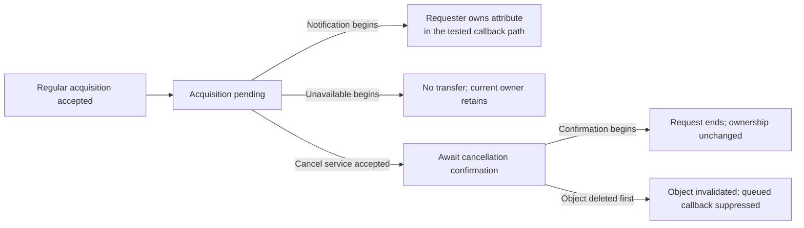

### Cancel Acquisition is pending until its confirmation callback

The 2025 API separates `cancelAttributeOwnershipAcquisition` (§7.15) from the
`confirmAttributeOwnershipAcquisitionCancellation` callback (§7.16). The
service returns `void`; in the focused embedded case, its return is not the
terminal cancellation observation. Until the confirmation callback begins,
the request still holds the publication fence and blocks an If-Available
request for the same attribute. At confirmation, the pending request is
removed, the queued owner-release callback is stale, and no acquisition
notification is reported. Ownership itself has not changed. The same test
shows that this service does not cancel an If-Available request: it reports
`AttributeAcquisitionWasNotRequested`; a later regular request supersedes
that If-Available work in the exercised scenario. Receive-order object
removal can invalidate a queued cancellation confirmation before application
code observes it.

See the pinned [Cancel Attribute Ownership Acquisition declaration](../../third_party/ieee1516.1-2025/include/RTI/RTIambassador.h#L1127),
its [confirmation callback](../../third_party/ieee1516.1-2025/include/RTI/FederateAmbassador.h#L456),
and the focused [2025 embedded cancellation-boundary case](../../cpp/tests/attribute_ownership_acquisition_cancellation_catch2.cpp#L199).

The important callback boundary is that the accepted request alone does not
make isAttributeOwnedByFederate true. In the focused 2025 tests, the requester's
ownership query changes when the acquisition-notification callback is
dispatched. With If Available, the dispatcher rechecks the request and current
ownership before selecting the notification or unavailable outcome. Thus, if
an owner divests before that callback is dispatched, a request that would
otherwise be unavailable can instead acquire the now-unowned attribute. See
the implementation's
[begin-acquisition callback path](../../cpp/src/internal/federation/federation_registry_attribute_ownership_acquisition_if_available.cpp)
and the tests below.

### Process endpoint: cancellation result and confirmation are separate

The pinned API labels cancellation §7.15 and its confirmation callback §7.16.
The process endpoint keeps the same public `void` operation/callback distinction
but adds a private status/count result. The sequence below is the focused
test's default pull route, not a cross-profile timing rule.

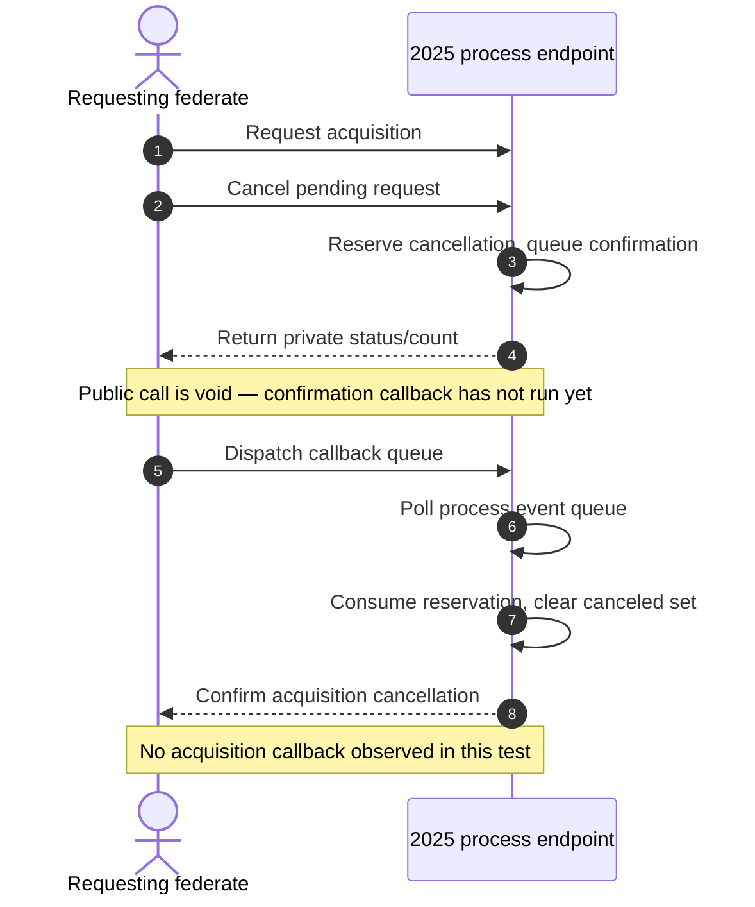

Here, the public calls are `attributeOwnershipAcquisition`,
`cancelAttributeOwnershipAcquisition`, and `evokeMultipleCallbacks`; the
confirmation event is `confirmAttributeOwnershipAcquisitionCancellation`. The
private status/count and process-event pull are Umbra boundary details, not
HLA ownership outcomes.

The configured-process case uses HLA_EVOKED and one regular-acquisition
attribute. It checks that cancellation returns normally with no confirmation
report yet, then that requester callback evocation yields the expected object
and attribute confirmation and no acquisition callback. Although the test also
finds no owner release report before and after cancellation, it does not poll the
owner after the cancel call; it therefore does not prove process delivery
suppression for a queued owner-release callback. The focused case also does not
cover immediate dispatch, push mode, empty sets, or the Release-Denied-wins
cancellation race.

Umbra source observations: default pull mode commits the reservation when the
queued confirmation reaches the `receive_interaction` delivery gate; configured
push mode begins the transition inside the service handler before sending the
unsolicited event. The registry leaves the acquisition pending when the cancel
service is accepted, suppresses new work for the reserved attributes, and
removes them at confirmation delivery. If an owner-release callback has
already entered user code, it may still answer; as described in the preceding
Release Denied note, the denial then wins the terminal outcome. The process
test does not exercise that race. An empty set is currently accepted as
applied with no callback reservation in source, but that behavior is untested
here and is not presented as a normative rule.

Before treating that sequence as guaranteed, account for lifecycle invalidation
before callback dispatch. This is a source-derived 2025 process pull-path view,
not an HLA rule, and neither branch has a focused process-boundary test:

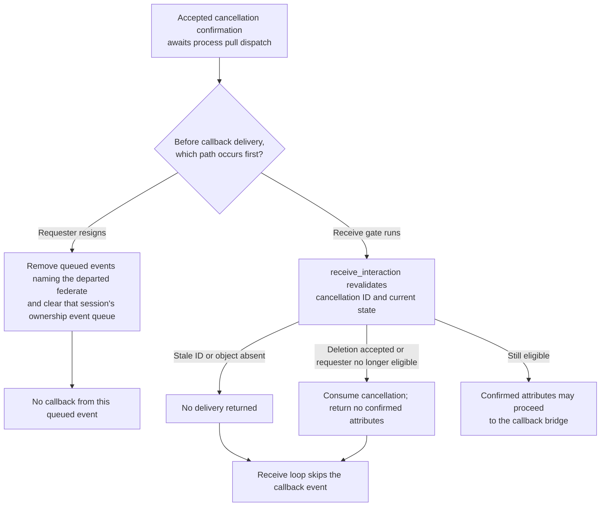

On explicit requester Resign, `handleResign` first commits the registry result,
then connection-loss cleanup removes queued acquisition events in that
federation whose requester or recipient is the departing member; session cleanup
also clears the resigning session's remaining ownership events. If pull receive
reaches the event after object state changes, a missing object or stale
cancellation returns no delivery. If deletion is accepted, or the requester is
no longer a member or no longer knows the object class, the registry consumes
the cancellation but returns no confirmed attributes (or no delivery when no
follow-up work remains). The receive loop drops either stale or empty event
before callback projection.

The configured-process success case does not interleave deletion or Resign
between cancellation and receive. The embedded test first observes one
confirmation, then issues a second cancellation followed by object deletion;
the report count remains one while the removal callback arrives, so the second
confirmation is suppressed in that embedded scenario only. The standalone
Resign test covers pending acquisition work and owner-release callback
suppression, not a pending cancellation confirmation. Neither adjacent case is
process-boundary evidence.

Evidence: pinned [§7.15 API](../../third_party/ieee1516.1-2025/include/RTI/RTIambassador.h#L1127)
and [§7.16 callback](../../third_party/ieee1516.1-2025/include/RTI/FederateAmbassador.h#L456);
2025 process [ambassador](../../cpp/src/internal/runtime/umbra_rti_ambassador_ownership_services.cpp#L1598),
[service handler](../../cpp/src/internal/federation/process_federation_service_ownership_handlers.cpp#L376),
[registry reservation/delivery](../../cpp/src/internal/federation/federation_registry_attribute_ownership_cancellation.cpp#L15),
[pull callback gate](../../cpp/src/internal/federation/process_federation_service_receive.cpp#L384),
and [callback bridge](../../cpp/src/internal/federation/process_federation_callback_bridge.cpp#L546).
Lifecycle sources: [explicit Resign handler](../../cpp/src/internal/federation/process_federation_service_request_handlers.cpp#L160),
[departed-member event cleanup](../../cpp/src/internal/federation/process_federation_service_connection_loss.cpp#L25),
[joined-session queue cleanup](../../cpp/src/internal/federation/process_federation_service_lifecycle.cpp#L28),
[registry cancellation recheck](../../cpp/src/internal/federation/federation_registry_attribute_ownership_cancellation.cpp#L136),
[registry ineligible-state branch](../../cpp/src/internal/federation/federation_registry_attribute_ownership_cancellation.cpp#L194),
[accepted-deletion state](../../cpp/src/internal/federation/federation_registry_object_instance_deletion.cpp#L117),
and [receive-loop empty-event skip](../../cpp/src/internal/federation/process_federation_service_receive.cpp#L452).
Adjacent tests: [embedded deletion case](../../cpp/tests/attribute_ownership_acquisition_cancellation_catch2.cpp#L199)
and [standalone pending-acquisition Resign case](../../cpp/tests/resign_action_cancel_pending_acquisition_catch2.cpp#L96);
focused [process case](../../cpp/tests/attribute_ownership_acquisition_catch2.cpp#L987).

### Push delivery commits before the client can dispatch

Push mode crosses a different boundary from the pull path. The service consumes
the cancellation reservation before sending an unsolicited event frame. The
client buffers that frame while waiting for the cancel response, then submits
it to the callback bridge before the client request returns. `HLA_IMMEDIATE`
may invoke the callback before the public cancel call returns; `HLA_EVOKED`
leaves a task in the local callback dispatcher. Once submitted, the callback
task is not rechecked against the registry. Object deletion therefore cannot
invalidate that already-sent confirmation in the inspected push path, and the
process Resign path returns without resetting the local callback dispatcher.
Current source consequently leaves an evoked confirmation available for a
later `evokeMultipleCallbacks`, even if deletion or requester Resign happens
first. This is source-derived 2025 process behavior, not a portable HLA rule.

There is also a send-failure seam: the registry transition occurs before
`session.send`; if that send fails, the handler returns its internal-error path
after the cancellation has already been consumed, with no confirmation frame
sent. The test suite inspected has only the default-pull process cancellation
case; neither this send-failure branch nor push-mode callback ordering after
deletion/Resign is process-tested.

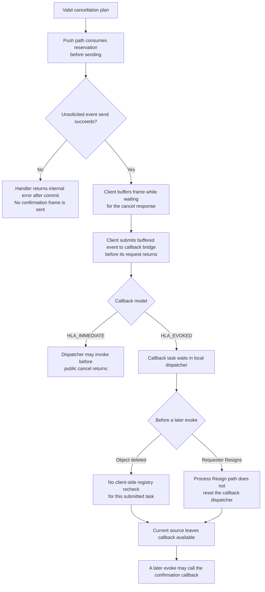

Push-path evidence: [server commit-before-send](../../cpp/src/internal/federation/process_federation_service_ownership_handlers.cpp#L435),
[unsolicited frame send](../../cpp/src/internal/federation/process_federation_service_ownership_handlers.cpp#L449),
[client frame buffering](../../cpp/src/internal/federation/process_federation_client.cpp#L427),
[request dispatch before return](../../cpp/src/internal/federation/process_federation_client.cpp#L504),
[callback-queue handoff](../../cpp/src/internal/federation/process_federation_client_callback_dispatch.cpp#L265),
[callback bridge submission](../../cpp/src/internal/federation/process_federation_callback_bridge.cpp#L1390),
[immediate/evoked dispatcher behavior](../../cpp/src/internal/callbacks/callback_dispatcher.cpp#L122),
and [process Resign branch](../../cpp/src/internal/runtime/umbra_rti_ambassador_federation_lifecycle.cpp#L785).
The only focused public process cancellation case remains the
[default-pull HLA_EVOKED test](../../cpp/tests/attribute_ownership_acquisition_catch2.cpp#L987);
no 2010 behavior is inferred.

### Regular acquisition with an owner response

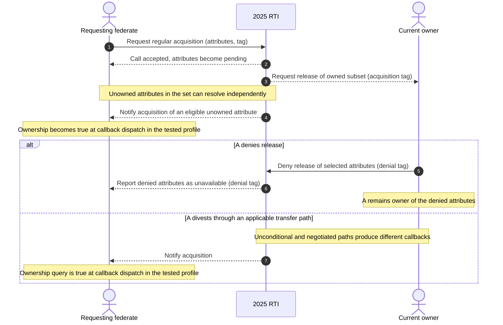

The shortened labels correspond to `attributeOwnershipAcquisition`, the
`requestAttributeOwnershipRelease` callback, the owner's
`attributeOwnershipReleaseDenied` response, and the requester's
`attributeOwnershipUnavailable` outcome.

This diagram summarizes only the paths represented by the cited tests. It
does not claim a particular arbitration order among multiple requesters or
cover every legal owner response.

The case
[Embedded Attribute Ownership Acquisition honors 2025 release and denial callbacks](../../cpp/tests/ieee1516_2025_attribute_ownership_acquisition_release_callbacks_catch2.cpp)
demonstrates several easily missed details:

- The request includes both an owner-held attribute and an unowned attribute;
  the unowned attribute can notify and transfer while the owner-held one stays
  pending.
- A regular request can supersede pending If-Available work in this scenario;
  stale queued work is suppressed rather than becoming a second public result.
- Repeating an already-pending regular request does not queue another owner
  release callback in this tested profile.
- The owner receives the requester's acquisition tag with the release request.
  If the owner denies release, the requester receives the denial call's tag in
  its Unavailable callback, and the owner retains ownership.
- Pending acquisition constrains unpublication in this scenario; publication
  is not merely an unrelated declaration detail.

### If Available: evaluate at the result callback

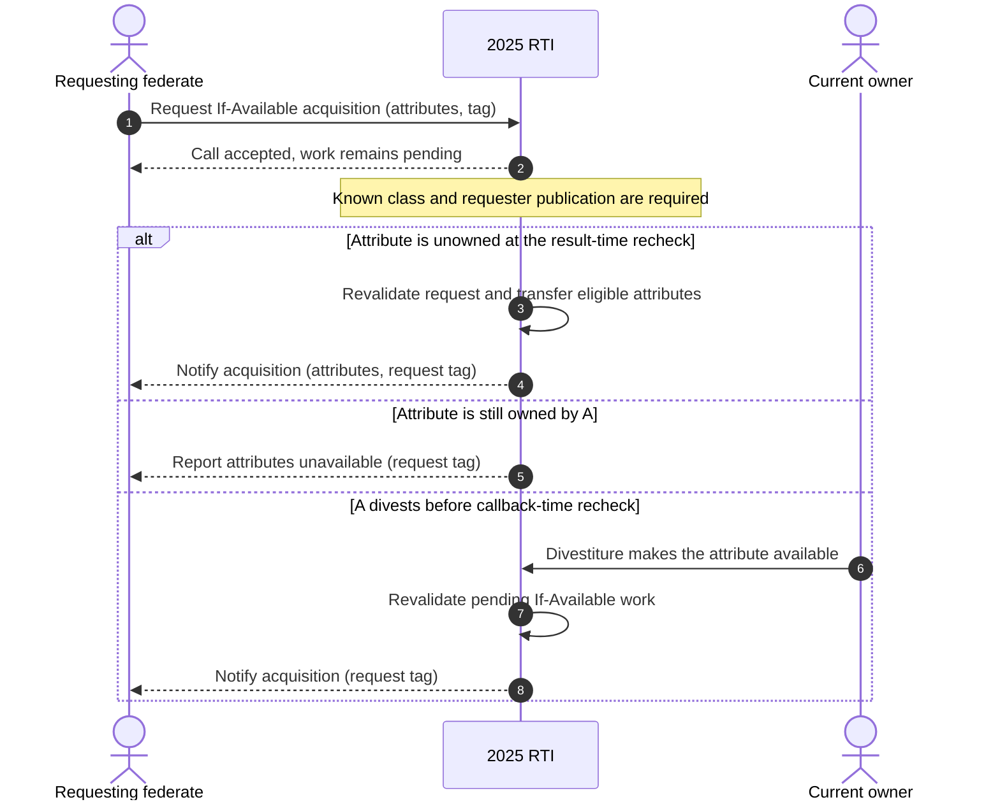

The branches are outcomes at the embedded profile's callback-time recheck, not
a promise that an owned attribute will be held indefinitely for the requester.
The focused [embedded If-Available test](../../cpp/tests/ieee1516_2025_attribute_ownership_acquisition_if_available_catch2.cpp#L112)
shows a mixed attribute set resolving into both Notification and Unavailable
callbacks. It also exercises repeated pending requests and the publication
guard against withdrawing a declaration needed by pending work.

### Process endpoint: private result and callback event are separate

The 2025 process endpoint adds an Umbra transport boundary around this HLA
service. The source-derived view below is not a second normative state machine:

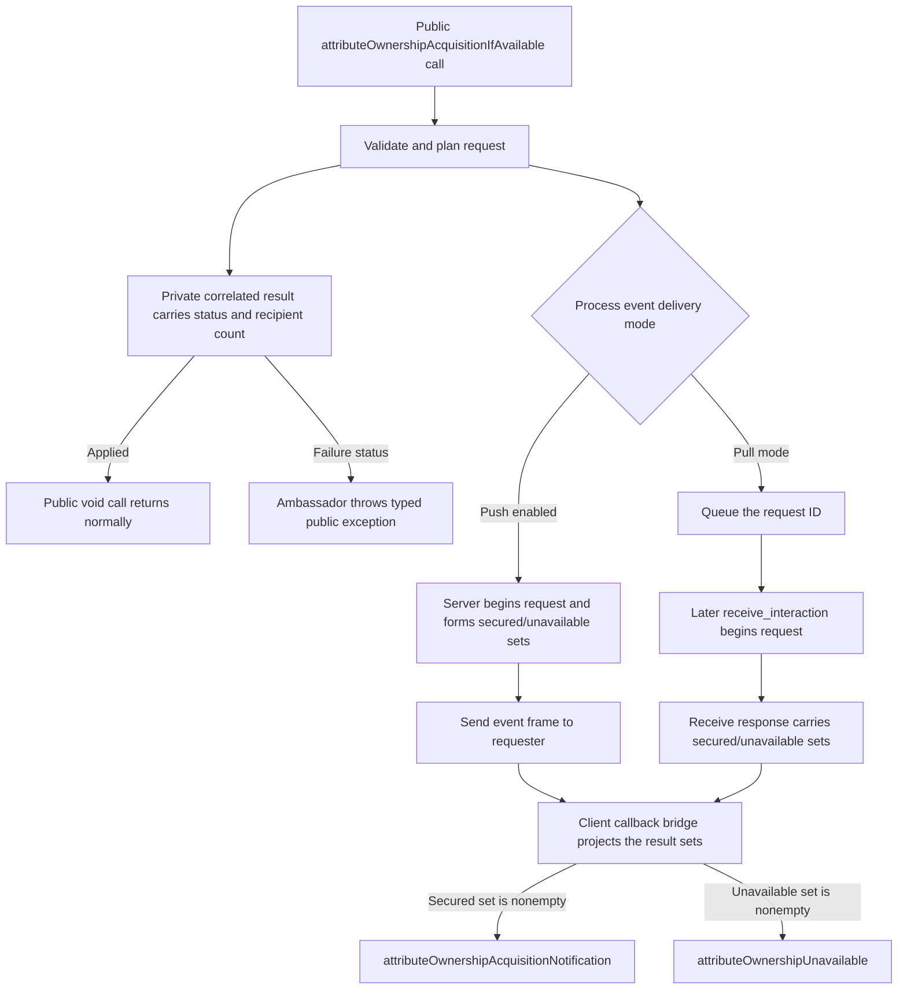

The public [§7.9 signature](../../third_party/ieee1516.1-2025/include/RTI/RTIambassador.h#L1061)
is `void`. Umbra maps a non-applied private status to a typed API exception;
the private recipient count is not an ownership result. At the server boundary,
push mode resolves the request before sending its event frame, while pull mode
queues its request ID and resolves it during a later `receive_interaction`
([handler](../../cpp/src/internal/federation/process_federation_service_ownership_handlers.cpp#L211),
[poll path](../../cpp/src/internal/federation/process_federation_service_receive.cpp#L468)).
The [callback bridge](../../cpp/src/internal/federation/process_federation_callback_bridge.cpp#L452)
converts the disjoint result sets to the corresponding public callbacks. These
are implementation scheduling details; callback model and event transport are
separate, and this diagram makes no portable callback-before-return claim.

The focused [configured-process case](../../cpp/tests/attribute_ownership_acquisition_if_available_catch2.cpp#L376)
uses `HLA_EVOKED`, the default pull-event configuration, and one unowned
attribute. It observes the acquisition notification and its tag after callback
evocation, but does not query ownership or cover an owned/unavailable member,
a mixed result, or pushed events. A separate process
[Release Denied case](../../cpp/tests/attribute_ownership_acquisition_catch2.cpp#L674)
tests `attributeOwnershipUnavailable` after regular acquisition; it is not
If-Available evidence. Likewise, the process
[acquisition-cancellation case](../../cpp/tests/attribute_ownership_acquisition_catch2.cpp#L987)
starts with regular acquisition, not §7.9. Do not use either to claim process
coverage of If-Available unavailable or cancellation outcomes. The embedded
mixed-outcome and ownership-query assertions remain a separate evidence lane.

### Release Denied in the process profile: service result versus callback

The HLA-level branch above pairs the owner's §7.12
`attributeOwnershipReleaseDenied` service with the requester's §7.10
`attributeOwnershipUnavailable` callback. This sequence adds the 2025 process
profile's two-client transport boundary; it is not a portable callback-timing
rule.

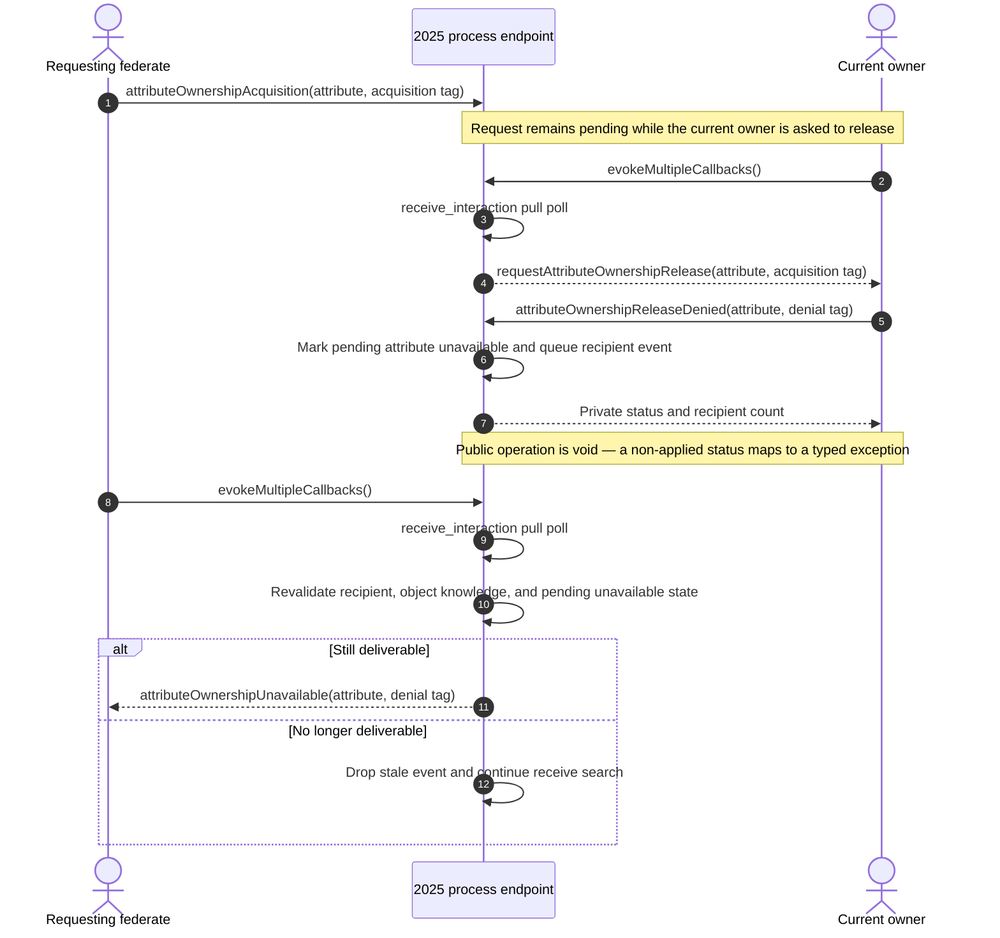

In the focused [configured-process test](../../cpp/tests/attribute_ownership_acquisition_catch2.cpp#L674),
the owner's call returns normally while the requester's report list is still
empty. The test then evokes the requester and checks one Unavailable report's
object, attribute, and owner-supplied denial tag. It uses HLA_EVOKED and one
requester/one owned attribute; it does not query ownership or test immediate
dispatch, multiple requesters, stale delivery, or denial racing an acquisition
cancellation. The existing HLA-level chart says the owner remains owner; this
process case does not independently assert that query result.

Umbra-specific source note: the process handler returns a private status and
recipient count separately from the queued callback event. The registry groups
denied attributes by pending requester, replans remaining acquisition work,
and rechecks the requester, known object/class, and pending unavailable marker
before exposing a pull event. If cancellation is requested while the owner's
release callback is in flight, the registry source makes Release Denied the
winning terminal event. These are implementation observations, not additional
portable HLA ordering claims; the focused process test does not exercise the
multi-requester or cancellation-race branches.

Evidence locators: pinned [§7.12 service](../../third_party/ieee1516.1-2025/include/RTI/RTIambassador.h#L1066)
and [§7.10 callback](../../third_party/ieee1516.1-2025/include/RTI/FederateAmbassador.h#L438);
process [owner handler](../../cpp/src/internal/federation/process_federation_service_ownership_handlers.cpp#L314),
[pull delivery recheck](../../cpp/src/internal/federation/process_federation_service_receive.cpp#L323)
and [callback bridge](../../cpp/src/internal/federation/process_federation_callback_bridge.cpp#L585);
Umbra's [recipient revalidation and cancellation precedence](../../cpp/src/internal/federation/federation_registry_attribute_ownership_cancellation.cpp#L220)
and [denial planning](../../cpp/src/internal/federation/federation_registry_attribute_ownership_acquisition.cpp#L492).

## Owner-side transfer paths

### Negotiated divestiture adds a confirmation stage

Negotiated divestiture is not the same sequence as denying a release request.
The owner initiates a negotiated divestiture, receives a
requestDivestitureConfirmation callback, and may confirm the transfer. In a
focused 2025 process-boundary scenario, the confirmation then leads to the
regular requester's acquisition-notification callback. A separate assumption
offer can be delivered to another candidate while that confirmation is
pending; the offer itself does not transfer ownership.

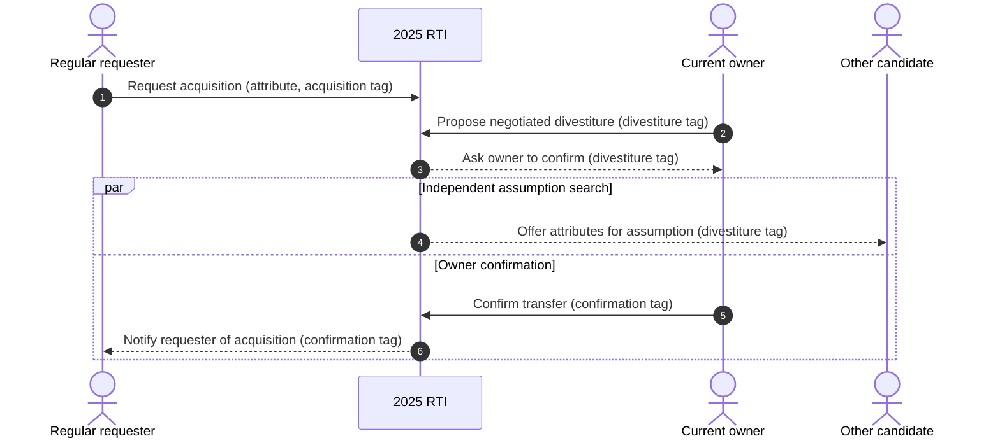

The targeted
[Confirm Divestiture with a pushed assumption candidate](../../cpp/tests/ieee1516_2025_confirm_divestiture_process_assumption_catch2.cpp)
test demonstrates the separate callback paths and tag ownership. It is a
process-boundary test, not evidence that every deployed transport or profile
supports the same end-to-end scope.

Keep the process request result separate from the HLA ownership outcome. The
pinned 2025 `attributeOwnershipAcquisition`,
`negotiatedAttributeOwnershipDivestiture`, and `confirmDivestiture` operations
return `void` and declare synchronous typed exceptions
([§7.8](../../third_party/ieee1516.1-2025/include/RTI/RTIambassador.h#L1042),
[§7.5](../../third_party/ieee1516.1-2025/include/RTI/RTIambassador.h#L1006),
[§7.6](../../third_party/ieee1516.1-2025/include/RTI/RTIambassador.h#L1024)).
Internally, the process service returns a correlated status/count to finish each
request, while ownership callback work is queued separately
([acquisition](../../cpp/src/internal/federation/process_federation_service_ownership_handlers.cpp#L156),
[negotiated divestiture and confirmation](../../cpp/src/internal/federation/process_federation_service_ownership_handlers.cpp#L545)).
That private result is not a public ownership value or a substitute for the
per-attribute callback. In the linked `HLA_IMMEDIATE` test, the requester's
acquisition notification is dispatched during its next ordinary lookup, before
that lookup returns—not during the owner's earlier confirmation call. The
focused assertions verify the callback kind, target attribute, and confirmation
tag; they do not add process-path `isAttributeOwnedByFederate` evidence. Keep
ownership-query timing claims scoped to the selected cases in
[Query Attribute Ownership](#query-attribute-ownership-reports-a-snapshot-it-does-not-transfer).

#### A requester can cancel after the owner receives confirmation

The successful process-boundary path above is not the only way a negotiated
divestiture can end. A separate focused embedded 2025 case delivers
`requestDivestitureConfirmation`, then accepts the requester's
`cancelAttributeOwnershipAcquisition` before the owner calls
`confirmDivestiture`. The pinned service declaration lists
`NoAcquisitionPending` for that confirmation call (§7.6). In the selected test,
the owner still owns the attribute, the requester does not, and the owner can
clear the negotiated divestiture; the requester later observes its cancellation
confirmation when its callbacks are drained. This is one embedded service
ordering, not process-profile parity or a general callback-timing rule.

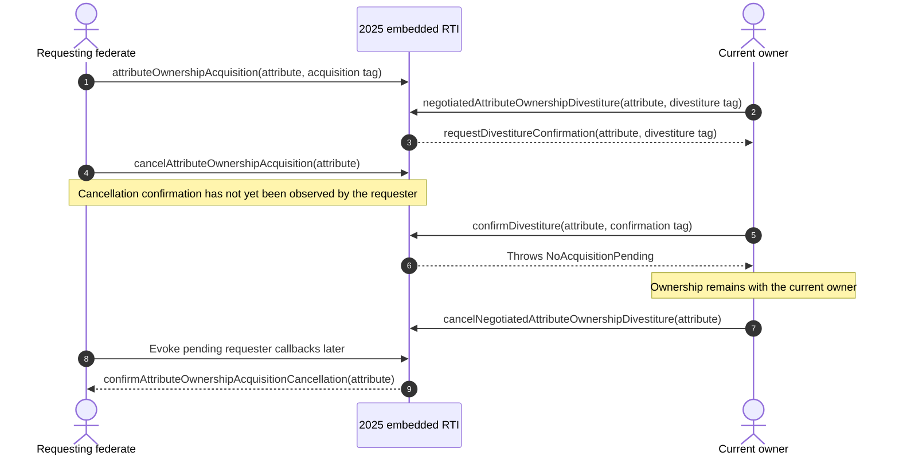

The [pinned Confirm Divestiture signature](../../third_party/ieee1516.1-2025/include/RTI/RTIambassador.h#L1013)
declares the exception. The [focused embedded case](../../cpp/tests/negotiated_attribute_ownership_divestiture_pending_catch2.cpp#L527)
checks cancellation after the confirmation callback, the typed exception, both
ownership queries, and cleanup; the [registry transition](../../cpp/src/internal/federation/federation_registry_negotiated_attribute_ownership_divestiture.cpp#L354)
retains ownership when it finds no active acquirer. Keep these claims scoped to
the API surface and selected embedded source/test evidence.

### Unconditional divestiture and assumption offers

In the exercised embedded scenario, unconditional divestiture first removes
the old owner's ownership. Pending regular and If-Available requesters may
then receive their own acquisition notification. The RTI can also search for
eligible assumption candidates and send requestAttributeOwnershipAssumption.
That callback is an **offer**, not an ownership transfer: the candidate remains
non-owner until its later acquisition request resolves through an acquisition
notification.

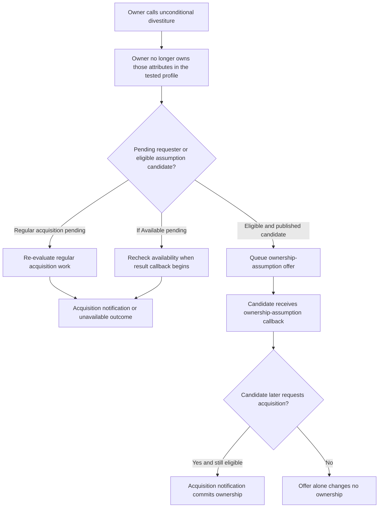

The focused
[Unconditional Attribute Ownership Divestiture offers eligible 2025 federates](../../cpp/tests/ieee1516_2025_unconditional_attribute_ownership_divestiture_catch2.cpp)
shows that a candidate that stopped publishing before callback dispatch gets
no stale offer, that a previously pending If-Available request can resolve
after divestiture, and that the assumption recipient remains a non-owner until
it separately requests acquisition. The search can continue after stale work
is suppressed; a candidate that republishes can become eligible for a fresh
offer.

### Process endpoint: Unconditional Divestiture and recipient work are separate

The 2025 process route sends the public request to the process client and
service, where the registry plan removes the previous owner and returns
follow-up acquisition work plus eligible assumption recipients. The service
then projects those recipient events using its configured push or pull event
transport and returns a private accepted Boolean; the public service itself is
`void`. That Boolean does not identify who acquired an attribute or prove that
any callback has entered application code. The receiving callback model is a
separate dispatch choice, and no callback-before-return order is claimed.

One source-only failure edge matters: registry state is committed before the
service attempts all recipient event enqueue/send work. If that work reports
failure, the handler returns a private internal error that the public adapter
maps to `RTIinternalError`; the inspected path shows no rollback of the already
committed registry transition. No focused process test covers this failure.
If-Available results also use their own request/result slot and are not folded
into the ordinary acquisition-work event queue.

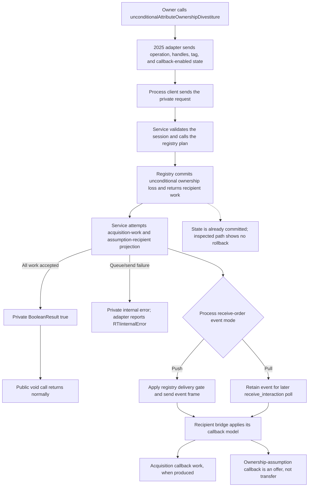

Process evidence: the [public adapter branch](../../cpp/src/internal/runtime/umbra_rti_ambassador_ownership_services.cpp#L831)
calls the [client operation](../../cpp/src/internal/federation/process_federation_client_ownership.cpp#L99);
the [service handler](../../cpp/src/internal/federation/process_federation_service_ownership_handlers.cpp#L662)
calls the [registry plan](../../cpp/src/internal/federation/federation_registry_attribute_ownership_assumptions.cpp#L16)
and then the [recipient queue helpers](../../cpp/src/internal/federation/process_federation_service_attribute_ownership_delivery.cpp#L12).
The [process callback bridge's acquisition-notification branch](../../cpp/src/internal/federation/process_federation_callback_bridge.cpp#L533)
and [ownership-assumption branch](../../cpp/src/internal/federation/process_federation_callback_bridge.cpp#L571)
project these private events to public callbacks. The portable C++ TCK has a
[general unconditional-divestiture scenario](../../packages/hla-rti-cpp-tck/src/portable_tck.cpp#L22587)
and [scenario catalog entry](../../packages/hla-rti-cpp-tck/README.md#L795),
but neither establishes a process-specific run. The focused
[Catch2 behavior case](../../cpp/tests/ieee1516_2025_unconditional_attribute_ownership_divestiture_catch2.cpp#L4)
is embedded; the process probe's occurrence of the operation is inside a
connection-loss cleanup fixture ([fixture](../../cpp/tests/process_federation_service_probe.cpp#L678))
and does not assert this ordinary callback path. Keep the process sequence
source-derived and untested as a whole.

### Divestiture If Wanted has an output-set result and later notifications

The 2025 `attributeOwnershipDivestitureIfWanted` signature (§7.13) gives the
owner an output set, `divestedAttributes`. This is a different completion
channel from a callback: in the focused embedded `HLA_EVOKED` case, the call
returns an empty set and retains ownership when no acquirer is pending; with eligible
regular and If-Available acquirers, it returns the transferred attributes and
ownership queries already show the new owners before their acquisition
notification callbacks are evoked. Those later notifications carry the
divestiture tag, not the earlier acquisition tags. A queued release request
to the former owner is suppressed as stale.

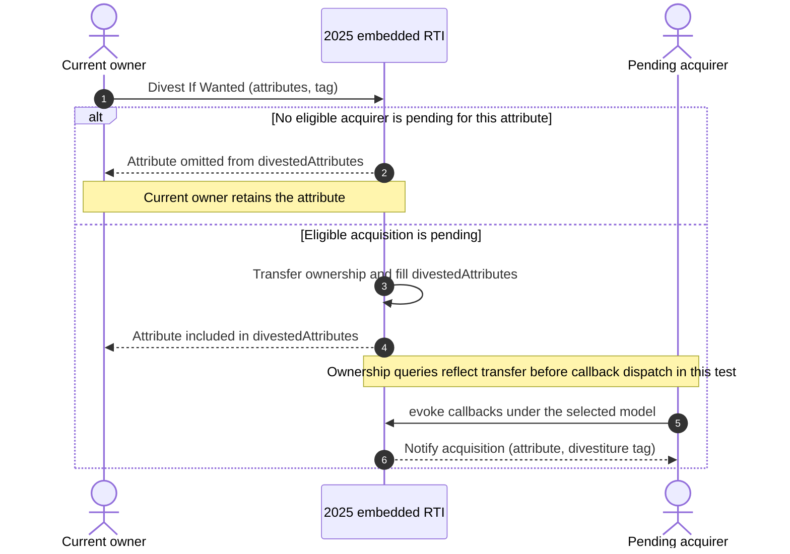

This is a per-attribute view of selected embedded evidence, not a complete
normative arbitration rule or process-endpoint claim. The focused [2025
embedded test](../../cpp/tests/attribute_ownership_divestiture_if_wanted_pending_catch2.cpp#L255)
checks the empty-result/retain-owner case, synchronous transfer result,
regular and If-Available recipients, tag selection, and stale release-callback
suppression. The pinned [service declaration](../../third_party/ieee1516.1-2025/include/RTI/RTIambassador.h#L1093)
defines the output-set interface; the acquisition notification is declared in
the [FederateAmbassador API](../../third_party/ieee1516.1-2025/include/RTI/FederateAmbassador.h#L432).

## Query Attribute Ownership reports a snapshot; it does not transfer

The 2025 API separates the request service (§7.17) from its three result
callbacks (§7.18): `informAttributeOwnership`, `attributeIsNotOwned`, and
`attributeIsOwnedByRTI`. These callback names and sections are visible in the
pinned [RTIambassador API](../../third_party/ieee1516.1-2025/include/RTI/RTIambassador.h)
and [FederateAmbassador API](../../third_party/ieee1516.1-2025/include/RTI/FederateAmbassador.h).
The following diagrams describe the **embedded 2025 path only**. The process
endpoint takes a separate client/protocol branch in the ambassador and is not
claimed equivalent here.

The service validates membership, object knowledge, and the supplied
attribute handles before planning a report. Failures at those gates are
synchronous service exceptions, not ownership-result callbacks. For an
ordinary object, the embedded registry groups each nonempty subset by current
federate owner and places unowned attributes in a separate group. A
joined-federate MOM object has a separate RTI-owned ledger and produces the
`attributeIsOwnedByRTI` result rather than fabricating a federate owner. All
groups route to the querying federate. The query changes no ownership state;
it reports the classification found by the plan and later rechecked at
delivery.

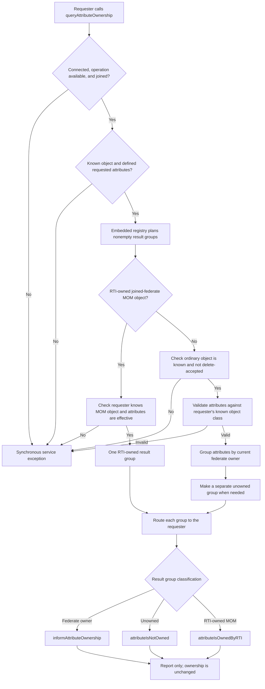

In the focused ordinary-object test, querying one owned and one unowned
attribute produces two distinct requester callbacks after the EVOKED callback
queue is drained; the owner receives neither callback. The MOM case exercises
the separate RTI-owned result and confirms that `isAttributeOwnedByFederate`
remains false for those attributes. These are selected embedded scenarios,
not an exhaustive exception matrix or a process-profile parity claim.

Planning a group is not a promise that its callback will still be meaningful
when user code runs. The embedded path records a pending query identity,
submits its callback route after releasing the registry lock, then consumes
and validates that identity and recomputes the current projection at callback
entry. A removed ordinary object, a no-longer-known projection, or attributes
that no longer match the planned result can suppress that group. The focused
deletion case shows that an already queued ownership report is suppressed
after object removal while the removal callback itself is still delivered.

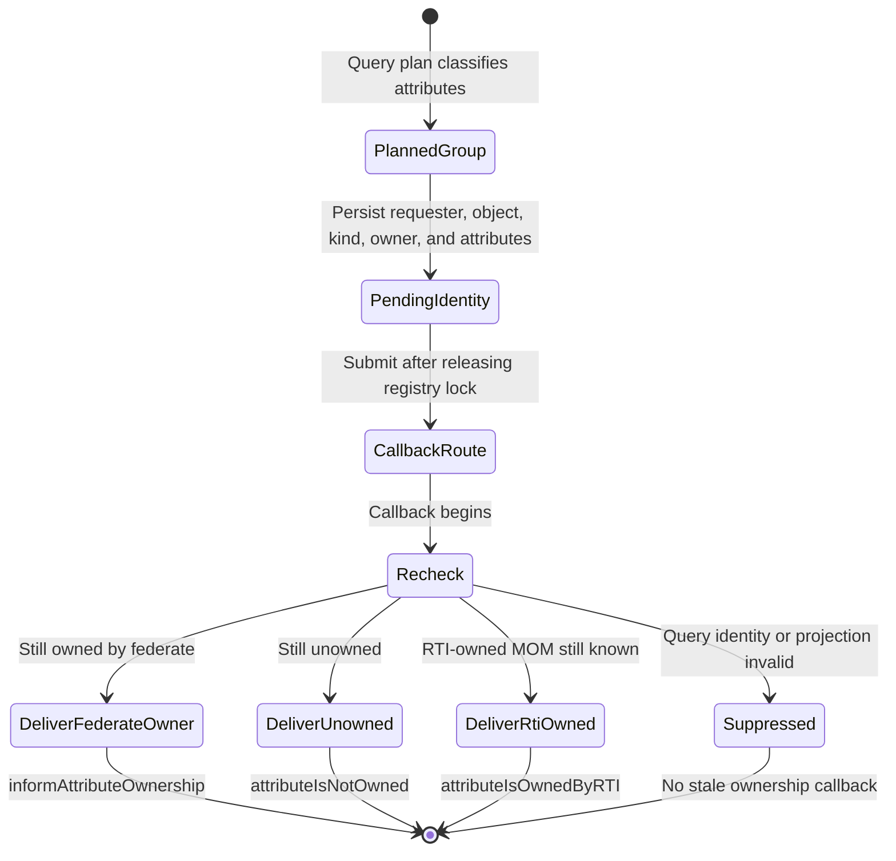

The save/restore tests add a separate persistence boundary: selected pending
unowned and RTI-owned query groups are present in the saved image and can be
rebound after a fresh embedded registry is created. Those two focused cases
exercise both `HLA_EVOKED` and `HLA_IMMEDIATE`; they do not establish restore
coverage for every result kind or every save/restore cut point. The diagrams
also do not specify ordering among independently planned result groups.
These query-result groups are distinct from ownership-transfer requests; see
the [ownership-persistence companion](HLA-2025-OWNERSHIP-PERSISTENCE-AND-RESIGNATION-FLOW-GUIDE.md)
for selected release, assumption, and recipient work across restore.

## Accepted object deletion invalidates pending ownership work

For an accepted receive-order `deleteObjectInstance`, the embedded registry
marks deletion accepted and clears pending ownership-query identities and
ownership-operation ledgers. Queued query, regular owner-release,
If-Available, and cancellation callbacks therefore re-enter their callback
gates against an object/request that is no longer eligible, and the selected
embedded tests observe those stale ownership callbacks being suppressed. A
separate receiver-removal reservation is still checked at its own gate; if the
receiver remains a member that knows the object, Umbra commits that receiver
to unknown before `removeObjectInstance`. These are separate callback gates,
not a promise of global ordering among ownership and removal callbacks.

This accepted federation-wide deletion differs from
`localDeleteObjectInstance`, which refuses the caller's local-forget request
while its relevant ownership work is still pending; see the distinct
[local-delete flow](HLA-2025-OBJECT-AND-INTERACTION-INFORMATION-FLOW-GUIDE.md#local-delete-forgets-one-federates-view-it-does-not-delete-the-instance).
The diagram's stale-work branches are directly exercised for ownership
queries, regular owner-release requests, If-Available results, and cancellation
confirmation. Other cleared ledgers are source-observed here, not individually
proven by these four deletion scenarios. The focused If-Wanted, negotiated
divestiture, and Confirm Divestiture test files surveyed for this update had no
direct delete/removal references. One If-Wanted restore test does stage a
pending notification and then resigns the owner with
`CANCEL_THEN_DELETE_THEN_DIVEST` before draining callbacks, but it makes no
post-deletion callback assertion; treat that as indirect setup evidence, not
proof of suppression. The Confirm Divestiture candidate-resignation test also
captures a pending notification before the candidate resigns, then tears down
the remaining owner without checking a post-delete callback. Deletion
suppression for these operation families remains source-observed.

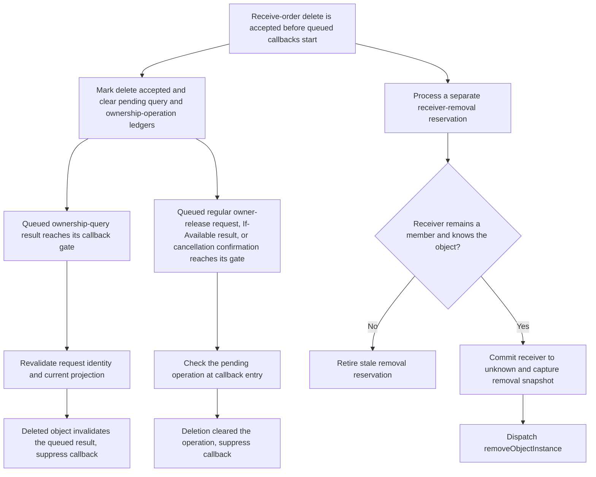

The registry's [accepted-delete cleanup](../../cpp/src/internal/federation/federation_registry_object_instance_deletion.cpp#L99),
the [query-result gate](../../cpp/src/internal/runtime/umbra_rti_ambassador_ownership_callback_dispatch.cpp#L20),
the [If-Available gate](../../cpp/src/internal/runtime/umbra_rti_ambassador_ownership_callback_dispatch.cpp#L79),
the [regular release-request gate](../../cpp/src/internal/runtime/umbra_rti_ambassador_ownership_callback_dispatch.cpp#L256),
and the [receiver-removal gate](../../cpp/src/internal/runtime/umbra_rti_ambassador_object_instance_lifecycle_callbacks.cpp#L1331)
establish separate source paths. Focused `HLA_EVOKED` tests demonstrate
[query-result suppression](../../cpp/tests/attribute_ownership_query_catch2.cpp#L359),
[regular owner-release suppression](../../cpp/tests/ieee1516_2025_attribute_ownership_acquisition_release_callbacks_catch2.cpp#L201),
[If-Available suppression](../../cpp/tests/attribute_ownership_acquisition_if_available_catch2.cpp#L353),
and [cancellation-confirmation suppression](../../cpp/tests/attribute_ownership_acquisition_cancellation_catch2.cpp#L359),
each with a receive-order removal callback. They are separate scenarios and do
not establish all-ledger callback ordering or process-endpoint parity.

## Edge cases worth remembering

- **Attribute sets are not atomic ownership units.** Track outcomes by each
  object-instance attribute, even when a service accepts one set.
- **Callbacks can be stale.** Object deletion, resignation, publication
  changes, or a superseding request can invalidate queued work before user code
  runs. The dispatcher/registry revalidates at delivery boundaries; do not
  draw every queued callback as guaranteed to execute.
- **More than one requester can be pending.** The
  [multiple-acquirer release-denied case](../../cpp/tests/ieee1516_2025_attribute_ownership_release_denied_multi_acquirer_catch2.cpp)
  shows a denial resolving both requesters as unavailable while the current
  owner remains owner. This guide does not specify fairness or winner
  selection for competing successful transfers.
- **A request may be rejected before it enters a pending state.** Connection,
  federation membership, known object instance, defined attributes, and
  publication are distinct preconditions. The cited tests exercise selected
  failures; this is not the complete exception matrix.
- **Ownership is not update delivery.** Time ordering, region relevance,
  subscription filtering, and update-queue behavior form additional state
  machines. Read the dedicated [timing guide](HLA-2025-TIME-MANAGEMENT-GUIDE.md)
  and [DDM/region guide](HLA-2025-DATA-DISTRIBUTION-AND-REGIONS-FLOW-GUIDE.md)
  before inferring whether a new owner has received any particular value. The
  [cross-cutting object-attribute map](HLA-2025-CROSS-CUTTING-STATE-EVENT-OBSERVATION-GUIDE.md#an-object-attribute-value-touches-several-independent-boundaries)
  gives the HLA-first overview of these independent gates; the focused guides
  retain their separate state machines. The
  [TSO ownership-change trace](HLA-2025-TSO-RETRACTION-FLOW-GUIDE.md#ownership-changes-and-an-accepted-tso-update-are-separate-timelines)
  shows one embedded case where an already-accepted update survives a transfer;
  acquisition does not add a new recipient retroactively or bypass the current
  recipient's callback gates.
- **Persistence and resignation are outside this core transfer guide.** See the
  [ownership persistence and resignation companion](HLA-2025-OWNERSHIP-PERSISTENCE-AND-RESIGNATION-FLOW-GUIDE.md)
  for selected pending-work restore and member-scoped cancellation scenarios;
  those diagrams remain bounded to the cited 2025 implementation and tests.
  For the broader current-implementation comparison of all six voluntary
  `ResignAction` values, including the pending-acquisition preflight, see the
  [federation lifecycle guide](HLA-2025-FEDERATION-AND-FEDERATE-LIFECYCLE-FLOW-GUIDE.md#resignaction-effects-in-the-current-implementation).
  It is not a full normative decision table or process-profile action matrix.

## Source and focused evidence

- Public 2025 service adaptation and callback scheduling:
  [ownership services](../../cpp/src/internal/runtime/umbra_rti_ambassador_ownership_services.cpp),
  [ownership callback dispatch](../../cpp/src/internal/runtime/umbra_rti_ambassador_ownership_callback_dispatch.cpp).
- Query result planning and callback-time projection:
  [embedded registry query planning and recipient revalidation](../../cpp/src/internal/federation/federation_registry_attribute_ownership_acquisition_if_available.cpp),
  [query callback dispatch](../../cpp/src/internal/runtime/umbra_rti_ambassador_ownership_callback_dispatch.cpp#L20),
  and the public 2025 API headers linked above.
- State planning and callback-entry revalidation:
  [regular acquisition registry](../../cpp/src/internal/federation/federation_registry_attribute_ownership_acquisition.cpp),
  [If-Available registry](../../cpp/src/internal/federation/federation_registry_attribute_ownership_acquisition_if_available.cpp),
  [negotiated divestiture registry](../../cpp/src/internal/federation/federation_registry_negotiated_attribute_ownership_divestiture.cpp).
- Focused tests:
  [regular acquisition, release, and denial](../../cpp/tests/ieee1516_2025_attribute_ownership_acquisition_release_callbacks_catch2.cpp),
  [If Available](../../cpp/tests/ieee1516_2025_attribute_ownership_acquisition_if_available_catch2.cpp),
  [unconditional divestiture and assumption search](../../cpp/tests/ieee1516_2025_unconditional_attribute_ownership_divestiture_catch2.cpp),
  [negotiated divestiture cancellation and NoAcquisitionPending](../../cpp/tests/negotiated_attribute_ownership_divestiture_pending_catch2.cpp#L204),
  [multiple acquirers after release denial](../../cpp/tests/ieee1516_2025_attribute_ownership_release_denied_multi_acquirer_catch2.cpp),
  [process-boundary confirmation with an assumption candidate](../../cpp/tests/ieee1516_2025_confirm_divestiture_process_assumption_catch2.cpp),
  [embedded query grouping and deletion invalidation](../../cpp/tests/ieee1516_2025_embedded_query_attribute_ownership_catch2.cpp),
  [RTI-owned MOM query result](../../cpp/tests/ieee1516_2025_rti_owned_mom_ownership_query_catch2.cpp),
  [pending unowned query restore](../../cpp/tests/ieee1516_2025_public_fresh_registry_pending_unowned_query_attribute_ownership_restore_catch2.cpp),
  and [pending RTI-owned query restore](../../cpp/tests/ieee1516_2025_public_fresh_registry_pending_rti_owned_query_attribute_ownership_restore_catch2.cpp).

The first acquisition case is indexed as
umbra-cpp-attribute-ownership-acquisition-integration: 73 assertions, mapped
to four canonical IEEE 1516.1-2025 sections (7.7.3, 7.8, 7.11, and 7.12) by the
current test-plan query. Those mappings are traceability aids, not conformance
evidence.

## Deliberate limits and next step

This guide does not attempt to encode every ownership exception, arbitration
rule, callback control, automatic resignation action, MOM report, persistence
transition, or interaction with time and DDM. It describes a set of high-value
paths whose behavior is visible in current 2025 source and tests. Expand it
only when a focused source-and-test review can support the added diagram.

The planned HLA-first cross-read of the attribute-value update, update-rate,
ownership, and subscription guides is complete. It found the necessary
distinctions already legible across the existing guides: sender service result
and per-attribute authority, receiver interest and eligibility, per-attribute
projection and rate admission, and callback observation. The cross-cutting
object-attribute map supplies the overview, while focused guides preserve the
separate state machines and embedded/process evidence. No synthesis diagram
was warranted. The direct-requester entitlement question for Request Attribute
Value Update remains an explicit normative gap in its dedicated guide; this
cross-read does not resolve it.

The negotiated-divestiture cancellation sequence is source/test-reviewed but
has no fresh Mermaid parser, local render, visual inspection, or GitHub verdict.
The configured Scoop sources had no `mmdc` manifest, so no package was
installed. Keep this validation gap visible; do not treat manual syntax review
as a renderer result.

Next documentation handoff: resolve the open 2025 Request Attribute Value
Update entitlement question: does making an explicit value request itself
make an otherwise ineligible requester a receiver of the provider's later
update? The current guide and selected tests keep solicitation separate from
ordinary update receiver eligibility, but neither establishes the normative
§6.21 rule. Use an authorized copy of the clause; if unavailable, leave the
portable outcome open and continue another bounded HLA-first review. Preserve
2010/2025 and embedded/process boundaries; do not build, rerun tests, start CI,
or edit the Requirements Lab during documentation work.
