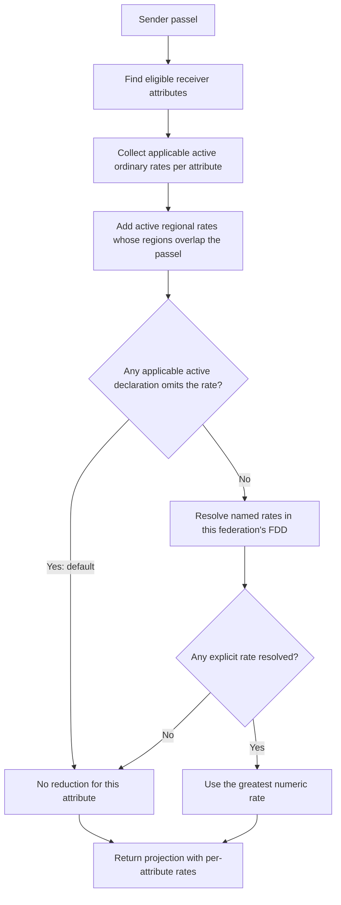
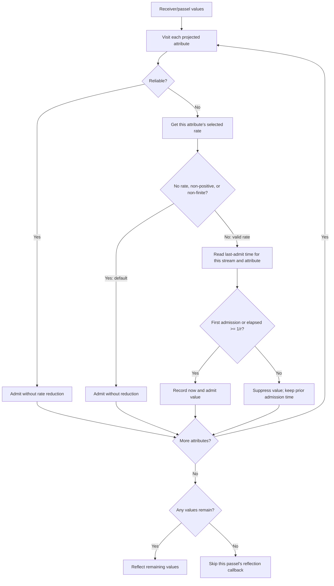
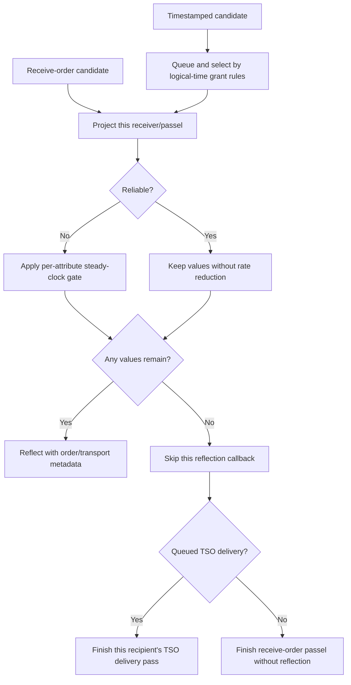

# HLA 1516.1-2025 Attribute Update-Rate Admission Flow Guide

> **Scope:** IEEE 1516.1-2025 API, Umbra's embedded federation-management
> development profile. This describes the observed 2025 implementation and
> selected tests; it is not a complete normative account or evidence of
> process-profile parity. The 2010 RTI stream is separate and is not covered.

The HLA 2025 API exposes a subscription update-rate designator and
update-rate queries. Keep that control distinct from an owner's Attribute
Relevance Advisory, an attribute update itself, and logical-time advancement.
This guide follows one receiver's attribute values through rate selection,
best-effort admission, and the separate receive-order and TSO delivery
boundaries. The detailed rate-combination and callback-admission rules below
are selected 2025 embedded implementation observations, not a universal
normative rate algorithm or evidence of process-profile parity.

## Keep the decisions separate

These are related but independent questions. Passing one does not imply that
the value passes the others. The table is a reader's orientation map, not a
universal order of RTI service processing.

| Question | Keep separate from rate admission |
| --- | --- |
| Who may update this object-instance attribute? | **Ownership** is sender-side authority; it does not decide whether a receiver's candidate value passes its rate gate. See the [ownership guide](HLA-2025-ATTRIBUTE-OWNERSHIP-FLOW-GUIDE.md). |
| Which receiver attributes are candidates? | **Publication, subscription, and DDM** determine the candidate projection before this guide's per-attribute filter. See [object/interaction information flow](HLA-2025-OBJECT-AND-INTERACTION-INFORMATION-FLOW-GUIDE.md) and [DDM/regions](HLA-2025-DATA-DISTRIBUTION-AND-REGIONS-FLOW-GUIDE.md). |
| What order does the delivery report? | **Receive order versus timestamp order** selects the delivery path and callback metadata; it is not the rate clock. See [order and transportation](HLA-2025-ORDER-AND-TRANSPORTATION-FLOW-GUIDE.md). |
| Which transportation category applies? | The category is separate from order. In the observed embedded 2025 path, reliable values bypass rate reduction and best-effort values reach the rate gate; this is not a wire-protocol or QoS guarantee. See [order and transportation](HLA-2025-ORDER-AND-TRANSPORTATION-FLOW-GUIDE.md). |
| When can queued TSO work reach delivery? | **Time management** selects the grant/delivery boundary first; the rate filter then uses steady-clock elapsed time, not the message's logical timestamp. See the [time-management guide](HLA-2025-TIME-MANAGEMENT-GUIDE.md). |
| Is this receiver's value admitted now? | The subscription's **update-rate designator** feeds the per-attribute admission path described below. In this implementation it is not a timer that schedules suppressed values or a globally guaranteed callback cadence. |

## The public vocabulary

The 2025 `subscribeObjectClassAttributes` API accepts an active/passive flag
and an optional update-rate designator. The API also exposes
`getUpdateRateValue` (§10.11) and `getUpdateRateValueForAttribute` (§10.12).
The pinned 2025 MIM defines `HLAmaxUpdateRate` using the `HLAupdateRateName`
type. These identify the public vocabulary and lookup surfaces; the exact
combination and admission behavior charted below is an implementation
observation, not an independent statement of every normative rate rule.

- [Pinned `subscribeObjectClassAttributes` declaration](../../third_party/ieee1516.1-2025/include/RTI/RTIambassador.h#L535)
- [Pinned update-rate query declarations, §§10.11–10.12](../../third_party/ieee1516.1-2025/include/RTI/RTIambassador.h#L1778)
- [Pinned MIM `HLAmaxUpdateRate`](../../third_party/ieee1516.2-2025/resources/mim/HLAstandardMIM-2025.xml#L1354) and [`HLAupdateRateName`](../../third_party/ieee1516.2-2025/resources/mim/HLAstandardMIM-2025.xml#L3594)

Keep the **designator name**, its **numeric table value**, and a delivered
attribute value separate:

| Public/model surface | Carries or returns | Do not read it as |
| --- | --- | --- |
| FDD/OMT updateRate row | A model-defined name paired with a numeric rate ([schema](../../third_party/ieee1516.2-2025/resources/schemas/IEEE1516-OMT-2025.xsd#L2476), [example](../../third_party/ieee1516.2-2025/resources/examples/RestaurantFOMmodule-2025.xml#L667)). | A universal keyword or a value sent with each attribute update. |
| subscribeObjectClassAttributes(..., updateRateDesignator) | The name selected for the subscription. | A numeric parameter or a promise that the owner publishes at that cadence. |
| getUpdateRateValue(name) | A numeric lookup for the named designator. | A delivery event; the service returns a value, not a reflection callback. |
| getUpdateRateValueForAttribute(instance, attribute) | A numeric query scoped to an object instance and attribute. | Proof that an update was admitted or observed by the application. |

The API/MIM vocabulary establishes the name and query surfaces; it does not
by itself establish how simultaneous declarations combine or when a callback
occurs. In the current embedded profile, the per-attribute query reflects the
maximum represented rate among active ordinary and regional declarations; it
has no region argument, and passive declarations do not contribute. Treat that
aggregation as an implementation observation, not a portable HLA rule. See
the [registry query](../../cpp/src/internal/federation/federation_registry_catalog_queries.cpp#L345)
and [focused query case](../../cpp/tests/update_rate_value_catch2.cpp#L122).

## 1. Resolve a rate for each receiver and attribute

Ordinary subscription matching, publication, object knowledge, and any
applicable region checks establish the receiver's candidate attributes first.
For each projected attribute, the current embedded planner considers active
ordinary declarations and active regional declarations whose region applies to
the sent passel. A passive regional declaration does not contribute to this
delivery-rate selection.

Here, **passel** is Umbra's implementation term for a group of candidate
attribute values processed together. It is not a distinct HLA value or wire
unit; the chart's delivery result still applies per receiver and attribute.

In this implementation, an omitted/empty designator on any applicable active
declaration selects the no-reduction path for that attribute, even if another
applicable declaration names an explicit rate. Otherwise, the planner keeps
the greatest resolved numeric rate among the applicable active ordinary and
regional declarations. It stores the result per attribute, not as one
projection-wide rate. The exact applicability predicates still belong to
ordinary subscription and DDM logic; this chart does not replace those guides.

This is distinct from the owner's Attribute Relevance Advisory update-rate
designator. `turnUpdatesOnForObjectInstance` may communicate a designator to an
owner; it is not the subscriber-side callback admission clock. See the
[separate relevance-advisory guide](HLA-2025-RELEVANCE-ADVISORY-FLOW-GUIDE.md).

## 2. Admit or suppress each best-effort value at delivery

Once a receiver/passel projection is ready, the 2025 embedded callback paths
filter each projected attribute independently. Reliable transport bypasses
reduction. For best-effort transport, a missing/non-positive rate follows the
default path; a positive finite rate `r` allows an admission when that
attribute has no previous admission or at least `1/r` seconds have elapsed on
`std::chrono::steady_clock` since its last admitted value.

The comparison is strict on suppression: elapsed time **less than** `1/r` is
rejected, so equality is admitted. Only successful admissions update the
stored time. Distinct attributes have independent histories. The admission key
also contains the subscription generation, so a newly created subscription
generation starts with fresh history; resignation and federation teardown
erase only the corresponding history prefixes.

This is a best-effort admission filter, not a timer that schedules a suppressed
value for later delivery and not a measurement of the producer's sustained
rate. If every value in a passel is filtered, that passel does not produce a
reflection callback; another passel or another attribute can still be
delivered.

## 3. Keep the wall clock outside the TSO state machine

Receive-order dispatch and queued timestamp-order delivery reach the same
per-attribute admission rule at different points. For receive-order traffic,
the filter runs on the callback-dispatch path. For TSO traffic, time management
first determines which queued work reaches its delivery/grant boundary; the
rate gate then uses wall-clock elapsed time, not the message's logical
timestamp, to decide which values remain in that reflection.

The final TSO branch is intentionally narrow: a rate-suppressed reflection is
not requeued for a later wall-clock slot. In the focused embedded TSO test,
after matching time-advance requests, no reflection is observed for a
best-effort-only message. One later `retract` call succeeds; a repeated call
throws `MessageCanNoLongerBeRetracted`. Do not describe rate suppression alone
as making the public retraction handle unavailable at the recipient boundary.
This is one test-shaped result, not a normative Retract rule or a full test of
the grant algorithm. The exact grant rules and callback ordering remain in the
[time-management guide](HLA-2025-TIME-MANAGEMENT-GUIDE.md); the TSO chart here
only marks where rate admission intersects that path.

## Process endpoint: subscription metadata is not callback admission

Do not project the embedded gate above onto the 2025 process endpoint. The
process subscription request carries its update-rate designator into the
service and registry, and the recipient projection can contain resolved
per-attribute rates. In the inspected process delivery path, however, the
receive-order and TSO event builders select values using the recipient's
received-attribute set; those builders do not consume the projected rate map
or invoke `UpdateRateGate`. The client dispatch forwards the event to a
callback bridge that calls `reflectAttributeValues`.

Existing process tests establish that an active `High` designator is retained
in the subscription snapshot, that a passive subscription with an empty
designator is represented as such, and that named/numeric update-rate queries
work. They do not send updates under different subscription rates and assert
callback suppression or spacing. The process delivery-reduction cases cover
recipient routing, overlapping-subscription deduplication, and disjoint
regional scope—not rate throttling. Thus the wall-clock admission behavior
documented above remains embedded-profile evidence. This source trace is not a
runtime observation or a conformance judgment; process callback-rate behavior
needs separate normative and runtime resolution. The broader process event
route is shown in the [process-endpoint guide](HLA-2025-PROCESS-ENDPOINT-REQUEST-AND-CALLBACK-FLOW-GUIDE.md).

## Evidence and limits

| Question | Source or focused test | What it establishes |
| --- | --- | --- |
| How does a rate name relate to its numeric value and the per-attribute query? | [Pinned OMT row schema](../../third_party/ieee1516.2-2025/resources/schemas/IEEE1516-OMT-2025.xsd#L2476), [public API](../../third_party/ieee1516.1-2025/include/RTI/RTIambassador.h#L1778), [embedded query](../../cpp/src/internal/federation/federation_registry_catalog_queries.cpp#L345), [focused query case](../../cpp/tests/update_rate_value_catch2.cpp#L122) | The model pairs a name with a numeric value; the API exposes named and object/attribute-scoped numeric queries. The embedded query aggregates current active ordinary/regional subscriptions and excludes passive declarations. A query result is not a callback or cadence guarantee. |
| Which active subscription rates are applicable to an attribute? | [Recipient planner](../../cpp/src/internal/federation/federation_registry_attribute_update_recipients.cpp#L327) | Current source combines applicable ordinary and overlapping active regional declarations per attribute; an applicable omitted/default declaration prevents reduction for that attribute. |
| What clock and interval does the private gate use? | [Gate contract](../../cpp/src/internal/time/update_rate_gate.hpp#L12), [implementation](../../cpp/src/internal/time/update_rate_gate.cpp#L9), [deterministic unit case](../../cpp/tests/ieee1516_2025_update_rate_gate_unit_catch2.cpp#L9) | The implementation uses an injectable steady clock, interval `1/r`, reliable/default bypass, independent keys, successful-admission timestamps, and scoped cleanup. The unit test advances a fake clock rather than sleeping. |
| Are mixed attributes filtered separately? | [Mixed explicit/default subscription case](../../cpp/tests/mixed_update_rate_subscriptions_catch2.cpp#L199) | In the embedded receive-order scenario, the Low-rate value is removed from the next reflection while the HLAdefault value in that same passel remains. |
| Do regional declarations participate? | [Regional best-effort case](../../cpp/tests/regional_best_effort_attribute_rate_catch2.cpp#L204), [passive regional query case](../../cpp/tests/update_rate_passive_regional_subscription_catch2.cpp#L73) | The first exercises overlapping active regional rate admission and resubscription; the second distinguishes passive from active regional declarations for the public rate query. These are separate observations. |
| Where does TSO admission occur, and what if all values are filtered? | [TSO dispatch](../../cpp/src/internal/runtime/umbra_rti_ambassador_time_advance_dispatch.cpp#L390), [mixed reliable/best-effort TSO case](../../cpp/tests/timestamped_attribute_update_rate_reduction_catch2.cpp#L187), [regional TSO case](../../cpp/tests/regional_best_effort_timestamped_attribute_rate_catch2.cpp#L197) | The implementation gates at queued delivery; focused embedded tests show best-effort suppression with reliable retention and regional suppression across grants. The mixed TSO case also checks the empty-reflection/retraction boundary. |
| Does the process endpoint retain a subscription rate designator? | [Process subscription handler](../../cpp/src/internal/federation/process_federation_service_declarations.cpp#L214), [public process subscription case](../../cpp/tests/ieee1516_2025_connection_public_object_subscription_catch2.cpp#L458) | The focused case checks active `High`, passive empty designator, and unsubscribe state in the server registry. It does not deliver attribute updates. |
| Is process callback admission by update rate established? | [Receive-order event projection](../../cpp/src/internal/federation/process_federation_service_attribute_value_updates.cpp#L191), [TSO event projection](../../cpp/src/internal/federation/process_federation_service_tso_delivery.cpp#L77), [callback bridge](../../cpp/src/internal/federation/process_federation_callback_bridge.cpp#L261), [process update-rate query cases](../../cpp/tests/ieee1516_2025_connection_update_rate_catch2.cpp#L458) | These source paths project values by received-attribute handles and forward reflection; the inspected builders do not consume `maximumUpdateRatesByAttribute` or call `UpdateRateGate`. Existing process query coverage does not test per-value admission. This is a source-only profile observation, not a normative or runtime conformance result. |
| What does the process delivery-reduction test lane establish? | [Public update route](../../cpp/tests/ieee1516_2025_connection_update_attribute_values_catch2.cpp#L458), [overlapping-subscription deduplication](../../cpp/tests/ieee1516_2025_connection_update_attribute_values_reflect_catch2.cpp#L458), [disjoint regional suppression](../../cpp/tests/ieee1516_2025_connection_disjoint_regional_update_catch2.cpp#L458) | It covers event routing, duplicate-recipient suppression, and DDM scope. Its regional “suppression” is not evidence of update-rate throttling. |

Additional implementation references: [rate-history key construction](../../cpp/src/internal/runtime/umbra_rti_ambassador.cpp#L96), [receive-order callback gate](../../cpp/src/internal/runtime/umbra_rti_ambassador_object_instance_lifecycle_callbacks.cpp#L785), and [federation rate queries](../../cpp/src/internal/federation/federation_registry_catalog_queries.cpp#L345).

These focused cases are embedded development-profile evidence, not proof of
full IEEE conformance, process-profile parity, or a globally enforced callback
cadence. Do not infer 2010 behavior from this 2025 implementation. Keep
transportation passel construction in the
[object/interaction information guide](HLA-2025-OBJECT-AND-INTERACTION-INFORMATION-FLOW-GUIDE.md),
region matching in the [DDM guide](HLA-2025-DATA-DISTRIBUTION-AND-REGIONS-FLOW-GUIDE.md),
and owner-facing rate advisories in the [relevance guide](HLA-2025-RELEVANCE-ADVISORY-FLOW-GUIDE.md).
