# HLA 1516.1-2025 attribute-value update request flow guide

An HLA attribute-value update request is a solicitation, not a value transfer:
it asks an eligible provider to supply values, but it does not itself return
those values to the requester. The provider callback, the provider's later
update, and a receiver's reflection are distinct events with distinct
eligibility and timing rules. This guide explains that portable service
sequence, then uses the current 2025 API and Umbra implementation as bounded
examples.

This is an HLA-facing behavior guide with bounded source- and test-informed
implementation examples, not a complete normative interpretation of every
request overload. It does not describe or infer IEEE 1516.1-2010 behavior.
Keep the editions' APIs, implementations, and tests on their own paths. Most
implementation detail below follows the embedded 2025 route; the one process
class-request observation is called out separately and is not evidence of
process/embedded parity.

## 1. HLA-facing model: solicitation and value delivery are distinct

The API-facing sequence has separate events: a requester asks for an
attribute-value update, a provider may receive `provideAttributeValueUpdate`,
the provider may later send values with `updateAttributeValues`, and an
eligible receiver may observe a reflection. The request callback carries the
request tag; the later update carries its own value map and tag. The service
clauses determine exact provider and receiver eligibility, which this model
does not attempt to settle.

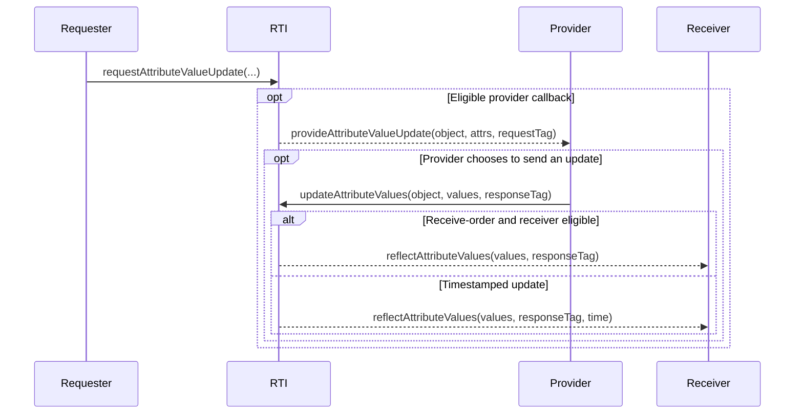

The lifelines are roles, not a claim about four distinct federates; one
federate may occupy more than one role when the applicable service rules permit.

This is a causal reading model, not a required RTI call sequence, complete
normative interpretation, shared call stack, or guarantee that the provider
observes the callback before the request service returns. The callback model
controls when application code can observe the callback: `HLA_EVOKED` uses an
Evoke service, while `HLA_IMMEDIATE` permits callback entry while an RTI service
is executing. That changes callback observation timing, not the distinction
between solicitation and a later value-bearing update. See the
[callback/service-ordering guide](HLA-2025-CALLBACK-AND-SERVICE-ORDERING-FLOW-GUIDE.md)
for the general callback boundary.

The requester is not assumed to be the only possible receiver—or to qualify
as a receiver merely because it requested values. Publication/ownership,
receiver relevance, regional criteria, transportation/order, and time
management are separate service questions. Local focused scenarios do not
settle whether an explicit request creates direct response entitlement for an
otherwise ineligible requester; verify the full §6.21 text before making that
normative claim. Do not conflate that open question with Delay Subscription
Evaluation: the latter changes when ordinary receiver eligibility is evaluated,
not whether an earlier RAVU creates a special receiver right. The vendored
[`RTIambassador.h`](../../third_party/ieee1516.1-2025/include/RTI/RTIambassador.h#L876)
contains the §6.21 signature and exception list, not the clause prose; the
[official IEEE listing](https://standards.ieee.org/ieee/1516.1/6688/) indicates
that access to the standard is by purchase or subscription. For receiver
selection, see the
[object and interaction information guide](HLA-2025-OBJECT-AND-INTERACTION-INFORMATION-FLOW-GUIDE.md)
and [DDM and regions guide](HLA-2025-DATA-DISTRIBUTION-AND-REGIONS-FLOW-GUIDE.md).
For timestamped update ordering, grants, and retraction, see the
[time-management guide](HLA-2025-TIME-MANAGEMENT-GUIDE.md) and
[TSO retraction guide](HLA-2025-TSO-RETRACTION-FLOW-GUIDE.md).

### A timestamped provider response follows its own TSO path

The Provide callback is still only a solicitation. If the provider chooses to
answer with a timestamped Update, that is a separate service call with its own
response tag and timestamp; the request tag remains the tag observed by the
provider in `provideAttributeValueUpdate`. The following embedded 2025 test
trace connects that request/response boundary to the ordinary recipient TSO
path. It is a bounded implementation example, not a portable callback-order
rule:

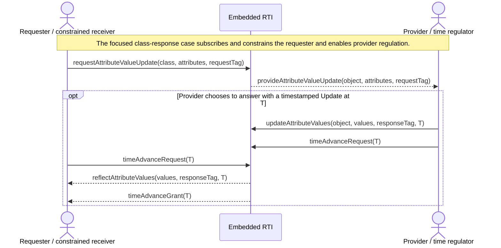

The focused [object-class response test](../../cpp/tests/ieee1516_2025_timestamped_object_class_request_provider_response_catch2.cpp#L114)
checks both `HLA_EVOKED` and `HLA_IMMEDIATE`: the provider sees the request
tag, sends the response with a distinct tag at time 2, and the subscribed,
time-constrained requester observes the timestamped reflection before its
matching grant. The [regional response test](../../cpp/tests/ieee1516_2025_timestamped_regional_request_provider_response_catch2.cpp#L128)
observes the same reflection-before-grant order under `HLA_EVOKED` and checks
the provider update's sent-region metadata. The latter does not compare
different request/source bounds; the separate
[regional request versus response-scope explanation](#regional-request-scope-is-not-response-ddm)
covers why the request's regions are not themselves the later Update's source
realization. For the general recipient-scoped queue and profile-specific
projection timing, continue to the time guide's
[TSO lifecycle](HLA-2025-TIME-MANAGEMENT-GUIDE.md#timestamped-message-lifecycle-and-callback-order)
and [attribute-update delivery boundary](HLA-2025-TIME-MANAGEMENT-GUIDE.md#timestamped-attribute-updates-time-eligibility-and-receiver-projection).
These focused embedded tests do not establish configured-process parity or a
normative interpretation of §6.21.

## 2. 2025 implementation example: plan and recheck provider work

The 2025 API has object-instance, object-class, and regional object-class
request forms. The object/class registry planner is shared by the embedded
ambassador and process service: it expands class scope into instances and
partitions requested attributes by current owner. Callback dispatch then
follows profile-specific paths. The first diagram summarizes that planning
seam; the callback-entry recheck in the second is bounded to the embedded
path. Neither diagram is a portable HLA algorithm.

### 1. Expand request scope into candidate provider/object work

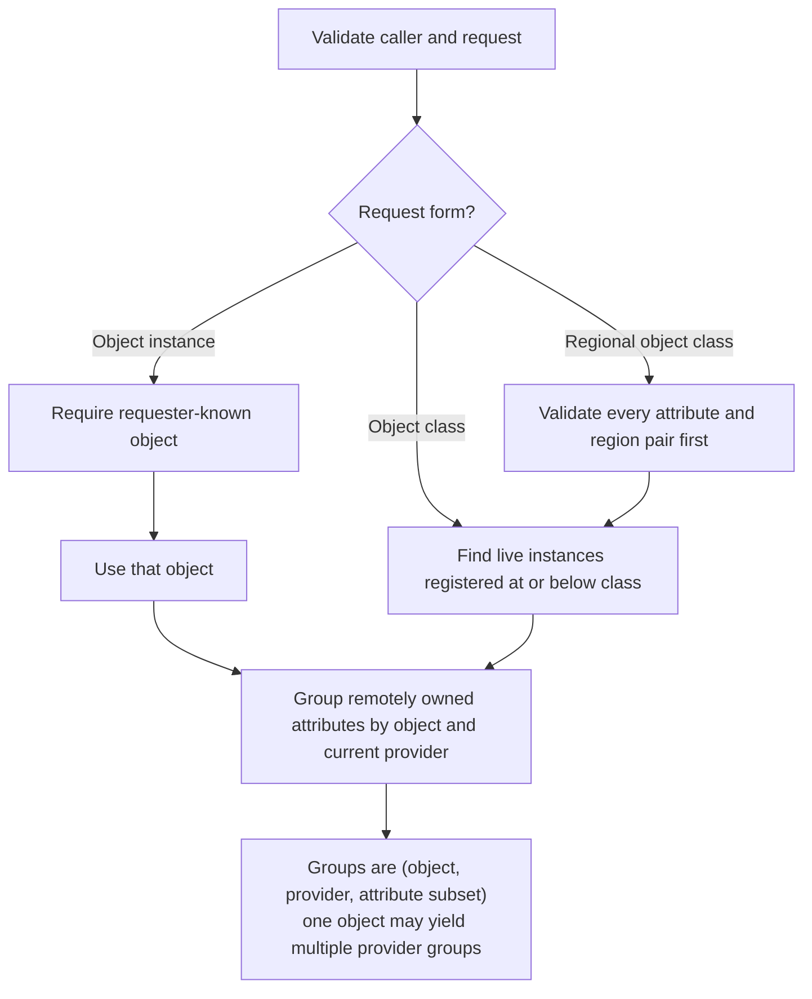

#### 2. Filter each group, then dispatch and recheck provider work

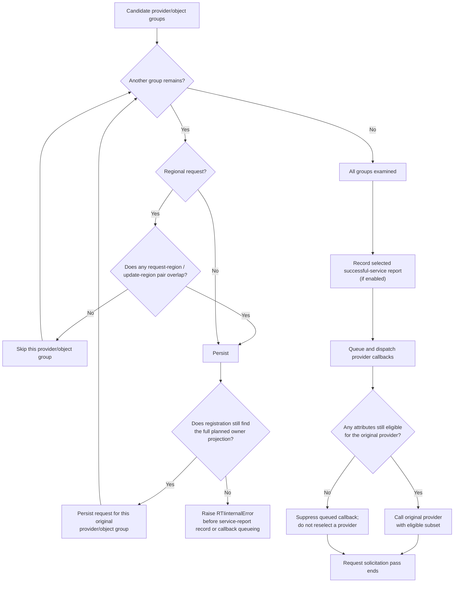

Apply the dispatch/recheck branch independently to each queued
provider/object group.

The persistence step above is an embedded implementation boundary, not an HLA
rule. The public class overload runs its final plan under the shared
federation-management lock, but that lock is released when planning returns;
the persistence loop does not hold it across all groups. Each provider/object
registration separately locks the registry and recalculates its candidate,
requiring the current-owner projection to equal the entire planned attribute
set. An ownership transaction can therefore interleave between planning and
registration, or between groups. If a group has gone stale, the service raises
`RTIinternalError` before its successful service report or callback queueing.
Earlier groups in that loop may already have been persisted individually, and
this path has no rollback for them if a later registration fails. Treat that
as a source-visible potential partial-persistence failure, not an HLA outcome
or a tested runtime scenario. No focused test exercises an ownership change
during this pre-enqueue interval.

### What changes with each scope in the embedded profile

- **Object instance:** the requesting federate must already know the object.
  This is both an API-documented `ObjectInstanceNotKnown` condition and a
  shared-planner check. Requested attributes are checked against that object's
  known class. The planner then solicits current owners for attributes they
  own; an attribute already owned by the requester does not create a provider
  callback.
- **Object class:** the shared 2025 planner enumerates live, non-deleted
  instances registered at or below the requested class. It splits each
  instance's requested attributes by their current provider. A provider can
  therefore receive multiple callbacks for different objects, and one object
  can produce callbacks to multiple providers. Unlike the object-instance
  planner, this class-expansion path does not consult the requester's
  per-instance known-object map or subscription while forming provider work;
  this is a source observation, not a normative rule. Both focused class tests
  request after the target instances have been discovered. The process fixture
  publishes one attribute from one provider on two object instances, then
  requests that attribute at class scope. It observes two one-attribute
  callbacks to the same provider, one for each object
  ([fixture](../../cpp/tests/ieee1516_2025_connection_process_class_request_attribute_value_update_catch2.cpp#L355),
  [callback assertions](../../cpp/tests/ieee1516_2025_connection_process_class_request_attribute_value_update_catch2.cpp#L408)).
  That is per-object callback fan-out, not evidence that one object's requested
  attributes are split across multiple providers. The process test makes no
  public subscription call before the request, but it does not test an
  undiscovered target instance or a later value reflection. Same-object
  multi-provider fan-out remains source-derived. Do not infer full
  process/embedded parity or present these implementation details as general
  HLA requirements.

  A concrete source-derived illustration makes that group key easier to see:
  requester `R` asks for class `C` attributes `{A, B}`. Assume in-scope object
  `O` is currently owned on `A` by provider `P` and on `B` by provider `Q`,
  while `R` owns neither. The class planner forms
  `(O, P, {A})` and `(O, Q, {B})`; the process service routes each group's
  subset to its provider ([shared owner grouping](../../cpp/src/internal/federation/federation_registry_attribute_value_update_requests.cpp#L1052),
  [process group dispatch](../../cpp/src/internal/federation/process_federation_service_attribute_update_requests.cpp#L243)).
  This is one object's attributes split across providers. The focused process
  test instead covers one provider across two objects
  ([test](../../cpp/tests/ieee1516_2025_connection_process_class_request_attribute_value_update_catch2.cpp#L400));
  it does not establish this same-object case. Treat the illustration as
  current source behavior, not a normative callback-count or ordering rule.
- **Regional object class:** validate the supplied attribute/region pairs and
  region ownership/commit state before planning any route. The request and
  provider source regions must satisfy the current regional eligibility test.
  Tests cover empty scopes, disjoint scopes, committed region changes, and a
  queued callback whose regional route becomes stale before delivery. Do not
  generalize those cases into a claim that every request property is
  revalidated in every profile.
- **Callback boundary:** after a pending record is persisted, the embedded
  callback-entry path consumes it and matches its requester, provider, class,
  and attribute set against the originally planned work. It then recomputes
  the candidate projection: a nonempty subset is sent to that same provider;
  an empty projection is suppressed, not reassigned to a newly selected owner.
  This later check is distinct from the full-set registration check above and
  is not a portable HLA retargeting rule or a process-profile claim. The
  focused baseline request test demonstrates ordinary callback delivery but
  does not exercise an ownership change at either boundary. For the portable
  per-attribute authority model, see the
  [attribute-ownership guide](HLA-2025-ATTRIBUTE-OWNERSHIP-FLOW-GUIDE.md).

The diagrams omit API exception details and per-overload validation matrices.
They also omit automatic `provideAttributeValueUpdate` behavior: an explicit
request is not discovery-triggered Auto Provide, and the Auto Provide switch
must not be applied to explicit requests by assumption. See the
[Auto Provide guide](HLA-2025-AUTO-PROVIDE-FLOW-GUIDE.md) for the separate
discovery-triggered path.

### A request does not replace receiver eligibility

In the current embedded 2025 implementation, the provider's later
`updateAttributeValues` goes through ordinary receiver planning; that plan does
not consume the earlier RAVU request as a receiver declaration. The request
planner selects provider work from the known object/class, requested
attributes, and current owners, while update delivery uses receiver declaration
and relevance state ([request planning](../../cpp/src/internal/federation/federation_registry_attribute_value_update_requests.cpp#L278),
[ordinary recipient projection](../../cpp/src/internal/federation/federation_registry_attribute_update_recipients.cpp#L231)).
This is a bounded source observation, not a complete normative rule for every
requester/receiver combination.

There is an important, separate 2025 path: when Delay Subscription Evaluation
is enabled, the receive-order update planner can retain a joined, non-source
federate with a live callback route even if it has no qualifying projection
when the update is planned. The receiver's current subscription and region
projection are checked again at the callback/delivery boundary
([route-only planning](../../cpp/src/internal/federation/federation_registry_attribute_value_update_requests.cpp#L211),
[delivery-time recheck](../../cpp/src/internal/runtime/umbra_rti_ambassador.cpp#L1571)).
An intervening subscription can therefore make that already-planned update
eligible at delivery. This is the §8.1.8 evaluation-timing path, not a right
created by the earlier RAVU. The focused [receive-order DSE test](../../cpp/tests/ieee1516_2025_delay_subscription_evaluation_receive_order_attribute_update_catch2.cpp#L3)
updates while the receiver is unsubscribed ([setup](../../cpp/tests/ieee1516_2025_delay_subscription_evaluation_receive_order_attribute_update_catch2.cpp#L71)),
then resubscribes before callback delivery ([resubscription](../../cpp/tests/ieee1516_2025_delay_subscription_evaluation_receive_order_attribute_update_catch2.cpp#L83));
the [reflection-count assertion](../../cpp/tests/ieee1516_2025_delay_subscription_evaluation_receive_order_attribute_update_catch2.cpp#L90)
distinguishes enabled from disabled DSE. It exercises both callback models,
but does not make an RAVU request. See the [DSE state machine](HLA-2025-DELAY-SUBSCRIPTION-EVALUATION-FLOW-GUIDE.md#recipient-state-machine)
for the wider delivery boundary.

The focused embedded RAVU baseline calls the public
`subscribeObjectClassAttributes` service first. A configured-process RAVU
scenario seeds the requester's subscription directly through the registry in
its test fixture, so it does not cover the public process subscription service.
Those RAVU tests do not isolate a requester that remains unsubscribed through
the response update. The separate DSE case is not a substitute: it establishes
only that ordinary delivery-time eligibility can change, not that an explicit
request creates direct response entitlement. Verify the full §6.21 text before
making that normative claim.

### Regional request scope is not response DDM

A regional request and a later value update make different regional
eligibility decisions. In the selected embedded 2025 path, the request's
attribute/region pairs screen which provider/object work is solicited against
the provider's committed source-region associations. The provide callback
carries the object, requested attributes, and request tag—not a source region.
For a requested attribute with a non-empty request-region set, an explicit
provider update-region association must overlap; an attribute using the
default region remains eligible. The embedded path rechecks eligibility when
delivering queued provider work, so a later committed region change can
suppress a now-stale explicit-region callback.

If that provider later sends values, `updateAttributeValues` is a separate
service call, not a continuation carrying the request's regions or an
ownership grant. The current 2025 update planner validates every supplied
attribute against the provider's ownership at planning time, then reads that
attribute's current update-region association and snapshots its committed
source region. If any supplied attribute is no longer owned, the whole update
is rejected before receiver delivery; the callback is not retargeted to the
new owner and the update map is not silently narrowed. An accepted update
enters ordinary receiver planning: its current source realization is evaluated
separately against each receiver's current committed subscription. The request
operation alone does not add its caller to the later update's recipient set,
and its request region does not become the later update's source realization.
These are bounded implementation observations, not a complete normative rule
for every overload or a claim that every profile exposes identical outcomes.

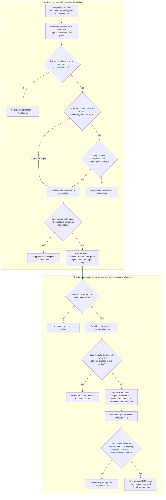

### The later Update call revalidates current provider state

Both inspected 2025 update paths call the registry's receive-order update
planner, which checks each supplied attribute against the current owner map and
then groups attributes using their current update-region associations. The
selected embedded adapter translates an ownership failure to
`AttributeNotOwned`; its focused passel-lifecycle test confirms that
unpublishing an attribute revokes the subsequent update. That test does not
place the unpublish between a Provide callback and its response.

The configured-process handler calls the same planner, but a non-applied plan
is returned as a generic rejected service response. The process client raises
a generic client error, which the public adapter translates to
`RTIinternalError`. The pinned 2025 API lists `AttributeNotOwned` for §6.10;
the reviewed process response path has no typed ownership-failure mapping, and
the focused process tests cover a successful response rather than this
rejection. This is a source-derived exception-translation gap to verify, not a
claim about normative exception precedence or a tested process outcome.

The embedded regional provider-response test answers from inside the Provide
callback and observes reflection using the existing source-region association.
The configured-process regional class-request test observes Provide first,
then submits an update and observes reflection under both callback models.
Neither transfers ownership between the callback and update. Thus the sources
show that a later call is checked against current state, but the specific
Provide-then-transfer-then-respond scenario remains untested. The process
rejection mapping is likewise source-only; do not infer embedded/process
parity.

### Configured-process path: region check before event routing

The preceding regional-request chart is specifically the selected embedded
path. The configured 2025 process path has two validation boundaries. First,
the public adapter converts handle values and checks membership before sending
the request; a malformed handle is rejected locally. Then the registry checks
each supplied pair against federation state before recipient expansion. Each
pair must name a requested attribute and a requester-owned region with
committed, complete bounds whose dimensions are available to the requested
class. A rejected planner result crosses the process response as a typed
status, which the public adapter maps to the corresponding 2025 API exception.

The focused process selector test exercises four server-side outcomes: a
region handle value with no registry entry and a requester-owned uncommitted
region both produce `InvalidRegion`; another federate's region produces
`RegionNotCreatedByThisFederate`; and a committed region whose dimension is
outside the requested class context produces `InvalidRegionContext`. It asserts
both public exceptions and the typed planner statuses returned by the server.

The implementation performs a whole-request preflight before provider
expansion. The registry stops at the first invalid attribute/region pair and
returns a typed status; the configured-process handler returns that rejection
before entering its provider loop. Therefore, this request path creates no
provider event to queue or push when regional preflight fails ([registry
preflight](../../cpp/src/internal/federation/federation_registry_attribute_value_update_requests.cpp#L999),
[typed rejection branch](../../cpp/src/internal/federation/process_federation_service_attribute_update_requests.cpp#L363),
[provider loop](../../cpp/src/internal/federation/process_federation_service_attribute_update_requests.cpp#L375)).
The focused tests submit invalid pairs in separate calls; they neither combine
an invalid pair with otherwise-eligible work nor assert this no-event
consequence. The invalid-selector fixture creates the relevant region states
but does not publish the class or register an object, so it does not establish
an otherwise-eligible provider route whose suppression could be observed.
Keep that consequence source-derived, not a normative atomicity or
exception-precedence claim.

For accepted input, the planner expands live instances, partitions requested
attributes by current provider, and filters each attribute against that
provider's source-region associations. A default-region association remains
eligible under the request-region filter; an explicit update-region
association needs at least one overlapping request/update-region pair. The
process handler then registers only that provider/object group's attribute
and region pairs and recomputes its current owner/region projection before
routing an event. These are configured-process implementation observations,
not normative exception-order or embedded-parity claims.

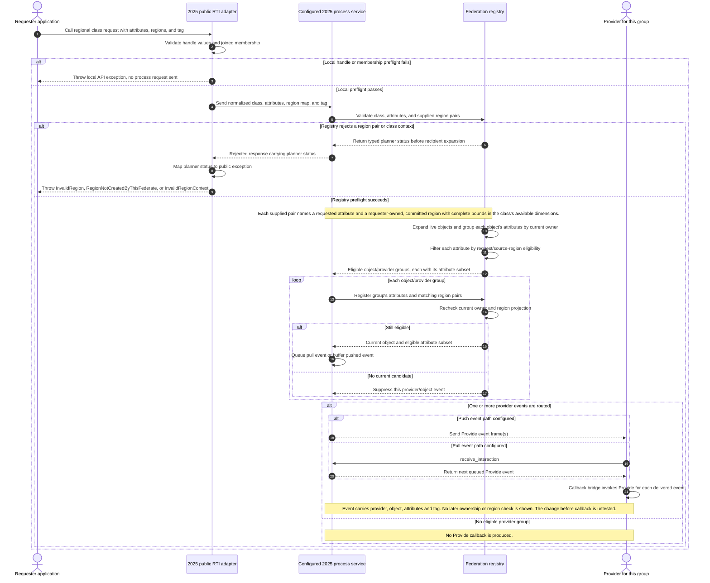

This is a source-derived process trace, not a normative callback-timing rule.
The process projection check occurs before the event is pushed or stored in the
provider's pull queue. The event contains the provider/object identity, the
projected attribute subset, and request tag, but not the request-region handles
([process event type](../../cpp/src/internal/federation/process_federation_service_protocol.hpp#L1389)).
The reviewed pull dequeue and client callback bridge forward that event without
another registry-region check. A region change after that checkpoint but
before the provider callback is therefore an untested implementation boundary,
not an established stale-event outcome.

Current ownership has the same source-visible cutoff. The event contains the
selected provider and projected attributes, but no current-owner version; pull
dequeue removes the queued event, while push sends the already-created event.
The client buffers and dispatches it through the callback bridge without a
registry lookup. The reviewed ownership handlers do not requalify or remove
these Provide events from the process queue. Thus ownership transfer after
projection but before `provideAttributeValueUpdate` remains an untested
source boundary: this trace shows no later owner check, but it does not prove
whether a particular interleaving delivers or suppresses the callback
([pull dequeue](../../cpp/src/internal/federation/process_federation_service_receive.cpp#L210),
[push route](../../cpp/src/internal/federation/process_federation_service_attribute_update_requests.cpp#L458),
[client pending-event buffer](../../cpp/src/internal/federation/process_federation_client.cpp#L393),
[client callback dispatch](../../cpp/src/internal/federation/process_federation_client_callback_dispatch.cpp#L33),
[callback bridge](../../cpp/src/internal/federation/process_federation_callback_bridge.cpp#L1471),
[ownership handlers](../../cpp/src/internal/federation/process_federation_service_ownership_handlers.cpp#L698)).

The focused regional process case observes the Provide callback before it
tests the provider's later value update; it does not transfer ownership
between projection and callback
([request and callback](../../cpp/tests/ieee1516_2025_connection_regional_class_request_attribute_value_update_catch2.cpp#L933)).
A separate configured-process ownership-cancellation case issues an
object-instance request and waits until its Provide callback has arrived
before starting and cancelling acquisition, so it also does not cover a
pending class-level request across a completed transfer
([Provide observed before acquisition](../../cpp/tests/ieee1516_2025_process_idle_immediate_ownership_cancellation_catch2.cpp#L628)).
Neither case establishes a normative result or embedded/process parity.

The group loop can repeat for different providers even when it is processing
one object. For example, if object O has requested attribute A owned by P1
with an overlapping request/source region, attribute B owned by P2 with a
valid but disjoint request/source region, and attribute C owned by the
requester, the source planner can form `(O, P1, {A})`, filter B from P2's
group, and omit C from remote-provider work. Each surviving group is then
registered and projected separately. This is an explanatory example of the
2025 Umbra source path—not a normative one-callback-per-provider rule or a
tested process outcome ([owner partition](../../cpp/src/internal/federation/federation_registry_attribute_value_update_requests.cpp#L1047),
[per-attribute regional filter](../../cpp/src/internal/federation/federation_registry_attribute_update_recipients.cpp#L579),
[per-group process registration](../../cpp/src/internal/federation/process_federation_service_attribute_update_requests.cpp#L395)).

The filter compares the request-region and update-region sets pairwise, but
keeps an attribute when any pair overlaps: it stops at the first match and
inserts that attribute once into the candidate's set. The process handler then
creates an event from the projected group, rather than one event per matching
region pair ([first-overlap filter and single insertion](../../cpp/src/internal/federation/federation_registry_attribute_update_recipients.cpp#L594),
[per-group event construction](../../cpp/src/internal/federation/process_federation_service_attribute_update_requests.cpp#L432)).
This is source-derived duplicate suppression. The focused regional process
case uses one request region and one update-region association for its
attribute; no focused case exercises multiple overlaps and asserts one
callback.

The [public focused process case](../../cpp/tests/ieee1516_2025_connection_regional_class_request_attribute_value_update_catch2.cpp#L933)
uses one object, provider, and attribute with matching committed `[0,2]`
request and update regions under both callback models. It observes one Provide
callback with the request tag. Only afterward does the requester install its
regional subscription; the provider's later update then follows ordinary
receiver DDM and is reflected. This distinguishes solicitation from response
delivery in that public fixture. It does not test disjoint or multi-provider
filtering, or a region mutation between the process projection check and the
callback.

A separate [private process-service fixture](../../cpp/tests/process_federation_service_regional_class_request_attribute_value_update_catch2.cpp#L78)
does test one disjoint selector: after the requester commits its region at
`[3,4]` while the provider's update association remains `[0,2]`, it repeats a
one-object/one-provider/one-attribute request and asserts `recipientCount == 0`
and no Provide event on the provider's next poll
([region change](../../cpp/tests/process_federation_service_regional_class_request_attribute_value_update_catch2.cpp#L238),
[zero-recipient result](../../cpp/tests/process_federation_service_regional_class_request_attribute_value_update_catch2.cpp#L413),
[empty poll](../../cpp/tests/process_federation_service_regional_class_request_attribute_value_update_catch2.cpp#L423)).
This is direct private service/protocol evidence for a later request after a
committed disjoint region change; it is not a public RTIambassador assertion,
a multi-provider case, or a mutation between projection and callback. Do not
infer process/embedded parity from either fixture.

#### Per-group projection has distinct push/pull failure checkpoints

The registry first returns eligible object/provider groups; the service then
registers and begins each group separately. Beginning a group consumes its
pending request record and recalculates the current owner/region projection.
Pull mode appends each eligible event to that provider's queue during the group
loop. Push mode stages each event in a local batch and starts its sequential
send loop only after all groups have been prepared.

That ordering creates different source-only partial-progress points. If a
later group registration fails, earlier Pull events may already be queued,
while Push has only staged earlier frames and has not reached its send loop. If
a Push send fails after preparation, an earlier frame prefix may already have
been sent. The inspected handler returns an internal error without a visible
compensating cleanup for earlier group work; the public adapter maps process
client/protocol failures to `RTIinternalError`. This does not establish which
callbacks a runtime delivers after a fault, an all-or-nothing HLA rule, or a
callback-order guarantee.

##### Per-group preparation and registration

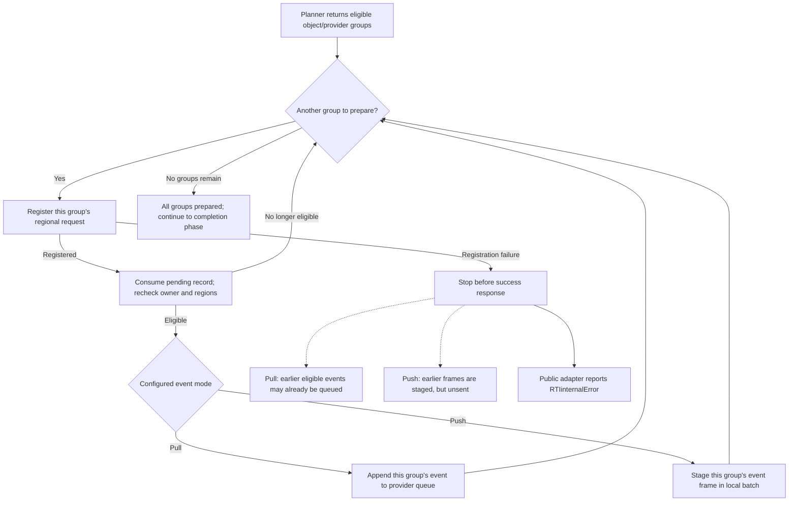

##### Completion after all groups are prepared

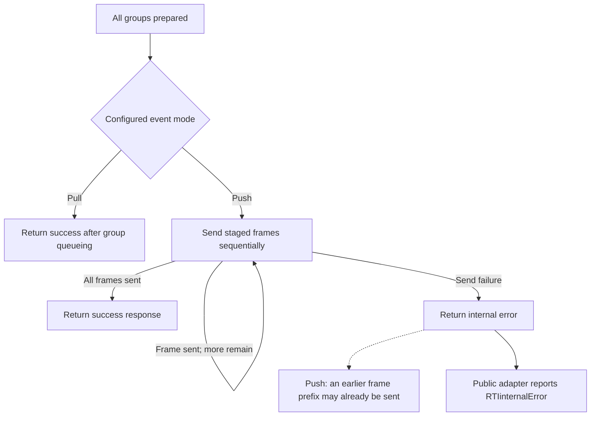

These charts are source-derived failure traces, not observed failure outcomes.
The public configured-process regional success case covers one
object/provider group under both callback models; the separate private service
fixture covers one disjoint object/provider/attribute selector but not a
multi-provider split. A separate nonregional class case covers two objects for
one provider; it does not test one object's attributes split across
providers. No focused test injects a later group-registration or Push send
failure.
See the [per-group service loop](../../cpp/src/internal/federation/process_federation_service_attribute_update_requests.cpp#L375),
[regional request registration](../../cpp/src/internal/federation/process_federation_service_attribute_update_requests.cpp#L407),
[registry request record](../../cpp/src/internal/federation/federation_registry_attribute_value_update_requests.cpp#L834),
[begin/recheck gate](../../cpp/src/internal/federation/federation_registry_attribute_value_update_requests.cpp#L923),
[Pull queue insertion](../../cpp/src/internal/federation/process_federation_service_attribute_update_requests.cpp#L447),
[Push send loop](../../cpp/src/internal/federation/process_federation_service_attribute_update_requests.cpp#L459),
[error translation](../../cpp/src/internal/runtime/umbra_rti_ambassador_request_attribute_value_updates.cpp#L704),
[regional process case](../../cpp/tests/ieee1516_2025_connection_regional_class_request_attribute_value_update_catch2.cpp#L933),
and [nonregional class case](../../cpp/tests/ieee1516_2025_connection_process_class_request_attribute_value_update_catch2.cpp#L400).

Both charts passed local Mermaid rendering and visual review. The preparation
loop is tall but remains readable while scrolling; the second chart isolates
the final Pull return versus sequential Push send. This local preview does not
establish GitHub presentation, and no failure injection or test rerun was done.

### Profile-specific precondition order is an implementation observation

IEEE 1516.1-2025 API 9.13 lists possible exceptions for this operation, but
the declaration does not specify which exception takes precedence when several
preconditions fail at once. The source paths order checks differently:

- In the embedded path, connection and federation save/restore availability
  are checked before the supplied handles are normalized and validated. The
  representative embedded interlock case confirms this operation throws
  `SaveInProgress` and `RestoreInProgress` in those respective single-fault
  states. The regional filtering case separately covers a foreign-owned,
  wrong-context, and uncommitted region.
- In the configured-process path, class, attribute, and region handle values
  (and a nonempty requested-attribute set) are checked before connection and
  membership. Registry-region failures then return typed statuses for public
  exception translation. The focused process case verifies the same three
  isolated region mappings as the embedded case, plus an unregistered region.

These are source and single-fault test observations, not normative exception
precedence. No combined-fault test establishes what wins when, for example, a
bad handle is supplied while disconnected or during save/restore. The wider
process trace finds no dispatch-wide availability gate: the
[service host](../../cpp/src/internal/federation/process_federation_service_host.cpp#L157)
obtains a handler and loops through
[transport dispatch](../../cpp/src/internal/federation/process_transport_session.cpp#L75),
which validates request framing and invokes that handler;
[handler registration](../../cpp/src/internal/federation/process_federation_service.cpp#L50)
forwards to the
[operation switch](../../cpp/src/internal/federation/process_federation_service_dispatch.cpp#L8).
The configured-process
[regional adapter branch](../../cpp/src/internal/runtime/umbra_rti_ambassador_request_attribute_value_updates.cpp#L633)
validates handle values before connection/membership, and the
[regional request handler](../../cpp/src/internal/federation/process_federation_service_attribute_update_requests.cpp#L335)
checks session/member identity before calling the
[shared registry planner](../../cpp/src/internal/federation/federation_registry_attribute_value_update_requests.cpp#L970).
That planner validates membership, catalog, class, attributes, and regions, but
does not inspect save/restore state. The explicit process-side
[`serviceOperationStatus` use](../../cpp/src/internal/federation/process_federation_service_reporting.cpp#L454)
is in a service-reporting handler, not a generic request-dispatch gate. Thus,
the inspected request chain has no save/restore rejection branch. The focused
process regional-request cases do not exercise those states, so this remains a
source observation—not a claim about the runtime outcome.
See the [2025 API declaration](../../third_party/ieee1516.1-2025/include/RTI/RTIambassador.h#L1659),
[regional adapter branches](../../cpp/src/internal/runtime/umbra_rti_ambassador_request_attribute_value_updates.cpp#L633),
[embedded interlock gate](../../cpp/src/internal/runtime/umbra_rti_ambassador_service_report_writers.cpp#L105),
[embedded regional checks](../../cpp/tests/ieee1516_2025_regional_request_attribute_value_update_filtering_catch2.cpp#L91),
[embedded save/restore cases](../../cpp/tests/ieee1516_2025_representative_save_restore_interlock_catch2.cpp#L223),
and [configured-process selector cases](../../cpp/tests/ieee1516_2025_connection_regional_class_request_attribute_value_update_invalid_region_catch2.cpp#L698).

### Special case: RTI-owned MOM objects

The current 2025 ambassador implementation has a separate branch for requests
against RTI-owned MOM objects: it plans a MOM snapshot and directly reflects
that snapshot to the requester instead of routing an ordinary provider
solicitation. Keep this as a special RTI-owned-object path, not as the general
provider lifecycle described above. See the
[federation-scoped MOM guide](HLA-2025-FEDERATION-MOM-FLOW-GUIDE.md) and the
[joined-federate MOM guide](HLA-2025-JOINED-FEDERATE-MOM-OBJECT-LIFECYCLE-FLOW-GUIDE.md)
for MOM ownership and lifecycle boundaries.

The configured process endpoint has a corresponding object-instance branch:
it reads the joined-federate MOM ledger and directly emits a value-reflection
event; the source explicitly states that these values do not induce a
federate `Provide Attribute Value Update` callback
([process request handler](../../cpp/src/internal/federation/process_federation_service_attribute_update_requests.cpp#L40)).
The process [joined-federate report-file case](../../cpp/tests/ieee1516_2025_connection_process_joined_federate_mom_report_file_catch2.cpp#L437)
requests the current report-file path and checks the resulting reflection.
This establishes only that selected `HLAfederate` request path; it does not
establish general provider-request parity across profiles.

### Configured-process instance requests branch on object ownership

For the inspected IEEE 1516.1-2025 configured-process endpoint, the public
instance-request call splits after the RTI recognizes the target object. An
ordinary object is resolved through its current federate owners: the RTI asks
eligible owners to provide values, and any later values travel through a
separate update service. A joined-federate MOM object is RTI-owned: the RTI
projects its current values and reflects them directly to the requester.
This is a bounded source map, not a portable rule about entitlement to a
response or a claim of general process/embedded parity.

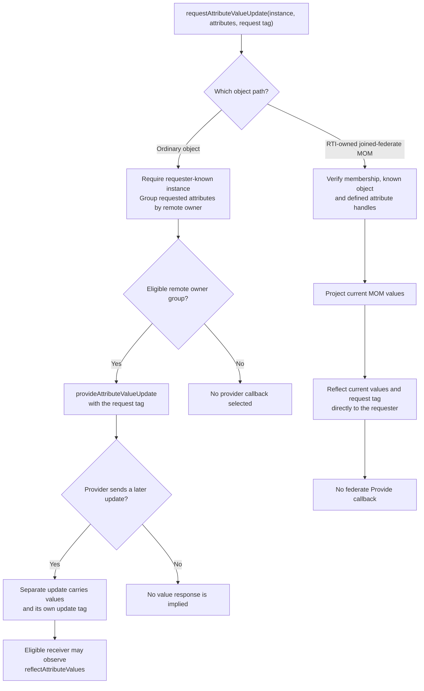

**Process implementation map (not an HLA wire protocol):** the public
ambassador validates and copies the request's handles and tag into the
process client ([adapter](../../cpp/src/internal/runtime/umbra_rti_ambassador_request_attribute_value_updates.cpp#L23));
the client encodes the federation/member/object/attribute identities and tag
for the private service request ([client](../../cpp/src/internal/federation/process_federation_client_value_services.cpp#L133),
[codec](../../cpp/src/internal/federation/process_federation_service_codecs.cpp#L828)).
The service decodes that request, checks session membership, and branches to
the MOM snapshot or ordinary owner planner ([handler](../../cpp/src/internal/federation/process_federation_service_attribute_update_requests.cpp#L13)).
For ordinary objects, each provider event carries the original request tag;
the callback bridge reconstructs the public handles and invokes
`provideAttributeValueUpdate` ([event creation](../../cpp/src/internal/federation/process_federation_service_attribute_update_requests.cpp#L159),
[callback bridge](../../cpp/src/internal/federation/process_federation_callback_bridge.cpp#L370)).
The later provider response is a separate update service and carries its own
tag ([process update handler](../../cpp/src/internal/federation/process_federation_service_attribute_value_updates.cpp#L13)).

The configured-process handler checks the joined-federate MOM ledger before
falling through to the ordinary object planner
([handler](../../cpp/src/internal/federation/process_federation_service_attribute_update_requests.cpp#L13),
[direct MOM event and request tag](../../cpp/src/internal/federation/process_federation_service_attribute_update_requests.cpp#L40),
[ordinary owner planner](../../cpp/src/internal/federation/federation_registry_attribute_value_update_requests.cpp#L278)).
The callback bridge turns ordinary request events into `provideAttributeValueUpdate`
and later value events into `reflectAttributeValues`
([Provide delivery](../../cpp/src/internal/federation/process_federation_callback_bridge.cpp#L370),
[reflection delivery](../../cpp/src/internal/federation/process_federation_callback_bridge.cpp#L261)).
The ordinary process test exercises the full selected chain under both
`HLA_EVOKED` and `HLA_IMMEDIATE`: it observes the request-tagged Provide
callback, sends a later value-bearing update, and checks the requester's
reflection and separate update tag
([focused process case](../../cpp/tests/ieee1516_2025_connection_request_attribute_value_update_catch2.cpp#L459)).
The joined-federate MOM test is narrower: its `HLA_EVOKED` observer asks for
the current `HLAreportServiceFile` and checks that direct reflection
([focused MOM case](../../cpp/tests/ieee1516_2025_connection_process_joined_federate_mom_report_file_catch2.cpp#L437)).
These selected tests do not establish every provider/receiver eligibility
case, an unsubscribed ordinary requester response, automatic Conditional
MOM-change delivery, or callback-order guarantees.

In particular, the ordinary process test does not assert that the Provide
callback entered before or after `requestAttributeValueUpdate` returned. After
the request returns, its `HLA_EVOKED` section explicitly calls
`evokeCallback`; its `HLA_IMMEDIATE` section makes a later
`getObjectClassHandle` call that the harness labels an immediate-callback
flush, then checks that Provide was observed. After `updateAttributeValues`,
the test uses the analogous evoke/lookup step before checking reflection
([request and Provide checkpoints](../../cpp/tests/ieee1516_2025_connection_request_attribute_value_update_catch2.cpp#L903),
[later update and reflection checkpoints](../../cpp/tests/ieee1516_2025_connection_request_attribute_value_update_catch2.cpp#L926)).
That proves observation by those later test checkpoints under both configured
models, not an AVU-specific before-return cutoff or cross-federate callback
order. Keep the generic [HLA_EVOKED application drain](HLA-2025-CALLBACK-AND-SERVICE-ORDERING-FLOW-GUIDE.md#hla_evoked-the-application-owns-the-drain-point)
and [HLA_IMMEDIATE service-stack boundary](HLA-2025-CALLBACK-AND-SERVICE-ORDERING-FLOW-GUIDE.md#hla_immediate-callback-work-can-be-on-the-service-stack)
separate from this selected process-test evidence.

#### Configured-process remote failure mapping varies by overload

The public API has instance, class, and regional-class request overloads. This
comparison isolates **remote registry-planner failures** after local adapter
preflight; it does not show local typed errors, session/protocol failures, or
the successful provider-callback path.

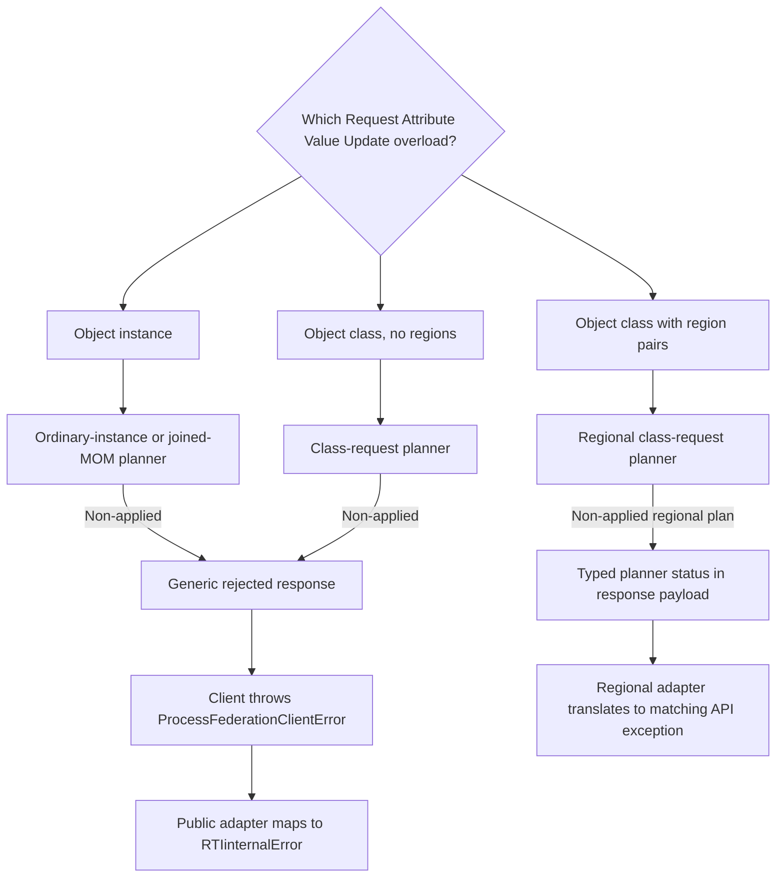

The pinned API presents the [instance overload](../../third_party/ieee1516.1-2025/include/RTI/RTIambassador.h#L876),
[class overload without regions](../../third_party/ieee1516.1-2025/include/RTI/RTIambassador.h#L891),
and [regional class overload](../../third_party/ieee1516.1-2025/include/RTI/RTIambassador.h#L1659)
as separate signatures. In the configured process implementation, local
class/attribute handle checks still raise typed exceptions, but a non-applied
remote class-request plan becomes a generic rejection; the client turns that
response into `ProcessFederationClientError`,
and the public adapter exposes `RTIinternalError`. The same generic response
shape is used for non-applied instance-request plans, including the ordinary
and joined-federate MOM branches documented above.

The regional class overload is different for registry-plan failures: its
service response carries the planner status in a result payload, and the client
and adapter translate that status to the corresponding API exception. The
[regional path above](#configured-process-path-region-check-before-event-routing)
and its focused invalid-region test document this typed branch. Do not extend
that mapping to the instance or class overload without regions. This is a
source-derived configured-process distinction, not a conformance or exception-
precedence conclusion.

The public process instance-request and no-region class-request cases exercise
successful provider callbacks under both callback models; neither asserts the
public exception for a remote non-applied plan. The regional invalid-region
test does assert typed planner outcomes. The focused instance case's successful
request checkpoint is at
[the public call](../../cpp/tests/ieee1516_2025_connection_request_attribute_value_update_catch2.cpp#L903);
the no-region class case calls the same API overload at
[its request checkpoint](../../cpp/tests/ieee1516_2025_connection_process_class_request_attribute_value_update_catch2.cpp#L400).
The class service, client, and public exception boundary are visible in the
[service rejection](../../cpp/src/internal/federation/process_federation_service_attribute_update_requests.cpp#L235),
[client status handling](../../cpp/src/internal/federation/process_federation_client_value_services.cpp#L172),
[adapter translation](../../cpp/src/internal/runtime/umbra_rti_ambassador_request_attribute_value_updates.cpp#L389),
and [local class/attribute preflight](../../cpp/src/internal/runtime/umbra_rti_ambassador_request_attribute_value_updates.cpp#L341).

## 3. Save/restore depends on which lifecycle stage was reached

“The response to a request” is not one durable state. A request still waiting
to solicit a provider, an already delivered receive-order update, and a queued
timestamped update have different restore behavior in the focused embedded
2025 tests.

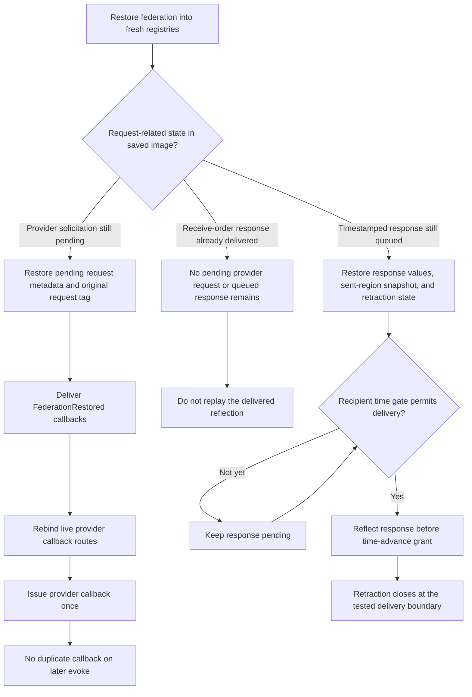

These are state distinctions, not three stages that every request must visit.
The restore tests deliberately probe different cut points:

- A still-pending class request is restored with its request tag and provider
  routing is rebound; the provider callback follows `federationRestored`, and
  later callback pumping does not duplicate it. The case keeps the original
  provider and does not establish owner-change replay, retargeting, or
  process-endpoint behavior.
- A separate embedded public-API fresh-registry case saves a pending regional
  class request, including its attribute-to-region map and tag, then restores
  it from the filesystem-backed state image. Under both `HLA_EVOKED` and
  `HLA_IMMEDIATE`, the provider observes one matching callback after
  `federationRestored`. The test creates a fresh registry within one test
  process; it is not configured-process or RTI-host-restart evidence.
- A separate internal-registry state-image case restores a pending regional
  class request with its attribute-to-region mapping and tag. The route can be
  consumed once while its eligibility still holds; committing now-disjoint
  requester-region bounds suppresses stale work, and provider departure retires
  its pending route. The requester-departure assertion is not isolated: that
  test resigns the provider first, so it does not establish requester-departure
  cleanup independently. This is not public callback or process-endpoint
  evidence, and the test creates a fresh registry within one test process.
- A delivered receive-order response is application-visible state rather than
  pending provider work; the fresh-registry restore test checks that it is not
  reflected a second time.
- A queued timestamped regional response survives with its values, source-region
  snapshot, and retraction state. The test observes reflection before the
  matching time-advance grant; after recipient delivery, retraction is no
  longer accepted.

Do not infer that every overload or execution profile has identical save/restore
coverage from these selected cases. For the broader save/restore state machine,
see the [federation save/restore guide](HLA-2025-FEDERATION-SAVE-RESTORE-FLOW-GUIDE.md).

The embedded public regional-class Restore test is stronger than registry-only
evidence: after restoring into a fresh registry in the same test process, it
observes one provider callback after `federationRestored` under both
`HLA_EVOKED` and `HLA_IMMEDIATE`. That result is specific to the embedded
endpoint; it is not configured-process or RTI-host-restart evidence.

Do not transfer that callback result to configured-process Save/Restore. For
each planned provider group, the process request handler registers a regional
request record and immediately passes it to
`beginAttributeValueUpdateRegionalProvideRecipientFor`, which consumes and
erases that record before returning the provider projection used to create the
notification. The registry state image can capture still-pending regional
request records in general, but that ledger is not the process provider-event
queue and is not the representation of a notification already produced by
this path. Pull mode queues a
`ProcessFederationAttributeValueUpdateRequestEvent` in the live session;
push mode sends it as an event frame. The inspected pull snapshot serializer
does not serialize that RAVU queue, and the push snapshot path covers pending
attribute updates rather than RAVU event frames. On successful pull restore,
the service clears `attributeUpdateEvents` but not
`attributeValueUpdateRequestEvents`; Restore completion does not explicitly
create or resend a RAVU notification. These are source observations only: no
focused configured-process test establishes the fate or callback count of a
queued or already-sent RAVU notification across Save/Restore. Do not infer
process replay, exactly-once delivery, or host-restart recovery.

### Process request metadata is separate from notification delivery

This source map separates the per-provider registry record from the provider's
RAVU notification. It is an Umbra process-path diagram, not a callback or
Save/Restore guarantee:

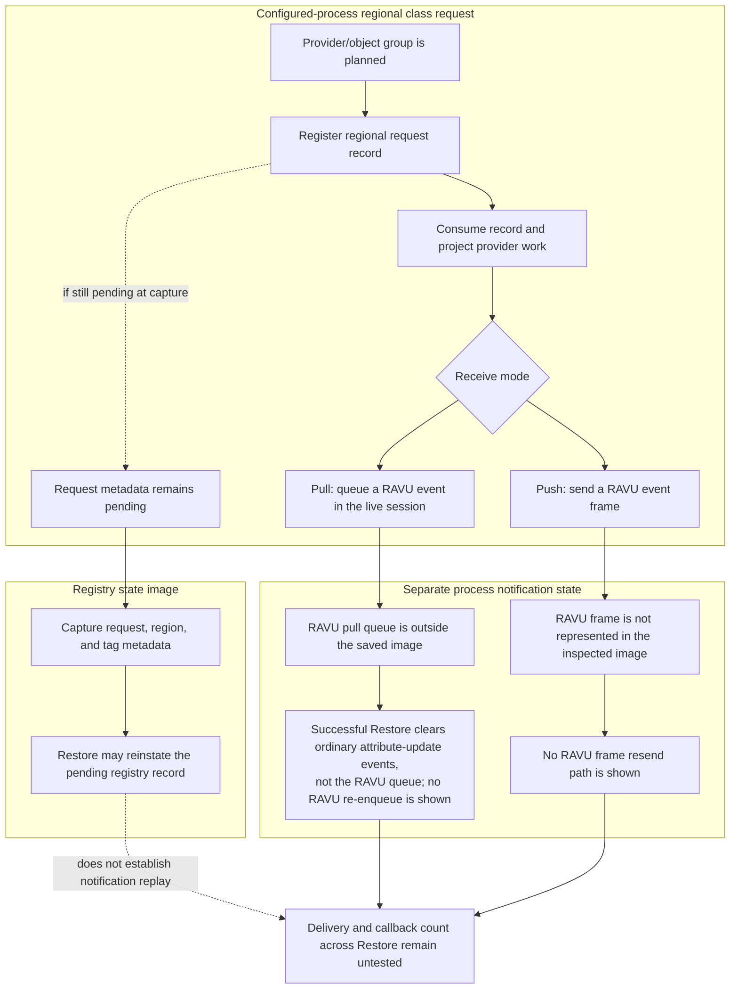

The configured-process handler registers each planned provider group and then
consumes that record to produce a projection before it queues or pushes the
notification ([request path](../../cpp/src/internal/federation/process_federation_service_attribute_update_requests.cpp#L395),
[record consumption](../../cpp/src/internal/federation/federation_registry_attribute_value_update_requests.cpp#L922)).
The registry image can retain request metadata that is pending at capture
([capture](../../cpp/src/internal/federation/federation_registry_state_image_capture.cpp#L993)); that fact alone does not capture the separate
session queue or prove a restored request will regenerate a provider event.
Successful process Restore clears a different queue, `attributeUpdateEvents`,
while the inspected code does not clear the regional RAVU queue or enqueue a
replacement notification ([Save queue scope](../../cpp/src/internal/federation/process_federation_service_save_restore.cpp#L45),
[Restore cleanup](../../cpp/src/internal/federation/process_federation_service_save_restore.cpp#L411)).
The exact fate of queued or already-sent provider notifications remains
unobserved.

The receive mechanics make the source boundary more precise, but do not close
that test gap. In pull mode, the process receive selector checks queued Restore
events before its interaction slot, while the regional RAVU queue is polled
later in the fallback path, after scope and relevance advisories. A RAVU event
still in the server session queue can therefore wait behind pending Restore
notifications; an event already returned to the client is no longer subject to
that server-side selection. In push mode, RAVU and Restore are separate event
frames. The client buffers received events in arrival order, drains its pending
event deque FIFO, and submits each to the callback dispatcher, whose task queue
is also FIFO. Under [`HLA_EVOKED`](HLA-2025-CALLBACK-AND-SERVICE-ORDERING-FLOW-GUIDE.md#hla_evoked-the-application-owns-the-drain-point),
submitted tasks wait for an application evoke; enabled
[`HLA_IMMEDIATE`](HLA-2025-CALLBACK-AND-SERVICE-ORDERING-FLOW-GUIDE.md#hla_immediate-callback-work-can-be-on-the-service-stack)
dispatch drains them as they are submitted. These are process queue mechanics,
not a normative callback-order rule, and they do not show
whether a pre-save RAVU callback is replayed or delivered exactly once. The
focused pushed `HLA_EVOKED` Save/Restore case covers discovery and ownership-
assumption work, not RAVU.

Source pointers: [pull receive selection](../../cpp/src/internal/federation/process_federation_service_receive.cpp#L95),
[Restore event routing](../../cpp/src/internal/federation/process_federation_service_notifications.cpp#L481),
[RAVU event routing](../../cpp/src/internal/federation/process_federation_service_attribute_update_requests.cpp#L375),
[client event buffering](../../cpp/src/internal/federation/process_federation_client.cpp#L385),
[client FIFO dispatch](../../cpp/src/internal/federation/process_federation_client_callback_dispatch.cpp#L261),
[callback dispatcher FIFO](../../cpp/src/internal/callbacks/callback_dispatcher.cpp#L122),
and the analogous [pushed `HLA_EVOKED` Save/Restore test](../../cpp/tests/ieee1516_2025_process_pushed_ownership_assumption_evoked_save_restore_catch2.cpp#L62).

## Evidence and implementation pointers

The links below identify the API surface, the current implementation seams,
and focused 2025 observations. Test observations are not substitutes for a
clause-by-clause review of IEEE 1516.1-2025.

| Concern | Source or focused test | What it supports |
| --- | --- | --- |
| Object-instance, class, and regional public API | [RTIambassador.h:876](../../third_party/ieee1516.1-2025/include/RTI/RTIambassador.h#L876), [RTIambassador.h:891](../../third_party/ieee1516.1-2025/include/RTI/RTIambassador.h#L891), [RTIambassador.h:1672](../../third_party/ieee1516.1-2025/include/RTI/RTIambassador.h#L1672) | The three request scopes and their API argument shapes; the documented `ObjectInstanceNotKnown` exception belongs to the instance overload, while the class overload lists class/attribute errors |
| Provider callback | [FederateAmbassador.h:350](../../third_party/ieee1516.1-2025/include/RTI/FederateAmbassador.h#L350) | The callback receives an object, attribute set, and tag |
| Explicit request versus later reflection eligibility | [Embedded provider planning](../../cpp/src/internal/federation/federation_registry_attribute_value_update_requests.cpp#L278), [ordinary receiver projection](../../cpp/src/internal/federation/federation_registry_attribute_update_recipients.cpp#L231), [DSE route-only planning](../../cpp/src/internal/federation/federation_registry_attribute_value_update_requests.cpp#L211), [delivery-time recheck](../../cpp/src/internal/runtime/umbra_rti_ambassador.cpp#L1571), [embedded public subscription setup](../../cpp/tests/attribute_value_update_request_baseline_catch2.cpp#L143), [process fixture's direct registry subscription](../../cpp/tests/ieee1516_2025_connection_request_attribute_value_update_catch2.cpp#L698), [process request call](../../cpp/tests/ieee1516_2025_connection_request_attribute_value_update_catch2.cpp#L903), [separate receive-order DSE case](../../cpp/tests/ieee1516_2025_delay_subscription_evaluation_receive_order_attribute_update_catch2.cpp#L73) | The inspected update plan has no prior RAVU record as a receiver input; ordinary declaration/relevance state controls the reflection projection. With DSE enabled, a route-only candidate can instead be re-evaluated at delivery, independently of the request. The RAVU cases have a subscription context and do not isolate an unsubscribed requester through response; the DSE test has no RAVU. This source/test distinction does not settle §6.21 direct response entitlement. |
| Requester also acts as receiver in one selected example | [Embedded requester's subscription](../../cpp/tests/attribute_value_update_response_catch2.cpp#L180), [request](../../cpp/tests/attribute_value_update_response_catch2.cpp#L215), and [later reflection](../../cpp/tests/attribute_value_update_response_catch2.cpp#L238) | In this embedded `HLA_EVOKED` case the requester has its own subscription, invokes the request, and later observes the provider's separate response update. This demonstrates role overlap in that scenario, not direct response entitlement for an unsubscribed or otherwise ineligible requester. |
| Callback delivery model | [2025 CallbackModel enum](../../third_party/ieee1516.1-2025/include/RTI/Enums.h#L22), [Evoke services](../../third_party/ieee1516.1-2025/include/RTI/RTIambassador.h#L2265) | Public callback-model vocabulary; see the linked callback guide for model semantics and their implementation boundary |
| Embedded request overloads | [Ambassador request implementation:23](../../cpp/src/internal/runtime/umbra_rti_ambassador_request_attribute_value_updates.cpp#L23), [class overload:331](../../cpp/src/internal/runtime/umbra_rti_ambassador_request_attribute_value_updates.cpp#L331), [regional overload:633](../../cpp/src/internal/runtime/umbra_rti_ambassador_request_attribute_value_updates.cpp#L633) | Separate object, class, regional, and RTI-owned MOM handling paths |
| RTI-owned joined-federate MOM request | [Embedded ambassador branch](../../cpp/src/internal/runtime/umbra_rti_ambassador_request_attribute_value_updates.cpp#L139), [process service branch](../../cpp/src/internal/federation/process_federation_service_attribute_update_requests.cpp#L40), [configured-process report-path request](../../cpp/tests/ieee1516_2025_connection_process_joined_federate_mom_report_file_catch2.cpp#L437) | The selected MOM object request returns RTI-held values through a direct reflection path rather than a provider solicitation in both inspected profiles. The process case checks the requested report-file value; this is not general request-service parity. |
| 2025 registry owner partition and fan-out | [Object planner:278](../../cpp/src/internal/federation/federation_registry_attribute_value_update_requests.cpp#L278), [class planner:970](../../cpp/src/internal/federation/federation_registry_attribute_value_update_requests.cpp#L970), [class owner grouping:1047](../../cpp/src/internal/federation/federation_registry_attribute_value_update_requests.cpp#L1047), [class candidate:531](../../cpp/src/internal/federation/federation_registry_attribute_update_recipients.cpp#L531), [process class planner call:230](../../cpp/src/internal/federation/process_federation_service_attribute_update_requests.cpp#L230), [process per-group dispatch:243](../../cpp/src/internal/federation/process_federation_service_attribute_update_requests.cpp#L243), [embedded class-request baseline:176](../../cpp/tests/object_class_attribute_value_update_request_baseline_catch2.cpp#L176), [process class-request test:400](../../cpp/tests/ieee1516_2025_connection_process_class_request_attribute_value_update_catch2.cpp#L400) | The process service calls the same class planner used by the embedded path. It consumes each planned object/provider group separately: resolves that provider's session, registers that group's attributes, then queues or pushes an event for that provider. The instance planner requires requester-known object state; class expansion does not consult that per-instance map or requester subscription when forming provider groups. The focused process class test has no public subscription call but does discover its target objects first. Neither class test isolates an undiscovered target; no focused test splits one object's requested attributes across multiple remote providers. The process fan-out is source-derived, not demonstrated by the tests or a portable requirement; do not infer full profile parity. |
| Embedded class pre-enqueue and callback revalidation | [Final plan lock scope:501](../../cpp/src/internal/runtime/umbra_rti_ambassador_request_attribute_value_updates.cpp#L501), [final class plan:552](../../cpp/src/internal/runtime/umbra_rti_ambassador_request_attribute_value_updates.cpp#L552), [per-group persistence:587](../../cpp/src/internal/runtime/umbra_rti_ambassador_request_attribute_value_updates.cpp#L587), [registration owner check:718](../../cpp/src/internal/federation/federation_registry_attribute_value_update_requests.cpp#L718), [full-set equality:763](../../cpp/src/internal/federation/federation_registry_attribute_value_update_requests.cpp#L763), [Confirm Divestiture transaction lock:634](../../cpp/src/internal/runtime/umbra_rti_ambassador_ownership_services.cpp#L634), [callback-entry identity match:817](../../cpp/src/internal/federation/federation_registry_attribute_value_update_requests.cpp#L817), [current-owner projection:531](../../cpp/src/internal/federation/federation_registry_attribute_update_recipients.cpp#L531), [runtime delivery gate:1763](../../cpp/src/internal/runtime/umbra_rti_ambassador.cpp#L1763) | The shared federation-management lock covers final planning but is released before separately locked per-group registrations; an ownership transaction can interleave in that gap. Each registration rechecks the full owner projection, while the path does not show rollback of earlier persisted groups if a later registration fails. At callback entry, pending identity is consumed/matched and a reduced current-owner subset may still be delivered to the original provider, while an empty subset is suppressed. No focused test covers either ownership-change boundary. |
| Ownership-change coverage for class-request rechecks | [Embedded pending-class restore setup:274](../../cpp/tests/federation_registry_catch2.cpp#L274), [restored callback entry:352](../../cpp/tests/federation_registry_catch2.cpp#L352), [process instance request:628](../../cpp/tests/ieee1516_2025_process_idle_immediate_ownership_cancellation_catch2.cpp#L628), [pending acquisition:632](../../cpp/tests/ieee1516_2025_process_idle_immediate_ownership_cancellation_catch2.cpp#L632), [later request and owner assertion:648](../../cpp/tests/ieee1516_2025_process_idle_immediate_ownership_cancellation_catch2.cpp#L648) | The embedded restore test resumes one pending class request with the same provider and owner. A separate process instance-request case blocks an already-entered Provide callback while acquisition is requested then cancelled; it confirms the original owner remains, but does not test a completed transfer or embedded class revalidation. No focused test covers ownership change during pre-enqueue persistence or after class-request persistence but before callback entry. |
| Ordinary object-request baseline | [Focused request test:157](../../cpp/tests/attribute_value_update_request_baseline_catch2.cpp#L157) | Confirms ordinary provider callback behavior and the requester-owned exclusion; it does not cover ownership transfer between planning and callback dispatch |
| Process class expansion observation | [Process class request test:50](../../cpp/tests/ieee1516_2025_connection_process_class_request_attribute_value_update_catch2.cpp#L50) | A focused process test observes class request callbacks for registered subclass instances; not full process parity |
| Configured-process regional class request | [Class region validation and planning:999](../../cpp/src/internal/federation/federation_registry_attribute_value_update_requests.cpp#L999), [provider/source-region filter:579](../../cpp/src/internal/federation/federation_registry_attribute_update_recipients.cpp#L579), [per-group persistence and projection:395](../../cpp/src/internal/federation/process_federation_service_attribute_update_requests.cpp#L395), [pull dequeue:208](../../cpp/src/internal/federation/process_federation_service_receive.cpp#L208), [callback bridge:1471](../../cpp/src/internal/federation/process_federation_callback_bridge.cpp#L1471), [public matching-region process request:933](../../cpp/tests/ieee1516_2025_connection_regional_class_request_attribute_value_update_catch2.cpp#L933), [private disjoint-selector service test:78](../../cpp/tests/process_federation_service_regional_class_request_attribute_value_update_catch2.cpp#L78), [zero-recipient and empty-poll assertions:413](../../cpp/tests/process_federation_service_regional_class_request_attribute_value_update_catch2.cpp#L413), [later regional subscription:945](../../cpp/tests/ieee1516_2025_connection_regional_class_request_attribute_value_update_catch2.cpp#L945), [response update:957](../../cpp/tests/ieee1516_2025_connection_regional_class_request_attribute_value_update_catch2.cpp#L957), [invalid-selector process case:459](../../cpp/tests/ieee1516_2025_connection_regional_class_request_attribute_value_update_invalid_region_catch2.cpp#L459) | Source validates every supplied region pair before recipient expansion and rejects a bad pair before provider routing. Public process evidence covers one matching object/provider/attribute under both callback models plus a separate invalid-selector case that checks four public exception mappings. A private process-service test changes the requester region from matching `[0,2]` to disjoint `[3,4]`, repeats the one-provider request, then asserts zero recipients and an empty provider poll. This is private service/protocol evidence, not a public RTIambassador result; it does not cover one object's attributes split across multiple providers or a region mutation after projection. The focused cases do not combine an invalid pair with other otherwise-eligible work. The matching public case installs the regional subscription after the Provide callback, then checks the provider's later update separately. Source rechecks before push/queue, but the pull dequeue and callback bridge show no later registry-region recheck; stale-event outcomes remain untested. |
| Configured-process regional request exception mapping | [2025 API exception declaration:1659](../../third_party/ieee1516.1-2025/include/RTI/RTIambassador.h#L1659), [public adapter preflight:633](../../cpp/src/internal/runtime/umbra_rti_ambassador_request_attribute_value_updates.cpp#L633), [registry validation:999](../../cpp/src/internal/federation/federation_registry_attribute_value_update_requests.cpp#L999), [service rejection with typed status:335](../../cpp/src/internal/federation/process_federation_service_attribute_update_requests.cpp#L335), [typed status codec:1660](../../cpp/src/internal/federation/process_federation_service_codecs.cpp#L1660), [client typed-response decode:181](../../cpp/src/internal/federation/process_federation_client_value_services.cpp#L181), [public exception translation:486](../../cpp/src/internal/runtime/umbra_rti_ambassador_service_failure_translation.cpp#L486), [public process cases:698](../../cpp/tests/ieee1516_2025_connection_regional_class_request_attribute_value_update_invalid_region_catch2.cpp#L698), [typed statuses observed:755](../../cpp/tests/ieee1516_2025_connection_regional_class_request_attribute_value_update_invalid_region_catch2.cpp#L755) | A valid-valued but unregistered region and an owned but uncommitted region both map to InvalidRegion; a region owned by another federate maps to RegionNotCreatedByThisFederate; a committed region outside the object's class dimension context maps to InvalidRegionContext. The focused process test checks each public exception and its typed planner status. It does not establish every API exception, local malformed-handle behavior, or a no-callback guarantee for mixed eligible and invalid work. |
| Regional filter and stale queued work | [Regional filtering test:178](../../cpp/tests/ieee1516_2025_regional_request_attribute_value_update_filtering_catch2.cpp#L178) | Selected overlap, validation, committed-region mutation, and stale callback cases |
| Ownership revalidation on provider response | [2025 API exception list:718](../../third_party/ieee1516.1-2025/include/RTI/RTIambassador.h#L718), [shared current-state planner:93](../../cpp/src/internal/federation/federation_registry_attribute_value_update_requests.cpp#L93), [owner check:147](../../cpp/src/internal/federation/federation_registry_attribute_value_update_requests.cpp#L147), [embedded exception translation:409](../../cpp/src/internal/runtime/umbra_rti_ambassador_service_failure_translation.cpp#L409), [embedded ownership-loss test:246](../../cpp/tests/ieee1516_2025_receive_order_attribute_update_passel_lifecycle_catch2.cpp#L246) | Every supplied attribute is checked against current ownership at the Update call. Embedded loss maps to `AttributeNotOwned`; the focused unpublish case proves the general rejection, not a Provide/transfer/response sequence. |
| Configured-process ownership-rejection mapping | [Process handler:45](../../cpp/src/internal/federation/process_federation_service_attribute_value_updates.cpp#L45), [client status check:108](../../cpp/src/internal/federation/process_federation_client_value_services.cpp#L108), [public adapter:114](../../cpp/src/internal/runtime/umbra_rti_ambassador_attribute_update_services.cpp#L114) | The inspected route returns a generic rejection, which the public adapter maps to `RTIinternalError`. This is a source-only possible exception-mapping gap; no focused test covers the rejection. |
| Current response regions and focused test boundary | [Current update-region association:167](../../cpp/src/internal/federation/federation_registry_attribute_value_update_requests.cpp#L167), [embedded response test:100](../../cpp/tests/ieee1516_2025_regional_request_attribute_value_update_provider_response_catch2.cpp#L100), [process response test:957](../../cpp/tests/ieee1516_2025_connection_regional_class_request_attribute_value_update_catch2.cpp#L957) | The later update uses current provider update-region state; the original request region is not carried forward. Both focused response tests retain ownership; neither covers a completed transfer between Provide and response. |
| Provider chooses timestamped response | [Timestamped class response test:6](../../cpp/tests/ieee1516_2025_timestamped_object_class_request_provider_response_catch2.cpp#L6), [regional response test:6](../../cpp/tests/ieee1516_2025_timestamped_regional_request_provider_response_catch2.cpp#L6) | A request callback can lead to a distinct TSO update, grant-ordered reflection, and response-tag propagation |
| Pending request restored | [Class pending-request restore test:6](../../cpp/tests/ieee1516_2025_public_class_pending_attribute_value_update_restore_catch2.cpp#L6) | Request metadata/tag restoration, callback ordering after restore, and no duplicate callback with the original provider; no owner-change replay or process-endpoint behavior is established |
| Embedded public regional class request restored | [Public fresh-registry restore test:7](../../cpp/tests/ieee1516_2025_public_regional_class_pending_attribute_value_update_restore_catch2.cpp#L7) | Restores the request's attribute-to-region map and tag, then observes one provider callback after `federationRestored` under `HLA_EVOKED` and `HLA_IMMEDIATE`. The fresh registry is created within one test process; this is not configured-process or RTI-host-restart evidence. |
| Regional class request restored and requalified | [Internal regional-request state-image test:3](../../cpp/tests/ieee1516_2025_federation_registry_pending_regional_object_class_attribute_value_update_catch2.cpp#L3) | Restores class/attribute/region request metadata and tag, consumes the eligible provider route once, suppresses it after committed region bounds become disjoint, and retires provider work on provider departure. The requester-departure path is not isolated because provider departure occurs first; this internal registry test is not public callback or process-endpoint evidence. |
| Configured-process regional class request across Save/Restore | [Per-provider registration and event creation:395](../../cpp/src/internal/federation/process_federation_service_attribute_update_requests.cpp#L395), [registry record consumption before projection:922](../../cpp/src/internal/federation/federation_registry_attribute_value_update_requests.cpp#L922), [generic pending-record capture:989](../../cpp/src/internal/federation/federation_registry_state_image_capture.cpp#L989), [RAVU session queue:162](../../cpp/src/internal/federation/process_federation_service.hpp#L162), [RAVU pull dequeue:208](../../cpp/src/internal/federation/process_federation_service_receive.cpp#L208), [Save snapshot scope:45](../../cpp/src/internal/federation/process_federation_service_save_restore.cpp#L45), [Restore cleanup:411](../../cpp/src/internal/federation/process_federation_service_save_restore.cpp#L411) | The process route consumes each per-provider registry request record before creating a queued event or push frame. Generic capture of still-pending registry records does not show that provider notifications are snapshotted or replayed. The inspected Save/Restore code omits the pull RAVU event queue from the saved image and does not explicitly clear, recreate, or resend RAVU notifications at restore completion. This is source-only; no focused configured-process callback-count or replay test exists. Do not infer replay, exactly-once delivery, or host-restart recovery. |
| Delivered RO response not replayed | [No-replay restore test:6](../../cpp/tests/ieee1516_2025_public_regional_provider_response_no_replay_restore_catch2.cpp#L6) | A delivered receive-order response is not re-reflected after fresh-registry restore |
| Queued regional TSO response restored | [Retraction restore test:7](../../cpp/tests/ieee1516_2025_public_regional_provider_response_retraction_restore_catch2.cpp#L7) | Queued payload, sent-region snapshot, recipient grant ordering, and retraction terminalization |

## Related guides

- [Attribute ownership](HLA-2025-ATTRIBUTE-OWNERSHIP-FLOW-GUIDE.md)
- [Object and interaction information flow](HLA-2025-OBJECT-AND-INTERACTION-INFORMATION-FLOW-GUIDE.md)
- [Attribute update-rate admission](HLA-2025-ATTRIBUTE-UPDATE-RATE-ADMISSION-FLOW-GUIDE.md)
- [DDM and regions](HLA-2025-DATA-DISTRIBUTION-AND-REGIONS-FLOW-GUIDE.md)
- [Auto Provide](HLA-2025-AUTO-PROVIDE-FLOW-GUIDE.md)
- [Time management](HLA-2025-TIME-MANAGEMENT-GUIDE.md)
- [Federation save/restore](HLA-2025-FEDERATION-SAVE-RESTORE-FLOW-GUIDE.md)
