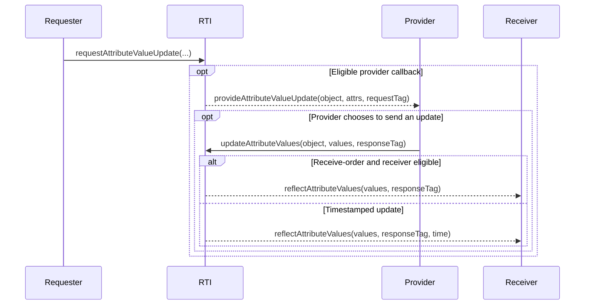
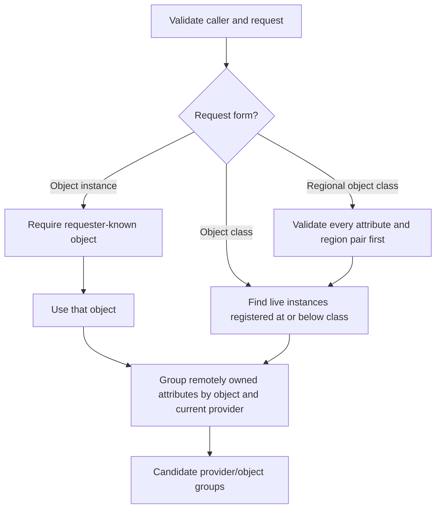
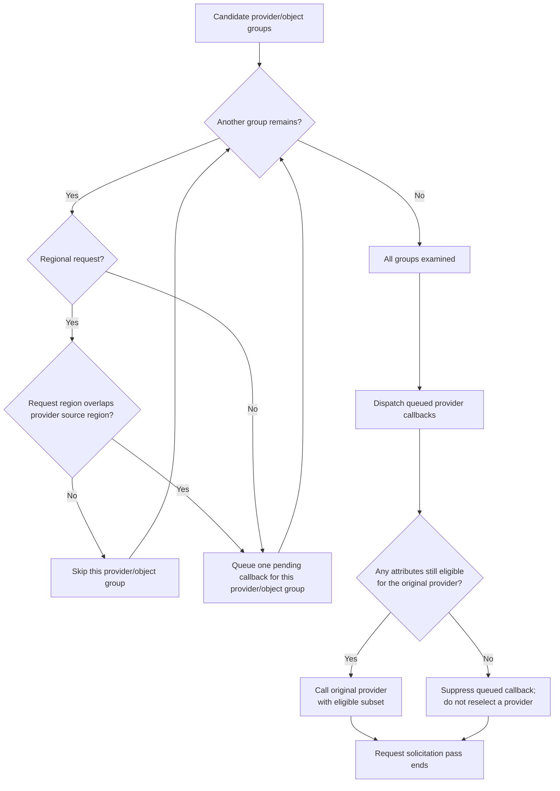
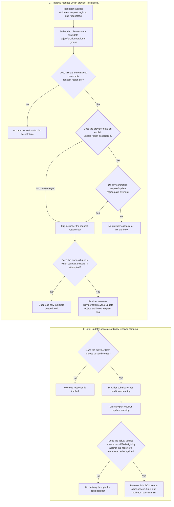
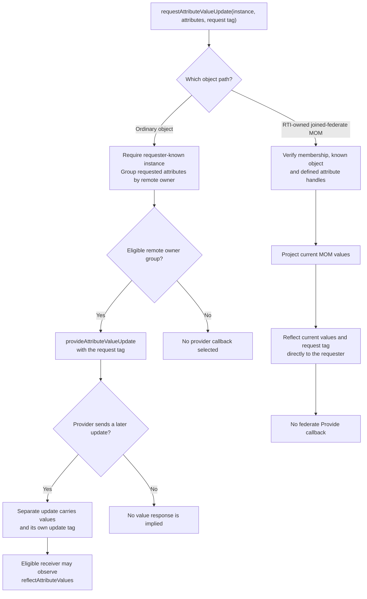
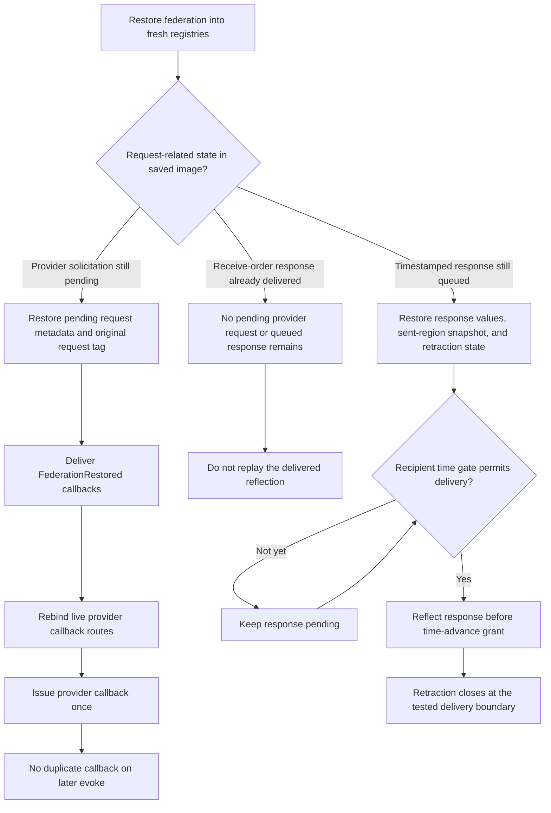

# HLA 1516.1-2025 attribute-value update request flow guide

An HLA attribute-value update request is a solicitation, not a value transfer:
it asks an eligible provider to supply values, but it does not itself return
those values to the requester. The provider callback, the provider's later
update, and a receiver's reflection are distinct events with distinct
eligibility and timing rules. This guide explains that portable service
sequence, then uses the current 2025 API and Umbra implementation as bounded
examples.

This is an HLA-facing behavior guide with bounded source- and test-informed
implementation examples, not a complete normative interpretation of every
request overload. It does not describe or infer IEEE 1516.1-2010 behavior.
Keep the editions' APIs, implementations, and tests on their own paths. Most
implementation detail below follows the embedded 2025 route; the one process
class-request observation is called out separately and is not evidence of
process/embedded parity.

## 1. HLA-facing model: solicitation and value delivery are distinct

The API-facing sequence has separate events: a requester asks for an
attribute-value update, a provider may receive `provideAttributeValueUpdate`,
the provider may later send values with `updateAttributeValues`, and an
eligible receiver may observe a reflection. The request callback carries the
request tag; the later update carries its own value map and tag. The service
clauses determine exact provider and receiver eligibility, which this model
does not attempt to settle.

The lifelines are roles, not a claim about four distinct federates; one
federate may occupy more than one role when the applicable service rules permit.

This is a causal reading model, not a required RTI call sequence, complete
normative interpretation, shared call stack, or guarantee that the provider
observes the callback before the request service returns. The callback model
controls when application code can observe the callback: `HLA_EVOKED` uses an
Evoke service, while `HLA_IMMEDIATE` permits callback entry while an RTI service
is executing. That changes callback observation timing, not the distinction
between solicitation and a later value-bearing update. See the
[callback/service-ordering guide](HLA-2025-CALLBACK-AND-SERVICE-ORDERING-FLOW-GUIDE.md)
for the general callback boundary.

The requester is not assumed to be the only possible receiver—or to qualify
as a receiver merely because it requested values. Publication/ownership,
receiver relevance, regional criteria, transportation/order, and time
management are separate service questions. Local focused scenarios do not
settle whether an explicit request creates direct response entitlement for an
otherwise ineligible requester; verify the full §6.21 text before making that
normative claim. The vendored [`RTIambassador.h`](../../third_party/ieee1516.1-2025/include/RTI/RTIambassador.h#L876)
contains the §6.21 signature and exception list, not the clause prose; the
[official IEEE listing](https://standards.ieee.org/ieee/1516.1/6688/) indicates
that access to the standard is by purchase or subscription. For receiver
selection, see the
[object and interaction information guide](HLA-2025-OBJECT-AND-INTERACTION-INFORMATION-FLOW-GUIDE.md)
and [DDM and regions guide](HLA-2025-DATA-DISTRIBUTION-AND-REGIONS-FLOW-GUIDE.md).
For timestamped update ordering, grants, and retraction, see the
[time-management guide](HLA-2025-TIME-MANAGEMENT-GUIDE.md) and
[TSO retraction guide](HLA-2025-TSO-RETRACTION-FLOW-GUIDE.md).

## 2. 2025 implementation example: plan and recheck provider work

The 2025 API has object-instance, object-class, and regional object-class
request forms. The object/class registry planner is shared by the embedded
ambassador and process service: it expands class scope into instances and
partitions requested attributes by current owner. Callback dispatch then
follows profile-specific paths. The first diagram summarizes that planning
seam; the callback-entry recheck in the second is bounded to the embedded
path. Neither diagram is a portable HLA algorithm.

#### 1. Expand request scope into candidate provider/object work

#### 2. Filter each group, then dispatch and recheck provider work

Apply the dispatch/recheck branch independently to each queued
provider/object group.

### What changes with each scope in the embedded profile

- **Object instance:** the requesting federate must already know the object.
  This is both an API-documented `ObjectInstanceNotKnown` condition and a
  shared-planner check. Requested attributes are checked against that object's
  known class. The planner then solicits current owners for attributes they
  own; an attribute already owned by the requester does not create a provider
  callback.
- **Object class:** the shared 2025 planner enumerates live, non-deleted
  instances registered at or below the requested class. It splits each
  instance's requested attributes by their current provider. A provider can
  therefore receive multiple callbacks for different objects, and one object
  can produce callbacks to multiple providers. Unlike the object-instance
  planner, this class-expansion path does not consult the requester's
  per-instance known-object map or subscription while forming provider work;
  this is a source observation, not a normative rule. Both focused class tests
  request after the target instances have been discovered. The process test
  makes no public subscription call before the request, but it does not test
  an undiscovered target instance or a later value reflection. Tests show
  multiple instances routed to one provider, not one object's requested
  attributes split across multiple providers; that latter branch remains
  source-derived. Do not infer full process/embedded parity or present these
  implementation details as general HLA requirements.
- **Regional object class:** validate the supplied attribute/region pairs and
  region ownership/commit state before planning any route. The request and
  provider source regions must satisfy the current regional eligibility test.
  Tests cover empty scopes, disjoint scopes, committed region changes, and a
  queued callback whose regional route becomes stale before delivery. Do not
  generalize those cases into a claim that every request property is
  revalidated in every profile.
- **Callback boundary:** pending embedded requests retain request metadata and
  are checked again as provider work begins. In the embedded class-request
  path, the pending item is matched against the requester and provider chosen
  during planning; its candidate projection then keeps only requested
  attributes still owned by that provider. A nonempty subset is sent to that
  same provider; an empty projection is suppressed, not reassigned to a newly
  selected owner. This is an implementation observation, not a claim about a
  portable HLA retargeting rule or the process profile. The focused baseline
  request test demonstrates ordinary callback delivery but does not exercise
  an ownership change between planning and dispatch. For the portable
  per-attribute authority model, see the
  [attribute-ownership guide](HLA-2025-ATTRIBUTE-OWNERSHIP-FLOW-GUIDE.md).

The diagrams omit API exception details and per-overload validation matrices.
They also omit automatic `provideAttributeValueUpdate` behavior: an explicit
request is not discovery-triggered Auto Provide, and the Auto Provide switch
must not be applied to explicit requests by assumption. See the
[Auto Provide guide](HLA-2025-AUTO-PROVIDE-FLOW-GUIDE.md) for the separate
discovery-triggered path.

In the current embedded 2025 implementation, the provider's later
`updateAttributeValues` goes through ordinary receiver planning; making a
request does not itself create a subscription or a special reflection
recipient. This is an implementation observation, not a complete normative
rule for every requester/receiver combination. The focused embedded baseline
calls the public `subscribeObjectClassAttributes` service first. The process
scenario instead seeds the requester's subscription directly through the
registry in its test fixture; it therefore does not cover the public process
subscription service. Neither case isolates an unsubscribed requester.

### Regional request scope is not response DDM

A regional request and a later value update make different regional
eligibility decisions. In the selected embedded 2025 path, the request's
attribute/region pairs screen which provider/object work is solicited against
the provider's committed source-region associations. The provide callback
carries the object, requested attributes, and request tag—not a source region.
For a requested attribute with a non-empty request-region set, an explicit
provider update-region association must overlap; an attribute using the
default region remains eligible. The embedded path rechecks eligibility when
delivering queued provider work, so a later committed region change can
suppress a now-stale explicit-region callback.
If that provider later sends values, the update enters ordinary receiver
planning: its applicable source realization is evaluated separately against
each receiver's committed subscription. The request operation alone does not
add its caller to the later update's recipient set, and its request region
does not become the later update's source realization. This is a selected
implementation explanation, not a complete normative rule for every overload
or a process/embedded parity claim.

### Special case: RTI-owned MOM objects

The current 2025 ambassador implementation has a separate branch for requests
against RTI-owned MOM objects: it plans a MOM snapshot and directly reflects
that snapshot to the requester instead of routing an ordinary provider
solicitation. Keep this as a special RTI-owned-object path, not as the general
provider lifecycle described above. See the
[federation-scoped MOM guide](HLA-2025-FEDERATION-MOM-FLOW-GUIDE.md) and the
[joined-federate MOM guide](HLA-2025-JOINED-FEDERATE-MOM-OBJECT-LIFECYCLE-FLOW-GUIDE.md)
for MOM ownership and lifecycle boundaries.

The configured process endpoint has a corresponding object-instance branch:
it reads the joined-federate MOM ledger and directly emits a value-reflection
event; the source explicitly states that these values do not induce a
federate `Provide Attribute Value Update` callback
([process request handler](../../cpp/src/internal/federation/process_federation_service_attribute_update_requests.cpp#L34)).
The process [joined-federate report-file case](../../cpp/tests/ieee1516_2025_connection_process_joined_federate_mom_report_file_catch2.cpp#L437)
requests the current report-file path and checks the resulting reflection.
This establishes only that selected `HLAfederate` request path; it does not
establish general provider-request parity across profiles.

### Configured-process instance requests branch on object ownership

For the inspected IEEE 1516.1-2025 configured-process endpoint, the public
instance-request call splits after the RTI recognizes the target object. An
ordinary object is resolved through its current federate owners: the RTI asks
eligible owners to provide values, and any later values travel through a
separate update service. A joined-federate MOM object is RTI-owned: the RTI
projects its current values and reflects them directly to the requester.
This is a bounded source map, not a portable rule about entitlement to a
response or a claim of general process/embedded parity.

**Process implementation map (not an HLA wire protocol):** the public
ambassador validates and copies the request's handles and tag into the
process client ([adapter](../../cpp/src/internal/runtime/umbra_rti_ambassador_request_attribute_value_updates.cpp#L23));
the client encodes the federation/member/object/attribute identities and tag
for the private service request ([client](../../cpp/src/internal/federation/process_federation_client_value_services.cpp#L133),
[codec](../../cpp/src/internal/federation/process_federation_service_codecs.cpp#L828)).
The service decodes that request, checks session membership, and branches to
the MOM snapshot or ordinary owner planner ([handler](../../cpp/src/internal/federation/process_federation_service_attribute_update_requests.cpp#L13)).
For ordinary objects, each provider event carries the original request tag;
the callback bridge reconstructs the public handles and invokes
`provideAttributeValueUpdate` ([event creation](../../cpp/src/internal/federation/process_federation_service_attribute_update_requests.cpp#L159),
[callback bridge](../../cpp/src/internal/federation/process_federation_callback_bridge.cpp#L370)).
The later provider response is a separate update service and carries its own
tag ([process update handler](../../cpp/src/internal/federation/process_federation_service_attribute_value_updates.cpp#L13)).

The configured-process handler checks the joined-federate MOM ledger before
falling through to the ordinary object planner
([handler](../../cpp/src/internal/federation/process_federation_service_attribute_update_requests.cpp#L13),
[direct MOM event and request tag](../../cpp/src/internal/federation/process_federation_service_attribute_update_requests.cpp#L40),
[ordinary owner planner](../../cpp/src/internal/federation/federation_registry_attribute_value_update_requests.cpp#L278)).
The callback bridge turns ordinary request events into `provideAttributeValueUpdate`
and later value events into `reflectAttributeValues`
([Provide delivery](../../cpp/src/internal/federation/process_federation_callback_bridge.cpp#L370),
[reflection delivery](../../cpp/src/internal/federation/process_federation_callback_bridge.cpp#L261)).
The ordinary process test exercises the full selected chain under both
`HLA_EVOKED` and `HLA_IMMEDIATE`: it observes the request-tagged Provide
callback, sends a later value-bearing update, and checks the requester's
reflection and separate update tag
([focused process case](../../cpp/tests/ieee1516_2025_connection_request_attribute_value_update_catch2.cpp#L459)).
The joined-federate MOM test is narrower: its `HLA_EVOKED` observer asks for
the current `HLAreportServiceFile` and checks that direct reflection
([focused MOM case](../../cpp/tests/ieee1516_2025_connection_process_joined_federate_mom_report_file_catch2.cpp#L437)).
These selected tests do not establish every provider/receiver eligibility
case, an unsubscribed ordinary requester response, automatic Conditional
MOM-change delivery, or callback-order guarantees.

In particular, the ordinary process test does not assert that the Provide
callback entered before or after `requestAttributeValueUpdate` returned. After
the request returns, its `HLA_EVOKED` section explicitly calls
`evokeCallback`; its `HLA_IMMEDIATE` section makes a later
`getObjectClassHandle` call that the harness labels an immediate-callback
flush, then checks that Provide was observed. After `updateAttributeValues`,
the test uses the analogous evoke/lookup step before checking reflection
([request and Provide checkpoints](../../cpp/tests/ieee1516_2025_connection_request_attribute_value_update_catch2.cpp#L887),
[later update and reflection checkpoints](../../cpp/tests/ieee1516_2025_connection_request_attribute_value_update_catch2.cpp#L910)).
That proves observation by those later test checkpoints under both configured
models, not an AVU-specific before-return cutoff or cross-federate callback
order. Keep the generic [HLA_EVOKED application drain](HLA-2025-CALLBACK-AND-SERVICE-ORDERING-FLOW-GUIDE.md#hla_evoked-the-application-owns-the-drain-point)
and [HLA_IMMEDIATE service-stack boundary](HLA-2025-CALLBACK-AND-SERVICE-ORDERING-FLOW-GUIDE.md#hla_immediate-callback-work-can-be-on-the-service-stack)
separate from this selected process-test evidence.

## 3. Save/restore depends on which lifecycle stage was reached

“The response to a request” is not one durable state. A request still waiting
to solicit a provider, an already delivered receive-order update, and a queued
timestamped update have different restore behavior in the focused embedded
2025 tests.

These are state distinctions, not three stages that every request must visit.
The restore tests deliberately probe different cut points:

- A still-pending class request is restored with its request tag and provider
  routing is rebound; the provider callback follows `federationRestored`, and
  later callback pumping does not duplicate it.
- A delivered receive-order response is application-visible state rather than
  pending provider work; the fresh-registry restore test checks that it is not
  reflected a second time.
- A queued timestamped regional response survives with its values, source-region
  snapshot, and retraction state. The test observes reflection before the
  matching time-advance grant; after recipient delivery, retraction is no
  longer accepted.

Do not infer that every overload or execution profile has identical save/restore
coverage from these selected cases. For the broader save/restore state machine,
see the [federation save/restore guide](HLA-2025-FEDERATION-SAVE-RESTORE-FLOW-GUIDE.md).

## Evidence and implementation pointers

The links below identify the API surface, the current implementation seams,
and focused 2025 observations. Test observations are not substitutes for a
clause-by-clause review of IEEE 1516.1-2025.

| Concern | Source or focused test | What it supports |
| --- | --- | --- |
| Object-instance, class, and regional public API | [RTIambassador.h:876](../../third_party/ieee1516.1-2025/include/RTI/RTIambassador.h#L876), [RTIambassador.h:891](../../third_party/ieee1516.1-2025/include/RTI/RTIambassador.h#L891), [RTIambassador.h:1672](../../third_party/ieee1516.1-2025/include/RTI/RTIambassador.h#L1672) | The three request scopes and their API argument shapes; the documented `ObjectInstanceNotKnown` exception belongs to the instance overload, while the class overload lists class/attribute errors |
| Provider callback | [FederateAmbassador.h:350](../../third_party/ieee1516.1-2025/include/RTI/FederateAmbassador.h#L350) | The callback receives an object, attribute set, and tag |
| Explicit request versus later reflection eligibility | [Embedded provider planning](../../cpp/src/internal/federation/federation_registry_attribute_value_update_requests.cpp#L278), [ordinary receiver planner](../../cpp/src/internal/federation/federation_registry_attribute_update_recipients.cpp#L231), [embedded public subscription setup](../../cpp/tests/attribute_value_update_request_baseline_catch2.cpp#L143), [process fixture's direct registry subscription](../../cpp/tests/ieee1516_2025_connection_request_attribute_value_update_catch2.cpp#L683), [process request call](../../cpp/tests/ieee1516_2025_connection_request_attribute_value_update_catch2.cpp#L887) | In the embedded path, request planning selects providers while later updates use receiver declarations. Both focused scenarios have a subscription context, but the process case seeds it below the public API; no unsubscribed-requester response case is established. This is not a normative ruling on direct response entitlement. |
| Requester also acts as receiver in one selected example | [Embedded requester's subscription](../../cpp/tests/attribute_value_update_response_catch2.cpp#L180), [request](../../cpp/tests/attribute_value_update_response_catch2.cpp#L215), and [later reflection](../../cpp/tests/attribute_value_update_response_catch2.cpp#L238) | In this embedded `HLA_EVOKED` case the requester has its own subscription, invokes the request, and later observes the provider's separate response update. This demonstrates role overlap in that scenario, not direct response entitlement for an unsubscribed or otherwise ineligible requester. |
| Callback delivery model | [2025 CallbackModel enum](../../third_party/ieee1516.1-2025/include/RTI/Enums.h#L22), [Evoke services](../../third_party/ieee1516.1-2025/include/RTI/RTIambassador.h#L2265) | Public callback-model vocabulary; see the linked callback guide for model semantics and their implementation boundary |
| Embedded request overloads | [Ambassador request implementation:23](../../cpp/src/internal/runtime/umbra_rti_ambassador_request_attribute_value_updates.cpp#L23), [class overload:331](../../cpp/src/internal/runtime/umbra_rti_ambassador_request_attribute_value_updates.cpp#L331), [regional overload:633](../../cpp/src/internal/runtime/umbra_rti_ambassador_request_attribute_value_updates.cpp#L633) | Separate object, class, regional, and RTI-owned MOM handling paths |
| RTI-owned joined-federate MOM request | [Embedded ambassador branch](../../cpp/src/internal/runtime/umbra_rti_ambassador_request_attribute_value_updates.cpp#L139), [process service branch](../../cpp/src/internal/federation/process_federation_service_attribute_update_requests.cpp#L34), [configured-process report-path request](../../cpp/tests/ieee1516_2025_connection_process_joined_federate_mom_report_file_catch2.cpp#L437) | The selected MOM object request returns RTI-held values through a direct reflection path rather than a provider solicitation in both inspected profiles. The process case checks the requested report-file value; this is not general request-service parity. |
| 2025 registry owner partition and fan-out | [Object planner:278](../../cpp/src/internal/federation/federation_registry_attribute_value_update_requests.cpp#L278), [class planner:970](../../cpp/src/internal/federation/federation_registry_attribute_value_update_requests.cpp#L970), [class candidate:531](../../cpp/src/internal/federation/federation_registry_attribute_update_recipients.cpp#L531), [process class handler:230](../../cpp/src/internal/federation/process_federation_service_attribute_update_requests.cpp#L230), [embedded class-request baseline:176](../../cpp/tests/object_class_attribute_value_update_request_baseline_catch2.cpp#L176), [process class-request test:395](../../cpp/tests/ieee1516_2025_connection_process_class_request_attribute_value_update_catch2.cpp#L395) | The process service calls the same class planner used by the embedded path, then uses its own event-delivery seam. The instance planner requires requester-known object state; class expansion does not consult that per-instance map or requester subscription when forming provider groups. The focused process class test has no public subscription call but does discover its target objects first. Neither class test isolates an undiscovered target; no focused test splits one object's requested attributes across multiple remote providers. These are source/test observations, not portable requirements or full profile parity. |
| Embedded class callback revalidation | [Pending provider match:817](../../cpp/src/internal/federation/federation_registry_attribute_value_update_requests.cpp#L817), [current-owner projection:567](../../cpp/src/internal/federation/federation_registry_attribute_update_recipients.cpp#L567), [runtime delivery gate:1705](../../cpp/src/internal/runtime/umbra_rti_ambassador.cpp#L1705) | The queued callback is checked against its originally selected provider; only still-owned requested attributes are projected, and an empty projection is not delivered |
| Ordinary object-request baseline | [Focused request test:157](../../cpp/tests/attribute_value_update_request_baseline_catch2.cpp#L157) | Confirms ordinary provider callback behavior and the requester-owned exclusion; it does not cover ownership transfer between planning and callback dispatch |
| Process class expansion observation | [Process class request test:49](../../cpp/tests/ieee1516_2025_connection_process_class_request_attribute_value_update_catch2.cpp#L49) | A focused process test observes class request callbacks for registered subclass instances; not full process parity |
| Regional filter and stale queued work | [Regional filtering test:178](../../cpp/tests/ieee1516_2025_regional_request_attribute_value_update_filtering_catch2.cpp#L178) | Selected overlap, validation, committed-region mutation, and stale callback cases |
| Provider chooses timestamped response | [Timestamped class response test:6](../../cpp/tests/ieee1516_2025_timestamped_object_class_request_provider_response_catch2.cpp#L6), [regional response test:6](../../cpp/tests/ieee1516_2025_timestamped_regional_request_provider_response_catch2.cpp#L6) | A request callback can lead to a distinct TSO update, grant-ordered reflection, and response-tag propagation |
| Pending request restored | [Class pending-request restore test:6](../../cpp/tests/ieee1516_2025_public_class_pending_attribute_value_update_restore_catch2.cpp#L6) | Request metadata/tag restoration, callback ordering after restore, and no duplicate callback |
| Delivered RO response not replayed | [No-replay restore test:6](../../cpp/tests/ieee1516_2025_public_regional_provider_response_no_replay_restore_catch2.cpp#L6) | A delivered receive-order response is not re-reflected after fresh-registry restore |
| Queued regional TSO response restored | [Retraction restore test:7](../../cpp/tests/ieee1516_2025_public_regional_provider_response_retraction_restore_catch2.cpp#L7) | Queued payload, sent-region snapshot, recipient grant ordering, and retraction terminalization |

## Related guides

- [Attribute ownership](HLA-2025-ATTRIBUTE-OWNERSHIP-FLOW-GUIDE.md)
- [Object and interaction information flow](HLA-2025-OBJECT-AND-INTERACTION-INFORMATION-FLOW-GUIDE.md)
- [Attribute update-rate admission](HLA-2025-ATTRIBUTE-UPDATE-RATE-ADMISSION-FLOW-GUIDE.md)
- [DDM and regions](HLA-2025-DATA-DISTRIBUTION-AND-REGIONS-FLOW-GUIDE.md)
- [Auto Provide](HLA-2025-AUTO-PROVIDE-FLOW-GUIDE.md)
- [Time management](HLA-2025-TIME-MANAGEMENT-GUIDE.md)
- [Federation save/restore](HLA-2025-FEDERATION-SAVE-RESTORE-FLOW-GUIDE.md)

