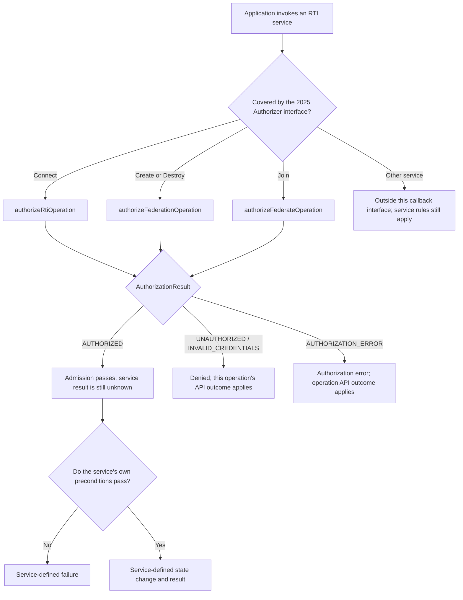
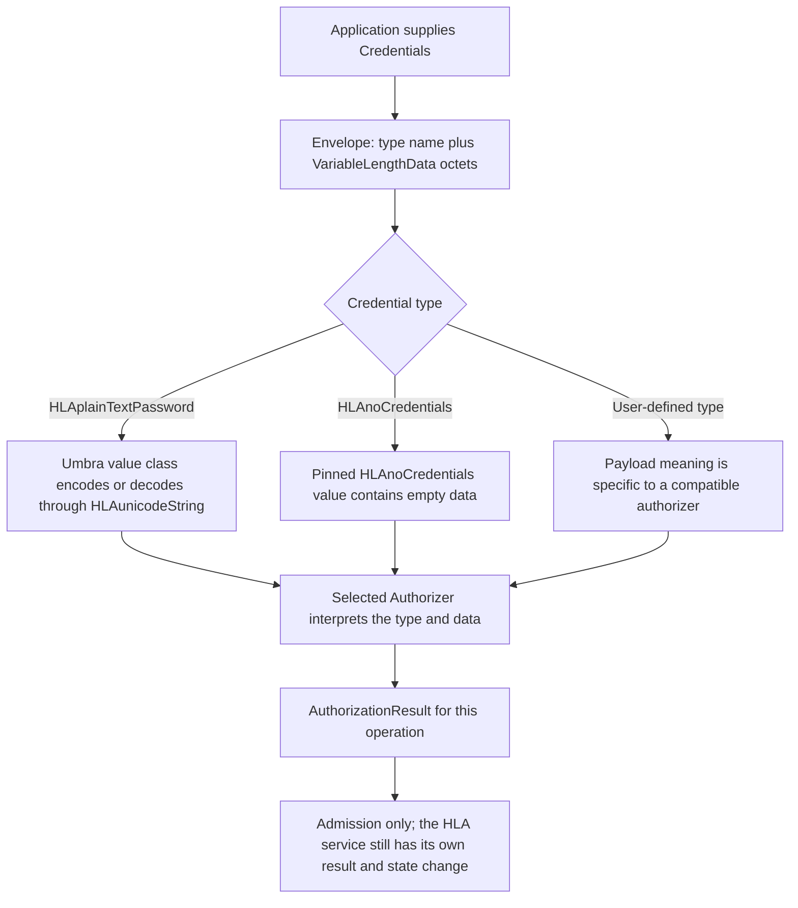
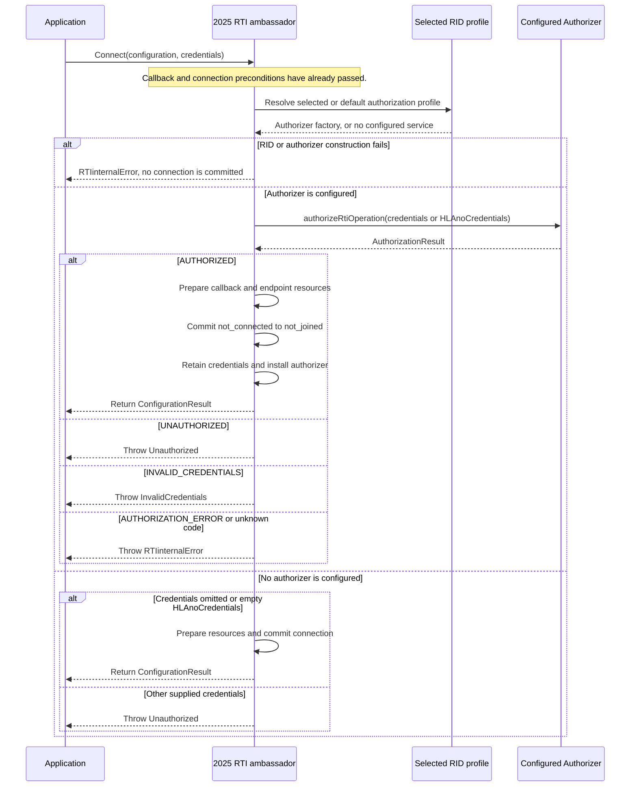
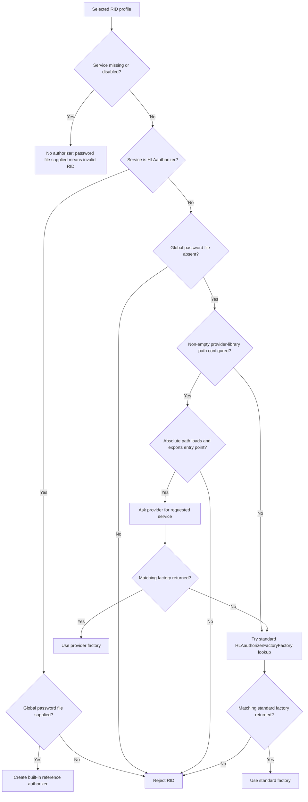
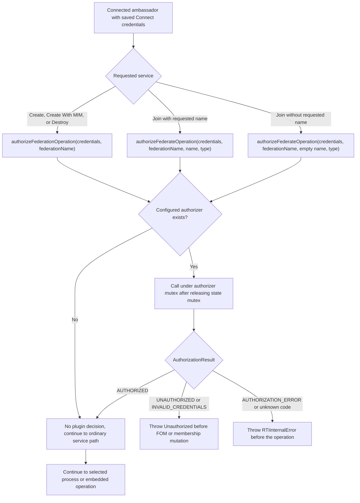
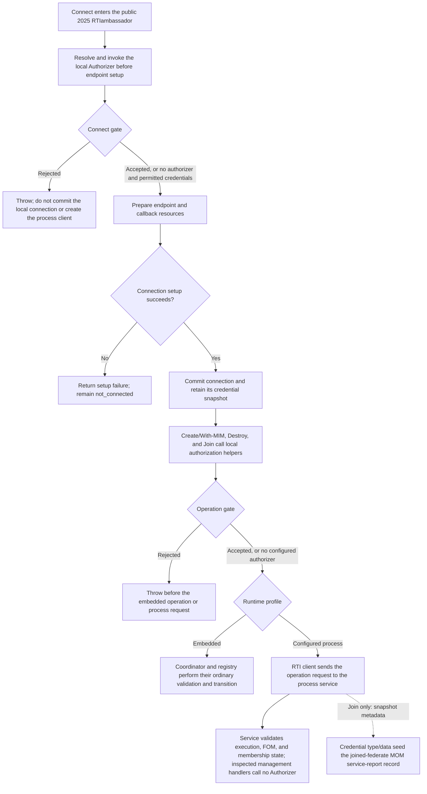
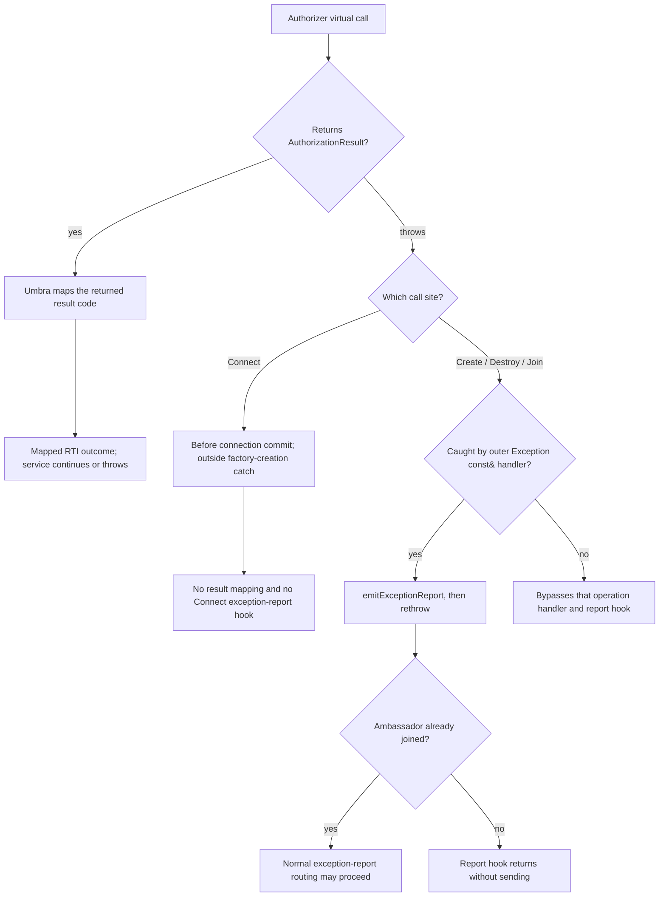
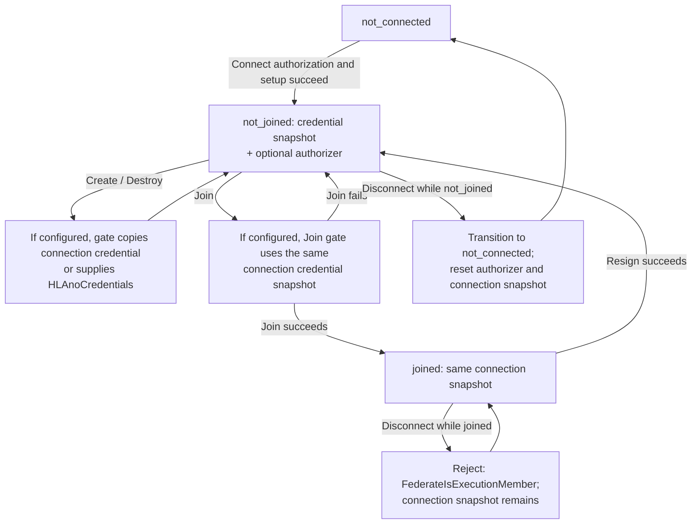

# HLA 1516.1-2025 Authorization and Credentials Flow

In the pinned IEEE 1516.1-2025 API, authorization is an admission decision for
a particular RTI, federation, or federate operation—not the result of that
HLA service. `AUTHORIZED` clears only that operation's authorization gate;
the service can still fail its own connection, FOM, federation-state, or
membership checks, and authorization does not by itself commit those later
state changes. The interface therefore has scoped authorization callbacks,
not one blanket check for every HLA service.

This guide traces that boundary through Connect, Create Federation Execution,
Destroy Federation Execution, and Join Federation Execution. It separates
credential presentation and authorization decisions from Umbra's exception
mapping and the operation's later state change. It describes the pinned API
and selected Umbra 2025 behavior, not a security assessment or conformance
claim.

Keep this guide separate from the [2010 reference-RTI flow
guide](HLA-2010-REFERENCE-RTI-FLOW-GUIDE.md). It does not infer that the 2010
stream has this authorizer interface or these behaviors.

## Authorization is a gate, not the service result

The portable mental model is an admission decision followed by the service's
own rules. The `Authorizer` callbacks cover Connect, Create/Destroy, and Join;
they do not turn every RTI service into an authorization callback. Even after
`AUTHORIZED`, the requested service still evaluates its own preconditions and
determines its state transition and caller-visible result.

This is the pinned 2025 API's callback boundary, not a claim that services
outside this interface have no other admission policy. Exception declarations
and result mapping are operation-specific, as the API notes below show. RID
profile selection and behavior when no authorizer is configured are Umbra
implementation details, covered in the following case-study flows.

## Three authorization scopes

The pinned 2025 `Authorizer` interface names three callbacks. They are not a
generic per-service hook:

| RTI operation | Authorizer callback | Inputs Umbra supplies | Umbra mapping before the operation continues |
| --- | --- | --- | --- |
| `Connect` | `authorizeRtiOperation` | Supplied `Credentials`, or Umbra's `HLAnoCredentials` value for an overload without credentials | `UNAUTHORIZED` → `Unauthorized`; `INVALID_CREDENTIALS` → `InvalidCredentials`; `AUTHORIZATION_ERROR` or an unknown code → `RTIinternalError` |
| `Create Federation Execution`, `Create Federation Execution With MIM`, `Destroy Federation Execution` | `authorizeFederationOperation` | The credential value retained from `Connect`, or `HLAnoCredentials` if none was supplied, and the requested federation name | `UNAUTHORIZED` or `INVALID_CREDENTIALS` → `Unauthorized`; `AUTHORIZATION_ERROR` or an unknown code → `RTIinternalError` |
| `Join Federation Execution` | `authorizeFederateOperation` | Retained credential value, or `HLAnoCredentials` if none was supplied; federation name, requested federate name (empty for the unnamed overload), and federate type | `UNAUTHORIZED` or `INVALID_CREDENTIALS` → `Unauthorized`; `AUTHORIZATION_ERROR` or an unknown code → `RTIinternalError` |

The pinned declarations show that both Connect overloads without a
`Credentials` parameter list `Unauthorized` but omit `InvalidCredentials`;
the [bare overload](../../third_party/ieee1516.1-2025/include/RTI/RTIambassador.h#L55)
and [configuration-only overload](../../third_party/ieee1516.1-2025/include/RTI/RTIambassador.h#L68)
are explicit. The [credentials-only](../../third_party/ieee1516.1-2025/include/RTI/RTIambassador.h#L83)
and [configuration-plus-credentials](../../third_party/ieee1516.1-2025/include/RTI/RTIambassador.h#L98)
overloads list both exceptions. Umbra uses one result mapper for every Connect
overload, including mapping `INVALID_CREDENTIALS` to `InvalidCredentials`;
this is a source/header declaration mismatch for the first two overloads, not
a basis to broaden their documented throw contract. The full licensed §4.2
text is not available here to resolve the normative question. Create, Destroy,
and Join list `Unauthorized`, but not `InvalidCredentials`. The same pinned
header declares [Create with one FOM module](../../third_party/ieee1516.1-2025/include/RTI/RTIambassador.h#L128),
[Create with an FOM module list](../../third_party/ieee1516.1-2025/include/RTI/RTIambassador.h#L145),
[Create-With-MIM](../../third_party/ieee1516.1-2025/include/RTI/RTIambassador.h#L165),
[Destroy](../../third_party/ieee1516.1-2025/include/RTI/RTIambassador.h#L179),
[unnamed Join](../../third_party/ieee1516.1-2025/include/RTI/RTIambassador.h#L212),
and [named Join](../../third_party/ieee1516.1-2025/include/RTI/RTIambassador.h#L234)
with their own operation-specific throw lists. The pinned [`Authorizer`
interface](../../third_party/ieee1516.1-2025/include/RTI/auth/Authorizer.h#L24)
and [`AuthorizationResult`](../../third_party/ieee1516.1-2025/include/RTI/auth/AuthorizationResult.h#L15)
define the callback and result values.

Authorization is distinct from [service-invocation reports](HLA-2025-SERVICE-INVOCATION-REPORTING-FLOW-GUIDE.md),
[exception reports](HLA-2025-EXCEPTION-REPORTING-FLOW-GUIDE.md), and the MOM
exception path covered by the latter. An authorized operation can still fail
its ordinary connection, FOM, federation-state, or membership checks.

## Credentials are typed payloads

The pinned 2025 C++ API models a credential as a type name plus
VariableLengthData. HLAplainTextPassword and HLAnoCredentials are predefined
types; the API also allows authorizer libraries to support user-defined
credential types. The type tells the selected authorizer what kind of data it
received—the RTI does not impose one universal password format on every
credential type.

The Credentials envelope and predefined types are part of the pinned API.
Umbra's HLAplainTextPassword implementation delegates its text encoding to
HLAunicodeString: a four-octet big-endian code-unit count followed by UTF-16BE
code units. Its source comment traces that choice to IEEE 1516.1-2025 §12.6,
and the focused unit case verifies the exact encoded vector. That is
implementation and test evidence, not an independent review of the full
licensed clause text. See the separate [Umbra authorization design note](AUTHORIZATION-DESIGN.md)
for the RID-backed reference policy and its configuration boundary.

For Umbra's built-in reference HLAauthorizer only, a matching configured
password returns AUTHORIZED; a mismatch, omitted credentials, or an
unsupported type returns UNAUTHORIZED; malformed recognized payload data
returns INVALID_CREDENTIALS; and an unconfigured private factory returns
AUTHORIZATION_ERROR. These are properties of that reference implementation,
not a universal HLA password policy. After a successful Connect, Umbra stores
any supplied credential value in its connection snapshot. Later Create,
Destroy, and Join gates use that value, or supply `HLAnoCredentials` when the
Connect overload omitted credentials. The callback arguments and service gate
are visible before both the embedded and process branches; the process-profile
path remains source evidence rather than tested parity, as noted below.

## 1. Connect loads the profile, asks once, then commits

The callback-model and reentrant-call checks happen before the authorizer
stage; an already-connected ambassador is rejected before caller settings are
prepared. See the [Connect guide](HLA-2025-CONNECTION-AND-CONFIGURATION-FLOW-GUIDE.md)
for those local connection gates. At the authorization boundary, the selected
RID profile chooses a service factory: `HLAauthorizer` uses Umbra's configured
reference service, while another enabled service name follows the optional
provider and fallback path below. A successful authorization is still
followed by connection-resource preparation before the local lifecycle
commits.

For authorization-profile lookup, Umbra uses only `RtiConfiguration`'s
`configurationName`. The other fields remain connection inputs and do not
choose the authorizer section:

| Connect input | Authorization profile selected from the configured RID |
| --- | --- |
| Overload without `RtiConfiguration`, or an empty `configurationName` | `default` |
| Non-empty `configurationName` | The same-named profile, such as `[authorization.named]` |
| `rtiAddress` or `additionalSettings` | Not used for authorization-profile selection; processed by later connection setup |

This is Umbra source behavior, not an HLA rule. If no RID path is configured,
or the RID contains no profiles, no RID authorizer is loaded. If a parsed RID
contains profiles but not the selected one, the Connect path reports
`RTIinternalError`. The pinned
[`RtiConfiguration` API](../../third_party/ieee1516.1-2025/include/RTI/RtiConfiguration.h#L17),
[profile-name selection](https://github.com/sheepfling/umbra/blob/c9c5a9e410539b039cd8bba35b53d0ef2b24d180/cpp/src/internal/runtime/rti_initialization_data.cpp#L154),
[RID profile lookup](https://github.com/sheepfling/umbra/blob/c9c5a9e410539b039cd8bba35b53d0ef2b24d180/cpp/src/internal/runtime/rti_initialization_data.cpp#L183),
and authorizer factory creation[^worktree-source]
show the distinction. The focused [RID authorization test source](../../cpp/tests/ieee1516_2025_authorization_catch2.cpp#L370)
expresses default, named, and missing-profile paths; this documentation pass
did not rerun it. For the later endpoint and optional-settings branches, see
the [connection/configuration guide's profile and endpoint flow](HLA-2025-CONNECTION-AND-CONFIGURATION-FLOW-GUIDE.md#2-configuration-selects-a-profile-and-reports-what-happened).

### How Umbra selects an enabled service factory

This branch is Umbra implementation policy, not an IEEE 1516.1 requirement.
The service name and optional global password file are interpreted together:

For a non-reference service, `globalPasswordFile` is invalid. A non-empty
`UMBRA_AUTHORIZER_PROVIDER_LIBRARY` must be an absolute path to a shared library
exporting `umbra_authorizer_factory_v1`; the provider receives the requested
service name and returns a 2025 `AuthorizerFactory*`. A relative path, load
failure, or missing entry point rejects RID selection. If the library loads
but returns no factory or a factory whose `getName()` differs from the
requested service, Umbra falls back to
`HLAauthorizerFactoryFactory::getAuthorizerFactory` and checks the name there
as well. The loader reads the environment and resolves the library on its
first lookup, then keeps the loaded library pinned for that provider
instance's lifetime. See the RID selection branch[^worktree-source]
and provider loader[^worktree-source].

The focused authorization Catch2 source covers reference-factory and
default/named RID paths, but has no focused case for custom-provider loading,
factory fallback, or provider configuration failures. This source review did
not run C++ tests.

The no-authorizer rule is specific to this Connect path: absent credentials and
the empty `HLAnoCredentials` value are accepted; another supplied credential
is rejected. For a configured authorizer, omitted credentials are presented to
`authorizeRtiOperation` as `HLAnoCredentials`. The authorizer candidate is
installed only after connection setup reaches the local commit. The RID-backed
reference service currently reads a configured global password file; that is
an Umbra profile option, not a claim about every 2025 authorizer. See [RID reference-password-file loading](https://github.com/sheepfling/umbra/blob/c9c5a9e410539b039cd8bba35b53d0ef2b24d180/cpp/src/internal/runtime/rti_initialization_data.cpp#L206) and
[Connect authorization](../../cpp/src/internal/runtime/umbra_rti_ambassador_connect_services.cpp#L115).
The [authorization-disabled Connect test](../../cpp/tests/ieee1516_2025_connection_catch2.cpp#L371)
asserts that supplied passwords are rejected and a subsequent Connect with
credentials omitted succeeds in both tested sections. It does not separately
isolate the explicit-empty-credential overloads. A separate [four-overload
Connect case](../../cpp/tests/ieee1516_2025_connection_catch2.cpp#L337)
constructs `HLAnoCredentials` and passes it to both credentials-bearing
overloads; each section expects Connect and Disconnect to succeed. The pinned
[HLAnoCredentials declaration](../../third_party/ieee1516.1-2025/include/RTI/auth/HLAnoCredentials.h#L22)
defines its payload as empty. The overload test does not explicitly select or
assert an authorization-disabled RID profile, or inspect the payload size, so
these cases remain complementary evidence rather than a dedicated test of
every no-authorizer input. This documentation review did not rerun either test.

## 2. Connected credentials gate Create, Destroy, and Join

After Connect, the ambassador keeps the credential value in its connection
snapshot. Before the federation-management branch, Umbra copies that value
under the state lock, releases the lock, and invokes the configured authorizer
under the authorizer lock. This keeps plugin code outside the ambassador state
mutex while serializing authorizer calls with Disconnect.

The gate is before each service's profile-specific operation. Create and
Create-With-MIM authorize before FOM preparation; Destroy authorizes before
the registry or process destroy request; Join authorizes before the membership
transaction and before an RTI-assigned federate name is selected. For the
unnamed Join overload, the API has no requested name to authorize, so Umbra
passes an empty string; the authorizer does not receive the later assigned
name. The [shared result mappers](../../cpp/src/internal/runtime/umbra_rti_ambassador.cpp#L140)
and [connected-operation credential snapshots and gates](../../cpp/src/internal/runtime/umbra_rti_ambassador.cpp#L140)
show these implementation boundaries; the [Join-specific helper](../../cpp/src/internal/runtime/umbra_rti_ambassador.cpp#L2631)
shows the same boundary for federate authorization.

The source places these checks before both the embedded and process branches.
The focused operation tests use Umbra's embedded test seam; this source order
does not establish process-endpoint authorization parity or an end-to-end
process test result.

### Configured-process authorization runs at the caller-side RTI boundary

Umbra resolves and invokes the configured `Authorizer` inside the public
`RTIambassador` before constructing the process client during Connect. The
Create, Create-With-MIM, Destroy, and Join methods invoke their same local
authorization helpers before branching to either the embedded coordinator and
registry or the configured-process client. A rejected result stops before the
process request or embedded operation; an accepted result only opens that gate.
The selected service still validates FOM, execution, and membership state.

The inspected process [Create](../../cpp/src/internal/federation/process_federation_service_lifecycle.cpp#L227),
[Destroy](../../cpp/src/internal/federation/process_federation_service_lifecycle.cpp#L269), and
[Join](../../cpp/src/internal/federation/process_federation_service_lifecycle.cpp#L302)
handlers do not invoke an `Authorizer`. One nuance is that the process Join request carries the saved
connection snapshot, including optional credential type and bytes. The service
copies those values into the joined federate's initial MOM service-report
record; that metadata handoff is not a second authorization decision. Avoid
inferring that no credential data crosses the process boundary, or that the
server reauthorizes Join.

The [Connect authorization gate](../../cpp/src/internal/runtime/umbra_rti_ambassador_connect_services.cpp#L115)
precedes [process-client construction](../../cpp/src/internal/runtime/umbra_rti_ambassador_connect_services.cpp#L234).
The Create, Destroy, and Join gates precede their process branches
([Create](../../cpp/src/internal/runtime/umbra_rti_ambassador_federation_lifecycle.cpp#L145),
[Destroy](../../cpp/src/internal/runtime/umbra_rti_ambassador_federation_lifecycle.cpp#L296),
[Join](../../cpp/src/internal/runtime/umbra_rti_ambassador_federation_lifecycle.cpp#L378));
the [process Join handler](../../cpp/src/internal/federation/process_federation_service_lifecycle.cpp#L302)
does federation/session/FOM checks and creates the initial report record.
The [Join client call](../../cpp/src/internal/federation/process_federation_client_federation_management.cpp#L188)
and [wire credential writer](../../cpp/src/internal/federation/process_federation_service_control_codecs.cpp#L133)
show the credential metadata crossing that boundary, and the [report-record
credential copy](../../cpp/src/internal/federation/process_federation_service_lifecycle.cpp#L175)
shows its use. The focused [authorization cases](../../cpp/tests/ieee1516_2025_authorization_catch2.cpp#L329)
do not configure a process endpoint.

This is the current Umbra process boundary, not a claim about every process
deployment or a normative authorization topology. The dedicated authorization
tests cover the embedded factory seam and factory-created ambassadors; they do
not select the configured process endpoint. A bounded test search found no
focused process case that supplies an `Authorizer` and observes Connect,
Create, Destroy, or Join through that endpoint. The process-side description is
therefore source-derived, not tested profile parity. The earlier recorded
7-of-10 focused run is historical and does not verify the authorization source
and test edits currently present in this worktree; no rerun was made here.

### A denied authorization is not automatically an observer report

The public exception and an observer-side `HLAreportException` are separate
outcomes. Connect authorization runs before connection commit and its Connect
path has no `emitExceptionReport` catch. Create, Create-With-MIM, Destroy, and
Join do call that hook when their public exception catches run, but the hook
returns unless the ambassador is already joined. Consequently, a denial of
Join by an unjoined ambassador has no joined-member route. A denied operation
from an ambassador that is already joined can instead be reported through
that existing federation, subject to its Exception Reporting switch and the
normal recipient rules; authorization itself does not create membership or a
report recipient.

These authorization catch paths also do not call the per-invocation service
report writer. `beginRtiCall` records runtime instrumentation and is not an
`HLAreportServiceInvocation`. Keep that reporting feature as an independent
path; do not infer its presence from an `Unauthorized` result. See the
[exception-report routing guide](HLA-2025-EXCEPTION-REPORTING-FLOW-GUIDE.md)
and [service-invocation reporting guide](HLA-2025-SERVICE-INVOCATION-REPORTING-FLOW-GUIDE.md).

The [Connect gate](../../cpp/src/internal/runtime/umbra_rti_ambassador_connect_services.cpp#L115)
and [Create](../../cpp/src/internal/runtime/umbra_rti_ambassador_federation_lifecycle.cpp#L213),
[Create-With-MIM](../../cpp/src/internal/runtime/umbra_rti_ambassador_federation_lifecycle.cpp#L288),
[Destroy](../../cpp/src/internal/runtime/umbra_rti_ambassador_federation_lifecycle.cpp#L358),
and [Join](../../cpp/src/internal/runtime/umbra_rti_ambassador_federation_lifecycle.cpp#L800)
exception catches show which paths invoke the hook. Its
[joined-state guard](../../cpp/src/internal/runtime/umbra_rti_ambassador_mom_service_report_interaction.cpp#L227)
shows why a pre-membership Join denial does not take the observer route.

### A throwing authorizer follows the call site's C++ exception path

The result mappings above apply only when an `Authorizer` callback returns an
`AuthorizationResult`. The Umbra adapters do not wrap the virtual callback in
a catch that converts a thrown exception into `AUTHORIZATION_ERROR`; a thrown
exception bypasses the result switch. At Connect, the callback runs before
connection commit and outside the catch used while constructing the configured
authorizer. Connect has no adjacent `emitExceptionReport` handler. For Create,
Create-With-MIM, Destroy, and Join, the authorization call is inside an outer
handler that catches the implementation's `Exception const&`, invokes
`emitExceptionReport`, and rethrows. A C++ exception not caught by that type
bypasses this handler and its report hook. When invoked, the report hook still
returns immediately unless the ambassador is already joined.

The [Connect mapper](../../cpp/src/internal/runtime/ambassador_connection_support.cpp#L197)
calls `authorizeRtiOperation` directly; the [Connect service](../../cpp/src/internal/runtime/umbra_rti_ambassador_connect_services.cpp#L115)
invokes it before later connection setup and commit. The
[federation-operation mapper](../../cpp/src/internal/runtime/umbra_rti_ambassador.cpp#L140)
and [federate-operation mapper](../../cpp/src/internal/runtime/umbra_rti_ambassador.cpp#L175)
also call their virtual methods directly. The [Create call site](../../cpp/src/internal/runtime/umbra_rti_ambassador_federation_lifecycle.cpp#L145),
[Destroy call site](../../cpp/src/internal/runtime/umbra_rti_ambassador_federation_lifecycle.cpp#L296),
and [Join call site](../../cpp/src/internal/runtime/umbra_rti_ambassador_federation_lifecycle.cpp#L378)
place authorization inside their operation-level `Exception const&` handlers.
This is an Umbra source observation, not an interpretation of which exceptions
the public `Authorizer` contract permits. The focused
[authorization test recorder](../../cpp/tests/ieee1516_2025_authorization_catch2.cpp#L73)
returns `AuthorizationResult` values; no throwing-authorizer case was found
there. Exception-type behavior and its observer-report outcomes therefore have
no focused runtime test evidence in this guide.

### Disconnect ends this source-level credential scope

Connect stores the supplied credential value in the connection snapshot and
installs a configured authorizer only when connection setup commits. In the
selected 2025 implementation, Disconnect is rejected while the ambassador is
joined; once the not-joined Disconnect transition succeeds, Umbra resets both
the authorizer and the entire connection snapshot. A later Connect constructs
a new snapshot from that call's credentials (or leaves it empty) and resolves
its authorizer again. This describes Umbra's connection-lifetime state, not a
standard-mandated credential-retention policy.

The reset follows the successful lifecycle transition and occurs under the
ambassador/authorizer synchronization used by the implementation. The
[Connect credential snapshot](../../cpp/src/internal/runtime/umbra_rti_ambassador_connect_services.cpp#L167)
is prepared before the [connection lifecycle commit](../../cpp/src/internal/runtime/umbra_rti_ambassador_connect_services.cpp#L267);
the [Disconnect precondition](../../cpp/src/internal/runtime/umbra_rti_ambassador.cpp#L2498)
rejects joined state, then its [cleanup path](../../cpp/src/internal/runtime/umbra_rti_ambassador.cpp#L2515)
resets the authorizer and clears the snapshot. The selected [authorization cases](../../cpp/tests/ieee1516_2025_authorization_catch2.cpp#L536)
use Disconnect for cleanup but do not assert which credentials a second
Connect on the same ambassador would present. Treat that reconnect outcome as
source-derived and not independently tested. The [connection guide's ordered
teardown map](HLA-2025-CONNECTION-AND-CONFIGURATION-FLOW-GUIDE.md#3-disconnect-requires-an-unjoined-connection-and-tears-down-in-order)
covers callback and transport cleanup; this smaller map isolates credential
and authorizer lifetime.

## What the focused cases establish

The [authorization test file](../../cpp/tests/ieee1516_2025_authorization_catch2.cpp#L183)
covers HLAunicodeString password payloads, malformed credential data, the
reference authorizer, Connect, factory/RID loading, and operation-specific
authorization. In a previously recorded local focused CTest run—not rerun
during this documentation review—7 of 10 selected cases passed. The Create
authorization case passed and denies before its deliberately missing FOM is
read. Three setup paths did not reach their authorization assertions:

- The factory-created RID case failed again on a standalone rerun while
  creating its temporary RID test file (test line 556).
- The Destroy case threw `Unknown exception` while creating its initial test
  federation (line 682), before the denial/retry checks.
- The Join case threw `Unknown exception` while creating its initial test
  federation (line 760), before the named/unnamed Join checks.

Those test bodies document intended scenarios, not passing runtime evidence in
this environment. The successful Connect, credential-format, reference
authorizer, and Create cases are also limited to their stated scenarios.

## Limits and handoff

- This guide explains the pinned 2025 API and Umbra's current 2025 code; it
  makes no 2010 equivalence claim.
- The reference `HLAauthorizer` is a password-file-backed implementation. Its
  existence does not evaluate the strength or deployment suitability of an
  authorization policy.
- `AUTHORIZATION_ERROR` and unknown-result exception mappings are source
  observations; the selected tests do not exercise every mapping. The
  overload-specific Connect `@throws` difference above remains to be checked
  against the full §4.2 text before making a normative claim. The official
  [IEEE 1516.1-2025 product page](https://standards.ieee.org/ieee/1516.1/6688/)
  offers purchase and subscription access. Its public downloads link provides
  the C++/Java API XML package, not the licensed §4.2 clause text, so the
  normative exception question remains unresolved here.
- The recorded Destroy and Join run did not reach its target assertions because
  setup failed; treat the 7-of-10 result as historical, not current-worktree
  verification. No focused configured-process authorization case was found;
  the process-side gate placement remains source evidence.
- Authorization success is only an admission decision. It does not mean FOM
  validation, federation mutation, Join, or any later service step succeeds.
- This documentation does not change or extend Requirements Lab mappings.

## Implementation and API map

| Boundary | Evidence |
| --- | --- |
| Typed credential envelope and predefined values | [Credentials](../../third_party/ieee1516.1-2025/include/RTI/auth/Credentials.h#L17), [HLAplainTextPassword](../../third_party/ieee1516.1-2025/include/RTI/auth/HLAplainTextPassword.h#L19), [HLAnoCredentials](../../third_party/ieee1516.1-2025/include/RTI/auth/HLAnoCredentials.h#L19) |
| Reference-authorizer decisions and password codec | [Reference authorizer](../../cpp/src/ieee1516_2025_authorization.cpp#L56), [password decode/encode](../../cpp/src/ieee1516_2025_authorization.cpp#L175), [encoded-payload tests](../../cpp/tests/ieee1516_2025_authorization_catch2.cpp#L183), [reference decision tests](../../cpp/tests/ieee1516_2025_authorization_catch2.cpp#L463) |
| Public 2025 authorization contract and result codes | [`Authorizer`](../../third_party/ieee1516.1-2025/include/RTI/auth/Authorizer.h#L24), [`AuthorizationResult`](../../third_party/ieee1516.1-2025/include/RTI/auth/AuthorizationResult.h#L16) |
| RID profile selection and reference-authorizer construction | [RID profile selection](https://github.com/sheepfling/umbra/blob/c9c5a9e410539b039cd8bba35b53d0ef2b24d180/cpp/src/internal/runtime/rti_initialization_data.cpp#L183), [reference-authorizer construction](https://github.com/sheepfling/umbra/blob/c9c5a9e410539b039cd8bba35b53d0ef2b24d180/cpp/src/internal/runtime/rti_initialization_data.cpp#L217) |
| Connect authorization and connection commit | [Connect authorization gate](../../cpp/src/internal/runtime/umbra_rti_ambassador_connect_services.cpp#L115), [credential snapshot](../../cpp/src/internal/runtime/umbra_rti_ambassador_connect_services.cpp#L166), [connection lifecycle commit](../../cpp/src/internal/runtime/umbra_rti_ambassador_connect_services.cpp#L267), [Connect result mapping](../../cpp/src/internal/runtime/ambassador_connection_support.cpp#L140) |
| Connect with authorization disabled | [test body: supplied credentials rejected, omitted-credential retry accepted](../../cpp/tests/ieee1516_2025_connection_catch2.cpp#L371) |
| Create, Create-With-MIM, Destroy, and Join gate placement | [Create](../../cpp/src/internal/runtime/umbra_rti_ambassador_federation_lifecycle.cpp#L145), [Create-With-MIM](../../cpp/src/internal/runtime/umbra_rti_ambassador_federation_lifecycle.cpp#L224), [Destroy](../../cpp/src/internal/runtime/umbra_rti_ambassador_federation_lifecycle.cpp#L296), [Join](../../cpp/src/internal/runtime/umbra_rti_ambassador_federation_lifecycle.cpp#L378) |
| Public authorization before profile fork; process Join reporting metadata | [Connect gate](../../cpp/src/internal/runtime/umbra_rti_ambassador_connect_services.cpp#L115), [Create/Destroy/Join gates](../../cpp/src/internal/runtime/umbra_rti_ambassador_federation_lifecycle.cpp#L145), [Join request](../../cpp/src/internal/federation/process_federation_service_control_codecs.cpp#L127), [MOM report credential copy](../../cpp/src/internal/federation/process_federation_service_lifecycle.cpp#L175) |
| Unit, Connect, and factory cases | [Authorization tests](../../cpp/tests/ieee1516_2025_authorization_catch2.cpp#L183) |
| Connect overloads with default-constructed `HLAnoCredentials` | [Four-overload Connect case](../../cpp/tests/ieee1516_2025_connection_catch2.cpp#L337) |

For adjacent state, continue with the [connection/configuration guide](HLA-2025-CONNECTION-AND-CONFIGURATION-FLOW-GUIDE.md)
or the [federation/federate lifecycle guide](HLA-2025-FEDERATION-AND-FEDERATE-LIFECYCLE-FLOW-GUIDE.md).

[^worktree-source]: Source/test citations marked in this guide refer to current-worktree changes absent from the hosted base; those files are excluded from the documentation-only publication path set. The [hosted source-dependency audit](HLA-2025-HOSTED-SOURCE-DEPENDENCIES.json) records the exact paths, lines, and status.
