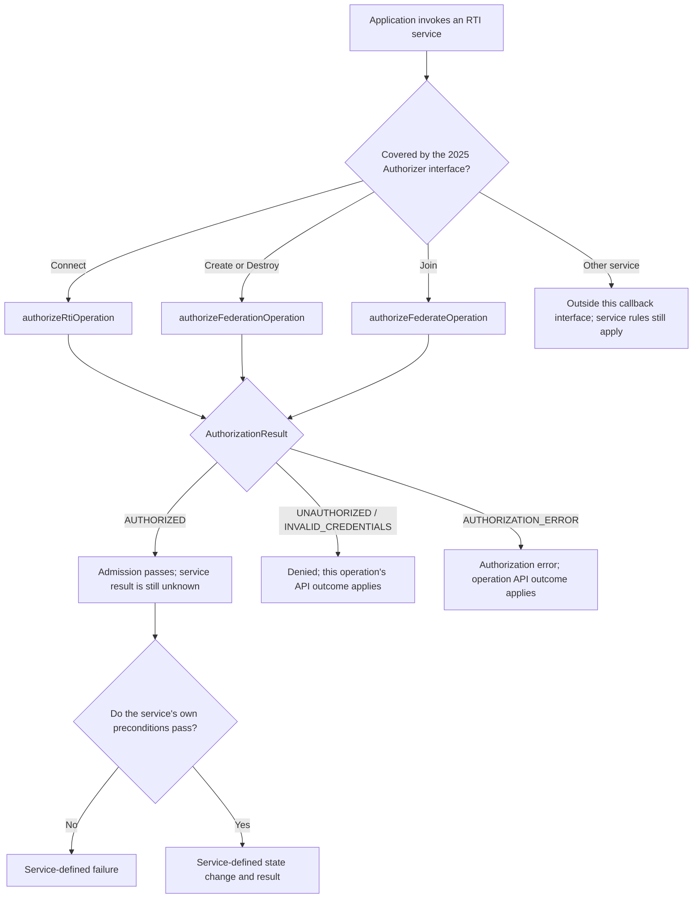
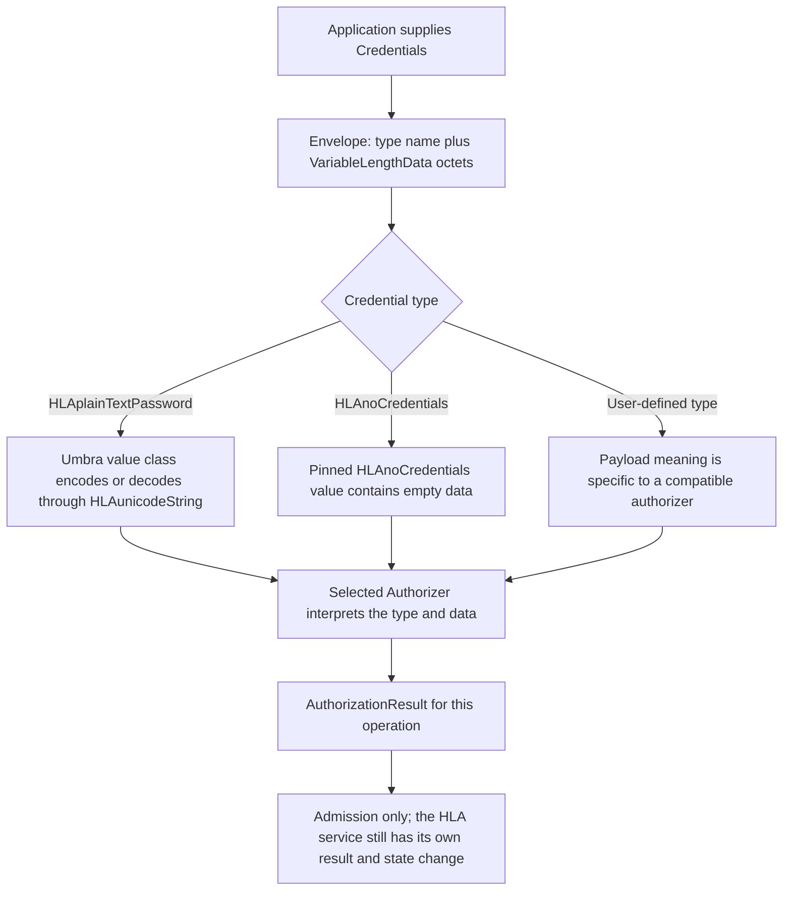
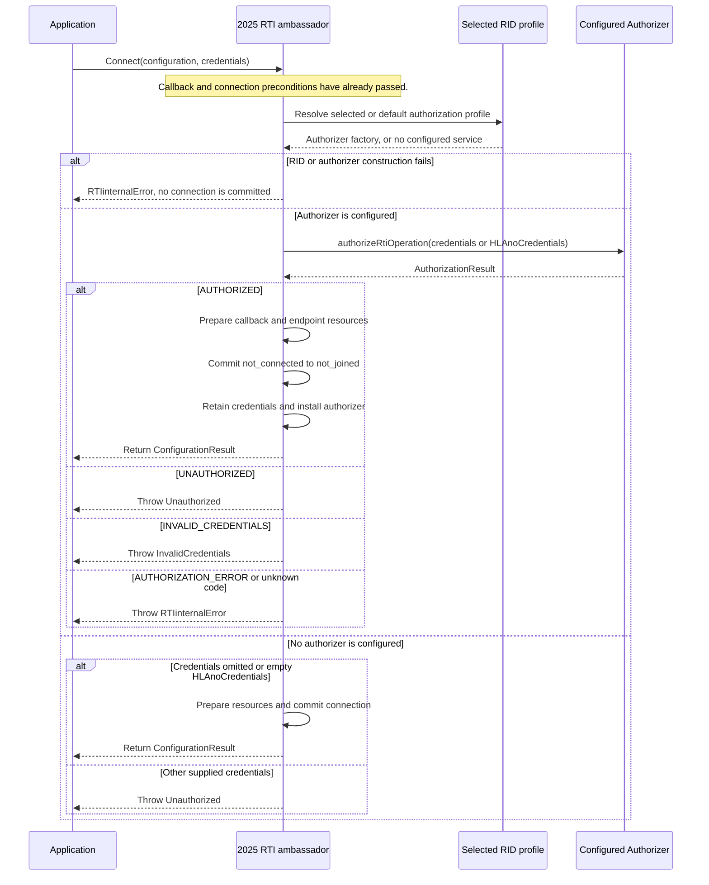
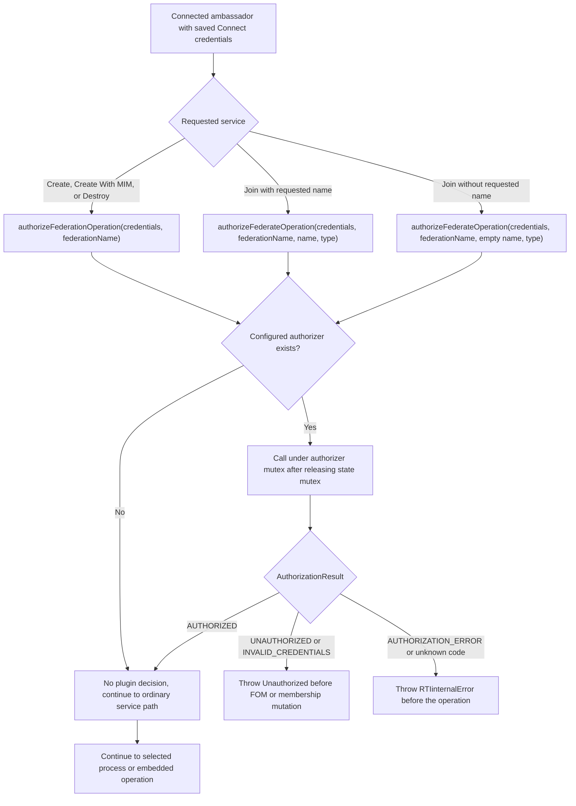

# HLA 1516.1-2025 Authorization and Credentials Flow

In the pinned IEEE 1516.1-2025 API, authorization is an admission decision for
a particular RTI, federation, or federate operation—not the result of that
HLA service. `AUTHORIZED` clears only that operation's authorization gate;
the service can still fail its own connection, FOM, federation-state, or
membership checks, and authorization does not by itself commit those later
state changes. The interface therefore has scoped authorization callbacks,
not one blanket check for every HLA service.

This guide traces that boundary through Connect, Create Federation Execution,
Destroy Federation Execution, and Join Federation Execution. It separates
credential presentation and authorization decisions from Umbra's exception
mapping and the operation's later state change. It describes the pinned API
and selected Umbra 2025 behavior, not a security assessment or conformance
claim.

Keep this guide separate from the [2010 reference-RTI flow
guide](HLA-2010-REFERENCE-RTI-FLOW-GUIDE.md). It does not infer that the 2010
stream has this authorizer interface or these behaviors.

## Authorization is a gate, not the service result

The portable mental model is an admission decision followed by the service's
own rules. The `Authorizer` callbacks cover Connect, Create/Destroy, and Join;
they do not turn every RTI service into an authorization callback. Even after
`AUTHORIZED`, the requested service still evaluates its own preconditions and
determines its state transition and caller-visible result.

This is the pinned 2025 API's callback boundary, not a claim that services
outside this interface have no other admission policy. Exception declarations
and result mapping are operation-specific, as the API notes below show. RID
profile selection and behavior when no authorizer is configured are Umbra
implementation details, covered in the following case-study flows.

## Three authorization scopes

The pinned 2025 `Authorizer` interface names three callbacks. They are not a
generic per-service hook:

| RTI operation | Authorizer callback | Inputs Umbra supplies | Umbra mapping before the operation continues |
| --- | --- | --- | --- |
| `Connect` | `authorizeRtiOperation` | Supplied `Credentials`, or Umbra's `HLAnoCredentials` value for an overload without credentials | `UNAUTHORIZED` → `Unauthorized`; `INVALID_CREDENTIALS` → `InvalidCredentials`; `AUTHORIZATION_ERROR` or an unknown code → `RTIinternalError` |
| `Create Federation Execution`, `Create Federation Execution With MIM`, `Destroy Federation Execution` | `authorizeFederationOperation` | The credential value retained from `Connect`, or `HLAnoCredentials` if none was supplied, and the requested federation name | `UNAUTHORIZED` or `INVALID_CREDENTIALS` → `Unauthorized`; `AUTHORIZATION_ERROR` or an unknown code → `RTIinternalError` |
| `Join Federation Execution` | `authorizeFederateOperation` | Retained credential value, or `HLAnoCredentials` if none was supplied; federation name, requested federate name (empty for the unnamed overload), and federate type | `UNAUTHORIZED` or `INVALID_CREDENTIALS` → `Unauthorized`; `AUTHORIZATION_ERROR` or an unknown code → `RTIinternalError` |

The pinned declarations show that both Connect overloads without a
`Credentials` parameter list `Unauthorized` but omit `InvalidCredentials`;
the [bare overload](../../third_party/ieee1516.1-2025/include/RTI/RTIambassador.h#L55)
and [configuration-only overload](../../third_party/ieee1516.1-2025/include/RTI/RTIambassador.h#L68)
are explicit. The [credentials-only](../../third_party/ieee1516.1-2025/include/RTI/RTIambassador.h#L83)
and [configuration-plus-credentials](../../third_party/ieee1516.1-2025/include/RTI/RTIambassador.h#L98)
overloads list both exceptions. Umbra uses one result mapper for every Connect
overload, including mapping `INVALID_CREDENTIALS` to `InvalidCredentials`;
this is a source/header declaration mismatch for the first two overloads, not
a basis to broaden their documented throw contract. The full licensed §4.2
text is not available here to resolve the normative question. Create, Destroy,
and Join list `Unauthorized`, but not `InvalidCredentials`. The same pinned
header declares [Create with one FOM module](../../third_party/ieee1516.1-2025/include/RTI/RTIambassador.h#L128),
[Create with an FOM module list](../../third_party/ieee1516.1-2025/include/RTI/RTIambassador.h#L145),
[Create-With-MIM](../../third_party/ieee1516.1-2025/include/RTI/RTIambassador.h#L165),
[Destroy](../../third_party/ieee1516.1-2025/include/RTI/RTIambassador.h#L179),
[unnamed Join](../../third_party/ieee1516.1-2025/include/RTI/RTIambassador.h#L212),
and [named Join](../../third_party/ieee1516.1-2025/include/RTI/RTIambassador.h#L234)
with their own operation-specific throw lists. The pinned [`Authorizer`
interface](../../third_party/ieee1516.1-2025/include/RTI/auth/Authorizer.h#L24)
and [`AuthorizationResult`](../../third_party/ieee1516.1-2025/include/RTI/auth/AuthorizationResult.h#L15)
define the callback and result values.

Authorization is distinct from [service-invocation reports](HLA-2025-SERVICE-INVOCATION-REPORTING-FLOW-GUIDE.md),
[exception reports](HLA-2025-EXCEPTION-REPORTING-FLOW-GUIDE.md), and the MOM
exception path covered by the latter. An authorized operation can still fail
its ordinary connection, FOM, federation-state, or membership checks.

## Credentials are typed payloads

The pinned 2025 C++ API models a credential as a type name plus
VariableLengthData. HLAplainTextPassword and HLAnoCredentials are predefined
types; the API also allows authorizer libraries to support user-defined
credential types. The type tells the selected authorizer what kind of data it
received—the RTI does not impose one universal password format on every
credential type.

The Credentials envelope and predefined types are part of the pinned API.
Umbra's HLAplainTextPassword implementation delegates its text encoding to
HLAunicodeString: a four-octet big-endian code-unit count followed by UTF-16BE
code units. Its source comment traces that choice to IEEE 1516.1-2025 §12.6,
and the focused unit case verifies the exact encoded vector. That is
implementation and test evidence, not an independent review of the full
licensed clause text. See the separate [Umbra authorization design note](AUTHORIZATION-DESIGN.md)
for the RID-backed reference policy and its configuration boundary.

For Umbra's built-in reference HLAauthorizer only, a matching configured
password returns AUTHORIZED; a mismatch, omitted credentials, or an
unsupported type returns UNAUTHORIZED; malformed recognized payload data
returns INVALID_CREDENTIALS; and an unconfigured private factory returns
AUTHORIZATION_ERROR. These are properties of that reference implementation,
not a universal HLA password policy. After a successful Connect, Umbra stores
any supplied credential value in its connection snapshot. Later Create,
Destroy, and Join gates use that value, or supply `HLAnoCredentials` when the
Connect overload omitted credentials. The callback arguments and service gate
are visible before both the embedded and process branches; the process-profile
path remains source evidence rather than tested parity, as noted below.

## 1. Connect loads the profile, asks once, then commits

The callback-model and reentrant-call checks happen before the authorizer
stage; an already-connected ambassador is rejected before caller settings are
prepared. See the [Connect guide](HLA-2025-CONNECTION-AND-CONFIGURATION-FLOW-GUIDE.md)
for those local connection gates. At the authorization boundary, the selected
RID profile may provide Umbra's reference `HLAauthorizer`; a successful
authorization is still followed by connection-resource preparation before the
local lifecycle commits.

The no-authorizer rule is specific to this Connect path: absent credentials and
the empty `HLAnoCredentials` value are accepted; another supplied credential
is rejected. For a configured authorizer, omitted credentials are presented to
`authorizeRtiOperation` as `HLAnoCredentials`. The authorizer candidate is
installed only after connection setup reaches the local commit. The RID-backed
reference service currently reads a configured global password file; that is
an Umbra profile option, not a claim about every 2025 authorizer. See [RID
loading](../../cpp/src/internal/runtime/rti_initialization_data.cpp#L196) and
[Connect authorization](../../cpp/src/internal/runtime/umbra_rti_ambassador_connect_services.cpp#L115).

## 2. Connected credentials gate Create, Destroy, and Join

After Connect, the ambassador keeps the credential value in its connection
snapshot. Before the federation-management branch, Umbra copies that value
under the state lock, releases the lock, and invokes the configured authorizer
under the authorizer lock. This keeps plugin code outside the ambassador state
mutex while serializing authorizer calls with Disconnect.

The gate is before each service's profile-specific operation. Create and
Create-With-MIM authorize before FOM preparation; Destroy authorizes before
the registry or process destroy request; Join authorizes before the membership
transaction and before an RTI-assigned federate name is selected. For the
unnamed Join overload, the API has no requested name to authorize, so Umbra
passes an empty string; the authorizer does not receive the later assigned
name. The [shared result mappers](../../cpp/src/internal/runtime/umbra_rti_ambassador.cpp#L139)
and [connected-operation credential snapshots and gates](../../cpp/src/internal/runtime/umbra_rti_ambassador.cpp#L2536)
show these implementation boundaries; the [Join-specific helper](../../cpp/src/internal/runtime/umbra_rti_ambassador.cpp#L2561)
shows the same boundary for federate authorization.

The source places these checks before both the embedded and process branches.
The focused operation tests use Umbra's embedded test seam; this source order
does not establish process-endpoint authorization parity or an end-to-end
process test result.

## What the focused cases establish

The [authorization test file](../../cpp/tests/ieee1516_2025_authorization_catch2.cpp#L389)
covers HLAunicodeString password payloads, malformed credential data, the
reference authorizer, Connect, factory/RID loading, and operation-specific
authorization. In a previously recorded local focused CTest run—not rerun
during this documentation review—7 of 10 selected cases passed. The Create
authorization case passed and denies before its deliberately missing FOM is
read. Three setup paths did not reach their authorization assertions:

- The factory-created RID case failed again on a standalone rerun while
  creating its temporary RID test file (test line 556).
- The Destroy case threw `Unknown exception` while creating its initial test
  federation (line 682), before the denial/retry checks.
- The Join case threw `Unknown exception` while creating its initial test
  federation (line 760), before the named/unnamed Join checks.

Those test bodies document intended scenarios, not passing runtime evidence in
this environment. The successful Connect, credential-format, reference
authorizer, and Create cases are also limited to their stated scenarios.

## Limits and handoff

- This guide explains the pinned 2025 API and Umbra's current 2025 code; it
  makes no 2010 equivalence claim.
- The reference `HLAauthorizer` is a password-file-backed implementation. Its
  existence does not evaluate the strength or deployment suitability of an
  authorization policy.
- `AUTHORIZATION_ERROR` and unknown-result exception mappings are source
  observations; the selected tests do not exercise every mapping. The
  overload-specific Connect `@throws` difference above remains to be checked
  against the full §4.2 text before making a normative claim. The official
  [IEEE listing](https://standards.ieee.org/ieee/1516.1/6688/) offers purchase
  and subscription access but does not expose that clause text.
- The operation tests for Destroy and Join did not reach their target
  assertions in the current run. Process-endpoint authorization is not
  established by the embedded test cases.
- Authorization success is only an admission decision. It does not mean FOM
  validation, federation mutation, Join, or any later service step succeeds.
- This documentation does not change or extend Requirements Lab mappings.

## Implementation and API map

| Boundary | Evidence |
| --- | --- |
| Typed credential envelope and predefined values | [Credentials](../../third_party/ieee1516.1-2025/include/RTI/auth/Credentials.h#L17), [HLAplainTextPassword](../../third_party/ieee1516.1-2025/include/RTI/auth/HLAplainTextPassword.h#L19), [HLAnoCredentials](../../third_party/ieee1516.1-2025/include/RTI/auth/HLAnoCredentials.h#L19) |
| Reference-authorizer decisions and password codec | [Reference authorizer](../../cpp/src/ieee1516_2025_authorization.cpp#L56), [password decode/encode](../../cpp/src/ieee1516_2025_authorization.cpp#L175), [encoded-payload tests](../../cpp/tests/ieee1516_2025_authorization_catch2.cpp#L389), [reference decision tests](../../cpp/tests/ieee1516_2025_authorization_catch2.cpp#L463) |
| Public 2025 authorization contract and result codes | [`Authorizer`](../../third_party/ieee1516.1-2025/include/RTI/auth/Authorizer.h#L24), [`AuthorizationResult`](../../third_party/ieee1516.1-2025/include/RTI/auth/AuthorizationResult.h#L16) |
| RID profile selection and reference-authorizer construction | [RID loader](../../cpp/src/internal/runtime/rti_initialization_data.cpp#L196) |
| Connect authorization and connection commit | [Connect authorization gate](../../cpp/src/internal/runtime/umbra_rti_ambassador_connect_services.cpp#L115), [connection commit](../../cpp/src/internal/runtime/umbra_rti_ambassador_connect_services.cpp#L264), [Connect result mapping](../../cpp/src/internal/runtime/ambassador_connection_support.cpp#L140) |
| Create, Create-With-MIM, Destroy, and Join gate placement | [Create](../../cpp/src/internal/runtime/umbra_rti_ambassador_federation_lifecycle.cpp#L129), [Create-With-MIM](../../cpp/src/internal/runtime/umbra_rti_ambassador_federation_lifecycle.cpp#L203), [Destroy](../../cpp/src/internal/runtime/umbra_rti_ambassador_federation_lifecycle.cpp#L263), [Join](../../cpp/src/internal/runtime/umbra_rti_ambassador_federation_lifecycle.cpp#L345) |
| Unit, Connect, and factory cases | [Authorization tests](../../cpp/tests/ieee1516_2025_authorization_catch2.cpp#L389) |

For adjacent state, continue with the [connection/configuration guide](HLA-2025-CONNECTION-AND-CONFIGURATION-FLOW-GUIDE.md)
or the [federation/federate lifecycle guide](HLA-2025-FEDERATION-AND-FEDERATE-LIFECYCLE-FLOW-GUIDE.md).
