# IEEE 1516.1-2025 Callback and Service Ordering

This guide explains how a federate-facing event moves from an RTI service or
federation event into user callback code, how the HLA_IMMEDIATE and HLA_EVOKED
models change that boundary, and where callback re-entry is allowed or
rejected. It focuses on per-ambassador dispatch and intentionally does not
restate the time-management guide's TSO ordering rules.

## Scope and authority

- **Edition boundary:** IEEE 1516.1-2025 only. The 2010 API/runtime and tests
  are a separate stream. This guide does not infer that their callback timing,
  restrictions, or ordering are equivalent.
- **Implementation boundary:** Umbra's callback dispatcher/session and
  selected embedded and process-endpoint tests. Unit tests establish private
  dispatcher behavior, while public integration cases establish only their
  named API path.
- **Normative authority:** the [official IEEE 1516.1-2025 Federate Interface
  Specification](https://standards.ieee.org/ieee/1516.1/6688/). Use its exact
  service clauses for callback-model and callback-re-entry requirements. The
  summaries below distinguish those concepts from current Umbra mechanics.
- **Evidence rule:** no unit or integration scenario here is presented as
  complete conformance evidence.

The [time-management guide](HLA-2025-TIME-MANAGEMENT-GUIDE.md) owns TSO
eligibility, grant ordering, and callback-gated logical-time state. The
[save/restore guide](HLA-2025-FEDERATION-SAVE-RESTORE-FLOW-GUIDE.md) owns
federation-wide callback barriers. Ownership callbacks and information-flow
callbacks remain in their [ownership](HLA-2025-ATTRIBUTE-OWNERSHIP-FLOW-GUIDE.md)
and [object/interaction](HLA-2025-OBJECT-AND-INTERACTION-INFORMATION-FLOW-GUIDE.md)
guides.

For the concrete 2025 process-profile request/response and event-to-callback
trace, see the [process endpoint guide](HLA-2025-PROCESS-ENDPOINT-REQUEST-AND-CALLBACK-FLOW-GUIDE.md#2-from-a-stream-frame-to-an-official-callback).
That walkthrough documents Umbra transport mechanics; it is not the source of
the HLA callback-model rules explained here.

## Normative clause locators

The pinned 2025 API header labels the relevant public service clauses. Use
these as navigation into the normative specification, not as a callback-order
rule by themselves:

| Question | Clause locator |
| --- | --- |
| Where is the callback model selected? | [`connect` — §4.2](../../third_party/ieee1516.1-2025/include/RTI/RTIambassador.h#L55) |
| How does an application dispatch one callback? | [`evokeCallback` — §10.57](../../third_party/ieee1516.1-2025/include/RTI/RTIambassador.h#L2265) |
| How does an application dispatch a bounded batch? | [`evokeMultipleCallbacks` — §10.58](../../third_party/ieee1516.1-2025/include/RTI/RTIambassador.h#L2273) |
| Which services enable or disable callbacks? | [`enableCallbacks` — §10.59](../../third_party/ieee1516.1-2025/include/RTI/RTIambassador.h#L2283), [`disableCallbacks` — §10.60](../../third_party/ieee1516.1-2025/include/RTI/RTIambassador.h#L2291) |

Those clauses locate callback control. Ordering, recipient eligibility, and
state effects still belong to each callback-producing service and its
applicable message- or time-order rules; do not infer a global sequence from
§4.2 or §§10.57–10.60. The source links below are implementation evidence,
not substitutes for the standard's normative text.

## Standard concepts to keep separate from dispatcher mechanics

| HLA-facing concept | How to read it |
| --- | --- |
| Callback model | The model selected when connecting determines whether callbacks are delivered immediately or through explicit evoke services. It is a delivery policy, not a second copy of the federation's event state. |
| HLA_IMMEDIATE | The RTI can invoke the FederateAmbassador while the inducing RTI service is still executing. Application code must account for that synchronous callback boundary. |
| HLA_EVOKED | The federate application controls callback dispatch by invoking Evoke Callback or Evoke Multiple Callbacks. A returned service call and an undelivered callback are not contradictory. |
| Callback re-entry | Whether an RTI service may be called from user callback code is service-specific. Check the official call restrictions for the exact operation. |
| Callback ordering | Tie each HLA ordering claim to its exact service clause and applicable message- or time-order rule. The callback model selects dispatch policy; it is not a sequence rule. |

A queue can preserve only the order it is given; it cannot define which events
HLA orders together. A transport FIFO and an ambassador-dispatch FIFO preserve
their own local input order, so neither alone proves one total order across
callback families, recipients, or concurrent producers. The process profile's
[poll-family priority versus pushed-stream FIFO](HLA-2025-PROCESS-ENDPOINT-REQUEST-AND-CALLBACK-FLOW-GUIDE.md#polling-family-priority-is-not-pushed-stream-fifo)
is a source-derived example of why those layers must stay separate.

## HLA mental model: a callback is a participant-specific effect

Start with the HLA service contract, not with a queue. An operation or
federation event does not automatically produce the same callback for every
federate: the particular service determines which participants have an effect
to observe. The callback model then answers how the application enters that
callback path. It does not choose recipients, establish event order, or say
whether the inducing operation's state transition is complete.

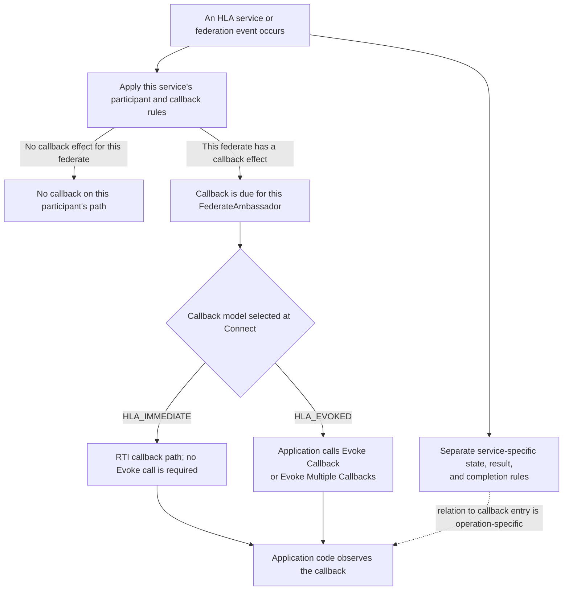

This is a reading model, not a universal callback state machine or ordering
claim. The pinned 2025 [`CallbackModel` enum](../../third_party/ieee1516.1-2025/include/RTI/Enums.h#L22)
names `HLA_IMMEDIATE` and `HLA_EVOKED`; the [`RTIambassador` interface](../../third_party/ieee1516.1-2025/include/RTI/RTIambassador.h#L2265)
declares the Evoke and callback enable/disable services. Those declarations
establish public vocabulary, while exact delivery, eligibility, and
callback-reentry rules come from the applicable standard service clauses. A
callback may be one participant's notification of a state change, a result
that completes a particular protocol, or simply an observation of an event.
Do not assume the same state-commit point or completion meaning for every
callback. Nor does the model branch mean a callback is eligible to run now:
callback enable/disable state and service-specific gates, including logical
time, can further constrain observation. For time grants, ownership outcomes,
and synchronization barriers, use their focused guides.

## Umbra dispatcher mechanics: submitted is not invoked

In the implementation traces below, treat these as separate events:

1. An RTI operation or internal transition produces a callback task.
2. The task is accepted into a per-ambassador dispatch queue.
3. The callback model and callbacks-enabled switch determine when it may run.
4. The RTI enters the federate ambassador method.
5. Any state change defined at callback entry or completion occurs at that
   callback boundary, not merely because the initiating service returned.

This distinction explains why an HLA_EVOKED service call can return before its
callback is application-visible. For operations with callback-gated state,
the corresponding state transition can also remain pending until that
callback boundary. It also explains why an immediate callback can run before
its inducing service call returns.

## Callback-task dispatch

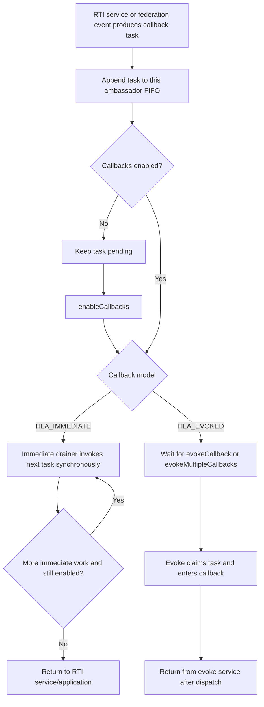

This is the current dispatcher model at a high level. Important qualifications:

- In HLA_IMMEDIATE mode, an enabled task normally runs synchronously on the
  submitting/draining thread. If another thread already owns the immediate
  drainer, its task is queued behind the current callback rather than entering
  the same federate ambassador concurrently.
- A callback may disable callbacks. The immediate drainer checks the setting
  at each callback boundary, leaves the remaining tasks pending, and resumes
  them when callbacks are enabled again.
- In HLA_EVOKED mode, enabling callbacks does not itself invoke queued work.
  The application must call an Evoke service. While callbacks are disabled,
  the current dispatcher leaves evoked tasks queued.
- These are per-ambassador queue mechanics. They do not establish one global
  order across different federates, RTI sessions, or independent callback
  routes.

## HLA_EVOKED: the application owns the drain point

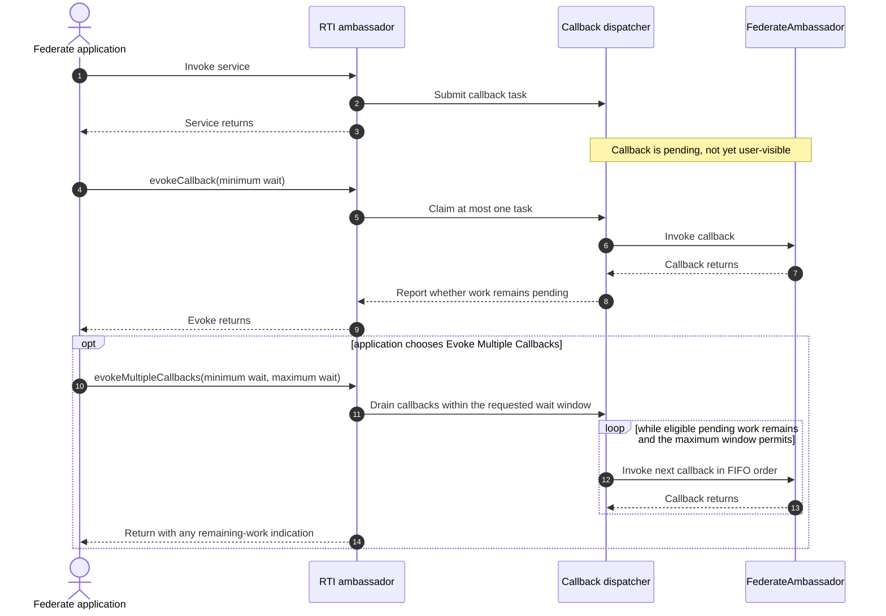

In the current public adapter, Evoke Callback first uses a locally queued task
when one exists and otherwise polls one process-endpoint receive-order event.
Evoke Multiple Callbacks admits currently available process receive-order
events before draining the shared dispatcher. These are transport-profile
details, not additional HLA ordering guarantees.

The Boolean result is also not the callback itself: in the current dispatcher
it reports whether work remains pending after the invocation/window. Tests
cover the one-at-a-time and FIFO cases. Do not interpret a true result as
“another callback already ran.”

## HLA_IMMEDIATE: callback work can be on the service stack

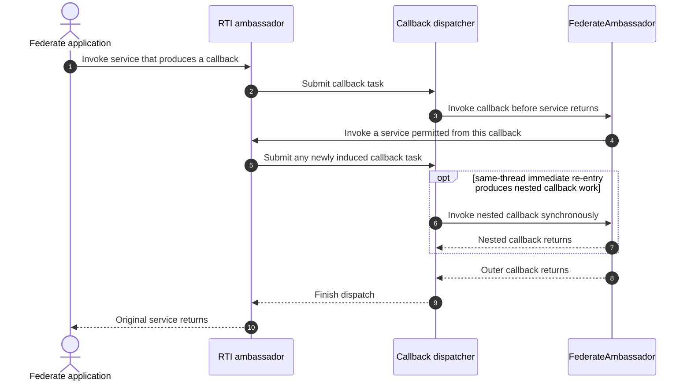

The same-thread nested path is a current implementation capability of the
recursive dispatcher/session, not permission to call every RTI service from a
callback. Each service's callback-re-entry rule still applies. The pinned 2025
C++ API explicitly lists `CallNotAllowedFromWithinCallback` for these
operations:

| API operation | Pinned API declarations | Current 2025 adapter and focused-test evidence |
| --- | --- | --- |
| Connect (four overloads) | [1](../../third_party/ieee1516.1-2025/include/RTI/RTIambassador.h#L55), [2](../../third_party/ieee1516.1-2025/include/RTI/RTIambassador.h#L68), [3](../../third_party/ieee1516.1-2025/include/RTI/RTIambassador.h#L83), [4](../../third_party/ieee1516.1-2025/include/RTI/RTIambassador.h#L98) | Callback-execution guards in the [Connect adapter](../../cpp/src/internal/runtime/umbra_rti_ambassador_connect_services.cpp#L43); no focused re-entry case was found in the bounded test scan. |
| Disconnect | [Declaration](../../third_party/ieee1516.1-2025/include/RTI/RTIambassador.h#L110) | Guarded by the [public adapter](../../cpp/src/internal/runtime/umbra_rti_ambassador.cpp#L2413); no focused re-entry case was found in the bounded test scan. |
| Join (both overloads) | [1](../../third_party/ieee1516.1-2025/include/RTI/RTIambassador.h#L212), [2](../../third_party/ieee1516.1-2025/include/RTI/RTIambassador.h#L234) | Guarded in [Join admission](../../cpp/src/internal/runtime/umbra_rti_ambassador_federation_lifecycle.cpp#L365); no focused re-entry case was found in the bounded test scan. |
| Resign | [Declaration](../../third_party/ieee1516.1-2025/include/RTI/RTIambassador.h#L250) | Guarded in [Resign admission](../../cpp/src/internal/runtime/umbra_rti_ambassador_federation_lifecycle.cpp#L806). Focused embedded `HLA_EVOKED` cases exercise rejection from [Initiate Federate Save](../../cpp/tests/ieee1516_2025_save_active_callback_resignation_guard_catch2.cpp#L4) and selected [timed-save callbacks](../../cpp/tests/ieee1516_2025_timed_save_active_callback_resignation_guard_catch2.cpp#L4), [FQR](../../cpp/tests/ieee1516_2025_timed_save_fqr_active_callback_resignation_guard_catch2.cpp#L4), [NMRA](../../cpp/tests/ieee1516_2025_timed_save_nmra_active_callback_resignation_guard_catch2.cpp#L4), and [TARA](../../cpp/tests/ieee1516_2025_timed_save_tara_active_callback_resignation_guard_catch2.cpp#L4). |
| Evoke Callback and Evoke Multiple Callbacks | [1](../../third_party/ieee1516.1-2025/include/RTI/RTIambassador.h#L2265), [2](../../third_party/ieee1516.1-2025/include/RTI/RTIambassador.h#L2273) | Both have adapter guards ([Evoke](../../cpp/src/internal/runtime/umbra_rti_ambassador_callback_control_services.cpp#L32), [Evoke Multiple](../../cpp/src/internal/runtime/umbra_rti_ambassador_callback_control_services.cpp#L74)); the focused [immediate-callback case](../../cpp/tests/callback_dispatcher_catch2.cpp#L167) attempts both services. |

This is a map of explicit API exception annotations and selected Umbra evidence,
not the complete normative call-allowed-from-callback matrix. The adjacent
`enableCallbacks` and `disableCallbacks` declarations do not list this
exception, but absence from an `@throws` list is not, by itself, permission to
call either service from every callback. Exact service rules still require the
applicable standard text; do not infer them from dispatcher recursion or from
an implementation guard's presence or absence.

Do not conflate the internal CallbackSession close operation with the public
Disconnect service. The session can close itself during an active invocation
without waiting on itself; the public RTI Disconnect call is explicitly
guarded against callback re-entry.

## Callback-session lifetime and concurrency

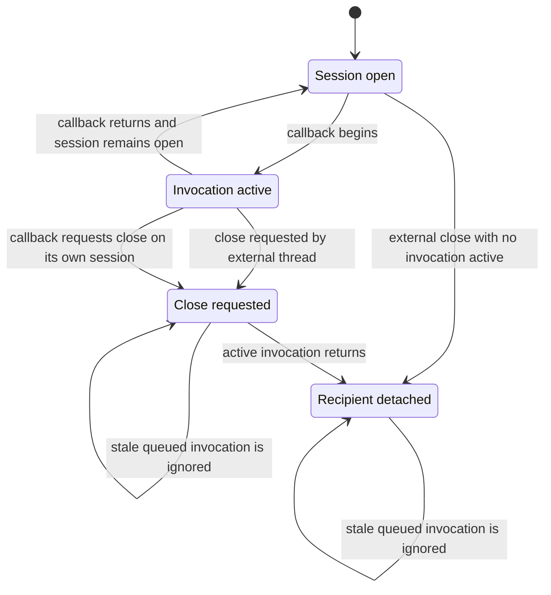

Umbra borrows the caller-owned FederateAmbassador rather than owning it. The
session serializes callback entry so two RTI paths do not enter the same
ambassador concurrently. An external close waits for a callback already in
flight; same-thread close marks the session closed and lets the active
invocation release the borrowed pointer on return. This internal lifetime
protection is separate from what the public HLA service permits.

## Ordering and state-commit cautions

- **FIFO is local.** The dispatcher deque preserves task submission order for
  one ambassador. A multi-recipient integration test checks per-recipient
  interaction FIFO across its configured process endpoint; it is not proof of
  one total order among all callbacks from all services or federates.
- **No batch pre-extraction in immediate mode.** Tasks are taken one at a time
  so disableCallbacks can stop a backlog at the next boundary.
- **Evoke Multiple is bounded.** The current implementation normalizes wait
  values and drains until no work remains after the minimum window or the
  maximum deadline is reached. Callbacks can consume time inside that window.
- **Disable is not discard.** Pending tasks survive disable/enable transitions
  unless a lifecycle operation explicitly resets or closes that session.
- **Exceptions are dispatch-boundary events.** If an exception escapes its
  callback task, the dispatcher has already removed that task. The session
  releases its in-flight count and rethrows; there is no automatic retry. The
  immediate drainer releases its election state and preserves later FIFO work.
  The Evoke path likewise propagates the exception and leaves later tasks
  pending. Producer-specific catches can change this path; see the focused
  [exception boundary](#if-an-exception-escapes-a-callback-task) below.
- **Time order is specialized.** Receive-order FIFO is not a substitute for
  timestamp ordering. TSO-before-grant ordering, retraction, and loss cutoffs
  are documented in the time-management guide.
- **Completion callbacks are protocol gates.** Save/restore completion,
  ownership transfer, and time-role changes may commit state at their own
  callback boundaries. Follow their focused guides instead of assuming that
  all callbacks have identical commit semantics. In the embedded
  FederationSynchronized path below, the registry instead erases the completed
  point while preparing notifications, before callback dispatch.

## If an exception escapes a callback task

This is the common 2025 dispatcher/session boundary used by callback tasks
that reach it. It does not claim that every producer lets user exceptions
escape; both 2025 `ConnectionLost` producer paths catch callback exceptions
themselves, as traced below. Nor does this low-level flow define each public
service's exception translation or state-commit behavior.

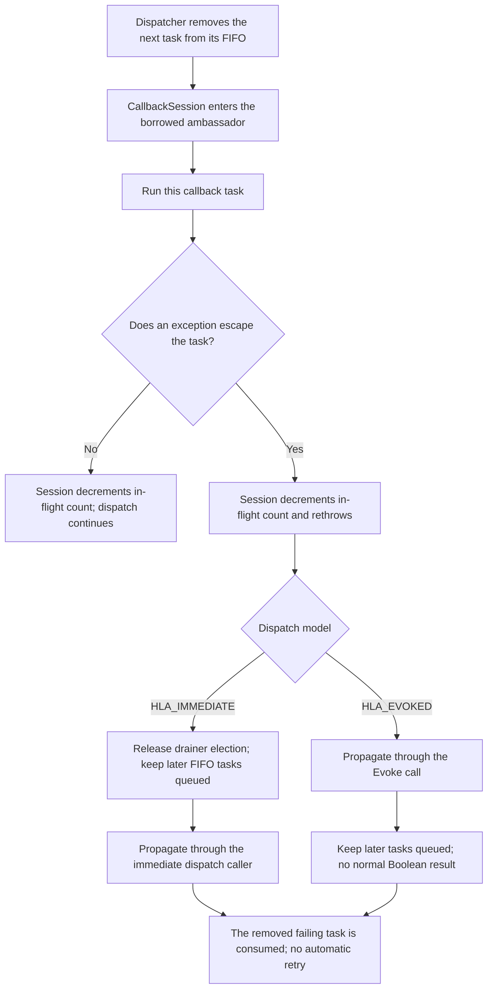

`CallbackDispatcher` takes the task out of the deque before invoking it. The
session's exceptional path decrements its in-flight count before rethrowing.
For HLA_IMMEDIATE, `drainImmediate` clears the drainer election on escape and
does not discard the remaining FIFO backlog. For HLA_EVOKED, `evokeOne` and
`evokeMultiple` invoke an already-extracted task without a catch/requeue step;
an escaping exception bypasses the normal return while later queue entries
remain. In both models the failed task has been consumed, not retried. A
producer may deliberately catch an exception before it reaches this boundary,
so treat this as dispatcher evidence rather than a universal RTI error policy.

### Which public call is active when the callback throws?

The HLA-facing question is not only whether a callback task throws, but which
application-to-RTI call is on the stack when the RTI enters that callback. The
2025 `FederateAmbassador::receiveInteraction` declaration documents
`FederateInternalError` as a possible callback exception. That declaration does
not, by itself, define how a particular producer catches, reports, or translates
the exception. `FederateInternalError` derives from the API's `Exception`
base; the service-catch example below is about that RTI exception hierarchy,
not arbitrary C++ exceptions.

The pinned API's exception annotations belong to each method separately:
`receiveInteraction` lists `FederateInternalError`, while `evokeCallback` and
`evokeMultipleCallbacks` list `CallNotAllowedFromWithinCallback` and
`RTIinternalError`, not `FederateInternalError`. Do not infer from the callback
annotation alone that its exception is part of Evoke's documented service
outcome. In the current Umbra `HLA_EVOKED` path, `CallbackSession` rethrows an
escaping exception and `evokeCallback` invokes the dispatcher without catching
it, so the exception can escape the public Evoke service. That is source-observed
implementation behavior, not a normative propagation conclusion. The exact
standard rule remains open without the applicable licensed clause text
([callback API](../../third_party/ieee1516.1-2025/include/RTI/FederateAmbassador.h#L262),
[Evoke API](../../third_party/ieee1516.1-2025/include/RTI/RTIambassador.h#L2260),
[Evoke wrapper](../../cpp/src/internal/runtime/umbra_rti_ambassador_callback_control_services.cpp#L60),
[dispatcher](../../cpp/src/internal/callbacks/callback_dispatcher.cpp#L156),
[session rethrow](../../cpp/src/internal/callbacks/callback_session.cpp#L79)).

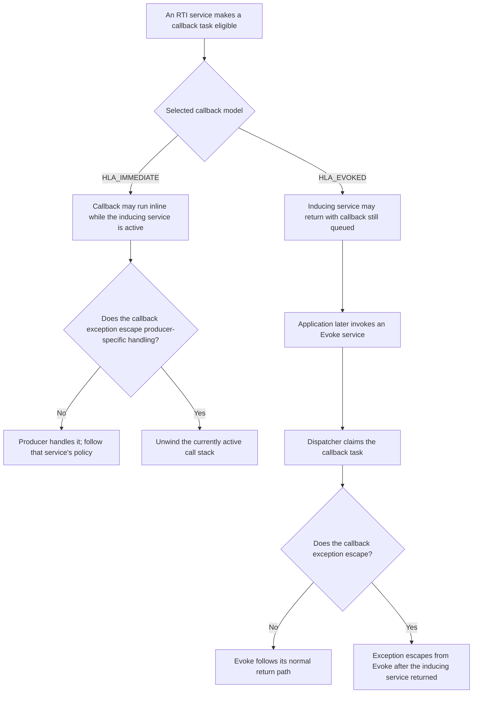

This is a call-stack model, not a claim that every HLA_IMMEDIATE callback runs
on the inducing thread: if another thread already owns the receiver's immediate
drainer, the task waits behind that drainer and any exception unwinds through
that thread's active call instead. Nor does the diagram prescribe a universal
exception-reporting rule. Check the specific producer catch and the state/report
boundary that precedes callback submission.

For one concrete 2025 embedded case, ordinary `Send Interaction` attempts its
successful service-report record and records the accepted-send MOM counter
before submitting recipient callback routes. If an HLA_IMMEDIATE
`Receive Interaction` callback runs inline on this `Send Interaction` stack and
throws an API `Exception` such as `FederateInternalError`, the service's broad
catch attempts `HLAreportException` and a failed service-report record, then
rethrows. Because this happens after the accepted boundary, the accepted-send
counter and any service-report record already appended are not rolled
back by that catch; report writes are separate fallible effects, not a
transaction. If a different thread owns the recipient's immediate drainer, the
sender may finish submitting the queued task before the callback runs, so its
later exception is not necessarily caught by this sender's `Send Interaction`
handler.

Under HLA_EVOKED, the recipient invokes the callback later from its Evoke call;
the failed task is consumed there and the original `Send Interaction` stack is
already gone. The inspected 2025 Evoke entry points propagate dispatcher
exceptions without a local `HLAreportException` or service-report catch. Keep
this embedded path separate from the process endpoint: its correlated service
response and pushed-event dispatch are distinct, and this review does not
assign process callback exceptions to the embedded reporting sequence. The
[exception-reporting guide](HLA-2025-EXCEPTION-REPORTING-FLOW-GUIDE.md#if-the-exception-report-callback-itself-throws) and
[service-invocation reporting guide](HLA-2025-SERVICE-INVOCATION-REPORTING-FLOW-GUIDE.md)
cover the reporting concepts; this section connects them only for the bounded
embedded example above. The exception guide separately explains when a
throwing `HLAreportException` recipient callback is contained by the original
service's `noexcept` report hook and when it runs on a later callback stack.

#### Process endpoint callback-exception attribution

The 2025 process endpoint has two recipient-side routes into callback
dispatch. The stream-reader decodes and buffers pushed event frames; it never
invokes `FederateAmbassador` code. A request-backed service that drains those
frames does so only after matching its own correlated response and releasing
the exchange lock. Separately, when no request is active, a background
dispatch loop submits buffered frames. These routes attribute an
`HLA_IMMEDIATE` callback exception differently. `HLA_EVOKED` queues the
callback task in either route, so the user callback runs later on the
recipient's Evoke path.

##### Request-backed API drains a pushed event

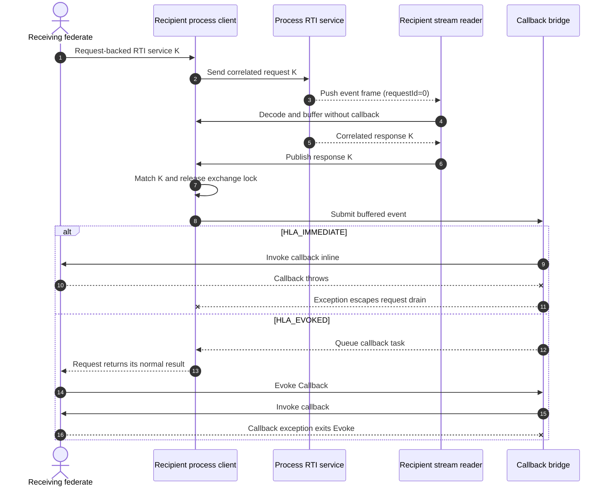

##### Background dispatch runs without an active request

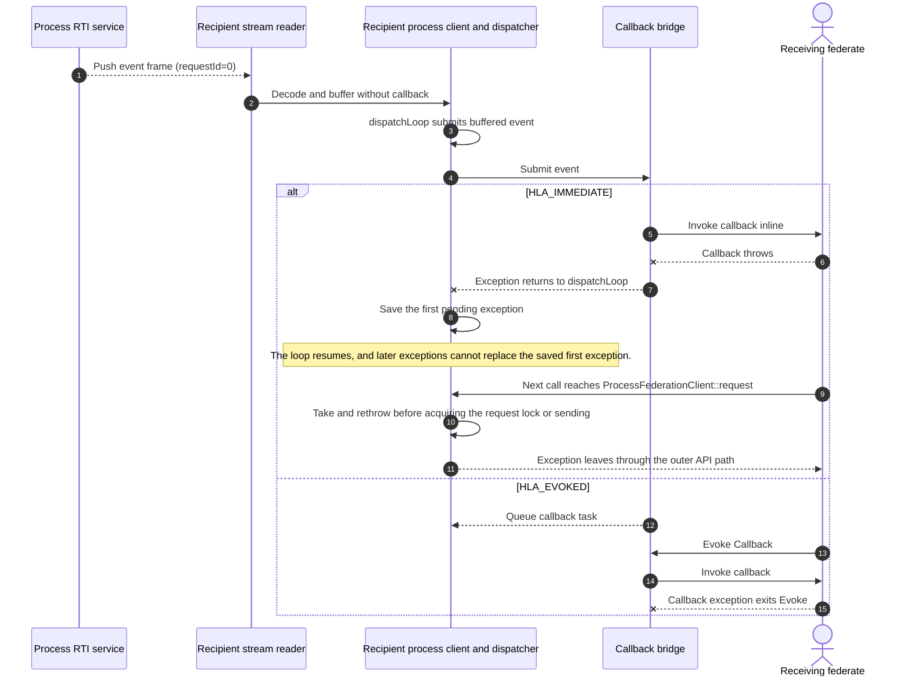

The two `HLA_IMMEDIATE` paths are source-derived implementation behavior, not
a normative HLA exception rule. In the request-drain path,
[`ProcessFederationClient::request`](../../cpp/src/internal/federation/process_federation_client.cpp#L522)
matches the response, releases the exchange lock, then drains pushed events;
an escaping callback exception can prevent that client call from returning
the already-received response to its caller. In the background path,
[`receiveLoop`](../../cpp/src/internal/federation/process_federation_client.cpp#L639)
only buffers events, while [`dispatchPendingPushedEvents`](../../cpp/src/internal/federation/process_federation_client_callback_dispatch.cpp#L261)
unlocks around callback-bridge submission. [`submitReceiveOrder`](../../cpp/src/internal/federation/process_federation_callback_bridge.cpp#L1128)
passes the task to the callback dispatcher. The background
[`dispatchLoop`](../../cpp/src/internal/federation/process_federation_client.cpp#L697)
catches callback-dispatch exceptions and stores one pending exception. The
first later call to `request()` exchanges and rethrows it before beginning a
request ([rethrow](../../cpp/src/internal/federation/process_federation_client.cpp#L723)).
Because the background loop resumes after its catch, later buffered events can
still be dispatched; while the pending slot is occupied, a later exception
does not replace the first. These precise queue/error details have no focused
throwing-callback test in the reviewed process cases.

For `HLA_EVOKED`, bridge submission queues a task and user code runs only when
the recipient invokes Evoke; the generic dispatcher/session exception route
above then applies. Do not infer from the callback's declared exception type
that Evoke translates or reports it. The producer's private response and
recipient's callback stack remain independent. See the detailed [process
request/callback flow](HLA-2025-PROCESS-ENDPOINT-REQUEST-AND-CALLBACK-FLOW-GUIDE.md#2-from-a-stream-frame-to-an-official-callback)
for request correlation and event admission. The focused [process Evoke
integration case](../../cpp/tests/ieee1516_2025_connection_receive_evoke_catch2.cpp#L457),
[multi-recipient interaction case](../../cpp/tests/ieee1516_2025_connection_multi_recipient_interaction_ordering_catch2.cpp#L459),
and [callback-bridge unit cases](../../cpp/tests/process_federation_callback_bridge_catch2.cpp#L19)
exercise successful dispatch, not a throwing `FederateAmbassador`; no test was
run for this documentation review.

##### One public wrapper: process `getInteractionClassHandle`

The previous call-stack map stops at the outer RTI service boundary because
report behavior is service-wrapper-specific. A concrete request-backed example
is the configured-process [`getInteractionClassHandle`](../../cpp/src/internal/runtime/umbra_rti_ambassador_interaction_class_lookup.cpp#L16)
path, which is also used as a receiver-side exchange fence in the focused
multi-recipient case. If its client request drains an `HLA_IMMEDIATE`
`FederateInternalError`, or the next call rethrows a saved one before sending,
the process branch's narrower `ProcessFederationClientError` catches do not
match that callback exception. The outer `catch (Exception const&)` does: it
attempts `HLAreportException` through the `noexcept`
[`emitExceptionReport`](../../cpp/src/internal/runtime/umbra_rti_ambassador_mom_service_report_interaction.cpp#L184)
hook, then attempts the failed service-invocation report before rethrowing the
original. The hook swallows failures in its own advisory report request. If
the later process failed-report request fails, the writer converts that
client error to `RTIinternalError`, which can replace the original callback
exception. An arbitrary non-RTI C++ exception does not match this wrapper's
typed catch and bypasses these two report hooks. This is one inspected
request-backed API path, not a rule for all services or for the separate
`HLA_EVOKED` Evoke stack.

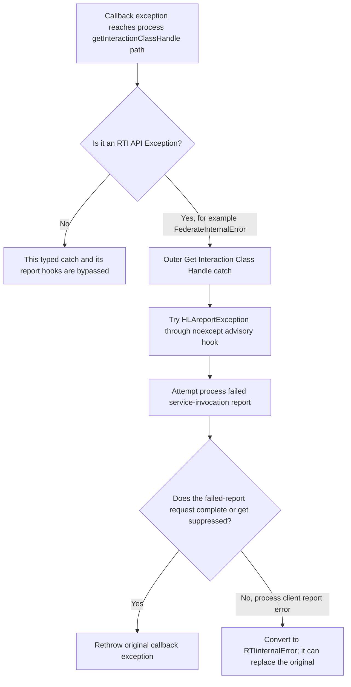

The catch/report ordering is visible in the [public wrapper](../../cpp/src/internal/runtime/umbra_rti_ambassador_interaction_class_lookup.cpp#L98),
the process-client report requests ([exception](../../cpp/src/internal/federation/process_federation_client_federation_management.cpp#L429),
[failed invocation](../../cpp/src/internal/federation/process_federation_client_federation_management.cpp#L445)),
and [failed-report adapter](../../cpp/src/internal/runtime/umbra_rti_ambassador_service_report_writers.cpp#L252).
It is source evidence only: the reviewed process tests do not throw from the
callback, and no combined exception-report/service-report failure schedule was
run or tested here. The embedded `Send Interaction` case below remains a
separate producer-side path.

### Embedded `Send Interaction`: accepted effects precede callback failure

This sequence is a source-derived embedded 2025 case, not a normative
exception rule or a tested throwing-callback scenario. It makes the call-stack
timing concrete: the send's accepted effects precede callback submission, so
an inline callback exception can escape the service after those effects have
already occurred.

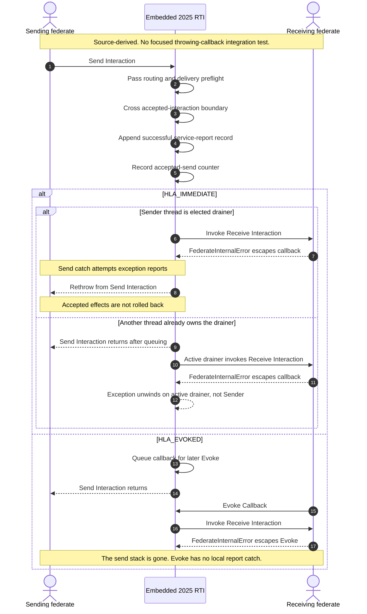

The embedded `Send Interaction` attribution is also source-derived and lacks
a focused throwing-callback integration case. Existing dispatcher tests cover
successful immediate/evoked dispatch, but do not establish callback exception
attribution, report-sink outcomes, or rollback behavior. No test was run for
this documentation review. The new Mermaid flow has not yet been rendered or
checked in GitHub.

Cancellation is a separate transition from exception handling or disabling.
`CallbackDispatcher::reset` clears pending work; the embedded resignation path
does this after the membership transition and before submitting notifications
to surviving members. The focused embedded restore/resignation test verifies
that queued restore callbacks do not reach the departing federate while the
survivor still receives the terminal restore result. The process-profile path
has a different, narrower source-observed boundary, shown next; do not infer
embedded/process parity from either path.

## `ConnectionLost` producer exception containment and backend-specific cleanup

Do not apply the generic escaping-task branch above to this callback: both
2025 producers catch exceptions thrown by `FederateAmbassador::connectionLost`.
Their local state transitions differ, so this chart compares only these
observed adapter paths; it is not a process/embedded parity claim or a 2010
description. Callback-model timing remains as described in the HLA_IMMEDIATE
and HLA_EVOKED sections above.

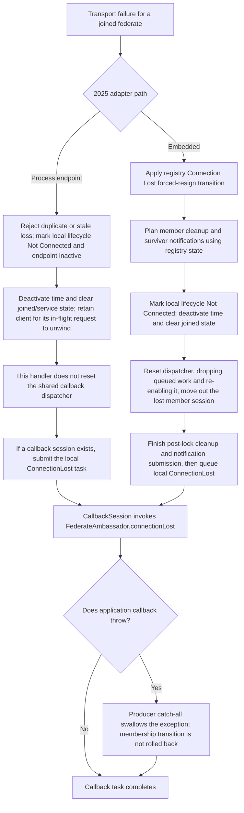

The process helper commits its local Not Connected state, clears joined/time
metadata, and submits the callback without resetting the shared dispatcher in
that handler. The embedded path first commits registry forced resignation,
then resets pending callback work before its later local `ConnectionLost`
submission. In both paths an application exception from `connectionLost` is
contained before it reaches the generic dispatcher exception boundary. The
embedded service-report append failure is a different RTI-side error: cleanup
and callback routing continue before the adapter reports `RTIinternalError`.

Evidence is source-bounded. The focused embedded service-report test encodes
record-before-callback behavior, but a recorded local run failed during
`createFederationExecution` (test line 521), before reaching the callback
assertions. The cited tests do not inject an exception from
`connectionLost`; neither that catch behavior nor a process-profile callback
scenario is claimed as runtime-tested.

## Process-profile Resign and queued callback work

This is a 2025 process-endpoint source trace, not a normative Resign rule and
not a test assertion about post-Resign delivery. Keep three boundaries
separate: event frames buffered by the client while the correlated Resign
request is outstanding, tasks already submitted to the shared callback
dispatcher, and the public Resign call's return. Projection cancellation is
deliberately narrower than resetting that dispatcher. For the
ownership-assumption and object-removal server queues that can feed this
boundary, see the focused
[receiver Resign flow](HLA-2025-OBJECT-AND-INTERACTION-INFORMATION-FLOW-GUIDE.md#receiver-resign-while-assumption-and-removal-callbacks-are-pending).

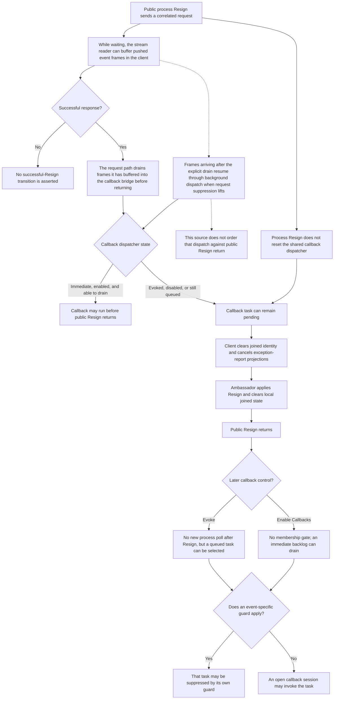

The server's successful [`handleResign`](../../cpp/src/internal/federation/process_federation_service_request_handlers.cpp#L136)
clears its still-queued joined-session event collections before returning the
response. Already-emitted stream frames are a separate boundary: the client's
[reader buffers them](../../cpp/src/internal/federation/process_federation_client.cpp#L445),
and the default request path drains buffered pushed events before returning
([request path](../../cpp/src/internal/federation/process_federation_client.cpp#L522),
[event dispatcher](../../cpp/src/internal/federation/process_federation_client_callback_dispatch.cpp#L261)).
For frames present when that explicit drain runs, an enabled HLA_IMMEDIATE
dispatcher may invoke inline before the public Resign service returns; an
HLA_EVOKED or disabled immediate task can remain in the shared dispatcher.
Frames that arrive after the explicit drain can instead wake the background
dispatch loop after request suppression lifts, so this source trace does not
establish their ordering relative to the public Resign return. The process
client then clears its joined identity and cancels exception-report
projections, while the [ambassador adapter](../../cpp/src/internal/runtime/umbra_rti_ambassador_federation_lifecycle.cpp#L772)
applies its lifecycle transition and clears its joined fields. Neither stage
resets the shared callback dispatcher. By contrast,
[`ProcessFederationCallbackBridge::close`](../../cpp/src/internal/federation/process_federation_callback_bridge.cpp#L1865)
closes the callback session and resets that dispatcher.

After the public call returns, Evoke has no joined-state gate, although the
process receive poll it may request does require joined membership;
`Enable Callbacks` likewise has no membership gate and enabling an immediate
dispatcher drains its pending queue. Bridge submissions generally check
`isClosed()` before enqueueing; ordinary task closures capture the session and
invoke it without a general membership recheck. Some event families have
specific staleness gates, including exception-report projection generation,
message retraction, and the Attribute Relevance Advisory switch. The callback
session itself checks whether it is closed or has lost its recipient (normally
on Disconnect/destruction), not whether Resign cleared federation membership.

This is an implementation observation, not a claim that post-Resign Evoke or
callback delivery is normatively permitted. The bridge cancellation tests
exercise exception-report projection guards, not the full public Resign path.
The process receive/Evoke integration drains its interaction callbacks before
resigning both participants, so it does not exercise this edge. The focused
cases cited here do not assert the post-Resign result for an unrelated pending
task, or the before/after-return ordering of a pushed frame racing the explicit
request drain. Keep both behavioral/test gaps visible until the official
service contract and intended implementation behavior are checked.

### Object-instance discovery: event-specific staleness boundary

Object-instance discovery is one concrete callback family to compare with
those guarded paths. The process service clears discovery events still in the
departing session's server-side queue during Resign. If a discovery event has
already reached the client or callback bridge, however, its bridge submission
checks that the bridge, session, and dispatcher are open; delivery validates
the event's identifiers and name, but does not recheck current federation
membership or current registry object state. It therefore has no
discovery-specific post-Resign suppression gate in this path. That is a
source-derived possibility for already-buffered work, not proof of a callback
after Resign or a portable HLA rule.

The public process [object-discovery case](../../cpp/tests/ieee1516_2025_connection_object_discovery_catch2.cpp#L457)
runs HLA_EVOKED and HLA_IMMEDIATE scenarios and asserts the discovered
instance/class/producer before it [resigns both participants](../../cpp/tests/ieee1516_2025_connection_object_discovery_catch2.cpp#L790).
It does not arrange for the recipient to resign with discovery pending or
assert post-Resign dispatch. The process service's
[server-side discovery queue](../../cpp/src/internal/federation/process_federation_service_object_discovery.cpp#L153)
and [Resign cleanup](../../cpp/src/internal/federation/process_federation_service_lifecycle.cpp#L56),
[client-to-bridge dispatch](../../cpp/src/internal/federation/process_federation_client_callback_dispatch.cpp#L307),
[bridge submission](../../cpp/src/internal/federation/process_federation_callback_bridge.cpp#L1424),
and [payload-only delivery validation](../../cpp/src/internal/federation/process_federation_callback_bridge.cpp#L610)
show the separate boundaries. The [failed-Join discovery rollback case](../../cpp/tests/ieee1516_2025_connection_process_mom_resign_removal_order_catch2.cpp#L346)
discards a queued discovery for the failed membership; it is not evidence for
Resign behavior.

## Federation Synchronized after barrier completion

This is a zoom-in on one 2025 embedded callback producer, not another
synchronization-point state machine. The [synchronization guide](HLA-2025-FEDERATION-SYNCHRONIZATION-FLOW-GUIDE.md#achievement-is-a-fan-in-not-a-per-caller-completion)
defines who must report and how the failed-to-synchronize set is formed. Here,
the registry finishes that barrier and returns one notification plan per
current participant; the ambassador then routes each plan through that
participant's callback session.

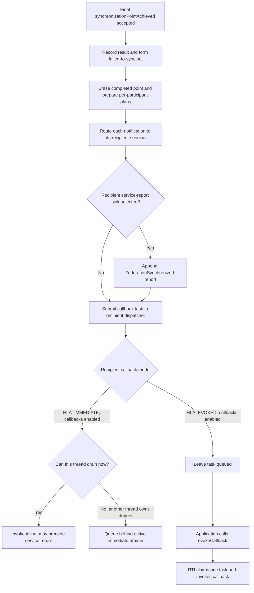

In this embedded path, point removal and notification planning precede the
per-recipient callback route. A selected FederationSynchronized service-report
record is appended before that route submits the callback task. The shared
dispatcher determines whether submission invokes inline, waits behind another
thread's immediate drainer, or remains queued for an evoke call; it does not
establish a single total order across different recipients. The exact
service-specific IMMEDIATE-before-return timing is source-derived rather than
asserted by the public synchronization-point test.
The HLA_EVOKED service-report test covers its selected-file record before the
resignation-triggered callback is evoked. Neither result establishes process
endpoint parity.

### Process endpoint: service responses and synchronization events are separate

The process profile uses a private correlated request/response for each public
registration or achievement service, while announcements and final
`federationSynchronized` outcomes travel as recipient events. These private
responses are adapter inputs, not additional HLA callbacks or public return
values: the HLA services return `void`, and their registration/federation
outcomes are reported through the callback interface. The pinned
[service declarations](../../third_party/ieee1516.1-2025/include/RTI/RTIambassador.h#L261)
and [callback declarations](../../third_party/ieee1516.1-2025/include/RTI/FederateAmbassador.h#L72)
anchor that public distinction.

The source reveals a meaningful difference from the embedded submission path.
When `pushReceiveOrderEvents` is enabled, registration enqueues and sends
announcement event frames before its correlated response. The client buffers
those frames while awaiting that response, then releases the request lock and
drains them to the callback bridge before returning to the public adapter. If
the registering federate is among the announced recipients, its announcement
callback is therefore submitted before the adapter submits that federate's
registration-result callback. For a final achievement, the service similarly
enqueues/sends the `federationSynchronized` event before its response; the
client dispatches the buffered event before returning to the adapter. An
`HLA_IMMEDIATE` dispatcher may invoke inline at that point, before the public
service returns; `HLA_EVOKED` leaves the callback for an evoke call.

Per-service invocation reporting has another distinct order. In the process
registration adapter, the registration-result callback is submitted before
the `RegisterFederationSynchronizationPoint` and
`ConfirmSynchronizationPointRegistration` report requests. For achievement,
pushed outcome events are drained inside the client request before the adapter
submits its `SynchronizationPointAchieved` report request. In the embedded
adapter, those report effects occur before the corresponding callback plans
are submitted. The report route may select a file record or an
`HLAreportServiceInvocation` interaction; it is not itself the registration or
federation-outcome callback. The dedicated
[service-reporting guide](HLA-2025-SERVICE-INVOCATION-REPORTING-FLOW-GUIDE.md#three-distinct-traces-call-outcome-invocation-report-requested-mom-report)
explains sink selection and observer delivery. Consequently, an enabled
`HLA_IMMEDIATE` process callback may run before the adapter starts its report
request; under `HLA_EVOKED`, the callback task can be queued first and observed
later. This is source-derived profile behavior, not an HLA ordering guarantee.

With push disabled, the service keeps those notifications in per-session
queues. A later `receive_interaction` request retrieves and projects them, so
they do not share the pushed-event ordering relative to the registration or
achievement request. `pushReceiveOrderEvents` is a private event-delivery
choice; it is independent of the HLA callback model, which selects inline
`HLA_IMMEDIATE` versus evoke-driven `HLA_EVOKED` dispatch. Neither source path
defines a normative HLA ordering between callback families, nor a total order
across recipients or concurrent callback producers.
The polling service's broader event-family precedence is a separate process
implementation concern; the [process-endpoint guide](HLA-2025-PROCESS-ENDPOINT-REQUEST-AND-CALLBACK-FLOW-GUIDE.md#polling-family-priority-is-not-pushed-stream-fifo)
shows that selector beside the pushed-stream FIFO without presenting either as
an HLA callback-order rule.

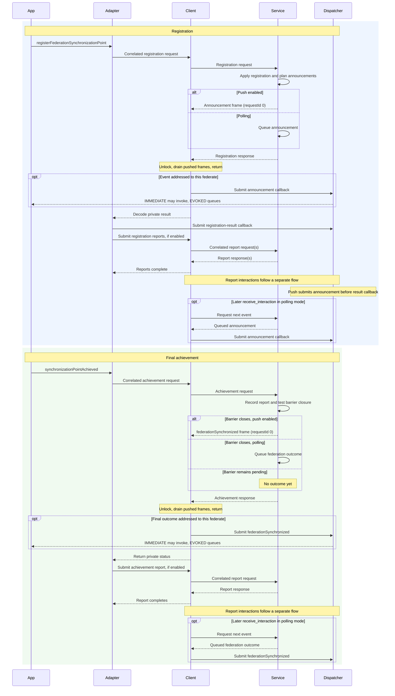

The same-recipient ordering in this sequence is an Umbra 2025 source trace,
not an HLA callback-order requirement. Separate public process-endpoint cases
exercise `HLA_EVOKED` with polling and `HLA_IMMEDIATE` with pushed events: they
assert registration success/failure callbacks, announcements to an explicit-
set recipient, and a false final achievement result. However, those cases
exclude the registering federate from the explicit synchronization set, so
they do not assert announcement-versus-registration-result order for one
recipient, nor do they assert service-report order. The process guide's
[stream-frame-to-callback map](HLA-2025-PROCESS-ENDPOINT-REQUEST-AND-CALLBACK-FLOW-GUIDE.md#2-from-a-stream-frame-to-an-official-callback)
explains the generic buffering/dispatch boundary. Relevant implementation
points are the [process client registration/achievement requests](../../cpp/src/internal/federation/process_federation_client_federation_management.cpp#L120),
[response matching and post-unlock event drain](../../cpp/src/internal/federation/process_federation_client.cpp#L504),
[process service request handlers](../../cpp/src/internal/federation/process_federation_service_request_handlers.cpp#L217),
[push-versus-poll recipient queues](../../cpp/src/internal/federation/process_federation_service_notifications.cpp#L194),
[process registration callback-before-report ordering](../../cpp/src/internal/runtime/umbra_rti_ambassador_federation_lifecycle.cpp#L1176),
[embedded registration report-before-callback ordering](../../cpp/src/internal/runtime/umbra_rti_ambassador_federation_lifecycle.cpp#L1270),
[process achievement/report adapter path](../../cpp/src/internal/runtime/umbra_rti_ambassador_federation_lifecycle.cpp#L1357),
[embedded achievement report-before-notification path](../../cpp/src/internal/runtime/umbra_rti_ambassador_federation_lifecycle.cpp#L1413),
the [process/embedded service-report routing helper](../../cpp/src/internal/runtime/umbra_rti_ambassador_service_report_writers.cpp#L131),
and the [process callback bridge submissions](../../cpp/src/internal/federation/process_federation_callback_bridge.cpp#L1618).
The [polling/evoked process case](../../cpp/tests/ieee1516_2025_connection_synchronization_failure_catch2.cpp#L457),
[pushed/immediate process case](../../cpp/tests/ieee1516_2025_connection_synchronization_failure_catch2.cpp#L674),
and [embedded public callback-model scenarios](../../cpp/tests/synchronization_point_catch2.cpp#L242)
cover these selected combinations only; none proves cross-profile parity.

### Recipient departure after planning but before observation

Barrier completion and delivery of its already-planned callback have separate
lifetimes. The following is Umbra 2025 implementation evidence only; it does
not decide what the standard permits or requires after Resign or forced
connection loss.

Ordering also matters in the process client. A Resign request uses the
client's default callback-dispatch path. While awaiting the response, the
client buffers event frames; after matching the response it dispatches those
events before the request returns. The client clears its local joined identity
only after that request returns. An event already buffered can therefore be
submitted to the callback bridge before the local identity is cleared. With
HLA_EVOKED, or HLA_IMMEDIATE while callbacks are disabled, bridge tasks can
remain queued for later Evoke or Enable; enabled HLA_IMMEDIATE may invoke a
callback inline while the Resign API call is still in progress. This is a
source-derived route, not test evidence that FederationSynchronized is
delivered after Resign.

Source path: [client event buffering and post-response dispatch](../../cpp/src/internal/federation/process_federation_client.cpp#L504), [Resign clearing local membership after the request returns](../../cpp/src/internal/federation/process_federation_client_federation_management.cpp#L89), and [callback-dispatch model gate](../../cpp/src/internal/callbacks/callback_dispatcher.cpp#L122).

| Where the outcome is when the recipient leaves | Embedded path | Process path |
| --- | --- | --- |
| Still queued on the recipient's ambassador | Successful Resign and RTI-side `connectionLost` both reset the departing ambassador's callback dispatcher before survivor notifications are submitted. `CallbackDispatcher::reset` clears tasks still pending there; it does not undo a callback already claimed or entered. | Not applicable to the server-owned session queue described below. |
| Still queued on the process service | Not applicable. | Successful process Resign clears `federationSynchronizedEvents` with the other server-side joined-session queues. Detaching a process session removes that session and its server-side queue. |
| Already received by the process client or submitted to its callback bridge | Not applicable. | Process Resign clears the client’s joined identity and cancels exception-report projections, but does not clear `pendingEvents_` or reset the callback bridge. Frames buffered when the correlated request performs its explicit drain are submitted before the client Resign method returns; HLA_IMMEDIATE may invoke them before public Resign returns, while HLA_EVOKED or disabled-immediate tasks can remain queued. Later-arriving frames resume through the background dispatch loop after request suppression lifts, without a source-established ordering against the public return. A later client close clears buffered events and resets the bridge dispatcher. These are source-observed paths, not runtime- or test-proven post-Resign outcomes. |
| Frame in transit when a process connection is lost | Not applicable. | Server-side session detachment and an already-sent frame are different boundaries. The bounded source/test review does not establish whether a frame in transit is observed, dropped, or retried. |

Evidence: embedded [Resign queue reset](../../cpp/src/internal/runtime/umbra_rti_ambassador_federation_lifecycle.cpp#L956), [forced-loss queue reset](../../cpp/src/internal/runtime/umbra_rti_ambassador_membership_loss.cpp#L341), and [dispatcher reset](../../cpp/src/internal/callbacks/callback_dispatcher.cpp#L72); process [server queue cleanup](../../cpp/src/internal/federation/process_federation_service_lifecycle.cpp#L28), [client Resign](../../cpp/src/internal/federation/process_federation_client_federation_management.cpp#L89), [buffered-event dispatch](../../cpp/src/internal/federation/process_federation_client_callback_dispatch.cpp#L279), [FederationSynchronized bridge submission](../../cpp/src/internal/federation/process_federation_callback_bridge.cpp#L1673), and [client/bridge close](../../cpp/src/internal/federation/process_federation_client_callback_dispatch.cpp#L550). The [embedded resignation test](../../cpp/tests/service_report_file_federation_synchronized_resignation_catch2.cpp#L186) checks a survivor receiving a new completion after another member resigns; it does not test cancellation of a completion already queued for the departing member. The selected [process synchronization cases](../../cpp/tests/ieee1516_2025_connection_synchronization_failure_catch2.cpp#L457) drain normal callbacks before Resign. No focused case found here asserts FederationSynchronized delivery after recipient Resign or connection loss. Keep that outcome unverified and do not infer 2010 parity.

The HLA_IMMEDIATE process [case](../../cpp/tests/ieee1516_2025_connection_synchronization_failure_catch2.cpp#L674)
also observes its ordinary synchronization callback before Resign; it does
not test callback delivery or suppression after that recipient leaves.

`Request Retraction` has a distinct process path and must not be inferred from
the synchronization-event example above. Its process recipient-session cache
survives receiver Resign until session detach, while the callback bridge gates
the public callback on per-message delivery state rather than current
membership. The source trace, focused-test boundary, and explicit
implementation-only caveat are in the [2025 TSO retraction guide](HLA-2025-TSO-RETRACTION-FLOW-GUIDE.md#process-receiver-resign-after-the-original-attribute-update).

## Evidence map: implementation versus exercised scenarios

| Topic | Current implementation entry points | Focused test evidence |
| --- | --- | --- |
| Queue, dispatch model, and per-ambassador serialization | [dispatcher submission and drain](../../cpp/src/internal/callbacks/callback_dispatcher.cpp#L121), [dispatcher API](../../cpp/src/internal/callbacks/callback_dispatcher.hpp#L24), [borrowed ambassador session](../../cpp/src/internal/callbacks/callback_session.hpp#L17) | [immediate synchronous dispatch and FIFO](../../cpp/tests/callback_dispatcher_catch2.cpp#L82), [concurrent immediate producers](../../cpp/tests/callback_dispatcher_catch2.cpp#L98), [evoked one-at-a-time and serialized entry](../../cpp/tests/callback_dispatcher_catch2.cpp#L209) |
| Escaping callback-task exceptions | [task extraction and immediate exception cleanup](../../cpp/src/internal/callbacks/callback_dispatcher.cpp#L244), [evoked task extraction/invocation](../../cpp/src/internal/callbacks/callback_dispatcher.cpp#L155), [session cleanup and rethrow](../../cpp/src/internal/callbacks/callback_session.cpp#L45) | Successful immediate and evoked dispatch are covered above; `callback_dispatcher_catch2.cpp` has no focused throwing-task test for task consumption, backlog retention, or drainer recovery. |
| Callback exception call-stack/report boundary | [2025 `receiveInteraction` exception declaration](../../third_party/ieee1516.1-2025/include/RTI/FederateAmbassador.h#L264), [`FederateInternalError` derives from `Exception`](../../third_party/ieee1516.1-2025/include/RTI/Exception.h#L52), [embedded Send Interaction accepted/report/fan-out and catch](../../cpp/src/internal/runtime/umbra_rti_ambassador_interaction_send_services.cpp#L2357), [Evoke entry points](../../cpp/src/internal/runtime/umbra_rti_ambassador_callback_control_services.cpp#L32), [process request's post-response callback drain](../../cpp/src/internal/federation/process_federation_client.cpp#L553), [buffered event drain](../../cpp/src/internal/federation/process_federation_client_callback_dispatch.cpp#L265), [process callback bridge submission](../../cpp/src/internal/federation/process_federation_callback_bridge.cpp#L1128) | Existing dispatcher and process delivery tests cover normal completion only; no focused case throws from `receiveInteraction` through embedded `Send Interaction`/Evoke or a process recipient request/Evoke path, and none asserts report-sink or accepted-state effects. Embedded and process exception attribution remain separate. |
| ConnectionLost producer exception containment | [process local transition and callback catch](../../cpp/src/internal/runtime/umbra_rti_ambassador_membership_loss.cpp#L104), [embedded forced-loss transition and queue reset](../../cpp/src/internal/runtime/umbra_rti_ambassador_membership_loss.cpp#L167), [dispatcher reset semantics](../../cpp/src/internal/callbacks/callback_dispatcher.cpp#L72) | [embedded ConnectionLost report-before-callback case](../../cpp/tests/ieee1516_2025_service_report_catch2.cpp#L506) encodes the normal callback route; a recorded local run failed during federation creation before those assertions. The cited tests do not throw from `connectionLost` or establish process-profile parity. |
| Evoke operations and callback controls | [Evoke Callback and Evoke Multiple Callbacks](../../cpp/src/internal/runtime/umbra_rti_ambassador_callback_control_services.cpp#L32), [enable/disable](../../cpp/src/internal/runtime/umbra_rti_ambassador_callback_control_services.cpp#L114) | [FIFO through Evoke Multiple](../../cpp/tests/callback_dispatcher_catch2.cpp#L301), [disabled work remains pending](../../cpp/tests/callback_dispatcher_catch2.cpp#L314), [process interaction delivered through Evoke](../../cpp/tests/ieee1516_2025_connection_receive_evoke_catch2.cpp#L457) |
| Embedded queue cancellation on lifecycle transitions | [embedded Resign reset and survivor notification ordering](../../cpp/src/internal/runtime/umbra_rti_ambassador_federation_lifecycle.cpp#L985), [Disconnect reset and session close](../../cpp/src/internal/runtime/umbra_rti_ambassador.cpp#L2403), [session close/wait behavior](../../cpp/src/internal/callbacks/callback_session.cpp#L34) | [embedded evoked restore callbacks dropped for resigning member](../../cpp/tests/ieee1516_2025_federation_management_save_restore_catch2.cpp#L486), [close drains an external in-flight invocation](../../cpp/tests/callback_dispatcher_catch2.cpp#L325), [close from the active callback](../../cpp/tests/callback_dispatcher_catch2.cpp#L427). |
| Process-profile Resign and queued work | [process Resign adapter branch](../../cpp/src/internal/runtime/umbra_rti_ambassador_federation_lifecycle.cpp#L772), [server Resign transition and session-queue cleanup](../../cpp/src/internal/federation/process_federation_service_request_handlers.cpp#L136), [client event-frame buffer](../../cpp/src/internal/federation/process_federation_client.cpp#L445), [default callback-dispatch request path](../../cpp/src/internal/federation/process_federation_client.hpp#L986), [request path and buffered-event drain](../../cpp/src/internal/federation/process_federation_client.cpp#L522), [client bridge dispatcher](../../cpp/src/internal/federation/process_federation_client_callback_dispatch.cpp#L261), [client membership clear and projection cancellation](../../cpp/src/internal/federation/process_federation_client_federation_management.cpp#L103), [Evoke and process-poll gate](../../cpp/src/internal/runtime/umbra_rti_ambassador_callback_control_services.cpp#L32), [Enable Callbacks](../../cpp/src/internal/runtime/umbra_rti_ambassador_callback_control_services.cpp#L114), [immediate enable drains pending work](../../cpp/src/internal/callbacks/callback_dispatcher.cpp#L81), [ordinary queued task invokes the captured session](../../cpp/src/internal/federation/process_federation_callback_bridge.cpp#L1346), [event-specific projection/retraction/advisory guards](../../cpp/src/internal/federation/process_federation_callback_bridge.cpp#L1162), [bridge close tears down session and queue](../../cpp/src/internal/federation/process_federation_callback_bridge.cpp#L1865) | [queued exception-report projection cancelled while later generation still works](../../cpp/tests/process_federation_callback_bridge_catch2.cpp#L58), [cancellation after projection but before callback-session entry](../../cpp/tests/process_federation_callback_bridge_catch2.cpp#L131), [process Evoke callbacks drained before test Resign](../../cpp/tests/ieee1516_2025_connection_receive_evoke_catch2.cpp#L720), [test Resign occurs after delivery assertions](../../cpp/tests/ieee1516_2025_connection_receive_evoke_catch2.cpp#L752). The focused cases cited here do not assert unrelated queued-task behavior after Resign or the before/after-return ordering of a racing pushed frame. |
| FederationSynchronized after barrier completion | [registry result and point removal](../../cpp/src/internal/federation/federation_registry.cpp#L262), [embedded achievement service submission](../../cpp/src/internal/runtime/umbra_rti_ambassador_federation_lifecycle.cpp#L1380), [process achievement request and notification queue](../../cpp/src/internal/federation/process_federation_service_request_handlers.cpp#L280), [recipient report and callback routing](../../cpp/src/internal/runtime/umbra_rti_ambassador_synchronization_notification_dispatch.cpp#L82), [dispatcher submission](../../cpp/src/internal/callbacks/callback_dispatcher.cpp#L121) | [embedded public synchronization scenarios under both callback models](../../cpp/tests/synchronization_point_catch2.cpp#L242), [process HLA_EVOKED/poll case](../../cpp/tests/ieee1516_2025_connection_synchronization_failure_catch2.cpp#L457), [process HLA_IMMEDIATE/push case](../../cpp/tests/ieee1516_2025_connection_synchronization_failure_catch2.cpp#L674), [generic immediate/evoked dispatcher tests](../../cpp/tests/callback_dispatcher_catch2.cpp#L82), [HLA_EVOKED report before resignation-triggered callback](../../cpp/tests/service_report_file_federation_synchronized_resignation_catch2.cpp#L131). The process cases assert their selected callbacks/outcome but exclude the registrant from the synchronization set, so same-recipient registration-versus-announcement order and service-report ordering remain source-derived; they do not establish service-specific IMMEDIATE-before-return timing across all profiles. |
| Re-entry restrictions and session close | [callback execution guards](../../cpp/src/internal/runtime/umbra_rti_ambassador_callback_control_services.cpp#L34), [Connect guard](../../cpp/src/internal/runtime/umbra_rti_ambassador_connect_services.cpp#L74), [Disconnect guard](../../cpp/src/internal/runtime/umbra_rti_ambassador.cpp#L2413), [Join guard](../../cpp/src/internal/runtime/umbra_rti_ambassador_federation_lifecycle.cpp#L371), [Resign guard](../../cpp/src/internal/runtime/umbra_rti_ambassador_federation_lifecycle.cpp#L809) | [Evoke calls rejected inside immediate callback](../../cpp/tests/callback_dispatcher_catch2.cpp#L166), [embedded save callback](../../cpp/tests/ieee1516_2025_save_active_callback_resignation_guard_catch2.cpp#L4), [timed save callback](../../cpp/tests/ieee1516_2025_timed_save_active_callback_resignation_guard_catch2.cpp#L4), [FQR](../../cpp/tests/ieee1516_2025_timed_save_fqr_active_callback_resignation_guard_catch2.cpp#L4), [NMRA](../../cpp/tests/ieee1516_2025_timed_save_nmra_active_callback_resignation_guard_catch2.cpp#L4), [TARA](../../cpp/tests/ieee1516_2025_timed_save_tara_active_callback_resignation_guard_catch2.cpp#L4), [close waits for external in-flight call](../../cpp/tests/callback_dispatcher_catch2.cpp#L325), [close from active callback](../../cpp/tests/callback_dispatcher_catch2.cpp#L427) |
| Cross-service ordering evidence | [process callback polling before dispatch](../../cpp/src/internal/runtime/umbra_rti_ambassador_callback_control_services.cpp#L125) | [per-recipient process interaction FIFO](../../cpp/tests/ieee1516_2025_connection_multi_recipient_interaction_ordering_catch2.cpp#L459), [TSO callback/evoke scenarios](../../cpp/tests/ieee1516_2025_connection_timestamped_receive_evoke_catch2.cpp#L457) |

The unit dispatcher tests are implementation evidence. The process-endpoint
integration tests demonstrate only their specific public callback paths and
profiles. For timestamped callback ordering, use the time-management guide's
focused evidence table rather than extrapolating from receive-order tests.

## Deliberate limits and next evidence

This guide does not define the complete normative call-allowed-from-callback
matrix, total ordering across different callback producers, transport-wide
delivery guarantees, error policy for every FederateAmbassador exception, or
all service-specific callback commit points. In particular, process-endpoint
Resign leaves a source-supported path for already-queued tasks to reach public
Evoke/Enable dispatch, but the exact normative service permission and a focused
post-Resign regression test are absent. It also does not merge 2010 and 2025
callback semantics. Those require their own exact-standard and source/test
surveys.

Next: audit the 2025 [Object and Interaction Information Flow guide](HLA-2025-OBJECT-AND-INTERACTION-INFORMATION-FLOW-GUIDE.md) at the object-discovery versus first-attribute-reflection boundary for a newly known object. Use the exact pinned authority available in the checkout and bounded embedded/process source and focused tests; distinguish normative callback sequence from implementation commit points and evidence gaps. Revise or add a diagram only for a concrete reader gap. Keep 2010 separate; no build, test rerun, CI, or Requirements Lab edit.
