# IEEE 1516.1-2025 Callback and Service Ordering

This guide explains how a federate-facing event moves from an RTI service or
federation event into user callback code, how the HLA_IMMEDIATE and HLA_EVOKED
models change that boundary, and where callback re-entry is allowed or
rejected. It focuses on per-ambassador dispatch and intentionally does not
restate the time-management guide's TSO ordering rules.

## Scope and authority

- **Edition boundary:** IEEE 1516.1-2025 only. The 2010 API/runtime and tests
  are a separate stream. This guide does not infer that their callback timing,
  restrictions, or ordering are equivalent.
- **Implementation boundary:** Umbra's callback dispatcher/session and
  selected embedded and process-endpoint tests. Unit tests establish private
  dispatcher behavior, while public integration cases establish only their
  named API path.
- **Normative authority:** the [official IEEE 1516.1-2025 Federate Interface
  Specification](https://standards.ieee.org/ieee/1516.1/6688/). IEEE lists this
  edition as active and provides access by subscription. The API-header clause
  numbers below are locators only, not normative prose. Use the exact service
  clauses for callback-model and callback-re-entry requirements; the summaries
  below distinguish those concepts from current Umbra mechanics.
- **Evidence rule:** no unit or integration scenario here is presented as
  complete conformance evidence.

The [time-management guide](HLA-2025-TIME-MANAGEMENT-GUIDE.md) owns TSO
eligibility, grant ordering, and callback-gated logical-time state. The
[save/restore guide](HLA-2025-FEDERATION-SAVE-RESTORE-FLOW-GUIDE.md) owns
federation-wide callback barriers. Ownership callbacks and information-flow
callbacks remain in their [ownership](HLA-2025-ATTRIBUTE-OWNERSHIP-FLOW-GUIDE.md)
and [object/interaction](HLA-2025-OBJECT-AND-INTERACTION-INFORMATION-FLOW-GUIDE.md)
guides.

For a service-specific ordering example, see the Object and Interaction guide's
[first reflection after discovery](HLA-2025-OBJECT-AND-INTERACTION-INFORMATION-FLOW-GUIDE.md#first-reflection-after-discovery-order-and-evidence-boundary).
It compares the embedded callback path with the process pull/push routes and
keeps the focused test chronology separate from a general HLA callback-order
claim.

For the concrete 2025 process-profile request/response and event-to-callback
trace, see the [process endpoint guide](HLA-2025-PROCESS-ENDPOINT-REQUEST-AND-CALLBACK-FLOW-GUIDE.md#2-from-a-stream-frame-to-an-official-callback).
That walkthrough documents Umbra transport mechanics; it is not the source of
the HLA callback-model rules explained here.

## Normative clause locators

The pinned 2025 API header labels the relevant public service clauses. Use
these as navigation into the normative specification, not as a callback-order
rule by themselves:

| Question | Clause locator |
| --- | --- |
| Where is the callback model selected? | [`connect` — §4.2](../../third_party/ieee1516.1-2025/include/RTI/RTIambassador.h#L55) |
| How does an application dispatch one callback? | [`evokeCallback` — §10.57](../../third_party/ieee1516.1-2025/include/RTI/RTIambassador.h#L2265) |
| How does an application dispatch a bounded batch? | [`evokeMultipleCallbacks` — §10.58](../../third_party/ieee1516.1-2025/include/RTI/RTIambassador.h#L2273) |
| Which services enable or disable callbacks? | [`enableCallbacks` — §10.59](../../third_party/ieee1516.1-2025/include/RTI/RTIambassador.h#L2283), [`disableCallbacks` — §10.60](../../third_party/ieee1516.1-2025/include/RTI/RTIambassador.h#L2291) |

Those clauses locate callback control. Ordering, recipient eligibility, and
state effects still belong to each callback-producing service and its
applicable message- or time-order rules; do not infer a global sequence from
§4.2 or §§10.57–10.60. The source links below are implementation evidence,
not substitutes for the standard's normative text.

## Standard concepts to keep separate from dispatcher mechanics

| HLA-facing concept | How to read it |
| --- | --- |
| Callback model | The model selected when connecting determines whether callbacks are delivered immediately or through explicit evoke services. It is a delivery policy, not a second copy of the federation's event state. |
| HLA_IMMEDIATE | The RTI can invoke the FederateAmbassador while the inducing RTI service is still executing. Application code must account for that synchronous callback boundary. |
| HLA_EVOKED | The federate application controls callback dispatch by invoking Evoke Callback or Evoke Multiple Callbacks. A returned service call and an undelivered callback are not contradictory. |
| Callback re-entry | Whether an RTI service may be called from user callback code is service-specific. Check the official call restrictions for the exact operation. |
| Callback ordering | Tie each HLA ordering claim to its exact service clause and applicable message- or time-order rule. The callback model selects dispatch policy; it is not a sequence rule. |

A queue can preserve only the order it is given; it cannot define which events
HLA orders together. A transport FIFO and an ambassador-dispatch FIFO preserve
their own local input order, so neither alone proves one total order across
callback families, recipients, or concurrent producers. The process profile's
[poll-family priority versus pushed-stream FIFO](HLA-2025-PROCESS-ENDPOINT-REQUEST-AND-CALLBACK-FLOW-GUIDE.md#polling-family-priority-is-not-pushed-stream-fifo)
is a source-derived example of why those layers must stay separate.

## HLA mental model: a callback is a participant-specific effect

Start with the HLA service contract, not with a queue. An operation or
federation event does not automatically produce the same callback for every
federate: the particular service determines which participants have an effect
to observe. The callback model then answers how the application enters that
callback path. It does not choose recipients, establish event order, or say
whether the inducing operation's state transition is complete.

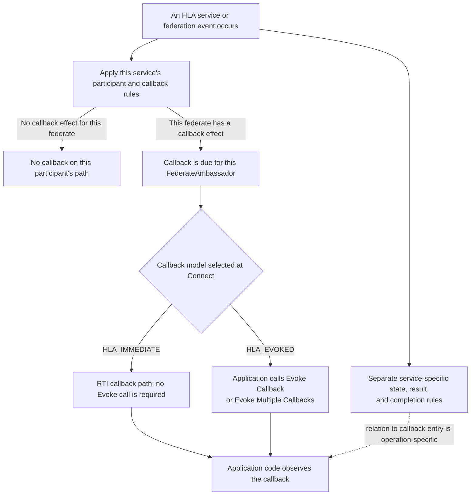

This is a reading model, not a universal callback state machine or ordering
claim. The pinned 2025 [`CallbackModel` enum](../../third_party/ieee1516.1-2025/include/RTI/Enums.h#L22)
names `HLA_IMMEDIATE` and `HLA_EVOKED`; the [`RTIambassador` interface](../../third_party/ieee1516.1-2025/include/RTI/RTIambassador.h#L2265)
declares the Evoke and callback enable/disable services. Those declarations
establish public vocabulary, while exact delivery, eligibility, and
callback-reentry rules come from the applicable standard service clauses. A
callback may be one participant's notification of a state change, a result
that completes a particular protocol, or simply an observation of an event.
Do not assume the same state-commit point or completion meaning for every
callback. Nor does the model branch mean a callback is eligible to run now:
callback enable/disable state and service-specific gates, including logical
time, can further constrain observation. For grants, see the Time Management
guide's [temporal-eligibility and callback-observation flow](HLA-2025-TIME-MANAGEMENT-GUIDE.md#temporal-eligibility-and-callback-observation-are-separate-gates).
For transfer and cancellation outcomes, see the Ownership guide's [service and
callback boundary](HLA-2025-ATTRIBUTE-OWNERSHIP-FLOW-GUIDE.md#service-return-transfer-outcome-and-callback-time-are-separate).
These reading links do not establish an order between ownership notifications
and a time grant.

## Umbra dispatcher mechanics: submitted is not invoked

In the implementation traces below, treat these as separate events:

1. An RTI operation or internal transition produces a callback task.
2. The task is accepted into a per-ambassador dispatch queue.
3. The callback model and callbacks-enabled switch determine when it may run.
4. The RTI enters the federate ambassador method.
5. Any state change defined at callback entry or completion occurs at that
   callback boundary, not merely because the initiating service returned.

This distinction explains why an HLA_EVOKED service call can return before its
callback is application-visible. For operations with callback-gated state,
the corresponding state transition can also remain pending until that
callback boundary. It also explains why an immediate callback can run before
its inducing service call returns.

## Callback-task dispatch

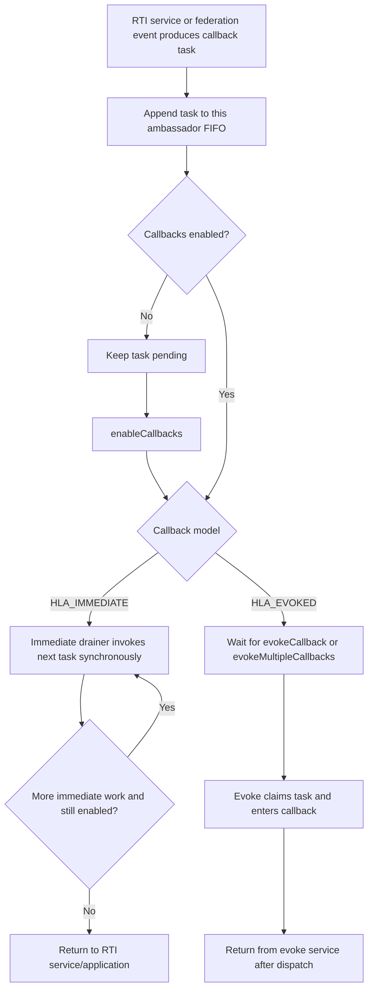

This is the current dispatcher model at a high level. Important qualifications:

- In HLA_IMMEDIATE mode, an enabled task normally runs synchronously on the
  submitting/draining thread. If another thread already owns the immediate
  drainer, its task is queued behind the current callback rather than entering
  the same federate ambassador concurrently.
- A callback may disable callbacks. The immediate drainer checks the setting
  at each callback boundary, leaves the remaining tasks pending, and resumes
  them when callbacks are enabled again.
- In HLA_EVOKED mode, enabling callbacks does not itself invoke queued work.
  The application must call an Evoke service. While callbacks are disabled,
  the current dispatcher leaves evoked tasks queued.
- These are per-ambassador queue mechanics. They do not establish one global
  order across different federates, RTI sessions, or independent callback
  routes.

### Enable Callbacks changes state before an immediate backlog can throw

In the current 2025 adapter, `enableCallbacks` sets the callback-enabled
switch before the dispatcher tries to drain pending work. Under
`HLA_IMMEDIATE`, if this call owns the drain, callbacks run inline on the
Enable Callbacks stack. The dispatcher removes each task before invocation;
if one throws, that task is consumed, later tasks remain queued, and the
immediate-drainer election is cleared before the exception propagates. The
dispatcher does not roll back the enabled switch (unless callback code itself
changed it). Under `HLA_EVOKED`, enabling opens the gate but does not invoke the
queued task; an Evoke call later claims it, and an escaping exception follows
the [ordinary callback exception boundary](#if-an-exception-escapes-a-callback-task).

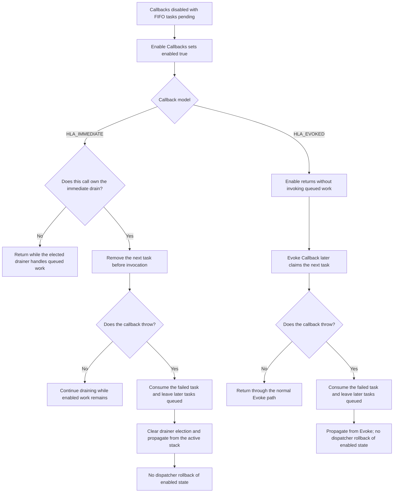

The `HLA_IMMEDIATE` exception path applies only when Enable Callbacks becomes
the drainer; if another thread already owns it, the exception follows that
drainer's active call stack instead. The 2025 API declaration for
[`enableCallbacks`](../../third_party/ieee1516.1-2025/include/RTI/RTIambassador.h#L2283)
lists `SaveInProgress`, `RestoreInProgress`, and `RTIinternalError`; the
possible propagation of an application callback exception through an inline
enable is source-derived here, not a conclusion about the normative service
outcome. The [adapter](../../cpp/src/internal/runtime/umbra_rti_ambassador_callback_control_services.cpp#L115)
calls `setEnabled(true)` directly; the [dispatcher state update](../../cpp/src/internal/callbacks/callback_dispatcher.cpp#L82)
precedes its [exception cleanup and rethrow](../../cpp/src/internal/callbacks/callback_dispatcher.cpp#L246).
Existing [dispatcher tests](../../cpp/tests/callback_dispatcher_catch2.cpp#L189)
cover a successful immediate enable/drain and stopping the backlog by
disabling from a callback; they do not test a throwing callback during Enable
or Evoke. This is 2025 implementation evidence only, not evidence of 2010
behavior or profile parity.

## HLA_EVOKED: the application owns the drain point

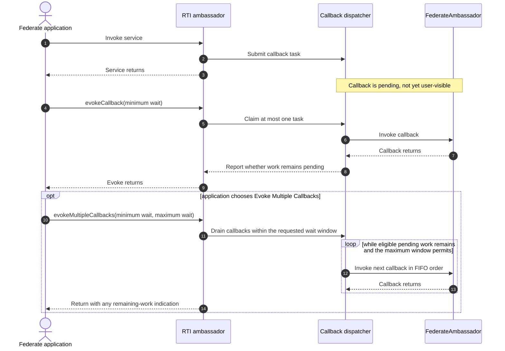

In the current public adapter, Evoke Callback first uses a locally queued task
when one exists and otherwise polls one process-endpoint receive-order event.
Evoke Multiple Callbacks admits currently available process receive-order
events before draining the shared dispatcher. These are transport-profile
details, not additional HLA ordering guarantees.

The Boolean result is also not the callback itself: in the current dispatcher
it reports whether work remains pending after the invocation/window. Tests
cover the one-at-a-time and FIFO cases. Do not interpret a true result as
“another callback already ran.”

### A process receive poll can admit a task while callbacks are disabled

For configured-process receive-order delivery, when no callback task is
pending, `evokeCallback` first calls the [process receive-order
pump](../../cpp/src/internal/runtime/umbra_rti_ambassador_callback_control_services.cpp#L56).
In polling mode, this single-callback path makes one `receive_interaction`
poll before trying to dispatch a callback; a pushed event can instead have
been buffered during another service exchange. If callbacks are disabled, the
event remains pending and no user callback runs; the current dispatcher can
report pending work from that Evoke.
`enableCallbacks` opens the gate, but does not drain an `HLA_EVOKED` task; a
later Evoke invokes it. This separates transport receipt, callback queueing,
and entry into user code.

The focused [process directed-interaction case](../../cpp/tests/ieee1516_2025_connection_directed_interaction_callback_catch2.cpp#L1011)
observes this sequence under `HLA_EVOKED`. Its `HLA_IMMEDIATE` branch uses the
private push option, admits the event during a later receiver service exchange
while callbacks are disabled, then observes `enableCallbacks` drain the task.
Those transport settings belong to this fixture; they do not bind an HLA
callback model to a process transport mode. The process poll,
[disabled dispatcher gate](../../cpp/src/internal/callbacks/callback_dispatcher.cpp#L218),
and [Enable Callbacks adapter](../../cpp/src/internal/runtime/umbra_rti_ambassador_callback_control_services.cpp#L171)
are implementation evidence, not portable transport behavior.

### A pushed interaction can arrive during a single Evoke wait

In the configured-process push path, a stream-reader thread can buffer an
unsolicited `receive_interaction` frame while the single `evokeCallback` call
is waiting in the shared dispatcher. A separate client dispatch loop may
submit that event to the bridge while the wait is active. If the dispatcher
invokes its task before the wait returns, an enabled `HLA_EVOKED` callback
enters `receiveInteraction` before this Evoke returns only when the
receive-order temporal gate is open; otherwise, the bridge defers the event.

The adapter's post-wait path is conditional. It runs only when the initial
`evokeOne` returns false and its `callbackInvoked` output remains false. That
output records whether the dispatcher invoked a queued task; a bridge task can
run and defer an event without entering `FederateAmbassador`. In the
post-wait branch, the adapter asks the process client to submit any
still-buffered pushed events, then invokes one zero-duration `evokeOne` if
dispatcher work is pending. Disabled callbacks stay queued. The client drain
can also return early when another thread owns its dispatch lease, so this
follow-up is not an atomic guarantee that every client-FIFO event has reached
the bridge before the Evoke call returns. This single-Evoke route is separate
from Evoke Multiple's pre-wait admission path described above.

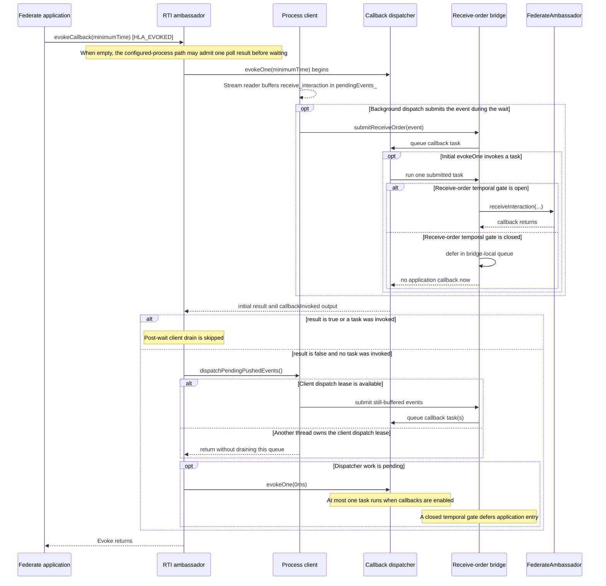

This is a source-derived configured-process interleaving, not a portable HLA guarantee about when a pushed transport frame arrives. The adapter's [single-Evoke path](../../cpp/src/internal/runtime/umbra_rti_ambassador_callback_control_services.cpp#L32) and [conditional post-wait drain](../../cpp/src/internal/runtime/umbra_rti_ambassador_callback_control_services.cpp#L64), the client's [unsolicited-event buffer](../../cpp/src/internal/federation/process_federation_client.cpp#L451), [background dispatch loop](https://github.com/sheepfling/umbra/blob/c9c5a9e410539b039cd8bba35b53d0ef2b24d180/cpp/src/internal/federation/process_federation_client.cpp#L722), and [pending-event dispatch and lease check](../../cpp/src/internal/federation/process_federation_client_callback_dispatch.cpp#L282), plus the bridge's [receive-order task](../../cpp/src/internal/federation/process_federation_callback_bridge.cpp#L1346) and [deferred temporal gate](../../cpp/src/internal/federation/process_federation_callback_bridge.cpp#L1201), form these stages. The `callbackInvoked` output is set by [CallbackDispatcher::evokeOne](../../cpp/src/internal/callbacks/callback_dispatcher.cpp#L156) after a queued task runs; application callback entry still depends on the receive-order gate. For gate release conditions, see the [configured-process receive-order interaction gate](HLA-2025-TIME-MANAGEMENT-GUIDE.md#configured-process-receive-order-interaction-gate). The [Process Endpoint interaction path](HLA-2025-PROCESS-ENDPOINT-REQUEST-AND-CALLBACK-FLOW-GUIDE.md#process-mapping-an-interaction-request-and-its-recipient-stream) shows where the pushed frame originates.

The focused [HLA_EVOKED asynchronous-delivery case](../../cpp/tests/ieee1516_2025_connection_process_asynchronous_delivery_evoked_catch2.cpp#L77) uses zero-duration Evokes and checks the receive-order temporal gate; it does not hold an Evoke wait open for a pushed interaction. The [process receive/Evoke case](../../cpp/tests/ieee1516_2025_connection_receive_evoke_catch2.cpp#L458) sends before a zero-duration Evoke and exercises the polling path. The generic [Evoke Multiple dispatcher test](../../cpp/tests/callback_dispatcher_catch2.cpp#L321) queues work before calling Evoke Multiple; it is not evidence for single-Evoke work arriving during a wait. These are adjacent evidence, not a focused regression for a pushed ordinary interaction arriving during an already-active process Evoke wait or for the client-FIFO-to-bridge dispatch-lease race. The `HLA_IMMEDIATE` asynchronous-delivery case exercises its own inline route; the [focused case](../../cpp/tests/ieee1516_2025_connection_process_asynchronous_delivery_catch2.cpp#L76) does not have this Evoke wait boundary.

### Configured-process AttributeUpdate receipt and disabled callback gates

For AttributeUpdate, receipt, client-FIFO dispatch, dispatcher admission, and callback
entry are distinct stages. Push frames and typed non-interaction poll results enter
`pendingEvents_` before callback enablement is checked. Background dispatch waits for request and
callback-dispatch suppression depths to clear; a callback-owning request drains after
its response while explicitly allowed through that suppression gate. If another thread
owns the client dispatch lease, a drain can return before popping an event. A full event
carries the captured reflection; a deferred marker queues a task that claims the event
and rechecks eligibility only when dispatched.

This chart begins after an `AttributeUpdate` event has arrived at the process
client. It does not describe which state changes produce a Conditional
`HLAfederate` update. The 2025 [`HLAsetSwitches` producer comparison](HLA-2025-FEDERATION-MOM-FLOW-GUIDE.md#switch-storage-current-mom-projection-and-conditional-reflection-are-separate)
maps those nine MIM attributes and distinguishes embedded work planning from
the configured-process enqueue path.

The `callbacks enabled` checks here describe local process dispatcher gates,
separate from the receive-order interaction time gate in the process bridge.
The client routes AttributeUpdate through
[`dispatchAttributeUpdate`](../../cpp/src/internal/federation/process_federation_client_callback_dispatch.cpp#L36)
to [`submitAttributeUpdate`](../../cpp/src/internal/federation/process_federation_callback_bridge.cpp#L1624)
and the shared dispatcher; that path does not consult
`AsynchronousReceiveOrderDeliveryState`. Receive-order interactions use that
state via [`submitReceiveOrder`](../../cpp/src/internal/federation/process_federation_callback_bridge.cpp#L1346)
and the [temporal-gate check](../../cpp/src/internal/federation/process_federation_callback_bridge.cpp#L1495).
Focused asynchronous-delivery tests exercise interaction callbacks in
[`HLA_IMMEDIATE`](../../cpp/tests/ieee1516_2025_connection_process_asynchronous_delivery_catch2.cpp#L75)
and [`HLA_EVOKED`](../../cpp/tests/ieee1516_2025_connection_process_asynchronous_delivery_evoked_catch2.cpp#L76).
They cover the process interaction gate, not the ordinary [AttributeUpdate reflection case](../../cpp/tests/ieee1516_2025_connection_update_attribute_values_reflect_catch2.cpp#L457).
That case does not combine a time-constrained receiver, asynchronous-delivery
changes, and a pending time advance; this is a coverage limit, not a normative
claim. See the [Time Management comparison](HLA-2025-TIME-MANAGEMENT-GUIDE.md#receive-order-and-asynchronous-delivery) for the separate evidence boundary.

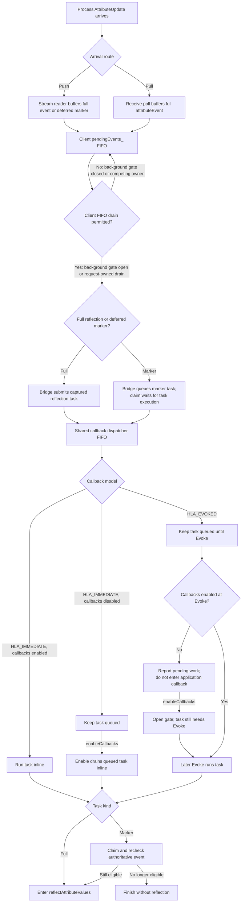

The [stream reader](../../cpp/src/internal/federation/process_federation_client.cpp#L664)
buffers pushed frames; [`bufferEvent`](../../cpp/src/internal/federation/process_federation_client.cpp#L451)
and [typed poll-result buffering](../../cpp/src/internal/federation/process_federation_client.cpp#L389) feed the FIFO.
The [dispatch loop](../../cpp/src/internal/federation/process_federation_client.cpp#L730) waits for request depth and callback-dispatch suppression
to clear. A callback-owning request raises suppression after its response and drains through it
([callback-suppression setup](../../cpp/src/internal/federation/process_federation_client.cpp#L613), [request-owned drain](../../cpp/src/internal/federation/process_federation_client.cpp#L622));
another thread's dispatch lease can make that drain return before it pops an item
([lease check](../../cpp/src/internal/federation/process_federation_client_callback_dispatch.cpp#L282)). An interaction returned by a `receive_interaction` poll
bypasses the FIFO and goes to the interaction [bridge](../../cpp/src/internal/runtime/umbra_rti_ambassador_callback_control_services.cpp#L272). The [client FIFO loop](../../cpp/src/internal/federation/process_federation_client_callback_dispatch.cpp#L298)
submits full events through the [reflection bridge](../../cpp/src/internal/federation/process_federation_client_callback_dispatch.cpp#L311) and
deferred markers through the [deferred task](../../cpp/src/internal/federation/process_federation_client_callback_dispatch.cpp#L314). It later uses the
[claim request](../../cpp/src/internal/federation/process_federation_client_value_services.cpp#L261) to resolve the authoritative event. The dispatcher
[appends tasks](../../cpp/src/internal/callbacks/callback_dispatcher.cpp#L135), [drains immediate work on enable](../../cpp/src/internal/callbacks/callback_dispatcher.cpp#L82),
and leaves disabled Evoke work pending ([Evoke path](../../cpp/src/internal/callbacks/callback_dispatcher.cpp#L176)). These are configured-process mechanics.

If `enableCallbacks` runs before a frame has left the client FIFO, the later
submission sees the open gate. In the immediate model, already-submitted tasks
drain during enable; in the evoked model, opening the gate does not invoke a
task, so a later Evoke is still required. These are current source mechanics,
not an HLA transport or callback-timing rule.

The focused [immediate delayed ordinary-AttributeUpdate case](../../cpp/tests/ieee1516_2025_connection_delayed_regional_attribute_update_catch2.cpp#L824)
uses Push in its fixture ([mode](../../cpp/tests/ieee1516_2025_connection_delayed_regional_attribute_update_catch2.cpp#L491)).
It disables callbacks before the update, unsubscribes, then re-subscribes and
enables callbacks before observing reflection ([scenario](../../cpp/tests/ieee1516_2025_connection_delayed_regional_attribute_update_catch2.cpp#L547)).
With delayed subscription evaluation enabled, the server marks the update for
callback-time eligibility recheck ([predicate](../../cpp/src/internal/federation/process_federation_service_attribute_value_updates.cpp#L222));
Push sends a complete event or a deferred marker ([encoding branch](../../cpp/src/internal/federation/process_federation_service_attribute_value_updates.cpp#L357),
[marker operation](../../cpp/src/internal/federation/process_federation_service_attribute_value_updates.cpp#L369)).
This end-to-end case asserts only the eventual callback outcome, not the timing of
stream-reader receipt, the contents of either private queue, or which gate permits
callback entry.

A separate [HLA_EVOKED delayed ordinary-attribute case](../../cpp/tests/ieee1516_2025_connection_delayed_regional_attribute_update_catch2.cpp#L840)
uses Pull because Push is enabled only for HLA_IMMEDIATE
([mode](../../cpp/tests/ieee1516_2025_connection_delayed_regional_attribute_update_catch2.cpp#L491)); it unsubscribes before
sending and re-subscribes before pumping the receiver. The observed result
supports deferred evaluation in this scenario, but not prior queue contents,
`disableCallbacks`, or the pushed deferred-marker path.

The focused [evoked TSO AttributeUpdate case](https://github.com/sheepfling/umbra/blob/c9c5a9e410539b039cd8bba35b53d0ef2b24d180/cpp/tests/ieee1516_2025_connection_tso_attribute_before_grant_catch2.cpp#L1128)
disables callbacks, sends a timestamped update, and calls Evoke while disabled;
the update remains pending without a reflection, then arrives after callbacks
are enabled and a later Evoke runs
([disabled Evoke and re-enable](https://github.com/sheepfling/umbra/blob/c9c5a9e410539b039cd8bba35b53d0ef2b24d180/cpp/tests/ieee1516_2025_connection_tso_attribute_before_grant_catch2.cpp#L1015),
[reflection assertions](https://github.com/sheepfling/umbra/blob/c9c5a9e410539b039cd8bba35b53d0ef2b24d180/cpp/tests/ieee1516_2025_connection_tso_attribute_before_grant_catch2.cpp#L1045)).
That fixture uses Pull and does not exercise a deferred marker. No focused public
case combines a deferred marker with `HLA_EVOKED` or directly inspects the two
private queues; those branches in the chart are source-derived, not a claim of
profile parity.

### Process Evoke Multiple separates event admission from callback draining

This is the configured-process `HLA_EVOKED` path. At entry, the adapter skips
its process receive pump if the shared callback dispatcher already has work.
Otherwise it calls `pumpProcessReceiveOrder` with the callback-enabled state.
The pump first drains buffered process work. When enabled it polls repeatedly
while each poll yields work; when disabled it stops after one work-yielding
poll. The adapter then calls the shared `evokeMultiple` dispatcher once with
the requested wait bounds.

The embedded `FlushQueueRequest` example nearby is a separate callback
boundary: in its focused Save/Restore case, the eligible TSO receive callback
runs before `flushQueueGrant`, and both are dispatched before the next
`evokeCallback(0.0)`. It observes interaction time 8 before FQG(actual=7,
optimistic=8). See the Save/Restore guide's [timed Save and later directed TSO
trace](HLA-2025-FEDERATION-SAVE-RESTORE-FLOW-GUIDE.md#worked-case-a-timed-save-retains-later-directed-tso-work)
and the [Time Management FQR delivery-frontier model](HLA-2025-TIME-MANAGEMENT-GUIDE.md#fqr-actual-grant-and-optimistic-floor).
That is one embedded implementation case, not configured-process evidence or a
general callback-order rule.

For the timing case where a receiver disables Time Constrained after FQR but
before Evoke, see the Time Management guide's [FQR/Disable boundary](HLA-2025-TIME-MANAGEMENT-GUIDE.md#disable-time-constrained-between-fqr-acceptance-and-evoke).
That trace separates the process client's event FIFO from dispatcher
admission; it does not claim a callback order for the untested combined case.

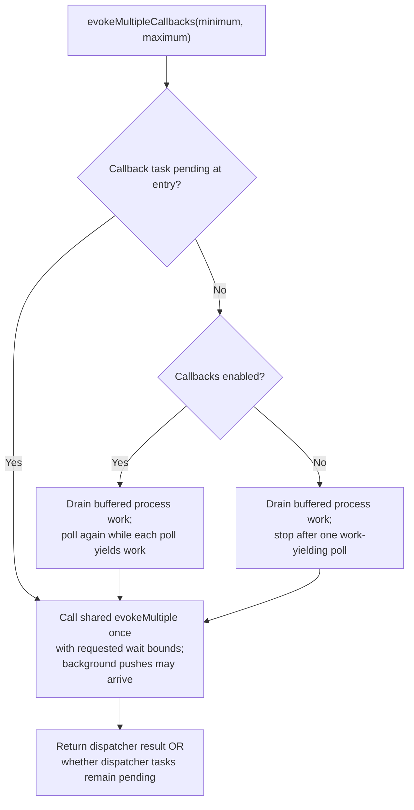

The [adapter](../../cpp/src/internal/runtime/umbra_rti_ambassador_callback_control_services.cpp#L95)
skips the pre-dispatch receive pump when a callback task is already pending and
passes `callbacks_->isEnabled()` to the [process receive pump](../../cpp/src/internal/runtime/umbra_rti_ambassador_callback_control_services.cpp#L124).
When enabled, the pump repeats polls while each poll yields work; when disabled,
it stops after one poll yields work. The pump checks pending callback count
before another poll, but that is only a queue-count observation.

It does not track the interval after the client removes a pushed event from its
FIFO and before bridge submission ([client handoff](../../cpp/src/internal/federation/process_federation_client_callback_dispatch.cpp#L303),
[pump check](../../cpp/src/internal/runtime/umbra_rti_ambassador_callback_control_services.cpp#L264)).
A concurrent background submission can cross that observation; the committed
candidate has no separate admission-depth fence. The focused process case cited
below does not force this handoff race. This is an implementation evidence
limit, not an HLA-wide polling or callback-order rule.

The adapter invokes `callbacks_->evokeMultiple` once and does not make the
post-wait client-FIFO drain or zero-wait follow-up used by single
[`evokeCallback`](../../cpp/src/internal/runtime/umbra_rti_ambassador_callback_control_services.cpp#L69).
While this timed call runs, the client's [background dispatch loop](https://github.com/sheepfling/umbra/blob/c9c5a9e410539b039cd8bba35b53d0ef2b24d180/cpp/src/internal/federation/process_federation_client.cpp#L722)
can submit pushed work. Enabled callbacks may run in the same dispatcher pass;
disabled tasks stay queued. The adapter returns the dispatcher result OR its
pending-task count ([adapter return](../../cpp/src/internal/runtime/umbra_rti_ambassador_callback_control_services.cpp#L133)).
A client-FIFO item not yet submitted is not counted, and this method has no
second process drain to account for it.

The focused [process receive/Evoke case](../../cpp/tests/ieee1516_2025_connection_receive_evoke_catch2.cpp#L743)
observes one event admitted while callbacks are disabled and its later delivery
after re-enable. Its scripted server expects one receive for that admission and
then no extra poll when the queued task is evoked. It does not verify an enabled
multi-poll drain, the FIFO-to-bridge race above, or pushed submission during the
timed wait. The generic [dispatcher minimum-wait case](../../cpp/tests/callback_dispatcher_catch2.cpp#L335)
shows submitted work can wake the dispatcher, but does not include the process
reader, FIFO, or callback bridge. The separate [two-interaction FIFO case](../../cpp/tests/ieee1516_2025_connection_multi_recipient_interaction_ordering_catch2.cpp#L459)
uses single `evokeCallback`, so it does not cover the multi-poll drain.
### The bounded drain uses elapsed time, not HLA logical time

The 2025 adapter converts each approximate-second argument to milliseconds.
Its conversion maps non-finite and nonpositive values to zero, truncates
positive fractional milliseconds, and saturates very large finite values at
`milliseconds::max()`. The dispatcher then clamps durations to zero or above
and raises the maximum to at least the minimum.

The dispatcher first acquires its shared callback-dispatch lock and checks
that it is in evoked mode with callbacks enabled. Only then does it start the
`std::chrono::steady_clock` window. Time spent waiting for that lock and work
the adapter performs before entering the dispatcher are outside this measured
window. If callbacks are disabled at entry, the dispatcher returns its
pending-work status without starting the clock.

With an empty queue, it waits only until the minimum deadline; when that
deadline arrives with no callback queued, it returns false. When work is
queued, it invokes callbacks in FIFO order and checks the maximum only after
each callback returns. A zero maximum therefore still permits one queued
callback to run. A callback already running is not interrupted when the
maximum passes, and its completion can extend beyond that deadline. The
maximum is not a hard bound on the full API-call duration: lock acquisition,
adapter work outside the dispatcher, and callback execution can all extend
the observed call time. This clock measures elapsed callback-service time, not
federation logical time.

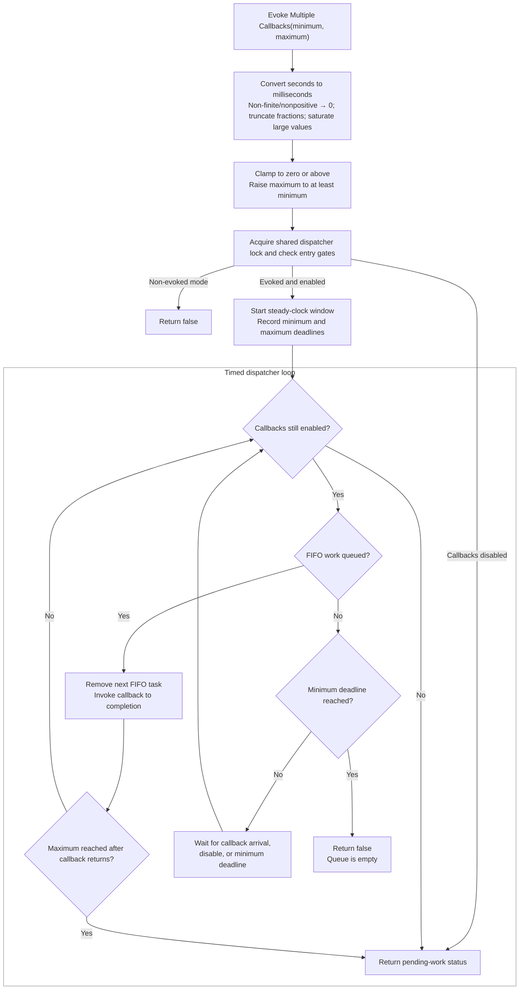

This is the current dispatcher path, not a complete statement of IEEE
1516.1-2025 §10.58. If a callback throws, its task has already been removed
and is not retried; the [callback exception boundary](#if-an-exception-escapes-a-callback-task)
covers that separate outcome. The public adapter's final boolean also includes
whether dispatcher work remains after its adapter-side processing.

The [focused dispatcher test](../../cpp/tests/callback_dispatcher_catch2.cpp#L321)
starts with three callbacks already queued, calls `evokeMultiple(1ms, 25ms)`,
and checks FIFO completion and a false pending-work result. It makes no timing
assertion, so it does not establish the wait duration. The [disabled-dispatcher
case](../../cpp/tests/callback_dispatcher_catch2.cpp#L334) exercises
`evokeOne(0ms)`, not `evokeMultiple`, and supplies no wait-window evidence.
There is no focused test here for an initially empty queue, callback arrival
during the wait, argument conversion or normalization, maximum-deadline
overshoot, time spent waiting for the dispatch lock, or the public API adapter.
The [pinned API declaration](../../third_party/ieee1516.1-2025/include/RTI/RTIambassador.h#L2273),
[argument converter](../../cpp/src/internal/runtime/umbra_rti_ambassador_callback_control_services.cpp#L16),
[2025 adapter](../../cpp/src/internal/runtime/umbra_rti_ambassador_callback_control_services.cpp#L95),
and [dispatcher implementation](../../cpp/src/internal/callbacks/callback_dispatcher.cpp#L200)
bound the explanation to this source path. The [official IEEE product page](https://standards.ieee.org/ieee/1516.1/6688/)
identifies 1516.1-2025 as purchase/subscription-access content; keep normative interpretations
of the approximate wait arguments unresolved until its licensed text is
available.

## HLA_IMMEDIATE: callback work can be on the service stack

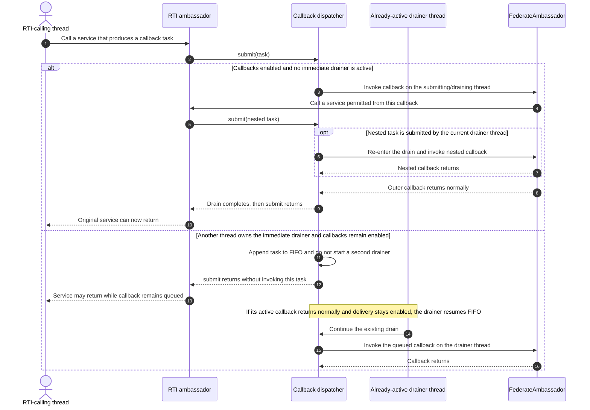

The pinned API's [`CallbackModel` enum](../../third_party/ieee1516.1-2025/include/RTI/Enums.h#L22)
names `HLA_IMMEDIATE` and `HLA_EVOKED`. The sequence above is the current 2025
Umbra implementation path, not a claim that every immediate callback must
run on its producer's thread or finish before every inducing service returns.
In the [dispatcher](../../cpp/src/internal/callbacks/callback_dispatcher.cpp#L122),
an enabled immediate submission appends to the FIFO. If no drainer owns the
queue, the submitting thread becomes the drainer and calls
[`drainImmediate`](../../cpp/src/internal/callbacks/callback_dispatcher.cpp#L253)
before `submit` returns. If delivery remains enabled, the callback enters
through [CallbackSession::invoke](../../cpp/src/internal/callbacks/callback_session.cpp#L54).
A submission from that same thread can re-enter the recursive drain. If a
different thread already owns the drain, the submitting thread only appends
the task and returns; the active drainer can invoke it after its current
callback returns normally and callbacks remain enabled.
Disabled tasks stay queued; a later
[`enableCallbacks`](../../cpp/src/internal/callbacks/callback_dispatcher.cpp#L82)
can start the drain. This per-ambassador queue does not establish a global
order across producers or federates.

If a callback throws while draining inline, the failing task has already been
removed, later FIFO tasks remain pending, and the exception unwinds through the
call that owns the active drain. That call can differ from the service that
submitted the failing task. The
[callback-exception flow](#if-an-exception-escapes-a-callback-task) traces task
consumption and the active-call boundary. The recursive dispatcher/session
permits same-thread nested dispatch in this implementation; it does not permit
calling every RTI service from a callback. Each service's re-entry rule still
applies. The pinned 2025 C++ API explicitly lists
`CallNotAllowedFromWithinCallback` for the operations below:

The [direct dispatcher test](../../cpp/tests/callback_dispatcher_catch2.cpp#L83)
checks synchronous completion for sequential submissions on one thread. The
[competing-producer test](../../cpp/tests/callback_dispatcher_catch2.cpp#L100)
blocks the first callback, joins a second producer after it submits another
task, and verifies the second callback has not entered until the first is
released; it then checks FIFO order. These are dispatcher tests, not public
service tests. The [public integration case](../../cpp/tests/callback_dispatcher_catch2.cpp#L168)
calls `listFederationExecutions` under `HLA_IMMEDIATE`; its callback attempts
both Evoke services, catches their re-entry exceptions, and has both flags
checked after the service returns. The [adapter](../../cpp/src/internal/runtime/umbra_rti_ambassador.cpp#L2735)
submits that report callback after releasing its runtime locks. Together these
show one uncontended public path and the generic competing-producer queue
behavior. They do not test a competing drainer through a public RTI service,
an allowed nested service that produces a second public callback, or exception
attribution in that concurrent schedule. For contrast,
`HLA_EVOKED` leaves callback invocation to a later Evoke service, as described
in [the explicit-drain section](#hla_evoked-the-application-owns-the-drain-point).

| API operation | Pinned API declarations | Current 2025 adapter and focused-test evidence |
| --- | --- | --- |
| Connect (four overloads) | [1](../../third_party/ieee1516.1-2025/include/RTI/RTIambassador.h#L55), [2](../../third_party/ieee1516.1-2025/include/RTI/RTIambassador.h#L68), [3](../../third_party/ieee1516.1-2025/include/RTI/RTIambassador.h#L83), [4](../../third_party/ieee1516.1-2025/include/RTI/RTIambassador.h#L98) | Callback-execution guards in the [Connect adapter](../../cpp/src/internal/runtime/umbra_rti_ambassador_connect_services.cpp#L43); no focused re-entry case was found in the bounded test scan. |
| Disconnect | [Declaration](../../third_party/ieee1516.1-2025/include/RTI/RTIambassador.h#L110) | Guarded by the [public adapter](../../cpp/src/internal/runtime/umbra_rti_ambassador.cpp#L2413); no focused re-entry case was found in the bounded test scan. |
| Join (both overloads) | [1](../../third_party/ieee1516.1-2025/include/RTI/RTIambassador.h#L212), [2](../../third_party/ieee1516.1-2025/include/RTI/RTIambassador.h#L234) | Guarded in [Join admission](../../cpp/src/internal/runtime/umbra_rti_ambassador_federation_lifecycle.cpp#L365); no focused re-entry case was found in the bounded test scan. |
| Resign | [Declaration](../../third_party/ieee1516.1-2025/include/RTI/RTIambassador.h#L250) | Guarded in [Resign admission](../../cpp/src/internal/runtime/umbra_rti_ambassador_federation_lifecycle.cpp#L806). Focused embedded `HLA_EVOKED` cases exercise rejection from [Initiate Federate Save](../../cpp/tests/ieee1516_2025_save_active_callback_resignation_guard_catch2.cpp#L4) and selected [timed-save callbacks](../../cpp/tests/ieee1516_2025_timed_save_active_callback_resignation_guard_catch2.cpp#L4), [FQR](../../cpp/tests/ieee1516_2025_timed_save_fqr_active_callback_resignation_guard_catch2.cpp#L4), [NMRA](../../cpp/tests/ieee1516_2025_timed_save_nmra_active_callback_resignation_guard_catch2.cpp#L4), and [TARA](../../cpp/tests/ieee1516_2025_timed_save_tara_active_callback_resignation_guard_catch2.cpp#L4). |
| Evoke Callback and Evoke Multiple Callbacks | [1](../../third_party/ieee1516.1-2025/include/RTI/RTIambassador.h#L2265), [2](../../third_party/ieee1516.1-2025/include/RTI/RTIambassador.h#L2273) | Both have adapter guards ([Evoke](../../cpp/src/internal/runtime/umbra_rti_ambassador_callback_control_services.cpp#L32), [Evoke Multiple](../../cpp/src/internal/runtime/umbra_rti_ambassador_callback_control_services.cpp#L97)); the focused [immediate-callback case](../../cpp/tests/callback_dispatcher_catch2.cpp#L167) attempts both services. |

This is a map of explicit API exception annotations and selected Umbra evidence,
not the complete normative call-allowed-from-callback matrix. The adjacent
`enableCallbacks` and `disableCallbacks` declarations do not list this
exception, but absence from an `@throws` list is not, by itself, permission to
call either service from every callback. Exact service rules still require the
applicable standard text; do not infer them from dispatcher recursion or from
an implementation guard's presence or absence.

Do not conflate the internal CallbackSession close operation with the public
Disconnect service. The session can close itself during an active invocation
without waiting on itself; the public RTI Disconnect call is explicitly
guarded against callback re-entry.

## Callback-session lifetime and concurrency

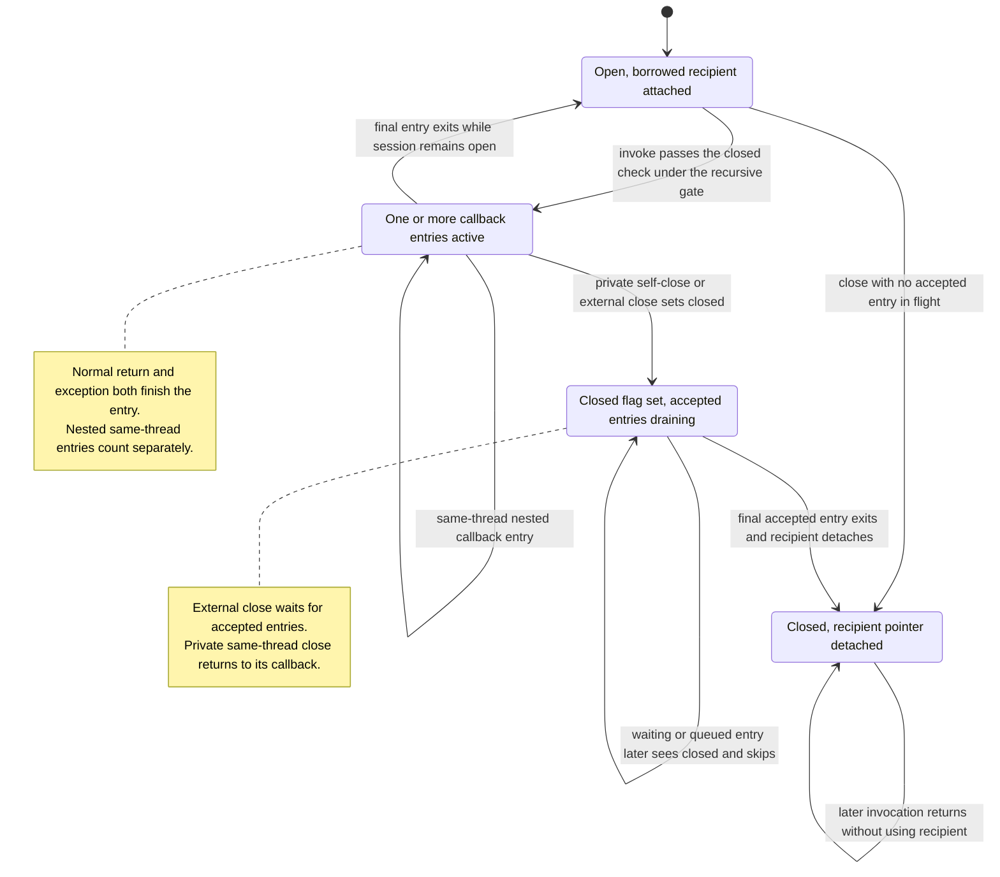

Umbra's 2025 `CallbackSession` borrows the caller-owned `FederateAmbassador`; it
does not own the recipient. `invoke` first obtains a per-session recursive
gate, then checks the closed flag and recipient pointer. An accepted entry
increments the in-flight count and snapshots the borrowed pointer before the
session mutex is released. Different threads serialize at the gate; same-thread
nested callbacks can re-enter it. An invocation waiting at the gate is not yet
counted. If close wins first, that invocation later sees the closed flag and
returns without dereferencing the recipient.

Every accepted entry decrements the count on both normal return and exception.
If the session is closed and the last entry exits, it clears the borrowed
pointer and wakes close waiters; an exception is then rethrown to the caller of
`invoke`. A private same-thread close only sets the closed flag and returns,
avoiding a wait on itself. An external close waits for accepted callback
entries, then detaches the pointer. That wait covers FederateAmbassador entry,
not every task waiting at the gate or the entire dispatcher/service call
stack.

### Public Disconnect guard and private session close are different paths

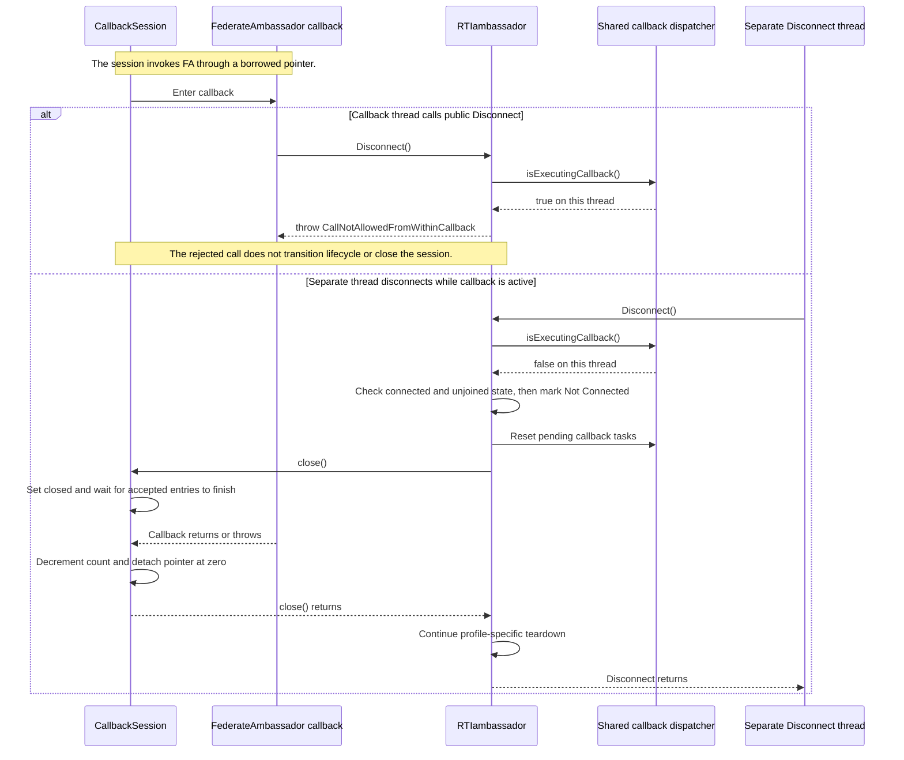

This is Umbra's implementation path, not a complete HLA callback-permission
matrix. The callback's private self-close branch is not a public way to call
Disconnect. A successful external Disconnect changes lifecycle state and
clears pending dispatcher tasks under the ambassador lock, then closes the
session after releasing that lock. A task already selected but not yet accepted
by the session is rejected by the closed check. In the configured-process
profile, client teardown follows the session close.

The focused unit tests exercise private session close directly: an external
close waits for a blocked callback; concurrent direct entries serialize; and
self-close returns without deadlocking. The public embedded federation-listing
scenario separately queues an evoked report, disconnects, then confirms a later
Evoke does not deliver it. These tests do not establish that public Disconnect
from a callback throws, nor do they exercise external public Disconnect while
another thread is inside the callback.

### Conveyed Region designators follow callback completion

The `optionalSentRegions` callback argument is a pointer to a callback's
sent-region set. In the embedded TSO paths, the RTI creates receiver-side
Region copies from the saved send snapshot, so the federate can query their
dimensions and bounds during the callback. The callback-scoped copy owner
releases those Regions when the callback returns. A federate may copy a
`RegionHandle` value into its own report, but Umbra's `RegionHandle::isValid()`
only checks for a nonzero value; a later Region service call must still resolve
that value in the receiver's registry.

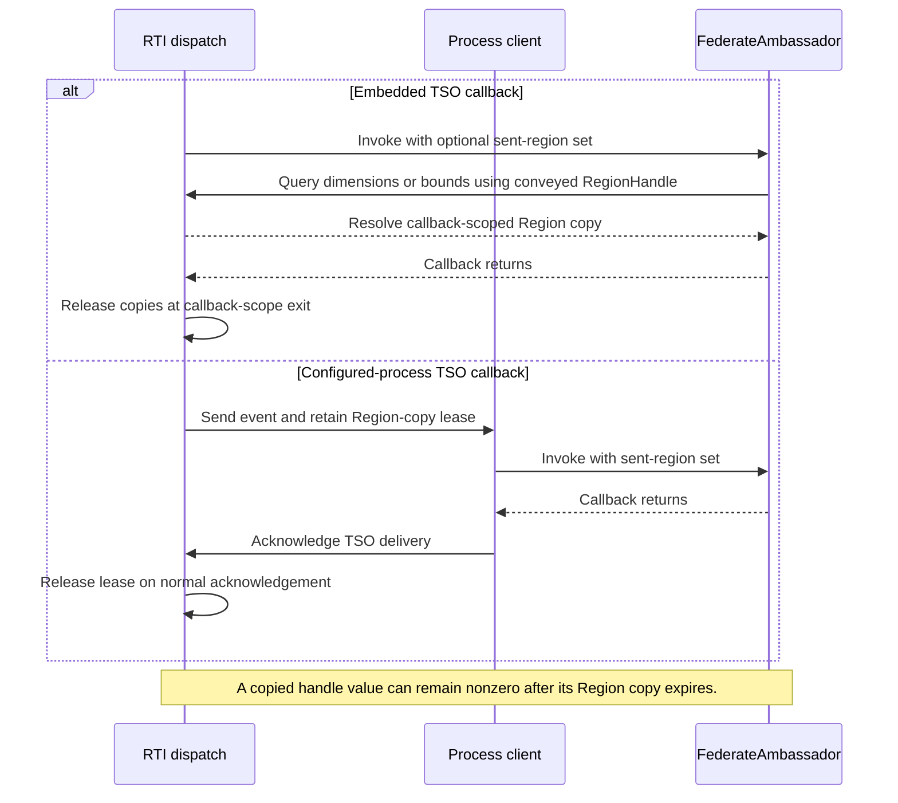

The callback model decides when user code is entered; the resource boundary
then follows callback return in the embedded path and delivery acknowledgement
in the configured-process TSO path. The process receiver-Resign-before-ack
edge has its own cleanup path, so normal acknowledgement cleanup is not a
universal process-session rule. See the DDM guide's
[Region-copy lifetime and test boundary](HLA-2025-DATA-DISTRIBUTION-AND-REGIONS-FLOW-GUIDE.md#a-conveyed-region-designator-is-not-a-surviving-live-region)
and the [TSO retraction guide](HLA-2025-TSO-RETRACTION-FLOW-GUIDE.md#receiver-resign-around-a-regional-interaction-callback-gate).
The focused embedded snapshot tests query conveyed Regions during
`receiveInteraction` or `reflectAttributeValues`, including after mutating the
publisher's live Region from inside the callback. They do not query the copied
Region after callback return. The DDM guide links those cases and separates
their tested snapshot stability from the source-derived cleanup boundary.

### Process Disconnect and reconnect use different cleanup paths

On a successful process-profile Disconnect, the ambassador resets its shared
dispatcher under the lifecycle lock, then interrupts the process client and
closes the adapter callback session outside the lock. Closing that session
prevents a selected old task from entering the old recipient and waits for an
invocation already in progress. Client close then joins its workers, clears
its buffered event queue, and closes the process bridge; bridge close cancels
pre-callback projections and resets the same shared dispatcher again. A
sequential Connect after Disconnect returns therefore starts after this old
session cleanup has completed.

ConnectionLost is different: it marks the ambassador Not Connected but retains
the process client. A later Connect replaces that client during commit; its
destruction closes the old bridge and old callback session before Connect
returns. The existing configured-process public case exercises a single
Connect/Disconnect and no pending callbacks; the public Disconnect/reconnect
case is embedded. Neither establishes configured-process queue behavior across
reconnect.

There is also a source-visible concurrency boundary. Disconnect publishes
Not Connected before its post-lock callback and client cleanup finishes. A
concurrent Connect can therefore commit a new session while old cleanup is
still outstanding, and the old bridge resets the dispatcher shared by both
sessions. That reset could remove tasks submitted by the replacement session.
This is an implementation-derived race possibility, not a tested outcome or a
claim about the API's concurrent-call contract. The existing public embedded
test covers queued evoked-report discard and sequential Disconnect/reconnect;
the configured-process public Connect/Disconnect case does not assert queued
callback behavior. No focused test covers concurrent Connect with outstanding
Disconnect cleanup, or configured-process pending callbacks across reconnect.
The Disconnect sequence and the distinction between local return and later
host cleanup are diagrammed in the [2025 connection guide](HLA-2025-CONNECTION-AND-CONFIGURATION-FLOW-GUIDE.md#3-disconnect-requires-an-unjoined-connection-and-tears-down-in-order).

## Ordering and state-commit cautions

- **FIFO is local.** The dispatcher deque preserves task submission order for
  one ambassador. A multi-recipient integration test checks per-recipient
  interaction FIFO across its configured process endpoint; it is not proof of
  one total order among all callbacks from all services or federates.
- **No batch pre-extraction in immediate mode.** Tasks are taken one at a time
  so disableCallbacks can stop a backlog at the next boundary.
- **Evoke Multiple is bounded.** The current implementation normalizes wait
  values and drains until no work remains after the minimum window or the
  maximum deadline is reached. Callbacks can consume time inside that window.
- **Disable is not discard.** Pending tasks survive disable/enable transitions
  unless a lifecycle operation explicitly resets or closes that session.
- **Exceptions are dispatch-boundary events.** If an exception escapes its
  callback task, the dispatcher has already removed that task. The session
  releases its in-flight count and rethrows; there is no automatic retry. The
  immediate drainer releases its election state and preserves later FIFO work.
  The Evoke path likewise propagates the exception and leaves later tasks
  pending. Producer-specific catches can change this path; see the focused
  [exception boundary](#if-an-exception-escapes-a-callback-task) below.
- **Time order is specialized.** Receive-order FIFO is not a substitute for
  timestamp ordering. TSO-before-grant ordering, retraction, and loss cutoffs
  are documented in the time-management guide.
- **Completion callbacks are protocol gates.** Save/restore completion,
  ownership transfer, and time-role changes may commit state at their own
  callback boundaries. Follow their focused guides instead of assuming that
  all callbacks have identical commit semantics. In the embedded
  FederationSynchronized path below, the registry instead erases the completed
  point while preparing notifications, before callback dispatch. For an
  ownership example, the [ownership guide](HLA-2025-ATTRIBUTE-OWNERSHIP-FLOW-GUIDE.md#service-return-transfer-outcome-and-callback-time-are-separate)
  distinguishes acquisition commit from later value updates, while the
  [TSO ownership timeline](HLA-2025-TSO-RETRACTION-FLOW-GUIDE.md#ownership-changes-and-an-accepted-tso-update-are-separate-timelines)
  shows a focused embedded case where an already-accepted update reflects after
  transfer with its original producer identity. These are scenario-specific
  boundaries, not a global ordering rule for ownership and reflection callbacks.
  The [interaction transportation example](HLA-2025-ORDER-AND-TRANSPORTATION-FLOW-GUIDE.md#interaction-requests-recheck-the-publishers-live-declaration)
  is another service-specific boundary: embedded revalidation and commit run
  inside the queued confirmation task, while process push/poll determines when
  registry begin runs before the client dispatches the confirmation callback.

## If an exception escapes a callback task

This is the common 2025 dispatcher/session boundary used by callback tasks
that reach it. It does not claim that every producer lets user exceptions
escape; both 2025 `ConnectionLost` producer paths catch callback exceptions
themselves, as traced below. Nor does this low-level flow define each public
service's exception translation or state-commit behavior.

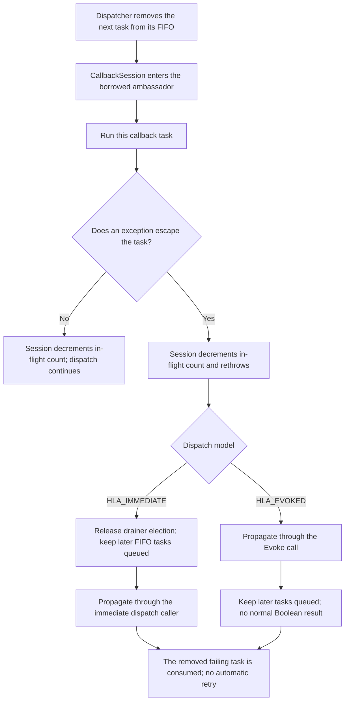

`CallbackDispatcher` takes the task out of the deque before invoking it. The
session's exceptional path decrements its in-flight count before rethrowing.
For HLA_IMMEDIATE, `drainImmediate` clears the drainer election on escape and
does not discard the remaining FIFO backlog. For HLA_EVOKED, `evokeOne` and
`evokeMultiple` invoke an already-extracted task without a catch/requeue step;
an escaping exception bypasses the normal return while later queue entries
remain. In both models the failed task has been consumed, not retried. A
producer may deliberately catch an exception before it reaches this boundary,
so treat this as dispatcher evidence rather than a universal RTI error policy.
For the discovery-specific receiver-known-state and pending-route consequences,
see the Object and Interaction guide's [2025 discovery callback exception map](HLA-2025-OBJECT-AND-INTERACTION-INFORMATION-FLOW-GUIDE.md#if-discoverobjectinstance-throws-after-the-receiver-becomes-known).

### Which public call is active when the callback throws?

The HLA-facing question is not only whether a callback task throws, but which
application-to-RTI call is on the stack when the RTI enters that callback. The
2025 `FederateAmbassador::receiveInteraction` declaration documents
`FederateInternalError` as a possible callback exception. That declaration does
not, by itself, define how a particular producer catches, reports, or translates
the exception. `FederateInternalError` derives from the API's `Exception`
base; the service-catch example below is about that RTI exception hierarchy,
not arbitrary C++ exceptions.

The pinned API's exception annotations belong to each method separately:
`receiveInteraction` lists `FederateInternalError`, while `evokeCallback` and
`evokeMultipleCallbacks` list `CallNotAllowedFromWithinCallback` and
`RTIinternalError`, not `FederateInternalError`. Do not infer from the callback
annotation alone that its exception is part of Evoke's documented service
outcome. In the current Umbra `HLA_EVOKED` path, `CallbackSession` rethrows an
escaping exception and `evokeCallback` invokes the dispatcher without catching
it, so the exception can escape the public Evoke service. That is source-observed
implementation behavior, not a normative propagation conclusion. The exact
standard rule remains open without the applicable licensed clause text
([callback API](../../third_party/ieee1516.1-2025/include/RTI/FederateAmbassador.h#L262),
[Evoke API](../../third_party/ieee1516.1-2025/include/RTI/RTIambassador.h#L2260),
[Evoke wrapper](../../cpp/src/internal/runtime/umbra_rti_ambassador_callback_control_services.cpp#L60),
[dispatcher](../../cpp/src/internal/callbacks/callback_dispatcher.cpp#L156),
[session rethrow](../../cpp/src/internal/callbacks/callback_session.cpp#L79)).

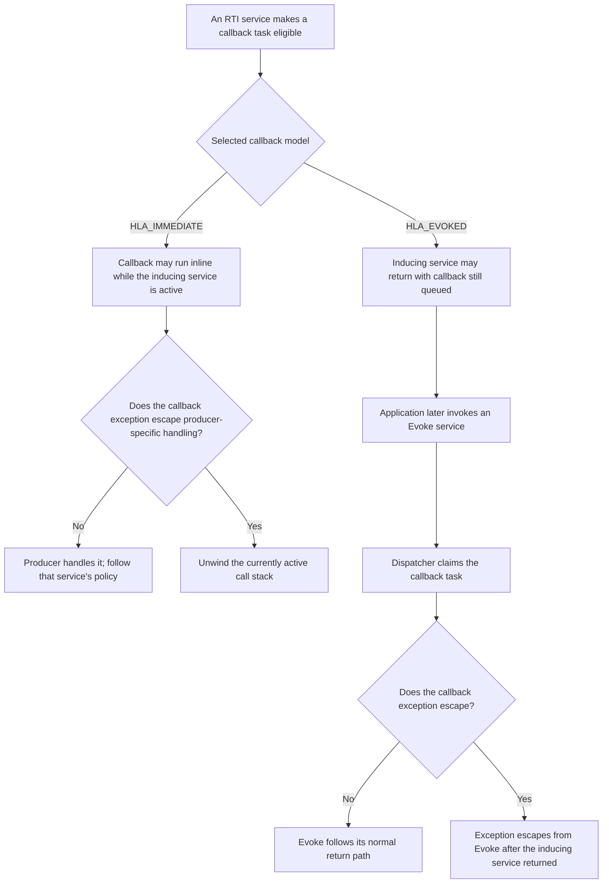

This is a call-stack model, not a claim that every HLA_IMMEDIATE callback runs
on the inducing thread: if another thread already owns the receiver's immediate
drainer, the task waits behind that drainer and any exception unwinds through
that thread's active call instead. Nor does the diagram prescribe a universal
exception-reporting rule. Check the specific producer catch and the state/report
boundary that precedes callback submission.

For one concrete 2025 embedded case, ordinary `Send Interaction` attempts its
successful service-report record and records the accepted-send MOM counter
before submitting recipient callback routes. If an HLA_IMMEDIATE
`Receive Interaction` callback runs inline on this `Send Interaction` stack and
throws an API `Exception` such as `FederateInternalError`, the service's broad
catch attempts `HLAreportException` and a failed service-report record, then
rethrows. Because this happens after the accepted boundary, the accepted-send
counter and any service-report record already appended are not rolled
back by that catch; report writes are separate fallible effects, not a
transaction. If a different thread owns the recipient's immediate drainer, the
sender may finish submitting the queued task before the callback runs, so its
later exception is not necessarily caught by this sender's `Send Interaction`
handler.

Under HLA_EVOKED, the recipient invokes the callback later from its Evoke call;
the failed task is consumed there and the original `Send Interaction` stack is
already gone. The inspected 2025 Evoke entry points propagate dispatcher
exceptions without a local `HLAreportException` or service-report catch. Keep
this embedded path separate from the process endpoint: its correlated service
response and pushed-event dispatch are distinct, and this review does not
assign process callback exceptions to the embedded reporting sequence. The
[exception-reporting guide](HLA-2025-EXCEPTION-REPORTING-FLOW-GUIDE.md#if-the-exception-report-callback-itself-throws) and
[service-invocation reporting guide](HLA-2025-SERVICE-INVOCATION-REPORTING-FLOW-GUIDE.md)
cover the reporting concepts; this section connects them only for the bounded
embedded example above. The exception guide separately explains when a
throwing `HLAreportException` recipient callback is contained by the original
service's `noexcept` report hook and when it runs on a later callback stack.

#### Process endpoint callback-exception attribution

The 2025 process endpoint has two recipient-side routes into callback
dispatch. The stream-reader decodes and buffers pushed event frames; it never
invokes `FederateAmbassador` code. A request-backed service that drains those
frames does so only after matching its own correlated response and releasing
the exchange lock. Separately, when no request is active, a background
dispatch loop submits buffered frames. These routes attribute an
`HLA_IMMEDIATE` callback exception differently. `HLA_EVOKED` queues the
callback task in either route, so the user callback runs later on the
recipient's Evoke path.

##### Request-backed API drains a pushed event

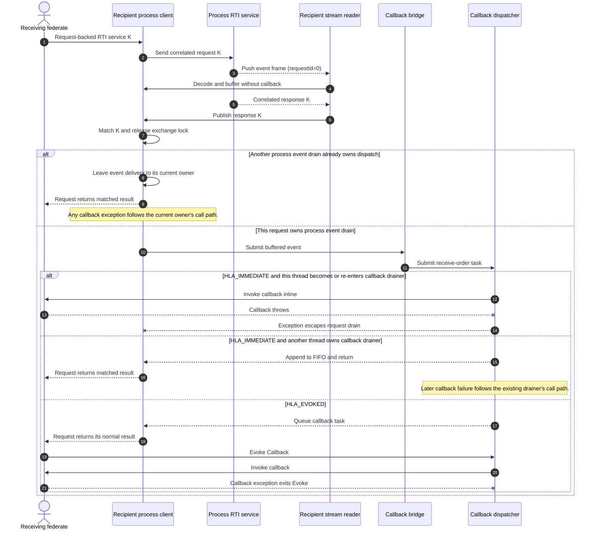

##### Background dispatch runs without an active request

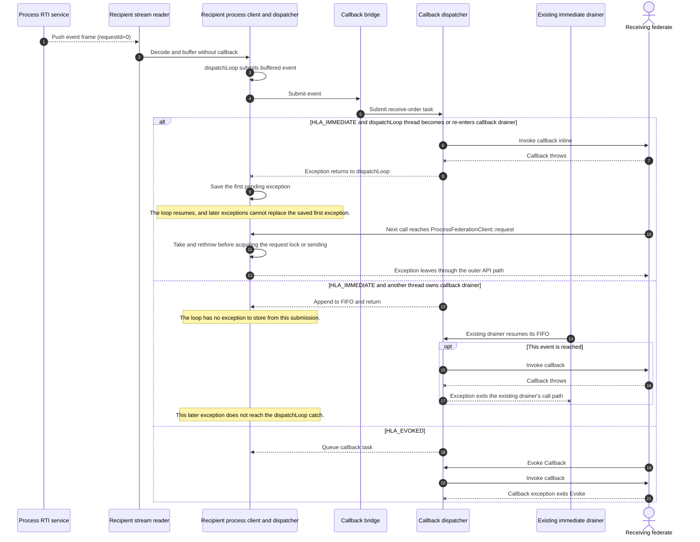

The two `HLA_IMMEDIATE` paths are source-derived implementation behavior, not
a normative HLA exception rule. In the request-drain path,
`request()` matches the response ([response correlation](https://github.com/sheepfling/umbra/blob/c9c5a9e410539b039cd8bba35b53d0ef2b24d180/cpp/src/internal/federation/process_federation_client.cpp#L599)), releases the exchange lock ([exchange unlock](https://github.com/sheepfling/umbra/blob/c9c5a9e410539b039cd8bba35b53d0ef2b24d180/cpp/src/internal/federation/process_federation_client.cpp#L618)), then drains pushed events ([request-owned event drain](https://github.com/sheepfling/umbra/blob/c9c5a9e410539b039cd8bba35b53d0ef2b24d180/cpp/src/internal/federation/process_federation_client.cpp#L622))
matches the response, releases the exchange lock, then drains pushed events;
an escaping callback exception can prevent that client call from returning
the already-received response to its caller only if this request owns the
process event drain and the callback submission drains synchronously on this
same thread. The process drain can return without submitting if another
thread already owns event dispatch
([ownership check](https://github.com/sheepfling/umbra/blob/c9c5a9e410539b039cd8bba35b53d0ef2b24d180/cpp/src/internal/federation/process_federation_client_callback_dispatch.cpp#L282));
in that case the request returns its matched response while the current owner
continues delivery. When this request owns the process drain, it removes an
event and unlocks before submitting it through the
[`callback bridge`](https://github.com/sheepfling/umbra/blob/c9c5a9e410539b039cd8bba35b53d0ef2b24d180/cpp/src/internal/federation/process_federation_client_callback_dispatch.cpp#L305).
The bridge passes the task to the dispatcher
([submission](https://github.com/sheepfling/umbra/blob/c9c5a9e410539b039cd8bba35b53d0ef2b24d180/cpp/src/internal/federation/process_federation_callback_bridge.cpp#L1378));
[`CallbackDispatcher::submit`](https://github.com/sheepfling/umbra/blob/c9c5a9e410539b039cd8bba35b53d0ef2b24d180/cpp/src/internal/callbacks/callback_dispatcher.cpp#L122)
drains synchronously in `HLA_IMMEDIATE` mode when this thread becomes the
drainer or re-enters its own drain. If a different thread owns that immediate
drain, submission only appends to the FIFO and returns; any later callback
exception follows the existing drainer's call path
([ownership rule](https://github.com/sheepfling/umbra/blob/c9c5a9e410539b039cd8bba35b53d0ef2b24d180/cpp/src/internal/callbacks/callback_dispatcher.cpp#L144),
[exception exit](https://github.com/sheepfling/umbra/blob/c9c5a9e410539b039cd8bba35b53d0ef2b24d180/cpp/src/internal/callbacks/callback_dispatcher.cpp#L279)).
The request can then return before that queued callback runs. In the background
path, [`receiveLoop` buffers the pushed event](https://github.com/sheepfling/umbra/blob/c9c5a9e410539b039cd8bba35b53d0ef2b24d180/cpp/src/internal/federation/process_federation_client.cpp#L683);
the [`dispatchLoop` catch](https://github.com/sheepfling/umbra/blob/c9c5a9e410539b039cd8bba35b53d0ef2b24d180/cpp/src/internal/federation/process_federation_client.cpp#L739)
stores only the first callback-dispatch exception. Before acquiring a request
lock or sending, the next `request()` calls
[`rethrowPendingCallbackException`](https://github.com/sheepfling/umbra/blob/c9c5a9e410539b039cd8bba35b53d0ef2b24d180/cpp/src/internal/federation/process_federation_client.cpp#L748),
which exchanges and rethrows the saved exception
([actual exception rethrow](https://github.com/sheepfling/umbra/blob/c9c5a9e410539b039cd8bba35b53d0ef2b24d180/cpp/src/internal/federation/process_federation_client.cpp#L755)).
Because the background loop resumes after its catch, later buffered events can
still be dispatched; while the pending slot is occupied, a later exception
does not replace the first. These precise queue/error details have no focused
throwing-callback test in the reviewed process cases. The dispatcher citation
describes only the mechanism reached by this 2025 process path; this review
does not establish 2010 parity.

For `HLA_EVOKED`, bridge submission queues a task and the recipient's later
[`evokeOne` call](https://github.com/sheepfling/umbra/blob/c9c5a9e410539b039cd8bba35b53d0ef2b24d180/cpp/src/internal/callbacks/callback_dispatcher.cpp#L191)
invokes user code; the generic dispatcher/session exception route above then
applies. Do not infer from the callback's declared exception type
that Evoke translates or reports it. The producer's private response and
recipient's callback stack remain independent. See the detailed [process
request/callback flow](HLA-2025-PROCESS-ENDPOINT-REQUEST-AND-CALLBACK-FLOW-GUIDE.md#2-from-a-stream-frame-to-an-official-callback)
for request correlation and event admission. The focused [process Evoke
integration case](https://github.com/sheepfling/umbra/blob/c9c5a9e410539b039cd8bba35b53d0ef2b24d180/cpp/tests/ieee1516_2025_connection_receive_evoke_catch2.cpp#L458),
[multi-recipient interaction case](https://github.com/sheepfling/umbra/blob/c9c5a9e410539b039cd8bba35b53d0ef2b24d180/cpp/tests/ieee1516_2025_connection_multi_recipient_interaction_ordering_catch2.cpp#L460),
and [callback-bridge unit cases](https://github.com/sheepfling/umbra/blob/c9c5a9e410539b039cd8bba35b53d0ef2b24d180/cpp/tests/process_federation_callback_bridge_catch2.cpp#L20)
exercise successful dispatch, not a throwing `FederateAmbassador`; no test was
run for this documentation review.

##### One public wrapper: process `getInteractionClassHandle`

The previous call-stack map stops at the outer RTI service boundary because
report behavior is service-wrapper-specific. A concrete request-backed example
is the configured-process [`getInteractionClassHandle`](https://github.com/sheepfling/umbra/blob/c9c5a9e410539b039cd8bba35b53d0ef2b24d180/cpp/src/internal/runtime/umbra_rti_ambassador_interaction_class_lookup.cpp#L16)
path, which is also used as a receiver-side exchange fence in the focused
multi-recipient case. If its client request drains an `HLA_IMMEDIATE`
`FederateInternalError`, or the next call rethrows a saved one before sending,
the process branch's narrower `ProcessFederationClientError` catches do not
match that callback exception. The outer `catch (Exception const&)` does: it
attempts `HLAreportException` through the `noexcept`
[`emitExceptionReport`](https://github.com/sheepfling/umbra/blob/c9c5a9e410539b039cd8bba35b53d0ef2b24d180/cpp/src/internal/runtime/umbra_rti_ambassador_mom_service_report_interaction.cpp#L185)
hook, then attempts the failed service-invocation report before rethrowing the
original. The hook swallows failures in its own advisory report request. If
the later process failed-report request fails, the writer converts that
client error to `RTIinternalError`, which can replace the original callback
exception. An arbitrary non-RTI C++ exception does not match this wrapper's
typed catch and bypasses these two report hooks. This is one inspected
request-backed API path, not a rule for all services or for the separate
`HLA_EVOKED` Evoke stack.

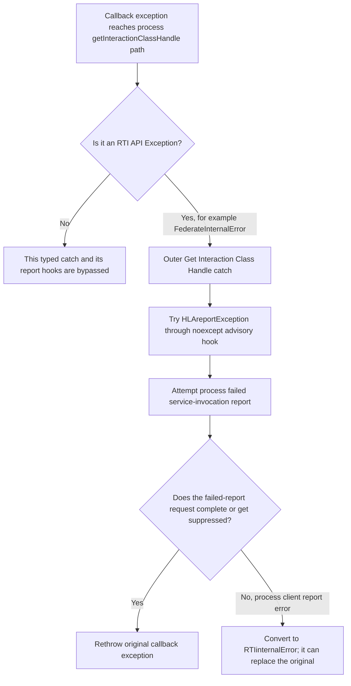

The catch/report ordering is visible in the [public wrapper](https://github.com/sheepfling/umbra/blob/c9c5a9e410539b039cd8bba35b53d0ef2b24d180/cpp/src/internal/runtime/umbra_rti_ambassador_interaction_class_lookup.cpp#L99),
the process-client report requests ([exception](https://github.com/sheepfling/umbra/blob/c9c5a9e410539b039cd8bba35b53d0ef2b24d180/cpp/src/internal/federation/process_federation_client_federation_management.cpp#L492),
[failed invocation](https://github.com/sheepfling/umbra/blob/c9c5a9e410539b039cd8bba35b53d0ef2b24d180/cpp/src/internal/federation/process_federation_client_federation_management.cpp#L508)),
and the [failed-report adapter's error conversion](https://github.com/sheepfling/umbra/blob/c9c5a9e410539b039cd8bba35b53d0ef2b24d180/cpp/src/internal/runtime/umbra_rti_ambassador_service_report_writers.cpp#L279).
It is source evidence only: the reviewed process tests do not throw from the
callback, and no combined exception-report/service-report failure schedule was
run or tested here. The embedded `Send Interaction` case below remains a
separate producer-side path.

##### Mutating process wrapper: final `Synchronization Point Achieved`

The lookup example above is read-only. A configured-process
`synchronizationPointAchieved` shows why the service-specific state boundary
matters. When the achievement that completes an announced synchronization set
arrives, the registry records that result, plans `FederationSynchronized`
notifications for the set, and erases the completed point before the process
service returns its correlated response. In push mode, the service sends
notification frames before returning that response. The client buffers those
frames, matches the response, releases its exchange lock, and only then drains
the pushed events.

Assuming the completing federate still has a notification route and this is
the next buffered event, its own `federationSynchronized` callback can throw
under `HLA_IMMEDIATE` while that service's client request drains the frame.
The process client has received the successful response, but its request does
not return the decoded result. The RTI adapter's outer `catch (Exception
const&)` attempts `HLAreportException` and rethrows; this wrapper does not show
a compensating registry transition or a failed-service-invocation report, and
its successful service-report-file append occurs later, so that append is
skipped. In `HLA_EVOKED`, bridge submission queues the callback instead: the
service wrapper can finish and append its successful service report, while a
later Evoke call is where the callback exception may escape. This trace assumes
the pushed frame and correlated success response are delivered; if sending a
notification frame fails, the service handler has a separate error-after-
registry-transition path that this callback-exception chart does not cover.

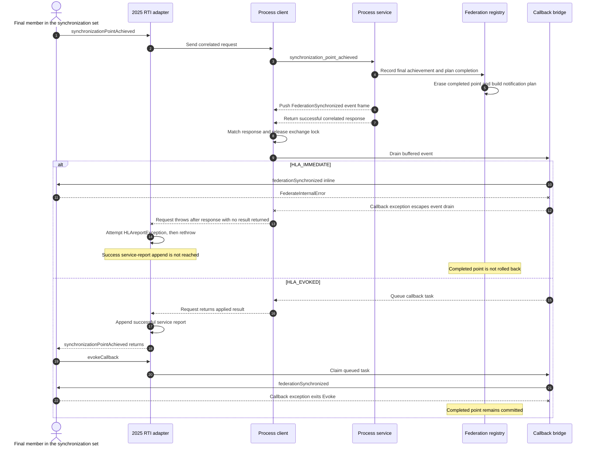

This is a current-source case study, not a normative exception or rollback
rule. The 2025 API declaration lists
[`synchronizationPointAchieved`](../../third_party/ieee1516.1-2025/include/RTI/RTIambassador.h#L288)
with `SynchronizationPointLabelNotAnnounced`, `SaveInProgress`,
`RestoreInProgress`, `FederateNotExecutionMember`, `NotConnected`, and
`RTIinternalError`; the callback declaration separately lists
[`FederateInternalError` for `federationSynchronized`](../../third_party/ieee1516.1-2025/include/RTI/FederateAmbassador.h#L93).
Do not infer a normative service outcome from this implementation trace.
Source anchors: [registry records achievement](../../cpp/src/internal/federation/federation_registry.cpp#L305)
and [erases the completed point](../../cpp/src/internal/federation/federation_registry.cpp#L340),
[process request handler's registry transition](../../cpp/src/internal/federation/process_federation_service_request_handlers.cpp#L261)
and [notification enqueue before response](../../cpp/src/internal/federation/process_federation_service_request_handlers.cpp#L288),
[pushed notification send](../../cpp/src/internal/federation/process_federation_service_notifications.cpp#L416),
[request-depth release](../../cpp/src/internal/federation/process_federation_client.cpp#L610) and [exchange unlock](../../cpp/src/internal/federation/process_federation_client.cpp#L618),
followed by [subsequent callback drain](https://github.com/sheepfling/umbra/blob/c9c5a9e410539b039cd8bba35b53d0ef2b24d180/cpp/src/internal/federation/process_federation_client.cpp#L737),
[public wrapper's success-report append](../../cpp/src/internal/runtime/umbra_rti_ambassador_federation_lifecycle.cpp#L1362),
and [outer exception catch](../../cpp/src/internal/runtime/umbra_rti_ambassador_federation_lifecycle.cpp#L1390).
The public [HLA_IMMEDIATE process test](../../cpp/tests/ieee1516_2025_connection_synchronization_failure_catch2.cpp#L871)
puts the receiver in the explicit set and observes its completion callback
after achievement, but the callback does not throw and the test does not
assert callback-before-return or exception-after-commit behavior. No focused
test establishes the throwing-callback outcome.

### Embedded `Send Interaction`: accepted effects precede callback failure

This sequence is a source-derived embedded 2025 case, not a normative
exception rule or a tested throwing-callback scenario. It makes the call-stack
timing concrete: the send's accepted effects precede callback submission, so
an inline callback exception can escape the service after those effects have
already occurred.

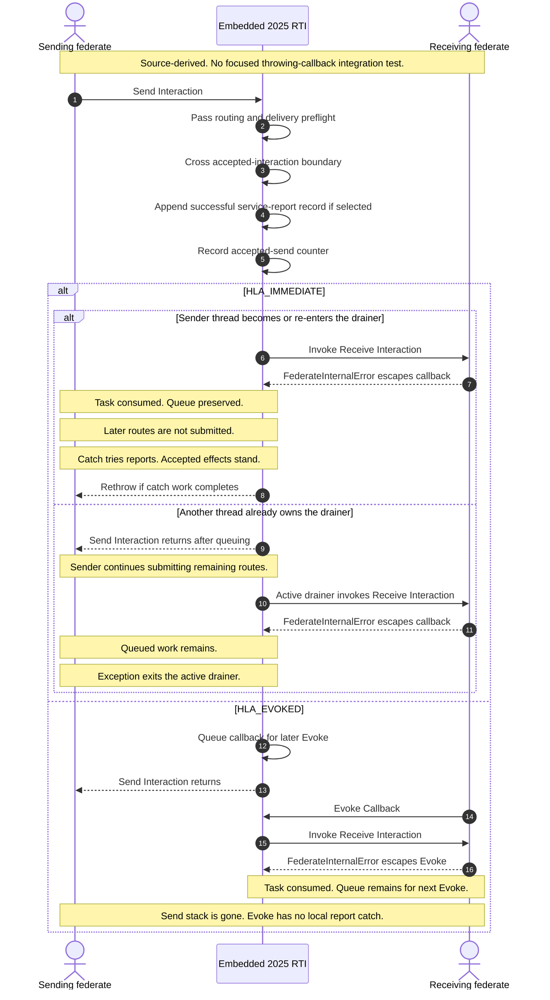

The embedded `Send Interaction` attribution is also source-derived and lacks
a focused throwing-callback integration case. Existing dispatcher tests cover
successful immediate/evoked dispatch, but do not establish callback exception
attribution, report-sink outcomes, or rollback behavior. No test was run for
this documentation review. Mermaid CLI 12.0.0 rendered this flow; local
screenshot review found its labels and branches readable without clipping.
GitHub presentation has not been verified.

Recipient-route submission is sequential in this embedded send overload. If
an immediate callback throws through the sender thread's `submit`, that call
unwinds the send's fan-out loop before later planned recipients are submitted;
the already accepted send effects remain. The dispatcher has extracted the
throwing task, so it is not retried, but preserves FIFO tasks that were already
queued and releases the immediate-drainer election. If a different thread
already owns that recipient's drainer, submission returns to the sender and
the sender can continue with later recipient routes; a callback exception then
unwinds on the active drainer's own call stack. Under `HLA_EVOKED`, all routes
are submitted before later callback execution; a task that throws during Evoke
is consumed while other pending tasks remain for a later dispatch. These queue
and fan-out outcomes are source-derived and have no focused throwing-callback
integration test.

The configured-process path has a different boundary. Its sender request and
each receiver event use separate client sessions; callback exceptions follow
the receiver's request-drain, background-dispatch, or later-Evoke path described
in [process endpoint callback-exception attribution](#process-endpoint-callback-exception-attribution).
The process [ordinary interaction projection](HLA-2025-OBJECT-AND-INTERACTION-INFORMATION-FLOW-GUIDE.md#process-ordinary-interactions-snapshot-the-promoted-callback-view)
shows the event side of that separation. The focused process send/receive cases
exercise successful delivery only; none establishes how a throwing receiver
callback relates to the sender's accepted service result.

Cancellation is a separate transition from exception handling or disabling.
`CallbackDispatcher::reset` clears pending work; the embedded resignation path
does this after the membership transition and before submitting notifications
to surviving members. The focused embedded restore/resignation test verifies
that queued restore callbacks do not reach the departing federate while the
survivor still receives the terminal restore result. The process-profile path
has a different, narrower source-observed boundary, shown next; do not infer
embedded/process parity from either path.

## `ConnectionLost` producer exception containment and backend-specific cleanup

Do not apply the generic escaping-task branch above to this callback: both
2025 producers catch exceptions thrown by FederateAmbassador::connectionLost.
Their local state transitions differ, so this chart compares only these
observed adapter paths; it is not a process/embedded parity claim. Callback
model timing remains as described in the HLA_IMMEDIATE and HLA_EVOKED sections
above.

The registry-side forced-resignation action, forced-loss cleanup, and
survivor-effect conditions are mapped in the [2025 lifecycle guide's
connection-loss flow](HLA-2025-FEDERATION-AND-FEDERATE-LIFECYCLE-FLOW-GUIDE.md#connection-loss-forced-resignation-is-a-different-entry-path).

For configured-process Push delivery, a closed pushed-event stream can trigger
this local path through the client reader, while the server-side recipient
worker independently handles its closed session. The [joined-federate MOM
guide](HLA-2025-JOINED-FEDERATE-MOM-OBJECT-LIFECYCLE-FLOW-GUIDE.md#transport-closure-can-start-another-process-loss-pass)
traces that send-failure cascade. Here the focus is the local callback path and
the distinct client and callback-dispatcher queues. For the separate server-
side member-exit path, see the Process Endpoint guide's [member-exit
notification handling](HLA-2025-PROCESS-ENDPOINT-REQUEST-AND-CALLBACK-FLOW-GUIDE.md#server-member-exit-effects-and-local-connectionlost-callback).

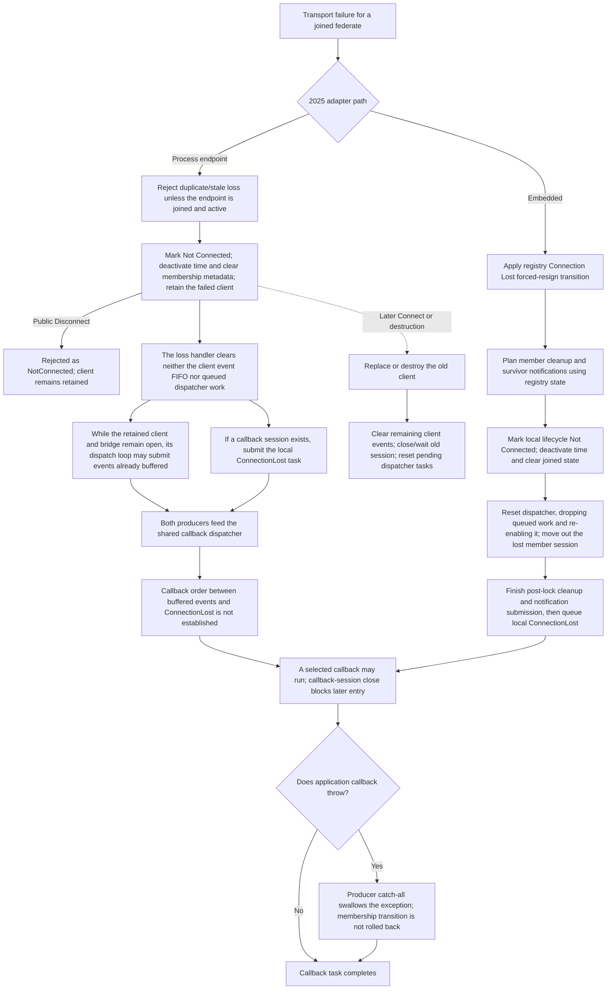

The process helper commits its local Not Connected state, clears joined/time
metadata, and submits ConnectionLost without closing the client or resetting
the shared dispatcher. The retained client's dispatch loop can still submit
events already in its pending FIFO when request and callback-dispatch
suppression allow it. The helper submits ConnectionLost independently to the
same dispatcher, so this source trace establishes no callback-entry order
between that notification and callbacks derived from buffered events.

After ConnectionLost, public `Disconnect()` is rejected as `NotConnected`; it
does not retire the retained client. A later `Connect()` replaces that client,
or ambassador destruction closes it. During old-client close, remaining client
events are cleared, the old callback session is closed and waits for an active
invocation, and the shared dispatcher is reset. Thus a ConnectionLost task
that is still pending can be removed along with other pending tasks if cleanup
happens before callback selection; an invocation already active is allowed to
finish. The embedded transport-loss case demonstrates that reconnect is
available after ConnectionLost, but it does not exercise configured-process
queue cleanup. See the [NotConnected Disconnect branch](../../cpp/src/internal/runtime/umbra_rti_ambassador.cpp#L2534),
[old-client replacement during Connect](https://github.com/sheepfling/umbra/blob/c9c5a9e410539b039cd8bba35b53d0ef2b24d180/cpp/src/internal/runtime/umbra_rti_ambassador_connect_services.cpp#L284),
[ambassador destruction](../../cpp/src/internal/runtime/umbra_rti_ambassador.cpp#L2469),
[process loss handler](../../cpp/src/internal/runtime/umbra_rti_ambassador_membership_loss.cpp#L122),
transport failure handoff[^worktree-source],
[retained-client dispatch loop](https://github.com/sheepfling/umbra/blob/c9c5a9e410539b039cd8bba35b53d0ef2b24d180/cpp/src/internal/federation/process_federation_client.cpp#L722),
[deferred failure callback](https://github.com/sheepfling/umbra/blob/c9c5a9e410539b039cd8bba35b53d0ef2b24d180/cpp/src/internal/federation/process_federation_client.cpp#L759),
client close[^worktree-source],
[bridge close](../../cpp/src/internal/federation/process_federation_callback_bridge.cpp#L2415),
and [callback-session close/wait](../../cpp/src/internal/callbacks/callback_session.cpp#L35).

### A concurrent Connect can wait on an active old-session callback

The adapter rejects `Connect()` called by the callback thread itself. A
different application thread can still call `Connect()` while a callback from
the failed process session is active: the callback guard reads thread-local
execution state, so it does not report a callback running on another thread.
At Connect commit, the ambassador mutex remains held while the new process
client replaces the retained old client. Destroying that old client interrupts
and joins its workers; closing its bridge then closes the old callback session
and waits for active invocations before resetting the shared dispatcher. These
steps are visible in the [Connect guard and commit](../../cpp/src/internal/runtime/umbra_rti_ambassador_connect_services.cpp#L74),
[thread-local callback guard](../../cpp/src/internal/callbacks/callback_dispatcher.cpp#L11),
[callback-state query](../../cpp/src/internal/callbacks/callback_dispatcher.cpp#L118),
[Connect commit lock](../../cpp/src/internal/runtime/umbra_rti_ambassador_connect_services.cpp#L242),
[old-client replacement](../../cpp/src/internal/runtime/umbra_rti_ambassador_connect_services.cpp#L284),
[client close](https://github.com/sheepfling/umbra/blob/c9c5a9e410539b039cd8bba35b53d0ef2b24d180/cpp/src/internal/federation/process_federation_client_callback_dispatch.cpp#L599),
[stream-reader join](https://github.com/sheepfling/umbra/blob/c9c5a9e410539b039cd8bba35b53d0ef2b24d180/cpp/src/internal/federation/process_federation_client_callback_dispatch.cpp#L624),
and [callback-dispatch join](https://github.com/sheepfling/umbra/blob/c9c5a9e410539b039cd8bba35b53d0ef2b24d180/cpp/src/internal/federation/process_federation_client_callback_dispatch.cpp#L628),
[bridge close and shared-dispatcher reset](../../cpp/src/internal/federation/process_federation_callback_bridge.cpp#L2415),
[callback-session wait](../../cpp/src/internal/callbacks/callback_session.cpp#L35),
and [dispatcher reset](../../cpp/src/internal/callbacks/callback_dispatcher.cpp#L73).
For example, after the process endpoint is marked inactive,
[`getFederateName`](../../cpp/src/internal/runtime/umbra_rti_ambassador_federate_identity_lookup.cpp#L153)
falls through to a path that takes the ambassador mutex before checking the
local lifecycle state.

```mermaid
sequenceDiagram
    participant Callback as Active old callback
    participant App as Other application thread
    participant RTI as RTIambassador
    participant Client as Retained client

    Note over Callback,App: Callback-thread Connect is rejected
    App->>RTI: Connect()
    RTI->>RTI: Lock mutex and commit Connect
    RTI->>Client: Replace old client and start close
    alt HLA_IMMEDIATE callback is on old worker
        Client->>Client: Interrupt and join worker
        Client-->>RTI: Waits for callback thread
    else HLA_EVOKED callback is active
        Client->>Client: Close waits on old callback session
        Client-->>RTI: Waits for callback return
    end
    Callback->>RTI: Call a service that needs the mutex
    Note over RTI,Callback: Possible wait cycle<br/>Connect holds lock and waits<br/>callback waits for the same lock
```

This is a source-derived possible wait cycle, not an observed deadlock or an
HLA requirement. It requires the active callback to re-enter a service that
needs the ambassador mutex while the external Connect is waiting for the old
client or callback session to close; a callback that returns without that
re-entry lets cleanup continue. The focused configured-process coordinator-
stop case delivers `ConnectionLost` under `HLA_EVOKED`, but does not race a
second-thread Connect or re-enter an RTI service from the active callback. The
The current worktree also contains a private socket-resume case named
`Process federation client resumes its joined session after socket loss` in
`cpp/tests/ieee1516_2025_connection_process_federation_service_host_catch2.cpp`[^worktree-source].
Its assertions check that the private client can list the joined member after
socket reconnection; they do not inspect a public ambassador's Not Connected
transition. The public same-ambassador Connect-after-loss case covers only the
embedded profile. None establishes this process-profile schedule.

The focused 2025 connection_lost case injects embedded transport failure. The
[embedded case](../../cpp/tests/ieee1516_2025_connection_lost_error_path_catch2.cpp#L5)
checks that the lost ambassador can Connect again; it does not exercise the
configured-process event and callback queues. A separate production
coordinator-stop test[^worktree-source],
summarized in the Lifecycle guide's [coordinator-stop flow](HLA-2025-FEDERATION-AND-FEDERATE-LIFECYCLE-FLOW-GUIDE.md#stopping-the-authoritative-coordinator-ends-both-client-sessions),
observes local `connectionLost` callbacks for two joined public clients after
the service stops. The parent ambassador uses `HLA_EVOKED` and explicitly
evokes the callback. This proves terminal callback delivery in that scenario;
the test does not seed pushed events or unrelated callback tasks before loss,
assert their relative callback order, or establish server-side survivor effects.
The private pushed-frame recovery case[^worktree-source]
checks callback replay across repeated socket loss around a service response,
but not its ordering with the local `connectionLost` callback. The
[embedded service-report case](../../cpp/tests/ieee1516_2025_service_report_catch2.cpp#L506)
encodes record-before-callback behavior, but a recorded local run failed during
createFederationExecution before reaching those assertions. None of these cases
injects an exception from `connectionLost`. The queue interaction remains
source-bounded, not a normative requirement or profile-parity claim.

### `ConnectionLost` and survivor Remove callbacks are separate streams

The flow above follows the departing ambassador's local terminal callback.
Connection loss can produce three separate observations: the lost endpoint's
local `connectionLost` callback, a remote survivor's `HLAreportFederateLost`
`receiveInteraction`, and a survivor's `Remove Object Instance` callback for a
known `HLAfederate` object. The MOM report's trigger and profile-specific
dispatch are traced in the [Federation MOM guide](HLA-2025-FEDERATION-MOM-FLOW-GUIDE.md#a-federate-lost-mom-report-is-distinct-from-local-loss-and-object-removal);
joined-object removal is covered by the [joined-federate MOM lifecycle](HLA-2025-JOINED-FEDERATE-MOM-OBJECT-LIFECYCLE-FLOW-GUIDE.md#resignation-removes-visibility-before-forgetting-the-snapshot).

On the embedded path, the adapter submits eligible report work before its
automatic-resign effects. It then submits planned removals before the departing
ambassador's local `ConnectionLost` task
([report submission](../../cpp/src/internal/runtime/umbra_rti_ambassador_membership_loss.cpp#L371),
[removal queue](../../cpp/src/internal/runtime/umbra_rti_ambassador_membership_loss.cpp#L448),
[local terminal callback](../../cpp/src/internal/runtime/umbra_rti_ambassador_membership_loss.cpp#L470)).
The HLA_EVOKED [report/removal case](../../cpp/tests/ieee1516_2025_connection_lost_report_ordering_catch2.cpp#L5)
observes the report before automatic `DELETE_OBJECTS` removal for each of two
survivors. The immediate removal queue may enter a callback synchronously
([callback queue](../../cpp/src/internal/runtime/umbra_rti_ambassador_object_instance_lifecycle_callbacks.cpp#L1418));
the focused immediate report case observes both the remote report and local
loss callback before the injected fault returns, but does not test their
relative order. These are implementation and focused-test observations, not a
general HLA callback-ordering claim.

The configured-process service enqueues removal and synchronization work
before the Federate-Lost event; the failed member's local ConnectionLost
callback follows the separate client transport path. Host-side membership loss
begins after its inactive-session purge timeout (host purge and loss path[^worktree-source]).
This ordering is source-only: no focused configured-process Federate-Lost
report test asserts callback entry or its order relative to the host purge
([process report dispatch](../../cpp/src/internal/federation/process_federation_service_connection_loss.cpp#L97)).
Neither the pinned 2025 `connectionLost` and `federateResigned` declarations
([`connectionLost`](../../third_party/ieee1516.1-2025/include/RTI/FederateAmbassador.h#L42),
[`federateResigned`](../../third_party/ieee1516.1-2025/include/RTI/FederateAmbassador.h#L67))
nor these tests establish relative invocation order between the lost
application's local terminal callback and a survivor callback. The joined-
federate MOM object tests still cover removal after explicit Resign rather
than forced loss. Keep that boundary unresolved.
The catch-all described for the departing ambassador's local `connectionLost`
callback does not contain a survivor's `removeObjectInstance` exception. That
callback follows its own removal-queue and registry path; see the [forced-loss
Remove callback failure boundary](HLA-2025-JOINED-FEDERATE-MOM-OBJECT-LIFECYCLE-FLOW-GUIDE.md#a-throwing-remove-callback-does-not-roll-back-the-callback-time-transition).

### Callback enable gates for Federate-Lost and local ConnectionLost

`disableCallbacks` changes the dispatcher on one RTI ambassador. It does not
cancel the federation's report plan or undo the failed member's local loss
transition. The gate applies separately at the survivor that may receive
`HLAreportFederateLost` and at the failed member that receives
`connectionLost`:

| Callback path | Effect while callbacks are disabled | Source boundary |
| --- | --- | --- |
| Survivor report, embedded | The task waits in that survivor's dispatcher. When it can run, the embedded callback path rechecks the current receive-order route; a changed route can suppress the report after the wait. | [Callback-time route recheck](../../cpp/src/internal/runtime/umbra_rti_ambassador_membership_loss.cpp#L74) |
| Survivor report, configured process | Push may admit the frame to the client FIFO; a Pull poll may return the report to the bridge. The bridge queues the callback task in the survivor's dispatcher. The report uses the recipient projection captured by the service; no report-specific callback-time route recheck was found. | [Service event projection](../../cpp/src/internal/federation/process_federation_service_connection_loss.cpp#L141), [bridge submission](../../cpp/src/internal/federation/process_federation_callback_bridge.cpp#L1378), [exception-report callback-admission gate](../../cpp/src/internal/federation/process_federation_callback_bridge.cpp#L1456) |
| Failed member's local callback, embedded | Forced loss resets that ambassador's dispatcher, clearing its old pending tasks and setting the enabled state to true before it submits local `connectionLost`. An Evoked ambassador still needs an Evoke call. | [Loss-path reset](../../cpp/src/internal/runtime/umbra_rti_ambassador_membership_loss.cpp#L358), [dispatcher reset](../../cpp/src/internal/callbacks/callback_dispatcher.cpp#L110) |
| Failed member's local callback, configured process | The ambassador becomes locally Not Connected before the callback task is submitted. This path does not reset or re-enable the dispatcher, so a disabled task remains pending until the gate opens. | [Process loss transition and submission](../../cpp/src/internal/runtime/umbra_rti_ambassador_membership_loss.cpp#L122) |

#### If the subscription changes before callback entry

The embedded queued closure does not freeze the plan-time route. When the task
can run, it calls `federateLostReportRecipientFor` again; that lookup uses the
survivor's current membership, interaction declarations, and regional
eligibility. If no current route qualifies, the closure returns without a
callback. A remaining eligible route, such as a subscribed ancestor, can still
produce a projection. The initial recipient list schedules the closure; it is
not the final callback projection ([queued closure](../../cpp/src/internal/runtime/umbra_rti_ambassador_membership_loss.cpp#L58),
[fresh lookup](../../cpp/src/internal/federation/federation_registry_federate_lost_reporting.cpp#L156),
[current declaration lookup](../../cpp/src/internal/federation/federation_registry.cpp#L1718)).

The configured-process service instead captures the recipient projection in
`planFederateLostReport` before committing the loss, then builds a projected
event for Push or Pull ([plan and dispatch](../../cpp/src/internal/federation/process_federation_service_connection_loss.cpp#L97),
[loss planning order](../../cpp/src/internal/federation/process_federation_service_connection_loss.cpp#L170)).
An unsubscribe service call updates the current declaration, but a bounded
source search found no
unsubscribe-driven purge of that report from the Pull `interactionEvents`
queue, the client's Push `pendingEvents_` FIFO, or a task already submitted to
the dispatcher ([client unsubscribe request](../../cpp/src/internal/federation/process_federation_client_declaration_services.cpp#L245),
[service unsubscribe handler](../../cpp/src/internal/federation/process_federation_service_request_handlers.cpp#L345),
[Pull queue](../../cpp/src/internal/federation/process_federation_service_receive.cpp#L123),
[Push FIFO admission](../../cpp/src/internal/federation/process_federation_client.cpp#L467)).
The Federate-Lost event also has no `exceptionReportFederateId`, so it skips the
bridge's special exception-report projection and callback-admission checks
([exception-report projection](../../cpp/src/internal/federation/process_federation_callback_bridge.cpp#L1411) and [callback-admission check](../../cpp/src/internal/federation/process_federation_callback_bridge.cpp#L1456)).
Thus an unsubscribe accepted after report planning does not reproject that
already planned event in the inspected process path; an unsubscribe before
planning can affect the initial recipient set.

These are Umbra source observations, not a normative rule for an already
selected report. Existing embedded regional cases unsubscribe during cleanup
after observing the report ([evoked case](../../cpp/tests/ieee1516_2025_connection_lost_federate_lost_mom_regional_catch2.cpp#L73),
[cleanup](../../cpp/tests/ieee1516_2025_connection_lost_federate_lost_mom_regional_catch2.cpp#L88));
no focused case disables callbacks, changes the subscription, and then releases
the report, and no configured-process Federate-Lost report case was found.

The interleaving below isolates that uncovered window: the report is planned
while the survivor is eligible, its callback gate stays closed, and the
survivor unsubscribes before callback entry. It compares current Umbra source
behavior; it does not define what IEEE 1516.1 requires for a report already
selected for delivery.
An unsubscribe before report planning is a different case and may change the
initial recipient set in either profile.

```mermaid
flowchart TD
  A["Loss path plans report while survivor is eligible"] --> B["Report work becomes pending while survivor callbacks are disabled"]
  B --> C["Survivor unsubscribes before callback entry"]
  C --> D{"Runtime profile"}
  D -->|Embedded| E["Queued closure checks the survivor's current receive-order route"]
  E --> F{"A current route still qualifies?"}
  F -->|No| G["Closure returns; no application callback"]
  F -->|Yes| H["Build current projection and allow callback dispatch"]
  D -->|Configured process| I["Push/Pull report retains the projection captured at planning"]
  I --> J["No report-specific unsubscribe purge or re-projection found"]
  J --> K["The projected event may remain in a service/client queue or reach the dispatcher; the local gate still delays invocation"]
  H --> L["Gate release: HLA_IMMEDIATE may invoke during enableCallbacks; HLA_EVOKED waits for a later Evoke"]
  K --> L
```

For either callback stream, an enabled `HLA_IMMEDIATE` dispatcher can invoke a
queued task during `enableCallbacks` ([dispatcher gate](../../cpp/src/internal/callbacks/callback_dispatcher.cpp#L119));
`HLA_EVOKED` enabling only opens the gate, and a later Evoke claims the task.
For the general immediate/evoked drain behavior and callback exceptions, see
[Enable Callbacks changes state before an immediate backlog can throw](#enable-callbacks-changes-state-before-an-immediate-backlog-can-throw).
Configured-process `HLA_EVOKED` polling can
still admit an event while disabled: the receive pump is bounded to one poll,
and the public ordinary-interaction case observes that event remain pending
until callbacks are enabled and Evoked
([pump](../../cpp/src/internal/runtime/umbra_rti_ambassador_callback_control_services.cpp#L125),
[test](../../cpp/tests/ieee1516_2025_connection_receive_evoke_catch2.cpp#L733)).
The dispatcher tests cover the general disabled-queue behavior
([disabled tasks](../../cpp/tests/callback_dispatcher_catch2.cpp#L307),
[pending work while disabled](../../cpp/tests/callback_dispatcher_catch2.cpp#L364)).
The process-host test observes local `connectionLost` after ingress loss but
does not disable callbacks
(case[^worktree-source]).
No focused test covers a Federate-Lost report received while disabled, a local
process `connectionLost` callback while disabled, or the embedded reset case
with callbacks disabled. These are source-derived adapter differences; they do
not establish a normative callback schedule or profile parity.

## Process-profile Resign and queued callback work

This is a 2025 process-endpoint source trace, not a normative Resign rule or a
public test assertion about pending-work behavior. Keep separate the client
event FIFO, tasks pending in the shared callback dispatcher, a callback already
selected for invocation, and the public Resign return. Projection cancellation
and dispatcher reset are distinct operations. For ownership and removal work
that feeds the server queues, see the focused
[receiver Resign flow](HLA-2025-OBJECT-AND-INTERACTION-INFORMATION-FLOW-GUIDE.md#receiver-resign-while-assumption-and-removal-callbacks-are-pending).
Save/Restore remains a separate registry transition; see the [lifecycle
guide](HLA-2025-FEDERATION-AND-FEDERATE-LIFECYCLE-FLOW-GUIDE.md#active-federation-save-and-restore-during-member-exit).

```mermaid
sequenceDiagram
  participant App as HLA application
  participant RTI as RTI ambassador
  participant Client as Process client
  participant Service as Process service

  App->>RTI: Resign Federation Execution
  RTI->>Client: Suppress pushed-event dispatch and wait for active client dispatch
  Note over RTI,Client: Frames with no joined identity are ignored.<br/>Old-session correlation after a later Join is unverified
  Client->>Service: Send correlated Resign without generic event-drain epilogue
  alt Correlated response
    alt Service rejects before registry transition
      Service-->>Client: Non-OK response
      Client->>Client: Release suppression, dispatch buffered events and acknowledgements
      Client-->>RTI: Throw service failure
    else Registry resignation applied
      Service->>Service: Route loss and survivor notifications, then reevaluate grants
      alt Follow-up routing and grant work succeeds
        Service->>Service: Clear remaining joined-session queues
        Note over Client,Service: A push selected before queue clearing may still send.<br/>Send-versus-response order is untested
        Service-->>Client: Success response
        Client->>Client: Clear old joined identity and client event FIFO
        Client->>Client: Cancel projections and retraction state, reset dispatcher
        Client->>RTI: Release suppression
        RTI->>RTI: Commit local Resign state
        RTI-->>App: Return
      else Follow-up work fails
        Service-->>Client: Internal error, registry transition may already be committed
        Client->>Client: Release suppression, dispatch buffered events and acknowledgements
        Client-->>RTI: Throw service failure
      end
    end
  else Transport exception
    Client->>Client: Release suppression
    Client-->>RTI: Rethrow transport failure
  end
```

Resign crosses several independently owned work queues. The success path clears
work that remains at each boundary; it is not one atomic drain across the server,
client, dispatcher, and callback session.

| Work state | Successful process Resign boundary | Evidence and test limit |
| --- | --- | --- |
| Server-owned per-session queues | After registry resignation and follow-up loss/grant routing succeed, the service clears the remaining joined-session event queues before returning success. A push already selected for transport send is outside that queue clear. | [Resign handler](../../cpp/src/internal/federation/process_federation_service_request_handlers.cpp#L136), [session queue cleanup](../../cpp/src/internal/federation/process_federation_service_lifecycle.cpp#L29); the selected-send/Resign-response race has no focused public assertion. |
| Client `pendingEvents_` FIFO | A successful response clears the old joined identity and buffered events. A non-OK response instead releases suppression, dispatches buffered events and deferred acknowledgements, then throws. | [client Resign path](../../cpp/src/internal/federation/process_federation_client_federation_management.cpp#L119); the public process Resign cases do not assert a pending unrelated event. |
| Shared dispatcher `pending_` queue | Bridge cleanup marks retained retraction states resigned, then dispatcher reset drops tasks still queued and sets callbacks enabled. | [bridge discard](../../cpp/src/internal/federation/process_federation_callback_bridge.cpp#L1802), [dispatcher reset](../../cpp/src/internal/callbacks/callback_dispatcher.cpp#L110). |
| Task extracted from dispatcher, before user entry | Reset cannot retrieve an extracted task. Its own callback-entry gates still run; exception-report projection cancellation can suppress one that is waiting to enter the callback session. | [task extraction](../../cpp/src/internal/callbacks/callback_dispatcher.cpp#L322), [projection admission check](../../cpp/src/internal/federation/process_federation_callback_bridge.cpp#L1456), [focused bridge case](../../cpp/tests/process_federation_callback_bridge_catch2.cpp#L131). This is not a public Resign race test. |
| User callback already executing | Dispatcher reset does not stop user code, and process Resign leaves the callback session open. The public adapter rejects Resign called from the active callback thread; another-thread Resign racing callback execution is not covered by a focused public case. | [public Resign guard](../../cpp/src/internal/runtime/umbra_rti_ambassador_federation_lifecycle.cpp#L772), [callback-session close](../../cpp/src/internal/callbacks/callback_session.cpp#L35), [callback invocation](../../cpp/src/internal/callbacks/callback_session.cpp#L54). |

The client waits for its pushed-event dispatch depth to reach zero before sending
Resign. That wait covers an event currently being handed from the client FIFO to
the bridge; it does not wait for a separate HLA_EVOKED task already extracted
from the shared dispatcher. Reset then clears only the dispatcher's remaining
pending queue. It neither closes the callback session nor supplies a universal
entry-time cancellation gate for every task type. The focused bridge test proves
that an exception-report projection waiting to enter the session can be
cancelled; it does not prove that every selected callback is suppressed.

The client buffer also checks for an active joined identity. Frames received
after the successful local clear are ignored while no later Join has installed
a new identity. The guard does not establish whether a frame from an old
session can be distinguished from a new session if a later Join completes
before that frame arrives; no focused test covers that sequence.

The inspected guard is presence-only: `bufferEvent` checks that a joined
federation name exists and the current federate ID is nonzero, then decodes the
frame. The adjacent comment's protection is narrower than its wording: the
return applies only while no current joined identity is installed. A later
successful Join installs its new federate ID, but the generic admission path
does not compare that ID with the event's
`receivingFederateId`. For an ownership-assumption event, the public callback
bridge validates that event identities are nonzero but has no active-membership
identity to compare. Therefore, if an old frame reaches this same client after
a later Join, no per-Join generation rejection is visible in these paths. This
does not prove that such a frame can cross the server's Resign cleanup and
response boundary. The focused public process rejoin test checks observer-side
object removal and new discovery, not injection or rejection of an old frame
([test](../../cpp/tests/ieee1516_2025_connection_process_mom_resign_removal_order_catch2.cpp#L39)).
Keep this as an untested source boundary, not an observed stale callback or
transport guarantee. A later Connect after `ConnectionLost` creates a new
process client, so this same-client question applies to Resign and rejoin.

See the [event admission gate](../../cpp/src/internal/federation/process_federation_client.cpp#L460),
[new-Join identity installation](../../cpp/src/internal/federation/process_federation_client_federation_management.cpp#L115),
and [ownership-assumption bridge validation](../../cpp/src/internal/federation/process_federation_callback_bridge.cpp#L505).

The process push helper also selects a session pointer under the service mutex,
then performs registry delivery validation and sends through that pointer after
releasing the mutex. A concurrent Resign clears the session's queued events and
federate mapping, but the inspected helper does not recheck that mapping before
its send. Transport writes are serialized by the connection send lock, but the
source trace does not prove whether an already selected event can be written
after the correlated Resign response. Together with the client's
presence-only admission gate, this leaves an untested same-client rejoin edge;
it is not evidence that an old ownership-assumption callback actually occurs.
See [push selection and send](../../cpp/src/internal/federation/process_federation_service_attribute_ownership_delivery.cpp#L232),
[joined-session cleanup](../../cpp/src/internal/federation/process_federation_service_lifecycle.cpp#L29),
and [serialized frame writes](../../cpp/src/internal/federation/process_transport.cpp#L190).

A non-OK response follows a different path: the client releases suppression,
dispatches the buffered pushed events, flushes deferred acknowledgements, and
then reports the failure. A service internal error can occur after the registry
has applied resignation but before joined-session queue cleanup, so non-OK does
not always prove that no server transition occurred. A transport exception
releases suppression and rethrows; any resulting ConnectionLost handling is
separate. None of these failure paths is the successful Resign cleanup shown
above.

The focused public process [receive/Evoke case](../../cpp/tests/ieee1516_2025_connection_receive_evoke_catch2.cpp#L457)
asserts interaction delivery before it [resigns the participants](../../cpp/tests/ieee1516_2025_connection_receive_evoke_catch2.cpp#L649);
it does not cover pending work at Resign. The process
[MOM removal-order case](../../cpp/tests/ieee1516_2025_connection_process_mom_resign_removal_order_catch2.cpp#L38)
asserts observer-side removal/discovery behavior, not cancellation or completion
of unrelated callbacks for the resigning participant. The focused bridge
cancellation tests cover projection guards, not the public Resign transition.
No cited public process case asserts a queued unrelated task, a concurrently
selected task, or an old-session frame crossing a later Join. The
[client Resign path](../../cpp/src/internal/federation/process_federation_client_federation_management.cpp#L119),
[service Resign handler](../../cpp/src/internal/federation/process_federation_service_request_handlers.cpp#L136),
[frame admission guard](../../cpp/src/internal/federation/process_federation_client.cpp#L460),
[dispatcher reset](../../cpp/src/internal/callbacks/callback_dispatcher.cpp#L110),
and [discovery callback task and session invocation](../../cpp/src/internal/federation/process_federation_callback_bridge.cpp#L1924)
show the implementation boundaries. Keep these behavioral gaps visible without
treating them as normative uncertainty.

### Object-instance discovery: event-specific staleness boundary

Object-instance discovery has no discovery-specific post-Resign membership
recheck in bridge delivery. However, successful process Resign first clears the
client's pending-event FIFO and then resets tasks still pending in the shared
dispatcher. A discovery callback already selected for invocation is not
withdrawn by reset because Resign leaves the callback session open. Frames
received after the local membership clear are ignored while no new Join has
installed an identity; correlation across a later Join remains unverified.

The public process
[object-discovery case](../../cpp/tests/ieee1516_2025_connection_object_discovery_catch2.cpp#L457)
runs HLA_EVOKED and HLA_IMMEDIATE scenarios and asserts the discovered
instance/class/producer before it [resigns both participants](../../cpp/tests/ieee1516_2025_connection_object_discovery_catch2.cpp#L790).
It does not arrange for the recipient to resign with discovery pending or
assert a callback already selected during Resign. The process service's
[server-side discovery event admission](../../cpp/src/internal/federation/process_federation_service_object_discovery.cpp#L11),
[joined-session Resign cleanup](../../cpp/src/internal/federation/process_federation_service_lifecycle.cpp#L29),
[client event-frame admission](../../cpp/src/internal/federation/process_federation_client.cpp#L460),
[client-to-bridge dispatch](../../cpp/src/internal/federation/process_federation_client_callback_dispatch.cpp#L333),
[bridge callback-task submission](../../cpp/src/internal/federation/process_federation_callback_bridge.cpp#L1931),
and [payload validation](../../cpp/src/internal/federation/process_federation_callback_bridge.cpp#L614)
show the separate boundaries. The [failed-Join discovery rollback case](../../cpp/tests/ieee1516_2025_connection_process_mom_resign_removal_order_catch2.cpp#L346)
discards queued discovery for the failed membership; it is not evidence for
Resign behavior.

## Federation Synchronized after barrier completion

This is a zoom-in on one 2025 embedded callback producer, not another
synchronization-point state machine. The [synchronization guide](HLA-2025-FEDERATION-SYNCHRONIZATION-FLOW-GUIDE.md#achievement-is-a-fan-in-not-a-per-caller-completion)
defines who must report and how the failed-to-synchronize set is formed. Here,
the registry finishes that barrier and returns one notification plan per
current participant; the ambassador then routes each plan through that
participant's callback session.

```mermaid
flowchart TD
  A[Final synchronizationPointAchieved accepted] --> B[Record result and form failed-to-sync set]
  B --> C[Erase completed point and prepare per-participant plans]
  C --> D[Route each notification to its recipient session]
  D --> E{Recipient service-report sink selected?}
  E -->|Yes| F[Append FederationSynchronized report]
  E -->|No| G[Submit callback task to recipient dispatcher]
  F --> G
  G --> H{Recipient callback model}
  H -->|HLA_IMMEDIATE, callbacks enabled| I{Can this thread drain now?}
  I -->|Yes| J[Invoke inline; may precede service return]
  I -->|No, another thread owns drainer| K[Queue behind active immediate drainer]
  H -->|HLA_EVOKED, callbacks enabled| L[Leave task queued]
  L --> M[Application calls evokeCallback]
  M --> N[RTI claims one task and invokes callback]
```

In this embedded path, point removal and notification planning precede the
per-recipient callback route. A selected FederationSynchronized service-report
record is appended before that route submits the callback task. The shared
dispatcher determines whether submission invokes inline, waits behind another
thread's immediate drainer, or remains queued for an evoke call; it does not
establish a single total order across different recipients. The exact
service-specific IMMEDIATE-before-return timing is source-derived rather than
asserted by the public synchronization-point test.
The HLA_EVOKED service-report test covers its selected-file record before the
resignation-triggered callback is evoked. Neither result establishes process
endpoint parity.

### Process endpoint: service responses and synchronization events are separate

The process profile uses a private correlated request/response for each public
registration or achievement service, while announcements and final
`federationSynchronized` outcomes travel as recipient events. These private
responses are adapter inputs, not additional HLA callbacks or public return
values: the HLA services return `void`, and their registration/federation
outcomes are reported through the callback interface. The pinned
[service declarations](../../third_party/ieee1516.1-2025/include/RTI/RTIambassador.h#L261)
and [callback declarations](../../third_party/ieee1516.1-2025/include/RTI/FederateAmbassador.h#L72)
anchor that public distinction.

The source reveals a meaningful difference from the embedded submission path.
When `pushReceiveOrderEvents` is enabled, registration enqueues and sends
announcement event frames before its correlated response. The client buffers
those frames while awaiting that response, then releases the request lock and
drains them to the callback bridge before returning to the public adapter. If
the registering federate is among the announced recipients, its announcement
callback is therefore submitted before the adapter submits that federate's
registration-result callback. For a final achievement, the service similarly
enqueues/sends the `federationSynchronized` event before its response; the
client dispatches the buffered event before returning to the adapter. An
`HLA_IMMEDIATE` dispatcher may invoke inline at that point, before the public
service returns; `HLA_EVOKED` leaves the callback for an evoke call.

Per-service invocation reporting has another distinct order. In the process
registration adapter, the registration-result callback is submitted before
the `RegisterFederationSynchronizationPoint` and
`ConfirmSynchronizationPointRegistration` report requests. For achievement,
pushed outcome events are drained inside the client request before the adapter
submits its `SynchronizationPointAchieved` report request. In the embedded
adapter, those report effects occur before the corresponding callback plans
are submitted. The report route may select a file record or an
`HLAreportServiceInvocation` interaction; it is not itself the registration or
federation-outcome callback. The dedicated
[service-reporting guide](HLA-2025-SERVICE-INVOCATION-REPORTING-FLOW-GUIDE.md#three-distinct-traces-call-outcome-invocation-report-requested-mom-report)
explains sink selection and observer delivery. Consequently, an enabled
`HLA_IMMEDIATE` process callback may run before the adapter starts its report
request; under `HLA_EVOKED`, the callback task can be queued first and observed
later. This is source-derived profile behavior, not an HLA ordering guarantee.

With push disabled, the service keeps those notifications in per-session
queues. A later `receive_interaction` request retrieves and projects them, so
they do not share the pushed-event ordering relative to the registration or
achievement request. `pushReceiveOrderEvents` is a private event-delivery
choice; it is independent of the HLA callback model, which selects inline
`HLA_IMMEDIATE` versus evoke-driven `HLA_EVOKED` dispatch. Neither source path
defines a normative HLA ordering between callback families, nor a total order
across recipients or concurrent callback producers.
The polling service's broader event-family precedence is a separate process
implementation concern; the [process-endpoint guide](HLA-2025-PROCESS-ENDPOINT-REQUEST-AND-CALLBACK-FLOW-GUIDE.md#polling-family-priority-is-not-pushed-stream-fifo)
shows that selector beside the pushed-stream FIFO without presenting either as
an HLA callback-order rule.

```mermaid
sequenceDiagram
  participant F as App
  participant A as Adapter
  participant C as Client
  participant S as Service
  participant D as Dispatcher

  rect rgb(238, 245, 255)
    Note over F,D: Registration
    F->>A: registerFederationSynchronizationPoint
    A->>C: Correlated registration request
    C->>S: Registration request
    S->>S: Apply registration and plan announcements
    alt Push enabled
      S-->>C: Announcement frame (requestId 0)
    else Polling
      S->>S: Queue announcement
    end
    S-->>C: Registration response
    C->>C: Unlock and drain pushed frames
    opt Event addressed to this federate
      C->>D: Submit announcement callback
      D-->>F: IMMEDIATE may invoke, EVOKED queues
    end
    C-->>A: Decode private result
    A->>D: Submit registration-result callback
    A->>C: Submit registration reports, if enabled
    C->>S: Correlated report request(s)
    S-->>C: Report response(s)
    C-->>A: Reports complete
    Note over C,D: Separate report requests

    opt Later receive_interaction in polling mode
      C->>S: Request next event
      S-->>C: Queued announcement
      C->>D: Submit announcement callback
    end
  end

  rect rgb(240, 250, 240)
    Note over F,D: Final achievement
    F->>A: synchronizationPointAchieved
    A->>C: Correlated achievement request
    C->>S: Achievement request
    S->>S: Record report and test barrier closure
    alt Barrier closes, push enabled
      S-->>C: federationSynchronized frame (requestId 0)
    else Barrier closes, polling
      S->>S: Queue federation outcome
    else Barrier remains pending
      Note over S: No outcome yet
    end
    S-->>C: Achievement response
    C->>C: Unlock and drain pushed frames
    opt Final outcome addressed to this federate
      C->>D: Submit federationSynchronized
      D-->>F: IMMEDIATE may invoke, EVOKED queues
    end
    C-->>A: Return private status
    A->>C: Submit achievement report, if enabled
    C->>S: Correlated report request
    S-->>C: Report response
    C-->>A: Report completes
    Note over C,D: Separate report requests
    opt Later receive_interaction in polling mode
      C->>S: Request next event
      S-->>C: Queued federation outcome
      C->>D: Submit federationSynchronized
    end
  end
```

The same-recipient ordering in this sequence is an Umbra 2025 source trace,
not an HLA callback-order requirement. Separate public process-endpoint cases
exercise `HLA_EVOKED` with polling and `HLA_IMMEDIATE` with pushed events: they
assert registration success/failure callbacks, announcements to an explicit-
set recipient, and a false final achievement result. However, those cases
exclude the registering federate from the explicit synchronization set, so
they do not assert announcement-versus-registration-result order for one
recipient, nor do they assert service-report order. The process guide's
[stream-frame-to-callback map](HLA-2025-PROCESS-ENDPOINT-REQUEST-AND-CALLBACK-FLOW-GUIDE.md#2-from-a-stream-frame-to-an-official-callback)
explains the generic buffering/dispatch boundary. Relevant implementation
points are the [process client registration/achievement requests](../../cpp/src/internal/federation/process_federation_client_federation_management.cpp#L120),
[request response matching](../../cpp/src/internal/federation/process_federation_client.cpp#L599) and [post-unlock event drain](../../cpp/src/internal/federation/process_federation_client.cpp#L622),
[process service request handlers](../../cpp/src/internal/federation/process_federation_service_request_handlers.cpp#L217),
[push-versus-poll recipient queues](../../cpp/src/internal/federation/process_federation_service_notifications.cpp#L360),
[process registration callback-before-report ordering](../../cpp/src/internal/runtime/umbra_rti_ambassador_federation_lifecycle.cpp#L1176),
[embedded registration report-before-callback ordering](../../cpp/src/internal/runtime/umbra_rti_ambassador_federation_lifecycle.cpp#L1270),
[process achievement/report adapter path](../../cpp/src/internal/runtime/umbra_rti_ambassador_federation_lifecycle.cpp#L1357),
[embedded achievement report-before-notification path](../../cpp/src/internal/runtime/umbra_rti_ambassador_federation_lifecycle.cpp#L1413),
the [process/embedded service-report routing helper](../../cpp/src/internal/runtime/umbra_rti_ambassador_service_report_writers.cpp#L132),
and the [process callback bridge submissions](../../cpp/src/internal/federation/process_federation_callback_bridge.cpp#L2212).
The [polling/evoked process case](../../cpp/tests/ieee1516_2025_connection_synchronization_failure_catch2.cpp#L457),
[pushed/immediate process case](../../cpp/tests/ieee1516_2025_connection_synchronization_failure_catch2.cpp#L678),
and [embedded public callback-model scenarios](../../cpp/tests/synchronization_point_catch2.cpp#L339), [immediate model](../../cpp/tests/synchronization_point_catch2.cpp#L350)
cover these selected combinations only; none proves cross-profile parity.

### Recipient departure after planning but before observation

Barrier completion and delivery of its already-planned callback have separate
lifetimes. The following is Umbra 2025 implementation evidence only; it does
not decide what the standard permits or requires after Resign or forced
connection loss.

For a successful process Resign, the current client deliberately suppresses
callback admission before sending the request. It calls `request` with
`dispatchCallbacks=false`, so the ordinary request epilogue does not drain
buffered events. A `FederationSynchronized` frame received while the request is
pending stays in `pendingEvents_`. The server clears the joined session's
`federationSynchronizedEvents` queue before returning success. The client then
clears its joined identity and buffered events, asks the callback bridge to
discard pending callbacks (which resets its dispatcher queue), and only then
releases callback suppression. This corrects the earlier description: a frame
buffered before the successful response is not submitted to the bridge by the
Resign request path. A callback task already claimed or executing is not
withdrawn by resetting the pending queue.

```mermaid
sequenceDiagram
  participant App as Application
  participant Client as 2025 process client
  participant Service as Process service
  participant Bridge as Callback bridge
  participant Dispatcher as Callback dispatcher
  Note over App,Dispatcher: Successful Resign path is source-derived with no HLA callback-order claim
  App->>Client: resignFederationExecution
  Client->>Client: Suppress callback admission and wait for client event dispatch
  Client->>Service: Resign request with dispatchCallbacks=false
  opt FederationSynchronized frame received before response
    Service-->>Client: Event frame
    Client->>Client: Buffer in pendingEvents_
  end
  Service->>Service: Clear joined-session event queues
  Service-->>Client: Successful response
  Client->>Client: Clear joined identity and pendingEvents_
  Client->>Bridge: discardPendingCallbacks()
  Bridge->>Dispatcher: Reset pending callback queue
  Note over Dispatcher: An already claimed or executing callback is not withdrawn
  Client->>Client: Release callback-dispatch suppression
  opt Frame arrives after local membership clear and before a later Join
    Service-->>Client: Already-sent frame crosses the response/cleanup boundary
    Client->>Client: bufferEvent sees no joined identity and drops the frame
  end
  Note over Client: Old-session correlation after a later Join is not established
```

The optional branch is bounded to the period before another Join: with no
joined identity, bufferEvent ignores the late frame. The source does not show
whether a late old-session frame can be distinguished after a later Join. If
Resign fails, the client follows a different path: it releases suppression,
dispatches buffered events, and then reports a rejected response; a transport
exception releases suppression and rethrows.

| Where the outcome is when the recipient leaves | Embedded path | Process path |
| --- | --- | --- |
| Still queued on the recipient's ambassador | Successful Resign and RTI-side `connectionLost` reset the departing ambassador's callback dispatcher before survivor notifications are submitted. `CallbackDispatcher::reset` clears pending tasks; it does not undo a callback already claimed or entered. | Not applicable to the server-owned queues below. |
| Still queued on the process service | Not applicable. | Successful process Resign clears `federationSynchronizedEvents` with the other joined-session queues before its success response. Session detachment is a separate server boundary. |
| Buffered by the process client or queued in its callback dispatcher | Not applicable. | On successful Resign, the client clears pendingEvents_ and the bridge resets queued dispatcher tasks. A task already selected or executing is not withdrawn. A frame received while no joined identity exists is ignored; old-session correlation after a later Join is unverified. |
| Frame in transit when a process connection is lost | Not applicable. | Server-side session detachment and an already-sent frame are different boundaries. The bounded source/test review does not establish whether a frame in transit is observed, dropped, or retried. |

Evidence: embedded
[Resign queue reset](../../cpp/src/internal/runtime/umbra_rti_ambassador_federation_lifecycle.cpp#L967),
[forced-loss queue reset](../../cpp/src/internal/runtime/umbra_rti_ambassador_membership_loss.cpp#L358), and
[dispatcher reset](../../cpp/src/internal/callbacks/callback_dispatcher.cpp#L110); process
[server Resign and queue cleanup](../../cpp/src/internal/federation/process_federation_service_request_handlers.cpp#L136),
[client Resign suppression and failure branches](../../cpp/src/internal/federation/process_federation_client_federation_management.cpp#L119),
[client event admission guard](../../cpp/src/internal/federation/process_federation_client.cpp#L460),
[client queue clear and projection cancellation](../../cpp/src/internal/federation/process_federation_client_federation_management.cpp#L162),
[bridge discard of pending callback tasks](../../cpp/src/internal/federation/process_federation_callback_bridge.cpp#L1802),
[dispatcher reset semantics](../../cpp/src/internal/callbacks/callback_dispatcher.cpp#L110),
[background event-dispatch loop](https://github.com/sheepfling/umbra/blob/c9c5a9e410539b039cd8bba35b53d0ef2b24d180/cpp/src/internal/federation/process_federation_client.cpp#L722), and
[client/bridge close](https://github.com/sheepfling/umbra/blob/c9c5a9e410539b039cd8bba35b53d0ef2b24d180/cpp/src/internal/federation/process_federation_client_callback_dispatch.cpp#L647).

The [embedded resignation test](../../cpp/tests/service_report_file_federation_synchronized_resignation_catch2.cpp#L203)
checks a survivor receiving a new completion after another member resigns; it does not test cancellation of a completion
already queued for the departing member. The process
[HLA_EVOKED case](../../cpp/tests/ieee1516_2025_connection_synchronization_failure_catch2.cpp#L651)
and [HLA_IMMEDIATE case](../../cpp/tests/ieee1516_2025_connection_synchronization_failure_catch2.cpp#L873)
observe normal synchronization callbacks before their respective Resign calls ([HLA_EVOKED cleanup](../../cpp/tests/ieee1516_2025_connection_synchronization_failure_catch2.cpp#L656),
[HLA_IMMEDIATE cleanup](../../cpp/tests/ieee1516_2025_connection_synchronization_failure_catch2.cpp#L878)).
No focused case found here asserts FederationSynchronized delivery after recipient Resign or connection loss. Keep that
outcome unverified.

`Request Retraction` has a distinct process path and must not be inferred from
the synchronization-event example above. Its process recipient-session cache
survives receiver Resign until session detach, while the callback bridge gates
the public callback on per-message delivery state rather than current
membership. The source trace, focused-test boundary, and explicit
implementation-only caveat are in the [2025 TSO retraction guide](HLA-2025-TSO-RETRACTION-FLOW-GUIDE.md#process-receiver-resign-after-a-cached-tso-attribute-delivery).

## Evidence map: implementation versus exercised scenarios

| Topic | Current implementation entry points | Focused test evidence |
| --- | --- | --- |
| Queue, dispatch model, and per-ambassador serialization | [dispatcher submission and drain](../../cpp/src/internal/callbacks/callback_dispatcher.cpp#L186), [dispatcher API](../../cpp/src/internal/callbacks/callback_dispatcher.hpp#L41), [borrowed ambassador session](../../cpp/src/internal/callbacks/callback_session.hpp#L17) | [immediate synchronous dispatch and FIFO](../../cpp/tests/callback_dispatcher_catch2.cpp#L83), [concurrent immediate producers](../../cpp/tests/callback_dispatcher_catch2.cpp#L99), [evoked one-at-a-time and serialized entry](../../cpp/tests/callback_dispatcher_catch2.cpp#L210) |
| Escaping callback-task exceptions | [task extraction and immediate exception cleanup](../../cpp/src/internal/callbacks/callback_dispatcher.cpp#L246), [evoked task extraction/invocation](../../cpp/src/internal/callbacks/callback_dispatcher.cpp#L155), [session cleanup and rethrow](../../cpp/src/internal/callbacks/callback_session.cpp#L54) | Successful immediate and evoked dispatch are covered above; `callback_dispatcher_catch2.cpp` has no focused throwing-task test for task consumption, backlog retention, or drainer recovery. |
| Callback exception call-stack/report boundary | [2025 `receiveInteraction` exception declaration](../../third_party/ieee1516.1-2025/include/RTI/FederateAmbassador.h#L264), [`FederateInternalError` derives from `Exception`](../../third_party/ieee1516.1-2025/include/RTI/Exception.h#L52), [embedded Send Interaction accepted/report/fan-out and catch](../../cpp/src/internal/runtime/umbra_rti_ambassador_interaction_send_services.cpp#L2357), [Evoke entry points](../../cpp/src/internal/runtime/umbra_rti_ambassador_callback_control_services.cpp#L32), [process request's post-response callback drain](../../cpp/src/internal/federation/process_federation_client.cpp#L622), [buffered event drain](../../cpp/src/internal/federation/process_federation_client_callback_dispatch.cpp#L298), [process callback bridge submission](../../cpp/src/internal/federation/process_federation_callback_bridge.cpp#L1378) | Existing dispatcher and process delivery tests cover normal completion only; no focused case throws from `receiveInteraction` through embedded `Send Interaction`/Evoke or a process recipient request/Evoke path, and none asserts report-sink or accepted-state effects. Embedded and process exception attribution remain separate. |
| ConnectionLost producer exception containment | [process local transition and callback catch](../../cpp/src/internal/runtime/umbra_rti_ambassador_membership_loss.cpp#L122), [embedded forced-loss transition and queue reset](../../cpp/src/internal/runtime/umbra_rti_ambassador_membership_loss.cpp#L177), [dispatcher reset semantics](../../cpp/src/internal/callbacks/callback_dispatcher.cpp#L110) | [embedded ConnectionLost report-before-callback case](../../cpp/tests/ieee1516_2025_service_report_catch2.cpp#L506) encodes the normal callback route; a recorded local run failed during federation creation before those assertions. The cited tests do not throw from `connectionLost` or establish process-profile parity. |
| Process ConnectionLost and queued work | [loss transition](../../cpp/src/internal/runtime/umbra_rti_ambassador_membership_loss.cpp#L122), client failure handoff[^worktree-source], [buffered-event dispatch loop](https://github.com/sheepfling/umbra/blob/c9c5a9e410539b039cd8bba35b53d0ef2b24d180/cpp/src/internal/federation/process_federation_client.cpp#L722), later client close[^worktree-source], [bridge/session close](../../cpp/src/internal/federation/process_federation_callback_bridge.cpp#L2415) | No focused configured-process ConnectionLost queue case was found. The [connection-lost error-path case](../../cpp/tests/ieee1516_2025_connection_lost_error_path_catch2.cpp#L5) explicitly injects embedded transport failure at [its fault trigger](../../cpp/tests/ieee1516_2025_connection_lost_error_path_catch2.cpp#L32). |
| Process Disconnect and reconnect session lifetime | [public Disconnect and callback guard](../../cpp/src/internal/runtime/umbra_rti_ambassador.cpp#L2507), [its dispatcher reset](../../cpp/src/internal/runtime/umbra_rti_ambassador.cpp#L2558), [callback-session close/wait](../../cpp/src/internal/callbacks/callback_session.cpp#L35), [client queue clearing](https://github.com/sheepfling/umbra/blob/c9c5a9e410539b039cd8bba35b53d0ef2b24d180/cpp/src/internal/federation/process_federation_client_callback_dispatch.cpp#L638), [bridge resets the shared dispatcher](../../cpp/src/internal/federation/process_federation_callback_bridge.cpp#L2415), [Connect replaces a retained old client](https://github.com/sheepfling/umbra/blob/c9c5a9e410539b039cd8bba35b53d0ef2b24d180/cpp/src/internal/runtime/umbra_rti_ambassador_connect_services.cpp#L284), [client destructor calls close](../../cpp/src/internal/federation/process_federation_client.cpp#L385) | [Configured TCP process Connect/Disconnect without callback-queue assertions](../../cpp/tests/ieee1516_2025_connection_catch2.cpp#L54); [same-ambassador Disconnect/reconnect in embedded profile](../../cpp/tests/ieee1516_2025_connection_catch2.cpp#L542). No focused configured-process pending-callback or concurrent lifecycle case was found. |
| Callback-session lifetime and public Disconnect | [borrowed session construction and invocation](../../cpp/src/internal/callbacks/callback_session.cpp#L30), [close and wait](../../cpp/src/internal/callbacks/callback_session.cpp#L35), [normal/exception completion](../../cpp/src/internal/callbacks/callback_session.cpp#L96), [Disconnect guard and teardown](../../cpp/src/internal/runtime/umbra_rti_ambassador.cpp#L2507), [dispatcher reset](../../cpp/src/internal/callbacks/callback_dispatcher.cpp#L73) | [external close waits and later entry is rejected](../../cpp/tests/callback_dispatcher_catch2.cpp#L345), [concurrent direct entries serialize](../../cpp/tests/callback_dispatcher_catch2.cpp#L394), [private same-thread close](../../cpp/tests/callback_dispatcher_catch2.cpp#L447), [public pending evoked report is discarded on Disconnect](../../cpp/tests/ieee1516_2025_federation_listing_test_support.hpp#L103) through the [embedded federation-management test](../../cpp/tests/ieee1516_2025_federation_management_catch2.cpp#L1034). No focused public test asserts Disconnect-from-callback rejection or waits for another thread's public callback. |
| Evoke operations and callback controls | [Evoke Callback and Evoke Multiple Callbacks](../../cpp/src/internal/runtime/umbra_rti_ambassador_callback_control_services.cpp#L32), [enable/disable](../../cpp/src/internal/runtime/umbra_rti_ambassador_callback_control_services.cpp#L171) | [FIFO through Evoke Multiple](../../cpp/tests/callback_dispatcher_catch2.cpp#L321), [disabled work remains pending](../../cpp/tests/callback_dispatcher_catch2.cpp#L314), [process interaction delivered through Evoke](../../cpp/tests/ieee1516_2025_connection_receive_evoke_catch2.cpp#L457) |
| Embedded queue cancellation on lifecycle transitions | [embedded Resign reset and survivor notification ordering](../../cpp/src/internal/runtime/umbra_rti_ambassador_federation_lifecycle.cpp#L985), [Disconnect reset and session close](../../cpp/src/internal/runtime/umbra_rti_ambassador.cpp#L2575), [session close/wait behavior](../../cpp/src/internal/callbacks/callback_session.cpp#L35) | [embedded evoked restore callbacks dropped for resigning member](../../cpp/tests/ieee1516_2025_federation_management_save_restore_catch2.cpp#L486), [close drains an external in-flight invocation](../../cpp/tests/callback_dispatcher_catch2.cpp#L325), [close from the active callback](../../cpp/tests/callback_dispatcher_catch2.cpp#L427). |
| Process-profile Resign and queued work | [client Resign suppression and outcome branches](../../cpp/src/internal/federation/process_federation_client_federation_management.cpp#L119), [server Resign transition and queue cleanup](../../cpp/src/internal/federation/process_federation_service_request_handlers.cpp#L136), [client event admission guard](../../cpp/src/internal/federation/process_federation_client.cpp#L460), [client pending-event dispatch depth](../../cpp/src/internal/federation/process_federation_client_callback_dispatch.cpp#L286), [client queue clear and projection cancellation](../../cpp/src/internal/federation/process_federation_client_federation_management.cpp#L162), [bridge pending-task reset](../../cpp/src/internal/federation/process_federation_callback_bridge.cpp#L1802), [dispatcher reset and extraction](../../cpp/src/internal/callbacks/callback_dispatcher.cpp#L110), [callback-session close/wait behavior](../../cpp/src/internal/callbacks/callback_session.cpp#L35) | [queued exception-report projection cancellation](../../cpp/tests/process_federation_callback_bridge_catch2.cpp#L58), [cancellation before callback-session entry](../../cpp/tests/process_federation_callback_bridge_catch2.cpp#L131), [process Evoke callbacks delivered before test Resign](../../cpp/tests/ieee1516_2025_connection_receive_evoke_catch2.cpp#L649), [resigning participant's pending queue not covered by MOM removal-order test](../../cpp/tests/ieee1516_2025_connection_process_mom_resign_removal_order_catch2.cpp#L38). No focused public case asserts an unrelated pending task or a task already selected concurrently with Resign. |
| FederationSynchronized after barrier completion | [registry result and point removal](../../cpp/src/internal/federation/federation_registry.cpp#L262), [embedded achievement service submission](../../cpp/src/internal/runtime/umbra_rti_ambassador_federation_lifecycle.cpp#L1373), [process achievement request and notification queue](../../cpp/src/internal/federation/process_federation_service_request_handlers.cpp#L280), [recipient report and callback routing](../../cpp/src/internal/runtime/umbra_rti_ambassador_synchronization_notification_dispatch.cpp#L82), [dispatcher submission](../../cpp/src/internal/callbacks/callback_dispatcher.cpp#L186) | [embedded public synchronization scenarios under both callback models](../../cpp/tests/synchronization_point_catch2.cpp#L339), [immediate model](../../cpp/tests/synchronization_point_catch2.cpp#L350), [process HLA_EVOKED/poll case](../../cpp/tests/ieee1516_2025_connection_synchronization_failure_catch2.cpp#L457), [process HLA_IMMEDIATE/push case](../../cpp/tests/ieee1516_2025_connection_synchronization_failure_catch2.cpp#L678), [generic immediate/evoked dispatcher tests](../../cpp/tests/callback_dispatcher_catch2.cpp#L83), [development-profile HLA_EVOKED report-before-callback case](../../cpp/tests/service_report_file_federation_synchronized_resignation_catch2.cpp#L131). The process cases assert their selected callbacks/outcome but exclude the registrant from the synchronization set, so same-recipient registration-versus-announcement order and service-report ordering remain source-derived; they do not establish service-specific IMMEDIATE-before-return timing across all profiles. |
| Re-entry restrictions and session close | [callback execution guards](../../cpp/src/internal/runtime/umbra_rti_ambassador_callback_control_services.cpp#L34), [Connect guard](../../cpp/src/internal/runtime/umbra_rti_ambassador_connect_services.cpp#L74), [Disconnect guard](../../cpp/src/internal/runtime/umbra_rti_ambassador.cpp#L2509), [Join guard](../../cpp/src/internal/runtime/umbra_rti_ambassador_federation_lifecycle.cpp#L371), [Resign guard](../../cpp/src/internal/runtime/umbra_rti_ambassador_federation_lifecycle.cpp#L809) | [Evoke calls rejected inside immediate callback](../../cpp/tests/callback_dispatcher_catch2.cpp#L168), [embedded save callback](../../cpp/tests/ieee1516_2025_save_active_callback_resignation_guard_catch2.cpp#L4), [timed save callback](../../cpp/tests/ieee1516_2025_timed_save_active_callback_resignation_guard_catch2.cpp#L4), [FQR](../../cpp/tests/ieee1516_2025_timed_save_fqr_active_callback_resignation_guard_catch2.cpp#L4), [NMRA](../../cpp/tests/ieee1516_2025_timed_save_nmra_active_callback_resignation_guard_catch2.cpp#L4), [TARA](../../cpp/tests/ieee1516_2025_timed_save_tara_active_callback_resignation_guard_catch2.cpp#L4) |
| Cross-service ordering evidence | [process callback polling before dispatch](../../cpp/src/internal/runtime/umbra_rti_ambassador_callback_control_services.cpp#L125) | [per-recipient process interaction FIFO](../../cpp/tests/ieee1516_2025_connection_multi_recipient_interaction_ordering_catch2.cpp#L459), [TSO callback/evoke scenarios](../../cpp/tests/ieee1516_2025_connection_timestamped_receive_evoke_catch2.cpp#L457) |

The unit dispatcher tests are implementation evidence. The process-endpoint
integration tests demonstrate only their specific public callback paths and
profiles. For timestamped callback ordering, use the time-management guide's
focused evidence table rather than extrapolating from receive-order tests.

## Deliberate limits and next evidence

This guide does not define the complete normative call-allowed-from-callback
matrix, total ordering across different callback producers, transport-wide
delivery guarantees, error policy for every FederateAmbassador exception, or
all service-specific callback commit points. Successful process Resign clears
client-buffered events and tasks still pending in the callback dispatcher;
already-selected work is not interrupted because the callback session remains
open. A focused public case for pending or concurrently selected callbacks is
absent. Process ConnectionLost retains the client and queues its local
notification alongside any buffered events, but no configured-process test
establishes callback-entry order. The old-session frame path across a later Join
also remains unverified. These source observations do not establish the
normative service permission or transport contract.

Rechecked 2026-10-17: the current process discovery source now plans ordinary selected values after a new discovery, and
the focused public late-subscription test source asserts discovery plus the selected stored value under both
callback-model sections
([source](../../cpp/src/internal/federation/process_federation_service_object_discovery.cpp#L90),
[test](../../cpp/tests/ieee1516_2025_connection_public_object_subscription_catch2.cpp#L652)). The process implementation
is modified in the current worktree; this documentation review did not build or run the case, so it records source shape
and test assertions, not a passing result. The RTI-owned MOM branch remains separate. The
already-known-object/value-only scenario and licensed §5.8 interpretation remain open; no normative or cross-profile
parity conclusion is warranted.

The earlier local visual-QA note about four pending diagrams is complete. The curated screenshot-review queue now has
133 reviewed and none pending; this does not establish whole-guide visual quality or GitHub rendering. See the current
[2025 documentation roadmap](HLA-2025-DOCUMENTATION-ROADMAP.md#current-baseline) for renderer status and the active
handoff. The behavioral evidence gaps above remain open; no callback-ordering or profile claim changed in this update.

[^worktree-source]: Source/test citations marked in this guide refer to current-worktree changes absent from the hosted base; those files are excluded from the documentation-only publication path set. The [hosted source-dependency audit](HLA-2025-HOSTED-SOURCE-DEPENDENCIES.json) records the exact paths, lines, and status.
