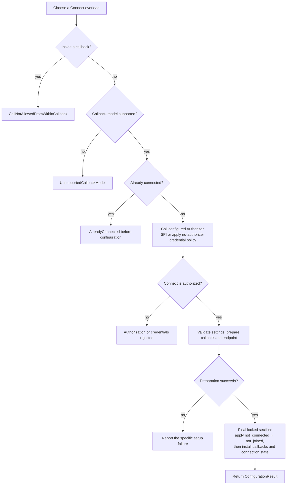
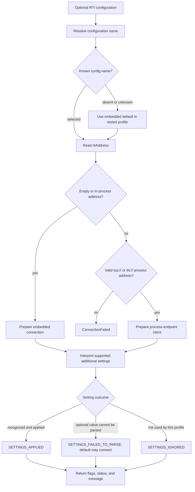
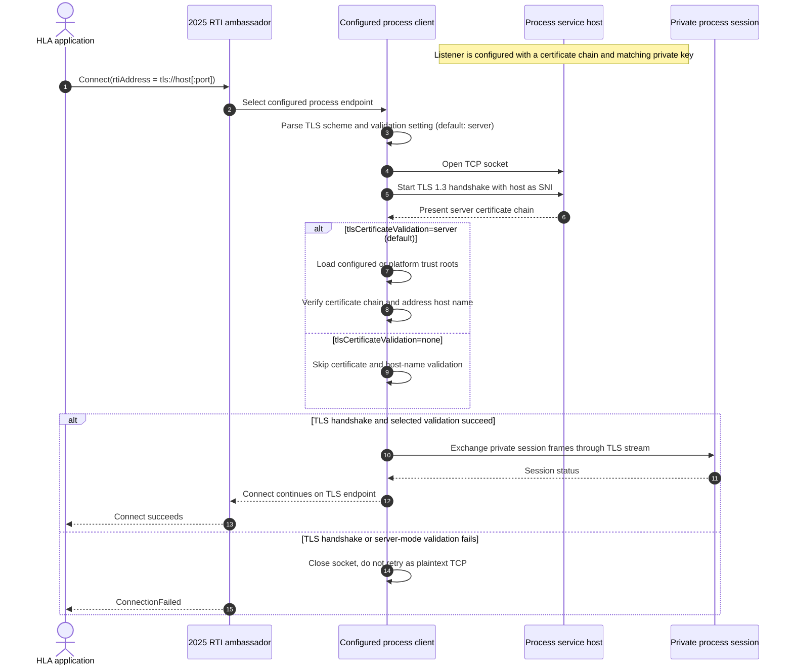
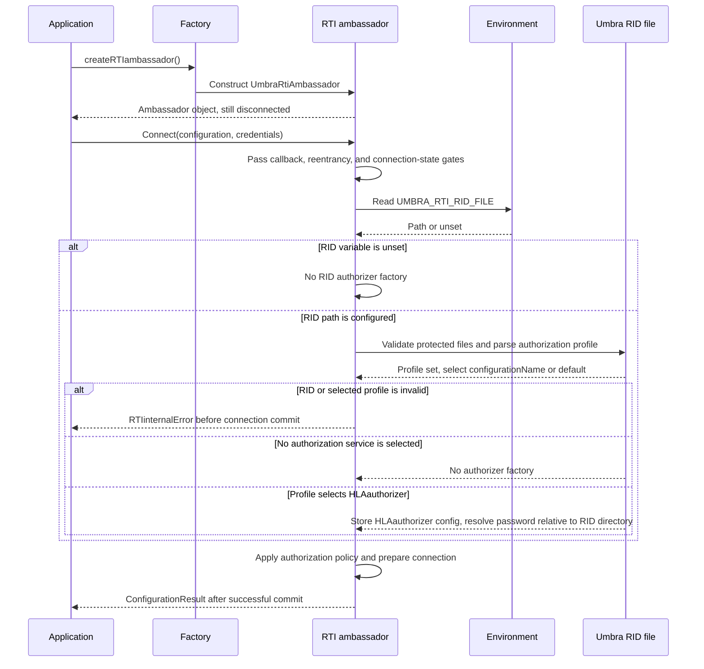
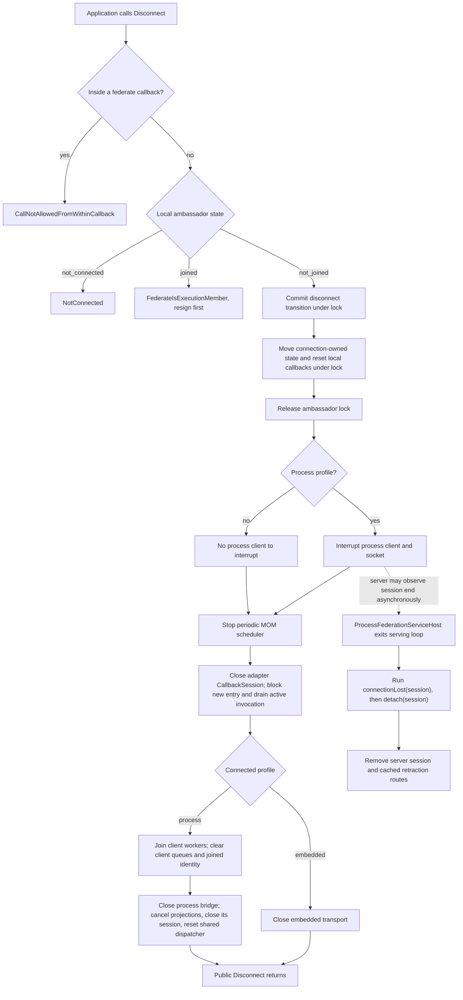
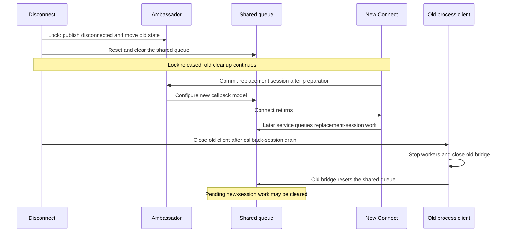

# HLA 1516.1-2025 Connect, Disconnect, and Configuration

This 2025-only companion explains the RTI ambassador's local connection
boundary: factory construction, the four `Connect` overloads, callback-model
and authorization gates, configuration selection, and ordered `Disconnect`
teardown. It does not merge the connection state with federation membership
or federation-execution lifetime.

Keep the [separate 2010 reference-RTI guide](HLA-2010-REFERENCE-RTI-FLOW-GUIDE.md)
separate. All behavior below is grounded in the pinned 2025 API, the 2025
`RTIambassador` implementation, and the cited tests. The official standard is
the normative authority; this guide is explanatory and makes no conformance
claim.

## The short mental model

`Connect` establishes the local RTI-ambassador session; it does not perform
`Join Federation Execution`. A connected ambassador can still be unjoined.
Likewise, `Disconnect` is not a shortcut for `Resign`: the pinned
[§4.3 API declaration](../../third_party/ieee1516.1-2025/include/RTI/RTIambassador.h#L110)
lists `FederateIsExecutionMember` for Disconnect, and Umbra's exercised path
rejects Disconnect while joined. This is a membership boundary, not a claim
that the federation execution itself has ended. The
[federation lifecycle guide's three-lifetime model](HLA-2025-FEDERATION-AND-FEDERATE-LIFECYCLE-FLOW-GUIDE.md#three-lifetimes-not-one)
keeps the ambassador session, federation membership, and execution lifetime
separate; it also records a selected embedded case where the same connected
ambassador rejoins after Resign. Connection loss is a different RTI-initiated
event that also cleans up membership; that path stays in the lifecycle guide.
Its [service precondition comparison](HLA-2025-FEDERATION-AND-FEDERATE-LIFECYCLE-FLOW-GUIDE.md#the-api-distinguishes-connection-failures-from-membership-failures)
also distinguishes connected-but-unjoined federation services from Join and
Resign membership transitions.

The public interface offers four overloads, combining optional
`RtiConfiguration` and `Credentials`. They converge on the same internal
connection preparation path. The chosen callback model is installed on the
connection; callback queueing and service re-entry rules are described in the
[callback/service-ordering guide](HLA-2025-CALLBACK-AND-SERVICE-ORDERING-FLOW-GUIDE.md).

## 1. Connect validates first, prepares, then commits

The ordering matters. The shared Umbra path rejects callback re-entry, then
validates the callback model, then checks whether the ambassador is already
connected. Only after those gates does it evaluate authorization and prepare
caller configuration, callback/session resources, and the selected endpoint.
In a final locked section it repeats the connection-state check, applies the
local `not_connected` → `not_joined` transition, then installs the prepared
callback/session and connection fields before returning. That last ordering is
source-observed Umbra finalization, not a separate HLA-visible protocol step.
In this source path an unsupported callback model therefore takes precedence
over `AlreadyConnected` if both conditions are present. This is observed Umbra
validation order, not a claim about normative exception priority. The
[unsupported-model test](../../cpp/tests/ieee1516_2025_connection_catch2.cpp#L502)
and [AlreadyConnected-before-invalid-settings test](../../cpp/tests/ieee1516_2025_connection_catch2.cpp#L471)
exercise the conditions separately; neither tests that combined-invalid case.

An invalid callback model or rejected credentials do not establish a
connection. When no authorizer is configured, the current implementation
accepts absent credentials and its `HLAnoCredentials` value; other supplied
credentials are rejected as `Unauthorized`. When authorization is configured,
the result maps to `Unauthorized`, `InvalidCredentials`, or an internal error.
That is the Connect gate only. The same credential snapshot also participates
in later Create, Destroy, and Join authorization; see the separate [2025
authorization guide](HLA-2025-AUTHORIZATION-FLOW-GUIDE.md) for those operation
gates and their different exception mappings.

The configured authorizer is an SPI callback to
`Authorizer::authorizeRtiOperation`, not a `FederateAmbassador` callback. In
the inspected 2025 Connect path, that authorization decision precedes
connection commit; the path returns a `ConfigurationResult` or throws to the
Connect caller. I found no Connect branch that invokes an HLA federate
callback, emits `HLAreportException`, or produces an
`HLAreportServiceInvocation` record. This is a source observation, not a
tested absence claim: the focused authorization/Connect cases assert Connect
results and later successful connection, but do not instrument the federate
ambassador or report sinks to assert that no side effect occurred. See the
[Connect implementation](../../cpp/src/internal/runtime/umbra_rti_ambassador_connect_services.cpp#L99),
the [authorization-result mapper](../../cpp/src/internal/runtime/ambassador_connection_support.cpp#L335),
and the [focused authorization cases](../../cpp/tests/ieee1516_2025_authorization_catch2.cpp#L329).

The implementation checks `AlreadyConnected` before parsing configuration,
then checks again while committing under the ambassador lock. The second check
guards the state transition; it is not a second configuration phase. A focused
test verifies that a second `Connect` reports `AlreadyConnected` even when the
new settings point to an unusable service-report path.

## 2. Configuration selects a profile and reports what happened

`RtiConfiguration` carries a configuration name, RTI address, and
additional-settings string. These are separate inputs; do not interpret an
ignored optional setting as a failed connection, or a successful connection
as proof that every requested setting was applied.

The focused fallback test establishes only that absent and unknown
configuration names fall back to the default in the tested embedded profile.
In the embedded federation-management build, an empty or `in-process` address
selects the embedded transport; the configured process route accepts
`tcp://host[:port]` or `tls://host[:port]`. These are Umbra address schemes:
TCP defaults to port 15164 and TLS to port 15165. A malformed address fails
with `ConnectionFailed`. The `tls://` path is traced below.
The result flags and additional-settings status
are independent: for example, an optional malformed FOM-edition value can
produce `SETTINGS_FAILED_TO_PARSE` while Connect still succeeds on the default
2025 model-compatibility path.

### TLS 1.3 secures the configured process endpoint

The process-address scheme selects the transport: `tcp://` uses the current
TCP path, while `tls://` selects TLS 1.3. This is a configured-process profile
detail below the public `Connect` call; the URI scheme, default port, and
certificate-file settings are Umbra-specific and do not change HLA value
encoding or service arguments. By default, the client validates the server's
certificate chain and host name. Umbra's TLS-only additional setting can select
`tlsCertificateValidation=none`; that keeps TLS encryption but skips both
server-certificate and host-name validation, so the peer's identity is not
authenticated. The server loads its own certificate chain and matching private
key but does not request a client certificate, so this is not mutual TLS.

With the default `tlsCertificateValidation=server` mode, the client uses
`UMBRA_RTI_TLS_TRUST_STORE_FILE` when set and otherwise loads the platform's
default trust paths; it verifies the certificate against the parsed address
host as well. The `none` mode skips loading trust roots and disables both
certificate-chain and host-name checks. Both modes still negotiate TLS 1.3 and
send the parsed host as SNI. A malformed or repeated validation setting falls
back to the default server-validation mode and reports an additional-settings
parse failure. These setting names and behaviors are Umbra-specific.

The default process-host option loader reads
`UMBRA_RTI_TLS_CERTIFICATE_CHAIN_FILE` and
`UMBRA_RTI_TLS_PRIVATE_KEY_FILE`, and rejects a half-configured pair. A TLS
listener requires both credentials; a TCP listener rejects TLS credentials.
TLS negotiation completes before the private process-session exchange, and
the inspected Connect path maps client transport setup failures to
`ConnectionFailed`. The source does not fall back to plaintext after a TLS
failure.

The source links below identify the public Connect assertions and private TLS socket/frame cases. This documentation pass did not rebuild or rerun them.

The public successful Connect case[^worktree-source]
uses a generated trusted certificate. The untrusted-peer case[^worktree-source]
reports `ConnectionFailed`, leaves the host running, and reconnects the same
ambassador after its trust store is changed. The trusted-certificate
hostname-mismatch case[^worktree-source]
rejects `127.0.0.1` for a certificate issued only for `localhost`, then
reconnects the same ambassador through `localhost`. The encryption-only
case[^worktree-source] succeeds
with `tlsCertificateValidation=none` despite an unavailable trust-store path
and the certificate name mismatch; the same case confirms an invalid setting
is rejected with `ConnectionFailed` before the valid `none` mode succeeds.
The default TLS port case[^worktree-source]
connects through `tls://127.0.0.1` to port 15165. These are local Umbra-profile
observations, not claims of standard conformance. Private TLS socket
coverage[^worktree-source] negotiates TLS 1.3 and
exchanges bytes; a separate private process-frame
case[^worktree-source] exchanges heartbeat frames
over TLS. This documentation update uses the recorded run; it did not rerun
the build or tests.

The embedded profile accepts the implementation-specific
`federationSaveDirectory=<directory>` token in `RtiConfiguration` additional
settings. When selected, Umbra creates filesystem-backed save commits for the
embedded RTI process; every ambassador that selects a directory must use the
same normalized path, and the setting must be applied before the first
federation is created. Reusing that path in a later RTI process makes the
committed save images available to restore. If omitted, the embedded registry
keeps its process-local in-memory store. This storage choice is an Umbra
extension, not an IEEE 1516.1-2025 conformance requirement.

### Factory construction is not Connect-time profile selection

The standard factory call creates the ambassador object; in Umbra's 2025
binding it does not itself read the RTI Initialization Data file or connect to
an execution. Umbra checks `UMBRA_RTI_RID_FILE` later, during `Connect`, after
the callback, reentrancy, and already-connected gates. The supplied
`RtiConfiguration::configurationName` selects Umbra's authorization profile
(or `default` when absent); `rtiAddress` and `additionalSettings` remain
separate connection inputs. This RID format and environment variable are
Umbra-specific, not standard-defined configuration behavior.

The factory-to-RID test is listed in the [authorization guide](HLA-2025-AUTHORIZATION-FLOW-GUIDE.md).
Its last focused run failed while creating the temporary RID test file, before
its profile-selection assertions; the sequence above is therefore a
source-grounded flow, not a passing test result. The authorization guide owns
the credential-to-exception mapping and the no-authorizer credential branch.

The internal `fomEdition=2010` option selects legacy-model compatibility under
the 2025 ambassador. It does not select the separate 2010 RTI implementation
and does not establish behavioral parity with that stream. Keep any 2010
reference-RTI explanation in its own guide.

## 3. Disconnect requires an unjoined connection and tears down in order

The public Disconnect operation is not a shortcut for resignation. Umbra
rejects it while the ambassador is joined. After the local transition succeeds,
connection-owned state is moved out and reset under the lock; scheduler and
callback/transport shutdown happen after leaving that critical section.

The adapter `CallbackSession` is closed outside the ambassador lock so an
external callback already in flight can finish without deadlocking on a
reentrant RTI call. `CallbackSession::close` marks the session closed before
waiting, so new invocations cannot begin; its same-session path avoids waiting
on itself. In the process profile, Disconnect first interrupts the client and
socket, then closes the adapter session, and finally calls client `close`.
Client close joins its workers, clears pending events and joined identity, and
closes the process bridge outside the transaction lock. The bridge cancels
pre-callback projections, closes its callback session, and resets the shared
dispatcher. Do not treat those two callback objects as one teardown step.

For a sequential Disconnect followed by Connect, Disconnect completes this
cleanup before it returns, so the next Connect installs a fresh callback session
after the old process client has closed. The configured-process public lifecycle
case exercises one Connect/Disconnect with no queued callback; the focused
same-ambassador Disconnect/reconnect case uses the embedded profile. Concurrent
Connect and Disconnect are a separate, unverified interleaving: Disconnect
publishes `not_connected` under the ambassador lock, then performs callback and
client shutdown outside it. A concurrent Connect can commit a new session
before the old process bridge closes. The old bridge still references the
ambassador's shared dispatcher, so its final reset can clear pending work from
the replacement session. Neither a focused test nor the pinned API establishes
this interleaving's behavior or whether concurrent calls are supported.

### Possible process reconnect during off-lock Disconnect cleanup

This sequence isolates the source-level overlap. The new Connect can commit
after Disconnect releases the lifecycle lock but before it finishes draining
the old callback session and closing the old process client. If the replacement
session queues callback work in that window, closing the old bridge resets the
same dispatcher and clears its pending queue. This is a possible source-derived
interleaving, not an observed test result or an HLA concurrency guarantee.

The [Disconnect transition and off-lock cleanup](../../cpp/src/internal/runtime/umbra_rti_ambassador.cpp#L2524)
move and reset connection-owned state before the old process client is closed
at [this call site](../../cpp/src/internal/runtime/umbra_rti_ambassador.cpp#L2596).
Connect attaches the process bridge to the shared dispatcher at
[preparation](../../cpp/src/internal/runtime/umbra_rti_ambassador_connect_services.cpp#L254)
and installs the replacement session at
[commit](../../cpp/src/internal/runtime/umbra_rti_ambassador_connect_services.cpp#L266).
The old [client close](https://github.com/sheepfling/umbra/blob/c9c5a9e410539b039cd8bba35b53d0ef2b24d180/cpp/src/internal/federation/process_federation_client_callback_dispatch.cpp#L647)
closes its bridge, whose [cleanup](../../cpp/src/internal/federation/process_federation_callback_bridge.cpp#L2403)
calls [dispatcher reset](../../cpp/src/internal/callbacks/callback_dispatcher.cpp#L110),
which clears pending tasks. The process Connect/Disconnect case has no queued
callback ([test](../../cpp/tests/ieee1516_2025_connection_catch2.cpp#L54));
same-ambassador reconnect is covered only in the embedded profile
([test](../../cpp/tests/ieee1516_2025_connection_catch2.cpp#L542)). The pinned
[RTIambassador API](../../third_party/ieee1516.1-2025/include/RTI/RTIambassador.h#L46)
does not state a general thread-safety contract. This source trace leaves both
the race outcome and normative support for concurrent calls unresolved.

Server-side `ProcessFederationService::detach` is another boundary, not a
Disconnect request sent by the RTI ambassador. In the process profile, public
Disconnect calls `ProcessFederationClient::close`; it sends no Disconnect
service message and does not wait for a remote host worker. The client closes
its socket locally. In the included `ProcessFederationServiceHost` implementation,
the serving loop handles session exit by calling `connectionLost(session)` and
then `detach(session)`. `detach` removes the server session and cached
pushed-retraction routes; it does not itself resign a federate. Thus the source
shows a server-side cleanup path after the transport session ends, but not that
public `Disconnect` waits for that cleanup to finish. A bounded repository-wide
symbol search found the host constructed by focused tests, not by a
non-test server launcher in this checkout.

The configured process-endpoint lifecycle test uses its own server fixture and
calls `detach` explicitly after serving its planned requests; it does not test
the host's automatic cleanup path. A separate host integration test exercises
public Connect/Disconnect followed by host shutdown, but does not assert server
session removal or its timing. These are source and scenario observations, not
process/embedded parity evidence.
Connection loss remains a separate forced-resignation path; see the lifecycle
guide rather than inferring it from this voluntary Disconnect sequence.

## What Umbra currently demonstrates

- Tests exercise all four official overload combinations and verify that an
  unsupported callback model leaves the ambassador connectable.
- The embedded tests cover credential rejection when authorization is
  disabled, successful retry after selected setup failures, applied and
  ignored configuration results, and the early `AlreadyConnected` guard.
- A malformed process address is rejected before connection; absent and
  unknown configuration names fall back only in the tested embedded profile.
- Disconnect rejects an absent connection in Umbra's implementation, rejects
  a joined ambassador until it resigns, and succeeds from the unjoined state.
- The selected callback dispatch model is installed at Connect. Details of
  callback queuing, disable/enable behavior, and service-call ordering remain
  in the callback/service-ordering guide.

## Evidence and source map

Normative/API references:

- The pinned [IEEE 1516.1-2025 RTIambassador API](../../third_party/ieee1516.1-2025/include/RTI/RTIambassador.h#L50)
  declares Connect in 4.2 and Disconnect in 4.3. The [official standard page](https://standards.ieee.org/ieee/1516.1/6688/)
  is the normative source; verify clause text there before making conformance claims.
- [RtiConfiguration](../../third_party/ieee1516.1-2025/include/RTI/RtiConfiguration.h#L11),
  [callback and additional-settings enums](../../third_party/ieee1516.1-2025/include/RTI/Enums.h#L12),
  and [ConfigurationResult](../../third_party/ieee1516.1-2025/include/RTI/Typedefs.h#L62)
  define the public configuration inputs and result fields.
- The pinned [RTIambassadorFactory API](../../third_party/ieee1516.1-2025/include/RTI/RTIambassadorFactory.h#L34)
  defines `createRTIambassador` in §10.35; the RID selection described here is
  Umbra-specific and occurs later, at Connect.

Umbra implementation:

- [Connect overloads and shared preparation/commit path](../../cpp/src/internal/runtime/umbra_rti_ambassador_connect_services.cpp#L29)
- [Factory construction](../../cpp/src/ieee1516_2025_binding_shell.cpp#L142),
  [Connect-time RID lookup](../../cpp/src/internal/runtime/umbra_rti_ambassador_connect_services.cpp#L99),
  [RID profile parsing](../../cpp/src/internal/runtime/rti_initialization_data.cpp#L157),
  and [RID profile selection](https://github.com/sheepfling/umbra/blob/c9c5a9e410539b039cd8bba35b53d0ef2b24d180/cpp/src/internal/runtime/rti_initialization_data.cpp#L183)
- [Callback-model validation](../../cpp/src/internal/runtime/ambassador_connection_support.cpp#L88),
  [process-endpoint address selection and validation](../../cpp/src/internal/runtime/ambassador_connection_support.cpp#L102),
  [no-authorizer credential policy](../../cpp/src/internal/runtime/ambassador_connection_support.cpp#L187),
  and [configured authorizer result mapping](../../cpp/src/internal/runtime/ambassador_connection_support.cpp#L197)
- [TLS address scheme, defaults, and optional client trust-store selection](../../cpp/src/internal/runtime/ambassador_connection_support.cpp#L103),
  TLS 1.3 client peer verification and trust roots[^worktree-source],
  client SNI[^worktree-source],
  certificate host-name verification[^worktree-source],
  TLS 1.3 server credentials[^worktree-source],
  and [default process-host certificate/key configuration](../../cpp/src/internal/federation/process_federation_service_host.cpp#L42)
- [Process client TLS setup before private session frames](../../cpp/src/internal/federation/process_transport.cpp#L253),
  TLS listener credential consistency[^worktree-source]
  and server-side TLS handshake[^worktree-source],
  no-plaintext-fallback stream contract[^worktree-source],
  and [Connect maps transport setup errors to `ConnectionFailed`](../../cpp/src/internal/runtime/umbra_rti_ambassador_connect_services.cpp#L266)
- [Service-report directory setting](https://github.com/sheepfling/umbra/blob/c9c5a9e410539b039cd8bba35b53d0ef2b24d180/cpp/src/internal/runtime/ambassador_connection_support.cpp#L224),
  [federation save-directory setting](https://github.com/sheepfling/umbra/blob/c9c5a9e410539b039cd8bba35b53d0ef2b24d180/cpp/src/internal/runtime/ambassador_connection_support.cpp#L264),
  and [2025-default FOM-edition parsing](https://github.com/sheepfling/umbra/blob/c9c5a9e410539b039cd8bba35b53d0ef2b24d180/cpp/src/internal/runtime/ambassador_connection_support.cpp#L296)
- [Disconnect preconditions and post-lock cleanup](../../cpp/src/internal/runtime/umbra_rti_ambassador.cpp#L2524)
- [Callback-session close and in-flight invocation wait](../../cpp/src/internal/callbacks/callback_session.cpp#L35)
 - Process client teardown: `close()`[^worktree-source] interrupts the active and recovery-attempt
   connections, joins the stream-reader, heartbeat, and callback-dispatch threads,
   clears the client queues, then closes the bridge. [Bridge cleanup](../../cpp/src/internal/federation/process_federation_callback_bridge.cpp#L2403)
   cancels pending tasks and resets the shared dispatcher ([dispatcher reset semantics](../../cpp/src/internal/callbacks/callback_dispatcher.cpp#L110)).
- [Connect installs a callback session and replaces a retained process client](../../cpp/src/internal/runtime/umbra_rti_ambassador_connect_services.cpp#L263)
- [Process transport service-operation enum](../../cpp/src/internal/federation/transport_service_protocol.hpp#L21); it has no public Disconnect request operation.
- [Process service Detach contract](../../cpp/src/internal/federation/process_federation_service.hpp#L150) and [server-session/retraction-route cleanup](../../cpp/src/internal/federation/process_federation_service.cpp#L115)
- Process-session recovery is private transport behavior. A disconnected worker marks its session inactive; the host keeps it resumable until `RTI_TIMEOUT_PURGE`, then applies connection-loss handling and calls `Detach` on success (worker and resume path[^worktree-source], inactive-session retention and purge[^worktree-source]).
- An invalid resume takes a separate terminal cleanup path (terminal cleanup[^worktree-source]); host shutdown drains the remaining sessions through its own loss-and-detach path ([shutdown cleanup](../../cpp/src/internal/federation/process_federation_service_host.cpp#L170)).
- [Local lifecycle transitions](../../cpp/src/internal/federation/federate_lifecycle.cpp#L9)

Focused tests (citations identify scenario evidence; see the factory/RID run
result above):

- [All four Connect overloads](../../cpp/tests/ieee1516_2025_connection_catch2.cpp#L337)
- [Factory-created ambassador and named/default RID authorization profiles](../../cpp/tests/ieee1516_2025_authorization_catch2.cpp#L370)
- [Credentials rejected when authorization is disabled](../../cpp/tests/ieee1516_2025_connection_catch2.cpp#L371)
- [Applied service-report configuration](../../cpp/tests/ieee1516_2025_connection_catch2.cpp#L398)
- [Invalid-path failure leaves the ambassador connectable](../../cpp/tests/ieee1516_2025_connection_catch2.cpp#L446)
- [AlreadyConnected checked before invalid configuration](../../cpp/tests/ieee1516_2025_connection_catch2.cpp#L471)
- [Unsupported callback model](../../cpp/tests/ieee1516_2025_connection_catch2.cpp#L502)
- [Absent Disconnect](../../cpp/tests/ieee1516_2025_connection_catch2.cpp#L513)
- [Disconnect rejected while joined](../../cpp/tests/ieee1516_2025_federation_resign_lifecycle_catch2.cpp#L51)
- [Absent/unknown configuration fallback](../../cpp/tests/ieee1516_2025_connection_configuration_fallback_catch2.cpp#L459)
- [Optional setting parse failure with successful Connect](../../cpp/tests/ieee1516_2025_connection_configuration_additional_settings_catch2.cpp#L459)
- [Malformed process address rejected before connection](../../cpp/tests/ieee1516_2025_connection_address_validation_catch2.cpp#L457)
- [Successful configured TCP process-endpoint Connect and Disconnect, without callback-queue assertions](../../cpp/tests/ieee1516_2025_connection_catch2.cpp#L54)
- 2025 public Connect over the configured TLS 1.3 process endpoint[^worktree-source]
- Untrusted TLS peer rejection and same-ambassador recovery[^worktree-source]
- Trusted-certificate host-name mismatch and recovery[^worktree-source]
- TLS encryption-only mode and invalid-mode rejection[^worktree-source]
- Configured default TLS port 15165[^worktree-source]
- Private TLS socket handshake and byte-stream round trip[^worktree-source]
- Private process-frame round trip over authenticated TLS 1.3[^worktree-source]
- [Same-ambassador Disconnect/reconnect in the embedded profile](../../cpp/tests/ieee1516_2025_connection_catch2.cpp#L542)
- [Public process-endpoint lifecycle through Resign and Disconnect; server fixture calls Detach separately](../../cpp/tests/ieee1516_2025_connection_catch2.cpp#L111)
- Process service host clients Connect and Disconnect before host shutdown; cleanup state/timing is not asserted[^worktree-source]
- [CallbackSession close drains an external in-flight invocation](../../cpp/tests/callback_dispatcher_catch2.cpp#L375)

## Known gaps and boundaries

- Most focused connection and cleanup assertions exercise the embedded
  profile. The host implementation calls `connectionLost` and `detach` after a
  serving loop ends, but the configured process-endpoint lifecycle fixture calls
  `detach` explicitly and the separate host test does not assert cleanup state
  or timing. No non-test host construction/launcher was found in this checkout.
  The sources and tests therefore do not prove that public Disconnect waits for
  server cleanup or establish full process/embedded equivalence for
  configuration, callback shutdown, or error mapping.
- Umbra's source and test report `NotConnected` when Disconnect is called on an
  absent connection, but the pinned `RTIambassador.h` 4.3 `@throws` list does
  not include that exception. Treat this as an API/source discrepancy to
  compare with the full 2025 normative clause, not as a conformance conclusion.
- The four overloads have focused coverage, but this guide does not claim that
  every overload has an independent test for every authorization, endpoint,
  malformed-setting, allocation, or callback race.
- The recorded focused TLS run covers five public cases and two private
  foundation cases, three repetitions each. It includes untrusted-certificate
  and host-name-mismatch rejection with same-ambassador recovery,
  encryption-only mode, invalid-mode rejection, and Umbra's default TLS port
  15165. The exact normative scope of §12.13.5 remains unverified against
  authorized clause text. Do not treat Umbra's `tls://` URI, port,
  environment-variable names, or single-sided certificate validation as
  standard-defined behavior, and do not infer 2010 parity.
- This guide covers the 2025 binding only. The 2010 reference RTI, its
  connection code, and its callback semantics remain in the separate 2010
  profile; a 2025 `fomEdition=2010` compatibility setting is not evidence about
  that implementation.

The process-host cleanup chart has been rendered and visually reviewed locally.
It is tall but readable while scrolling, and it keeps public Disconnect return
separate from the host's later session cleanup. GitHub presentation remains
unverified; track publication review in the
[behavior-flow guide backlog](HLA-BEHAVIOR-FLOW-GUIDES.md).

[^worktree-source]: Source/test citations marked in this guide refer to current-worktree changes absent from the hosted base; those files are excluded from the documentation-only publication path set. The [hosted source-dependency audit](HLA-2025-HOSTED-SOURCE-DEPENDENCIES.json) records the exact paths, lines, and status.
