# HLA 2025: A Cross-Cutting Model of State, Events, and Observation

This guide offers a portable way to reason about HLA behavior while reading a
service contract or an RTI implementation. It synthesizes questions that recur
across many services; it is not an additional state machine, a replacement for
IEEE 1516.1-2025, or a description of Umbra's internal architecture.

## Scope and authority

- **Edition boundary:** the examples and linked evidence are IEEE
  1516.1-2025 only. The 2010 API and runtime remain a separate behavior stream;
  this guide makes no 2010 equivalence claim.
- **Portable lens:** the diagrams describe questions to ask of an HLA behavior,
  not a required RTI component topology or universal order of internal steps.
  A conforming RTI may realize the same service contract differently.
- **Normative authority:** the [official IEEE 1516.1-2025 Federate Interface
  Specification](https://standards.ieee.org/ieee/1516.1/6688/) defines the
  standard RTI services and interfaces. This guide supplies no new requirement
  interpretation or clause mapping; check the exact service clauses in an
  authorized copy.
- **Evidence boundary:** the neighboring guides cite Umbra source and focused
  scenarios as implementation evidence. Those examples illustrate the lens;
  they do not establish complete support, cross-profile equivalence, or
  conformance.

IEEE describes the HLA as a common framework for interconnecting simulations,
with the Federate Interface Specification defining RTI services used for
coordinated exchange among federation participants. The useful teaching
consequence is to follow not only *what data was sent*, but also *which state
changed, which participant became eligible, and when the application could
observe the effect*.

## One behavior, four different questions

Do not treat “the operation worked” as one milestone. Trace these lenses
separately, then connect them only where the service contract or evidence does
so:

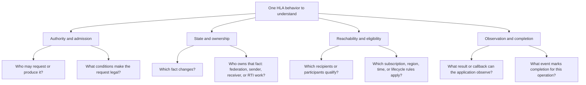

These are analysis dimensions, not a mandated four-stage protocol. A service
may affect only one dimension, branch into several effects, or defer a visible
effect while its underlying state is already committed. Always use the
operation-specific contract to establish its real order and completion point.

## Keep state, pending work, and observation distinct

An implementation often makes these differences concrete, but the reasoning
does not depend on Umbra's classes, queues, threads, or transport. Use this
sketch to keep the *kinds of facts* separate while reading a flow; it is not a
claim that an RTI must have these internal boxes:

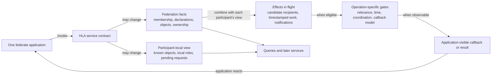

The boxes are a reading aid, not mandatory storage locations or a single
universal timeline. Some operations have no remote recipient; some produce
multiple per-recipient effects; some callbacks report a transition rather than
carry data; and some effects are gated by logical time or federation-wide
coordination. A callback can also be queued without yet being visible to user
code. Identify those details in the guide for the specific service.

## A federation model defines vocabulary; services create live state

The FOM and the running federation answer different questions. A composed
federation model supplies the object classes, attributes, interaction classes,
parameters, and data types that services can refer to. It does not, by itself,
publish a class, subscribe a federate, register an object instance, or make a
receiver know that instance. Those are separate runtime facts created by
federates' service calls and RTI effects.

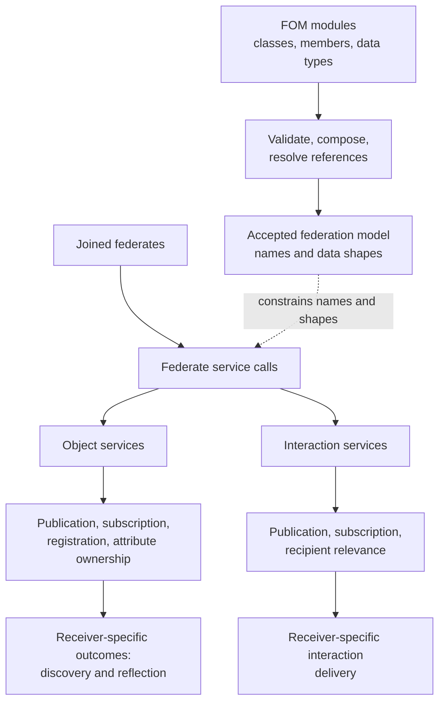

This is a relationship map, not a universal call sequence or a claim about an
RTI's internal topology. The object-service box groups related facts rather
than prescribing their order; publication is a registration precondition in
the linked 2025 service evidence. Registration is not discovery: discovery is
receiver-local knowledge and may become eligible after a later declaration
change. Interaction delivery is a separate path and does not depend on
object-instance knowledge. Exact active/passive, class-hierarchy, region,
time, and callback rules remain service-specific; do not infer them from this
overview.

The 2025 [FOM admission and composition guide's implementation/test evidence](HLA-2025-FOM-MODULE-ADMISSION-AND-COMPOSITION-FLOW-GUIDE.md#implementation-and-focused-evidence)
traces module validation through model composition and marks the limits of
selected source and focused-test evidence. The [object and interaction
guide's implementation/test evidence](HLA-2025-OBJECT-AND-INTERACTION-INFORMATION-FLOW-GUIDE.md#evidence-map-implementation-versus-exercised-scenarios)
then traces publication, subscription, registration, discovery, and delivery
with its own implementation/test evidence and profile boundaries. Read those
guides for the service-specific transitions; this synthesis adds no new
normative rule and makes no 2010 equivalence claim.

## A class hierarchy does not imply one inheritance rule

An object-class tree and an interaction-class tree are separate model
hierarchies. Even within one tree, lookup, declaration mutation, recipient
matching, and value projection answer different questions. This comparison
map summarizes selected 2025 embedded behavior; it is not a universal
inheritance algorithm or a substitute for the service-specific standard text.

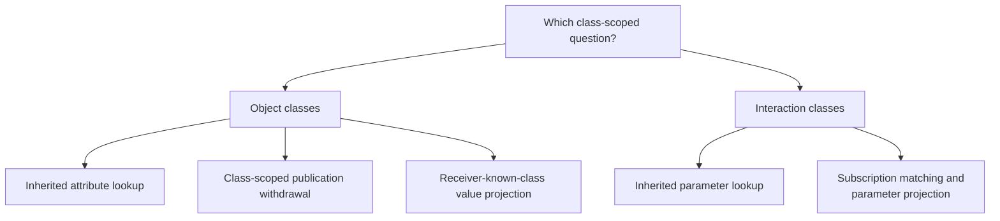

The chart names separate questions, not one inheritance algorithm. An object
child-class handle can look up an inherited base attribute. In selected 2025
embedded evidence, withdrawing publication for one whole class changes that
class's declaration while a separately published base class can remain. On
the selected embedded receive-order update path, projection depends on the
receiver-known class, so a base-known receiver does not receive child-only
attributes. On the interaction side, a child-class handle can look up an
inherited parameter; for the selected embedded ordinary receive-order path,
matching uses receiver subscriptions and the resolver selects the closest
eligible class for parameter projection. That last multi-level selection is
established by current source, not by the focused planning test, which gives
hierarchy matches to separate receivers. Exact normative semantics remain
with IEEE 1516.1-2025; no process-endpoint or 2010 parity is inferred. See the
[name/handle guide](HLA-2025-NAME-AND-HANDLE-RESOLUTION-FLOW-GUIDE.md#3-class-scoped-names-follow-the-declared-hierarchy),
[object publication and projection sections](HLA-2025-OBJECT-AND-INTERACTION-INFORMATION-FLOW-GUIDE.md#publication-withdrawal-is-also-an-ownership-boundary),
and [interaction class-matching section](HLA-2025-OBJECT-AND-INTERACTION-INFORMATION-FLOW-GUIDE.md#interaction-path-class-subscription-parameter-projection-callback)
for source and test pointers.

## A support switch has an owner, a lifetime, and a control surface

Do not infer a switch's scope or mutability from its name. For each 2025
support switch, ask where its value comes from, whether the API exposes a
setter, when it is established, and whose later behavior it can affect. The
same interface includes static federation policy, a federation-wide value
with a MOM change path in this Umbra profile, FDD-provided defaults that seed
each member, and member-local switches that an application can change:

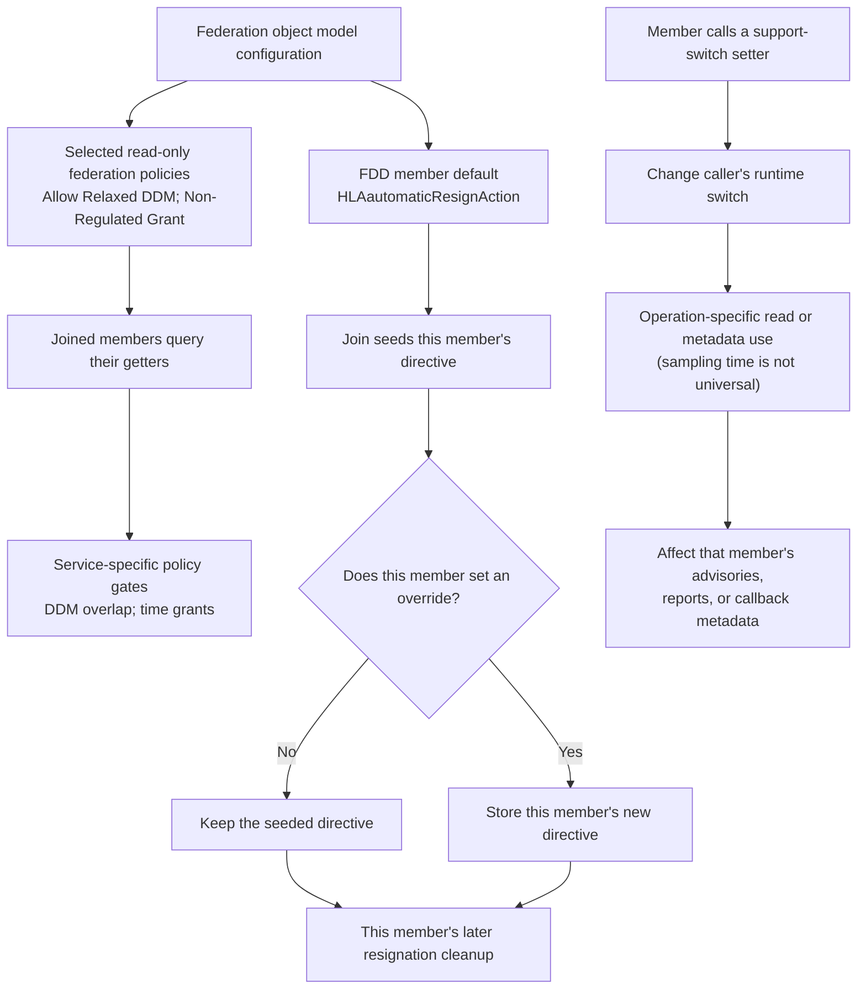

The map is a way to classify interfaces, not a claim that every setting named
“switch” has one universal ownership rule. The pinned 2025 API exposes only
getters for `getAllowRelaxedDDMSwitch()` and `getNonRegulatedGrantSwitch()`;
the same API has setters for controls such as
`setConveyRegionDesignatorSetsSwitch()` and
`setAutomaticResignDirective()`. The automatic-resign value is a useful
intermediate case: FDD configuration seeds each joining member, then a member
may override its own directive. Read the operation-specific guides for the
actual consequence, rather than assuming all values affect all federates or
all services alike.

| Control surface | Selected 2025 example | Reader path and evidence boundary |
| --- | --- | --- |
| Static federation policy, getter only | `Advisories Use Known Class`, `Delay Subscription Evaluation`, `Allow Relaxed DDM`, and `Non-Regulated Grant` | The RTIambassador exposes getters but no setters for these four switches; the 2025 MIM marks each corresponding attribute `Static` ([API](../../third_party/ieee1516.1-2025/include/RTI/RTIambassador.h#L2228), [MIM](../../third_party/ieee1516.2-2025/resources/mim/HLAstandardMIM-2025.xml#L845)). See the [relevance](HLA-2025-RELEVANCE-ADVISORY-FLOW-GUIDE.md), [DSE](HLA-2025-DELAY-SUBSCRIPTION-EVALUATION-FLOW-GUIDE.md), [DDM](RELAXED-DDM-POLICY.md), and [time](HLA-2025-TIME-MANAGEMENT-GUIDE.md#grant-decision-flow) guides for their distinct effects. The embedded NRG case is not a universal FDD-merge rule. |
| Federation-wide value, changed through federation MOM in this Umbra profile | Auto Provide | The API exposes [`getAutoProvideSwitch()`](../../third_party/ieee1516.1-2025/include/RTI/RTIambassador.h#L2218); the MIM describes `HLAautoProvide` as federation-wide and `Conditional` ([MIM](../../third_party/ieee1516.2-2025/resources/mim/HLAstandardMIM-2025.xml#L833)). Umbra's embedded federation `HLAsetSwitches` path changes it; see the [Auto Provide](HLA-2025-AUTO-PROVIDE-FLOW-GUIDE.md#switch-state-is-federation-wide) and [federation MOM](HLA-2025-FEDERATION-MOM-FLOW-GUIDE.md#creation-time-federation-policy-versus-per-member-switch-seeding) guides. This is not a member-local setter and does not establish process or 2010 parity. |
| FDD-seeded, then member-overridable | `HLAautomaticResignAction` / `getAutomaticResignDirective()` | The [membership path](../../cpp/src/internal/federation/federation_registry_membership_lifecycle.cpp#L389) seeds the joining member; the [lifecycle guide](HLA-2025-FEDERATION-AND-FEDERATE-LIFECYCLE-FLOW-GUIDE.md#the-automatic-directive-is-seeded-per-member-then-overridden-per-member) traces the cleanup effect. The focused [support-switch scenario](../../cpp/tests/support_switch_state_catch2.cpp#L4) changes one member's directive and observes the peer's value remain unchanged. |
| Member-local direct RTIambassador setter, embedded path | `ConveyRegionDesignatorSets`, service/exception reporting, and object-class/interaction relevance | The API declares member-facing setters ([support/reporting](../../third_party/ieee1516.1-2025/include/RTI/RTIambassador.h#L2125), [object-class relevance](../../third_party/ieee1516.1-2025/include/RTI/RTIambassador.h#L2045), [interaction relevance](../../third_party/ieee1516.1-2025/include/RTI/RTIambassador.h#L2105)); the focused [support-switch scenario](../../cpp/tests/support_switch_state_catch2.cpp#L4) exercises peer isolation. The relevance setters use the embedded registry and plan Conditional MOM updates ([object-class](../../cpp/src/internal/runtime/umbra_rti_ambassador_advisory_switches.cpp#L212), [interaction](../../cpp/src/internal/runtime/umbra_rti_ambassador_advisory_switches.cpp#L466)); focused reflection cases cover both ([object-class](../../cpp/tests/ieee1516_2025_joined_federate_mom_conditional_reflections_catch2.cpp#L326), [interaction](../../cpp/tests/ieee1516_2025_joined_federate_mom_conditional_reflections_catch2.cpp#L338)). The [DDM guide](HLA-2025-DATA-DISTRIBUTION-AND-REGIONS-FLOW-GUIDE.md) shows the callback-metadata effect; the [exception](HLA-2025-EXCEPTION-REPORTING-FLOW-GUIDE.md) and [service-reporting](HLA-2025-SERVICE-INVOCATION-REPORTING-FLOW-GUIDE.md) guides own their routes. |
| Member-local values changed through process Federate MOM | Object-class and interaction-relevance advisory | In the selected process endpoint path, `HLAsetSwitches` stores these values on the member and public getters read them back. That is distinct from automatic Conditional MOM reflection: this handler does not enqueue reflection for these fields, while an explicit value-update request can return their current projection. See the [Federation MOM trace](HLA-2025-FEDERATION-MOM-FLOW-GUIDE.md#switch-storage-current-mom-projection-and-conditional-reflection-are-separate) and its focused [process test](../../cpp/tests/ieee1516_2025_connection_process_mom_set_switches_catch2.cpp#L349). This is source/test evidence for that path, not a 2010 or backend-parity claim. |

### Control scope does not determine sampling time

The portable reading question is not only who controls a value and whose state
it belongs to, but which service contract consumes it and when that service's
result becomes observable. Ownership or a setter call alone does not establish
whether already-pending work is reconsidered. The following are bounded
2025 embedded examples, not universal HLA switch-timing rules:

- In the focused Non-Regulated Grant case, the federation value is established
  at creation and consulted by the grant-eligibility path when GALT is
  undefined. Joining later with an additional module neither changes the
  queried value nor releases the already-pending TAR. See the
  [time-management rule map](HLA-2025-TIME-MANAGEMENT-GUIDE.md#grant-decision-flow)
  and [focused scenario](../../cpp/tests/ieee1516_2025_non_regulated_grant_switch_catch2.cpp#L4).
- The automatic-resign default is copied into each member at Join; after a
  member override, the connection-loss path reads that member's current
  directive when handling the loss. The
  [lifecycle sequence](HLA-2025-FEDERATION-AND-FEDERATE-LIFECYCLE-FLOW-GUIDE.md#the-automatic-directive-is-seeded-per-member-then-overridden-per-member)
  keeps this distinct from the later cleanup and callback effects.
- Member-local controls have their own consumer boundaries: the service-report
  writer checks the subject's reporting configuration, exception-report
  planning checks the reported member's switch, and the DDM path uses
  `ConveyRegionDesignatorSets` for callback metadata without changing overlap
  routing. Follow the [service-reporting](HLA-2025-SERVICE-INVOCATION-REPORTING-FLOW-GUIDE.md),
  [exception-reporting](HLA-2025-EXCEPTION-REPORTING-FLOW-GUIDE.md), and
  [DDM](HLA-2025-DATA-DISTRIBUTION-AND-REGIONS-FLOW-GUIDE.md) guides for those
  operation-specific boundaries.

Use each service's contract to ask what happens to accepted or pending work
and which callback, query, or later service makes an effect observable. These
case studies show how to locate that boundary; they do not establish a general
retroactivity rule or 2010/process parity.

### A saved value is a separate question from who controls it

Save/restore adds another boundary to the control-surface map: where an RTI
records a value, and which state object receives it on restore. In Umbra's
2025 embedded state-image path, selected federation policy bits are captured
in the federation record, while selected runtime switches and the
automatic-resign directive are captured in each member record. Restore
reapplies those federation fields and applies a member record only after
finding a live member with matching saved identity metadata:

| State-image scope | Selected captured values | Restore destination |
| --- | --- | --- |
| Federation | Includes `Non-Regulated Grant` and `Allow Relaxed DDM` among federation control bits ([capture](../../cpp/src/internal/federation/federation_registry_state_image_capture.cpp#L58)) | Federation control fields ([restore](../../cpp/src/internal/federation/federation_registry_state_image_restore.cpp#L56)) |
| Member | Selected member-switch bits and `automaticResignAction` ([capture](../../cpp/src/internal/federation/federation_registry_state_image_capture.cpp#L108)) | The matching live member's fields; a missing or mismatched member is rejected by this path ([restore](../../cpp/src/internal/federation/federation_registry_state_image_restore.cpp#L87)) |

This is an implementation map, not a portable HLA persistence rule. A bounded
search of the save/restore and state-image codec tests found no focused
assertion that these particular public getters return the captured values
after restore. Keep three questions distinct in any HLA explanation: who may
control a value, how one RTI stores it, and what the standard requires an
application to observe after restore. The [save/restore guide](HLA-2025-FEDERATION-SAVE-RESTORE-FLOW-GUIDE.md)
covers the wider protocol and its separate evidence limits.

The reusable HLA reading lesson is to track **authority, scope, and sampling
time** separately: a model-provided policy, a default copied at Join, and a
member's runtime choice are not interchangeable just because each is called a
switch. These examples are selected 2025 embedded evidence except where a
process endpoint route is explicitly identified above. They make no 2010 or
universal switch-lifetime claim; check the exact IEEE clause for a normative
interpretation.

## Keep delivery and observation questions separate

Questions about a sent value often get compressed into “how is it delivered?”
That hides several independent decisions. Separate sender declarations,
instance-level authority, receiver-side questions, message properties, and
application observation. A value for one axis does not answer the others.

| Axis | Question it answers | It does not, by itself, establish |
| --- | --- | --- |
| Publication declaration | Has the federate declared publication for the relevant object attribute or interaction class? | Ownership of a particular object-instance attribute or receiver relevance. |
| Attribute ownership | Does the sender own each object-instance attribute it is updating? | The publication declaration or which receivers are relevant. This question does not apply to an interaction send. |
| Recipient relevance | Which federates or objects qualify under this service's subscription, target, and DDM rules? | Whether a qualifying TSO event is time-eligible or whether an object receiver currently knows the instance. |
| Object-instance knowledge | For an object service, does this receiver know the relevant instance? | Current subscription, regional match, or eligibility for every attribute value. |
| Order type | Is the information receive-order or timestamp-order? | Which transportation category applies, or whether a TSO event is time-eligible now. |
| Transportation type | Which FOM-declared category is associated with the published attribute or interaction? | Order, recipient selection, or a particular physical-network protocol or guarantee. |
| Time eligibility | For a time-managed/TSO path, do the current grant and queue rules permit delivery now? | Sender publication, receiver relevance, or callback entry. |
| Callback observation | When does this federate's application enter callback code under its callback model? | Service legality, recipient selection, message order, or transportation. |

These are questions, not a fixed pipeline; each service contract determines
which ones apply and their relevant ordering. In particular, publication and
instance ownership are distinct producer-side facts, while receiver knowledge
is distinct from interest or value eligibility. An interaction has no object
instance and therefore no per-instance attribute ownership or known-object
state. The [object/interaction guide](HLA-2025-OBJECT-AND-INTERACTION-INFORMATION-FLOW-GUIDE.md#start-with-five-distinct-questions)
and [attribute-ownership guide](HLA-2025-ATTRIBUTE-OWNERSHIP-FLOW-GUIDE.md)
trace those distinctions without collapsing their state machines.

To follow the independent time, message, region, and observation boundaries,
use the TSO grant/queue model in the
[time-management guide](HLA-2025-TIME-MANAGEMENT-GUIDE.md), sender-selected
order and transportation lifetimes in the
[order and transportation guide](HLA-2025-ORDER-AND-TRANSPORTATION-FLOW-GUIDE.md),
recipient selection in the [DDM guide](HLA-2025-DATA-DISTRIBUTION-AND-REGIONS-FLOW-GUIDE.md),
and application callback dispatch in the
[callback/service-ordering guide](HLA-2025-CALLBACK-AND-SERVICE-ORDERING-FLOW-GUIDE.md).
This matrix is a reader's checklist, not a claim that every service uses every
axis, that every combination is valid, or that a particular implementation
has realized all combinations.

## An object-attribute value touches several independent boundaries

Use this as a navigation map for the questions around one attribute-value
update. It joins the relevant concepts without turning them into one universal
service algorithm:

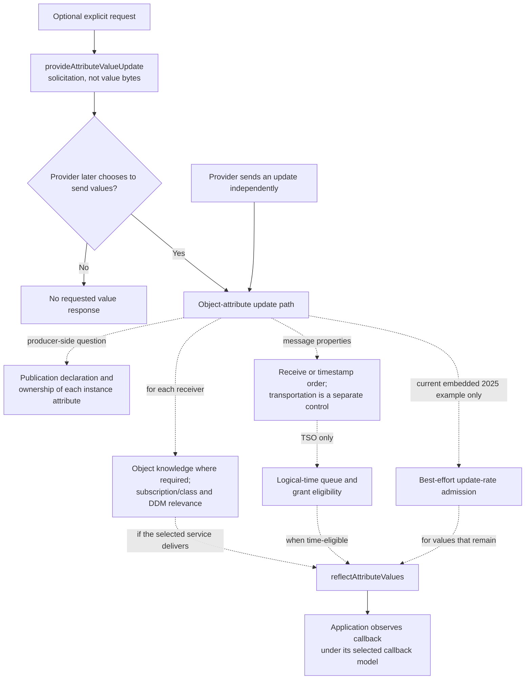

The dashed connectors mean “also ask this question,” not execution order.
Applicability and ordering come from the selected service contract. An explicit
request is optional: it solicits the provider but does not itself return
values; an update may also be sent without a request. The rate node is a
bounded embedded-profile example, not a universal HLA scheduling rule.

For the per-attribute authority and sender-side distinctions, see the
[ownership guide](HLA-2025-ATTRIBUTE-OWNERSHIP-FLOW-GUIDE.md) and
[object/interaction guide](HLA-2025-OBJECT-AND-INTERACTION-INFORMATION-FLOW-GUIDE.md).
For receiver interest and regions, see the
[subscription-state guide](HLA-2025-OBJECT-ATTRIBUTE-SUBSCRIPTION-STATE-FLOW-GUIDE.md)
and [DDM guide](HLA-2025-DATA-DISTRIBUTION-AND-REGIONS-FLOW-GUIDE.md). The
[request guide](HLA-2025-ATTRIBUTE-VALUE-UPDATE-REQUEST-FLOW-GUIDE.md) follows
solicitation separately; the [update-rate guide](HLA-2025-ATTRIBUTE-UPDATE-RATE-ADMISSION-FLOW-GUIDE.md),
[time-management guide](HLA-2025-TIME-MANAGEMENT-GUIDE.md), and
[callback/service-ordering guide](HLA-2025-CALLBACK-AND-SERVICE-ORDERING-FLOW-GUIDE.md)
cover the selected delivery, timing, and application-observation boundaries.
Their source links and focused tests bound implementation examples; none
establishes process parity or 2010 behavior.

## Different protocols have different completion boundaries

“The RTI is waiting” is incomplete. Name what is waiting, its scope, and the
specific result that ends that wait. Time advancement, synchronization points,
and save/restore are distinct coordination protocols; callback dispatch is a
separate, per-federate question of when application code observes a callback.
The callback is the public result notification, not a fourth coordination
protocol:

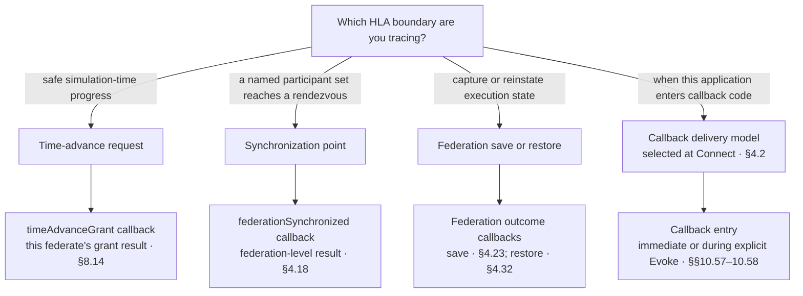

| Boundary | What is coordinated or controlled | Public result or observation marker | Does not, by itself, mean |
| --- | --- | --- | --- |
| Time advance | One federate's requested logical-time progress under federation time-management constraints. | Its `timeAdvanceGrant` callback (§8.14); callback entry is when this application observes the grant. | A named synchronization point completed or a federation image was saved. |
| Synchronization point | Achievement results for that point's participant set. | `federationSynchronized` reports the federation-level result (§4.18); this federate observes it on callback entry. | Logical time advanced or the application performed an atomic transaction. |
| Save/restore | Participant-owned state together with RTI-owned federation state. | `federationSaved`/`federationNotSaved` (§4.23) or `federationRestored`/`federationNotRestored` (§4.32) reports the federation-level outcome; this federate observes it on callback entry. | Every other pending federation-management protocol also completed. |
| Callback dispatch | When a particular federate application enters callback code; this is not a federation coordination protocol. | The model is selected at Connect (§4.2); Immediate invokes callback code automatically, while Evoked uses `evokeCallback`/`evokeMultipleCallbacks` (§§10.57–10.58). Entry is the application-observation boundary. | A callback's delivery policy changes the meaning of its originating service or protocol result. |

The clause anchors follow section labels on the pinned 2025 API declarations:
[time grant](../../third_party/ieee1516.1-2025/include/RTI/FederateAmbassador.h#L504),
[synchronization outcome](../../third_party/ieee1516.1-2025/include/RTI/FederateAmbassador.h#L91),
[save outcome](../../third_party/ieee1516.1-2025/include/RTI/FederateAmbassador.h#L110),
[restore outcome](../../third_party/ieee1516.1-2025/include/RTI/FederateAmbassador.h#L153),
[Connect callback-model selection](../../third_party/ieee1516.1-2025/include/RTI/RTIambassador.h#L45),
and [Evoke and callback-control services](../../third_party/ieee1516.1-2025/include/RTI/RTIambassador.h#L2260).
They are navigation anchors, not substitutes for the complete normative text
in the [official IEEE 1516.1-2025 specification](https://standards.ieee.org/ieee/1516.1/6688/).

These mechanisms can constrain one another without sharing a completion
contract: a timed save can depend on logical-time progress, and a completed
synchronization point still has to be delivered through the selected callback
model before user code observes its notification. In Immediate mode callback
entry may occur synchronously; in Evoked mode the application controls entry
through an evoke service. Keep the protocol's public result notification
distinct from the dispatch mechanism that lets this federate observe it.
See the [time-management](HLA-2025-TIME-MANAGEMENT-GUIDE.md),
[synchronization-point](HLA-2025-FEDERATION-SYNCHRONIZATION-FLOW-GUIDE.md),
[save/restore](HLA-2025-FEDERATION-SAVE-RESTORE-FLOW-GUIDE.md), and
[callback/service-ordering](HLA-2025-CALLBACK-AND-SERVICE-ORDERING-FLOW-GUIDE.md)
guides for each 2025 protocol's implementation evidence and limits.

### Temporal admission does not imply callback entry

For the HLA reader, ask whether an effect is only eligible for delivery or
whether the receiving application has actually observed its callback. In this
selected embedded 2025 implementation path, those are two different gates.
For a time-constrained recipient, asynchronous delivery or a pending time
advance opens the receive-order gate; it moves eligible work toward the callback
dispatcher, not directly into user code. The independent callbacks-enabled
switch controls whether the dispatcher may enter the callback. Once enabled,
`HLA_IMMEDIATE` normally drains on the submitting thread, while
`HLA_EVOKED` still waits for an Evoke service.

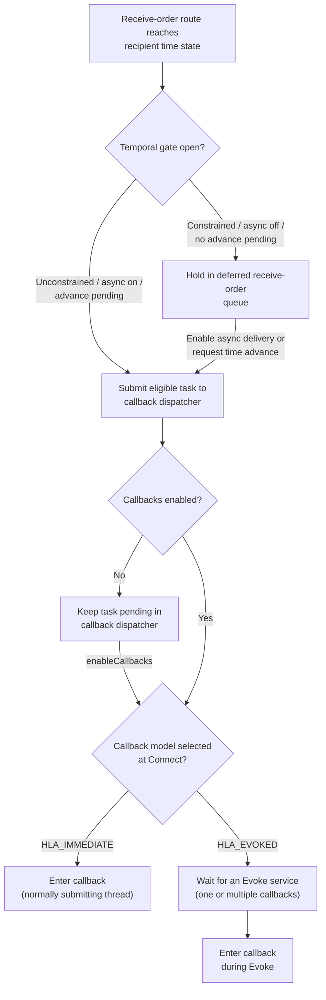

This composes two implementation gates; it is not one HLA protocol or a claim
that receive-order admission advances logical time. The pending-advance gate
is temporary: a matching grant clears the pending request, and if asynchronous
delivery is still off, later receive-order routes are deferred again. Closing
that temporal gate does not itself retract work already submitted to the
independent callback dispatcher. These are source-derived embedded details;
the unit cases cover the time-state and dispatcher transitions separately,
not their combined history.

The focused public integration case makes one cross-boundary consequence
concrete: a time-advance request opens the receive-order gate and the selected
interaction callback is observed before any Time Advance Grant. In
`HLA_IMMEDIATE`, it enters during the request-service path; in `HLA_EVOKED`, it
enters during the following Evoke. This is the bounded embedded scenario, not a
general callback-order guarantee. The [time-management guide's receive-order
section](HLA-2025-TIME-MANAGEMENT-GUIDE.md#receive-order-and-asynchronous-delivery)
shows this test-shaped sequence. The callback/service-ordering guide explains
why `HLA_IMMEDIATE` may instead queue behind a different thread's active
drainer ([active-call boundary](HLA-2025-CALLBACK-AND-SERVICE-ORDERING-FLOW-GUIDE.md#which-public-call-is-active-when-the-callback-throws)).
No focused test combines asynchronous-delivery deferral with callbacks being
disabled at the same time. Process/embedded parity and normative ordering are
not claimed. Timestamped messages remain outside this receive-order flow and
follow their separate grant and callback boundaries.

The pinned [asynchronous-delivery](../../third_party/ieee1516.1-2025/include/RTI/RTIambassador.h#L1295)
and [callback-control API](../../third_party/ieee1516.1-2025/include/RTI/RTIambassador.h#L2265)
surfaces remain distinct. Evidence: [`FederateTimeState` receive-order predicate](../../cpp/src/internal/time/federate_time_state.cpp#L711)
and [deferred-queue extraction](../../cpp/src/internal/time/federate_time_state.cpp#L725),
[asynchronous flush](../../cpp/src/internal/runtime/umbra_rti_ambassador_asynchronous_delivery.cpp#L18),
[callback dispatcher enable gate](../../cpp/src/internal/callbacks/callback_dispatcher.cpp#L82),
[temporal-state predicate and matching-grant case](../../cpp/tests/federate_time_state_catch2.cpp#L145),
[public pre-grant asynchronous-delivery case](../../cpp/tests/ieee1516_2025_asynchronous_delivery_temporal_state_catch2.cpp#L101),
the [disabled-work dispatcher case](../../cpp/tests/callback_dispatcher_catch2.cpp#L288),
and the [evoked-work-while-disabled case](../../cpp/tests/callback_dispatcher_catch2.cpp#L315).
The async and dispatcher tests are separate layers, not one end-to-end
cross-gate regression.

Save/restore adds an ownership-and-lifetime question: distinguish participant-
owned application state, supported RTI image records, current membership, and
live callback routes. In the covered 2025 Umbra profile, a saved record is not
an executable callback closure, and durable bytes do not promise arbitrary
crash recovery. The selected 2025 lifecycle flows also show resignation
ending one member lifetime without necessarily destroying the federation
execution. The existing guides already show these distinct boundaries, so read
them together rather than inferring one universal “restore everything” state
machine: the [save/restore guide]
(HLA-2025-FEDERATION-SAVE-RESTORE-FLOW-GUIDE.md) details image contents and
limits, the [ownership persistence companion]
(HLA-2025-OWNERSHIP-PERSISTENCE-AND-RESIGNATION-FLOW-GUIDE.md) separates ledger,
route, and membership, and the [lifecycle guide]
(HLA-2025-FEDERATION-AND-FEDERATE-LIFECYCLE-FLOW-GUIDE.md) tracks what survives
member exit. These are selected 2025 Umbra evidence scopes, not 2010 or
cross-implementation parity claims.

## Participant-set changes are protocol-specific

The following comparison is about selected 2025 Umbra embedded-registry paths,
not a universal HLA rule. In particular, synchronization-point membership is a
mutable barrier set in this implementation, while restore first validates the
saved participant roster and save/restore resignation fails an operation that
has already begun:

As a reusable reading model, treat each protocol's participant cohort as its
own state: one operation may snapshot and expand it, another may revalidate it
at admission, and an in-flight operation may have a defined failure on
departure. Do not infer one protocol's membership rule from another's.

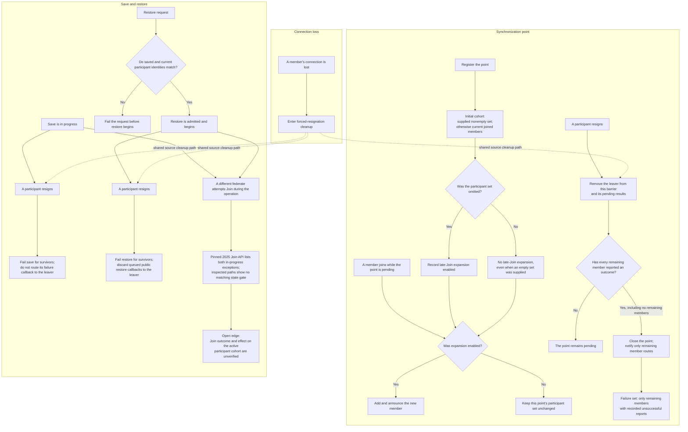

The synchronization distinction is subtle: this registry uses the current
joined members when the requested set is empty, but separately remembers
whether a set was supplied. Only an omitted set expands for a later Join; an
explicitly supplied empty set starts with the current members but does not
expand. On resignation, the pending barrier is checked against the remaining
members again. A point closes once every remaining member has reported an
outcome (success or failure); an empty remainder also closes it. The
notification's failure set contains only remaining participants whose
unsuccessful result was recorded. The focused resignation case covers one
already-achieved member and one leaver, not every partial-achievement or Join
interleaving.

Restore admission is different from synchronization expansion: a saved/current
participant mismatch is a request failure before restore begins. Once a save
or restore is active, voluntary resignation fails that operation for the
remaining participants and excludes the leaver's callback route. The focused
save test also checks that resignation attempted from inside an active
initiation callback is rejected until that callback returns. Connection loss
enters forced-resignation cleanup, so its pending-protocol edges are
source-derived here; the cited focused cases do not test each loss/protocol
combination.

Join during an active operation is an unresolved API/source edge. Both 2025
Join overloads in the pinned interface list `SaveInProgress` and
`RestoreInProgress`. The inspected embedded Join adapter and registry
transaction, and the process `handleJoin` path, show no matching operation-state
gate. Save and restore build their participant-status maps from the members
present at operation start; the inspected Join transaction does not update
those maps. The bounded test search found no focused Join-during-save/restore
case. The existing representative interlock test joins both participants
before save and tests other services while the operation is active. Record this
as an apparent contract/source gap, not a verified result:
neither acceptance nor rejection, nor the effect of a joining member on an
active operation, is established here. Check the exact 2025 §4.11 conditions
and obtain focused runtime evidence before calling it a conformance defect.
Do not extend any of these selected 2025 embedded results to the separate 2010
stream or claim process-endpoint parity.

| Evidence slice | Source and focused evidence |
| --- | --- |
| Omitted versus supplied synchronization sets; late Join | [Registration and expansion mode](../../cpp/src/internal/federation/federation_registry.cpp#L188), [Join expansion hook](../../cpp/src/internal/federation/federation_registry.cpp#L246). The source distinguishes omission even though an empty request initially defaults to current membership; the specific late-join test interleaving is source-derived. |
| Resignation closes a synchronization point | [Resignation cleanup](../../cpp/src/internal/federation/federation_registry_resign_lifecycle.cpp#L920), [focused HLA_EVOKED resignation case](../../cpp/tests/service_report_file_federation_synchronized_resignation_catch2.cpp#L131). The test checks report-before-evoke and an empty failed set for its two-member case. |
| Restore roster admission | [Saved/current roster check](../../cpp/src/internal/federation/federation_registry_restore_control.cpp#L335) and the [save/restore guide's early-rejection boundary](HLA-2025-FEDERATION-SAVE-RESTORE-FLOW-GUIDE.md#early-rejection-versus-begun-failure). The exact set-check edge is source-derived in this comparison. |
| Join while save/restore is active | Pinned 2025 API exception lists for the [first overload](../../third_party/ieee1516.1-2025/include/RTI/RTIambassador.h#L204) and [named-federate overload](../../third_party/ieee1516.1-2025/include/RTI/RTIambassador.h#L226); [embedded Join adapter](../../cpp/src/internal/runtime/umbra_rti_ambassador_federation_lifecycle.cpp#L364), [shared registry Join transaction](../../cpp/src/internal/federation/federation_registry_membership_lifecycle.cpp#L238), [process Join handler](../../cpp/src/internal/federation/process_federation_service_lifecycle.cpp#L193), [save participant statuses](../../cpp/src/internal/federation/federation_registry_save_control.cpp#L40), and [restore participant statuses](../../cpp/src/internal/federation/federation_registry_restore_control.cpp#L375). The [representative interlock test](../../cpp/tests/ieee1516_2025_representative_save_restore_interlock_catch2.cpp#L34) joins before save and does not attempt Join during the active operation. This is an apparent API/source gap, not an established runtime outcome. |
| Resignation during an active save or restore | [Shared save/restore resignation transition](../../cpp/src/internal/federation/federation_registry_resign_lifecycle.cpp#L442), [active-save callback resignation test](../../cpp/tests/ieee1516_2025_save_active_callback_resignation_guard_catch2.cpp#L4), and [active-restore resignation test](../../cpp/tests/ieee1516_2025_federation_management_save_restore_catch2.cpp#L486). Both tests cover selected embedded evoked-callback paths. |
| Connection loss | [Lifecycle guide's forced-resignation path](HLA-2025-FEDERATION-AND-FEDERATE-LIFECYCLE-FLOW-GUIDE.md#connection-loss-forced-resignation-is-a-different-entry-path), [Connection Lost source entry](../../cpp/src/internal/federation/federation_registry.cpp#L410). Pending synchronization/save/restore outcomes on loss are not independently exercised by the focused cases above. |

## Milestones to annotate in a service flow

When documenting one API operation, mark only the milestones that actually
apply, and give each its own name:

| Milestone | Question to answer |
| --- | --- |
| Request validity | Did the call satisfy this operation's argument, role, membership, and state preconditions? |
| Admission or result | Was it rejected, completed synchronously, or accepted as pending work? Use the exact service outcome, not a generic “success.” |
| State transition | Which state changes, and at what operation-defined point does it change? Is that fact federation-scoped, participant-local, or per-recipient? |
| Effect planning | Does the operation create a callback, message, advisory, barrier result, or other effect? Who is a candidate recipient? |
| Eligibility | Which current subscription, ownership, region, time, membership, or switch conditions can admit or suppress that effect? |
| Application observation | Which callback, query, or later service makes the effect visible, and what callback model or time rule controls that observation? |
| Completion | What exact callback or returned result ends the pending operation? Do not substitute internal queue emptiness for the API's completion rule. |

These milestones can occur in different orders for different services. For
example, a callback can run inside an immediate-mode inducing service, whereas
an evoked callback can remain pending after that service returns. A time
advance request is not a grant, and an object registration is not a remote
federate's discovery. Those are distinct service contracts, not one generic
“accepted, then callback” sequence.

## A service result, committed state, and a report are separate traces

When a service fails or produces an observability record, do not collapse the
caller result, the operation's state effects, a diagnostic/report path, and an
observer's later view into one “success or failure” milestone. This relationship
map is a checklist, not a universal transaction timeline:

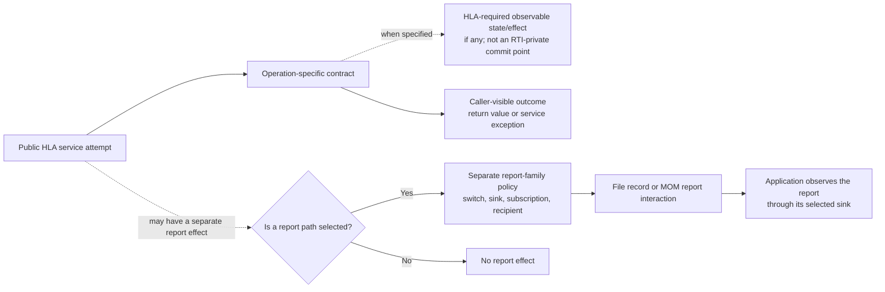

Use the HLA contract to establish required caller outcomes and externally
observable effects. When an internal commit point matters, identify it
separately from the selected RTI/profile; it is not portable merely because it
is where that implementation mutates state. A report is a distinct effect
with its own selection and failure policy. A thrown service exception does not
by itself prove that earlier state or accepted work was rolled back. Likewise,
delivery of a report does not decide whether the original service returned or
threw. Follow the exact service and implementation profile to establish
ordering. These examples are **2025 Umbra case studies**, not normative rules
or claims about the separate 2010 stream:

| Case | Distinct traces visible in the evidence | Evidence boundary |
| --- | --- | --- |
| Process `GetObjectClassHandle` fails | The source calls the best-effort `HLAreportException` hook before requesting a failed `HLAreportServiceInvocation` record. Failure in the first hook is suppressed; failure in the later process service-report request can surface as `RTIinternalError` instead of the original `NameNotFound`. | [Catch path](../../cpp/src/internal/runtime/umbra_rti_ambassador_object_class_lookup.cpp#L98), [noexcept exception hook](../../cpp/src/internal/runtime/umbra_rti_ambassador_mom_service_report_interaction.cpp#L184), and [failed-report writer path](../../cpp/src/internal/runtime/umbra_rti_ambassador_service_report_writers.cpp#L252). The focused exception-report and service-report tests exercise the two controls separately; the combined two-switch scenario and replacement outcome are source-derived. See the [combined-report guide section](HLA-2025-EXCEPTION-REPORTING-FLOW-GUIDE.md#when-both-process-report-routes-apply). |
| Embedded `setExceptionReportingSwitch(true)` with file reporting selected | The registry commits the Exception Reporting switch before the successful invocation record is appended. An append error can therefore escape as `RTIinternalError` while a later query still observes Exception Reporting as true. | [Switch service](../../cpp/src/internal/runtime/umbra_rti_ambassador_service_reporting_switches.cpp#L219) and [injected writer test](../../cpp/tests/service_report_writer_failure_catch2.cpp#L132). The test body encodes the state assertion, but its last recorded run failed during federation creation before those assertions; treat the state edge as source-derived, not runtime-verified. See the [report-append case study](HLA-2025-SERVICE-INVOCATION-REPORTING-FLOW-GUIDE.md#a-failed-report-append-leaves-exception-reporting-enabled). |
| Embedded timestamped `UpdateAttributeValues` with file reporting | TSO work is admitted before the successful service report is appended. The catch path can then attempt exception/failure reporting and rethrow without returning a retraction handle; the cited source has no compensating dequeue at that boundary. | [TSO admission](../../cpp/src/internal/runtime/umbra_rti_ambassador_attribute_update_services.cpp#L687), [failed-report catch](../../cpp/src/internal/runtime/umbra_rti_ambassador_attribute_update_services.cpp#L790), and the [successful-path focused test](../../cpp/tests/ieee1516_2025_timestamped_update_attribute_values_service_report_catch2.cpp#L5). Queue retention on the injected append-failure schedule and whether that work later reaches a callback are not tested. See the [TSO/report boundary](HLA-2025-SERVICE-INVOCATION-REPORTING-FLOW-GUIDE.md#timestamped-update-admission-precedes-report-persistence). |

The two reporting guides own their distinct MOM interactions, switches, sinks,
recipient rules, and profile-specific failure behavior: [exception
reporting](HLA-2025-EXCEPTION-REPORTING-FLOW-GUIDE.md) and [service invocation
reporting](HLA-2025-SERVICE-INVOCATION-REPORTING-FLOW-GUIDE.md). Use this lens to
connect their milestones, not to combine them into a single report state
machine.

## Service contracts—not argument shape—define outcomes

A set-valued argument or a composite operation does not, by itself, tell you
whether its outcomes may be partial, all-or-nothing, or accompanied by other
state effects. Start with the exact HLA service contract: identify its
specified results, exceptions, and state or callback effects. When studying a
particular RTI, trace its validation gate and internal state-commit unit as a
separate implementation question; that commit point is not a portable HLA
rule. The following 2025 Umbra examples deliberately have different internal
boundaries:

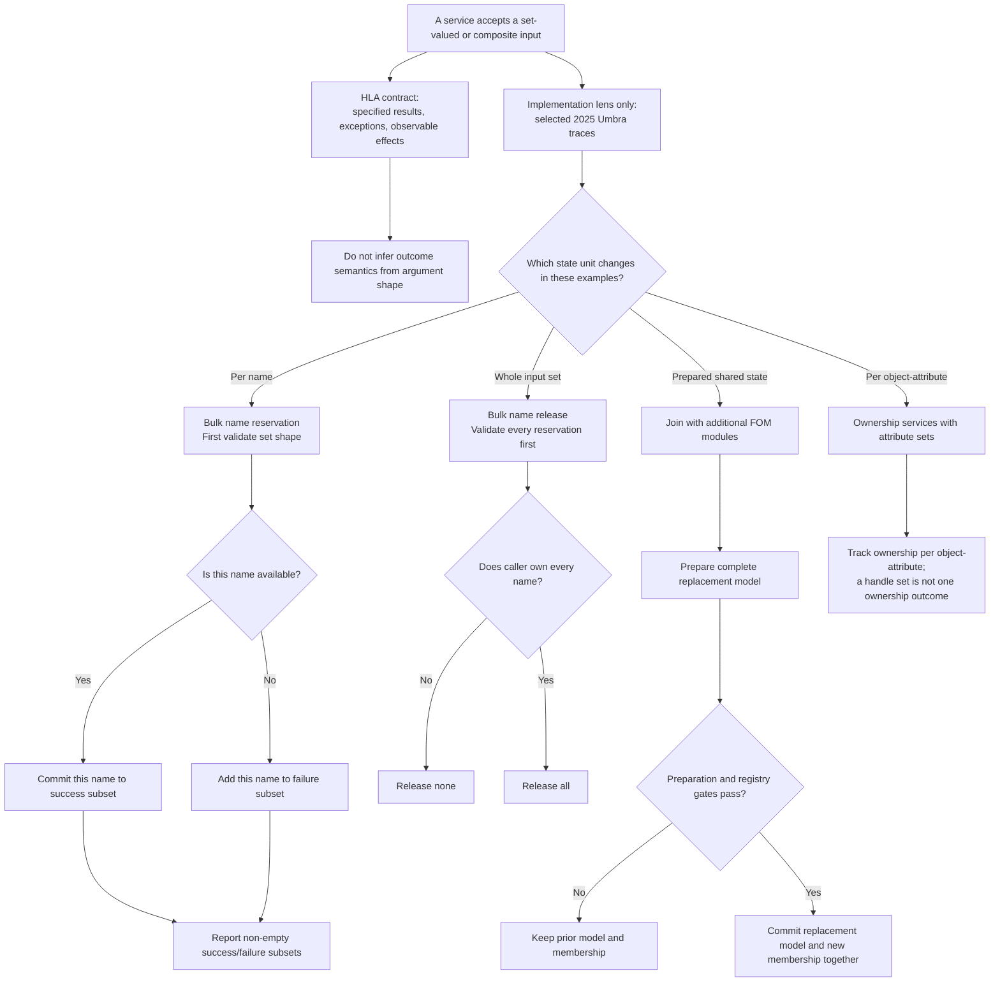

The two branches are separate reading questions, not a runtime sequence: the
HLA contract remains the portable authority, while the selected 2025 examples
show one profile's internal update units.

The [name-reservation guide](HLA-2025-OBJECT-INSTANCE-NAME-RESERVATION-FLOW-GUIDE.md#2-bulk-operations-partial-reservation-versus-atomic-release)
and its [focused test](../../cpp/tests/object_instance_name_reservation_catch2.cpp#L95)
show per-name reservation outcomes but all-or-nothing bulk release. The
[FOM-composition guide](HLA-2025-FOM-MODULE-ADMISSION-AND-COMPOSITION-FLOW-GUIDE.md#join-with-additional-fom-modules-replace-definition-and-add-member-together)
and [atomicity test](../../cpp/tests/ieee1516_2025_embedded_fom_preparation_atomicity_catch2.cpp#L29)
show a prepared replacement definition and membership committed together.
The [ownership guide's edge-case notes](HLA-2025-ATTRIBUTE-OWNERSHIP-FLOW-GUIDE.md#edge-cases-worth-remembering)
warn that an attribute set is not one ownership unit.

Regional declaration calls expose a different boundary. Publisher-side update
associations are tracked for an object instance's attributes; receiver-side
regional subscriptions track class-attribute/region entries. The public
operations return no per-pair result collection: changed declarations feed
later overlap evaluation and may lead to receiver discovery, scope or
relevance advisories, and value delivery. The detailed
[subscription-state guide](HLA-2025-OBJECT-ATTRIBUTE-SUBSCRIPTION-STATE-FLOW-GUIDE.md#3-regional-declarations-are-separate-per-attribute-region-entries)
and [DDM guide](HLA-2025-DATA-DISTRIBUTION-AND-REGIONS-FLOW-GUIDE.md#object-attributes-source-association-discovery-relevance-and-updates)
already diagram those separate relations and their downstream effects, so
they are linked rather than repeated in the commit-grain map. Their selected
2025 embedded evidence does not define one transaction rule for every
operation or implementation profile.

These are scoped implementation traces, not a taxonomy of standard service
guarantees, a universal HLA transaction model, or a claim of 2010/profile
parity. For portable HLA behavior, use the exact service clause to establish
required results and effects; treat internal commit points as profile-specific
unless they change a required observable effect. Never infer atomicity from
the number or shape of values in an API argument.

## Four examples of the same reasoning lens

### Time management: request versus grant

Ask separately whether an advance request was accepted, what time constraints
hold it, and which grant callback completes it. A pending request is not proof
that the federate's public logical time has advanced. See the detailed
[2025 time-management guide](HLA-2025-TIME-MANAGEMENT-GUIDE.md) for the role
states, frontier calculations, boundary cases, and focused evidence.

### Object information: instance existence versus local knowledge

Ask separately whether an instance exists in the federation and whether a
particular federate has learned of it. Registration, discovery, attribute
projection, and removal affect related but non-identical facts. See the
[object and interaction information guide](HLA-2025-OBJECT-AND-INTERACTION-INFORMATION-FLOW-GUIDE.md)
for the object and attribute paths, and the
[joined-federate MOM lifecycle guide](HLA-2025-JOINED-FEDERATE-MOM-OBJECT-LIFECYCLE-FLOW-GUIDE.md)
for a separate federate-local object lifetime.

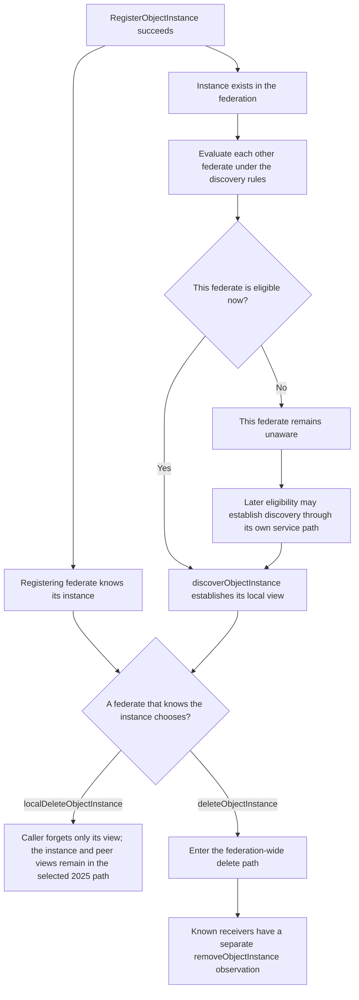

This is a relationship map, not one service's universal timeline or a
normative state machine. The 2025 object guide supplies the separate service
preconditions, callback boundaries, and implementation/profile limits; see
its object-existence and receiver-knowledge source/test map in the [2025
object/interaction guide](HLA-2025-OBJECT-AND-INTERACTION-INFORMATION-FLOW-GUIDE.md#evidence-map-implementation-versus-exercised-scenarios). Its
focused [process discovery case](../../cpp/tests/ieee1516_2025_connection_object_discovery_catch2.cpp#L457),
[embedded local-delete/rediscovery case](../../cpp/tests/local_delete_object_instance_catch2.cpp#L110),
[process local-delete case](../../cpp/tests/ieee1516_2025_connection_local_delete_catch2.cpp#L457),
and [process removal-payload case](../../cpp/tests/ieee1516_2025_connection_delete_object_instance_catch2.cpp#L779)
are separate scenarios, not one end-to-end proof of the whole map. In
particular, the process local-delete case covers success only; do not infer
full embedded/process parity from it.

### Information delivery: candidate versus visible effect

Ask separately whether a sender is allowed to produce an update, whether a
receiver is relevant, whether the receiver knows the object, and when its
application observes a callback. Publication, subscription, DDM, time
management, and callback dispatch answer different parts of that question;
the exact combination depends on the service. Start with the
[object/interaction overview](HLA-2025-OBJECT-AND-INTERACTION-INFORMATION-FLOW-GUIDE.md),
then follow its links to the focused subscription, DDM, time, and callback
guides rather than combining their rules into a new universal gate.

### Retraction: queued work versus an already observed event

Ask whether a recipient still has pending work or has already observed the
message. Withdrawing pending delivery and requesting that a recipient account
for an already-delivered effect are different transitions. The
[2025 TSO retraction guide](HLA-2025-TSO-RETRACTION-FLOW-GUIDE.md) keeps the
producer's legality boundary separate from each recipient's delivery phase.

## When work becomes stale: withdraw, invalidate, preserve, or account

“Cancel the event” is too imprecise for a federated system. First identify one
service operation, request, and affected recipient (or attribute); a single
send may be pending for one recipient and already observed by another. Track
the committed federation fact separately from its callback: state can be
query-visible while a notification is still queued, and a queued callback is
not the same as one that has entered application code. Then ask which
operation-specific transition applies:

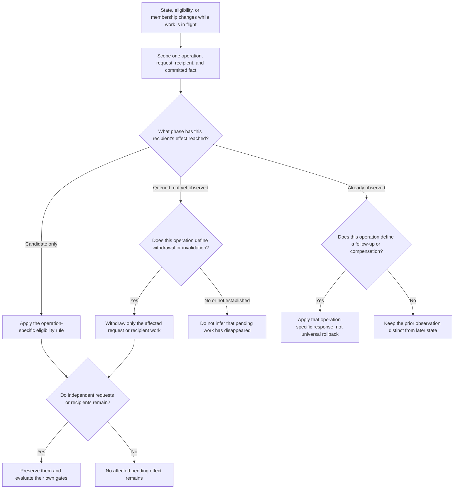

This is a reading aid, not a prescribed RTI algorithm or one shared HLA
cancellation rule. “Observed” must be defined for the service being read; the
diagram deliberately separates callback entry from committed/query-visible
state. Six 2025 implementation examples show why the work item and its phase
matter:

| Example | What is scoped independently | What the focused guide establishes | Boundary |
| --- | --- | --- | --- |
| [Attribute subscription changes](HLA-2025-OBJECT-ATTRIBUTE-SUBSCRIPTION-STATE-FLOW-GUIDE.md) and [DSE recipient evaluation](HLA-2025-DELAY-SUBSCRIPTION-EVALUATION-FLOW-GUIDE.md#recipient-state-machine) | Each selected attribute's active/passive declaration versus one service's retained recipient candidate | Selected embedded tests show that changing one attribute's mode preserves other declarations and changes later projections. Separately, DSE may defer an ineligible recipient's service-specific check; a later unsubscribe can suppress that candidate before its callback or TSO boundary. | Future per-attribute projection, DSE deferral, and discovery-time initial reflection are separate questions—not a general undo/replay rule or a process-parity claim. |
| [Accepted object deletion](HLA-2025-OBJECT-AND-INTERACTION-INFORMATION-FLOW-GUIDE.md#object-removal-delete-callback-and-per-receiver-cleanup) | The delete transition, deleting member's local knowledge, other members' removal reservations, and pending per-object work | In the selected 2025 receive-order path, accepting deletion clears the deleting member's knowledge and invalidates pending discovery, value-update, and ownership work; each receiver's removal transition is separately revalidated before its callback. | Evidence is split across focused scenarios and source. It does not assert every ledger cleanup, global recipient order, process-push behavior, or 2010 behavior; see the guide's [deletion evidence map](HLA-2025-OBJECT-AND-INTERACTION-INFORMATION-FLOW-GUIDE.md#evidence-map-implementation-versus-exercised-scenarios). |
| [Interaction publication withdrawal](HLA-2025-OBJECT-AND-INTERACTION-INFORMATION-FLOW-GUIDE.md#embedded-ordinary-interaction-unpublication-and-already-accepted-work) versus [directed publication withdrawal](HLA-2025-DIRECTED-INTERACTION-FLOW-GUIDE.md#receive-order-send-validate-fan-out-then-dispatch) | Ordinary send admission versus directed sender-pair callback fencing | Current embedded source checks ordinary publication before acceptance and rechecks receiver eligibility at delivery; it does not use later ordinary unpublication to fence that queued route. The separate directed path rechecks its publication pair, with a focused stale-work case. | Ordinary send → unpublish → evoke is not directly tested; do not infer normative, process-endpoint, or 2010 parity from either path. |
| [Resignation with pending ownership work](HLA-2025-OWNERSHIP-PERSISTENCE-AND-RESIGNATION-FLOW-GUIDE.md) | The departing member's requests/candidates and callbacks versus another member's independent candidate | A covered cancellation action removes the departing member's acquisition-side work and invalidates work tied to it; other candidates survive. Other covered actions reject before cleanup when pending work blocks resignation. | Selected 2025 embedded behavior, not the complete normative ResignAction matrix or process parity. |
| [TSO Retract](HLA-2025-TSO-RETRACTION-FLOW-GUIDE.md) | One message's phase for each recipient | Pending recipient work can be withdrawn; after the original callback enters recipient code, the distinct Request Retraction path applies. Timestamped deletion has additional service-specific state reconstitution. | Do not generalize this to non-TSO services or interpret the callback as automatic rollback of application actions. |
| [Federation and federate lifecycle: voluntary resignation](HLA-2025-FEDERATION-AND-FEDERATE-LIFECYCLE-FLOW-GUIDE.md#voluntary-resignation-validate-before-removing-membership) and [forced connection loss](HLA-2025-FEDERATION-AND-FEDERATE-LIFECYCLE-FLOW-GUIDE.md#connection-loss-forced-resignation-is-a-different-entry-path) | The departing member's identity-bound route versus notifications planned for surviving members | In the selected 2025 embedded voluntary-resign path, the departing ambassador's queued callbacks are reset and induced survivor effects are submitted on survivor routes. Forced connection loss enters through its own directive and cleanup path. | Do not treat the embedded queue reset as process behavior or as a universal cancellation rule; voluntary resignation and forced connection-loss cleanup are distinct entry paths. |

Declaration withdrawal answers a future-admission question; it does not, by
itself, specify what happens to every accepted effect already in flight. Read
the affected service's cancellation or callback-time eligibility rule instead
of carrying one service's queue behavior over to another.

The portable lesson is to avoid a message-wide “done/cancelled” flag when
recipients, requests, or callbacks can be in different phases. Preserve the
operation's own legality, ordering, and compensation rules, and do not infer
that changing a declaration, leaving a federation, or receiving a retraction
rewinds an effect already observed by an application.

## A practical reading checklist

For a new requirement, source path, or confusing diagram, write down:

1. **The actor and boundary:** which federate calls which service, under which
   edition and implementation profile?
2. **The fact:** what changes, who owns it, and can a query or later operation
   observe it before a callback runs?
3. **The effect:** is there a notification or message, and is it per operation,
   per class, per object, or per recipient?
4. **The gates:** which eligibility rules are independent, and which are
   operation-specific? Is this receive order or timestamp order?
5. **The visible completion:** what callback or result completes the public
   operation? Does the callback model or time-management state defer it?
6. **The evidence:** which exact standard clause defines the contract, which
   source path illustrates this implementation, and which focused test covers
   this scenario?
7. **The boundary:** what is explicitly not established—another service,
   callback model, embedded/process profile, edition, or provider?

If two diagrams disagree, first check whether they are drawing different
milestones, participants, or callback models. Do not resolve the discrepancy
by merging them into one state machine without showing that the underlying
contract and state are actually shared.

## Deliberate limits

- This synthesis adds no normative rule and no requirement-to-clause mapping.
- It is not a universal RTI architecture, queue design, event scheduler, or
  prescription for when implementations must commit internal state.
- The linked implementation evidence is 2025-specific. IEEE 1516.1-2010 stays
  separate; do not transfer a diagram, source claim, or test result across the
  edition boundary.
- The HLA Requirements Lab is a later, separately authorized goal. This
  document changes Umbra documentation only.
