# IEEE 1516.1-2025 Data Distribution Management and Regions: Flow Guide

IEEE 1516.1-2025 Data Distribution Management (DDM) separates a federate's
data interest from the RTI's decision about which recipients are in scope.
The durable HLA model uses FOM dimensions, region extents, and service-specific
regional subscriptions or source-region associations; applicable source and
receiver regions determine DDM scope. Time eligibility and callback dispatch
are separate questions. This guide explains those concepts first, then uses
selected Umbra 2025 paths and tests as bounded examples—not as the definition
of HLA behavior. It is not an implementation contract or a conformance claim.

## Scope and authority

- **Standard boundary:** IEEE 1516.1-2025 only. The [official IEEE
  standard](https://standards.ieee.org/ieee/1516.1/6688/) is the normative
  authority for DDM services and behavior.
- **Implementation boundary:** the non-installable 2025 development profile
  and selected 2025 process-boundary tests. Some private registry code is
  shared implementation machinery; this guide does not infer 2010 behavior
  from it.
- **Edition separation:** IEEE 1516.1-2010 is deliberately outside this guide.
  No cross-edition equivalence is asserted.
- **Evidence boundary:** source files describe current Umbra behavior. Focused
  tests show only their exercised scenarios; neither source nor tests replace
  normative requirements or prove full support, interoperability, or
  conformance.

For temporal ordering, grants, and TSO callback timing, see the separate
[2025 time-management guide](HLA-2025-TIME-MANAGEMENT-GUIDE.md). Ownership
transfer is explained separately in the
[2025 ownership flow guide](HLA-2025-ATTRIBUTE-OWNERSHIP-FLOW-GUIDE.md).
This document keeps their interaction points visible without merging those
state machines into DDM.
For the end-to-end 2025 object/interaction path from sender declarations
through receiver eligibility, object knowledge, and callback observation, see
[Object and Interaction Information Flow](HLA-2025-OBJECT-AND-INTERACTION-INFORMATION-FLOW-GUIDE.md);
this guide narrows that path to regional scope.
Directed interactions use a separate target-and-selector path: the target
object handle is not a DDM region, and the universal/by-ownership selector is
not a regional subscription. See the [2025 directed-interaction guide's
target/region distinction](HLA-2025-DIRECTED-INTERACTION-FLOW-GUIDE.md#a-target-object-is-not-a-ddm-region),
which keeps any further normative relationship with DDM open.

## The mental model

DDM answers **which receivers are in scope for this information**, based on
class/attribute declarations and region realizations. It does not decide when
a time-constrained federate may receive a timestamped message. Keep these
questions separate:

1. Which interaction class or object attribute is being sent?
2. Which source region or regions realize that send/update?
3. Which receiver subscription realization applies?
4. Do the applicable source and receiver regions overlap?
5. If the receiver is relevant, is this an initial discovery, a change in
   attribute relevance, or a new value delivery?
6. If the value is timestamp ordered, when does time management permit its
   callback?

A region is a federate-owned template of dimensions and range bounds. Each
dimension's range has a lower and upper bound; a region may cover more than one
dimension. Object attributes can have update-region associations. Interactions
can be sent with an explicit region set. Receivers express regional interest
with object-class attribute or interaction-class subscriptions. The DDM
decision is based on the committed region specifications used by those
service paths.

### Shared geometry, different service state

Both paths use class-available dimensions, committed region bounds, and
overlap, but they attach source and receiver state to different HLA services.
Treat this as a comparison of the 2025 API surfaces and the bounded paths
documented below, not as one shared recipient algorithm:

| Question | Object-attribute update | Interaction send |
| --- | --- | --- |
| Where does source scope come from? | `associateRegionsForUpdates` associates regions with an object's attributes (§9.6); the inspected path uses the default source realization when an attribute has no explicit association ([API](../../third_party/ieee1516.1-2025/include/RTI/RTIambassador.h#L1526), [detailed path](#object-attributes-source-association-discovery-relevance-and-updates)). | `sendInteractionWithRegions` supplies regions for that send (§9.12); ordinary `sendInteraction` uses the default realization in the inspected path ([API](../../third_party/ieee1516.1-2025/include/RTI/RTIambassador.h#L1631), [detailed path](#interactions-explicit-and-default-region-paths)). |
| Where does receiver scope come from? | Object-class and attribute-to-region pairs in `subscribeObjectClassAttributesWithRegions` (§9.8). | Interaction-class regions in `subscribeInteractionClassWithRegions` (§9.10). |
| What is selected? | Relevant attributes are projected for each known or newly discoverable object; discovery, scope advice, and value reflection are separate effects. | Each interaction send is evaluated for each receiver; an eligible send yields `receiveInteraction`, not object discovery. |
| What must not be conflated? | A new or changed region can affect object visibility and attribute relevance independently of a publisher's next value update. | A region set belongs to one send, not to an object/attribute association. In the focused embedded TSO case, replacing the subscription suppressed rather than retargeted the accepted send ([bounded case](#a-replacement-regional-interaction-subscription-does-not-retarget-queued-tso-work)). |

The API declares the receiver-side services separately as well:
[`subscribeObjectClassAttributesWithRegions` (§9.8)](../../third_party/ieee1516.1-2025/include/RTI/RTIambassador.h#L1559)
and
[`subscribeInteractionClassWithRegions` (§9.10)](../../third_party/ieee1516.1-2025/include/RTI/RTIambassador.h#L1595).
The detailed object and interaction flows below retain the path-specific
dimension, default-region, delivery, and timestamped-work rules.

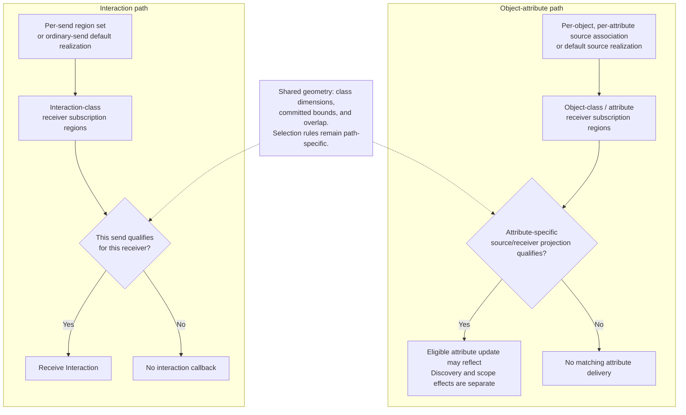

## From FOM dimensions to runtime region scope

This is a conceptual bridge between the model and DDM, not a required
service-call sequence. A FOM declares named dimensions and associates them
with object or interaction classes. The RTI's class-availability queries let
an application inspect the dimensions available to a selected class. The
application then chooses the dimensions and ranges for a region and uses that
region in an applicable regional service.

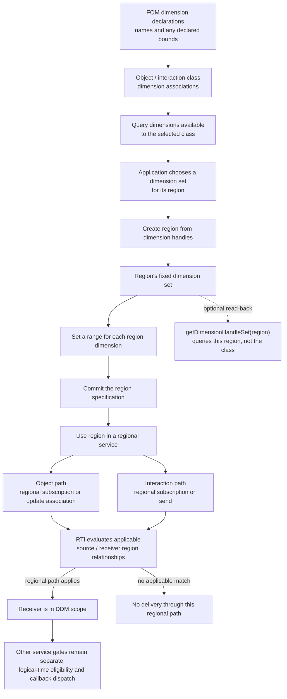

Keep three related sets distinct: the execution's **dimension catalogue**;
the **class-available dimensions** returned for one object or interaction
class; and the **dimension set of a region**, chosen by the application with
its ranges. Three public queries expose different parts of this model:

| Question | Public query | What it answers |
| --- | --- | --- |
| Which dimensions are associated with this FOM class? | [`getAvailableDimensionsForObjectClass`](../../third_party/ieee1516.1-2025/include/RTI/RTIambassador.h#L1891) / [`getAvailableDimensionsForInteractionClass`](../../third_party/ieee1516.1-2025/include/RTI/RTIambassador.h#L1901) | Class availability for application decisions; it does not create or configure a region. |
| Which dimensions were selected for this region? | [`getDimensionHandleSet(region)`](../../third_party/ieee1516.1-2025/include/RTI/RTIambassador.h#L1943) | The region's fixed dimension set, not its range bounds or a class's available dimensions. |
| What bounds are set for this region and dimension? | [`getRangeBounds(region, dimension)`](../../third_party/ieee1516.1-2025/include/RTI/RTIambassador.h#L1956) | Bounds for a dimension in this region; in the selected embedded path, this reports pending edits before commit as well as committed values. |

For clause-level reading, the pinned 2025 `RTIambassador` interface labels
these services with the following IEEE 1516.1-2025 section numbers. This is a
navigation map, not a substitute for the normative service text; use the
[official IEEE standard](https://standards.ieee.org/ieee/1516.1/6688/) for
required preconditions and effects.

| HLA question | Service clauses |
| --- | --- |
| How is a region created, committed, or deleted? | [`createRegion` §9.2](../../third_party/ieee1516.1-2025/include/RTI/RTIambassador.h#L1442), [`commitRegionModifications` §9.3](../../third_party/ieee1516.1-2025/include/RTI/RTIambassador.h#L1455), [`deleteRegion` §9.4](../../third_party/ieee1516.1-2025/include/RTI/RTIambassador.h#L1469). |
| Which dimensions and bounds are available or selected? | [`getAvailableDimensionsForObjectClass` §10.21](../../third_party/ieee1516.1-2025/include/RTI/RTIambassador.h#L1891), [`getAvailableDimensionsForInteractionClass` §10.22](../../third_party/ieee1516.1-2025/include/RTI/RTIambassador.h#L1901), [`getDimensionUpperBound` §10.25](../../third_party/ieee1516.1-2025/include/RTI/RTIambassador.h#L1931), [`getDimensionHandleSet` §10.26](../../third_party/ieee1516.1-2025/include/RTI/RTIambassador.h#L1943), [`getRangeBounds` §10.27](../../third_party/ieee1516.1-2025/include/RTI/RTIambassador.h#L1956), and [`setRangeBounds` §10.28](../../third_party/ieee1516.1-2025/include/RTI/RTIambassador.h#L1972). |
| Where do object attributes get source regions and receiver interest? | [`registerObjectInstanceWithRegions` §9.5](../../third_party/ieee1516.1-2025/include/RTI/RTIambassador.h#L1487), [`associateRegionsForUpdates` / `unassociateRegionsForUpdates` §§9.6–9.7](../../third_party/ieee1516.1-2025/include/RTI/RTIambassador.h#L1526), and [`subscribeObjectClassAttributesWithRegions` / `unsubscribeObjectClassAttributesWithRegions` §§9.8–9.9](../../third_party/ieee1516.1-2025/include/RTI/RTIambassador.h#L1559). |
| Where do interactions get source regions and receiver interest? | [`subscribeInteractionClassWithRegions` / `unsubscribeInteractionClassWithRegions` §§9.10–9.11](../../third_party/ieee1516.1-2025/include/RTI/RTIambassador.h#L1595) and [`sendInteractionWithRegions` §9.12](../../third_party/ieee1516.1-2025/include/RTI/RTIambassador.h#L1631). |
| Where is a region used for provider solicitation rather than receiver selection? | [`requestAttributeValueUpdateWithRegions` §9.13](../../third_party/ieee1516.1-2025/include/RTI/RTIambassador.h#L1672); its distinct role is explained in [regional request scope](HLA-2025-ATTRIBUTE-VALUE-UPDATE-REQUEST-FLOW-GUIDE.md#regional-request-scope-is-not-response-ddm), and its configured-process route is traced in the [regional class-request sequence](HLA-2025-ATTRIBUTE-VALUE-UPDATE-REQUEST-FLOW-GUIDE.md#configured-process-path-region-check-before-event-routing). |

The class-availability query informs application choices; it does not create
a region. In the public API, `createRegion` accepts a `DimensionHandleSet`
and has no class argument, so the created region is not intrinsically bound to
the class used for the query. A later class-specific regional service may
impose compatibility rules; those are separate from region construction.
Likewise, [`getDimensionUpperBound`](../../third_party/ieee1516.1-2025/include/RTI/RTIambassador.h#L1931)
reports the FOM dimension's upper bound, not the range selected for a
particular region.

In the selected embedded 2025 region-lifecycle test, a region's non-empty
dimension set is queryable immediately after `createRegion`, before range
bounds are set or committed ([assertion](../../cpp/tests/ieee1516_2025_federation_management_region_lifecycle_catch2.cpp#L65)).
An empty set remains empty before and after commit, so it describes a
zero-dimensional region rather than a wildcard ([before commit](../../cpp/tests/ieee1516_2025_federation_management_region_lifecycle_catch2.cpp#L53),
[after commit](../../cpp/tests/ieee1516_2025_federation_management_region_lifecycle_catch2.cpp#L55)).
The same test observes pending bounds through `getRangeBounds` before commit
([upper-bound assertion](../../cpp/tests/ieee1516_2025_federation_management_region_lifecycle_catch2.cpp#L95)),
then checks both committed bounds after commit
([lower-bound assertion](../../cpp/tests/ieee1516_2025_federation_management_region_lifecycle_catch2.cpp#L125),
[upper-bound assertion](../../cpp/tests/ieee1516_2025_federation_management_region_lifecycle_catch2.cpp#L127)).
These are bounded embedded observations, not a process-parity claim. The
query's unjoined, foreign-handle, and deleted-handle error behavior is also
observed only in this path ([unjoined caller](../../cpp/tests/ieee1516_2025_federation_management_region_lifecycle_catch2.cpp#L36),
[foreign handle](../../cpp/tests/ieee1516_2025_federation_management_region_lifecycle_catch2.cpp#L112),
[deleted handle](../../cpp/tests/ieee1516_2025_federation_management_region_lifecycle_catch2.cpp#L167)).

For example, an object path may use a region in an attribute subscription or
an object's update-region association; an interaction path may use one in a
regional subscription or a send. Which services accept which region arguments
is service-specific. After DDM scope is established, logical-time rules and
callback dispatch remain separate questions; see [time management](HLA-2025-TIME-MANAGEMENT-GUIDE.md)
and [callback ordering](HLA-2025-CALLBACK-AND-SERVICE-ORDERING-FLOW-GUIDE.md).

The pinned [2025 FDD schema](../../third_party/ieee1516.2-2025/resources/schemas/IEEE1516-FDD-2025.xsd)
records class-to-dimension associations and dimension declarations. The
pinned [2025 RTIambassador API's region services](../../third_party/ieee1516.1-2025/include/RTI/RTIambassador.h#L1442),
its separate [class-availability queries](../../third_party/ieee1516.1-2025/include/RTI/RTIambassador.h#L1891)
(§§10.21–10.22), and dimension/range lookups make this boundary visible. Those
API signatures establish the distinction above; the official IEEE standards
remain the normative authority.

Umbra's existing embedded 2025 [three-dimensional regional object test](../../cpp/tests/three_dimensional_regional_object_attribute_overlap_catch2.cpp#L110)
provides one authored case study: it queries dimensions for an object class,
creates source and receiver regions with those dimensions, and expects
discovery and attribute reflection. The current focused CTest run fails at the
regional subscription assertion: 21 of 22 assertions pass, then Catch2 reports
`Unknown exception`. The failure occurs before registration, discovery, or
reflection, so those remain test expectations rather than observed outcomes.
This is one HLA_EVOKED development-profile scenario, not proof of universal
behavior. A separate [process-endpoint query test](../../cpp/tests/ieee1516_2025_connection_available_dimensions_hierarchy_catch2.cpp#L459)
covers available-dimension lookups only. Separate configured process-endpoint
regional-object cases cover registration/discovery, regional-subscription
transitions, and source-region relevance transitions; they are summarized in
[the process boundary below](#2025-process-endpoint-boundary-for-regional-objects).
Those cases use the same object class for publisher and receiver, so they do
not establish cross-class regional behavior or general process DDM parity.

The embedded query test also makes the object-class hierarchy result concrete:

| Query target in that test | Returned available dimensions |
| --- | --- |
| `Food.Drink` | `{BarQuantity}` |
| `Food.Drink.Soda` | `{BarQuantity, SodaFlavor}` |
| `Food.Drink.Soda.Light` | `{BarQuantity, SodaFlavor, Sweetener}` |
| `FoodServed` interaction | empty set |
| `MainCourseServed` interaction | `{ServerId}` |

These are scenario results, not a substitute for the standard's definition.
The [embedded registry query](../../cpp/src/internal/federation/federation_registry_catalog_queries.cpp#L594)
walks the selected class and its parent chain, collecting associated
dimensions; the [focused lookup test](../../cpp/tests/dimension_lookup_catch2.cpp#L53)
asserts the sets above. Its process-endpoint counterpart asserts the `Drink`,
`Soda`, `FoodServed`, and `MainCourseServed` query results over that tested
endpoint, but remains query-only. An empty available-dimensions result means
that query returned no dimension handles for that class in the tested model;
it does not create a region or turn a zero-dimensional region into a wildcard.

### An FDD `Excluded` value does not remove class availability

Keep three pieces of model/runtime state distinct: the dimensions associated
with a class, the FDD `value` recorded for each dimension, and the dimension
handles explicitly selected when an application creates a region. In the
2025 FDD schema, the dimension `value` field uses `dimensionValuePattern`,
which accepts a numeric value, a range, or the token `Excluded`
([value field](../../third_party/ieee1516.2-2025/resources/schemas/IEEE1516-FDD-2025.xsd#L2233),
[pattern](../../third_party/ieee1516.2-2025/resources/schemas/IEEE1516-FDD-2025.xsd#L3069)).
In the current Umbra composer, `Excluded` yields no `defaultRange`
([parser](../../cpp/src/internal/fom/libxml2_fom_composer.cpp#L248)); class
availability is collected independently from the class's dimension references
([availability query](../../cpp/src/internal/federation/federation_registry_regions.cpp#L676)).
In the current embedded source, routing makes a temporary realization from the
Region snapshot. It adds an omitted dimension from the service's available set
only when that dimension has a default range
([snapshot copy](../../cpp/src/internal/federation/federation_registry_regions.cpp#L635),
[default-range check](../../cpp/src/internal/federation/federation_registry_regions.cpp#L649),
[realization helper](../../cpp/src/internal/federation/federation_registry_regions.cpp#L631)).
This projection does not rewrite the Region handle's stored dimension set
([Region query](../../cpp/src/internal/federation/federation_registry_regions.cpp#L363));
the available set comes from the specific object-attribute or interaction
service path described in [dimension-context admission](#dimension-context-admission-is-not-later-regional-delivery).
Thus an `Excluded` dimension may still be returned as class-available and may
still be selected explicitly in a region; it is not implicitly inserted to
complete another region's dimension set.
The pinned `dimensionValuePattern` does not contain a `Not Available` value;
use **unavailable to this class** for the separate case where a dimension is
absent from the class-available set. A region may exist independently and
still fail a class-specific service check; see
[interaction-region context validation](#interaction-regions-must-fit-the-classs-available-dimensions).

The portable C++ TCK fixture makes the distinction concrete: `TckObject`
associates `TckDimensionX` and `TckDimensionY`
(X association[^worktree-source],
Y association[^worktree-source]),
while both dimension definitions use `value=Excluded` (X[^worktree-source],
Y[^worktree-source]).
Its scenario source checks that the class-available query still returns `{X,Y}`,
then uses an X-only source, an X-only receiver, and a Y-only receiver
(scenario[^worktree-source],
available-set assertion[^worktree-source]).
The overlapping X receiver discovers the object and receives one reflection,
while the Y-only receiver gets neither discovery nor a reflection
(X reflection[^worktree-source],
Y suppression[^worktree-source]).
This matches the registry overlap predicate's requirement for a shared
dimension ([overlap check](../../cpp/src/internal/federation/federation_registry_regions.cpp#L800)).
The primary scenario and contract twin have recorded installed-package passes
under both `HLA_EVOKED` and `HLA_IMMEDIATE` (4/4 executions total;
[catalog record](../../compliance/catalogs/cpp-tck-scenario-catalog.json#L53277)).
This is focused behavior evidence for the fixture, not an independent
interpretation of the schema token or a conformance claim.

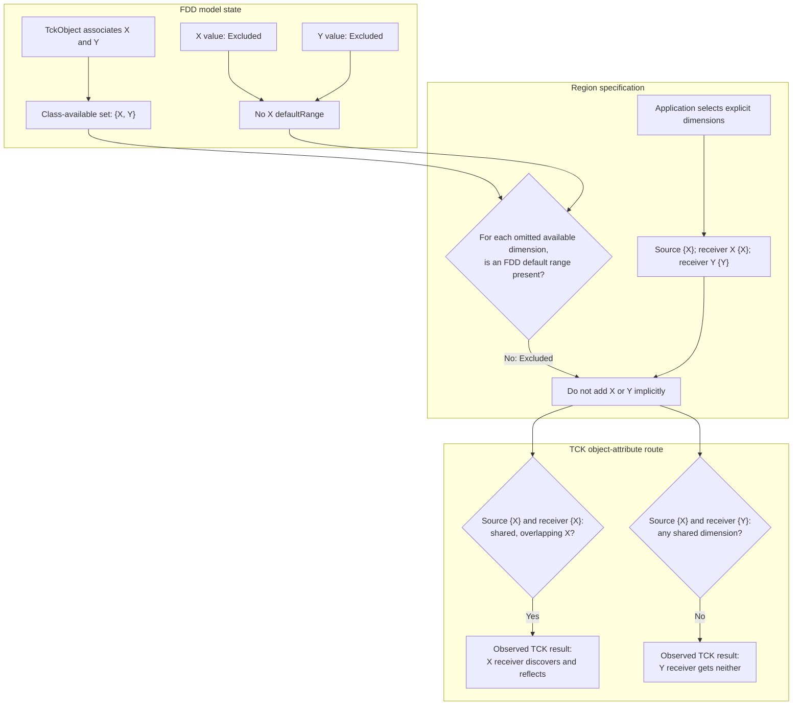

This chart describes the cited TCK fixture and current source path. It keeps
class availability separate from implicit default-range realization and
subsequent overlap; it does not define every FDD or regional-service case.

### When FDD default ranges fill omitted dimensions

The positive counterpart uses the multi-attribute FOM's `[0..100)` value for
dimensions X and Y ([X value](https://github.com/sheepfling/umbra/blob/c9c5a9e410539b039cd8bba35b53d0ef2b24d180/packages/hla-rti-cpp-tck/fom/ddm-multi-attribute-tck.xml#L93),
[Y value](https://github.com/sheepfling/umbra/blob/c9c5a9e410539b039cd8bba35b53d0ef2b24d180/packages/hla-rti-cpp-tck/fom/ddm-multi-attribute-tck.xml#L104)); the composer turns that into runtime default bounds
`0,100)`.
The portable TCK covers two distinct paths. First, ordinary object registration
has no publisher-supplied Region association; its default source region is
evaluated in each attribute's FDD dimension context. Second, an explicit
DerivedValue source Region stores only X, while routing temporarily adds
omitted Y with its FDD default range. The latter does not mutate the Region's
stored dimension set ([scenario and stored-set assertion[^worktree-source],
[default-range routing helper](../../cpp/src/internal/federation/federation_registry_regions.cpp#L631)).

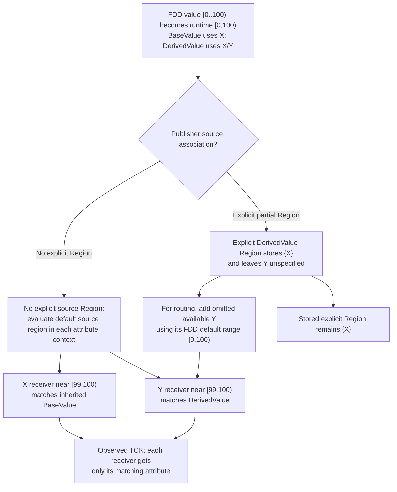

The default-region primary scenario and the explicit partial-region primary
scenario, with their contract twins, have recorded **8/8 passes** across both
callback models ([default-region catalog record](../../compliance/catalogs/cpp-tck-scenario-catalog.json#L53722),
[unspecified-dimension catalog record](../../compliance/catalogs/cpp-tck-scenario-catalog.json#L53815)).
In the default-region case, the test uses X-only and Y-only receiver Regions
near the upper bound and verifies each receives only its attribute
(scenario[^worktree-source],
attribute-only reflections[^worktree-source]).
In the partial-region case, it asserts the source Region still contains `{X}`
(assertion[^worktree-source]),
then observes a Y-only receiver at `99,100)` receive `DerivedValue` through
the default range
([reflection assertion[^worktree-source]).
This is bounded adapter behavior evidence; it does not make a Region handle
itself acquire Y or establish a general wildcard rule. When a dimension is
marked `Excluded`, the preceding case has no default range to project and the
Y-only route does not match.

### Inherited dimensions in a child-class regional path

The three-dimensional test source pairs the hierarchy query with a regional
registration and subscription attempt. Its current execution fails at
subscription before registration or callbacks. In the pinned Restaurant FOM,
[`Food.Drink`](../../third_party/ieee1516.2-2025/resources/examples/RestaurantFOMmodule-2025.xml#L226)
declares `BarQuantity`, its child
[`Soda`](../../third_party/ieee1516.2-2025/resources/examples/RestaurantFOMmodule-2025.xml#L255)
adds `SodaFlavor`, and
[`Light`](../../third_party/ieee1516.2-2025/resources/examples/RestaurantFOMmodule-2025.xml#L274)
adds `Sweetener`. Querying `Light` returns all three; the test source uses those
dimensions in publisher and receiver regions for the same `Light` class and
its `Flavor` attribute.

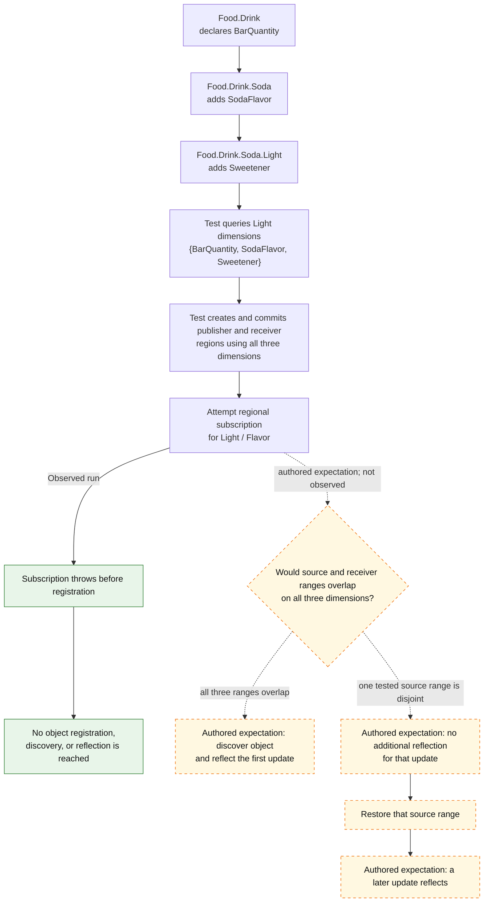

This is one embedded 2025 `HLA_EVOKED` test scenario, not a universal
inheritance rule. The test source queries the `Light` class, intends to
register and subscribe at that same class, and moves each source-region
dimension out of overlap before restoring it. In the current run, the
subscription throws before registration, so the overlap and callback branches
below are authored expectations, not observations. The query result is
observed. The test does **not** show how a parent-keyed
regional subscription interacts with a child-registered object; the embedded
source path is separated from dimension accumulation in the next subsection,
and no focused regional case tests that cross-class behavior. The relevant
API entry points are `getAvailableDimensionsForObjectClass` (§10.21),
`registerObjectInstanceWithRegions` (§9.5), and
`subscribeObjectClassAttributesWithRegions` (§9.8); see the clause table above.

The pinned [Restaurant FOM declarations](../../third_party/ieee1516.2-2025/resources/examples/RestaurantFOMmodule-2025.xml#L226)
and the embedded [dimension query test](../../cpp/tests/dimension_lookup_catch2.cpp#L112)
show the class-level inputs and returned set. The
[regional overlap test source](../../cpp/tests/three_dimensional_regional_object_attribute_overlap_catch2.cpp#L110)
asserts that set, supplies the three dimensions in both regions, and authors
expectations for discovery/reflection, per-dimension suppression, and restored
overlap. Although its filename is generic,
the [test source imports `rti1516_2025` API types](../../cpp/tests/three_dimensional_regional_object_attribute_overlap_catch2.cpp#L24),
and the [2025 embedded target declaration](../../cmake/ieee1516_2025_federation_management_catch2_targets.cmake#L1305)
identifies its build stream. The focused target was built, then run with the
dedicated `umbra.three_dimensional_regional_object_attribute_overlap.catch2`
CTest selector. It failed 1/1 at the test's
[`REQUIRE_NOTHROW` subscription assertion](../../cpp/tests/three_dimensional_regional_object_attribute_overlap_catch2.cpp#L214);
21 assertions passed and one failed. Catch2 reported `Unknown exception`.
Object registration and the later discovery/reflection assertions were not
reached.

The current embedded class-availability helper walks from the selected object
class through its parents
([helper](../../cpp/src/internal/federation/federation_registry_regions.cpp#L663)).
Regional object-attribute admission instead uses a per-attribute helper, which
resolves the declaring class before selecting its dimensions
([declaration-class lookup](../../cpp/src/internal/federation/federation_registry_regions.cpp#L703),
[subscription validation](../../cpp/src/internal/federation/federation_registry_object_attribute_declarations.cpp#L466)).
The three-dimensional scenario uses `Flavor` through `Light`, while the pinned
FDD declares `Flavor` on `Soda` and adds `Sweetener` on `Light`
([attribute declaration](../../third_party/ieee1516.2-2025/resources/examples/RestaurantFOMmodule-2025.xml#L262),
[Light dimension](../../third_party/ieee1516.2-2025/resources/examples/RestaurantFOMmodule-2025.xml#L277));
the test supplies a three-dimension region containing `Sweetener` for that
attribute
([regional subscription](../../cpp/tests/three_dimensional_regional_object_attribute_overlap_catch2.cpp#L214),
[regional registration](../../cpp/tests/three_dimensional_regional_object_attribute_overlap_catch2.cpp#L218)).
Those inputs include `Sweetener`, which the helper excludes when it resolves
`Flavor` to its declaring class, `Soda`. The subscription planner returns
`invalid_region_context` at its dimension-subset check
([check](../../cpp/src/internal/federation/federation_registry_object_attribute_declarations.cpp#L490));
the embedded translation maps that status to `InvalidRegionContext`
([translation](../../cpp/src/internal/runtime/umbra_rti_ambassador_service_failure_translation.cpp#L245)).
This source path is consistent with the failing CTest, but the Catch2 output
does not identify the dynamic exception type. Record the runtime fact as a
failed subscription assertion and the exception mapping as source evidence.
No process-profile parity is inferred.

The test's authored flow, observed CTest result, and embedded source path meet
at the subscription call. The focused target built successfully, then CTest
failed at `REQUIRE_NOTHROW`: 21 of 22 assertions passed, and Catch2 reported
`Unknown exception`. The inspected source path predicts a typed
`invalid_region_context` rejection at that point, which is consistent with the
failure location; the CTest output does not report the dynamic exception type.
This evidence does not decide the IEEE rule.

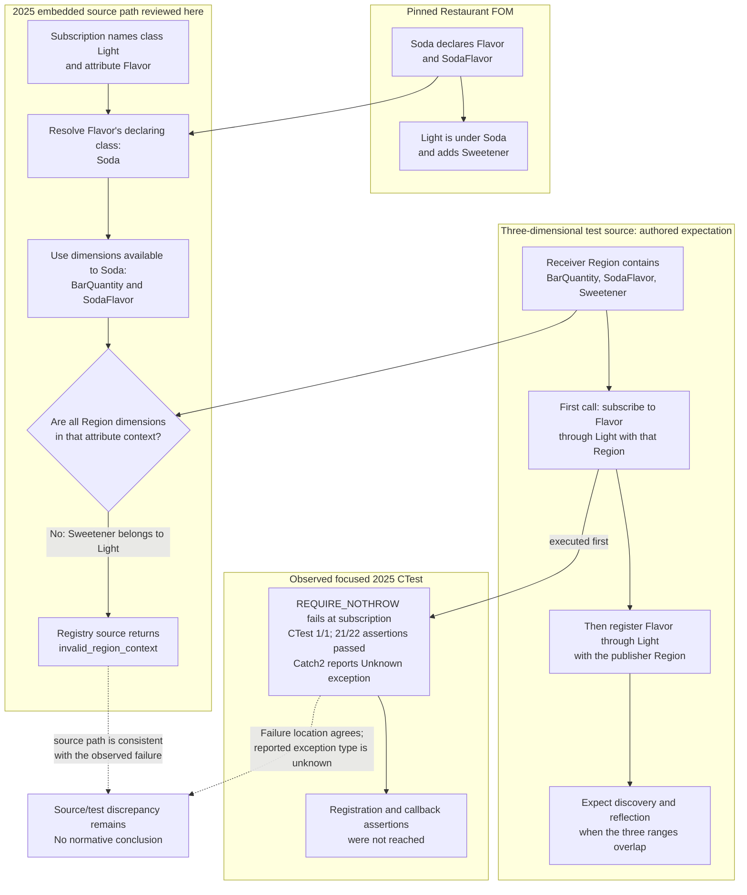

The [subscription check](../../cpp/src/internal/federation/federation_registry_object_attribute_declarations.cpp#L466)
uses the [attribute-specific dimension helper](../../cpp/src/internal/federation/federation_registry_regions.cpp#L703)
and returns `invalid_region_context` when the Region's dimension set is not
included in the selected set. The test's `REQUIRE_NOTHROW` subscription call
comes before registration and later discovery/reflection assertions
([test assertion](../../cpp/tests/three_dimensional_regional_object_attribute_overlap_catch2.cpp#L214)).
The built target fails at that assertion; Catch2 reports an unknown exception.
The registry status and public exception mapping are source evidence and match
the failure point, but the run did not expose the dynamic exception type. Keep
the chart as an implementation/test comparison, not an IEEE outcome.

The per-attribute helper is also used at other service boundaries. Keeping
those call sites distinct helps avoid treating the failed subscription as proof
that every regional operation was executed:

| 2025 path | Source use of attribute context | Focused evidence and limit |
| --- | --- | --- |
| Registration, regional subscription, Associate Regions for Updates, and regional class RAVU admission | Each checks every supplied Region's dimensions against `availableObjectClassAttributeDimensions` ([registration](../../cpp/src/internal/federation/federation_registry_object_instance_registration.cpp#L246), [subscription](../../cpp/src/internal/federation/federation_registry_object_attribute_declarations.cpp#L466), [association](../../cpp/src/internal/federation/federation_registry_update_region_associations.cpp#L47), RAVU[^worktree-source]). | The regional-context test expects `InvalidRegionContext` for all four services with `Soda.Flavor`, declared directly on `Soda` ([assertions](../../cpp/tests/regional_object_attribute_routing_catch2.cpp#L905)). The `Light`/`Flavor` case fails at subscription before it reaches registration ([assertion](../../cpp/tests/three_dimensional_regional_object_attribute_overlap_catch2.cpp#L214)). |
| Discovery and attribute-value overlap | Pairwise and default-region overlap realize regions using the same per-attribute context ([overlap functions](../../cpp/src/internal/federation/federation_registry_regions.cpp#L882), default-region function[^worktree-source]); the attribute update planner calls them during recipient selection ([planner](../../cpp/src/internal/federation/federation_registry_attribute_update_recipients.cpp#L487)). | The positive regional-routing test exercises `Soda.Flavor` with `SodaFlavor` ([test](../../cpp/tests/regional_object_attribute_routing_catch2.cpp#L198)). The three-dimensional test's overlap assertions are authored only; its subscription failure prevents reaching them. |
| Public available-dimensions query | `availableObjectClassDimensions` accumulates dimensions from the selected object class and its parents ([helper](../../cpp/src/internal/federation/federation_registry_regions.cpp#L663)). | The 2025 dimension lookup test observes the queried class's full set ([assertion](../../cpp/tests/dimension_lookup_catch2.cpp#L161)); this class-wide query does not itself select an attribute's declaration context. |

The failing `Light` Catch2 case is not the only evidence for this boundary. A
separate portable TCK scenario directly distinguishes an inherited attribute's
declaring-class dimensions from dimensions added only on a derived class; its
bounded result is summarized below. Keep the two fixtures separate: the TCK's
`BaseValue`/`DerivedValue` case passes, while the three-dimensional
`Light`/`Flavor` Catch2 case still fails at subscription because its test
supplies the child-only `Sweetener` dimension for `Flavor`.
For association commit and its later effects, the existing flows already trace
the [association preflight and map update](#a-stale-region-rejects-the-association-before-the-map-changes),
[pending versus committed bounds at discovery](#a-committed-range-change-can-discover-an-existing-object),
and [later receive-order update routing](#receive-order-value-routing-after-regional-overlap-changes);
those paths make a duplicate region-association chart unnecessary here.

#### Passing portable TCK case: inherited attributes keep their FDD dimensions

The portable TCK uses a purpose-built hierarchy: the base class declares
`BaseValue` with dimension X; the derived class adds dimension Y and declares
`DerivedValue` ([FOM](../../packages/hla-rti-cpp-tck/fom/ddm-multi-attribute-tck.xml#L54)).
The public class query still reports the class-level sets, base `{X}` and
derived `{X,Y}` (test setup[^worktree-source]).
The test verifies that the inherited `BaseValue` handle remains the same when
looked up through the derived class, while regional service admission uses
the attribute's declaring-class dimension context.

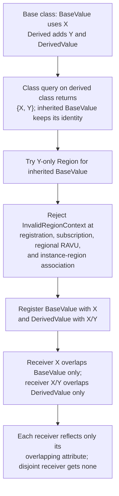

This portable TCK scenario and its contract twin passed **4/4 executions**:
both scenario IDs under `HLA_EVOKED` and `HLA_IMMEDIATE`. Its source rejects a
Y-only Region for inherited `BaseValue` at registration, subscription, and
regional value request, rejects changing its instance association to Y, then
routes an update so an X receiver gets only `BaseValue`, an X/Y receiver gets
only `DerivedValue`, and a disjoint receiver gets no reflection
(rejections and setup[^worktree-source],
regional subscription setup[^worktree-source],
update call[^worktree-source],
per-attribute reflection assertions[^worktree-source],
[recorded catalog result](../../compliance/catalogs/cpp-tck-scenario-catalog.json#L53598)).
The contract twin repeats the same fixture and is paired evidence, not an
independent second coverage claim. This result covers these named services and
fixture; it does not create a public per-attribute dimension query or decide
the separate failing `Light`/`Flavor` case.

### Object-class ancestry: regional discovery and value projection

The child-class dimension set and a receiver's regional declaration are
different kinds of inheritance. The first flow ends when the publisher's
source association is admitted; the second starts from that registered object
state and follows each receiver's discovery path. The selected embedded 2025 source accumulates
available dimensions from the queried object class and its parents, but it
stores regional subscriptions under the exact class-and-attribute key passed
to the service. A publisher's update-region association is instead attached
to an object instance and attribute.

At discovery, the registry first checks whether an active subscription from
a joined non-producer establishes the object's relevance. For each receiver,
it then starts at the object's registered class and walks toward parents,
checking the declarations and attribute visibility at each class. The closest
qualifying class becomes that receiver's known class. Thus a parent-keyed
regional declaration can be considered for a child-registered object along
this source path; the
declaration is not copied into the child's class entry. The source's active-
relevance scan
([source](../../cpp/src/internal/federation/federation_registry.cpp#L878))
is separate from a particular receiver's subscription status;
after that scan succeeds, a passive declaration may still supply the
receiver's closest class. Later value planning uses the receiver's saved
known class to filter visible attributes and the declarations at that class.
A receiver discovered at a parent class does not gain child-only attributes
merely because the publisher registered the instance at a child class.

#### Registration context: available dimensions and source regions

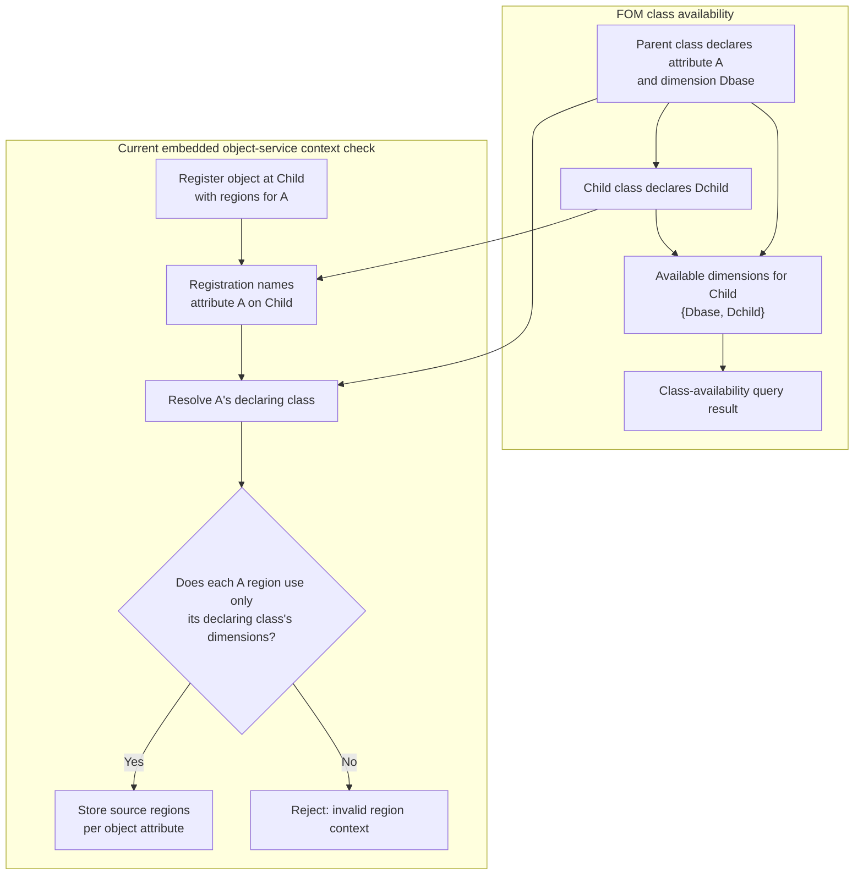

#### Receiver discovery and later value projection

The admitted registration state supplies the object's class and per-attribute
source Regions. Discovery evaluates that state separately for each receiver.

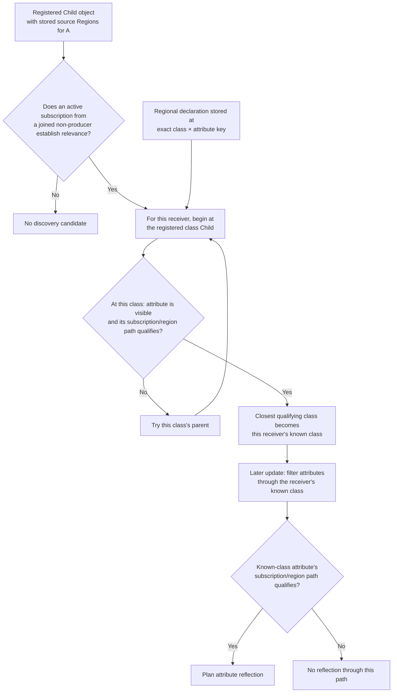

This is an embedded-source map, not a normative inheritance rule. The
[pinned API entries](../../third_party/ieee1516.1-2025/include/RTI/RTIambassador.h#L1487)
for `registerObjectInstanceWithRegions` (§9.5) and
[`subscribeObjectClassAttributesWithRegions`](../../third_party/ieee1516.1-2025/include/RTI/RTIambassador.h#L1559)
(§9.8) are navigation pointers, not evidence for the cross-class behavior
described here. The [dimension helper](../../cpp/src/internal/federation/federation_registry_regions.cpp#L663)
walks the object-class parents;
[registration state](../../cpp/src/internal/federation/federation_registry_object_instance_registration.cpp#L197)
keeps the registered class while
[source regions are stored per object attribute](../../cpp/src/internal/federation/federation_registry_object_instance_registration.cpp#L371);
[regional subscription storage](../../cpp/src/internal/federation/federation_registry_object_attribute_declarations.cpp#L503)
keys declarations by class before attribute; the
[discovery resolver](../../cpp/src/internal/federation/federation_registry.cpp#L835)
walks from the registered class toward parents
([parent step](../../cpp/src/internal/federation/federation_registry.cpp#L1084));
and the [attribute update planner](../../cpp/src/internal/federation/federation_registry_attribute_update_recipients.cpp#L121)
uses the receiver's saved known class to select declarations and filter
attributes. The three-dimensional test queries `Light` and its assertion
confirms the available set `{BarQuantity, SodaFlavor, Sweetener}` before
execution fails at regional subscription. Its authored registration and
overlap path therefore does not demonstrate regional delivery. It also does
not test a parent-class regional subscription against a child-registered
object. Keep that cross-class result source-only; do not infer process-endpoint
or 2010 parity. For how discovery
and attribute projection differ from other ancestry paths, see the object
information guide's [cross-path class ancestry map](HLA-2025-OBJECT-AND-INTERACTION-INFORMATION-FLOW-GUIDE.md#class-ancestry-has-different-jobs-in-different-paths).

#### Worked source-only trace: parent subscription, child object

This hypothetical separates three questions that are easy to collapse:
whether each region fits its own class context, whether the declarations are
considered while walking class ancestry, and whether their committed
realizations overlap. It composes current embedded source paths; it is not a
focused test or a normative example.

| Stage | Example state | Current embedded source path |
| --- | --- | --- |
| Class context | `Base` declares attribute `A` and dimension `D`; `Child` inherits `D` and adds dimension `E`. Available dimensions are `{D}` for `Base` and `{D, E}` for `Child`. | The dimension query collects associations on the selected class and its parents ([helper](../../cpp/src/internal/federation/federation_registry_regions.cpp#L663)). |
| Admission | The receiver subscribes to `Base/A` with a committed region over `{D}`. The publisher registers a `Child` object and associates `A` with a committed source region over `{D, E}`. | Subscription and registration check each region's dimension set against the available set of the class named by that service ([subscription](../../cpp/src/internal/federation/federation_registry_object_attribute_declarations.cpp#L465), [registration](../../cpp/src/internal/federation/federation_registry_object_instance_registration.cpp#L245)). |
| Discovery | With an active non-producer declaration and overlapping committed ranges on shared dimension `D`, the discovery planner walks from registered class `Child` to `Base` and can consider the `Base/A` declaration. | The active-relevance and per-receiver class walks are in the [discovery resolver](../../cpp/src/internal/federation/federation_registry.cpp#L835); overlap uses committed region snapshots ([overlap helper](../../cpp/src/internal/federation/federation_registry_regions.cpp#L792)). |
| Receiver knowledge and later value | If `Base/A` is the closest qualifying receiver declaration, the receiver's known class is `Base`. A later reflection is projected through that saved class, so child-only attributes are not made visible by the publisher's `Child` registration. | The receiver walk saves the qualifying class in the [discovery resolver](../../cpp/src/internal/federation/federation_registry.cpp#L835); later per-recipient filtering starts from that class in the [attribute update planner](../../cpp/src/internal/federation/federation_registry_attribute_update_recipients.cpp#L121). |

The [child-object/base-subscription test](../../cpp/tests/subscribe_object_class_attributes_discovery_catch2.cpp#L297)
covers the nearest-known-class result without regions. The
[three-dimensional regional test](../../cpp/tests/three_dimensional_regional_object_attribute_overlap_catch2.cpp#L110)
asserts the available dimensions for `Light`, then fails at the same-class
regional subscription before registration or overlap delivery. The inspected
2025 process regional cases also use the same class for publisher and receiver.
These components do not establish the combined parent-subscription/child-object
callback outcome; keep that result as an embedded source inference, not process
evidence or an HLA requirement.

### 2025 process-endpoint boundary for regional objects

The process endpoint adds a session and event-transport boundary around the
2025 registry's regional decisions. The service validates that the connected
session represents the requested federation member, delegates registration,
declaration, or source-region changes and recipient planning to the shared
registry, then routes the returned discovery, scope, and advisory events to
process sessions. This is an Umbra process-path map, not an additional HLA
rule, and it covers regional object registration/declarations/associations,
not ordinary or timestamped attribute-value routing. The chart shows the
successful mutation paths; rejected and unapplied-result branches are omitted.

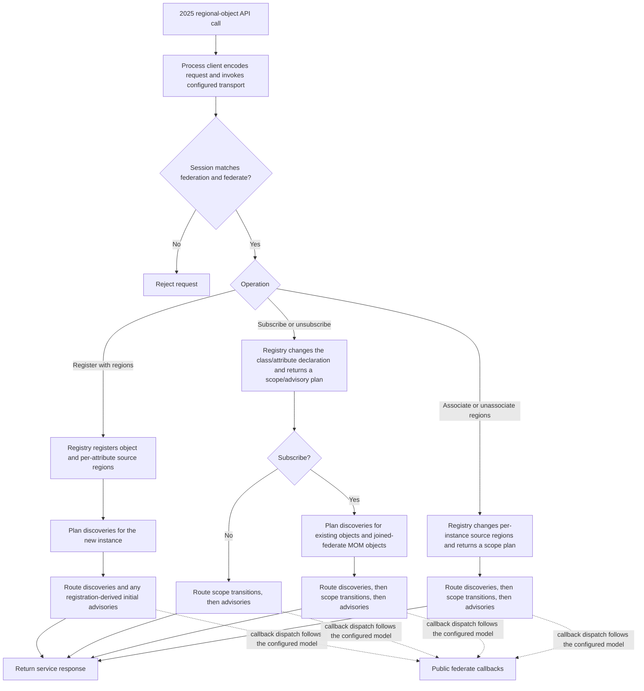

The client-side boundary is visible in the [regional registration wrapper](../../cpp/src/internal/federation/process_federation_client_region_services.cpp#L276)
and [regional subscription wrapper](../../cpp/src/internal/federation/process_federation_client_declaration_services.cpp#L482),
which encode requests and invoke the configured transport. On the server side,
the [regional registration and association handlers](../../cpp/src/internal/federation/process_federation_service_regional_object_association.cpp#L8)
and the [regional subscription handler](../../cpp/src/internal/federation/process_federation_service_declarations.cpp#L261)
validate the session before asking the registry to mutate state or produce a
plan. Subscription-triggered discovery is planned only on subscribe,
and is routed before the returned scope changes and advisories. Association
changes route discoveries before scope changes and advisories as well. The
process-specific [discovery router](../../cpp/src/internal/federation/process_federation_service_object_discovery.cpp#L11),
[scope-event router](../../cpp/src/internal/federation/process_federation_service_notifications.cpp#L282),
and [advisory router](../../cpp/src/internal/federation/process_federation_service_attribute_relevance_advisories.cpp#L11)
are separate from the registry's recipient decision.
The process scope route has distinct polling-queue and pushed-event stale-work
checkpoints; see the [Attribute Scope Advisory process-path note](HLA-2025-ATTRIBUTE-SCOPE-ADVISORY-FLOW-GUIDE.md#process-event-transport-has-two-stale-work-checkpoints)
for the bounded source evidence and missing race-test boundary.

Three focused [initial-discovery](../../cpp/tests/ieee1516_2025_connection_regional_attribute_relevance_initial_discovery_catch2.cpp#L458),
[subscription-transition](../../cpp/tests/ieee1516_2025_connection_regional_attribute_relevance_subscription_transition_catch2.cpp#L457),
and [source-region transition](../../cpp/tests/ieee1516_2025_connection_regional_attribute_relevance_transition_catch2.cpp#L42)
cases exercise configured process endpoints. All use
`HLAobjectRoot.Food.Drink.Soda` for registration and subscription and compare
the publisher/receiver class handles in the [initial-discovery](../../cpp/tests/ieee1516_2025_connection_regional_attribute_relevance_initial_discovery_catch2.cpp#L709),
[subscription-transition](../../cpp/tests/ieee1516_2025_connection_regional_attribute_relevance_subscription_transition_catch2.cpp#L708),
and [source-region transition](../../cpp/tests/ieee1516_2025_connection_regional_attribute_relevance_transition_catch2.cpp#L322)
cases. In the initial-discovery case, the owner-directed advisory is observed during the
registration response under HLA_IMMEDIATE, but after an explicit evoke under
HLA_EVOKED; [the case comment](../../cpp/tests/ieee1516_2025_connection_regional_attribute_relevance_initial_discovery_catch2.cpp#L736)
notes that the test does not need a second network poll. These are bounded
case results, not proof of every callback ordering or process/embedded parity.
None tests a parent-class regional subscription against a child-registered
object, so the cross-class behavior above remains source-only for the embedded
path and unclaimed for the process endpoint. The entire path here is 2025-only;
make no 2010 inference.

### Interaction-class ancestry: available context and declaration lookup

For a selected interaction class, the tested 2025 baseline has two different
parent-chain uses. The first computes the dimension context used to validate a
regional declaration or send. The second is a later delivery lookup: after a
separate interaction-relevance gate, each receiver's candidate class starts
at the sent class and walks toward its parents. At each candidate, the planner
checks declarations keyed to that exact class; a regional candidate must also
overlap the source region. Thus a parent-keyed regional declaration can be
*considered* for a send on a descendant class in this source path; the walk
does not search downward from a parent send to child-keyed declarations.
Neither direction means declarations are copied between class keys, and
neither is here claimed as a normative inheritance rule. In the shared 2025
candidate selector, an eligible ordinary/default route is checked before the
regional route at each class candidate. A disjoint With Regions declaration
does not by itself suppress that ordinary route; regional overlap is considered
when the ordinary route does not qualify. The flow below records current
source and focused-test behavior, not a normative inheritance rule.

An ordinary embedded receive-order case now exercises the nonregional
candidate walk for one receiver: a descendant send reports the base when only
the base is subscribed, the middle when base and middle are subscribed, and
the sent class when that exact class is subscribed too. Each send produces
one callback whose class matches the selected candidate
([test](../../cpp/tests/inherited_interaction_receipt_catch2.cpp#L71)). It
uses empty parameter maps and no regions, so it does not verify inherited
parameter projection, regional overlap, or the available-dimension checks in
the diagram below. Keep those branches source-scoped; this case does not
establish a normative inheritance rule or process-profile parity.

For how this regional path differs from object discovery, ordinary
interaction promotion, and directed routing, see the object-information
guide's [cross-path class ancestry map](HLA-2025-OBJECT-AND-INTERACTION-INFORMATION-FLOW-GUIDE.md#class-ancestry-has-different-jobs-in-different-paths).

```mermaid
flowchart TD
  subgraph Subscribe["Regional subscription declared for class C"]
    C["Select interaction class C"] --> SR{"Subscription region set non-empty?"}
    SR -->|No| SNoOp["No regional declaration change"]
    SR -->|Yes| CA["Available dimensions = dimensions on C and its parent chain"]
    CA --> CV["Validate each subscription region against that set"]
    CV --> CS["Store regional entries under C's exact class handle"]
  end

  subgraph Send["Regional send on interaction class S"]
    S["Select sent interaction class S"] --> ER{"Explicit source-region set non-empty?"}
    ER -->|No| ENoOp["No send through this invocation"]
    ER -->|Yes| SA["Available dimensions = dimensions on S and its parent chain"]
    SA --> SV["Validate each explicit source region against that set"]
    SV --> RG{"Separate global active-subscription relevance gate succeeds?"}
    RG -->|No| Stop["No recipient candidate is planned"]
    RG -->|Yes| Candidate["For this receiver, begin candidate walk at S"]
    Candidate --> Ordinary{"Eligible ordinary/default route at this candidate?"}
    Ordinary -->|Yes| OrdinaryEligible["Select this candidate through its ordinary/default route"]
    Ordinary -->|No| Regional{"Regional declaration keyed at this candidate?"}
    Regional -->|Yes| Overlap{"Does a candidate region overlap the source region?"}
    Overlap -->|Yes| RegionalEligible["Select this candidate through its regional route"]
    Overlap -->|No| Parent["Try the candidate's parent class"]
    Regional -->|No| Parent
    Parent --> Candidate
    OrdinaryEligible --> Projection["Set planned received class and parameter projection;<br/>later delivery gates still apply"]
    RegionalEligible --> Projection
  end
```

**Bounded 2025 source/test evidence; not a normative rule.** The shared
[per-recipient selector](../../cpp/src/internal/federation/federation_registry.cpp#L1725)
checks an eligible ordinary/default route before falling back to a regional
declaration at that class candidate. Both the [embedded regional-send path](../../cpp/src/internal/runtime/umbra_rti_ambassador_regional_interaction_send_services.cpp#L253)
and the [configured-process send handler](../../cpp/src/internal/federation/process_federation_service_interaction_send.cpp#L546)
invoke the shared `planReceiveOrderInteraction` planner. The chart therefore
shows a common source decision. Its focused mixed-subscription test is embedded;
the separate [process fan-out case](#process-endpoint-fan-out-evaluate-each-receiver-separately)
tests regional-only receivers with different overlaps, not this ordinary-plus-
regional subscription combination. The updated focused test expects a mixed
receiver to receive an explicit-source interaction through its ordinary
subscription despite a disjoint regional declaration
([focused case](../../cpp/tests/ieee1516_2025_default_region_interaction_routing_catch2.cpp#L5),
[assertion](../../cpp/tests/ieee1516_2025_default_region_interaction_routing_catch2.cpp#L88));
the focused CTest passed 1/1 with 50 assertions in the current MinGW build. The
second embedded fixture now expresses the same expectation
([case](../../cpp/tests/default_region_interaction_routing_catch2.cpp#L90),
[assertion](../../cpp/tests/default_region_interaction_routing_catch2.cpp#L197)).
This is one exercised embedded scenario, not broad DDM coverage. The process
path uses the shared selector, but this case has no focused process assertion;
the later process event and callback stages remain a separate boundary. The
exact normative interpretation of IEEE 1516.1-2025 §9.1.5 remains unverified
until its authorized text is reviewed; neither source comments nor test
mappings establish that interpretation.

**Authorized-text access check (2026-11-05).** The [IEEE product page](https://standards.ieee.org/ieee/1516.1/6688/)
lists the active standard with purchase and subscription access and links a
public [downloads archive](https://standards.ieee.org/wp-content/uploads/2025/08/1516.1-2025_downloads.zip).
I inspected that archive: it contains the 2025 API XML package (C++/Java API
files, protobuf, schemas, and example models), not the standard clauses. IEEE's
[Reading Room](https://standards.ieee.org/access-standards/) provides free
account access to selected standards, but its public page does not establish
whether 1516.1-2025 is included. This access check adds no normative
interpretation; keep §9.1.5 open until authorized clause text is available.

The chart is a **shared-registry 2025 source map with embedded test evidence**,
not a normative flowchart. It isolates class/DDM lookup and omits publication
and other service preconditions, sender self-exclusion, order/transport, and
later callback-dispatch gates. Shared recipient selection does not establish
that downstream process effects match the embedded callback path. The API
entry points are
`getAvailableDimensionsForInteractionClass`
(§10.22), `subscribeInteractionClassWithRegions` (§9.10), and
`sendInteractionWithRegions` (§9.12); these are navigation pointers, not
paraphrases of the licensed clauses. The implementation's availability
helper walks the selected class and its parents
([helper](../../cpp/src/internal/federation/federation_registry_regions.cpp#L589));
regional subscription validates against that result and stores by the
provided class handle
([validation](../../cpp/src/internal/federation/federation_registry_directed_interactions.cpp#L624),
[exact-key write](../../cpp/src/internal/federation/federation_registry_directed_interactions.cpp#L651));
regional send validates the sent class's regions against its available set
([send planner](../../cpp/src/internal/federation/federation_registry_receive_order_interactions.cpp#L82));
and recipient resolution begins at the sent class, checks each candidate, and
advances to its parent
([planner](../../cpp/src/internal/federation/federation_registry.cpp#L1421),
[candidate walk](../../cpp/src/internal/federation/federation_registry.cpp#L1512),
[parent step](../../cpp/src/internal/federation/federation_registry.cpp#L1611)).

The reviewed tests do not combine an ancestor-only interaction dimension
with regional subscription/send, or a parent-class regional subscription
with a descendant-class send. The Restaurant query case reports
`ServerId` for `MainCourseServed`, but the FOM has no dimension on
`FoodServed` and declares `ServerId` directly on its `MainCourseServed`
child; it is not evidence of ancestor-dimension accumulation. The focused
regional interaction case also uses `MainCourseServed` for both subscription
and send. See the [query assertions](../../cpp/tests/dimension_lookup_catch2.cpp#L121),
the FOM's [`FoodServed` parent](../../third_party/ieee1516.2-2025/resources/examples/RestaurantFOMmodule-2025.xml#L444)
and [`MainCourseServed` child declaration](../../third_party/ieee1516.2-2025/resources/examples/RestaurantFOMmodule-2025.xml#L464),
and the [regional case's selected class](../../cpp/tests/ieee1516_2025_regional_interaction_subscription_receive_order_catch2.cpp#L50).
Keep both cross-class consequences explicitly source-only until a focused
case or the applicable licensed standard text establishes more; do not
transfer the object-case test result to interactions.

#### Additional-module Join: retained regional interaction declarations

For the embedded 2025 source path, an additional-module Join prepares a new
composed definition and reconciles the existing interaction-class, parameter,
and dimension handle directories before swapping the replacement definition
and directories with the new membership
([preparation](../../cpp/src/internal/federation/federation_registry_membership_lifecycle.cpp#L298),
[commit](../../cpp/src/internal/federation/federation_registry_membership_lifecycle.cpp#L618),
[interaction handles](../../cpp/src/internal/handles/interaction_class_handle_directory.cpp#L10),
[parameter handles](../../cpp/src/internal/handles/parameter_handle_directory.cpp#L35),
[dimension handles](../../cpp/src/internal/handles/dimension_handle_directory.cpp#L9)).
The per-federate interaction-declaration map is separate from those catalog
directories and is not rewritten by that swap
([declaration state](../../cpp/src/internal/federation/federation_registry.hpp#L2635)).
Regional entries remain keyed by the exact interaction-class handle supplied
when the declaration was made
([regional write](../../cpp/src/internal/federation/federation_registry_directed_interactions.cpp#L651));
Join does not copy a parent declaration onto a newly available descendant.

There is a separate dimension-growth case when a later module adds a unique
dimension association to an interaction class that already exists. The
composer's `dimensions` merge appends unique references
([merge rule](../../cpp/src/internal/fom/libxml2_fom_composer.cpp#L983),
[dispatch](../../cpp/src/internal/fom/libxml2_fom_composer.cpp#L1069)). The
registry reconciles the dimension directory by name and swaps the replacement
catalog and directories at commit; this path does not rewrite existing Region
records or the per-federate interaction-declaration map
([directory reconciliation](../../cpp/src/internal/federation/federation_registry_membership_lifecycle.cpp#L331),
[catalog/directory commit](../../cpp/src/internal/federation/federation_registry_membership_lifecycle.cpp#L618),
[dimension handle reuse](../../cpp/src/internal/handles/dimension_handle_directory.cpp#L9),
[Region creation](../../cpp/src/internal/federation/federation_registry_regions.cpp#L67),
[regional declaration state](../../cpp/src/internal/federation/federation_registry.hpp#L2322),
[per-federate map](../../cpp/src/internal/federation/federation_registry.hpp#L2635)).

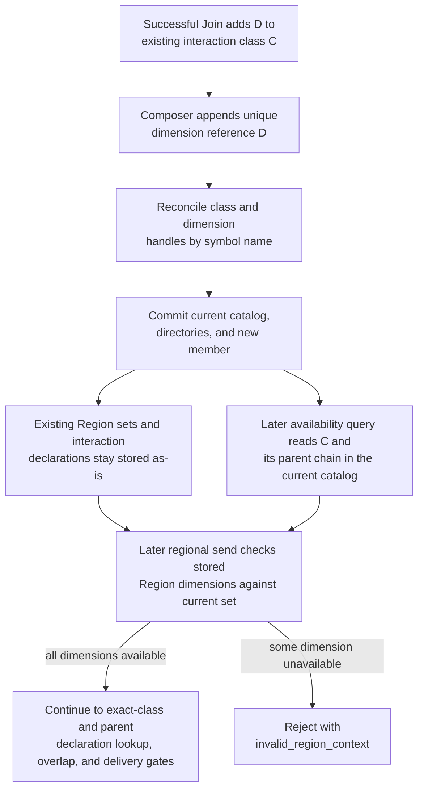

This is a source-derived 2025 path, not tested or normative behavior. Since
this scenario only adds an association, a Region's old dimension set remains
unchanged; if it was a subset before the addition, it remains a subset for the
later send's context check. That check alone does not add the new dimension to
the Region or establish overlap or callback delivery. The availability helper
reads the current class ancestry
([helper](../../cpp/src/internal/federation/federation_registry_regions.cpp#L589)),
and the send planner tests the supplied Region dimensions against that set
([context check](../../cpp/src/internal/federation/federation_registry_receive_order_interactions.cpp#L107)).

A later regional send uses the current catalog in two distinct decisions.
The send's source regions are checked against dimensions currently available
to the sent class and its parents
([dimension-context check](../../cpp/src/internal/federation/federation_registry_receive_order_interactions.cpp#L82)).
Recipient selection then starts at the sent class, checks that exact class's
ordinary/regional declarations and region overlap, and walks toward parent
classes when no candidate is eligible
([recipient planner](../../cpp/src/internal/federation/federation_registry.cpp#L1421),
[candidate walk](../../cpp/src/internal/federation/federation_registry.cpp#L1512),
[region-overlap check](../../cpp/src/internal/federation/federation_registry.cpp#L1568),
[parent step](../../cpp/src/internal/federation/federation_registry.cpp#L1611)).
Consequently, this source path can consider a retained parent-class regional
subscription for a later send on an added descendant class. That is a
source-derived lookup result—not a copied subscription, a normative
inheritance claim, or a guarantee that every later callback is delivered;
relevance, sender exclusion, and callback-dispatch gates remain separate.

The evidence is deliberately narrower. The additional-module dimension test
observes a new interaction class and its dimension through lookup while also
checking an existing dimension handle; it does not preserve a regional
interaction declaration or send on the new class
([test](../../cpp/tests/dimension_lookup_catch2.cpp#L129)). The focused
regional receive-order test subscribes and sends on the same
`MainCourseServed` class without an additional-module Join
([test](../../cpp/tests/ieee1516_2025_regional_interaction_subscription_receive_order_catch2.cpp#L50)).
No focused case combines Join, a retained parent-keyed regional subscription,
and a later descendant send, or extends an existing interaction class's
dimension set while retaining its Region sets. Keep these as embedded 2025
source traces; the process-profile test evidence and normative interpretation
are not established here. The
existing [interaction ancestry map](#interaction-class-ancestry-available-context-and-declaration-lookup)
diagrams send-time class lookup; the flow above covers the separate Join-time
catalog and retained-Region transition.

The configured process profile keeps a separate transport and callback
boundary, but its additional-FOM Join passes the prepared definition to
`joinWithDefinitionAndTimeState`, its regional-subscription handler delegates
to the registry declaration methods, and receive-order sends pass the class
and optional source regions to `planReceiveOrderInteraction`
([process Join](../../cpp/src/internal/federation/process_federation_service_lifecycle.cpp#L589),
[regional declaration handler](../../cpp/src/internal/federation/process_federation_service_declarations.cpp#L31),
[send planner call](../../cpp/src/internal/federation/process_federation_service_interaction_send.cpp#L389)).
This is source-level reuse of the registry's catalog and recipient-planning
logic, not an end-to-end process-parity result. The reviewed public process
multi-recipient case joins without additional modules and exercises per-
receiver overlap, but not this added-class combination
([test](../../cpp/tests/ieee1516_2025_connection_multi_recipient_regional_interaction_catch2.cpp#L917)).
No focused process test in this bounded review combines additional-module
Join, a retained parent-keyed regional subscription, and a send on the added
descendant.

The embedded lookup case later admits an additional module containing a
separate class and dimension, then observes the new dimension through lookup
while an existing dimension handle remains stable. It does not test how a
later module that changes an existing class's associations interacts with
already-created regions. This is a test-evidence limit, not proof that an
existing class cannot gain another association. For admission and composition
boundaries, see the [FOM module guide](HLA-2025-FOM-MODULE-ADMISSION-AND-COMPOSITION-FLOW-GUIDE.md);
the region lifecycle section below keeps creation and commitments distinct.

### 2025 implementation trace: class availability and existing regions

The following is an Umbra source-derived case study, not a claim about
normatively required additional-module Join behavior and not a statement about
the separate 2010 stream. In the current composer, repeated scalar dimension
references are keyed by their text ([node-key logic](../../cpp/src/internal/fom/libxml2_fom_composer.cpp#L164)),
and recursive composition routes a `dimensions` node through a
[dimension-specific merge](../../cpp/src/internal/fom/libxml2_fom_composer.cpp#L983)
that appends unique references ([append step](../../cpp/src/internal/fom/libxml2_fom_composer.cpp#L1004)).
This means a later module can add a dimension association to an already-composed
class; the current class-availability result can then grow. The focused
later-module case cited above adds a separate class instead, so it does not
directly test this same-class extension.

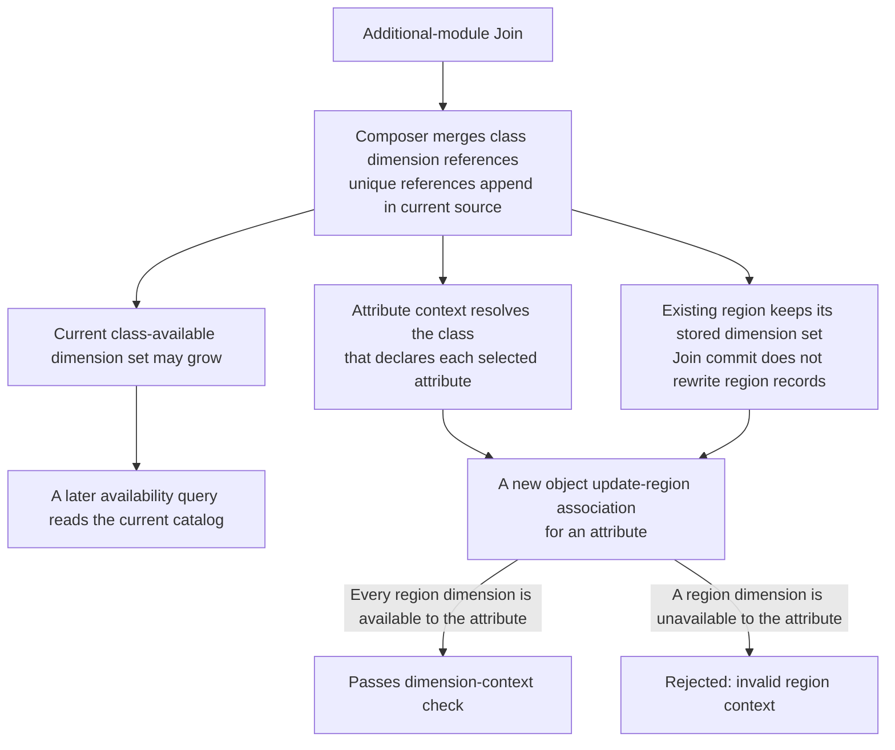

The source path behind this distinction is specific and useful: the
[composer's unique-reference append](../../cpp/src/internal/fom/libxml2_fom_composer.cpp#L1004)
merges dimension references; additional-module Join copies and
[reconciles the existing dimension-handle directory](../../cpp/src/internal/federation/federation_registry_membership_lifecycle.cpp#L331)
against the replacement catalog via the
[dimension directory](../../cpp/src/internal/handles/dimension_handle_directory.cpp#L9),
then swaps the replacement definition and prepared directories together
([definition swap](../../cpp/src/internal/federation/federation_registry_membership_lifecycle.cpp#L618),
[dimension-directory swap](../../cpp/src/internal/federation/federation_registry_membership_lifecycle.cpp#L624));
`createRegion` stores the exact dimension-handle set supplied by the
application ([region record](../../cpp/src/internal/federation/federation_registry_regions.cpp#L67));
and a later object update-region association request checks each attribute's
region dimensions against the set resolved for that attribute's declaring
class ([declaration-class lookup](../../cpp/src/internal/federation/federation_registry_regions.cpp#L738),
[dimension selection](../../cpp/src/internal/federation/federation_registry_regions.cpp#L744),
[association validation](../../cpp/src/internal/federation/federation_registry_update_region_associations.cpp#L66)).
The Join commit does not itself rewrite regions or rerun that association
check. Under the source's additive dimension-reference merge, an existing
region that was compatible before an added class association remains a subset
afterward; this is a source-derived consequence, not a focused integration
test result.

The [embedded additional-module test](../../cpp/tests/dimension_lookup_catch2.cpp#L149)
joins the extension modules, then confirms the [prior dimension handle remains stable](../../cpp/tests/dimension_lookup_catch2.cpp#L154)
and the [new class exposes its dimension](../../cpp/tests/dimension_lookup_catch2.cpp#L161). The focused cases reviewed
here do not extend an existing class's dimension list or keep a region alive
across that extension. Do not present the diagram's untested branch as
normative HLA behavior or as verified process-endpoint behavior.

#### Dimension-context admission is not later regional delivery

If a dimension association is added to the class that declares an attribute,
the current embedded object-attribute check can include it in that attribute's
context. A dimension added only to a more-derived class does not widen an
ancestor-declared attribute's set in the current source. Regional subscription
stores entries under the supplied class/attribute/region keys; update-region
association stores source regions separately per object/attribute. Neither
request changes the dimension set captured by a region that already exists;
nor does passing either context check establish
that the two sides overlap or that a callback will result. A later update uses
the committed source and receiver region snapshots in the separate object
discovery/value path. See [object-class ancestry, regional discovery, and value
projection](#object-class-ancestry-regional-discovery-and-value-projection)
and [receive-order routing after regional overlap changes](#receive-order-value-routing-after-regional-overlap-changes).

In the current embedded 2025 implementation, the class-context set depends on
the service family:

- **Object-attribute services** resolve each supplied attribute to its
  declaring object class, then use that class's available dimensions
  ([declaration lookup](../../cpp/src/internal/federation/federation_registry_regions.cpp#L738),
  [dimension selection](../../cpp/src/internal/federation/federation_registry_regions.cpp#L744)).
  This check is used by regional object registration
  ([check](../../cpp/src/internal/federation/federation_registry_object_instance_registration.cpp#L265)),
  update-region association
  ([check](../../cpp/src/internal/federation/federation_registry_update_region_associations.cpp#L66)),
  regional attribute subscription
  ([check](../../cpp/src/internal/federation/federation_registry_object_attribute_declarations.cpp#L485)),
  and regional attribute-value request
  ([check](../../cpp/src/internal/federation/federation_registry_attribute_value_update_requests.cpp#L1050)).
  The focused object-context case exercises all four services with a dimension
  unavailable to the selected class
  ([case](../../cpp/tests/regional_object_attribute_routing_catch2.cpp#L838),
  [registration](../../cpp/tests/regional_object_attribute_routing_catch2.cpp#L905),
  [association](../../cpp/tests/regional_object_attribute_routing_catch2.cpp#L912),
  [subscription](../../cpp/tests/regional_object_attribute_routing_catch2.cpp#L916),
  [request](../../cpp/tests/regional_object_attribute_routing_catch2.cpp#L920)).
- **Interaction services** use the selected interaction class's dimensions
  accumulated through its interaction-class parent chain
  ([inheritance walk](../../cpp/src/internal/federation/federation_registry_regions.cpp#L605)).
  Non-empty regional subscriptions and sends check supplied regions against
  that set ([subscription](../../cpp/src/internal/federation/federation_registry_directed_interactions.cpp#L639),
  [send](../../cpp/src/internal/federation/federation_registry_receive_order_interactions.cpp#L107)).
  Empty subscription and send sets have their separate no-effect/no-send
  branches described in the interaction flow above.

These are source observations, not a universal normative algorithm. The
three-dimensional test now records a failed subscription assertion for its
`Flavor`/`Light`/`Sweetener` input; source inspection explains the failure point,
but the reported dynamic exception type remains unknown and the §9.1.5 question
is open. This combined Join-to-delivery path also remains source-only: the additional-module dimension test adds a
separate class, while the focused regional case tests overlap without a later
Join. No focused test extends an existing class's dimension set, retains its
old regions, submits new regional subscription/association state, and observes
a later update.

### A queued timestamped default-region interaction when Join adds a dimension

The embedded 2025 trace below is for timestamped `sendInteraction` without
an explicit Region set, when the sender is regulating and the planned order is
`TIMESTAMP`. The planner reads the interaction class's available dimensions
and sets `defaultRegionUsed` when that set is non-empty. The adapter stores
that value in the TSO message and derives constrained-recipient queue entries
from the plan ([planner](../../cpp/src/internal/federation/federation_registry_receive_order_interactions.cpp#L82),
[payload and enqueue](../../cpp/src/internal/runtime/umbra_rti_ambassador_timestamped_interaction_send.cpp#L333)).

An additional-module Join that adds a dimension to the existing interaction
class swaps the composed catalog and handle directories. The inspected Join
commit does not rebuild an already queued message or its recipient entries
([catalog commit](../../cpp/src/internal/federation/federation_registry_membership_lifecycle.cpp#L616)).
When a queued recipient reaches its TSO callback gate, the embedded dispatcher
asks the registry to project the sent class and parameters again. That
projection reads the current catalog's available dimensions and current
recipient declarations, including the current default-region context for a
regional subscription
([delivery projection](../../cpp/src/internal/runtime/umbra_rti_ambassador_time_advance_dispatch.cpp#L309),
[current class dimensions](../../cpp/src/internal/federation/federation_registry.cpp#L1616),
[regional default-region check](../../cpp/src/internal/federation/federation_registry.cpp#L1752)).
The callback's Convey Region Designator Sets metadata uses the saved
`defaultRegionUsed` bit from send time; it does not derive that bit again from
the post-Join catalog
([callback metadata gate](../../cpp/src/internal/runtime/umbra_rti_ambassador_time_advance_dispatch.cpp#L354)).
This keeps two delivery inputs distinct: current DDM projection state and the
message's retained send-time default-region flag.

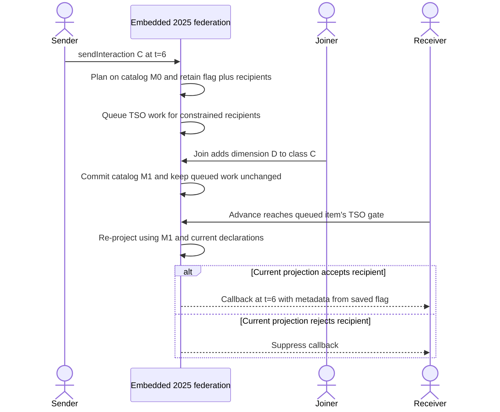

The diagram describes the implementation timing, not a predicted delivery
result for every Join. The queued recipient work starts from the send-time
plan; callback projection can reject a queued recipient using current
declarations. The configured-process 2025 path also copies
`plan.defaultRegionUsed` into its TSO message and calls the registry
projection at delivery ([process enqueue](../../cpp/src/internal/federation/process_federation_service_interaction_send.cpp#L587),
[process projection](../../cpp/src/internal/federation/process_federation_service_tso_delivery.cpp#L299),
[process callback metadata](../../cpp/src/internal/federation/process_federation_service_tso_delivery.cpp#L369)).
This is source evidence for that path, not a focused process result for this
Join interleaving.

The embedded state-image path saves and restores `defaultRegionUsed` with the
queued TSO payload ([capture](../../cpp/src/internal/federation/federation_registry_state_image_capture.cpp#L611),
[restore](../../cpp/src/internal/federation/federation_registry_restore_tso_payloads.cpp#L174)).
The existing timestamped default-region case checks the supplied empty
callback RegionHandleSet, while the additional-module Join case adds a
separate interaction class and checks its dimension lookup
([timestamped case](../../cpp/tests/ieee1516_2025_timestamped_default_region_interaction_catch2.cpp#L95),
[Join lookup case](../../cpp/tests/dimension_lookup_catch2.cpp#L146)).
No focused case in this review combines a dimension added to an existing
class, a queued timestamped send, and delivery after the Join. Keep this as a
2025 implementation trace.

A receiver's advance controls when queued work reaches the callback gate; it
does not recalculate the saved default-region flag. Retraction can remove
pending work before callback, a separate TSO transition covered in the
[TSO-retraction guide](HLA-2025-TSO-RETRACTION-FLOW-GUIDE.md). Join changes
the current projection inputs but does not change the accepted message
timestamp. Keep that DDM check separate from the timestamp and grant logic in
the [time-management guide](HLA-2025-TIME-MANAGEMENT-GUIDE.md).

## Interaction regions must fit the class's available dimensions

An interaction-class handle and a region handle can each be valid while their
combination is invalid. For regional send and regional subscription, check the
region's dimensions against the dimensions available to that interaction
class; handle validity alone does not establish a valid class/region context.

The two flows below summarize separate embedded 2025 test cases, not one
combined service sequence. In each case the dimension handles and regions are
valid in isolation. The test authors map the send and subscription constraints
to IEEE 1516.1-2025 §§9.1.3.3 and 9.1.4 respectively; because the complete
standard text is not available in this checkout, the diagram stays within the
specific dimension-availability cases exercised by those tests.

In this fixture, `MainCourseServed` has `{ServerId}` available, while
`SodaFlavor` is a real FOM dimension available to other classes but not to this
interaction class. The RTI can create and commit a region over `SodaFlavor`;
the context error arises only when a service tries to use it for
`MainCourseServed`. That is the key distinction: region existence is not the
same as service/class compatibility.

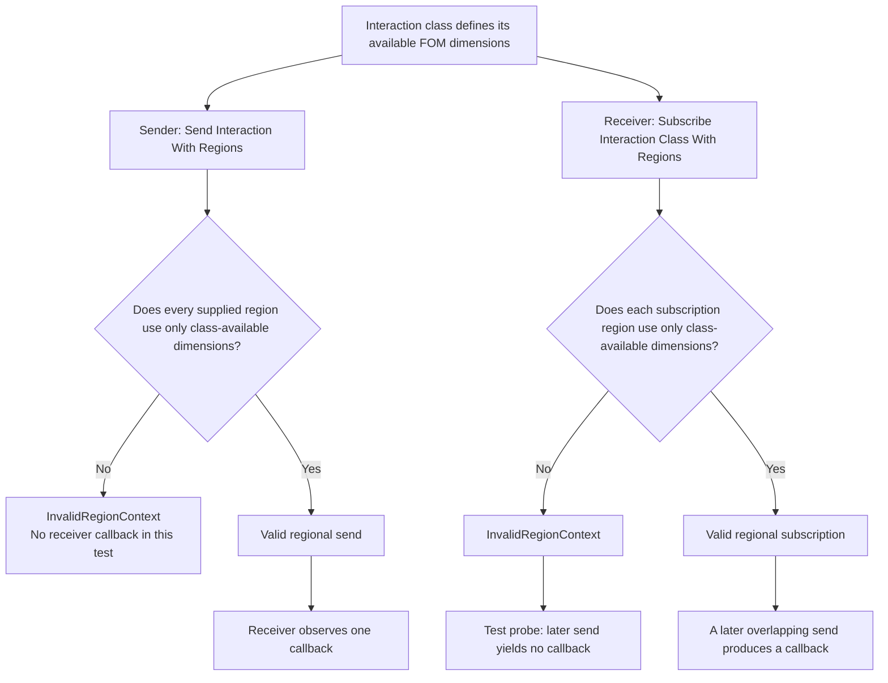

In the send case, a mixed region set contains one region dimension available
to the interaction class and one valid-but-unavailable dimension. The send is
rejected before any delivery is observed; a later valid-only send reaches the
receiver once. In the subscription case, rejecting the unavailable-dimension
region leaves no effective subscription: a later send produces no callback,
whereas a later valid regional subscription permits the matching send. These
are bounded embedded `HLA_EVOKED` observations, not a claim that every HLA
service has the same transaction or rollback semantics. See the two focused
[mixed-region interaction tests](../../cpp/tests/mixed_region_interaction_validation_catch2.cpp#L119)
([mixed send case](../../cpp/tests/mixed_region_interaction_validation_catch2.cpp#L189),
[subscription case](../../cpp/tests/mixed_region_interaction_validation_catch2.cpp#L312)).
The test inputs differ: the send supplies one valid and one unavailable-
dimension region, while the rejected subscription call supplies only the
unavailable-dimension region. The complete-set validation before subscription
map mutation is source evidence; the public test does not exercise a mixed
valid/invalid subscription set. No process-profile or 2010 parity is inferred.

### What the embedded 2025 source does before these outcomes

This is implementation evidence, not a universal HLA algorithm. The
receive-order send planner checks each supplied region against the interaction
class's available dimensions and returns `invalid_region_context` on a
mismatch. The ambassador maps that status to `InvalidRegionContext` before it
builds recipient deliveries. A valid earlier region can have a temporary
snapshot in the local plan before a later region fails; the selected test
asserts that no callback is delivered, not that no temporary work occurred or
that the implementation rolls back every internal step. See the
[receive-order region check](../../cpp/src/internal/federation/federation_registry_receive_order_interactions.cpp#L112),
[send-plan failure boundary](../../cpp/src/internal/runtime/umbra_rti_ambassador_regional_interaction_send_services.cpp#L726),
and [status-to-exception mapping](../../cpp/src/internal/runtime/umbra_rti_ambassador_service_failure_translation.cpp#L361).

For a regional subscription, the embedded registry checks the supplied
regions' dimensions before creating or updating the regional declaration map.
The failure is then mapped to `InvalidRegionContext`; the later-send test probe
is the public observation that no effective regional subscription resulted.
See the [subscription validation and mutation order](../../cpp/src/internal/federation/federation_registry_directed_interactions.cpp#L640)
and its [status mapping](../../cpp/src/internal/runtime/umbra_rti_ambassador_service_failure_translation.cpp#L72).

The configured-process evidence has a narrower scope. Its
[available-dimensions test](../../cpp/tests/ieee1516_2025_connection_available_dimensions_hierarchy_catch2.cpp#L459)
checks the query through the public process endpoint under both callback
models, including an empty `FoodServed` set and `{ServerId}` for
`MainCourseServed` ([assertions](../../cpp/tests/ieee1516_2025_connection_available_dimensions_hierarchy_catch2.cpp#L586)).
Because the Restaurant FOM gives `FoodServed` no dimensions and declares
`ServerId` on its child ([parent](../../third_party/ieee1516.2-2025/resources/examples/RestaurantFOMmodule-2025.xml#L444),
[child declaration](../../third_party/ieee1516.2-2025/resources/examples/RestaurantFOMmodule-2025.xml#L464)),
this does not exercise accumulation of a dimension from an interaction-class
ancestor. The selected configured-process regional
cases cover valid fan-out and timestamped delivery
([multi-recipient](../../cpp/tests/ieee1516_2025_connection_multi_recipient_regional_interaction_catch2.cpp#L459),
[TSO](../../cpp/tests/ieee1516_2025_connection_tso_regional_interaction_catch2.cpp#L459));
they do not assert the invalid-dimension or empty-input branches described
above. Keep those outcomes bounded to the embedded cases and shared source
inspection, without inferring process-profile runtime parity.

## Region template lifecycle

The useful distinction is between the latest range values supplied by the
application and the committed specification used for routing.
For one bounded 2025 embedded save/restore case in which a committed Region
returns after its live handle is deleted, see the
[saved-Region example](HLA-2025-FEDERATION-SAVE-RESTORE-FLOW-GUIDE.md#worked-case-a-committed-region-returns-from-the-saved-image).
That example does not establish process-endpoint or 2010 behavior.
For the source-derived 2025 process adapter-to-image path and its missing
configured-process Region assertion, see the Save/Restore guide's
[Region persistence boundary](HLA-2025-FEDERATION-SAVE-RESTORE-FLOW-GUIDE.md#process-adapter-to-saved-region-state-source-derived-path-not-a-process-region-test).
For a separate fresh-embedded-registry case that saves an active object-
attribute update-region association together with a queued TSO update, see the
[association and queued-update trace](HLA-2025-FEDERATION-SAVE-RESTORE-FLOW-GUIDE.md#worked-case-an-update-region-association-and-queued-tso-survive-fresh-registry-restore).
It is distinct from the committed-Region-only case and does not establish
process-endpoint or 2010 persistence.
For the separate interaction path, see the [saved regional TSO trace](HLA-2025-FEDERATION-SAVE-RESTORE-FLOW-GUIDE.md#worked-case-a-saved-regional-tso-interaction-becomes-live-again)
and the [2025 public filesystem-backed case](../../cpp/tests/ieee1516_2025_public_regional_interaction_tso_ddm_filesystem_restore_catch2.cpp#L7).
These cases follow queued work and its invocation-time source-region snapshot;
they do not show a new post-Restore send routed through a rehydrated regional
interaction subscription. The image code captures that subscription's Region
handle and validates it during restore ([capture](../../cpp/src/internal/federation/federation_registry_state_image_capture.cpp#L523),
[restore](../../cpp/src/internal/federation/federation_registry_restore_declarations.cpp#L283));
the inspected test evidence does not assert the new-send transition.

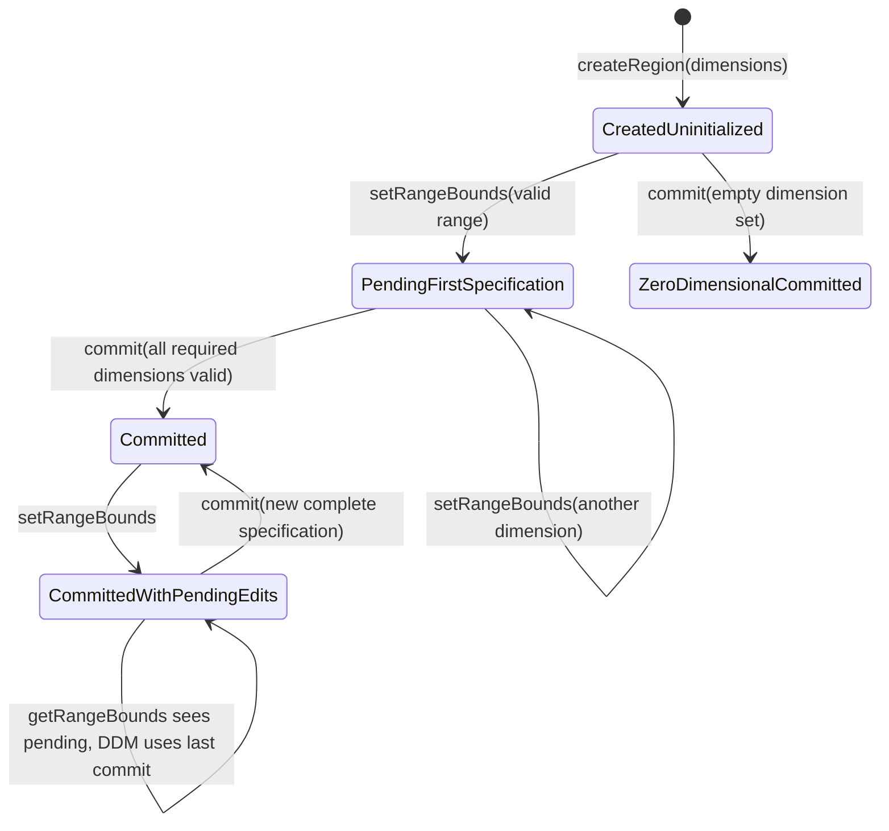

In the current embedded profile, an edited region therefore has two views:
the owner can query its pending bounds, while normal regional matching still
uses the last committed specification. A successful commit installs the new
specification and replans regional scope; this is an implementation mapping,
not a universal HLA delivery-timing claim.

Range state and handle lifetime are separate questions. For a valid region
handle owned by the calling federate, the delete gate is:

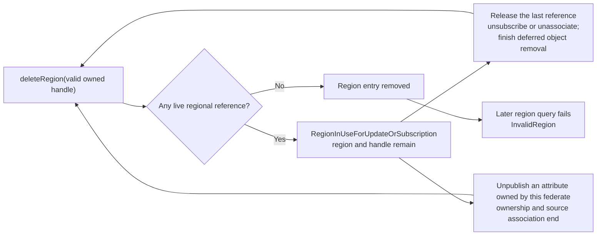

The API's delete exception and stale-handle result are distinct from pending or
committed bounds. In the embedded 2025 registry, the in-use check covers
regional object/interaction subscriptions and object update-region
associations; some object-removal paths retain an association until their
final removal callback is consumed.

Unpublishing an attribute that the caller owns is another release path: the
2025 registry removes that ownership and its active update-region association,
then refreshes region usage before returning
([association clear](../../cpp/src/internal/federation/federation_registry_object_attribute_declarations.cpp#L174),
[usage refresh](../../cpp/src/internal/federation/federation_registry_object_attribute_declarations.cpp#L205)).
The focused
[embedded region-lifecycle case](../../cpp/tests/ieee1516_2025_federation_management_region_lifecycle_catch2.cpp#L181)
registers one object attribute with a source Region and asserts that deletion
is blocked, then unpublishes the attribute and asserts that deleting the same
Region succeeds immediately. It also asserts that a later query reports
InvalidRegion. This test-source evidence is limited to the selected
association-release scenario, not the result when other live references
remain or process/2010 behavior.

### Object deletion and update-region lifetime

The pinned 2025 API has separate receive-order and timestamped
**Delete Object Instance** overloads and matching **Remove Object Instance**
callback forms ([receive-order delete](../../third_party/ieee1516.1-2025/include/RTI/RTIambassador.h#L832),
[timestamped delete](../../third_party/ieee1516.1-2025/include/RTI/RTIambassador.h#L847),
[removal callback](../../third_party/ieee1516.1-2025/include/RTI/FederateAmbassador.h#L316)).
This map follows the current 2025 embedded registry's object-record lifetime:
it is not a normative callback-order diagram or a process/2010 parity claim.
The question is when active and deferred update-region references stop
contributing to the region-in-use ledger.

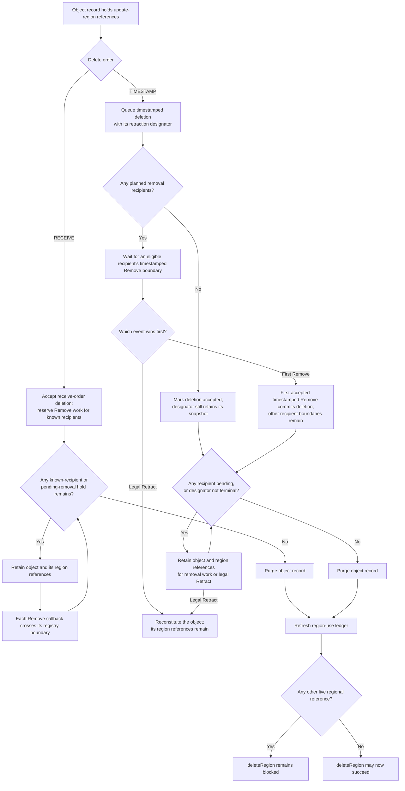

In the embedded receive-order path, deletion can purge the object and refresh
region usage in the service call when no other recipient/removal hold remains
([registry transition](../../cpp/src/internal/federation/federation_registry_object_instance_deletion.cpp#L117),
[purge and refresh](../../cpp/src/internal/federation/federation_registry_object_instance_deletion.cpp#L124)).
Otherwise, the object retains its update-region references until the final
removal boundary permits purge
([removal callback transition](../../cpp/src/internal/federation/federation_registry_object_instance_removal.cpp#L85),
[final purge and refresh](../../cpp/src/internal/federation/federation_registry_object_instance_removal.cpp#L111)).
The focused embedded test sources assert both cases: same-call region
deletion when there is no other known recipient
([case](../../cpp/tests/ieee1516_2025_federation_management_region_lifecycle_catch2.cpp#L246)),
and continued blocking until the peer crosses its final Remove callback
([case](../../cpp/tests/ieee1516_2025_federation_management_region_lifecycle_catch2.cpp#L312)).

Timestamped deletion has a longer implementation lifetime. Enqueue records
the designator and recipient set
([enqueue state](../../cpp/src/internal/federation/federation_registry_time_tso_enqueue.cpp#L840));
the first accepted timestamped removal commits the deletion, while the
backing object is retained for possible reconstitution until the designator is
terminal
([recipient boundary](../../cpp/src/internal/federation/federation_registry_tso_delivery.cpp#L850),
[terminalization and region refresh](../../cpp/src/internal/federation/federation_registry.cpp#L1252),
[purge gate](../../cpp/src/internal/federation/federation_registry.cpp#L1101)).
Thus even after a receiver has observed Remove, the region can remain in use
while recipient work or legal retraction state keeps the object record alive.
The focused embedded timestamped-delete test covers retraction before Remove
and the later timestamped Remove/retraction cutoff
([test source](../../cpp/tests/ieee1516_2025_timestamped_delete_object_instance_retraction_catch2.cpp#L6)),
but does not call region services. It does not test post-callback,
preterminal retraction or the exact `deleteRegion` release point; those
details remain source-observed.

The configured 2025 process endpoint has separate public request paths for
Delete Object Instance and Delete Region: their client wrappers send requests,
and their service handlers call `registry_.deleteObjectInstance` and
`registry_.deleteRegion` respectively ([delete client](../../cpp/src/internal/federation/process_federation_client_object_services.cpp#L53),
[delete handler](../../cpp/src/internal/federation/process_federation_service_object_instance_deletion.cpp#L191),
[region client](../../cpp/src/internal/federation/process_federation_client_region_services.cpp#L46),
[region handler](../../cpp/src/internal/federation/process_federation_service_region_management.cpp#L151)).
Focused process integration tests separately exercise receive-order deletion
and its Remove callback, timestamped deletion/removal, and region creation,
commit, and regional registration ([receive-order deletion](../../cpp/tests/ieee1516_2025_connection_delete_object_instance_catch2.cpp#L458),
[timestamped deletion](../../cpp/tests/ieee1516_2025_connection_timestamped_delete_object_instance_catch2.cpp#L1506),
[regional-registration case and its explicit request list](../../cpp/tests/ieee1516_2025_connection_region_lifecycle_catch2.cpp#L458)).
That registration request list does not include `delete_region`. A separate
process service-report case deletes a newly created, otherwise-unused region
([process Delete Region case](../../cpp/tests/ieee1516_2025_connection_service_report_catch2.cpp#L1375));
it does not exercise an in-use rejection or a release after object deletion.
No reviewed process case combines object deletion with a region-in-use query
or deletion. The shared registry call sites are source evidence only:
process-endpoint release timing is not directly asserted, so keep the diagram
above scoped to the embedded 2025 path.

For the broader object-knowledge/removal route, see the
[2025 object and interaction guide](HLA-2025-OBJECT-AND-INTERACTION-INFORMATION-FLOW-GUIDE.md);
the [2025 time-management guide](HLA-2025-TIME-MANAGEMENT-GUIDE.md) and
[TSO retraction guide](HLA-2025-TSO-RETRACTION-FLOW-GUIDE.md) cover the
surrounding timestamped callback and retraction timeline.
The selected embedded receive-order delete also invalidates pending ownership
work at acceptance, while update-region references follow the separate object-
record purge gates above. See the [accepted-delete ownership flow](HLA-2025-ATTRIBUTE-OWNERSHIP-FLOW-GUIDE.md#accepted-object-deletion-invalidates-pending-ownership-work);
these are distinct implementation lifetimes, not one combined callback-order
rule.

In the current 2025 C++ path:

- **createRegion** establishes the dimension set and ownership of the region
  handle. An empty dimension set is accepted by the tested API path; it creates
  a zero-dimensional region, not a wildcard region. The registry stores the
  supplied dimension handles in the new Region record
  ([creation write](../../cpp/src/internal/federation/federation_registry_regions.cpp#L67)).
- **setRangeBounds** writes pending bounds. The implementation checks that the
  dimension belongs to the region, that lower is less than upper, and that the
  upper bound is within the FDD dimension bound
  ([region-dimension check](../../cpp/src/internal/federation/federation_registry_regions.cpp#L527),
  [bound validation](../../cpp/src/internal/federation/federation_registry_regions.cpp#L537),
  [pending write](../../cpp/src/internal/federation/federation_registry_regions.cpp#L540)).
- **getRangeBounds** reports the latest pending value for a dimension when one
  has been set, even before commit. This query view is not the same thing as
  the routing snapshot ([pending-first lookup](../../cpp/src/internal/federation/federation_registry_regions.cpp#L414),
  [committed fallback](../../cpp/src/internal/federation/federation_registry_regions.cpp#L418)).
- **commitRegionModifications** requires a complete, valid specification for
  every committed dimension. Only then does the new committed snapshot become
  active for overlap/relevance calculations. If a region already had a
  committed snapshot, later pending edits do not replace it until commit
  ([completeness check](../../cpp/src/internal/federation/federation_registry_regions.cpp#L95),
  [per-dimension validation](../../cpp/src/internal/federation/federation_registry_regions.cpp#L104),
  [pending-to-committed copy](../../cpp/src/internal/federation/federation_registry_regions.cpp#L154)).
- In the embedded 2025 path, an active or deferred object update-region
  association and a regional subscription keep the region in use
  ([delete guard](../../cpp/src/internal/federation/federation_registry_regions.cpp#L339),
  [usage-ledger scan](../../cpp/src/internal/federation/federation_registry_regions.cpp#L832)).
  Remove all remaining references; a passive regional subscription is still a
  live dependency in the tested profile.
- Mutating or deleting a region created by another federate is rejected in the
  embedded lifecycle case ([bounds mutation](../../cpp/tests/ieee1516_2025_federation_management_region_lifecycle_catch2.cpp#L119),
  [deletion](../../cpp/tests/ieee1516_2025_federation_management_region_lifecycle_catch2.cpp#L109)).

The [focused region lifecycle case](../../cpp/tests/ieee1516_2025_federation_management_region_lifecycle_catch2.cpp#L4)
queries a pending value both before the first complete commit and after editing
an already committed region. A separate [commit-triggered discovery case](../../cpp/tests/ieee1516_2025_federation_management_region_lifecycle_catch2.cpp#L394)
observes no discovery while the receiver range is disjoint, then observes
discovery after that range is edited and committed. Neither case asserts a
value send between `setRangeBounds` and commit. Continued matching against the
old committed range during that interval is source-derived from
[`regionsOverlap`](../../cpp/src/internal/federation/federation_registry_regions.cpp#L775),
which constructs matching snapshots from committed bounds; do not promote it
to a broader standard-level routing guarantee.

The central implementations are
[region services](../../cpp/src/internal/runtime/umbra_rti_ambassador_dimension_region_services.cpp)
and
[region registry state](../../cpp/src/internal/federation/federation_registry_regions.cpp).
The focused 2025
[region lifecycle test](../../cpp/tests/ieee1516_2025_federation_management_region_lifecycle_catch2.cpp)
exercises zero-dimensional templates, incomplete commits, pending-versus-
committed bounds, range validation, creator ownership, and the in-use deletion
guard.

## Overlap: strict rule and Umbra's optional expansion

For each dimension shared by a source and receiver region, the normal
half-open ranges are written <code>[lower, upper)</code>. Strict overlap in one
shared dimension is:

<code>source.lower &lt; receiver.upper &amp;&amp; receiver.lower &lt; source.upper</code>

The current registry requires at least one shared dimension and checks every
shared dimension. With Umbra's Allow Relaxed DDM switch disabled, all shared
dimensions must strictly overlap. When enabled, this Umbra profile additionally
accepts an exact boundary touch in a shared dimension, provided every other
shared dimension is either strictly overlapping or also exactly touching.
A positive gap is never expanded.

The switch in this 2025 model is the composed FOM's `allowRelaxedDDM`
support-switch value, not a per-federate subscription setting. In the current
embedded path, FOM composition reads that value into the catalogue and
federation state retains it; the pinned API exposes
`getAllowRelaxedDDMSwitch()` as a query, not a setter. The focused embedded
boundary tests create separate enabled/disabled federation configurations and
check that both publisher and subscriber observe the same switch value. A
separate configured process-endpoint test checks the sender and both receivers
and exercises per-recipient regional-interaction routing under both callback
models. That is direct evidence for this selected endpoint scenario, not broad
embedded/process parity; see the
[policy note](RELAXED-DDM-POLICY.md#configuration-and-scope) for its
source/test map.

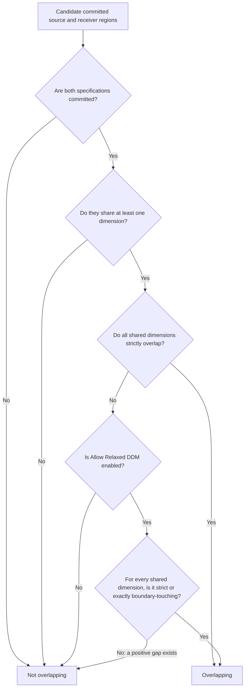

The focused embedded exact-touch tests and the configured process-endpoint
multi-recipient test each use one shared dimension. The central predicate
checks every shared dimension, but combinations mixing strict overlap, exact
touch, and a positive gap across multiple dimensions remain source-derived
rather than directly exercised by these focused tests.

Examples for one dimension:

- <code>[0, 10)</code> and <code>[9, 12)</code> strictly overlap.
- <code>[0, 10)</code> and <code>[10, 15)</code> only touch. They do not
  strictly overlap; this implementation accepts the touch only when Allow
  Relaxed DDM is enabled.
- <code>[0, 10)</code> and <code>[11, 15)</code> have a positive gap and do
  not overlap, even when the switch is enabled.
- In the current embedded 2025 implementation, a committed zero-dimensional
  Region has no shared dimensions with the default-region realization and
  produces no regional match. The focused test first observes an ordinary
  default-region interaction, then no callback when an explicit zero-
  dimensional Region is supplied ([test](../../cpp/tests/zero_dimensional_regional_interaction_catch2.cpp#L184)).
  Keep this source/test observation separate from a broader normative claim.

One two-dimensional combination illustrates why the rule is applied to every
shared dimension. Let the source be X=`[0, 10)`, Y=`[0, 10)`, and the receiver be
X=`[9, 12)`, Y=`[10, 14)`. X strictly overlaps, while Y only touches:

- With Allow Relaxed DDM disabled, the regions do not overlap because Y fails
  strict overlap.
- With it enabled, the regions overlap because X is strict and Y exactly
  touches.
- If the receiver's Y range is `[11, 14)` instead, that dimension has a
  positive gap, so the regions do not overlap in either mode.

This is a source-derived example, not a focused test result. The
[embedded overlap predicate](../../cpp/src/internal/federation/federation_registry_regions.cpp#L827)
returns no overlap when the regions share no dimensions. The focused boundary cases above use one shared dimension;
mixed strict/touch/gap outcomes across multiple dimensions remain untested.

The exact-touch expansion is an **Umbra implementation policy**, not a
universal HLA rule. The local
[Allow Relaxed DDM policy note](RELAXED-DDM-POLICY.md) records the standard
distinction and the narrower current evidence. In particular, the switch is
not an epsilon, a configurable distance, a geographic interpretation, or a
permission to drop any strict overlap.

## Object attributes: source association, discovery, relevance, and updates

Object-attribute DDM is evaluated per attribute. The publisher's update-region
association and the receiver's subscription determine the regions to compare.
The current object-attribute planner evaluates ordinary/default-region
subscriptions and explicit regional subscriptions independently; do not
import the interaction-class selection behavior in the next section into this
path.
For object discovery, regional overlap is only one part of eligibility: a
different non-producer member can establish active relevance on attribute A,
while this receiver separately matches its own declaration for attribute B.
The [subscription-state guide](HLA-2025-OBJECT-ATTRIBUTE-SUBSCRIPTION-STATE-FLOW-GUIDE.md#2-discovery-and-value-delivery-are-separate-active-subscription-gates)
explains that source-derived cross-attribute case and its missing three-role
test; this guide's region flows do not establish it by themselves.

### A stale region rejects the association before the map changes

`associateRegionsForUpdates` receives attribute/region-set pairs. In the
inspected 2025 registry, it checks the execution, member, known object,
attribute set, and every supplied region before copying or changing the active
and deferred association maps. Each region must exist, belong to the caller,
have committed bounds for its dimensions, and fit the dimensions available to
the registered object class. A later invalid region therefore returns an
error before any requested pair is applied; it is not a progressive
valid-prefix operation.

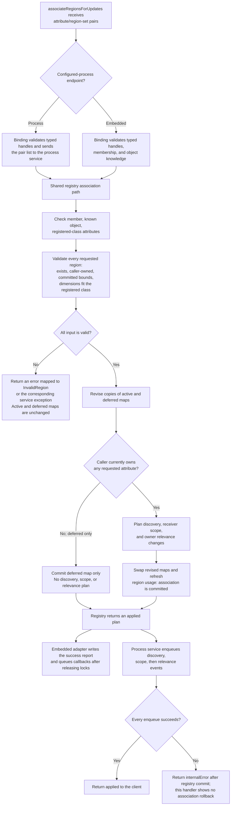

The validation boundary and map swap are visible in the
[embedded registry implementation](../../cpp/src/internal/federation/federation_registry_update_region_associations.cpp#L13);
the configured-process handler calls that same registry path, then enqueues
the already-planned discovery, scope, and relevance events
([process handler](../../cpp/src/internal/federation/process_federation_service_regional_object_association.cpp#L76)).
Its [enqueue-failure checks](../../cpp/src/internal/federation/process_federation_service_regional_object_association.cpp#L102)
run after the registry call has committed, and the inspected handler contains
no rollback. If an earlier event enqueue succeeds and a later one fails, the
source also does not retract the earlier event. No focused test exercises that
post-commit transport failure; this is a source boundary, not an HLA exception
schedule or a claim about guaranteed callback delivery.

The focused 2025
[stale-region case](../../cpp/tests/attribute_scope_advisory_catch2.cpp#L553)
deletes a region, verifies that associating it throws `InvalidRegion`, then
moves the object's pre-existing valid region out of subscription overlap and
observes `attributesOutOfScope`. That later transition shows the failed call
left the original association in place. The case runs under both
`HLA_EVOKED` and `HLA_IMMEDIATE`; it does not submit a mixed valid/invalid
multi-region batch, and it does not cover process enqueue failure.

Ownership and source-region association are separate state questions. The
selected embedded 2025 ownership-transfer cases show that the former owner's
association is cleared and that a prospective owner's still-pending deferred
association may become active at transfer. They also show that a former owner
must explicitly associate again after later reacquisition, while
`unassociateRegionsForUpdates` before transfer removes a prospective owner's
deferred association and leaves the acquirer's first update on the default
source realization. These are separate HLA_EVOKED embedded test scenarios;
see the ownership guide's
[transfer/association boundary](HLA-2025-ATTRIBUTE-OWNERSHIP-FLOW-GUIDE.md#ownership-transfer-and-update-region-association-are-separate-boundaries)
for the sequence and individual test links. They are bounded
implementation/test observations, not a general DDM rule or process/2010
parity claim.

### Adjacent ownership routes: what the current association paths show

The three region-specific cases above exercise an If-Available requester and
If-Wanted owner-side transfer. A bounded comparison of other 2025 public
ownership routes finds these Umbra source transitions; this comparison is not
a portable HLA rule:

- **Regular acquisition of an unowned attribute.** The registry assigns the
  requester as owner and promotes that federate's deferred association; this
  branch has no active former-owner association to clear
  ([registry path](../../cpp/src/internal/federation/federation_registry_attribute_ownership_acquisition.cpp#L347),
  [promotion helper](../../cpp/src/internal/federation/federation_registry_regions.cpp#L807)).
  The [focused regular-acquisition case](../../cpp/tests/ieee1516_2025_attribute_ownership_acquisition_release_callbacks_catch2.cpp#L162)
  checks ownership and callbacks, not region services. Association behavior
  is source-observed.
- **Confirm Divestiture.** When confirmation commits the transfer, the path
  clears the former owner's committed association and promotes any deferred
  association belonging to the acquiring federate
  ([registry path](../../cpp/src/internal/federation/federation_registry_negotiated_attribute_ownership_divestiture.cpp#L463)).
  The [process confirmation case](../../cpp/tests/ieee1516_2025_confirm_divestiture_process_assumption_catch2.cpp#L508)
  checks ownership and callback/report boundaries but does not invoke
  update-region APIs. The association transition is source-observed; this is
  not process-profile DDM evidence.
- **Unconditional divestiture and its assumption offer.** The registry
  clears the active association when it makes the attribute unowned, then
  replans already-pending acquisition work
  ([unconditional path](../../cpp/src/internal/federation/federation_registry_attribute_ownership_assumptions.cpp#L204)).
  A later successful regular or If-Available acquisition promotes that
  requester's deferred association through its own grant path
  ([regular grant](../../cpp/src/internal/federation/federation_registry_attribute_ownership_acquisition.cpp#L347),
  [If-Available grant](../../cpp/src/internal/federation/federation_registry_attribute_ownership_acquisition_if_available.cpp#L606)).
  An assumption callback by itself is only an offer: its recipient remains
  a non-owner until it requests and completes acquisition. The
  [focused unconditional-divestiture case](../../cpp/tests/ieee1516_2025_unconditional_attribute_ownership_divestiture_catch2.cpp#L274)
  checks the unowned interval, pending acquisition, and non-owning assumption
  recipient, but does not invoke update-region APIs. Association effects
  remain source-observed.
- **Resign with unconditional attribute divestiture.** In the 2025 registry,
  this selected ResignAction enters the divestiture cleanup path; for each
  owned attribute on an instance not already removed, it clears the active
  source association and replans pending acquisition work
  ([cleanup path](../../cpp/src/internal/federation/federation_registry_resign_lifecycle.cpp#L639),
  [association clear](../../cpp/src/internal/federation/federation_registry_resign_lifecycle.cpp#L668)).
  The [focused embedded resign case](../../cpp/tests/ieee1516_2025_embedded_resign_action_divestiture_catch2.cpp#L49)
  checks ownership loss and the later assumption/acquisition path, but makes
  no region-service calls; the DDM effect is source-observed only. Do not
  generalize this to every ResignAction; see the lifecycle guide's
  [action effects](HLA-2025-FEDERATION-AND-FEDERATE-LIFECYCLE-FLOW-GUIDE.md#resignaction-effects-in-the-current-implementation).

Do not collapse these paths into one generic transfer: Confirm Divestiture
commits an owner-to-owner change, while unconditional divestiture first
clears ownership and then resolves existing acquisition work or invites a
candidate. Unpublish and the selected Resign path are distinct ownership-loss
routes, not owner-to-owner transfers; only unpublish has direct region-use
assertions in the inspected tests. Administrative control-state changes remain
outside this audit. No 2010 behavior or embedded/process parity is claimed.
The three region-specific cases above remain the direct test evidence for
association state across an If-Available/If-Wanted transfer.

This regional path describes per-instance attribute relevance and overlap.
The distinct publisher/class declaration advisories and owner-directed
Turn Updates callbacks are separated in the [2025 relevance-advisory guide](HLA-2025-RELEVANCE-ADVISORY-FLOW-GUIDE.md).
Receiver-directed Attributes In/Out Of Scope callbacks have their own
[2025 Attribute Scope Advisory guide](HLA-2025-ATTRIBUTE-SCOPE-ADVISORY-FLOW-GUIDE.md);
that guide covers scope-state transitions and stale callback filtering, while
this one remains the home for region geometry, discovery, and routing.

A regional [`requestAttributeValueUpdate`](HLA-2025-ATTRIBUTE-VALUE-UPDATE-REQUEST-FLOW-GUIDE.md#regional-request-scope-is-not-response-ddm)
uses regions at a different boundary: the selected embedded 2025 request path
uses them to screen provider solicitation, while a provider's later value
update goes through ordinary per-receiver DDM. Do not treat the request region
as the response update's source region or as direct receiver eligibility.
This is an implementation-scoped distinction, not a normative or
process-parity claim.
For a cross-guide comparison of region-sensitive work that is pending, queued,
or already observed, see the Cross-Cutting guide's
[service-specific stale-work map](HLA-2025-CROSS-CUTTING-STATE-EVENT-OBSERVATION-GUIDE.md#when-work-becomes-stale-withdraw-invalidate-preserve-or-account).

```mermaid
flowchart TD
  A[Registration or scope-changing event] --> B[Resolve object class and attribute]
  B --> C[Select source realization for this attribute]
  C --> D{Explicit update-region association exists?}
  D -->|Yes| E[Use associated committed source regions]
  D -->|No| F[Use the implicit default source region]
  E --> G[Compare against applicable receiver subscription regions]
  F --> G
  G --> H{Any applicable source/receiver pair overlaps?}
  H -->|No| I[No regional relevance for this attribute]
  H -->|Yes, receiver has not discovered instance| J[Plan Discover Object Instance]
  H -->|Yes, instance already known| K[Attribute is in scope for value routing]
  J --> L[At a relevance transition, queue applicable advisory]
  K --> L
  I --> M[Later scope change may make the instance or attribute relevant]
  M --> A
```

There are two different public effects that are easy to conflate:

- **Discovery:** a receiver that did not know the object can become eligible
  for **discoverObjectInstance**. In this implementation, registration is not
  the only discovery boundary. Committing a receiver region into overlap or
  associating a new overlapping update region can also make an already-
  registered object discoverable.
- **Attribute relevance advisory:** when the in-scope state of a known
  object's attribute changes, the producer can receive
  **turnUpdatesOnForObjectInstance** or **turnUpdatesOffForObjectInstance**
  when the advisory behavior is enabled. This is an advisory transition, not
  the value update itself and not a replacement for subscription or overlap
  filtering.

### A committed range change can discover an existing object

```mermaid
sequenceDiagram
  autonumber
  actor P as Object publisher
  participant RTI as Embedded 2025 RTI
  participant Q as Subscriber HLA_EVOKED callback queue
  actor S as Regional subscriber

  P->>RTI: Register object with source region A
  Note over RTI: A and the subscriber's committed region B are disjoint
  RTI-->>S: No Discover Object Instance callback yet
  S->>RTI: setRangeBounds(B, [0,1])
  RTI->>RTI: Store B's pending bounds
  Note over RTI,S: Source-derived: overlap still uses B's prior committed bounds
  S->>RTI: commitRegionModifications(B)
  RTI->>RTI: Install committed B and plan discovery
  RTI->>Q: Queue Discover Object Instance
  S->>RTI: evokeCallback()
  Q-->>S: discoverObjectInstance
```

The focused
[commit-triggered discovery case](../../cpp/tests/ieee1516_2025_federation_management_region_lifecycle_catch2.cpp#L389)
starts with a disjoint source and receiver range, observes no discovery, then
calls `setRangeBounds` followed by `commitRegionModifications` and observes one
discovery without another registration or subscription call. It does not drain
or assert callbacks between those two calls. The [region registry](../../cpp/src/internal/federation/federation_registry_regions.cpp#L540)
stores the Set value as pending; the [commit transaction](../../cpp/src/internal/federation/federation_registry_regions.cpp#L154)
installs the committed snapshot and the [adapter](../../cpp/src/internal/runtime/umbra_rti_ambassador_dimension_region_services.cpp#L734)
queues planned discovery afterward. This is evidence for the embedded 2025
implementation path, not a portable callback-timing rule or a process-endpoint
result. The adjacent
[association-triggered discovery case](../../cpp/tests/ieee1516_2025_federation_management_region_lifecycle_catch2.cpp)
shows the other boundary: adding a second overlapping update-region
association makes an existing object discoverable. A separate 2025
[relevance-advisory transition test](../../cpp/tests/ieee1516_2025_connection_regional_attribute_relevance_transition_catch2.cpp)
exercises the producer's On/Off callbacks as overlapping associations are
removed and restored, under both evoked and immediate callback models.

### Receive-order value routing after regional overlap changes

The focused no-time-update scenario uses `HLA_EVOKED` and makes the boundary
between **object knowledge** and **current value relevance** more concrete. A
registered object can remain undiscovered while source and receiver regions
are disjoint. Once the receiver commits an overlapping range, discovery
reports the object and the most recently accepted attribute value; later
updates are filtered against the current overlap. This is an embedded 2025 test scenario,
not a complete normative rule for all DDM profiles.

```mermaid
sequenceDiagram
  actor P as Publisher
  participant RTI as Embedded 2025 RTI
  participant Q as Subscriber EVOKED callback queue
  actor S as Regional subscriber
  Note over P,S: Initial source and receiver ranges do not overlap
  P->>RTI: Register object with source-region association
  S->>RTI: Subscribe Flavor to receiver region
  P->>RTI: Add empty region association
  S->>RTI: Add empty-region subscription
  P->>RTI: Update value A
  RTI-->>Q: No discovery or reflection queued while disjoint
  S->>RTI: evokeMultipleCallbacks()
  RTI-->>S: No callback
  P->>RTI: Associate source region again
  S->>RTI: Move receiver to [0,1), commit, and subscribe again
  RTI->>Q: Queue discovery and latest-value reflection for A
  S->>RTI: evokeMultipleCallbacks()
  Q-->>S: Deliver discovery and value-A reflection
  P->>RTI: Update value B
  RTI->>Q: Queue one reflection for value B
  S->>RTI: evokeMultipleCallbacks()
  Q-->>S: One Reflect Attribute Values callback
  Note over RTI,S: Convey Region Designator Sets is off, callback has no sent-region set
  S->>RTI: Enable Convey Region Designator Sets
  P->>RTI: Update value C
  RTI->>Q: Queue one reflection with the associated source-region designator
  S->>RTI: evokeMultipleCallbacks()
  Q-->>S: One reflection includes the source-region designator
  S->>RTI: Move receiver back to disjoint [2,3) and commit
  P->>RTI: Update value D
  RTI-->>Q: No regional reflection queued while disjoint
  S->>RTI: evokeMultipleCallbacks()
  RTI-->>S: No callback
```

The [61-assertion focused case](../../cpp/tests/ieee1516_2025_regional_object_attribute_no_time_update_overlap_catch2.cpp#L5)
explicitly treats the empty-region association and
subscription calls as no-ops, checks that disjointness suppresses reflections,
then checks discovery plus the latest value after overlap and one reflection
for each subsequent accepted update in its exercised setup. It also shows
`ConveyRegionDesignatorSets` changing callback metadata without changing the
overlap route. The final disjoint phase asserts no reflection; it does not
independently query whether the already-known object remains known. It stores
discovery and reflection callbacks separately, so it does not establish their
relative callback order; the chart intentionally groups them.

The current local MinGW target was rebuilt from this worktree and passed this
focused case (1/1). A separate [open privileged-MinGW investigation](../planning/ROADMAP-INDEX.json#L100)
records duplicate reflections for the same test expectation. That discrepancy
is unresolved: this local pass is not evidence of cross-configuration or
process-endpoint parity. The chart is therefore bounded to the named scenario,
and the environment-specific result remains a follow-up rather than a settled
implementation guarantee.

### Process-boundary case: send-time source snapshot, receive-time receiver projection

The embedded flow above does not establish the configured process endpoint's
attribute route. A focused process case exposes a useful two-time distinction:
the accepted update keeps the producer's committed source-region realization
from the `Update Attribute Values` call, while a later process receive boundary
checks the receiver's then-current regional declaration and committed range.
The process registry planner captures the source snapshot
([planner](../../cpp/src/internal/federation/federation_registry_attribute_value_update_requests.cpp#L93));
the service carries available region context through its receive-order route
([event planning](../../cpp/src/internal/federation/process_federation_service_attribute_value_updates.cpp#L210),
[receive-boundary projection](../../cpp/src/internal/federation/process_federation_service_receive.cpp#L39)).

```mermaid
sequenceDiagram
  autonumber
  actor P as Publisher
  participant RTI as Configured 2025 process endpoint
  actor S as Regional subscriber

  P->>RTI: Update D2 while S has no matching declaration
  Note over P,RTI: D2 uses committed source region A
  Note over S,RTI: S's current range overlaps A
  alt DSE enabled
    RTI->>RTI: Save A and retain S as a route-only candidate
  else DSE disabled
    RTI->>RTI: No late candidate for initially ineligible S
  end
  P->>RTI: Mutate live source region A to disjoint A2
  S->>RTI: Add matching regional declaration before delivery
  S->>RTI: Reach EVOKED receive / IMMEDIATE regional-push boundary
  alt Candidate exists and current receiver projection overlaps saved A
    RTI->>RTI: Recheck attributes against A and current S state
    RTI-->>S: Reflect D2
  else No candidate or current receiver projection fails
    RTI-->>S: Suppress D2
  end
```

The [process DSE case](../../cpp/tests/ieee1516_2025_connection_delayed_regional_attribute_update_catch2.cpp#L523)
checks the enabled/disabled receive-order path under `HLA_EVOKED` and
`HLA_IMMEDIATE`. For D2, the receiver adds its declaration after the send and
the publisher mutates its live region; the enabled case reflects using the
accepted source snapshot. A later D3 update is initially eligible but is
suppressed in both switch modes when the receiver moves out of overlap before
the receive boundary. Thus the tested process route does not freeze the
receiver's future scope. This is selected 2025 process source/test evidence,
not a normative DDM algorithm, complete process coverage, or embedded/process
parity. The [DSE guide](HLA-2025-DELAY-SUBSCRIPTION-EVALUATION-FLOW-GUIDE.md#receive-order-tso-and-callback-model-are-separate-axes)
details the separate process delivery lanes and their test limits.

## Interactions: explicit and default-region paths

This section and its diagrams cover ordinary `sendInteraction` and
`sendInteractionWithRegions`; they do not describe
`sendDirectedInteraction`. A directed send names a target object instance and
uses a separate object-class/interaction-class declaration pair and receiver
selector. See the [directed-interaction guide's target/region distinction](HLA-2025-DIRECTED-INTERACTION-FLOW-GUIDE.md#a-target-object-is-not-a-ddm-region).
Do not infer the ordinary interaction region-overlap decision below as a
directed-send rule; this scope note does not settle any further normative
relationship between directed interactions and DDM.

Interaction routing uses an interaction-class publication, a send-region
realization, and the receiver's subscription realization. Keep the two region
comparisons separate. An ordinary `sendInteraction` supplies no explicit
source Region; its adapter calls the shared planner without a region-set
pointer
([ordinary send](../../cpp/src/internal/runtime/umbra_rti_ambassador_interaction_send_services.cpp#L2325)).
The current planner's dimensionful default-region branch is shown below: it
marks `defaultRegionUsed` only when the sent class currently has at least one
available dimension
([planner](../../cpp/src/internal/federation/federation_registry_receive_order_interactions.cpp#L88)).
Because the planner reads the current catalog, a successful additional-module
Join that adds a dimension to an existing class can change this flag for later
ordinary sends. The [Join trace](#additional-module-join-retained-regional-interaction-declarations)
shows the catalog update; no focused case combines that same-class extension
with an ordinary send. The existing post-Join lookup case adds a separate
interaction class and dimension, then queries the new class; it does not send
on it ([assertion](../../cpp/tests/dimension_lookup_catch2.cpp#L166)). This
flag also gates conveyed sender-region metadata:
with Convey Region Designator Sets enabled, the ordinary path can report a
supplied-but-empty RegionHandleSet
([callback gate](../../cpp/src/internal/runtime/umbra_rti_ambassador_interaction_callbacks.cpp#L123),
[flag handoff](../../cpp/src/internal/runtime/umbra_rti_ambassador_interaction_send_services.cpp#L2393),
[ordinary-send assertion](../../cpp/tests/default_region_interaction_routing_catch2.cpp#L253)).
That callback observation is separate from recipient selection. For
`sendInteractionWithRegions`, the inspected embedded
planner can still select an ordinary subscription when at least one explicit
source region overlaps the RTI default region; a separate regional declaration
is tested against the explicit source regions. A disjoint regional declaration
does not shadow an eligible ordinary/default route. The default-region
comparison is source-derived: in this implementation a committed explicit
region with at least one dimension overlaps the default, while a zero-dimensional
region overlaps neither it nor another region. Focused embedded cases cover
these bounded outcomes; they are not an independent normative interpretation
of §9.1.5.

Keep three superficially similar “empty” cases distinct:

| Caller-visible case | Routing meaning |
| --- | --- |
| Ordinary `sendInteraction` | No caller region set is supplied; the embedded planner marks default-region use when the current class-available dimension set is non-empty. |
| `sendInteractionWithRegions` with an empty `RegionHandleSet` | No-send operation; it does not fall back to the ordinary subscription/default-region path. The 2025 receive-order planner returns before selecting recipients, and the focused case confirms no callback while an ordinary subscription remains active ([source](../../cpp/src/internal/federation/federation_registry_receive_order_interactions.cpp#L90), [no-callback assertion](../../cpp/tests/ieee1516_2025_regional_interaction_subscription_receive_order_catch2.cpp#L112)). |
| A real zero-dimensional `Region` object | A region handle whose dimension set is empty; unlike the empty service-input set above, this explicit regional interaction produces no match in the focused embedded 2025 case (see [focused source/test evidence](#focused-source-and-test-evidence)). |

An empty region-designator set optionally conveyed on an ordinary
`receiveInteraction` callback is metadata, not the `RegionHandleSet` argument
to `sendInteractionWithRegions`. Do not infer the no-send case from that
callback field.

```mermaid
flowchart TD
  A[Choose ordinary Send Interaction or Send Interaction With Regions] --> B{Invocation form}
  B -->|Ordinary sendInteraction| D[No explicit source set;<br/>defaultRegionUsed when current available dimensions are non-empty]
  D --> E{Ordinary subscription eligible at this candidate?}
  B -->|Regional send with empty set| Z[No-send operation<br/>no ordinary default-region fallback]
  B -->|Regional send with non-empty set| C[Use explicit committed source regions]
  C --> X{Any explicit source region overlaps the RTI default region?}
  X -->|Yes| E
  X -->|No| G
  E -->|Yes| F[Select ordinary/default route]
  E -->|No| G{Effective explicit regional subscription?}
  G -->|Yes| H[Compare source and receiver region pairs]
  G -->|No| J[No route for this receiver]
  H --> I{Does any region pair overlap?}
  I -->|Yes| K[Select regional route]
  I -->|No| J
  F --> L[Recipient selected;<br/>delivery gates remain]
  K --> L
```

The diagram describes the current embedded 2025 source/test path, not an
edition-independent rule. It starts after the active-relevance and class-
candidate gates in the [interaction-class ancestry flow](#interaction-class-ancestry-available-context-and-declaration-lookup),
and it stops at recipient selection; the [time and callback gates](#keep-time-and-ddm-as-separate-filters)
are later and independent. It is intentionally separate from the object-
attribute planner described above. The focused case is
[default-region interaction routing](../../cpp/tests/ieee1516_2025_default_region_interaction_routing_catch2.cpp):

- An explicit source region reaches an overlapping regional subscriber. A
  mixed receiver with an ordinary subscription also receives through its
  ordinary/default route when the explicit source overlaps the RTI default,
  even if its separate regional declaration is disjoint.
- Removing that disjoint regional declaration leaves the ordinary/default
  route eligible, and the focused case observes delivery continue.
- For a class with available dimensions, an ordinary **sendInteraction** marks
  the dimensionful default-region realization. With Convey Region Designator
  Sets enabled, the callback can report that a region set was supplied and
  that the set is empty. That empty designator set is not the same thing as a
  non-empty explicit region set. The focused test predates this Join review and
  does not test changing the class's dimension set after Join.

The focused embedded CTest passed 1/1 (50 assertions) against the current
worktree. This result is bounded to the named case; it does not establish
process-profile behavior or the normative meaning of §9.1.5.

The default region is an RTI-provided realization, not a region handle the
application creates. In the current registry it represents the full range for
every FDD dimension. The separate zero-dimensional case has no shared
dimension on which that default overlap can be established; see the
[focused source and test evidence](#focused-source-and-test-evidence). See the
[default-region overlap helper](../../cpp/src/internal/federation/federation_registry_regions.cpp#L850)
and
[regional interaction subscription services](../../cpp/src/internal/runtime/umbra_rti_ambassador_regional_interaction_subscription.cpp).

### A partial interaction Region uses the restricted FDD default

The portable TCK fixture gives the sent interaction class X and Y, but Y's
FDD value is `0..5)`, producing runtime default bounds `[0,5)`
([fixture[^worktree-source]).
The sender supplies a non-empty Region containing X only; its public dimension
set remains X. The RTI's routing projection adds omitted Y with `[0,5)` for
this send. Both receivers overlap source X, so the Y result isolates the
default-range check: `[1,4)` matches, while `[6,9)` is outside it.

```mermaid
flowchart TD
  FDD["Interaction class uses X and Y;<br/>Y FDD value [0..5) becomes runtime [0,5)"]
  SOURCE["Sender supplies non-empty Region {X}<br/>with X range [1,4)"]
  KEEP["Public source Region still stores {X}"]
  PROJECT["For this send, temporarily add omitted Y<br/>using restricted default range [0,5)"]
  IN["Receiver A: X overlaps;<br/>Y range [1,4) overlaps default"]
  OUT["Receiver B: X overlaps;<br/>Y range [6,9) is outside default"]
  DELIVER["Observed TCK: one interaction callback"]
  SUPPRESS["Observed TCK: no interaction callback"]
  FDD --> SOURCE --> KEEP --> PROJECT
  PROJECT --> IN --> DELIVER
  PROJECT --> OUT --> SUPPRESS
```

The primary portable TCK scenario and contract twin passed **4/4 recorded
executions** across `HLA_EVOKED` and `HLA_IMMEDIATE`
(scenario source[^worktree-source],
sender dimension-set assertion[^worktree-source],
delivery assertion[^worktree-source],
suppression assertion[^worktree-source],
[catalog result](../../compliance/catalogs/cpp-tck-scenario-catalog.json#L56119)).
This is one bounded interaction-send case. It does not imply that every
regional service uses this projection, nor that an FDD default outside
`[0,5)` should match.

### Routing and conveyed sender-region metadata are separate decisions

Interaction routing first selects an eligible receiver. In the embedded 2025
callback path, the receiver's Convey Region Designator Sets switch then gates
whether `receiveInteraction` gets an optional sent-region set. With the switch
enabled, an explicit regional send conveys its source-region handles; an
ordinary send using the implicit default region conveys a supplied empty set.
The switch is read after recipient projection and does not participate in the
overlap decision. This is a source-derived embedded behavior, not a claim about
every HLA implementation or a complete normative interpretation.

```mermaid
flowchart TD
  A["Embedded interaction recipient selected"] --> B{"Receiver's Convey Region Designator Sets switch enabled?"}
  B -->|"No"| C["Callback omits the optional sent-region set"]
  B -->|"Yes"| D{"Source realization used"}
  D -->|"Explicit non-empty source regions"| E["Callback receives a supplied set of source-region handles"]
  D -->|"Implicit RTI default region"| F["Callback receives a supplied empty set"]
```

The public 2025 API exposes both the switch and the optional callback argument
([switch](../../third_party/ieee1516.1-2025/include/RTI/RTIambassador.h#L2125),
[`receiveInteraction`](../../third_party/ieee1516.1-2025/include/RTI/FederateAmbassador.h#L264)).
The embedded [callback assembly](../../cpp/src/internal/runtime/umbra_rti_ambassador_interaction_callbacks.cpp#L118)
checks the switch after resolving the recipient projection. The working-tree
[regional interaction test source](../../cpp/tests/default_region_interaction_routing_catch2.cpp#L267)
asserts that an enabled receiver gets the explicit source-region set
([assertions](../../cpp/tests/default_region_interaction_routing_catch2.cpp#L344));
the ordinary default-region case separately asserts a supplied empty set
([assertions](../../cpp/tests/default_region_interaction_routing_catch2.cpp#L241)).
These are source assertions, not a test run in this documentation pass. The
switch-off branch is source-only in this evidence set.

### Process-endpoint fan-out: evaluate each receiver separately

The public process-boundary case below covers a different question than the
embedded default-region case: when two remote federates subscribe to the same
interaction class with different regions, the process service evaluates each
receiver independently. The test runs both `HLA_IMMEDIATE` and `HLA_EVOKED`
callback models, with strict and relaxed DDM configurations. Its two sends
select one different recipient apiece; it does not establish general
embedded/process parity or every multi-region combination.

```mermaid
sequenceDiagram
  participant Sender as Sender client (RTI plus application)
  participant E as Configured 2025 process endpoint
  participant R1 as Receiver 1 client (RTI plus application)
  participant R2 as Receiver 2 client (RTI plus application)

  Note over Sender,R2: Each run uses HLA_IMMEDIATE or HLA_EVOKED. Strict and relaxed DDM are separate FDD configurations
  Note over Sender,E: Client/server framing is omitted. This trace focuses on per-recipient selection
  alt Strict DDM
    Note over E,R2: Send A1: source [0,10) overlaps R1 [0,5), while R2 [10,20) is disjoint
    Sender->>E: Send Interaction With Regions, tag A1
    Note over E,R2: Before A2, move and commit the source region at [10,20)
    Sender->>E: Send Interaction With Regions, tag A2
    Note over E,R2: A2 selects R2 while R1 is now disjoint
  else Allow Relaxed DDM
    Note over E,R2: Send A1: source [0,10) touches R1 [10,20), while R2 [11,20) has a positive gap
    Sender->>E: Send Interaction With Regions, tag A1
    Note over E,R2: Before A2, move R1 to [11,20) and R2 to [10,20)
    R1->>E: Commit receiver 1 region [11,20)
    R2->>E: Commit receiver 2 region [10,20)
    Sender->>E: Send unchanged source region [0,10), tag A2
    Note over E,R2: A2 excludes R1 by a positive gap and selects touching R2
  end
  par Receiver 1 result
    E-->>R1: One Receive Interaction carrying tag A1
  and Receiver 2 result
    E-->>R2: One Receive Interaction carrying tag A2
  end
  Note over Sender,R2: The test observes one callback per receiver. These outcomes do not specify cross-receiver callback order
```

In the test, callback delivery is drained with the next ordinary service under
`HLA_IMMEDIATE` and with `evokeCallback` under `HLA_EVOKED`. Relaxed DDM admits
touching ranges but not a positive gap; it does not broaden the test into a
general distance-based matching rule. Both receivers enable Convey Region
Designator Sets, and the single callback each receives includes one sent-region
designator; its tag identifies which send matched. See the
[per-recipient process test](../../cpp/tests/ieee1516_2025_connection_multi_recipient_regional_interaction_catch2.cpp#L459),
the [process send client](../../cpp/src/internal/federation/process_federation_client_value_services.cpp#L39),
and the [process send handler](../../cpp/src/internal/federation/process_federation_service_interaction_send.cpp#L79).

Keep this distinct from the adjacent embedded default-region test. That test
connects all three participants with `HLA_EVOKED` and shows that a disjoint
regional declaration does not suppress the mixed receiver's eligible
ordinary/default route for an explicit positive-dimensional send. Removing
the regional declaration leaves that route eligible. Its ordinary-send case
also checks the conveyed empty designator set. It does not exercise process
transport or the process test's four-way callback-model × strict/relaxed-DDM
matrix. These are complementary test scenarios, not evidence of
embedded/process parity.

The configured-process regional send path calls the shared registry's
`planReceiveOrderInteraction`; the regional service operation forwards through
the same handler. The shared planner's recipient walk therefore supplies the
candidate received class and parameter projection used by this process path.
Before constructing a process event, the service re-resolves a deferred
candidate when necessary, then stores that recipient-specific class and
parameter list in the event ([planner call](../../cpp/src/internal/federation/process_federation_service_interaction_send.cpp#L389),
[sent-class-to-parent candidate walk](../../cpp/src/internal/federation/federation_registry.cpp#L1512),
[deferred-candidate resolution](../../cpp/src/internal/federation/process_federation_service_interaction_send.cpp#L512),
[event construction](../../cpp/src/internal/federation/process_federation_service_interaction_send.cpp#L537),
[regional-operation forwarding](../../cpp/src/internal/federation/process_federation_service_interaction_send.cpp#L631)).
This is a source-path connection, not an independent process-side matching
algorithm or a claim that every interleaving has been tested.

The focused multi-recipient process case uses the same interaction class for
the sender and both receivers, and asserts that class in both callbacks
([exact-class setup](../../cpp/tests/ieee1516_2025_connection_multi_recipient_regional_interaction_catch2.cpp#L946),
[callback assertions](../../cpp/tests/ieee1516_2025_connection_multi_recipient_regional_interaction_catch2.cpp#L1088)).
It establishes per-recipient regional selection for that setup, not parent-
subscription/descendant-send promotion or parameter pruning at an ancestor.
Keep those cross-class regional process outcomes source-traced but not
focused-test-established; this does not add a normative inheritance rule.

## Keep time and DDM as separate filters

For a timestamped regional interaction, current Umbra code captures the
accepted send's region realization into the queued message. A later region
mutation does not rewrite the already accepted message's source-scope snapshot.
The time-management policy can still delay the timestamped callback after that
DDM decision. In short:

**DDM contributes recipient and scope eligibility; time management gates
timestamp-order delivery by logical time.**

Use this as a conceptual reading aid for one receiver, not as a universal
internal algorithm. A service defines when it evaluates or rechecks DDM, and
callback admission can add its own boundary:

```mermaid
flowchart TB
  TRACE[One service / receiver trace<br/>Separate analysis dimensions, not an RTI timeline]
  TRACE --> DDM{Regional scope:<br/>does any applicable source/receiver pair overlap?}
  TRACE --> ORDER{Delivery order}
  TRACE --> MODEL{Callback model}
  TRACE --> ENABLED{Are callbacks enabled?}
  DDM -->|No| OUT[No delivery through this regional path]
  DDM -->|Yes| SCOPE[Scope-qualified receiver<br/>not proof of callback delivery]
  ORDER -->|RECEIVE| RO[Not governed by the TSO grant frontier]
  ORDER -->|TIMESTAMP| TSO[Logical-time eligibility may defer callback]
  MODEL -->|HLA_IMMEDIATE| IMMEDIATE[Immediate-model dispatch<br/>service-specific boundary]
  MODEL -->|HLA_EVOKED| EVOKED[Application services callbacks<br/>through an evoke operation]
  ENABLED -->|No| DISABLED[Callback delivery can remain gated]
  ENABLED -->|Yes| OPEN[This gate is open;<br/>other eligibility still applies]
```

The arrows branch from one scenario into independent questions; there are no
arrows between the questions because this is not a required service-call or
internal RTI order. A particular service combines only the applicable gates:
regional scope does not grant a TSO callback, a timestamp does not make a
disjoint regional path eligible, and callback-model or enablement state does
not itself establish recipient eligibility or logical-time readiness.

A separate set of [2025 process-boundary regional TSO cases](../../cpp/tests/ieee1516_2025_connection_process_tso_regional_interaction_arrival_catch2.cpp#L24)
makes the gates observable. The NMR case keeps callbacks enabled; its first
Evoke observes the interaction, and a later Evoke observes the grant. The
NMRA and receiver-TAR cases disable callbacks before the send; Evoke while
disabled delivers nothing to the federate ambassador, and after re-enabling,
one Evoke observes the interaction before a later Evoke observes the grant.
All three focused cases use `HLA_EVOKED`; callback enablement is a separate
gate from the callback model. The tests also check the timestamp, retraction
handle, transportation type, and conveyed source region. This is a focused
process callback-gating trace, not evidence that every timestamped DDM path
has the same process/embedded behavior.

#### Regional process TSO: recipient selection, callback gate, and Evoke

This sequence follows the focused process tests. A receiver with an overlapping
regional subscription has a pending time request when the publisher sends at
time 5. The receiver's request is NMR(10), NMRA(10), or TAR(5); the test's NMR
case leaves callbacks enabled, while the NMRA and TAR cases disable them.
After the publisher advances, the receiver observes the selected interaction
before its matching grant. The callback-gating branch is specific to the
configured-process test path and its explicit `HLA_EVOKED` calls.

```mermaid
sequenceDiagram
  autonumber
  actor Publisher
  participant RTI as 2025 process RTI
  participant Client as Receiver process client
  actor Receiver as Federate ambassador

  Receiver->>RTI: Subscribe with region overlapping publisher source
  Receiver->>RTI: Enable time constrained then request NMR 10 or NMRA 10 or TAR 5
  opt NMRA or receiver-TAR focused case
    Receiver->>RTI: Disable callbacks before the send
  end
  Publisher->>RTI: Send Interaction With Regions at T=5
  RTI->>RTI: Select the overlapping receiver and retain TSO region data
  RTI-->>Publisher: recipient count 1 and valid retraction handle
  Publisher->>RTI: TAR to 5
  RTI->>Client: Release the eligible timestamped interaction

  alt Pending NMR with callbacks enabled
    Receiver->>Client: Evoke
    Client-->>Receiver: receiveInteraction with sent and received TIMESTAMP order at T=5
    Note over Client,Receiver: Interaction callback observed first and grant not yet observed
    Receiver->>Client: Later Evoke
    Client-->>Receiver: TimeAdvanceGrant to 5
  else Pending NMRA or receiver TAR with callbacks disabled
    Receiver->>Client: Evoke while callbacks are disabled
    Client-->>Receiver: No federate callback
    Receiver->>RTI: Enable callbacks
    Receiver->>Client: Evoke
    Client-->>Receiver: receiveInteraction with sent and received TIMESTAMP order at T=5
    Receiver->>Client: Later Evoke
    Client-->>Receiver: TimeAdvanceGrant to 5
  end
```

The cases establish recipient selection, callback-gate behavior, and this
interaction-before-grant observation for their tested setup. They do not
establish a universal HLA callback order or process/embedded parity. The three
entry points are the [disabled-callback TAR case](../../cpp/tests/ieee1516_2025_connection_process_tso_regional_interaction_arrival_catch2.cpp#L24),
[pending NMR case](../../cpp/tests/ieee1516_2025_connection_process_tso_regional_interaction_arrival_catch2.cpp#L48),
and [disabled-callback NMRA case](../../cpp/tests/ieee1516_2025_connection_process_tso_regional_interaction_arrival_catch2.cpp#L69);
they share the [process test helper](../../cpp/tests/ieee1516_2025_connection_process_tso_regional_interaction_callback_gating_catch2.cpp#L461).

### One regional update, three available-advance choices

Keep two questions separate for each receiver: does its regional subscription
overlap the sender's source region, and when does that receiver's own time
advance permit its timestamp-ordered callback to be observed? The following
2025 embedded test-shaped trace uses one update at time 7 and three eligible
receivers, each choosing a different available-advance service. The values are
deliberately chosen so the three paths all grant at 7; that shared result does
not make the services interchangeable or establish their general boundary
rules.

```mermaid
sequenceDiagram
  autonumber
  actor Publisher
  participant RTI as RTI / federation
  participant FQR as Receiver using FQR
  participant TARA as Receiver using TARA
  participant NMRA as Receiver using NMRA

  Note over Publisher,RTI: Publisher source region [0,2), each receiver subscribes to [1,3), so each regional pair overlaps
  Publisher->>RTI: Update attribute at time 7
  RTI-->>FQR: Keep eligible TSO work pending
  RTI-->>TARA: Keep eligible TSO work pending
  RTI-->>NMRA: Keep eligible TSO work pending
  FQR->>RTI: Flush Queue Request(10)
  TARA->>RTI: Time Advance Request Available(7)
  NMRA->>RTI: Next Message Request Available(10), selects queued time 7
  Publisher->>RTI: Time Advance Request(2), lookahead 5
  RTI-->>Publisher: Time Advance Grant(2), GALT reaches 7

  FQR->>FQR: evokeCallback()
  RTI-->>FQR: Reflect Attribute Values(time 7, source region, retraction handle)
  RTI-->>FQR: Flush Queue Grant(actual 7, optimistic 7)
  TARA->>TARA: evokeCallback()
  RTI-->>TARA: Reflect Attribute Values(time 7, source region, retraction handle)
  RTI-->>TARA: Time Advance Grant(7)
  NMRA->>NMRA: evokeCallback()
  RTI-->>NMRA: Reflect Attribute Values(time 7, source region, retraction handle)
  RTI-->>NMRA: Time Advance Grant(7)
```

The test holds the callback model at `HLA_EVOKED` and asserts `reflect` before
the corresponding grant for each receiver. It also checks the delivered value,
timestamp/order metadata, source region, and valid retraction handle. This is a
single embedded scenario that illustrates how DDM eligibility and receiver
time progress compose; it is not a normative rule for all implementations or
evidence of process-profile or 2010 behavior. For the separate advance-service
boundary rules, see the [time-management guide](HLA-2025-TIME-MANAGEMENT-GUIDE.md).
For the contrasting case where the same style of regional update is retracted
before receiver callbacks are drained, see the [TSO retraction guide](HLA-2025-TSO-RETRACTION-FLOW-GUIDE.md#retract-a-regional-update-before-three-available-advance-callbacks).

Configured-process regional attribute TSO tests cover a separate timing slice:
the public endpoint retargets pending NMR and NMRA requests to a future
regional update under `HLA_EVOKED`, and covers NMR/NMRA under
`HLA_IMMEDIATE` without a follow-up poll
([NMR](https://github.com/sheepfling/umbra/blob/c9c5a9e410539b039cd8bba35b53d0ef2b24d180/cpp/tests/ieee1516_2025_connection_tso_attribute_before_grant_catch2.cpp#L1153),
[HLA_IMMEDIATE cases](https://github.com/sheepfling/umbra/blob/c9c5a9e410539b039cd8bba35b53d0ef2b24d180/cpp/tests/ieee1516_2025_connection_tso_attribute_before_grant_catch2.cpp#L1159),
[NMRA](https://github.com/sheepfling/umbra/blob/c9c5a9e410539b039cd8bba35b53d0ef2b24d180/cpp/tests/ieee1516_2025_connection_tso_attribute_before_grant_catch2.cpp#L1172)).
They do not mutate the receiver's region between update acceptance and event
materialization, so they do not test the stale-selector suppression shown in
the embedded sequence. The [time-management projection map](HLA-2025-TIME-MANAGEMENT-GUIDE.md#timestamped-attribute-updates-time-eligibility-and-receiver-projection)
compares those profile-specific boundaries without extending either test's
result.

This is an implementation boundary, not a complete TSO routing algorithm.
Follow the separate [time-management flow guide](HLA-2025-TIME-MANAGEMENT-GUIDE.md)
for grant and queue state.

### A recipient region can invalidate queued regional TSO delivery

This sequence is one tested 2025 **embedded** path, not a complete rule for
every timestamped message or RTI. It composes three independent decisions:
the update is admitted while the committed source and receiver regions
overlap; connection loss applies the publisher's configured automatic-resign
directive and last-granted-time cutoff; and the receiver's current regional
selector is checked again at the TSO callback boundary. The general cutoff and
forced-resignation state machine is covered in the separate
[federation lifecycle guide](HLA-2025-FEDERATION-AND-FEDERATE-LIFECYCLE-FLOW-GUIDE.md).

In the focused scenario, the source region is `[0,2)` and the receiver region
starts at `[1,3)`, so they overlap. The publisher sends an attribute update at
time 6; both members request time 6, and the publisher is granted 6 while the
receiver's grant is still pending. The publisher then loses its connection
with `DELETE_OBJECTS` configured. Before resolving its pending time-6 advance,
the receiver commits `[3,4)`, which is now disjoint from the saved source
region. The accepted TSO payload remains on the at-or-before-loss cutoff path,
but the callback-time DDM check suppresses its reflection. The receiver gets
its time-6 grant without that reflection; on its next request to time 7, it
observes the independent automatic removal callback and no longer knows the
object. These are scenario observations, not a general conformance claim.

```mermaid
sequenceDiagram
  actor Publisher as Soon-disconnected publisher
  participant PRTI as Publisher RTI
  participant Registry as Federation state
  participant SRTI as Subscriber RTI
  actor Subscriber as Surviving subscriber

  Note over Publisher,Registry: Initial source [0,2) overlaps committed receiver region [1,3)
  Publisher->>PRTI: Timestamped attribute update, time 6
  PRTI->>Registry: Queue TSO payload with source-region snapshot
  Subscriber->>SRTI: timeAdvanceRequest(6)
  Publisher->>PRTI: timeAdvanceRequest(6)
  PRTI->>Registry: Resolve publisher grant
  Registry-->>Publisher: timeAdvanceGrant(6)
  Note over SRTI,Subscriber: Subscriber's time-6 grant remains pending
  Publisher->>PRTI: Inject embedded connection loss
  PRTI->>Registry: Apply DELETE_OBJECTS and capture loss cutoff at 6
  Subscriber->>SRTI: Commit receiver region [3,4)
  SRTI->>Registry: Reach queued TSO callback gate, time 6
  Note over Registry,SRTI: Recheck current receiver scope against saved source scope
  alt Current [3,4) is disjoint from source [0,2)
    Registry-->>SRTI: Suppress Reflect Attribute Values
    SRTI-->>Subscriber: timeAdvanceGrant(6)
  end
  Subscriber->>SRTI: timeAdvanceRequest(7)
  SRTI->>Registry: Reach next automatic-removal gate
  Registry-->>Subscriber: removeObjectInstance(object, empty tag, producer)
  Subscriber->>SRTI: Query object name
  SRTI-->>Subscriber: ObjectInstanceNotKnown
```

The separate `connectionLost` report to the disconnected publisher's own
ambassador is omitted from this receiver-side timeline. The focused test
drains and checks that report separately; this diagram does not prescribe a
cross-ambassador callback order.

### A replacement regional interaction subscription does not retarget queued TSO work

This focused embedded 2025 scenario keeps two moments separate: the send's
source-region realization is captured when the interaction is accepted, while
the receiver's current subscription is checked when the timestamped delivery
reaches its callback boundary. Replacing the receiver's regional subscription
before that boundary suppresses the old passel when the saved source region no
longer overlaps; it does not move that passel onto the new region. A later send
using the replacement region follows the new subscription and is delivered.
For this inspected embedded path, the retained TSO message carries the
send-time source-region snapshot, not a frozen receiver-region subscription;
callback dispatch resolves the recipient against the current subscription
([message snapshot](../../cpp/src/internal/federation/federation_registry_tso_types.hpp#L28),
[dispatch projection](../../cpp/src/internal/runtime/umbra_rti_ambassador_time_advance_dispatch.cpp#L309)).
That is an implementation observation for this path, not a general HLA or
process/2010 parity claim.

```mermaid
sequenceDiagram
  actor Publisher as Publisher application
  participant Sender as Publisher RTI
  participant Queue as TSO queue / delivery gate
  participant Receiver as Subscriber RTI
  actor Subscriber as Subscriber application

  Note over Publisher,Subscriber: Embedded test: source A overlaps receiver region A
  Subscriber->>Receiver: Subscribe interaction class with receiverRegionA
  Publisher->>Sender: Send Interaction With Regions, tag A, time 6, sourceRegionA
  Sender->>Queue: Retain accepted interaction and source-region snapshot A
  Note over Queue,Subscriber: TSO waits for the receiver's time-6 callback gate
  Subscriber->>Receiver: Replace subscription A with B before callback
  Subscriber->>Receiver: Time Advance Request(6)
  Receiver->>Queue: Check current subscription B against saved source A
  alt Current B is disjoint from saved source A
    Queue-->>Receiver: Suppress this queued recipient delivery
    Receiver-->>Subscriber: Time Advance Grant(6), no interaction callback
    Note over Publisher,Subscriber: The test also observes no Request Retraction callback
  end
  Publisher->>Sender: Send Interaction With Regions, tag B, time 7, sourceRegionB
  Sender->>Queue: Retain later interaction and source-region snapshot B
  Subscriber->>Receiver: Time Advance Request(7)
  Receiver->>Queue: Recheck current subscription B against saved sourceRegionB
  Queue-->>Subscriber: Receive Interaction(tag B, sent region B)
  Queue-->>Subscriber: Time Advance Grant(7)
  Note over Receiver,Subscriber: Observed order here: grant(6), interaction(7), grant(7)
```

The [subscription-replacement test case](../../cpp/tests/ieee1516_2025_timestamped_regional_interaction_subscription_replacement_catch2.cpp#L5)
checks that the first passel is suppressed without a `requestRetraction`
callback ([suppressed-delivery assertion](../../cpp/tests/ieee1516_2025_timestamped_regional_interaction_subscription_replacement_catch2.cpp#L130),
[no-retraction assertion](../../cpp/tests/ieee1516_2025_timestamped_regional_interaction_subscription_replacement_catch2.cpp#L131)).
It then checks the later passel's tag, value, source region, timestamp, and
callback order ([later-delivery assertions](../../cpp/tests/ieee1516_2025_timestamped_regional_interaction_subscription_replacement_catch2.cpp#L150),
[callback-order assertion](../../cpp/tests/ieee1516_2025_timestamped_regional_interaction_subscription_replacement_catch2.cpp#L169)).
The source stores committed source-region snapshots in the interaction plan
([planner snapshot](../../cpp/src/internal/federation/federation_registry_receive_order_interactions.cpp#L114));
at the embedded TSO callback boundary it asks the registry for a recipient
projection again using the message's sent regions and saved snapshots
([dispatch projection](../../cpp/src/internal/runtime/umbra_rti_ambassador_time_advance_dispatch.cpp#L309)).
This is a single embedded test/source trace, not a normative subscription
replacement rule or evidence of process-endpoint, 2010, or all-ordering parity.

#### Configured-process source boundary

The configured-process 2025 source keeps the same two pieces of state visible,
but reaches the delivery decision through a different path. At send time, the
service obtains the interaction plan, copies its committed source-region
snapshots into the TSO message, and queues the time-constrained recipients from
that plan ([message and initial recipients](../../cpp/src/internal/federation/process_federation_service_interaction_send.cpp#L595),
[enqueue](../../cpp/src/internal/federation/process_federation_service_interaction_send.cpp#L641)).
When a queued recipient reaches process delivery, the dispatcher asks the
registry for that recipient's projection again using the message's sent regions
and saved snapshots, before constructing and sending the callback event
([projection](../../cpp/src/internal/federation/process_federation_service_tso_delivery.cpp#L299),
[event construction](../../cpp/src/internal/federation/process_federation_service_tso_delivery.cpp#L355),
[event send](https://github.com/sheepfling/umbra/blob/c9c5a9e410539b039cd8bba35b53d0ef2b24d180/cpp/src/internal/federation/process_federation_service_tso_delivery.cpp#L381)).
This is source evidence that the process path rechecks current receiver
declarations for an already queued recipient; it is not a focused process
subscription-replacement result.

The process callback-gating cases establish their regional subscription before
sending ([disabled-callback TAR case](../../cpp/tests/ieee1516_2025_connection_process_tso_regional_interaction_arrival_catch2.cpp#L24),
[disabled-callback NMRA case](../../cpp/tests/ieee1516_2025_connection_process_tso_regional_interaction_arrival_catch2.cpp#L69)).
The shared scenario helper performs the [regional subscription](../../cpp/tests/ieee1516_2025_connection_process_tso_regional_interaction_callback_gating_catch2.cpp#L1065)
and [timestamped regional send](../../cpp/tests/ieee1516_2025_connection_process_tso_regional_interaction_callback_gating_catch2.cpp#L1107);
these cases do not replace the subscription while delivery is queued.
Therefore, the replacement outcome is tested in the embedded scenario only;
the configured-process path remains source-derived here. Neither path establishes
a normative subscription-replacement rule or 2010 behavior.

### A queued regional interaction survives source resignation

This focused embedded 2025 `HLA_EVOKED` case separates three lifetimes: the
sender-owned live Region, the committed source-region snapshot attached to an
accepted timestamped interaction, and the receiver-side Region designators
created for its callback. Resigning deletes the live Region and terminalizes
the producer's retraction record, but the accepted interaction still reaches
the already-planned receiver when the time frontier permits it. The test's
explicit source and receiver regions overlap, and the receiver enables `Convey
Region Designator Sets`.

```mermaid
sequenceDiagram
  actor Publisher
  participant RTI as RTI / TSO gate
  actor Subscriber
  participant Clock as Independent clock

  Publisher->>RTI: SendInteractionWithRegions(sourceRegion, t=6)
  RTI->>RTI: Retain payload, source snapshot, and recipient
  RTI-->>Publisher: Return retraction handle h
  Subscriber->>RTI: TAR(6)
  RTI->>RTI: Hold delivery at receiver's TSO gate
  Publisher->>RTI: Resign(NO_ACTION)
  RTI->>RTI: Delete sender-owned live Region
  RTI->>RTI: Terminalize producer's retraction record
  Clock->>RTI: TAR(2), advancing independent frontier
  RTI->>RTI: Reproject from saved source snapshot
  RTI->>RTI: Create callback-scoped Region designator copies
  RTI-->>Subscriber: receiveInteraction(t=6, producer, regions, h)
  Subscriber-->>RTI: Callback returns
  RTI->>RTI: Release callback-scoped Region copies
  RTI-->>Subscriber: timeAdvanceGrant(6)
  Publisher->>RTI: Retract(h) after Resign
  RTI-->>Publisher: FederateNotExecutionMember
```

The [focused scenario](../../cpp/tests/timed_live_tso_regional_interaction_source_resignation_catch2.cpp#L15)
queues the receiver's advance before the publisher resigns, then uses an
independent regulator to release the pending interaction. It observes
`receiveInteraction` before `timeAdvanceGrant(6)`, a supplied source-region
designator set and retraction handle, and `FederateNotExecutionMember` when the
departed publisher later calls `Retract`. In the reporting ambassador,
`retractionValid` means only that `MessageRetractionHandle::isValid()` returned
true; the handle's presence does not establish that the service is still
available to its producer.

The implementation explains the distinct state lifetimes: resignation erases
Regions owned by the departing federate
([Region cleanup](../../cpp/src/internal/federation/federation_registry_resign_lifecycle.cpp#L765));
the outstanding producer record is marked `producerResigned` and terminal
([retraction ledger](../../cpp/src/internal/federation/federation_registry_resign_lifecycle.cpp#L981));
and callback Region copies are created from the message's committed snapshots
and released when the embedded callback scope ends
([copy owner](../../cpp/src/internal/runtime/callback_region_designator_copies.hpp#L16),
[copy creation and release](../../cpp/src/internal/federation/federation_registry_regions.cpp#L426)).
The test records the conveyed handle set but does not query those Region handles
after the callback returns.

The configured-process path has corresponding source-level mechanisms. Its
send service stores the planned Region snapshots in the queued message
([message](../../cpp/src/internal/federation/process_federation_service_interaction_send.cpp#L595));
its Resign handler calls the registry and clears the departing producer's
session bookkeeping
([handler](../../cpp/src/internal/federation/process_federation_service_request_handlers.cpp#L136),
[cleanup](../../cpp/src/internal/federation/process_federation_service_lifecycle.cpp#L29));
and delivery reprojects from the queued snapshots and retains callback Region
copies through the receiver's delivery acknowledgement
([projection and copy lease](../../cpp/src/internal/federation/process_federation_service_tso_delivery.cpp#L299),
[lease cleanup](../../cpp/src/internal/federation/process_federation_service.cpp#L194)).
The process [disabled-callback TAR case](../../cpp/tests/ieee1516_2025_connection_process_tso_regional_interaction_arrival_catch2.cpp#L24)
and [disabled-callback NMRA case](../../cpp/tests/ieee1516_2025_connection_process_tso_regional_interaction_arrival_catch2.cpp#L69)
complete delivery and grant observation before their shared helper's [normal
publisher-resignation cleanup](https://github.com/sheepfling/umbra/blob/c9c5a9e410539b039cd8bba35b53d0ef2b24d180/cpp/tests/ieee1516_2025_connection_process_tso_regional_interaction_callback_gating_catch2.cpp#L1081).
Neither resigns the publisher while the interaction is pending. Thus the
complete source-resignation outcome above is tested only in the embedded case;
the process path is source-derived.

#### A conveyed Region designator is not a surviving live Region

The callback's `optionalSentRegions` is a pointer to a set of receiver-visible
designators ([2025 interaction signature](../../third_party/ieee1516.1-2025/include/RTI/FederateAmbassador.h#L244),
[reflection signature](../../third_party/ieee1516.1-2025/include/RTI/FederateAmbassador.h#L255)).
In the embedded TSO paths, Umbra creates receiver-owned copies from the
send-time snapshots immediately before invoking `receiveInteraction` or
`reflectAttributeValues`; the copy owner releases them when that callback
returns ([interaction dispatch](../../cpp/src/internal/runtime/umbra_rti_ambassador_time_advance_dispatch.cpp#L351),
[reflection dispatch](../../cpp/src/internal/runtime/umbra_rti_ambassador_time_advance_dispatch.cpp#L512),
[copy owner](../../cpp/src/internal/runtime/callback_region_designator_copies.hpp#L16)).
During the callback, `getDimensionHandleSet` and `getRangeBounds` resolve those
copies ([registry query paths](../../cpp/src/internal/federation/federation_registry_regions.cpp#L359),
[range query](../../cpp/src/internal/federation/federation_registry_regions.cpp#L374)).
Once released ([copy release](../../cpp/src/internal/federation/federation_registry_regions.cpp#L483)),
a saved `RegionHandle` value no longer resolves as a Region service argument.
Umbra's handle `isValid()` check only tests whether its stored value is nonzero
([handle implementation](../../cpp/src/internal/handles/2025_handle_definition.hpp#L84));
it does not ask the federation registry whether the Region still exists.

The four focused embedded `HLA_EVOKED` snapshot tests query conveyed Regions
inside `receiveInteraction` or `reflectAttributeValues`, mutate the publisher's
live Region during that callback, and query the conveyed Region again. They
observe the original dimensions and bounds at both query points, including the
timestamped interaction and timestamped reflection paths
([interaction](../../cpp/tests/ddm_conveyed_region_designator_snapshot_lifetime_catch2.cpp#L128),
[timestamped interaction](../../cpp/tests/ddm_conveyed_region_designator_tso_snapshot_lifetime_catch2.cpp#L158),
[reflection](../../cpp/tests/ddm_conveyed_region_designator_attribute_reflection_snapshot_catch2.cpp#L133),
[timestamped reflection](../../cpp/tests/ddm_conveyed_region_designator_tso_reflect_snapshot_lifetime_catch2.cpp#L174)).
They establish snapshot stability and queryability during the callback. They do
not query the saved handle after callback return. The source-resignation test
above separately retains the conveyed set and compares it with the original
source handle, while `retractionValid` reports on a separate
`MessageRetractionHandle`. Source Resign deletes the publisher's live Region,
the accepted message still carries its snapshot, and the receiver's temporary
copy exists only for its callback query window.

The current configured-process TSO paths retain a server-side copy lease through
the receiver's delivery acknowledgement, then erase it on the normal
acknowledgement path ([attribute copy-lease retention](../../cpp/src/internal/federation/process_federation_service_tso_delivery.cpp#L221),
interaction copy-lease retention[^worktree-source],
[acknowledgement cleanup](../../cpp/src/internal/federation/process_federation_service.cpp#L187)).
Its lease lifetime therefore follows the callback acknowledgement boundary,
not the embedded C++ stack scope. The process receiver-Resign-before-ack edge
has separate cleanup behavior documented in the
[TSO Retraction guide](HLA-2025-TSO-RETRACTION-FLOW-GUIDE.md#receiver-resign-around-a-regional-interaction-callback-gate).
These are Umbra implementation observations; the cited public tests do not
establish a post-callback Region-query result.

#### Receive-order Region designators have profile-specific callback windows

The TSO acknowledgement lease above is not the ordinary receive-order path.
With `ConveyRegionDesignatorSets` enabled, the optional sent-region set is
populated from the send-time designators for an eligible callback.
In the embedded profile, each queued receive-order interaction or attribute
update retains the send-time Region snapshot. When its callback task runs, the
RTI rechecks the recipient, creates receiver-owned copies immediately before
the callback, and releases them when that task returns. The same task closure
runs synchronously for `HLA_IMMEDIATE` or later through Evoke for
`HLA_EVOKED` ([interaction task](../../cpp/src/internal/runtime/umbra_rti_ambassador_interaction_callbacks.cpp#L29),
[attribute task](../../cpp/src/internal/runtime/umbra_rti_ambassador_object_instance_lifecycle_callbacks.cpp#L751)).

The configured-process profile has more than one receive-order boundary:

- A **pull interaction poll** first releases the session's previous active
  callback-copy map. If it returns an untimestamped regional event, it then
  creates receiver-owned copies from that event's saved snapshots and retains
  one map on the session
  ([poll cleanup and copy creation](../../cpp/src/internal/federation/process_federation_service_receive.cpp#L115)).
  A single `Evoke Callback` can poll one event and invoke it before polling
  again. `Evoke Multiple Callbacks`, however, admits all currently available
  process events before draining the callback dispatcher
  ([pump policy](../../cpp/src/internal/runtime/umbra_rti_ambassador_callback_control_services.cpp#L120)).
  When a second regional interaction is polled, the service releases the first
  event's copies even though its callback task may still be queued.
- The **push interaction route** carries source Region identifiers and
  snapshots for an ordinary untimestamped event. The sender's copy-creation
  branch is gated to timestamped delivery; the ordinary event is sent to the
  process client, whose callback bridge converts the identifiers to public
  `RegionHandle` values
  ([send branch](../../cpp/src/internal/federation/process_federation_service_interaction_send.cpp#L713),
  [bridge conversion](../../cpp/src/internal/federation/process_federation_callback_bridge.cpp#L156)).
- **Ordinary attribute reflection** also carries source Region identifiers and
  snapshots for receive-time rechecking. The timestamped sender branch creates
  callback copies, but the ordinary receive handler and deferred claim return
  the event without creating them; the callback bridge converts the identifiers
  to handles
  ([event construction](../../cpp/src/internal/federation/process_federation_service_attribute_value_updates.cpp#L248),
  [ordinary receive](../../cpp/src/internal/federation/process_federation_service.cpp#L265),
  [bridge conversion](../../cpp/src/internal/federation/process_federation_callback_bridge.cpp#L287)).
  The Region query path accepts a receiver-owned callback copy or a Region
  owned by that receiver; a sender-owned Region identifier alone does not
  resolve for the receiver
  ([dimension query](../../cpp/src/internal/federation/federation_registry_regions.cpp#L355),
  [bounds query](../../cpp/src/internal/federation/federation_registry_regions.cpp#L384)).

The Evoke Multiple interaction case shows why event admission and callback
entry need separate lifetimes:

```mermaid
sequenceDiagram
  participant App as Federate application
  participant RTI as Process RTI adapter
  participant Service as Process federation service
  participant Regions as Region registry
  participant Queue as Callback dispatcher
  participant FA as FederateAmbassador

  App->>RTI: Evoke Multiple Callbacks
  RTI->>Service: Poll receive-order interaction 1
  Service->>Regions: Release previous active callback-copy map
  Service->>Regions: Create receiver copies from event 1 snapshot
  Service-->>RTI: Event 1 with copied Region handles
  RTI->>Queue: Admit callback task 1
  RTI->>Service: Poll receive-order interaction 2
  Service->>Regions: Release event 1 callback copies
  Service->>Regions: Create receiver copies from event 2 snapshot
  Service-->>RTI: Event 2 with copied Region handles
  RTI->>Queue: Admit callback task 2
  RTI->>Queue: Drain admitted callback tasks
  Queue->>FA: Invoke callback 1 with event 1 handles
  FA->>Regions: Query event 1 Region handle
  Regions-->>FA: Event 1 copy was released by poll 2
```

This is a source-level gap, not an observed test failure or a normative
interpretation: the existing process snapshot case covers one pull-delivered
ordinary regional interaction under receiver `HLA_EVOKED`, while the four
focused embedded snapshot cases also select `HLA_EVOKED`
([process interaction](../../cpp/tests/ieee1516_2025_connection_process_ddm_region_callback_snapshot_catch2.cpp#L209),
[embedded interaction and reflection cases](../../cpp/tests/ddm_conveyed_region_designator_snapshot_lifetime_catch2.cpp#L128)).
The process test's other case covers timestamped reflection, not ordinary
receive-order reflection. No focused case found here queries conveyed Regions
for process `HLA_IMMEDIATE`, push delivery, ordinary reflection, or multiple
regional interaction events admitted before callback draining. Those paths
need targeted follow-up before claiming process-profile parity.

Receiver resignation while a regional TSO interaction is pending follows the
opposite lifetime direction and has a separate process callback-Region-lease
boundary; see the [TSO receiver-Resign trace](HLA-2025-TSO-RETRACTION-FLOW-GUIDE.md#receiver-resign-around-a-regional-interaction-callback-gate).

This timeline is distinct from the
[Save/Restore case](HLA-2025-FEDERATION-SAVE-RESTORE-FLOW-GUIDE.md#worked-case-a-saved-regional-tso-interaction-becomes-live-again):
resignation terminalizes the producer's current retraction record, while
restoring an earlier image can reestablish a saved live record. The guide's
[fresh-registry companion](HLA-2025-FEDERATION-SAVE-RESTORE-FLOW-GUIDE.md#a-fresh-embedded-registry-can-rebind-two-queued-regional-recipients)
also restores both recipient entries from a file-backed image under both
callback models, but checks only handle `isValid()` and does not invoke
`Retract`. The
[TSO-retraction guide](HLA-2025-TSO-RETRACTION-FLOW-GUIDE.md#regional-interaction-delivery-can-outlive-the-producers-retract-eligibility)
explains what that means for `Retract` eligibility. The
[Time Management guide](HLA-2025-TIME-MANAGEMENT-GUIDE.md) covers the
advance and time-frontier rules behind the independent regulator's release.

## Focused source and test evidence

- Region creation, pending/committed bounds, validation, and deletion:
  [2025 region services](../../cpp/src/internal/runtime/umbra_rti_ambassador_dimension_region_services.cpp),
  [region registry](../../cpp/src/internal/federation/federation_registry_regions.cpp),
  and [region lifecycle tests](../../cpp/tests/ieee1516_2025_federation_management_region_lifecycle_catch2.cpp).
- Explicit zero-dimensional Region versus the default interaction
  realization: the current embedded [overlap predicate](../../cpp/src/internal/federation/federation_registry_regions.cpp#L827)
  returns true only when at least one dimension is shared; the focused [2025
  interaction test](../../cpp/tests/zero_dimensional_regional_interaction_catch2.cpp#L162)
  observes ordinary default-region delivery, then no callback after committing
  a zero-dimensional source Region ([suppression assertion](../../cpp/tests/zero_dimensional_regional_interaction_catch2.cpp#L184)).
  This is selected embedded `HLA_EVOKED` evidence, not process/2010 parity or a
  substitute for the authorized standard text; the test comments cite §9.1.3.2.
- Object update-region association and its discovery/scope effects:
  [association planner](../../cpp/src/internal/federation/federation_registry_update_region_associations.cpp),
  [attribute relevance planner](../../cpp/src/internal/federation/federation_registry_attribute_relevance.cpp),
  and the region lifecycle / [relevance transition](../../cpp/tests/ieee1516_2025_connection_regional_attribute_relevance_transition_catch2.cpp) tests.
- Regional timestamped attribute update across selector mutation and publisher connection loss:
  [accepted source-region snapshot](../../cpp/src/internal/federation/federation_registry_time_tso_enqueue.cpp#L514),
  [TSO callback-boundary recheck](../../cpp/src/internal/runtime/umbra_rti_ambassador_time_advance_dispatch.cpp#L409),
  [current receiver projection](../../cpp/src/internal/federation/federation_registry_attribute_value_update_requests.cpp#L370),
  [connection-loss cutoff capture](../../cpp/src/internal/federation/federation_registry_resign_lifecycle.cpp#L34),
  and the focused [callback-time suppression assertion](../../cpp/tests/connection_loss_regional_selector_mutation_catch2.cpp#L309).
- Regional interaction send and subscription:
  [send services](../../cpp/src/internal/runtime/umbra_rti_ambassador_regional_interaction_send_services.cpp),
  [subscription services](../../cpp/src/internal/runtime/umbra_rti_ambassador_regional_interaction_subscription.cpp),
  the [embedded default-region routing test](../../cpp/tests/ieee1516_2025_default_region_interaction_routing_catch2.cpp),
  and the [multi-recipient process-boundary case](../../cpp/tests/ieee1516_2025_connection_multi_recipient_regional_interaction_catch2.cpp#L459).
- Timestamped regional interaction callback gating over the public process endpoint:
  [TSO enqueue path](../../cpp/src/internal/federation/process_federation_service_interaction_send.cpp#L641),
  [disabled-callback TAR case](../../cpp/tests/ieee1516_2025_connection_process_tso_regional_interaction_arrival_catch2.cpp#L24),
  [disabled-callback NMRA case](../../cpp/tests/ieee1516_2025_connection_process_tso_regional_interaction_arrival_catch2.cpp#L69),
  and the separate [time-management flow guide](HLA-2025-TIME-MANAGEMENT-GUIDE.md).
- One timestamped regional attribute update across FQR, TARA, and NMRA:
  [embedded mixed-advance test](../../cpp/tests/timestamped_regional_attribute_update_mixed_advance_catch2.cpp#L171),
  with explicit [FQR](../../cpp/tests/timestamped_regional_attribute_update_mixed_advance_catch2.cpp#L315),
  [TARA](../../cpp/tests/timestamped_regional_attribute_update_mixed_advance_catch2.cpp#L324),
  and [NMRA](../../cpp/tests/timestamped_regional_attribute_update_mixed_advance_catch2.cpp#L331)
  callback-order assertions. Each HLA_EVOKED receiver observes the reflection
  before its matching grant in this setup; consult the time-management guide
  for the distinct advance-service policies, and do not infer profile parity.
- Configured-process regional attribute TSO before-grant coverage:
  [HLA_EVOKED NMR](https://github.com/sheepfling/umbra/blob/c9c5a9e410539b039cd8bba35b53d0ef2b24d180/cpp/tests/ieee1516_2025_connection_tso_attribute_before_grant_catch2.cpp#L1153),
  [HLA_IMMEDIATE NMR/NMRA](https://github.com/sheepfling/umbra/blob/c9c5a9e410539b039cd8bba35b53d0ef2b24d180/cpp/tests/ieee1516_2025_connection_tso_attribute_before_grant_catch2.cpp#L1159),
  and [HLA_EVOKED NMRA](https://github.com/sheepfling/umbra/blob/c9c5a9e410539b039cd8bba35b53d0ef2b24d180/cpp/tests/ieee1516_2025_connection_tso_attribute_before_grant_catch2.cpp#L1172).
  These use a pre-established regional path and exercise process callback/grant
  delivery; they do not mutate a region between acceptance and event creation
  or test the stale-selector suppression above. The detailed projection timing
  and limits are in the [time-management guide](HLA-2025-TIME-MANAGEMENT-GUIDE.md#timestamped-attribute-updates-time-eligibility-and-receiver-projection).
- Regional interaction subscription replacement before queued TSO delivery:
  [source-region snapshot and initial plan](../../cpp/src/internal/federation/federation_registry_receive_order_interactions.cpp#L114),
  [delivery-time recipient projection](../../cpp/src/internal/runtime/umbra_rti_ambassador_time_advance_dispatch.cpp#L309),
  and the focused [embedded suppression assertion](../../cpp/tests/ieee1516_2025_timestamped_regional_interaction_subscription_replacement_catch2.cpp#L130).
- Relaxed DDM configuration and touching-range scope:
  [pinned 2025 getter](../../third_party/ieee1516.1-2025/include/RTI/RTIambassador.h#L2248),
  [FOM switch parsing](../../cpp/src/internal/fom/libxml2_fom_composer.cpp#L2037),
  [federation-state initialization](../../cpp/src/internal/federation/federation_registry_membership_lifecycle.cpp#L130),
  and [policy note](RELAXED-DDM-POLICY.md). Focused embedded cases cover
  [regional interactions](../../cpp/tests/ieee1516_2025_allow_relaxed_ddm_regional_interaction_boundary_catch2.cpp#L5),
  [object attributes](../../cpp/tests/allow_relaxed_ddm_object_attribute_catch2.cpp#L103),
  and [Auto Provide](../../cpp/tests/regional_auto_provide_response_catch2.cpp#L149).
  A configured [process-endpoint multi-recipient interaction case](../../cpp/tests/ieee1516_2025_connection_multi_recipient_regional_interaction_catch2.cpp#L459)
  also checks per-recipient touch/gap selection under HLA_EVOKED and
  HLA_IMMEDIATE. Each focused case uses one shared dimension;
  multi-dimensional mixed strict/touch/gap combinations remain source-only.
  The process test is selected integration evidence, not broad
  embedded/process parity.

The current query card for
umbra-cpp-default-region-interaction-routing-integration maps its focused case
to IEEE 1516.1-2025 clauses 9, 9.1.3.3, 9.1.4, and 9.1.8. This is a
traceability pointer for that tested case, not conformance evidence; consult
the official standard for normative wording. The linked source files and test
titles remain the direct evidence for the scenarios described above.

## Deliberate limits and next step

This guide does not model the full exception matrix, every combination of
object-class inheritance and regional declarations, all interaction
subscription replacement cases, every update-rate advisory path, or the full
timestamped/retraction/save-restore matrix. Discovery-triggered provider
solicitation has its own [Auto Provide guide](HLA-2025-AUTO-PROVIDE-FLOW-GUIDE.md).
This guide does not compare 2010 and 2025 behavior. Treat the remaining
branches as separate guides or focused extensions when source and test
evidence support them; do not flatten them into this overview.

The separate [federation save and restore guide](HLA-2025-FEDERATION-SAVE-RESTORE-FLOW-GUIDE.md)
covers save-state transitions, callback completion and failure, restore
selection/rejoin, and deferred-work restoration. The current [2025 documentation
roadmap](HLA-2025-DOCUMENTATION-ROADMAP.md#current-baseline) records successful
Mermaid CLI 12.2.0 has local render coverage for all 459 current 2025 diagrams.
The Mermaid version matches the version string found in GitHub's public
Viewscreen bundle; actual GitHub page rendering remains unverified. The selected
screenshot review covers 223 charts with none pending; this is not a whole-inventory
visual audit. Changed charts need fresh local and, after publication, GitHub
checks.

[^worktree-source]: Source/test citations marked in this guide refer to current-worktree changes absent from the hosted base; those files are excluded from the documentation-only publication path set. The [hosted source-dependency audit](HLA-2025-HOSTED-SOURCE-DEPENDENCIES.json) records the exact paths, lines, and status.
