# IEEE 1516.1-2025 Data Distribution Management and Regions: Flow Guide

IEEE 1516.1-2025 Data Distribution Management (DDM) separates a federate's
data interest from the RTI's decision about which recipients are in scope.
The durable HLA model uses FOM dimensions, region extents, and service-specific
regional subscriptions or source-region associations; applicable source and
receiver regions determine DDM scope. Time eligibility and callback dispatch
are separate questions. This guide explains those concepts first, then uses
selected Umbra 2025 paths and tests as bounded examples—not as the definition
of HLA behavior. It is not an implementation contract or a conformance claim.

## Scope and authority

- **Standard boundary:** IEEE 1516.1-2025 only. The [official IEEE
  standard](https://standards.ieee.org/ieee/1516.1/6688/) is the normative
  authority for DDM services and behavior.
- **Implementation boundary:** the non-installable 2025 development profile
  and selected 2025 process-boundary tests. Some private registry code is
  shared implementation machinery; this guide does not infer 2010 behavior
  from it.
- **Edition separation:** IEEE 1516.1-2010 is deliberately outside this guide.
  No cross-edition equivalence is asserted.
- **Evidence boundary:** source files describe current Umbra behavior. Focused
  tests show only their exercised scenarios; neither source nor tests replace
  normative requirements or prove full support, interoperability, or
  conformance.

For temporal ordering, grants, and TSO callback timing, see the separate
[2025 time-management guide](HLA-2025-TIME-MANAGEMENT-GUIDE.md). Ownership
transfer is explained separately in the
[2025 ownership flow guide](HLA-2025-ATTRIBUTE-OWNERSHIP-FLOW-GUIDE.md).
This document keeps their interaction points visible without merging those
state machines into DDM.
For the end-to-end 2025 object/interaction path from sender declarations
through receiver eligibility, object knowledge, and callback observation, see
[Object and Interaction Information Flow](HLA-2025-OBJECT-AND-INTERACTION-INFORMATION-FLOW-GUIDE.md);
this guide narrows that path to regional scope.

## The mental model

DDM answers **which receivers are in scope for this information**, based on
class/attribute declarations and region realizations. It does not decide when
a time-constrained federate may receive a timestamped message. Keep these
questions separate:

1. Which interaction class or object attribute is being sent?
2. Which source region or regions realize that send/update?
3. Which receiver subscription realization applies?
4. Do the applicable source and receiver regions overlap?
5. If the receiver is relevant, is this an initial discovery, a change in
   attribute relevance, or a new value delivery?
6. If the value is timestamp ordered, when does time management permit its
   callback?

A region is a federate-owned template of dimensions and range bounds. Each
dimension's range has a lower and upper bound; a region may cover more than one
dimension. Object attributes can have update-region associations. Interactions
can be sent with an explicit region set. Receivers express regional interest
with object-class attribute or interaction-class subscriptions. The DDM
decision is based on the committed region specifications used by those
service paths.

### Shared geometry, different service state

Both paths use class-available dimensions, committed region bounds, and
overlap, but they attach source and receiver state to different HLA services.
Treat this as a comparison of the 2025 API surfaces and the bounded paths
documented below, not as one shared recipient algorithm:

| Question | Object-attribute update | Interaction send |
| --- | --- | --- |
| Where does source scope come from? | `associateRegionsForUpdates` associates regions with an object's attributes (§9.6); the inspected path uses the default source realization when an attribute has no explicit association ([API](../../third_party/ieee1516.1-2025/include/RTI/RTIambassador.h#L1526), [detailed path](#object-attributes-source-association-discovery-relevance-and-updates)). | `sendInteractionWithRegions` supplies regions for that send (§9.12); ordinary `sendInteraction` uses the default realization in the inspected path ([API](../../third_party/ieee1516.1-2025/include/RTI/RTIambassador.h#L1631), [detailed path](#interactions-explicit-and-default-region-paths)). |
| Where does receiver scope come from? | Object-class and attribute-to-region pairs in `subscribeObjectClassAttributesWithRegions` (§9.8). | Interaction-class regions in `subscribeInteractionClassWithRegions` (§9.10). |
| What is selected? | Relevant attributes are projected for each known or newly discoverable object; discovery, scope advice, and value reflection are separate effects. | Each interaction send is evaluated for each receiver; an eligible send yields `receiveInteraction`, not object discovery. |
| What must not be conflated? | A new or changed region can affect object visibility and attribute relevance independently of a publisher's next value update. | A region set belongs to one send, not to an object/attribute association. In the focused embedded TSO case, replacing the subscription suppressed rather than retargeted the accepted send ([bounded case](#a-replacement-regional-interaction-subscription-does-not-retarget-queued-tso-work)). |

The API declares the receiver-side services separately as well:
[`subscribeObjectClassAttributesWithRegions` (§9.8)](../../third_party/ieee1516.1-2025/include/RTI/RTIambassador.h#L1559)
and
[`subscribeInteractionClassWithRegions` (§9.10)](../../third_party/ieee1516.1-2025/include/RTI/RTIambassador.h#L1595).
The detailed object and interaction flows below retain the path-specific
dimension, default-region, delivery, and timestamped-work rules.

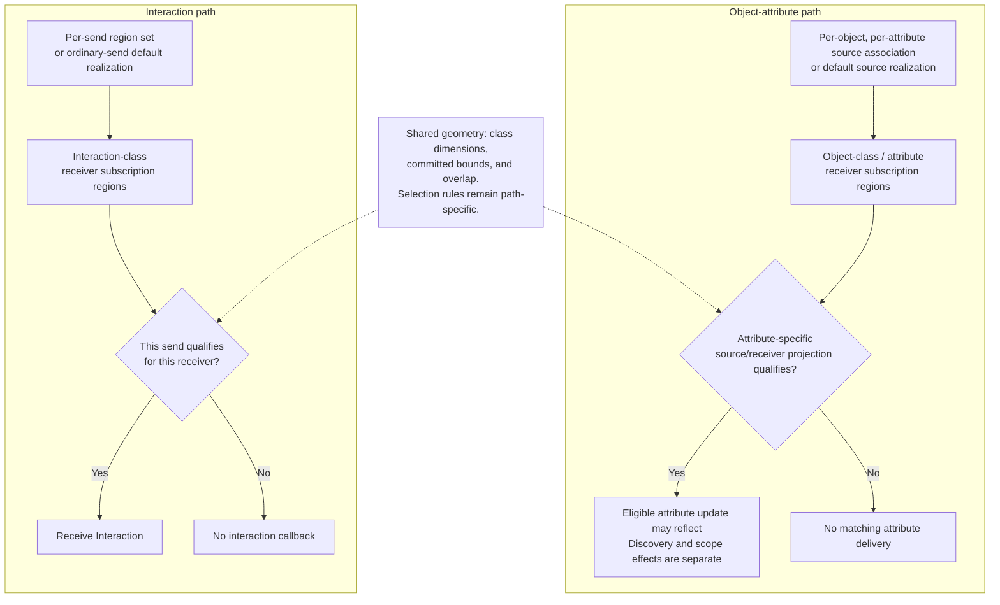

## From FOM dimensions to runtime region scope

This is a conceptual bridge between the model and DDM, not a required
service-call sequence. A FOM declares named dimensions and associates them
with object or interaction classes. The RTI's class-availability queries let
an application inspect the dimensions available to a selected class. The
application then chooses the dimensions and ranges for a region and uses that
region in an applicable regional service.

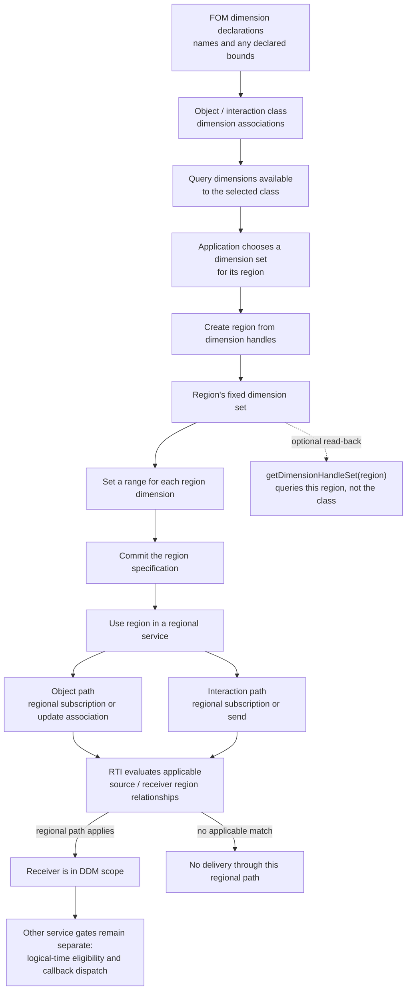

Keep three related sets distinct: the execution's **dimension catalogue**;
the **class-available dimensions** returned for one object or interaction
class; and the **dimension set of a region**, chosen by the application with
its ranges. Three public queries expose different parts of this model:

| Question | Public query | What it answers |
| --- | --- | --- |
| Which dimensions are associated with this FOM class? | [`getAvailableDimensionsForObjectClass`](../../third_party/ieee1516.1-2025/include/RTI/RTIambassador.h#L1891) / [`getAvailableDimensionsForInteractionClass`](../../third_party/ieee1516.1-2025/include/RTI/RTIambassador.h#L1901) | Class availability for application decisions; it does not create or configure a region. |
| Which dimensions were selected for this region? | [`getDimensionHandleSet(region)`](../../third_party/ieee1516.1-2025/include/RTI/RTIambassador.h#L1943) | The region's fixed dimension set, not its range bounds or a class's available dimensions. |
| What bounds are set for this region and dimension? | [`getRangeBounds(region, dimension)`](../../third_party/ieee1516.1-2025/include/RTI/RTIambassador.h#L1956) | Bounds for a dimension in this region; in the selected embedded path, this reports pending edits before commit as well as committed values. |

For clause-level reading, the pinned 2025 `RTIambassador` interface labels
these services with the following IEEE 1516.1-2025 section numbers. This is a
navigation map, not a substitute for the normative service text; use the
[official IEEE standard](https://standards.ieee.org/ieee/1516.1/6688/) for
required preconditions and effects.

| HLA question | Service clauses |
| --- | --- |
| How is a region created, committed, or deleted? | [`createRegion` §9.2](../../third_party/ieee1516.1-2025/include/RTI/RTIambassador.h#L1442), [`commitRegionModifications` §9.3](../../third_party/ieee1516.1-2025/include/RTI/RTIambassador.h#L1455), [`deleteRegion` §9.4](../../third_party/ieee1516.1-2025/include/RTI/RTIambassador.h#L1469). |
| Which dimensions and bounds are available or selected? | [`getAvailableDimensionsForObjectClass` §10.21](../../third_party/ieee1516.1-2025/include/RTI/RTIambassador.h#L1891), [`getAvailableDimensionsForInteractionClass` §10.22](../../third_party/ieee1516.1-2025/include/RTI/RTIambassador.h#L1901), [`getDimensionUpperBound` §10.25](../../third_party/ieee1516.1-2025/include/RTI/RTIambassador.h#L1931), [`getDimensionHandleSet` §10.26](../../third_party/ieee1516.1-2025/include/RTI/RTIambassador.h#L1943), [`getRangeBounds` §10.27](../../third_party/ieee1516.1-2025/include/RTI/RTIambassador.h#L1956), and [`setRangeBounds` §10.28](../../third_party/ieee1516.1-2025/include/RTI/RTIambassador.h#L1972). |
| Where do object attributes get source regions and receiver interest? | [`registerObjectInstanceWithRegions` §9.5](../../third_party/ieee1516.1-2025/include/RTI/RTIambassador.h#L1487), [`associateRegionsForUpdates` / `unassociateRegionsForUpdates` §§9.6–9.7](../../third_party/ieee1516.1-2025/include/RTI/RTIambassador.h#L1526), and [`subscribeObjectClassAttributesWithRegions` / `unsubscribeObjectClassAttributesWithRegions` §§9.8–9.9](../../third_party/ieee1516.1-2025/include/RTI/RTIambassador.h#L1559). |
| Where do interactions get source regions and receiver interest? | [`subscribeInteractionClassWithRegions` / `unsubscribeInteractionClassWithRegions` §§9.10–9.11](../../third_party/ieee1516.1-2025/include/RTI/RTIambassador.h#L1595) and [`sendInteractionWithRegions` §9.12](../../third_party/ieee1516.1-2025/include/RTI/RTIambassador.h#L1631). |
| Where is a region used for provider solicitation rather than receiver selection? | [`requestAttributeValueUpdateWithRegions` §9.13](../../third_party/ieee1516.1-2025/include/RTI/RTIambassador.h#L1672); its distinct role is explained in [regional request scope](HLA-2025-ATTRIBUTE-VALUE-UPDATE-REQUEST-FLOW-GUIDE.md#regional-request-scope-is-not-response-ddm), and its configured-process route is traced in the [regional class-request sequence](HLA-2025-ATTRIBUTE-VALUE-UPDATE-REQUEST-FLOW-GUIDE.md#configured-process-path-region-check-before-event-routing). |

The class-availability query informs application choices; it does not create
a region. In the public API, `createRegion` accepts a `DimensionHandleSet`
and has no class argument, so the created region is not intrinsically bound to
the class used for the query. A later class-specific regional service may
impose compatibility rules; those are separate from region construction.
Likewise, [`getDimensionUpperBound`](../../third_party/ieee1516.1-2025/include/RTI/RTIambassador.h#L1931)
reports the FOM dimension's upper bound, not the range selected for a
particular region.

In the selected embedded 2025 region-lifecycle test, a region's non-empty
dimension set is queryable immediately after `createRegion`, before range
bounds are set or committed ([assertion](../../cpp/tests/ieee1516_2025_federation_management_region_lifecycle_catch2.cpp#L65)).
An empty set remains empty before and after commit, so it describes a
zero-dimensional region rather than a wildcard ([assertions](../../cpp/tests/ieee1516_2025_federation_management_region_lifecycle_catch2.cpp#L53)).
The same test observes pending bounds through `getRangeBounds` before commit
([assertions](../../cpp/tests/ieee1516_2025_federation_management_region_lifecycle_catch2.cpp#L88)),
then checks the committed values after commit
([assertions](../../cpp/tests/ieee1516_2025_federation_management_region_lifecycle_catch2.cpp#L117)).
These are bounded embedded observations, not a process-parity claim. The
query's unjoined, foreign-handle, and deleted-handle error behavior is also
observed only in this path ([unjoined caller](../../cpp/tests/ieee1516_2025_federation_management_region_lifecycle_catch2.cpp#L36),
[foreign handle](../../cpp/tests/ieee1516_2025_federation_management_region_lifecycle_catch2.cpp#L106),
[deleted handle](../../cpp/tests/ieee1516_2025_federation_management_region_lifecycle_catch2.cpp#L161)).

For example, an object path may use a region in an attribute subscription or
an object's update-region association; an interaction path may use one in a
regional subscription or a send. Which services accept which region arguments
is service-specific. After DDM scope is established, logical-time rules and
callback dispatch remain separate questions; see [time management](HLA-2025-TIME-MANAGEMENT-GUIDE.md)
and [callback ordering](HLA-2025-CALLBACK-AND-SERVICE-ORDERING-FLOW-GUIDE.md).

The pinned [2025 FDD schema](../../third_party/ieee1516.2-2025/resources/schemas/IEEE1516-FDD-2025.xsd)
records class-to-dimension associations and dimension declarations. The
pinned [2025 RTIambassador API's region services](../../third_party/ieee1516.1-2025/include/RTI/RTIambassador.h#L1442),
its separate [class-availability queries](../../third_party/ieee1516.1-2025/include/RTI/RTIambassador.h#L1891)
(§§10.21–10.22), and dimension/range lookups make this boundary visible. Those
API signatures establish the distinction above; the official IEEE standards
remain the normative authority.

Umbra's existing embedded 2025 [three-dimensional regional object test](../../cpp/tests/three_dimensional_regional_object_attribute_overlap_catch2.cpp#L110)
provides one concrete case study: it queries dimensions for an object class,
creates source and receiver regions with those dimensions, commits their
ranges, then observes discovery and attribute reflection when the tested
regional path applies. This is one HLA_EVOKED development-profile scenario,
not proof of universal behavior. A separate [process-endpoint query test](../../cpp/tests/ieee1516_2025_connection_available_dimensions_hierarchy_catch2.cpp#L459)
covers available-dimension lookups only. Separate configured process-endpoint
regional-object cases cover registration/discovery, regional-subscription
transitions, and source-region relevance transitions; they are summarized in
[the process boundary below](#2025-process-endpoint-boundary-for-regional-objects).
Those cases use the same object class for publisher and receiver, so they do
not establish cross-class regional behavior or general process DDM parity.

The embedded query test also makes the object-class hierarchy result concrete:

| Query target in that test | Returned available dimensions |
| --- | --- |
| `Food.Drink` | `{BarQuantity}` |
| `Food.Drink.Soda` | `{BarQuantity, SodaFlavor}` |
| `Food.Drink.Soda.Light` | `{BarQuantity, SodaFlavor, Sweetener}` |
| `FoodServed` interaction | empty set |
| `MainCourseServed` interaction | `{ServerId}` |

These are scenario results, not a substitute for the standard's definition.
The [embedded registry query](../../cpp/src/internal/federation/federation_registry_catalog_queries.cpp#L594)
walks the selected class and its parent chain, collecting associated
dimensions; the [focused lookup test](../../cpp/tests/dimension_lookup_catch2.cpp#L53)
asserts the sets above. Its process-endpoint counterpart asserts the `Drink`,
`Soda`, `FoodServed`, and `MainCourseServed` query results over that tested
endpoint, but remains query-only. An empty available-dimensions result means
that query returned no dimension handles for that class in the tested model;
it does not create a region or turn a zero-dimensional region into a wildcard.

### Inherited dimensions in a child-class regional path

The embedded three-dimensional object case joins the hierarchy query to an
actual regional registration and subscription. In the pinned Restaurant FOM,
[`Food.Drink`](../../third_party/ieee1516.2-2025/resources/examples/RestaurantFOMmodule-2025.xml#L226)
declares `BarQuantity`, its child
[`Soda`](../../third_party/ieee1516.2-2025/resources/examples/RestaurantFOMmodule-2025.xml#L255)
adds `SodaFlavor`, and
[`Light`](../../third_party/ieee1516.2-2025/resources/examples/RestaurantFOMmodule-2025.xml#L274)
adds `Sweetener`. Querying `Light` returns all three; the test then uses those
dimensions in publisher and receiver regions for the same `Light` class and
its `Flavor` attribute.

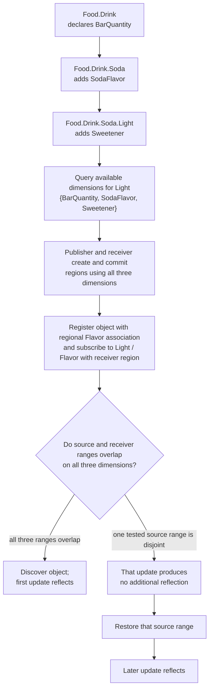

This is one embedded 2025 `HLA_EVOKED` scenario, not a universal inheritance
rule. The test queries the `Light` class, registers and subscribes at that
same class, and moves each of the three source-region dimensions out of
overlap one at a time before restoring it. It demonstrates that ancestor-
associated dimensions participate in this descendant class's available set
and in this regional object path. It does **not** show how a parent-keyed
regional subscription interacts with a child-registered object; the embedded
source path is separated from dimension accumulation in the next subsection,
and no focused regional case tests that cross-class behavior. The relevant
API entry points are `getAvailableDimensionsForObjectClass` (§10.21),
`registerObjectInstanceWithRegions` (§9.5), and
`subscribeObjectClassAttributesWithRegions` (§9.8); see the clause table above.

The pinned [Restaurant FOM declarations](../../third_party/ieee1516.2-2025/resources/examples/RestaurantFOMmodule-2025.xml#L226)
and the embedded [dimension query test](../../cpp/tests/dimension_lookup_catch2.cpp#L112)
show the class-level inputs and returned set. The [regional overlap case](../../cpp/tests/three_dimensional_regional_object_attribute_overlap_catch2.cpp#L110)
asserts that set, uses the three dimensions in both regions, observes discovery
and reflection, suppresses an additional reflection after each individual
dimension is made disjoint, then observes reflection again after restoring
overlap. In the current embedded source, the available-dimension helper walks
from the selected object class through its parents
([helper](../../cpp/src/internal/federation/federation_registry_regions.cpp#L531));
regional registration and subscription each check region dimensions against
that set ([registration](../../cpp/src/internal/federation/federation_registry_object_instance_registration.cpp#L245),
[subscription](../../cpp/src/internal/federation/federation_registry_object_attribute_declarations.cpp#L465)).
These are separate normative, source, and test evidence layers; the test does
not establish process-profile parity.

### Object-class ancestry: regional discovery and value projection

The child-class dimension set and a receiver's regional declaration are
different kinds of inheritance. The selected embedded 2025 source accumulates
available dimensions from the queried object class and its parents, but it
stores regional subscriptions under the exact class-and-attribute key passed
to the service. A publisher's update-region association is instead attached
to an object instance and attribute.

At discovery, the registry first checks whether an active subscription from
a joined non-producer establishes the object's relevance. For each receiver,
it then starts at the object's registered class and walks toward parents,
checking the declarations and attribute visibility at each class. The closest
qualifying class becomes that receiver's known class. Thus a parent-keyed
regional declaration can be considered for a child-registered object along
this source path; the
declaration is not copied into the child's class entry. The source's active-
relevance scan
([source](../../cpp/src/internal/federation/federation_registry.cpp#L869))
is separate from a particular receiver's subscription status;
after that scan succeeds, a passive declaration may still supply the
receiver's closest class. Later value planning uses the receiver's saved
known class to filter visible attributes and the declarations at that class.
A receiver discovered at a parent class does not gain child-only attributes
merely because the publisher registered the instance at a child class.

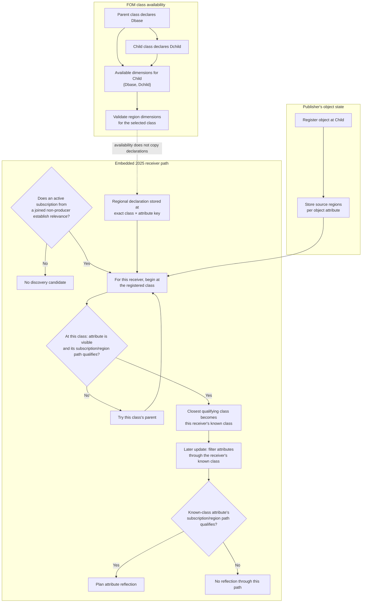

This is an embedded-source map, not a normative inheritance rule. The
[pinned API entries](../../third_party/ieee1516.1-2025/include/RTI/RTIambassador.h#L1487)
for `registerObjectInstanceWithRegions` (§9.5) and
[`subscribeObjectClassAttributesWithRegions`](../../third_party/ieee1516.1-2025/include/RTI/RTIambassador.h#L1559)
(§9.8) are navigation pointers, not evidence for the cross-class behavior
described here. The [dimension helper](../../cpp/src/internal/federation/federation_registry_regions.cpp#L531)
walks the object-class parents;
[registration state](../../cpp/src/internal/federation/federation_registry_object_instance_registration.cpp#L332)
keeps the registered class while
[source regions are stored per object attribute](../../cpp/src/internal/federation/federation_registry_object_instance_registration.cpp#L365);
[regional subscription storage](../../cpp/src/internal/federation/federation_registry_object_attribute_declarations.cpp#L500)
keys declarations by class before attribute; the
[discovery resolver](../../cpp/src/internal/federation/federation_registry.cpp#L830)
walks from the registered class toward parents
([parent step](../../cpp/src/internal/federation/federation_registry.cpp#L1079));
and the [attribute update planner](../../cpp/src/internal/federation/federation_registry_attribute_update_recipients.cpp#L55)
uses the receiver's saved known class to select declarations and filter
attributes. The reviewed regional object tests,
including the [three-dimensional case](../../cpp/tests/three_dimensional_regional_object_attribute_overlap_catch2.cpp#L110),
register and subscribe at the same class. They demonstrate inherited
dimensions in that regional path, but do not test a parent-class regional
subscription against a child-registered object. Keep the cross-class result
source-only; do not infer process-endpoint or 2010 parity. For how discovery
and attribute projection differ from other ancestry paths, see the object
information guide's [cross-path class ancestry map](HLA-2025-OBJECT-AND-INTERACTION-INFORMATION-FLOW-GUIDE.md#class-ancestry-has-different-jobs-in-different-paths).

#### Worked source-only trace: parent subscription, child object

This hypothetical separates three questions that are easy to collapse:
whether each region fits its own class context, whether the declarations are
considered while walking class ancestry, and whether their committed
realizations overlap. It composes current embedded source paths; it is not a
focused test or a normative example.

| Stage | Example state | Current embedded source path |
| --- | --- | --- |
| Class context | `Base` declares attribute `A` and dimension `D`; `Child` inherits `D` and adds dimension `E`. Available dimensions are `{D}` for `Base` and `{D, E}` for `Child`. | The dimension query collects associations on the selected class and its parents ([helper](../../cpp/src/internal/federation/federation_registry_regions.cpp#L531)). |
| Admission | The receiver subscribes to `Base/A` with a committed region over `{D}`. The publisher registers a `Child` object and associates `A` with a committed source region over `{D, E}`. | Subscription and registration check each region's dimension set against the available set of the class named by that service ([subscription](../../cpp/src/internal/federation/federation_registry_object_attribute_declarations.cpp#L465), [registration](../../cpp/src/internal/federation/federation_registry_object_instance_registration.cpp#L245)). |
| Discovery | With an active non-producer declaration and overlapping committed ranges on shared dimension `D`, the discovery planner walks from registered class `Child` to `Base` and can consider the `Base/A` declaration. | The active-relevance and per-receiver class walks are in the [discovery resolver](../../cpp/src/internal/federation/federation_registry.cpp#L830); overlap uses committed region snapshots ([overlap helper](../../cpp/src/internal/federation/federation_registry_regions.cpp#L611)). |
| Receiver knowledge and later value | If `Base/A` is the closest qualifying receiver declaration, the receiver's known class is `Base`. A later reflection is projected through that saved class, so child-only attributes are not made visible by the publisher's `Child` registration. | The receiver walk saves the qualifying class in the [discovery resolver](../../cpp/src/internal/federation/federation_registry.cpp#L830); later per-recipient filtering starts from that class in the [attribute update planner](../../cpp/src/internal/federation/federation_registry_attribute_update_recipients.cpp#L55). |

The [child-object/base-subscription test](../../cpp/tests/subscribe_object_class_attributes_discovery_catch2.cpp#L297)
covers the nearest-known-class result without regions. The
[three-dimensional regional test](../../cpp/tests/three_dimensional_regional_object_attribute_overlap_catch2.cpp#L110)
covers inherited dimensions and overlap while registering and subscribing at
the same class. The inspected 2025 process regional cases also use the same
class for publisher and receiver. These components do not establish the
combined parent-subscription/child-object callback outcome; keep that result
as an embedded source inference, not process evidence or an HLA requirement.

### 2025 process-endpoint boundary for regional objects

The process endpoint adds a session and event-transport boundary around the
2025 registry's regional decisions. The service validates that the connected
session represents the requested federation member, delegates registration,
declaration, or source-region changes and recipient planning to the shared
registry, then routes the returned discovery, scope, and advisory events to
process sessions. This is an Umbra process-path map, not an additional HLA
rule, and it covers regional object registration/declarations/associations,
not ordinary or timestamped attribute-value routing. The chart shows the
successful mutation paths; rejected and unapplied-result branches are omitted.

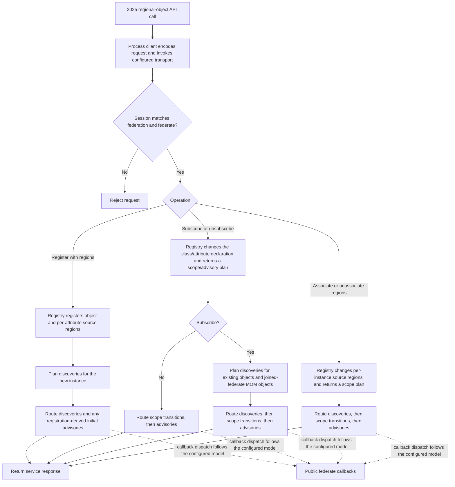

The client-side boundary is visible in the [regional registration wrapper](../../cpp/src/internal/federation/process_federation_client_region_services.cpp#L276)
and [regional subscription wrapper](../../cpp/src/internal/federation/process_federation_client_declaration_services.cpp#L482),
which encode requests and invoke the configured transport. On the server side,
the [regional registration and association handlers](../../cpp/src/internal/federation/process_federation_service_regional_object_association.cpp#L8)
and the [regional subscription handler](../../cpp/src/internal/federation/process_federation_service_declarations.cpp#L261)
validate the session before asking the registry to mutate state or produce a
plan. Subscription-triggered discovery is planned only on subscribe,
and is routed before the returned scope changes and advisories. Association
changes route discoveries before scope changes and advisories as well. The
process-specific [discovery router](../../cpp/src/internal/federation/process_federation_service_object_discovery.cpp#L11),
[scope-event router](../../cpp/src/internal/federation/process_federation_service_notifications.cpp#L207),
and [advisory router](../../cpp/src/internal/federation/process_federation_service_attribute_relevance_advisories.cpp#L11)
are separate from the registry's recipient decision.
The process scope route has distinct polling-queue and pushed-event stale-work
checkpoints; see the [Attribute Scope Advisory process-path note](HLA-2025-ATTRIBUTE-SCOPE-ADVISORY-FLOW-GUIDE.md#process-event-transport-has-two-stale-work-checkpoints)
for the bounded source evidence and missing race-test boundary.

Three focused [initial-discovery](../../cpp/tests/ieee1516_2025_connection_regional_attribute_relevance_initial_discovery_catch2.cpp#L458),
[subscription-transition](../../cpp/tests/ieee1516_2025_connection_regional_attribute_relevance_subscription_transition_catch2.cpp#L457),
and [source-region transition](../../cpp/tests/ieee1516_2025_connection_regional_attribute_relevance_transition_catch2.cpp#L42)
cases exercise configured process endpoints. All use
`HLAobjectRoot.Food.Drink.Soda` for registration and subscription and compare
the publisher/receiver class handles in the [initial-discovery](../../cpp/tests/ieee1516_2025_connection_regional_attribute_relevance_initial_discovery_catch2.cpp#L699),
[subscription-transition](../../cpp/tests/ieee1516_2025_connection_regional_attribute_relevance_subscription_transition_catch2.cpp#L724),
and [source-region transition](../../cpp/tests/ieee1516_2025_connection_regional_attribute_relevance_transition_catch2.cpp#L301)
cases. In the initial-discovery case, the owner-directed advisory is observed during the
registration response under HLA_IMMEDIATE, but after an explicit evoke under
HLA_EVOKED; [the case comment](../../cpp/tests/ieee1516_2025_connection_regional_attribute_relevance_initial_discovery_catch2.cpp#L725)
notes that the test does not need a second network poll. These are bounded
case results, not proof of every callback ordering or process/embedded parity.
None tests a parent-class regional subscription against a child-registered
object, so the cross-class behavior above remains source-only for the embedded
path and unclaimed for the process endpoint. The entire path here is 2025-only;
make no 2010 inference.

### Interaction-class ancestry: available context and declaration lookup

For a selected interaction class, the tested 2025 baseline has two different
parent-chain uses. The first computes the dimension context used to validate a
regional declaration or send. The second is a later delivery lookup: after a
separate interaction-relevance gate, each receiver's candidate class starts
at the sent class and walks toward its parents. At each candidate, the planner
checks declarations keyed to that exact class; a regional candidate must also
overlap the source region. Thus a parent-keyed regional declaration can be
*considered* for a send on a descendant class in this source path; the walk
does not search downward from a parent send to child-keyed declarations.
Neither direction means declarations are copied between class keys, and
neither is here claimed as a normative inheritance rule. In the inspected
embedded planner, an eligible ordinary/default route is checked before the
regional route at each class candidate. A disjoint With Regions declaration
does not by itself suppress that ordinary route; regional overlap is considered
when the ordinary route does not qualify. The flow below records the current
source and focused-test behavior, not a normative inheritance rule.

An ordinary embedded receive-order case now exercises the nonregional
candidate walk for one receiver: a descendant send reports the base when only
the base is subscribed, the middle when base and middle are subscribed, and
the sent class when that exact class is subscribed too. Each send produces
one callback whose class matches the selected candidate
([test](../../cpp/tests/inherited_interaction_receipt_catch2.cpp#L71)). It
uses empty parameter maps and no regions, so it does not verify inherited
parameter projection, regional overlap, or the available-dimension checks in
the diagram below. Keep those branches source-scoped; this case does not
establish a normative inheritance rule or process-profile parity.

For how this regional path differs from object discovery, ordinary
interaction promotion, and directed routing, see the object-information
guide's [cross-path class ancestry map](HLA-2025-OBJECT-AND-INTERACTION-INFORMATION-FLOW-GUIDE.md#class-ancestry-has-different-jobs-in-different-paths).

```mermaid
flowchart TD
  subgraph Subscribe["Regional subscription declared for class C"]
    C["Select interaction class C"] --> SR{"Subscription region set non-empty?"}
    SR -->|No| SNoOp["No regional declaration change"]
    SR -->|Yes| CA["Available dimensions = dimensions on C and its parent chain"]
    CA --> CV["Validate each subscription region against that set"]
    CV --> CS["Store regional entries under C's exact class handle"]
  end

  subgraph Send["Regional send on interaction class S"]
    S["Select sent interaction class S"] --> ER{"Explicit source-region set non-empty?"}
    ER -->|No| ENoOp["No send through this invocation"]
    ER -->|Yes| SA["Available dimensions = dimensions on S and its parent chain"]
    SA --> SV["Validate each explicit source region against that set"]
    SV --> RG{"Separate global active-subscription relevance gate succeeds?"}
    RG -->|No| Stop["No recipient candidate is planned"]
    RG -->|Yes| Candidate["For this receiver, begin candidate walk at S"]
    Candidate --> Ordinary{"Eligible ordinary/default route at this candidate?"}
    Ordinary -->|Yes| OrdinaryEligible["Select this candidate through its ordinary/default route"]
    Ordinary -->|No| Regional{"Regional declaration keyed at this candidate?"}
    Regional -->|Yes| Overlap{"Does a candidate region overlap the source region?"}
    Overlap -->|Yes| RegionalEligible["Select this candidate through its regional route"]
    Overlap -->|No| Parent["Try the candidate's parent class"]
    Regional -->|No| Parent
    Parent --> Candidate
    OrdinaryEligible --> Projection["Set planned received class and parameter projection;<br/>later delivery gates still apply"]
    RegionalEligible --> Projection
  end
```

**Bounded 2025 source/test evidence; not a normative rule.** The current
[embedded recipient planner](../../cpp/src/internal/federation/federation_registry.cpp#L1520)
checks an eligible ordinary/default route before falling back to a regional
declaration at that class candidate. The updated focused test expects a mixed
receiver to receive an explicit-source interaction through its ordinary
subscription despite a disjoint regional declaration
([focused case](../../cpp/tests/ieee1516_2025_default_region_interaction_routing_catch2.cpp#L5),
[assertion](../../cpp/tests/ieee1516_2025_default_region_interaction_routing_catch2.cpp#L88));
the focused CTest passed 1/1 with 50 assertions in the current MinGW build. The
second embedded fixture now expresses the same expectation
([case](../../cpp/tests/default_region_interaction_routing_catch2.cpp#L90),
[assertion](../../cpp/tests/default_region_interaction_routing_catch2.cpp#L197)).
This is one exercised embedded scenario, not broad DDM coverage or process
parity. The exact normative interpretation of IEEE 1516.1-2025 §9.1.5 remains
unverified until its authorized text is reviewed; neither source comments nor
test mappings establish that interpretation.

The chart is an **embedded 2025 test/source map**, not a normative flowchart or
a process-profile claim. It isolates class/DDM lookup and omits publication
and other service preconditions, sender self-exclusion, order/transport, and
later callback-dispatch gates. The API entry points are
`getAvailableDimensionsForInteractionClass`
(§10.22), `subscribeInteractionClassWithRegions` (§9.10), and
`sendInteractionWithRegions` (§9.12); these are navigation pointers, not
paraphrases of the licensed clauses. The implementation's availability
helper walks the selected class and its parents
([helper](../../cpp/src/internal/federation/federation_registry_regions.cpp#L489));
regional subscription validates against that result and stores by the
provided class handle
([validation](../../cpp/src/internal/federation/federation_registry_directed_interactions.cpp#L624),
[exact-key write](../../cpp/src/internal/federation/federation_registry_directed_interactions.cpp#L651));
regional send validates the sent class's regions against its available set
([send planner](../../cpp/src/internal/federation/federation_registry_receive_order_interactions.cpp#L82));
and recipient resolution begins at the sent class, checks each candidate, and
advances to its parent
([planner](../../cpp/src/internal/federation/federation_registry.cpp#L1421),
[candidate walk](../../cpp/src/internal/federation/federation_registry.cpp#L1512),
[parent step](../../cpp/src/internal/federation/federation_registry.cpp#L1611)).

The reviewed tests do not combine an ancestor-only interaction dimension
with regional subscription/send, or a parent-class regional subscription
with a descendant-class send. The Restaurant query case reports
`ServerId` for `MainCourseServed`, but the FOM has no dimension on
`FoodServed` and declares `ServerId` directly on its `MainCourseServed`
child; it is not evidence of ancestor-dimension accumulation. The focused
regional interaction case also uses `MainCourseServed` for both subscription
and send. See the [query assertions](../../cpp/tests/dimension_lookup_catch2.cpp#L121),
the FOM's [`FoodServed` parent](../../third_party/ieee1516.2-2025/resources/examples/RestaurantFOMmodule-2025.xml#L443)
and [`MainCourseServed` child declaration](../../third_party/ieee1516.2-2025/resources/examples/RestaurantFOMmodule-2025.xml#L464),
and the [regional case's selected class](../../cpp/tests/ieee1516_2025_regional_interaction_subscription_receive_order_catch2.cpp#L50).
Keep both cross-class consequences explicitly source-only until a focused
case or the applicable licensed standard text establishes more; do not
transfer the object-case test result to interactions.

#### Additional-module Join: retained regional interaction declarations

For the embedded 2025 source path, an additional-module Join prepares a new
composed definition and reconciles the existing interaction-class, parameter,
and dimension handle directories before swapping the replacement definition
and directories with the new membership
([preparation](../../cpp/src/internal/federation/federation_registry_membership_lifecycle.cpp#L298),
[commit](../../cpp/src/internal/federation/federation_registry_membership_lifecycle.cpp#L605),
[interaction handles](../../cpp/src/internal/handles/interaction_class_handle_directory.cpp#L10),
[parameter handles](../../cpp/src/internal/handles/parameter_handle_directory.cpp#L35),
[dimension handles](../../cpp/src/internal/handles/dimension_handle_directory.cpp#L9)).
The per-federate interaction-declaration map is separate from those catalog
directories and is not rewritten by that swap
([declaration state](../../cpp/src/internal/federation/federation_registry.hpp#L2255)).
Regional entries remain keyed by the exact interaction-class handle supplied
when the declaration was made
([regional write](../../cpp/src/internal/federation/federation_registry_directed_interactions.cpp#L651));
Join does not copy a parent declaration onto a newly available descendant.

A later regional send uses the current catalog in two distinct decisions.
The send's source regions are checked against dimensions currently available
to the sent class and its parents
([dimension-context check](../../cpp/src/internal/federation/federation_registry_receive_order_interactions.cpp#L82)).
Recipient selection then starts at the sent class, checks that exact class's
ordinary/regional declarations and region overlap, and walks toward parent
classes when no candidate is eligible
([recipient planner](../../cpp/src/internal/federation/federation_registry.cpp#L1421),
[candidate walk](../../cpp/src/internal/federation/federation_registry.cpp#L1512),
[region-overlap check](../../cpp/src/internal/federation/federation_registry.cpp#L1568),
[parent step](../../cpp/src/internal/federation/federation_registry.cpp#L1611)).
Consequently, this source path can consider a retained parent-class regional
subscription for a later send on an added descendant class. That is a
source-derived lookup result—not a copied subscription, a normative
inheritance claim, or a guarantee that every later callback is delivered;
relevance, sender exclusion, and callback-dispatch gates remain separate.

The evidence is deliberately narrower. The additional-module dimension test
observes a new interaction class and its dimension through lookup while also
checking an existing dimension handle; it does not preserve a regional
interaction declaration or send on the new class
([test](../../cpp/tests/dimension_lookup_catch2.cpp#L129)). The focused
regional receive-order test subscribes and sends on the same
`MainCourseServed` class without an additional-module Join
([test](../../cpp/tests/ieee1516_2025_regional_interaction_subscription_receive_order_catch2.cpp#L50)).
No focused case combines Join, a retained parent-keyed regional subscription,
and a later descendant send. Keep this as an embedded 2025 source trace, not
process or 2010 parity evidence. The existing [interaction ancestry map](#interaction-class-ancestry-available-context-and-declaration-lookup)
already diagrams the send-time lookup, so a second chart would repeat it.

The configured process profile keeps a separate transport and callback
boundary, but its additional-FOM Join passes the prepared definition to
`joinWithDefinitionAndTimeState`, its regional-subscription handler delegates
to the registry declaration methods, and receive-order sends pass the class
and optional source regions to `planReceiveOrderInteraction`
([process Join](../../cpp/src/internal/federation/process_federation_service_lifecycle.cpp#L589),
[regional declaration handler](../../cpp/src/internal/federation/process_federation_service_declarations.cpp#L31),
[send planner call](../../cpp/src/internal/federation/process_federation_service_interaction_send.cpp#L389)).
This is source-level reuse of the registry's catalog and recipient-planning
logic, not an end-to-end process-parity result. The reviewed public process
multi-recipient case joins without additional modules and exercises per-
receiver overlap, but not this added-class combination
([test](../../cpp/tests/ieee1516_2025_connection_multi_recipient_regional_interaction_catch2.cpp#L917)).
No focused process test in this bounded review combines additional-module
Join, a retained parent-keyed regional subscription, and a send on the added
descendant.

The embedded lookup case later admits an additional module containing a
separate class and dimension, then observes the new dimension through lookup
while an existing dimension handle remains stable. It does not test how a
later module that changes an existing class's associations interacts with
already-created regions. This is a test-evidence limit, not proof that an
existing class cannot gain another association. For admission and composition
boundaries, see the [FOM module guide](HLA-2025-FOM-MODULE-ADMISSION-AND-COMPOSITION-FLOW-GUIDE.md);
the region lifecycle section below keeps creation and commitments distinct.

### 2025 implementation trace: class availability and existing regions

The following is an Umbra source-derived case study, not a claim about
normatively required additional-module Join behavior and not a statement about
the separate 2010 stream. In the current composer, repeated scalar dimension
references are keyed by their text ([node-key logic](../../cpp/src/internal/fom/libxml2_fom_composer.cpp#L160)),
and recursive composition routes a `dimensions` node through a
[dimension-specific merge](../../cpp/src/internal/fom/libxml2_fom_composer.cpp#L884)
that appends unique references ([merge helper](../../cpp/src/internal/fom/libxml2_fom_composer.cpp#L804)).
This means a later module can add a dimension association to an already-composed
class; the current class-availability result can then grow. The focused
later-module case cited above adds a separate class instead, so it does not
directly test this same-class extension.

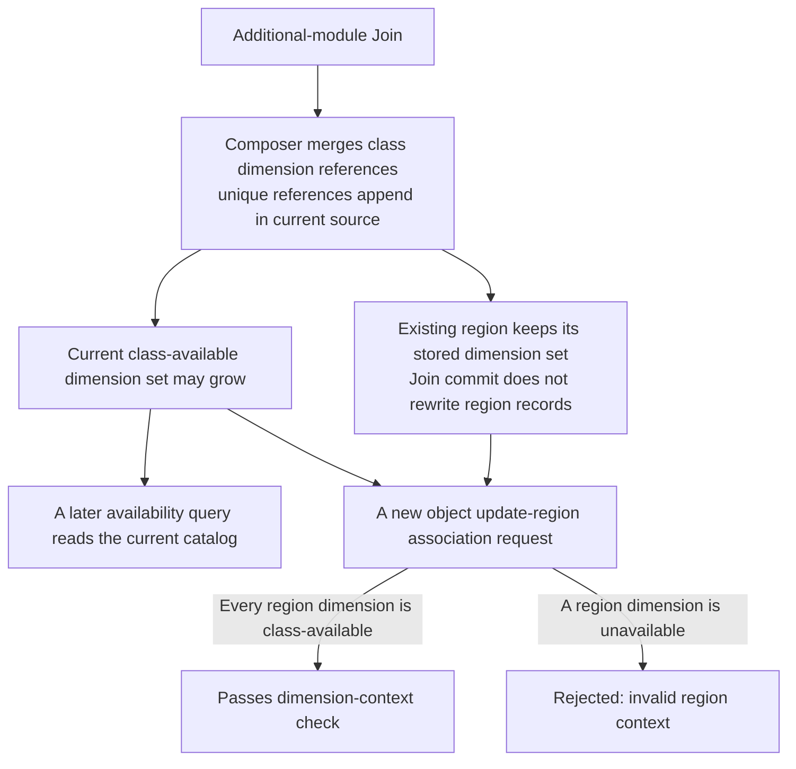

The source path behind this distinction is specific and useful: the
[composer](../../cpp/src/internal/fom/libxml2_fom_composer.cpp#L804)
merges dimension references; additional-module Join copies and
[reconciles the existing dimension-handle directory](../../cpp/src/internal/federation/federation_registry_membership_lifecycle.cpp#L316)
against the replacement catalog via the
[dimension directory](../../cpp/src/internal/handles/dimension_handle_directory.cpp#L9),
then swaps the replacement definition and prepared directories together
([registry commit](../../cpp/src/internal/federation/federation_registry_membership_lifecycle.cpp#L601));
`createRegion` stores the exact dimension-handle set supplied by the
application ([region creation](../../cpp/src/internal/federation/federation_registry_regions.cpp#L31));
and a later object update-region association request checks that its region
dimensions are contained in the class's currently available set
([association validation](../../cpp/src/internal/federation/federation_registry_update_region_associations.cpp#L65)).
The Join commit does not itself rewrite regions or rerun that association
check. Under the source's additive dimension-reference merge, an existing
region that was compatible before an added class association remains a subset
afterward; this is a source-derived consequence, not a focused integration
test result.

The [embedded additional-module test](../../cpp/tests/dimension_lookup_catch2.cpp#L129)
tests a new class/dimension and stable prior handle. The focused cases reviewed
here do not extend an existing class's dimension list or keep a region alive
across that extension. Do not present the diagram's untested branch as
normative HLA behavior or as verified process-endpoint behavior.

#### Dimension-context admission is not later regional delivery

If a same-class dimension association is added, a later regional object
subscription validates its regions against the class's then-current available
dimensions and stores entries under the supplied class/attribute/region keys.
A later update-region association performs the corresponding current-context
check for the registered object class and stores source regions separately per
object/attribute. Neither request changes the dimension set captured by a
region that already exists; nor does passing either context check establish
that the two sides overlap or that a callback will result. A later update uses
the committed source and receiver region snapshots in the separate object
discovery/value path. See [object-class ancestry, regional discovery, and value
projection](#object-class-ancestry-regional-discovery-and-value-projection)
and [receive-order routing after regional overlap changes](#receive-order-value-routing-after-regional-overlap-changes).

The source checks and state writes are in [regional subscription admission](../../cpp/src/internal/federation/federation_registry_object_attribute_declarations.cpp#L465),
[update-region association admission](../../cpp/src/internal/federation/federation_registry_update_region_associations.cpp#L46),
and [committed-snapshot overlap](../../cpp/src/internal/federation/federation_registry_regions.cpp#L611).
This combined Join-to-delivery path remains source-only: the additional-module
dimension test adds a separate class, while the focused [three-dimensional
regional object case](../../cpp/tests/three_dimensional_regional_object_attribute_overlap_catch2.cpp#L111)
tests overlap without a later Join. No focused test extends an existing
class's dimension set, retains its old regions, submits new regional
subscription/association state, and observes a later update.

## Interaction regions must fit the class's available dimensions

An interaction-class handle and a region handle can each be valid while their
combination is invalid. For regional send and regional subscription, check the
region's dimensions against the dimensions available to that interaction
class; handle validity alone does not establish a valid class/region context.

The two flows below summarize separate embedded 2025 test cases, not one
combined service sequence. In each case the dimension handles and regions are
valid in isolation. The test authors map the send and subscription constraints
to IEEE 1516.1-2025 §§9.1.3.3 and 9.1.4 respectively; because the complete
standard text is not available in this checkout, the diagram stays within the
specific dimension-availability cases exercised by those tests.

In this fixture, `MainCourseServed` has `{ServerId}` available, while
`SodaFlavor` is a real FOM dimension available to other classes but not to this
interaction class. The RTI can create and commit a region over `SodaFlavor`;
the context error arises only when a service tries to use it for
`MainCourseServed`. That is the key distinction: region existence is not the
same as service/class compatibility.

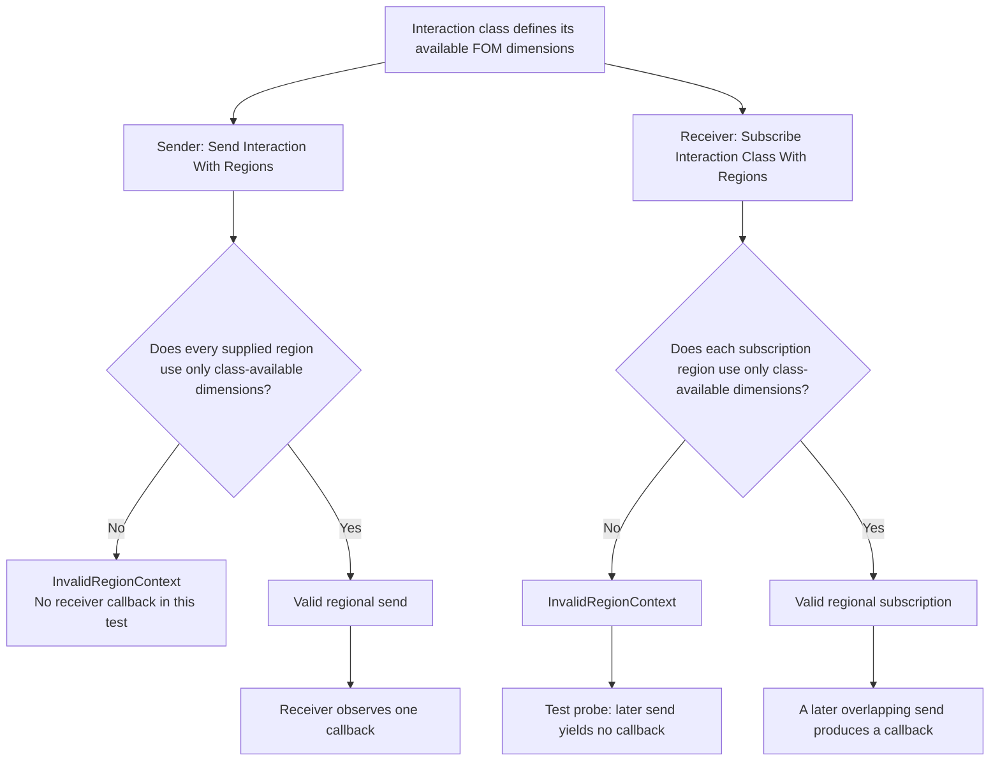

In the send case, a mixed region set contains one region dimension available
to the interaction class and one valid-but-unavailable dimension. The send is
rejected before any delivery is observed; a later valid-only send reaches the
receiver once. In the subscription case, rejecting the unavailable-dimension
region leaves no effective subscription: a later send produces no callback,
whereas a later valid regional subscription permits the matching send. These
are bounded embedded `HLA_EVOKED` observations, not a claim that every HLA
service has the same transaction or rollback semantics. See the two focused
[mixed-region interaction tests](../../cpp/tests/mixed_region_interaction_validation_catch2.cpp#L120)
([send case](../../cpp/tests/mixed_region_interaction_validation_catch2.cpp#L186),
[subscription case](../../cpp/tests/mixed_region_interaction_validation_catch2.cpp#L229)).
No process-profile or 2010 parity is inferred.

#### What the embedded 2025 source does before these outcomes

This is implementation evidence, not a universal HLA algorithm. The
receive-order send planner checks each supplied region against the interaction
class's available dimensions and returns `invalid_region_context` on a
mismatch. The ambassador maps that status to `InvalidRegionContext` before it
builds recipient deliveries. A valid earlier region can have a temporary
snapshot in the local plan before a later region fails; the selected test
asserts that no callback is delivered, not that no temporary work occurred or
that the implementation rolls back every internal step. See the
[receive-order region check](../../cpp/src/internal/federation/federation_registry_receive_order_interactions.cpp#L82),
[send-plan failure boundary](../../cpp/src/internal/runtime/umbra_rti_ambassador_regional_interaction_send_services.cpp#L709),
and [status-to-exception mapping](../../cpp/src/internal/runtime/umbra_rti_ambassador_service_failure_translation.cpp#L344).

For a regional subscription, the embedded registry checks the supplied
regions' dimensions before creating or updating the regional declaration map.
The failure is then mapped to `InvalidRegionContext`; the later-send test probe
is the public observation that no effective regional subscription resulted.
See the [subscription validation and mutation order](../../cpp/src/internal/federation/federation_registry_directed_interactions.cpp#L593)
and its [status mapping](../../cpp/src/internal/runtime/umbra_rti_ambassador_service_failure_translation.cpp#L58).

## Region template lifecycle

The useful distinction is between the latest range values supplied by the
application and the committed specification used for routing.
For one bounded 2025 embedded save/restore case in which a committed Region
returns after its live handle is deleted, see the
[saved-Region example](HLA-2025-FEDERATION-SAVE-RESTORE-FLOW-GUIDE.md#worked-case-a-committed-region-returns-from-the-saved-image).
That example does not establish process-endpoint or 2010 behavior.
For the source-derived 2025 process adapter-to-image path and its missing
configured-process Region assertion, see the Save/Restore guide's
[Region persistence boundary](HLA-2025-FEDERATION-SAVE-RESTORE-FLOW-GUIDE.md#process-adapter-to-saved-region-state-source-derived-path-not-a-process-region-test).
For a separate fresh-embedded-registry case that saves an active object-
attribute update-region association together with a queued TSO update, see the
[association and queued-update trace](HLA-2025-FEDERATION-SAVE-RESTORE-FLOW-GUIDE.md#worked-case-an-update-region-association-and-queued-tso-survive-fresh-registry-restore).
It is distinct from the committed-Region-only case and does not establish
process-endpoint or 2010 persistence.

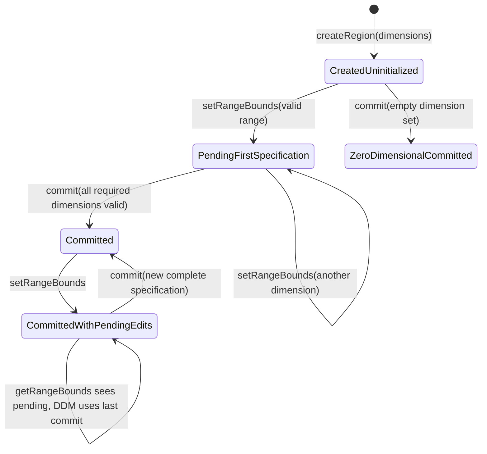

In the current embedded profile, an edited region therefore has two views:
the owner can query its pending bounds, while normal regional matching still
uses the last committed specification. A successful commit installs the new
specification and replans regional scope; this is an implementation mapping,
not a universal HLA delivery-timing claim.

Range state and handle lifetime are separate questions. For a valid region
handle owned by the calling federate, the delete gate is:

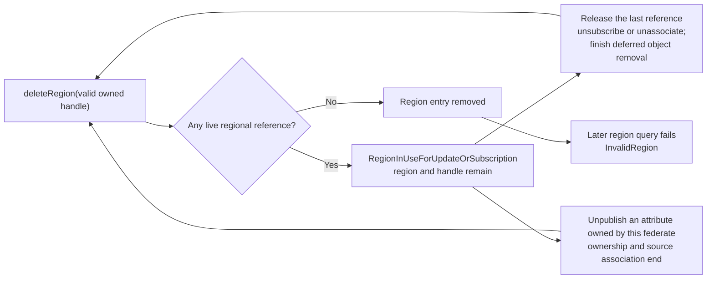

The API's delete exception and stale-handle result are distinct from pending or
committed bounds. In the embedded 2025 registry, the in-use check covers
regional object/interaction subscriptions and object update-region
associations; some object-removal paths retain an association until their
final removal callback is consumed.

Unpublishing an attribute that the caller owns is another release path: the
2025 registry removes that ownership and its active update-region association,
then refreshes region usage before returning
([association clear](../../cpp/src/internal/federation/federation_registry_object_attribute_declarations.cpp#L174),
[usage refresh](../../cpp/src/internal/federation/federation_registry_object_attribute_declarations.cpp#L205)).
The focused
[embedded region-lifecycle case](../../cpp/tests/ieee1516_2025_federation_management_region_lifecycle_catch2.cpp#L221)
registers one object attribute with a source Region and asserts that deletion
is blocked, then unpublishes the attribute and asserts that deleting the same
Region succeeds immediately. It also asserts that a later query reports
InvalidRegion. This test-source evidence is limited to the selected
association-release scenario, not the result when other live references
remain or process/2010 behavior.

### Object deletion and update-region lifetime

The pinned 2025 API has separate receive-order and timestamped
**Delete Object Instance** overloads and matching **Remove Object Instance**
callback forms ([receive-order delete](../../third_party/ieee1516.1-2025/include/RTI/RTIambassador.h#L832),
[timestamped delete](../../third_party/ieee1516.1-2025/include/RTI/RTIambassador.h#L847),
[removal callback](../../third_party/ieee1516.1-2025/include/RTI/FederateAmbassador.h#L316)).
This map follows the current 2025 embedded registry's object-record lifetime:
it is not a normative callback-order diagram or a process/2010 parity claim.
The question is when active and deferred update-region references stop
contributing to the region-in-use ledger.

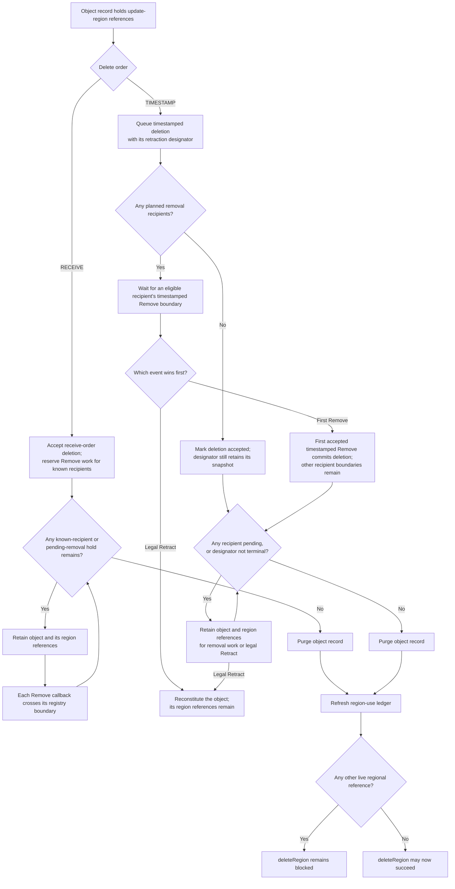

In the embedded receive-order path, deletion can purge the object and refresh
region usage in the service call when no other recipient/removal hold remains
([registry transition](../../cpp/src/internal/federation/federation_registry_object_instance_deletion.cpp#L117),
[purge and refresh](../../cpp/src/internal/federation/federation_registry_object_instance_deletion.cpp#L124)).
Otherwise, the object retains its update-region references until the final
removal boundary permits purge
([removal callback transition](../../cpp/src/internal/federation/federation_registry_object_instance_removal.cpp#L85),
[final purge and refresh](../../cpp/src/internal/federation/federation_registry_object_instance_removal.cpp#L111)).
The focused embedded test sources assert both cases: same-call region
deletion when there is no other known recipient
([case](../../cpp/tests/ieee1516_2025_federation_management_region_lifecycle_catch2.cpp#L240)),
and continued blocking until the peer crosses its final Remove callback
([case](../../cpp/tests/ieee1516_2025_federation_management_region_lifecycle_catch2.cpp#L306)).

Timestamped deletion has a longer implementation lifetime. Enqueue records
the designator and recipient set
([enqueue state](../../cpp/src/internal/federation/federation_registry_time_tso_enqueue.cpp#L840));
the first accepted timestamped removal commits the deletion, while the
backing object is retained for possible reconstitution until the designator is
terminal
([recipient boundary](../../cpp/src/internal/federation/federation_registry_tso_delivery.cpp#L646),
[terminalization and region refresh](../../cpp/src/internal/federation/federation_registry.cpp#L1252),
[purge gate](../../cpp/src/internal/federation/federation_registry.cpp#L1101)).
Thus even after a receiver has observed Remove, the region can remain in use
while recipient work or legal retraction state keeps the object record alive.
The focused embedded timestamped-delete test covers retraction before Remove
and the later timestamped Remove/retraction cutoff
([test source](../../cpp/tests/ieee1516_2025_timestamped_delete_object_instance_retraction_catch2.cpp#L4)),
but does not call region services. It does not test post-callback,
preterminal retraction or the exact `deleteRegion` release point; those
details remain source-observed.

The configured 2025 process endpoint has separate public request paths for
Delete Object Instance and Delete Region: their client wrappers send requests,
and their service handlers call `registry_.deleteObjectInstance` and
`registry_.deleteRegion` respectively ([delete client](../../cpp/src/internal/federation/process_federation_client_object_services.cpp#L53),
[delete handler](../../cpp/src/internal/federation/process_federation_service_object_instance_deletion.cpp#L191),
[region client](../../cpp/src/internal/federation/process_federation_client_region_services.cpp#L46),
[region handler](../../cpp/src/internal/federation/process_federation_service_region_management.cpp#L151)).
Focused process integration tests separately exercise receive-order deletion
and its Remove callback, timestamped deletion/removal, and region creation,
commit, and regional registration ([receive-order deletion](../../cpp/tests/ieee1516_2025_connection_delete_object_instance_catch2.cpp#L458),
[timestamped deletion](../../cpp/tests/ieee1516_2025_connection_timestamped_delete_object_instance_catch2.cpp#L1092),
[regional-registration case and its explicit request list](../../cpp/tests/ieee1516_2025_connection_region_lifecycle_catch2.cpp#L458)).
That registration request list does not include `delete_region`. A separate
process service-report case deletes a newly created, otherwise-unused region
([process Delete Region case](../../cpp/tests/ieee1516_2025_connection_service_report_catch2.cpp#L1220));
it does not exercise an in-use rejection or a release after object deletion.
No reviewed process case combines object deletion with a region-in-use query
or deletion. The shared registry call sites are source evidence only:
process-endpoint release timing is not directly asserted, so keep the diagram
above scoped to the embedded 2025 path.

For the broader object-knowledge/removal route, see the
[2025 object and interaction guide](HLA-2025-OBJECT-AND-INTERACTION-INFORMATION-FLOW-GUIDE.md);
the [2025 time-management guide](HLA-2025-TIME-MANAGEMENT-GUIDE.md) and
[TSO retraction guide](HLA-2025-TSO-RETRACTION-FLOW-GUIDE.md) cover the
surrounding timestamped callback and retraction timeline.
The selected embedded receive-order delete also invalidates pending ownership
work at acceptance, while update-region references follow the separate object-
record purge gates above. See the [accepted-delete ownership flow](HLA-2025-ATTRIBUTE-OWNERSHIP-FLOW-GUIDE.md#accepted-object-deletion-invalidates-pending-ownership-work);
these are distinct implementation lifetimes, not one combined callback-order
rule.

In the current 2025 C++ path:

- **createRegion** establishes the dimension set and ownership of the region
  handle. An empty dimension set is accepted by the tested API path; it creates
  a zero-dimensional region, not a wildcard region.
- **setRangeBounds** writes pending bounds. The implementation checks that the
  dimension belongs to the region, that lower is less than upper, and that the
  upper bound is within the FDD dimension bound.
- **getRangeBounds** reports the latest pending value for a dimension when one
  has been set, even before commit. This query view is not the same thing as
  the routing snapshot.
- **commitRegionModifications** requires a complete, valid specification for
  every committed dimension. Only then does the new committed snapshot become
  active for overlap/relevance calculations. If a region already had a
  committed snapshot, later pending edits do not replace it until commit.
- In the embedded 2025 path, an active or deferred object update-region
  association and a regional subscription keep the region in use
  ([delete guard](../../cpp/src/internal/federation/federation_registry_regions.cpp#L339),
  [usage-ledger scan](../../cpp/src/internal/federation/federation_registry_regions.cpp#L732)).
  Remove all remaining references; a passive regional subscription is still a
  live dependency in the tested profile.
- Mutating or deleting a region created by another federate is rejected.

The [focused region lifecycle case](../../cpp/tests/ieee1516_2025_federation_management_region_lifecycle_catch2.cpp#L4)
queries a pending value both before the first complete commit and after editing
an already committed region. A separate [commit-triggered discovery case](../../cpp/tests/ieee1516_2025_federation_management_region_lifecycle_catch2.cpp#L389)
observes no discovery while the receiver range is disjoint, then observes
discovery after that range is edited and committed. Neither case asserts a
value send between `setRangeBounds` and commit. Continued matching against the
old committed range during that interval is source-derived from
[`regionsOverlap`](../../cpp/src/internal/federation/federation_registry_regions.cpp#L574),
which constructs matching snapshots from committed bounds; do not promote it
to a broader standard-level routing guarantee.

The central implementations are
[region services](../../cpp/src/internal/runtime/umbra_rti_ambassador_dimension_region_services.cpp)
and
[region registry state](../../cpp/src/internal/federation/federation_registry_regions.cpp).
The focused 2025
[region lifecycle test](../../cpp/tests/ieee1516_2025_federation_management_region_lifecycle_catch2.cpp)
exercises zero-dimensional templates, incomplete commits, pending-versus-
committed bounds, range validation, creator ownership, and the in-use deletion
guard.

## Overlap: strict rule and Umbra's optional expansion

For each dimension shared by a source and receiver region, the normal
half-open ranges are written <code>[lower, upper)</code>. Strict overlap in one
shared dimension is:

<code>source.lower &lt; receiver.upper &amp;&amp; receiver.lower &lt; source.upper</code>

The current registry requires at least one shared dimension and checks every
shared dimension. With Umbra's Allow Relaxed DDM switch disabled, all shared
dimensions must strictly overlap. When enabled, this Umbra profile additionally
accepts an exact boundary touch in a shared dimension, provided every other
shared dimension is either strictly overlapping or also exactly touching.
A positive gap is never expanded.

The switch in this 2025 model is the composed FOM's `allowRelaxedDDM`
support-switch value, not a per-federate subscription setting. In the current
embedded path, FOM composition reads that value into the catalogue and
federation state retains it; the pinned API exposes
`getAllowRelaxedDDMSwitch()` as a query, not a setter. The focused embedded
boundary tests create separate enabled/disabled federation configurations and
check that both publisher and subscriber observe the same switch value. A
separate configured process-endpoint test checks the sender and both receivers
and exercises per-recipient regional-interaction routing under both callback
models. That is direct evidence for this selected endpoint scenario, not broad
embedded/process parity; see the
[policy note](RELAXED-DDM-POLICY.md#configuration-and-scope) for its
source/test map.

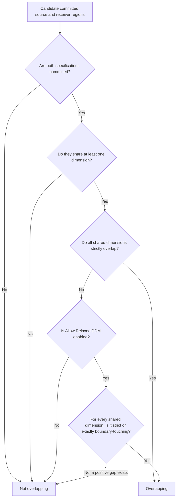

The focused embedded exact-touch tests and the configured process-endpoint
multi-recipient test each use one shared dimension. The central predicate
checks every shared dimension, but combinations mixing strict overlap, exact
touch, and a positive gap across multiple dimensions remain source-derived
rather than directly exercised by these focused tests.

Examples for one dimension:

- <code>[0, 10)</code> and <code>[9, 12)</code> strictly overlap.
- <code>[0, 10)</code> and <code>[10, 15)</code> only touch. They do not
  strictly overlap; this implementation accepts the touch only when Allow
  Relaxed DDM is enabled.
- <code>[0, 10)</code> and <code>[11, 15)</code> have a positive gap and do
  not overlap, even when the switch is enabled.
- In the current embedded 2025 implementation, a committed zero-dimensional
  Region has no shared dimensions with the default-region realization and
  produces no regional match. The focused test first observes an ordinary
  default-region interaction, then no callback when an explicit zero-
  dimensional Region is supplied ([test](../../cpp/tests/zero_dimensional_regional_interaction_catch2.cpp#L92)).
  Keep this source/test observation separate from a broader normative claim.

The exact-touch expansion is an **Umbra implementation policy**, not a
universal HLA rule. The local
[Allow Relaxed DDM policy note](RELAXED-DDM-POLICY.md) records the standard
distinction and the narrower current evidence. In particular, the switch is
not an epsilon, a configurable distance, a geographic interpretation, or a
permission to drop any strict overlap.

## Object attributes: source association, discovery, relevance, and updates

Object-attribute DDM is evaluated per attribute. The publisher's update-region
association and the receiver's subscription determine the regions to compare.
The current object-attribute planner evaluates ordinary/default-region
subscriptions and explicit regional subscriptions independently; do not
import the interaction-class selection behavior in the next section into this
path.

Ownership and source-region association are separate state questions. The
selected embedded 2025 ownership-transfer cases show that the former owner's
association is cleared and that a prospective owner's still-pending deferred
association may become active at transfer. They also show that a former owner
must explicitly associate again after later reacquisition, while
`unassociateRegionsForUpdates` before transfer removes a prospective owner's
deferred association and leaves the acquirer's first update on the default
source realization. These are separate HLA_EVOKED embedded test scenarios;
see the ownership guide's
[transfer/association boundary](HLA-2025-ATTRIBUTE-OWNERSHIP-FLOW-GUIDE.md#ownership-transfer-and-update-region-association-are-separate-boundaries)
for the sequence and individual test links. They are bounded
implementation/test observations, not a general DDM rule or process/2010
parity claim.

### Adjacent ownership routes: what the current association paths show

The three region-specific cases above exercise an If-Available requester and
If-Wanted owner-side transfer. A bounded comparison of other 2025 public
ownership routes finds these Umbra source transitions; this comparison is not
a portable HLA rule:

- **Regular acquisition of an unowned attribute.** The registry assigns the
  requester as owner and promotes that federate's deferred association; this
  branch has no active former-owner association to clear
  ([registry path](../../cpp/src/internal/federation/federation_registry_attribute_ownership_acquisition.cpp#L347),
  [promotion helper](../../cpp/src/internal/federation/federation_registry_regions.cpp#L707)).
  The [focused regular-acquisition case](../../cpp/tests/ieee1516_2025_attribute_ownership_acquisition_release_callbacks_catch2.cpp#L162)
  checks ownership and callbacks, not region services. Association behavior
  is source-observed.
- **Confirm Divestiture.** When confirmation commits the transfer, the path
  clears the former owner's committed association and promotes any deferred
  association belonging to the acquiring federate
  ([registry path](../../cpp/src/internal/federation/federation_registry_negotiated_attribute_ownership_divestiture.cpp#L463)).
  The [process confirmation case](../../cpp/tests/ieee1516_2025_confirm_divestiture_process_assumption_catch2.cpp#L508)
  checks ownership and callback/report boundaries but does not invoke
  update-region APIs. The association transition is source-observed; this is
  not process-profile DDM evidence.
- **Unconditional divestiture and its assumption offer.** The registry
  clears the active association when it makes the attribute unowned, then
  replans already-pending acquisition work
  ([unconditional path](../../cpp/src/internal/federation/federation_registry_attribute_ownership_assumptions.cpp#L204)).
  A later successful regular or If-Available acquisition promotes that
  requester's deferred association through its own grant path
  ([regular grant](../../cpp/src/internal/federation/federation_registry_attribute_ownership_acquisition.cpp#L347),
  [If-Available grant](../../cpp/src/internal/federation/federation_registry_attribute_ownership_acquisition_if_available.cpp#L606)).
  An assumption callback by itself is only an offer: its recipient remains
  a non-owner until it requests and completes acquisition. The
  [focused unconditional-divestiture case](../../cpp/tests/ieee1516_2025_unconditional_attribute_ownership_divestiture_catch2.cpp#L274)
  checks the unowned interval, pending acquisition, and non-owning assumption
  recipient, but does not invoke update-region APIs. Association effects
  remain source-observed.
- **Resign with unconditional attribute divestiture.** In the 2025 registry,
  this selected ResignAction enters the divestiture cleanup path; for each
  owned attribute on an instance not already removed, it clears the active
  source association and replans pending acquisition work
  ([cleanup path](../../cpp/src/internal/federation/federation_registry_resign_lifecycle.cpp#L637),
  [association clear](../../cpp/src/internal/federation/federation_registry_resign_lifecycle.cpp#L664)).
  The [focused embedded resign case](../../cpp/tests/ieee1516_2025_embedded_resign_action_divestiture_catch2.cpp#L49)
  checks ownership loss and the later assumption/acquisition path, but makes
  no region-service calls; the DDM effect is source-observed only. Do not
  generalize this to every ResignAction; see the lifecycle guide's
  [action effects](HLA-2025-FEDERATION-AND-FEDERATE-LIFECYCLE-FLOW-GUIDE.md#resignaction-effects-in-the-current-implementation).

Do not collapse these paths into one generic transfer: Confirm Divestiture
commits an owner-to-owner change, while unconditional divestiture first
clears ownership and then resolves existing acquisition work or invites a
candidate. Unpublish and the selected Resign path are distinct ownership-loss
routes, not owner-to-owner transfers; only unpublish has direct region-use
assertions in the inspected tests. Administrative control-state changes remain
outside this audit. No 2010 behavior or embedded/process parity is claimed.
The three region-specific cases above remain the direct test evidence for
association state across an If-Available/If-Wanted transfer.

This regional path describes per-instance attribute relevance and overlap.
The distinct publisher/class declaration advisories and owner-directed
Turn Updates callbacks are separated in the [2025 relevance-advisory guide](HLA-2025-RELEVANCE-ADVISORY-FLOW-GUIDE.md).
Receiver-directed Attributes In/Out Of Scope callbacks have their own
[2025 Attribute Scope Advisory guide](HLA-2025-ATTRIBUTE-SCOPE-ADVISORY-FLOW-GUIDE.md);
that guide covers scope-state transitions and stale callback filtering, while
this one remains the home for region geometry, discovery, and routing.

A regional [`requestAttributeValueUpdate`](HLA-2025-ATTRIBUTE-VALUE-UPDATE-REQUEST-FLOW-GUIDE.md#regional-request-scope-is-not-response-ddm)
uses regions at a different boundary: the selected embedded 2025 request path
uses them to screen provider solicitation, while a provider's later value
update goes through ordinary per-receiver DDM. Do not treat the request region
as the response update's source region or as direct receiver eligibility.
This is an implementation-scoped distinction, not a normative or
process-parity claim.

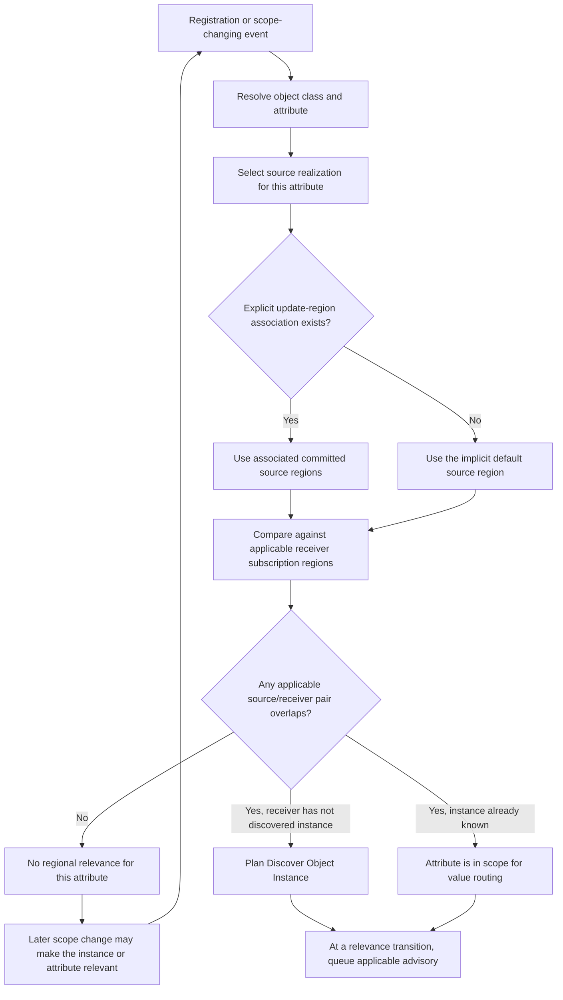

There are two different public effects that are easy to conflate:

- **Discovery:** a receiver that did not know the object can become eligible
  for **discoverObjectInstance**. In this implementation, registration is not
  the only discovery boundary. Committing a receiver region into overlap or
  associating a new overlapping update region can also make an already-
  registered object discoverable.
- **Attribute relevance advisory:** when the in-scope state of a known
  object's attribute changes, the producer can receive
  **turnUpdatesOnForObjectInstance** or **turnUpdatesOffForObjectInstance**
  when the advisory behavior is enabled. This is an advisory transition, not
  the value update itself and not a replacement for subscription or overlap
  filtering.

### A committed range change can discover an existing object

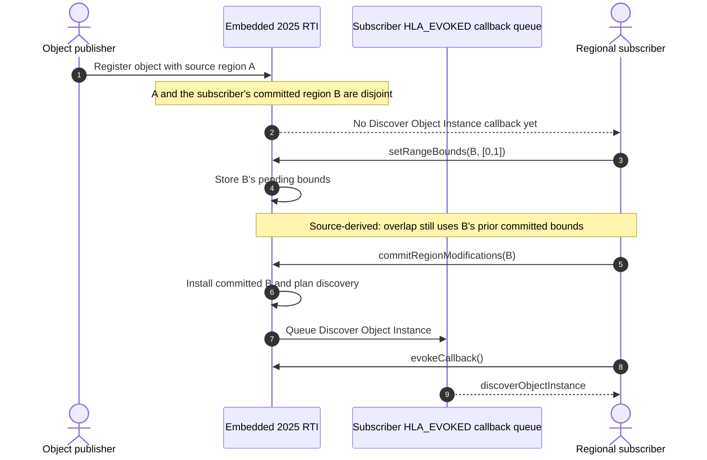

The focused
[commit-triggered discovery case](../../cpp/tests/ieee1516_2025_federation_management_region_lifecycle_catch2.cpp#L389)
starts with a disjoint source and receiver range, observes no discovery, then
calls `setRangeBounds` followed by `commitRegionModifications` and observes one
discovery without another registration or subscription call. It does not drain
or assert callbacks between those two calls. The [region registry](../../cpp/src/internal/federation/federation_registry_regions.cpp#L540)
stores the Set value as pending; the [commit transaction](../../cpp/src/internal/federation/federation_registry_regions.cpp#L154)
installs the committed snapshot and the [adapter](../../cpp/src/internal/runtime/umbra_rti_ambassador_dimension_region_services.cpp#L734)
queues planned discovery afterward. This is evidence for the embedded 2025
implementation path, not a portable callback-timing rule or a process-endpoint
result. The adjacent
[association-triggered discovery case](../../cpp/tests/ieee1516_2025_federation_management_region_lifecycle_catch2.cpp)
shows the other boundary: adding a second overlapping update-region
association makes an existing object discoverable. A separate 2025
[relevance-advisory transition test](../../cpp/tests/ieee1516_2025_connection_regional_attribute_relevance_transition_catch2.cpp)
exercises the producer's On/Off callbacks as overlapping associations are
removed and restored, under both evoked and immediate callback models.

### Receive-order value routing after regional overlap changes

The focused no-time-update scenario uses `HLA_EVOKED` and makes the boundary
between **object knowledge** and **current value relevance** more concrete. A
registered object can remain undiscovered while source and receiver regions
are disjoint. Once the receiver commits an overlapping range, discovery
reports the object and the most recently accepted attribute value; later
updates are filtered against the current overlap. This is an embedded 2025 test scenario,
not a complete normative rule for all DDM profiles.

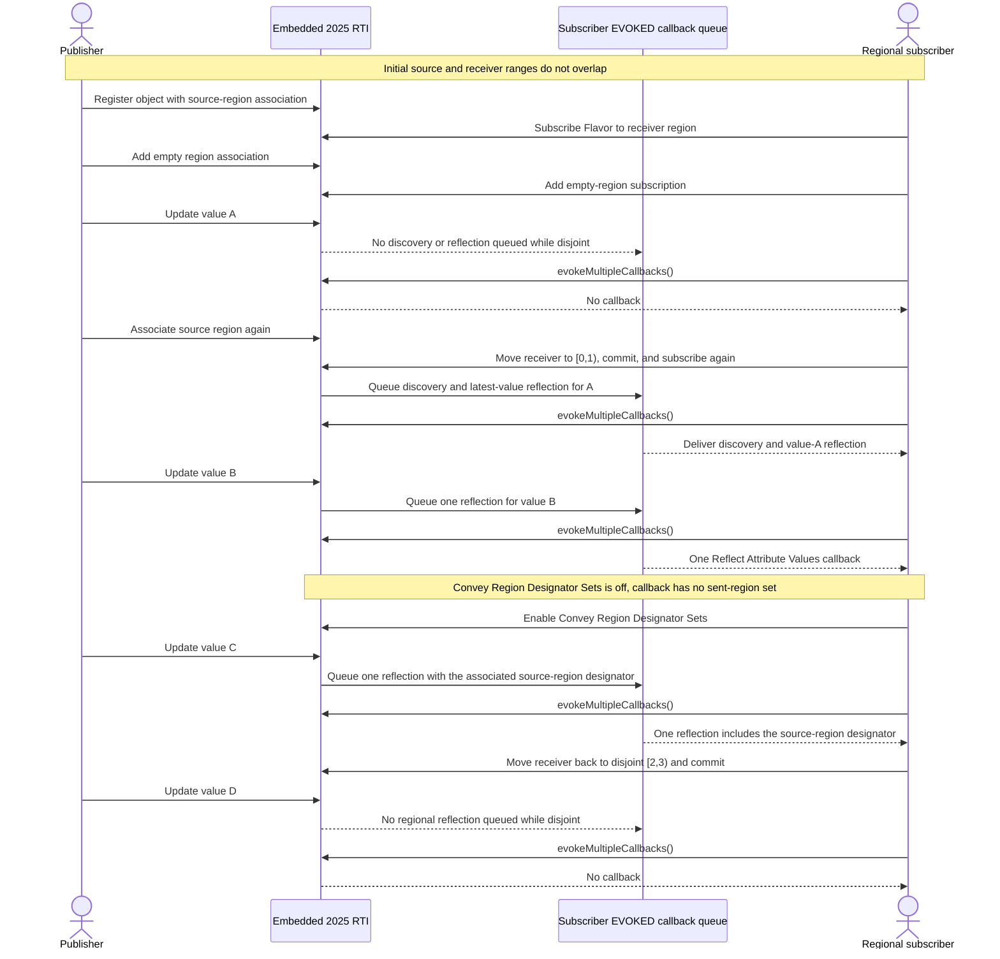

The [61-assertion focused case](../../cpp/tests/ieee1516_2025_regional_object_attribute_no_time_update_overlap_catch2.cpp#L5)
explicitly treats the empty-region association and
subscription calls as no-ops, checks that disjointness suppresses reflections,
then checks discovery plus the latest value after overlap and one reflection
for each subsequent accepted update in its exercised setup. It also shows
`ConveyRegionDesignatorSets` changing callback metadata without changing the
overlap route. The final disjoint phase asserts no reflection; it does not
independently query whether the already-known object remains known. It stores
discovery and reflection callbacks separately, so it does not establish their
relative callback order; the chart intentionally groups them.

The current local MinGW target was rebuilt from this worktree and passed this
focused case (1/1). A separate [open privileged-MinGW investigation](../planning/ROADMAP-INDEX.json#L100)
records duplicate reflections for the same test expectation. That discrepancy
is unresolved: this local pass is not evidence of cross-configuration or
process-endpoint parity. The chart is therefore bounded to the named scenario,
and the environment-specific result remains a follow-up rather than a settled
implementation guarantee.

### Process-boundary case: send-time source snapshot, receive-time receiver projection

The embedded flow above does not establish the configured process endpoint's
attribute route. A focused process case exposes a useful two-time distinction:
the accepted update keeps the producer's committed source-region realization
from the `Update Attribute Values` call, while a later process receive boundary
checks the receiver's then-current regional declaration and committed range.
The process registry planner captures the source snapshot
([planner](../../cpp/src/internal/federation/federation_registry_attribute_value_update_requests.cpp#L93));
the service carries available region context through its receive-order route
([event planning](../../cpp/src/internal/federation/process_federation_service_attribute_value_updates.cpp#L210),
[receive-boundary projection](../../cpp/src/internal/federation/process_federation_service_receive.cpp#L39)).

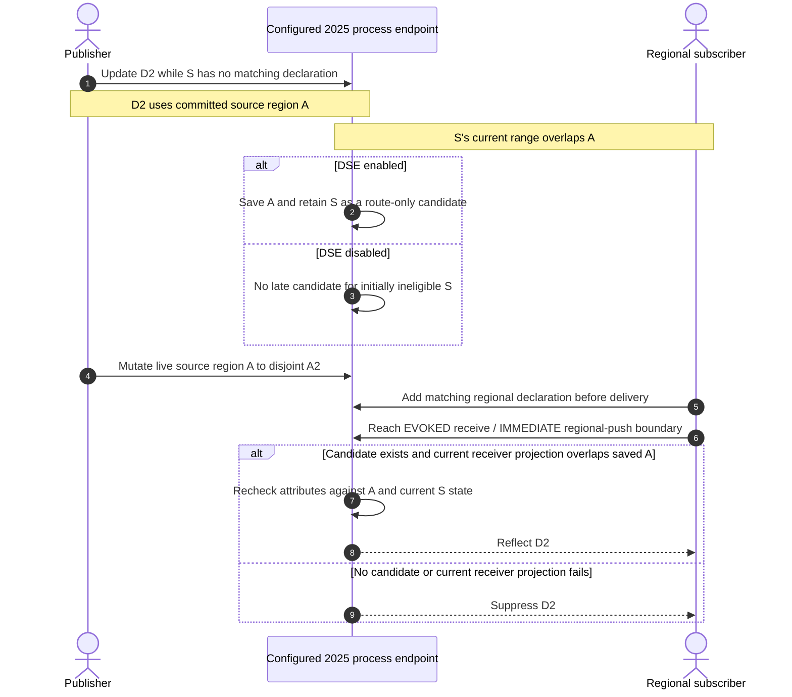

The [process DSE case](../../cpp/tests/ieee1516_2025_connection_delayed_regional_attribute_update_catch2.cpp#L523)
checks the enabled/disabled receive-order path under `HLA_EVOKED` and
`HLA_IMMEDIATE`. For D2, the receiver adds its declaration after the send and
the publisher mutates its live region; the enabled case reflects using the
accepted source snapshot. A later D3 update is initially eligible but is
suppressed in both switch modes when the receiver moves out of overlap before
the receive boundary. Thus the tested process route does not freeze the
receiver's future scope. This is selected 2025 process source/test evidence,
not a normative DDM algorithm, complete process coverage, or embedded/process
parity. The [DSE guide](HLA-2025-DELAY-SUBSCRIPTION-EVALUATION-FLOW-GUIDE.md#receive-order-tso-and-callback-model-are-separate-axes)
details the separate process delivery lanes and their test limits.

## Interactions: explicit and default-region paths

This section and its diagrams cover ordinary `sendInteraction` and
`sendInteractionWithRegions`; they do not describe
`sendDirectedInteraction`. A directed send names a target object instance and
uses a separate object-class/interaction-class declaration pair and receiver
selector. See the [directed-interaction guide's target/region distinction](HLA-2025-DIRECTED-INTERACTION-FLOW-GUIDE.md#a-target-object-is-not-a-ddm-region).
Do not infer the ordinary interaction region-overlap decision below as a
directed-send rule; this scope note does not settle any further normative
relationship between directed interactions and DDM.

Interaction routing uses an interaction-class publication, a send-region
realization, and the receiver's subscription realization. In the current 2025
default-region test, when a receiver has an explicit regional subscription for
an interaction class, that regional realization is effective for a send with
an explicit region; a retained ordinary subscription does not bypass a
disjoint regional subscription. Removing the regional subscription lets the
ordinary subscription's default-region realization apply again.

Keep three superficially similar “empty” cases distinct:

| Caller-visible case | Routing meaning |
| --- | --- |
| Ordinary `sendInteraction` | No caller region set is supplied; the RTI uses the ordinary path's default-region realization where the class has dimensions. |
| `sendInteractionWithRegions` with an empty `RegionHandleSet` | No-send operation; it does not fall back to the ordinary subscription/default-region path. The 2025 receive-order planner returns before selecting recipients, and the focused case confirms no receive callback even while an ordinary subscription remains active ([source](../../cpp/src/internal/federation/federation_registry_receive_order_interactions.cpp#L89), [test](../../cpp/tests/ieee1516_2025_regional_interaction_subscription_receive_order_catch2.cpp#L103)). |
| A real zero-dimensional `Region` object | A region handle whose dimension set is empty; unlike the empty service-input set above, this explicit regional interaction produces no match in the focused embedded 2025 case (see [focused source/test evidence](#focused-source-and-test-evidence)). |

An empty region-designator set optionally conveyed on an ordinary
`receiveInteraction` callback is metadata, not the `RegionHandleSet` argument
to `sendInteractionWithRegions`. Do not infer the no-send case from that
callback field.

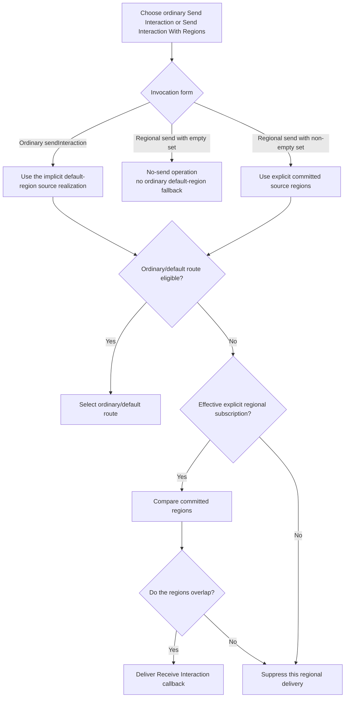

The diagram describes the current embedded 2025 source/test path, not an
edition-independent rule. It is intentionally separate from the object-
attribute planner described above. The focused case is
[default-region interaction routing](../../cpp/tests/ieee1516_2025_default_region_interaction_routing_catch2.cpp):

- An explicit source region reaches an overlapping regional subscriber. A
  mixed receiver with an ordinary subscription also receives through its
  ordinary/default route when its separate regional declaration is disjoint.
- Removing that disjoint regional declaration leaves the ordinary/default
  route eligible; it does not create that route or restore it from suppression.
- An ordinary **sendInteraction** uses the implicit full-range source region.
  With Convey Region Designator Sets enabled, the callback can report that a
  region set was supplied and that the set is empty. That empty designator set
  is not the same thing as a non-empty explicit region set.

The focused embedded CTest passed 1/1 (50 assertions) against the current
worktree. This result is bounded to the named case; it does not establish
process-profile behavior or the normative meaning of §9.1.5.

The default region is an RTI-provided realization, not a region handle the
application creates. In the current registry it represents the full range for
every FDD dimension. See the
[default-region overlap helper](../../cpp/src/internal/federation/federation_registry_regions.cpp)
and
[regional interaction subscription services](../../cpp/src/internal/runtime/umbra_rti_ambassador_regional_interaction_subscription.cpp).

### Routing and conveyed sender-region metadata are separate decisions

Interaction routing first selects an eligible receiver. In the embedded 2025
callback path, the receiver's Convey Region Designator Sets switch then gates
whether `receiveInteraction` gets an optional sent-region set. With the switch
enabled, an explicit regional send conveys its source-region handles; an
ordinary send using the implicit default region conveys a supplied empty set.
The switch is read after recipient projection and does not participate in the
overlap decision. This is a source-derived embedded behavior, not a claim about
every HLA implementation or a complete normative interpretation.

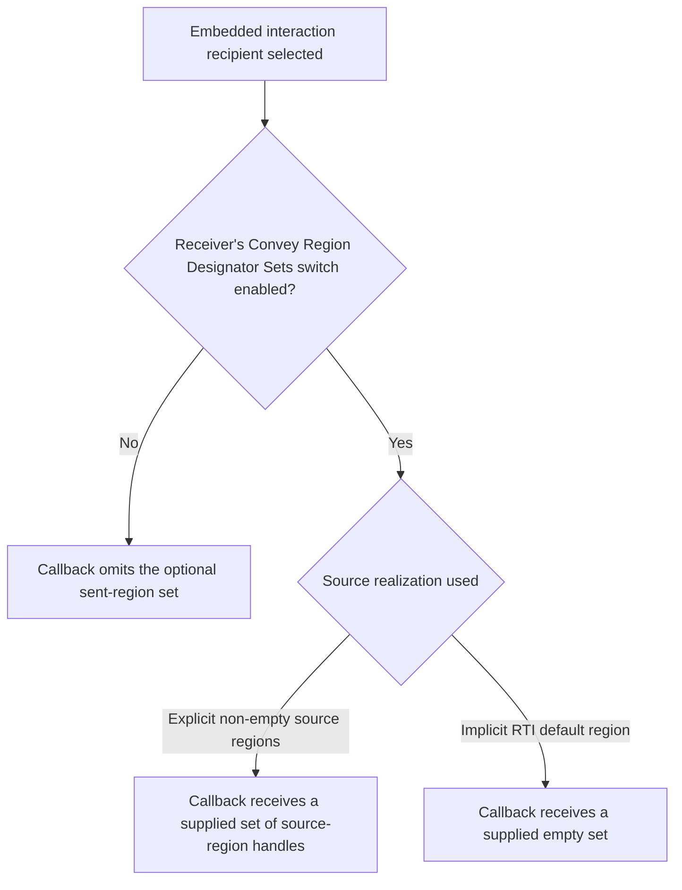

The public 2025 API exposes both the switch and the optional callback argument
([switch](../../third_party/ieee1516.1-2025/include/RTI/RTIambassador.h#L2125),
[`receiveInteraction`](../../third_party/ieee1516.1-2025/include/RTI/FederateAmbassador.h#L264)).
The embedded [callback assembly](../../cpp/src/internal/runtime/umbra_rti_ambassador_interaction_callbacks.cpp#L118)
checks the switch after resolving the recipient projection. The working-tree
[regional interaction test source](../../cpp/tests/default_region_interaction_routing_catch2.cpp#L267)
asserts that an enabled receiver gets the explicit source-region set
([assertions](../../cpp/tests/default_region_interaction_routing_catch2.cpp#L344));
the ordinary default-region case separately asserts a supplied empty set
([assertions](../../cpp/tests/default_region_interaction_routing_catch2.cpp#L241)).
These are source assertions, not a test run in this documentation pass. The
switch-off branch is source-only in this evidence set.

### Process-endpoint fan-out: evaluate each receiver separately

The public process-boundary case below covers a different question than the
embedded default-region case: when two remote federates subscribe to the same
interaction class with different regions, the process service evaluates each
receiver independently. The test runs both `HLA_IMMEDIATE` and `HLA_EVOKED`
callback models, with strict and relaxed DDM configurations. Its two sends
select one different recipient apiece; it does not establish general
embedded/process parity or every multi-region combination.

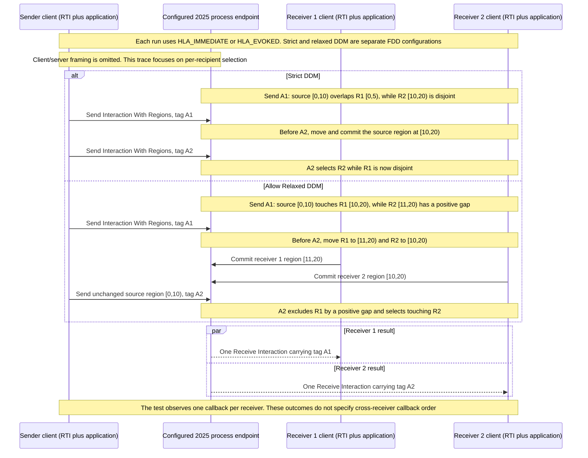

In the test, callback delivery is drained with the next ordinary service under
`HLA_IMMEDIATE` and with `evokeCallback` under `HLA_EVOKED`. Relaxed DDM admits
touching ranges but not a positive gap; it does not broaden the test into a
general distance-based matching rule. Both receivers enable Convey Region
Designator Sets, and the single callback each receives includes one sent-region
designator; its tag identifies which send matched. See the
[per-recipient process test](../../cpp/tests/ieee1516_2025_connection_multi_recipient_regional_interaction_catch2.cpp#L459),
the [process send client](../../cpp/src/internal/federation/process_federation_client_value_services.cpp#L39),
and the [process send handler](../../cpp/src/internal/federation/process_federation_service_interaction_send.cpp#L74).

Keep this distinct from the adjacent embedded default-region test. That test
connects all three participants with `HLA_EVOKED` and focuses on how an
explicit disjoint regional subscription changes an ordinary subscription's
effective realization, then how unsubscribe restores default-region
eligibility. Its ordinary-send case also checks the conveyed empty designator
set. It does not exercise process transport or the process test's four-way
callback-model × strict/relaxed-DDM matrix. These are complementary test
scenarios, not evidence of embedded/process parity.

The configured-process regional send path calls the shared registry's
`planReceiveOrderInteraction`; the regional service operation forwards through
the same handler. The shared planner's recipient walk therefore supplies the
candidate received class and parameter projection used by this process path.
Before constructing a process event, the service re-resolves a deferred
candidate when necessary, then stores that recipient-specific class and
parameter list in the event ([planner call](../../cpp/src/internal/federation/process_federation_service_interaction_send.cpp#L389),
[sent-class-to-parent candidate walk](../../cpp/src/internal/federation/federation_registry.cpp#L1512),
[deferred-candidate resolution](../../cpp/src/internal/federation/process_federation_service_interaction_send.cpp#L512),
[event construction](../../cpp/src/internal/federation/process_federation_service_interaction_send.cpp#L537),
[regional-operation forwarding](../../cpp/src/internal/federation/process_federation_service_interaction_send.cpp#L631)).
This is a source-path connection, not an independent process-side matching
algorithm or a claim that every interleaving has been tested.

The focused multi-recipient process case uses the same interaction class for
the sender and both receivers, and asserts that class in both callbacks
([exact-class setup](../../cpp/tests/ieee1516_2025_connection_multi_recipient_regional_interaction_catch2.cpp#L946),
[callback assertions](../../cpp/tests/ieee1516_2025_connection_multi_recipient_regional_interaction_catch2.cpp#L1088)).
It establishes per-recipient regional selection for that setup, not parent-
subscription/descendant-send promotion or parameter pruning at an ancestor.
Keep those cross-class regional process outcomes source-traced but not
focused-test-established; this does not add a normative inheritance rule.

## Keep time and DDM as separate filters

For a timestamped regional interaction, current Umbra code captures the
accepted send's region realization into the queued message. A later region
mutation does not rewrite the already accepted message's source-scope snapshot.
The time-management policy can still delay the timestamped callback after that
DDM decision. In short:

**DDM contributes recipient and scope eligibility; time management gates
timestamp-order delivery by logical time.**

Use this as a conceptual reading aid for one receiver, not as a universal
internal algorithm. A service defines when it evaluates or rechecks DDM, and
callback admission can add its own boundary:

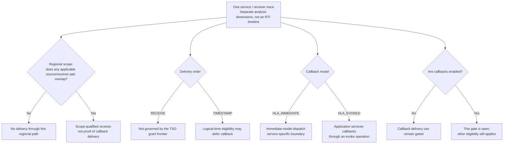

The arrows branch from one scenario into independent questions; there are no
arrows between the questions because this is not a required service-call or
internal RTI order. A particular service combines only the applicable gates:
regional scope does not grant a TSO callback, a timestamp does not make a
disjoint regional path eligible, and callback-model or enablement state does
not itself establish recipient eligibility or logical-time readiness.

A separate [2025 process-boundary timestamped regional interaction case](../../cpp/tests/ieee1516_2025_connection_process_tso_regional_interaction_callback_gating_catch2.cpp#L459)
makes that separation observable: the process-side test observes one selected
recipient while the receiver's callbacks are disabled; enabling them later
delivers the interaction before its matching time-advance grant. Both clients
connect with `HLA_EVOKED`. The `disableCallbacks()` / `enableCallbacks()` switch
is a separate gate, not a comparison of `HLA_EVOKED` with `HLA_IMMEDIATE`.
The test also checks the timestamp, retraction handle, transportation type,
and conveyed source region.
This is a focused process callback-gating trace, not evidence that every
timestamped DDM path has the same process/embedded behavior.

### One regional update, three available-advance choices

Keep two questions separate for each receiver: does its regional subscription
overlap the sender's source region, and when does that receiver's own time
advance permit its timestamp-ordered callback to be observed? The following
2025 embedded test-shaped trace uses one update at time 7 and three eligible
receivers, each choosing a different available-advance service. The values are
deliberately chosen so the three paths all grant at 7; that shared result does
not make the services interchangeable or establish their general boundary
rules.

```mermaid
sequenceDiagram
  autonumber
  actor Publisher
  participant RTI as RTI / federation
  participant FQR as Receiver using FQR
  participant TARA as Receiver using TARA
  participant NMRA as Receiver using NMRA

  Note over Publisher,RTI: Publisher source region [0,2), each receiver subscribes to [1,3), so each regional pair overlaps
  Publisher->>RTI: Update attribute at time 7
  RTI-->>FQR: Keep eligible TSO work pending
  RTI-->>TARA: Keep eligible TSO work pending
  RTI-->>NMRA: Keep eligible TSO work pending
  FQR->>RTI: Flush Queue Request(10)
  TARA->>RTI: Time Advance Request Available(7)
  NMRA->>RTI: Next Message Request Available(10), selects queued time 7
  Publisher->>RTI: Time Advance Request(2), lookahead 5
  RTI-->>Publisher: Time Advance Grant(2), GALT reaches 7

  FQR->>FQR: evokeCallback()
  RTI-->>FQR: Reflect Attribute Values(time 7, source region, retraction handle)
  RTI-->>FQR: Flush Queue Grant(actual 7, optimistic 7)
  TARA->>TARA: evokeCallback()
  RTI-->>TARA: Reflect Attribute Values(time 7, source region, retraction handle)
  RTI-->>TARA: Time Advance Grant(7)
  NMRA->>NMRA: evokeCallback()
  RTI-->>NMRA: Reflect Attribute Values(time 7, source region, retraction handle)
  RTI-->>NMRA: Time Advance Grant(7)
```

The test holds the callback model at `HLA_EVOKED` and asserts `reflect` before
the corresponding grant for each receiver. It also checks the delivered value,
timestamp/order metadata, source region, and valid retraction handle. This is a
single embedded scenario that illustrates how DDM eligibility and receiver
time progress compose; it is not a normative rule for all implementations or
evidence of process-profile or 2010 behavior. For the separate advance-service
boundary rules, see the [time-management guide](HLA-2025-TIME-MANAGEMENT-GUIDE.md).
For the contrasting case where the same style of regional update is retracted
before receiver callbacks are drained, see the [TSO retraction guide](HLA-2025-TSO-RETRACTION-FLOW-GUIDE.md#retract-a-regional-update-before-three-available-advance-callbacks).

This is an implementation boundary, not a complete TSO routing algorithm.
Follow the separate [time-management flow guide](HLA-2025-TIME-MANAGEMENT-GUIDE.md)
for grant and queue state.

### A recipient region can invalidate queued regional TSO delivery

This sequence is one tested 2025 **embedded** path, not a complete rule for
every timestamped message or RTI. It composes three independent decisions:
the update is admitted while the committed source and receiver regions
overlap; connection loss applies the publisher's configured automatic-resign
directive and last-granted-time cutoff; and the receiver's current regional
selector is checked again at the TSO callback boundary. The general cutoff and
forced-resignation state machine is covered in the separate
[federation lifecycle guide](HLA-2025-FEDERATION-AND-FEDERATE-LIFECYCLE-FLOW-GUIDE.md).

In the focused scenario, the source region is `[0,2)` and the receiver region
starts at `[1,3)`, so they overlap. The publisher sends an attribute update at
time 6; both members request time 6, and the publisher is granted 6 while the
receiver's grant is still pending. The publisher then loses its connection
with `DELETE_OBJECTS` configured. Before resolving its pending time-6 advance,
the receiver commits `[3,4)`, which is now disjoint from the saved source
region. The accepted TSO payload remains on the at-or-before-loss cutoff path,
but the callback-time DDM check suppresses its reflection. The receiver gets
its time-6 grant without that reflection; on its next request to time 7, it
observes the independent automatic removal callback and no longer knows the
object. These are scenario observations, not a general conformance claim.

```mermaid
sequenceDiagram
  actor Publisher as Soon-disconnected publisher
  participant PRTI as Publisher RTI
  participant Registry as Federation state
  participant SRTI as Subscriber RTI
  actor Subscriber as Surviving subscriber

  Note over Publisher,Registry: Initial source [0,2) overlaps committed receiver region [1,3)
  Publisher->>PRTI: Timestamped attribute update, time 6
  PRTI->>Registry: Queue TSO payload with source-region snapshot
  Subscriber->>SRTI: timeAdvanceRequest(6)
  Publisher->>PRTI: timeAdvanceRequest(6)
  PRTI->>Registry: Resolve publisher grant
  Registry-->>Publisher: timeAdvanceGrant(6)
  Note over SRTI,Subscriber: Subscriber's time-6 grant remains pending
  Publisher->>PRTI: Inject embedded connection loss
  PRTI->>Registry: Apply DELETE_OBJECTS and capture loss cutoff at 6
  Subscriber->>SRTI: Commit receiver region [3,4)
  SRTI->>Registry: Reach queued TSO callback gate, time 6
  Note over Registry,SRTI: Recheck current receiver scope against saved source scope
  alt Current [3,4) is disjoint from source [0,2)
    Registry-->>SRTI: Suppress Reflect Attribute Values
    SRTI-->>Subscriber: timeAdvanceGrant(6)
  end
  Subscriber->>SRTI: timeAdvanceRequest(7)
  SRTI->>Registry: Reach next automatic-removal gate
  Registry-->>Subscriber: removeObjectInstance(object, empty tag, producer)
  Subscriber->>SRTI: Query object name
  SRTI-->>Subscriber: ObjectInstanceNotKnown
```

The separate `connectionLost` report to the disconnected publisher's own
ambassador is omitted from this receiver-side timeline. The focused test
drains and checks that report separately; this diagram does not prescribe a
cross-ambassador callback order.

### A replacement regional interaction subscription does not retarget queued TSO work

This focused embedded 2025 scenario keeps two moments separate: the send's
source-region realization is captured when the interaction is accepted, while
the receiver's current subscription is checked when the timestamped delivery
reaches its callback boundary. Replacing the receiver's regional subscription
before that boundary suppresses the old passel when the saved source region no
longer overlaps; it does not move that passel onto the new region. A later send
using the replacement region follows the new subscription and is delivered.
For this inspected embedded path, the retained TSO message carries the
send-time source-region snapshot, not a frozen receiver-region subscription;
callback dispatch resolves the recipient against the current subscription
([message](../../cpp/src/internal/federation/federation_registry_tso_types.hpp#L14),
[dispatch](../../cpp/src/internal/runtime/umbra_rti_ambassador_time_advance_dispatch.cpp#L260)).
That is an implementation observation for this path, not a general HLA or
process/2010 parity claim.

```mermaid
sequenceDiagram
  actor Publisher as Publisher application
  participant Sender as Publisher RTI
  participant Queue as TSO queue / delivery gate
  participant Receiver as Subscriber RTI
  actor Subscriber as Subscriber application

  Note over Publisher,Subscriber: Embedded test: source A overlaps receiver region A
  Subscriber->>Receiver: Subscribe interaction class with receiverRegionA
  Publisher->>Sender: Send Interaction With Regions, tag A, time 6, sourceRegionA
  Sender->>Queue: Retain accepted interaction and source-region snapshot A
  Note over Queue,Subscriber: TSO waits for the receiver's time-6 callback gate
  Subscriber->>Receiver: Replace subscription A with B before callback
  Subscriber->>Receiver: Time Advance Request(6)
  Receiver->>Queue: Check current subscription B against saved source A
  alt Current B is disjoint from saved source A
    Queue-->>Receiver: Suppress this queued recipient delivery
    Receiver-->>Subscriber: Time Advance Grant(6), no interaction callback
    Note over Publisher,Subscriber: The test also observes no Request Retraction callback
  end
  Publisher->>Sender: Send Interaction With Regions, tag B, time 7, sourceRegionB
  Sender->>Queue: Retain later interaction and source-region snapshot B
  Subscriber->>Receiver: Time Advance Request(7)
  Receiver->>Queue: Recheck current subscription B against saved sourceRegionB
  Queue-->>Subscriber: Receive Interaction(tag B, sent region B)
  Queue-->>Subscriber: Time Advance Grant(7)
  Note over Receiver,Subscriber: Observed order here: grant(6), interaction(7), grant(7)
```

The existing [subscription-replacement case](../../cpp/tests/ieee1516_2025_timestamped_regional_interaction_subscription_replacement_catch2.cpp#L91)
asserts that the first send produces neither `receiveInteraction` nor
`requestRetraction`, then checks the later send's tag, value, source region,
timestamp, and callback order. The source stores committed source-region
snapshots in the interaction plan
([planner](../../cpp/src/internal/federation/federation_registry_receive_order_interactions.cpp#L89));
at the embedded TSO callback boundary it asks the registry for a recipient
projection again using the message's sent regions and saved snapshots
([dispatch](../../cpp/src/internal/runtime/umbra_rti_ambassador_time_advance_dispatch.cpp#L266)).
This is a single embedded test/source trace, not a normative subscription
replacement rule or evidence of process-endpoint, 2010, or all-ordering parity.

## Focused source and test evidence

- Region creation, pending/committed bounds, validation, and deletion:
  [2025 region services](../../cpp/src/internal/runtime/umbra_rti_ambassador_dimension_region_services.cpp),
  [region registry](../../cpp/src/internal/federation/federation_registry_regions.cpp),
  and [region lifecycle tests](../../cpp/tests/ieee1516_2025_federation_management_region_lifecycle_catch2.cpp).
- Explicit zero-dimensional Region versus the default interaction
  realization: the current embedded [overlap predicate](../../cpp/src/internal/federation/federation_registry_regions.cpp#L611)
  requires at least one shared dimension; the focused [2025 interaction
  test](../../cpp/tests/zero_dimensional_regional_interaction_catch2.cpp#L92)
  first observes ordinary default-region delivery, then no callback for a
  committed zero-dimensional source Region. This is selected embedded
  `HLA_EVOKED` evidence, not process/2010 parity or a substitute for the
  authorized standard text; the test comments cite §9.1.3.2.
- Object update-region association and its discovery/scope effects:
  [association planner](../../cpp/src/internal/federation/federation_registry_update_region_associations.cpp),
  [attribute relevance planner](../../cpp/src/internal/federation/federation_registry_attribute_relevance.cpp),
  and the region lifecycle / [relevance transition](../../cpp/tests/ieee1516_2025_connection_regional_attribute_relevance_transition_catch2.cpp) tests.
- Regional timestamped attribute update across selector mutation and publisher connection loss:
  [accepted source-region snapshot](../../cpp/src/internal/federation/federation_registry_time_tso_enqueue.cpp#L503),
  [TSO callback-boundary recheck](../../cpp/src/internal/runtime/umbra_rti_ambassador_time_advance_dispatch.cpp#L351),
  [current receiver projection](../../cpp/src/internal/federation/federation_registry_attribute_update_recipients.cpp#L16),
  [connection-loss cutoff capture](../../cpp/src/internal/federation/federation_registry_resign_lifecycle.cpp#L29),
  and the focused [embedded scenario](../../cpp/tests/connection_loss_regional_selector_mutation_catch2.cpp#L159).
- Regional interaction send and subscription:
  [send services](../../cpp/src/internal/runtime/umbra_rti_ambassador_regional_interaction_send_services.cpp),
  [subscription services](../../cpp/src/internal/runtime/umbra_rti_ambassador_regional_interaction_subscription.cpp),
  the [embedded default-region routing test](../../cpp/tests/ieee1516_2025_default_region_interaction_routing_catch2.cpp),
  and the [multi-recipient process-boundary case](../../cpp/tests/ieee1516_2025_connection_multi_recipient_regional_interaction_catch2.cpp#L459).
- Timestamped regional interaction callback gating over the public process endpoint:
  [TSO enqueue path](../../cpp/src/internal/federation/process_federation_service_interaction_send.cpp#L482),
  [TSO process test](../../cpp/tests/ieee1516_2025_connection_process_tso_regional_interaction_callback_gating_catch2.cpp#L459),
  and the separate [time-management flow guide](HLA-2025-TIME-MANAGEMENT-GUIDE.md).
- One timestamped regional attribute update across FQR, TARA, and NMRA:
  [embedded mixed-advance test](../../cpp/tests/timestamped_regional_attribute_update_mixed_advance_catch2.cpp#L171).
  Its assertions show each HLA_EVOKED receiver observing the reflection before
  its matching grant in this setup; consult the time-management guide for the
  distinct advance-service policies, and do not infer profile parity.
- Regional interaction subscription replacement before queued TSO delivery:
  [source-region snapshot and initial plan](../../cpp/src/internal/federation/federation_registry_receive_order_interactions.cpp#L89),
  [delivery-time recipient projection](../../cpp/src/internal/runtime/umbra_rti_ambassador_time_advance_dispatch.cpp#L266),
  and the focused [embedded scenario](../../cpp/tests/ieee1516_2025_timestamped_regional_interaction_subscription_replacement_catch2.cpp#L91).
- Relaxed DDM configuration and touching-range scope:
  [pinned 2025 getter](../../third_party/ieee1516.1-2025/include/RTI/RTIambassador.h#L2248),
  [FOM switch parsing](../../cpp/src/internal/fom/libxml2_fom_composer.cpp#L1805),
  [federation-state initialization](../../cpp/src/internal/federation/federation_registry_membership_lifecycle.cpp#L130),
  and [policy note](RELAXED-DDM-POLICY.md). Focused embedded cases cover
  [regional interactions](../../cpp/tests/ieee1516_2025_allow_relaxed_ddm_regional_interaction_boundary_catch2.cpp#L5),
  [object attributes](../../cpp/tests/allow_relaxed_ddm_object_attribute_catch2.cpp#L103),
  and [Auto Provide](../../cpp/tests/regional_auto_provide_response_catch2.cpp#L149).
  A configured [process-endpoint multi-recipient interaction case](../../cpp/tests/ieee1516_2025_connection_multi_recipient_regional_interaction_catch2.cpp#L459)
  also checks per-recipient touch/gap selection under HLA_EVOKED and
  HLA_IMMEDIATE. Each focused case uses one shared dimension;
  multi-dimensional mixed strict/touch/gap combinations remain source-only.
  The process test is selected integration evidence, not broad
  embedded/process parity.

The current query card for
umbra-cpp-default-region-interaction-routing-integration maps its focused case
to IEEE 1516.1-2025 clauses 9, 9.1.3.3, 9.1.4, and 9.1.8. This is a
traceability pointer for that tested case, not conformance evidence; consult
the official standard for normative wording. The linked source files and test
titles remain the direct evidence for the scenarios described above.

## Deliberate limits and next step

This guide does not model the full exception matrix, every combination of
object-class inheritance and regional declarations, all interaction
subscription replacement cases, every update-rate advisory path, or the full
timestamped/retraction/save-restore matrix. Discovery-triggered provider
solicitation has its own [Auto Provide guide](HLA-2025-AUTO-PROVIDE-FLOW-GUIDE.md).
This guide does not compare 2010 and 2025 behavior. Treat the remaining
branches as separate guides or focused extensions when source and test
evidence support them; do not flatten them into this overview.

The separate [federation save and restore guide](HLA-2025-FEDERATION-SAVE-RESTORE-FLOW-GUIDE.md)
covers save-state transitions, callback completion and failure, restore
selection/rejoin, and deferred-work restoration. Per-diagram syntax and visual
review status is tracked in the behavior-guide index and review ledger. A
parser-only pass or a review of an earlier worktree snapshot does not verify
the current diagrams or GitHub rendering; keep those checks pending until the
current blocks are actually parsed and rendered.
