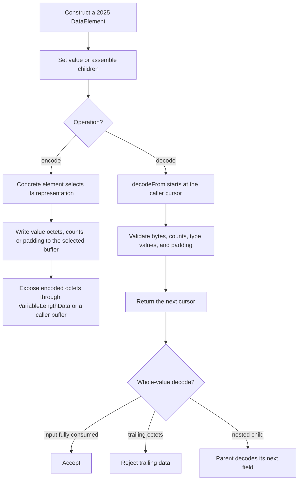
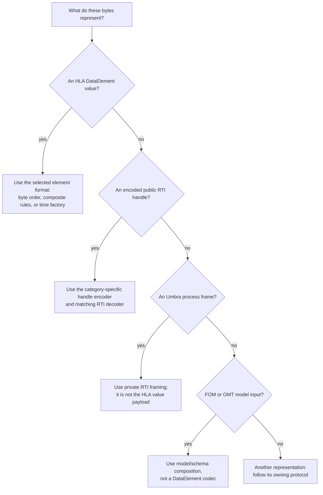
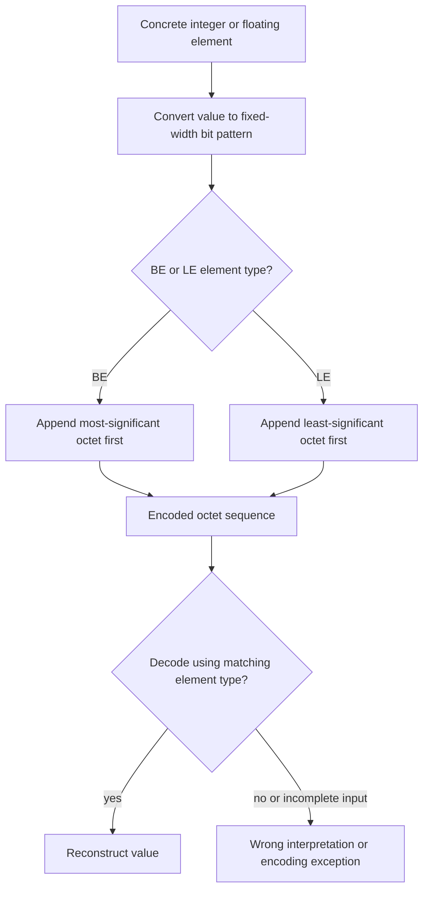
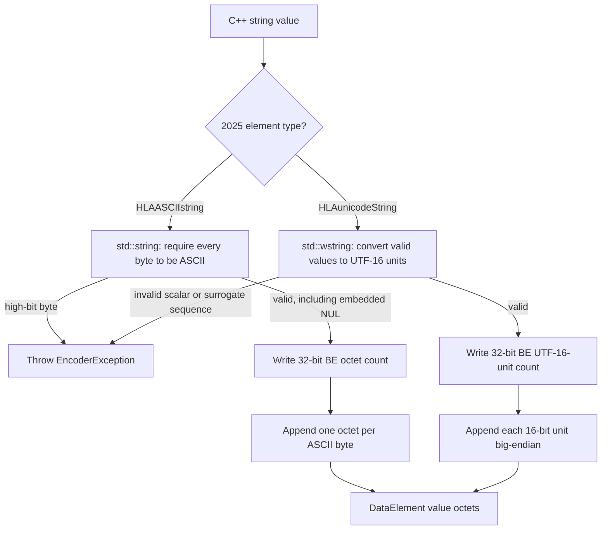
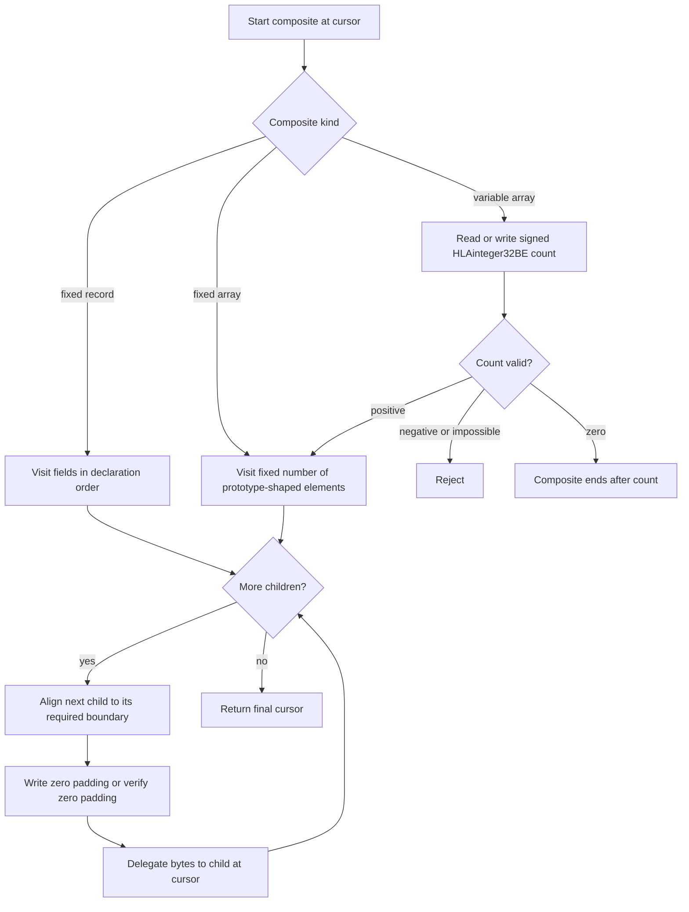
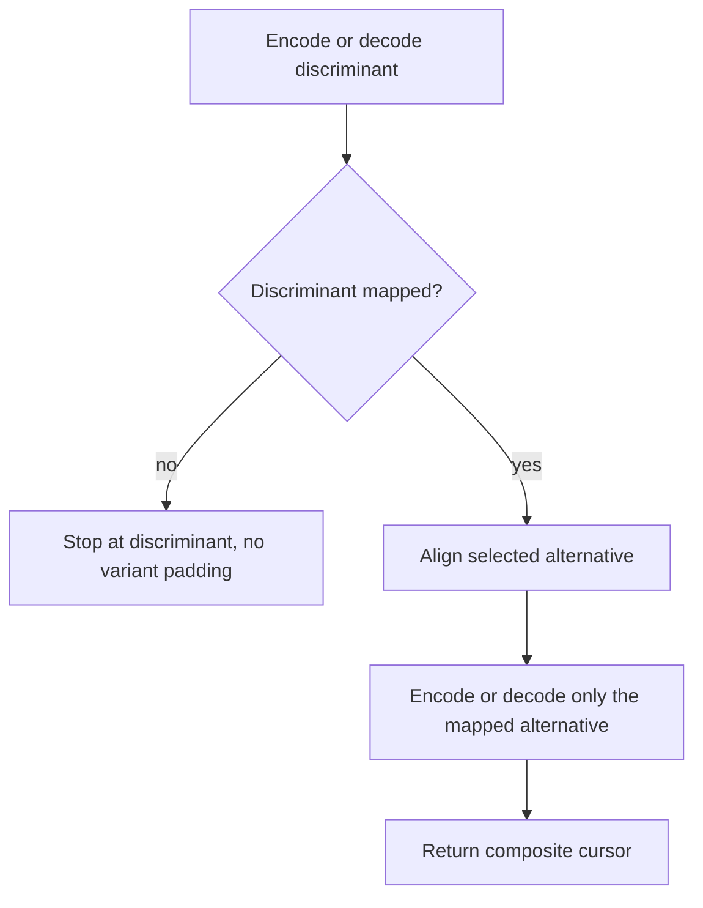
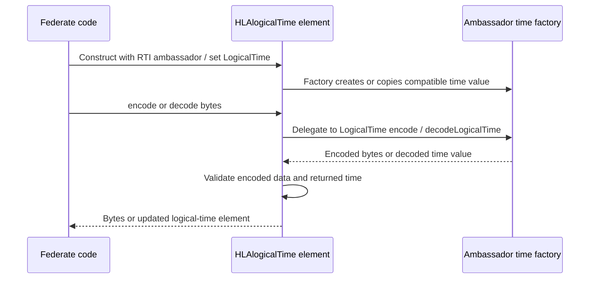
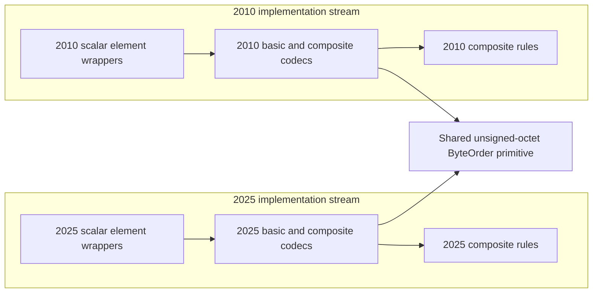

# IEEE 1516.1-2025 C++ DataElement Encoding: Flow Guide

The IEEE 1516.1-2025 C++ `DataElement` interface defines the application-facing
value-encoding boundary: a typed value is represented as octets according to
the selected element's format. This guide explains that portable boundary and
distinguishes it from handle encoding, model input, and private transport
framing. Umbra's source and focused tests illustrate selected implementation
paths; they are not normative authority or evidence of complete conformance.

## Scope and authority

- **Edition:** IEEE 1516.1-2025 C++ API only. The 2010 API and implementation
  remain a separate compatibility stream; this guide does not infer parity.
- **Implementation boundary:** public 2025 `DataElement` codecs and focused
  unit tests. No federation-management profile, process message framing, or
  2010 API behavior is inferred.
- **Layer:** `rti1516_2025::DataElement` values, their nested encodings, and
  logical-time wrappers. This is not the internal process-RPC wire format,
  FOM serialization, or the RTI's network framing.
- **Authority:** the [official IEEE 1516.1-2025 Federate Interface
  Specification](https://standards.ieee.org/ieee/1516.1/6688/) defines the
  interface; the [official IEEE 1516.2-2025 OMT
  Specification](https://standards.ieee.org/ieee/1516.2/6689/) is the related
  model-template standard. The pinned [2025 `DataElement` API](../../third_party/ieee1516.1-2025/include/RTI/encoding/DataElement.h)
  and [basic element declarations](../../third_party/ieee1516.1-2025/include/RTI/encoding/BasicDataElements.h)
  make the C++ operations navigable. Source describes current Umbra behavior;
  focused tests show only the concrete cases they exercise.
- **Shared primitive boundary:** both edition-specific basic-element sources
  call the small [explicit-byte-order primitive](../../cpp/src/internal/encoding/byte_order.hpp#L15).
  This shared helper only appends/reads unsigned octets in a requested order.
  The 2010 and 2025 type wrappers, time encoders, composite helpers, and tests
  remain separate; in particular, [2025 composite rules](../../cpp/src/internal/encoding/composite_2025.hpp)
  are not the [2010 composite rules](../../cpp/src/internal/encoding/composite_2010.hpp).

## One value, from API call to octets

The public `VariableLengthData` is the C++ carrier for encoded value octets.
Its `size()` reports how many octets the carrier currently holds; it does not
prepend a payload length. The selected `DataElement` defines any structure
inside those bytes, while a private RTI process frame is an outer layer.

| Surface | Buffer effect |
| --- | --- |
| `encode()` | Returns a new `VariableLengthData` containing this value's encoding. |
| `encode(VariableLengthData&)` | In the examined basic, fixed-record, and variable-array codecs, writes a fresh encoding through `setData`, replacing prior carrier contents; this is source-observed behavior. |
| `encodeInto(vector<Octet>&)` | Appends encoded octets to the caller's vector; composites use this to build nested values. |
| `decode(VariableLengthData const&)` | Whole-value entry point; the selected implementations reject unconsumed trailing octets. |
| `decodeFrom(vector<Octet> const&, index)` | Cursor entry point; returns the next offset so a parent can decode another child. |

These are distinct from the format's own count fields. For example,
`HLAvariableArray` puts a signed 32-bit big-endian element count inside its
encoded value, while `VariableLengthData::size()` simply reports the octets
already stored in the carrier. Neither is the RTI's private process-frame
metadata.

The pinned [DataElement operations](../../third_party/ieee1516.1-2025/include/RTI/encoding/DataElement.h#L33)
and [`VariableLengthData` accessors](../../third_party/ieee1516.1-2025/include/RTI/VariableLengthData.h#L50)
define the public surfaces. Current overwrite/append behavior is illustrated
by the [basic codecs](../../cpp/src/ieee1516_2025_basic_data_elements.cpp#L381),
[fixed record](../../cpp/src/ieee1516_2025_fixed_record.cpp#L132), and
[variable array](../../cpp/src/ieee1516_2025_variable_array.cpp#L204).
The selected [variable-array test](../../cpp/tests/ieee1516_2025_basic_data_elements_catch2.cpp#L723)
asserts its in-value count and that `encodeInto` appends; separate
[`VariableLengthData` tests](../../cpp/tests/variable_length_data_catch2.cpp#L29)
cover copying caller-owned bytes and value copies, not every encoder overload.
For retaining callback payloads, including the `data()` pointer lifetime, see
the object guide's [callback-payload ownership note](HLA-2025-OBJECT-AND-INTERACTION-INFORMATION-FLOW-GUIDE.md#callback-payload-references-decode-now-or-copy-to-retain).

A nested `decodeFrom` begins at the caller-supplied cursor and returns the next
cursor; a whole-value `decode` adds the stricter outer check that the selected
element consumed the complete input.

The API contract for [encoding and decoding operations](../../third_party/ieee1516.1-2025/include/RTI/encoding/DataElement.h#L35)
is distinct from the implementation's scalar and composite policies. The
whole-input trailing-data guard is visible, for example, in the 2025
[`HLAvariableArray::decode`](../../cpp/src/ieee1516_2025_variable_array.cpp#L234)
and [`HLAfixedRecord::decode`](../../cpp/src/ieee1516_2025_fixed_record.cpp#L156)
paths.

## Pick the representation boundary before reasoning about bytes

Several paths eventually produce octets, but their encodings are not
interchangeable. First ask what the bytes represent:

Only the DataElement branch is described by this guide's scalar and composite
rules. Public handle encoding has its own opaque, category-specific contract;
see the [names and handle guide](HLA-2025-NAME-AND-HANDLE-RESOLUTION-FLOW-GUIDE.md#5-typed-handle-encoding-is-not-numeric-identity).
The RTI process-frame branch is an Umbra transport detail, not an HLA wire
format; its [frame helpers](../../cpp/src/internal/encoding/transport_wire.hpp#L14)
are separate from the value payload. Even where private frame metadata uses
fixed big-endian encoding, it does not select the byte order of the
DataElement payload; the [frame-header reader](../../cpp/src/internal/federation/process_transport.cpp#L94)
shows that boundary directly. For model inputs, see the [FOM module admission
and composition guide](HLA-2025-FOM-MODULE-ADMISSION-AND-COMPOSITION-FLOW-GUIDE.md).

## Explicit byte order belongs to each value type

Host endianness is not consulted by the shared primitive. A concrete encoder
passes `ByteOrder::big` or `ByteOrder::little` at the call site; the BE/LE API
type chooses which. Floating values are converted to their bit representation
and then encoded through the matching-width path. This is a byte-order choice
for that element, not a setting that silently changes every value in a
composite.

The public `DataElement` API has no global byte-order setting or byte-order
argument on `encode`/`decode`. In the examined 2025 surface, the concrete type,
the type's fixed encoding rule, or a delegated logical-time implementation
owns that choice:

| Byte-order owner | Example in the examined 2025 path |
| --- | --- |
| Application selects a concrete type | Fixed-width signed/unsigned integer and IEEE floating elements have `...BE` and `...LE` wrappers. The suffix is part of the value type, not a host-endian or process-wide switch; see the pinned [type declarations](../../third_party/ieee1516.1-2025/include/RTI/encoding/BasicDataElements.h#L150), [integer vectors](../../cpp/tests/ieee1516_2025_basic_data_elements_catch2.cpp#L327), and [floating-point vectors](../../cpp/tests/ieee1516_2025_basic_data_elements_catch2.cpp#L173). |
| Element's fixed encoding | `HLAboolean` is 32-bit BE 0/1; `HLAunicodeChar` is one UTF-16BE code unit; string lengths are 32-bit BE and Unicode string units are UTF-16BE. These formats have no caller-selected `BE`/`LE` sibling; see the [scalar encoders](../../cpp/src/ieee1516_2025_basic_data_elements.cpp#L661), [basic vectors](../../cpp/tests/ieee1516_2025_basic_data_elements_catch2.cpp#L86), [Unicode character test](../../cpp/tests/ieee1516_2025_basic_data_elements_catch2.cpp#L216), and [Unicode string test](../../cpp/tests/ieee1516_2025_basic_data_elements_catch2.cpp#L367). |
| No multi-octet order to select | `HLAoctet`, `HLAbyte`, and `HLAASCIIchar` each encode one octet; see the [focused scalar case](../../cpp/tests/ieee1516_2025_basic_data_elements_catch2.cpp#L111). |
| Child element, not composite-wide | Records, arrays, and variants delegate value bytes to their elements; a variable array's leading count is `HLAinteger32BE`, followed by its boundary/padding rules. See the [array codec](../../cpp/src/ieee1516_2025_variable_array.cpp#L210) and [array vectors](../../cpp/tests/ieee1516_2025_basic_data_elements_catch2.cpp#L723). |
| Contained time value and selected factory | `HLAlogicalTime` and `HLAlogicalTimeInterval` encode through the contained value and decode through the selected factory. In Umbra's 2025 wrapper, `getOctetBoundary() == 1` is an alignment boundary, not an encoded-size or byte-order promise; see the [wrapper source](../../cpp/src/ieee1516_2025_logical_time_encoding.cpp#L213) and [two-factory tests](../../cpp/tests/ieee1516_2025_time_catch2.cpp#L210). |
| Umbra's outer process-frame layer | Private framing helpers encode framing integers as big-endian; this does not select the HLA value's format. See the [framing helpers](../../cpp/src/internal/encoding/transport_wire.hpp#L14) and [frame header read](../../cpp/src/internal/federation/process_transport.cpp#L94). |

The fixed-format and factory rows describe the inspected 2025 codec paths;
they are not a claim that every `DataElement` has a byte-order choice or that
the generic API promises one representation for every logical-time factory.

For a concrete test vector, signed `-2` encodes as `FF FF FF FE` in
`HLAinteger32BE` and `FE FF FF FF` in `HLAinteger32LE`; the 64-bit test checks
the corresponding eight-octet forms. Those exact vectors and truncated-input
rejections are in the [2025 basic-element tests](../../cpp/tests/ieee1516_2025_basic_data_elements_catch2.cpp#L303)
and [64-bit cases](../../cpp/tests/ieee1516_2025_basic_data_elements_catch2.cpp#L328).
The 2025 implementation's [named BE/LE helpers](../../cpp/src/ieee1516_2025_basic_data_elements.cpp#L58)
make the choice explicit. The common [byte-order primitive](../../cpp/src/internal/encoding/byte_order.hpp#L18)
does not choose an order on behalf of a caller.

These are `DataElement` value octets, not process-frame headers. The private
[transport adapter](../../cpp/src/internal/encoding/transport_wire.hpp#L14)
has separate fixed-big-endian framing helpers, and the
[process transport path](../../cpp/src/internal/federation/process_transport.cpp#L195)
reads frame metadata independently of the encoded payload. Do not infer a
value element's BE/LE choice from the transport frame's byte order.

Other scalar families have their own representation, rather than inheriting
the integer suffix rule: for example, `HLAboolean` is validated as a four-octet
0/1 value and `HLAunicodeChar` is one UTF-16 code unit. Strings add an
important C++ boundary of their own.

## String elements: ASCII bytes versus UTF-16 code units

The pinned API declares `HLAASCIIstring` with a `std::string` value and
`HLAunicodeString` with `std::wstring`; those C++ types alone do not mean that
both strings are UTF-8 or that `std::wstring::size()` is the wire count. In
Umbra's inspected 2025 codecs, the two elements have different validation and
counting units:

| Element | Current 2025 C++ value contract | Encoded value payload |
| --- | --- | --- |
| `HLAASCIIstring` | Each `std::string` byte must be ASCII (`0x00`–`0x7F`). A UTF-8 byte sequence containing non-ASCII characters is rejected rather than passed through. Embedded NUL is valid data because the value is length-delimited, not NUL-terminated. | Four-octet big-endian byte count, then one octet per ASCII byte. |
| `HLAunicodeString` | `std::wstring` values are converted to UTF-16 units. With 16-bit `wchar_t`, surrogate units must form valid pairs; with wider `wchar_t`, input must be a valid Unicode scalar value. Decoding rejects unmatched surrogate units. | Four-octet big-endian count of UTF-16 code units, then each 16-bit unit in big-endian order. A supplementary character contributes two units; the count is not a byte count, Unicode-scalar count, or necessarily `std::wstring::size()`. |

This table describes the current Umbra source path, not a cross-edition
assumption. The pinned declarations for [`HLAASCIIstring`](../../third_party/ieee1516.1-2025/include/RTI/encoding/BasicDataElements.h#L147)
and [`HLAunicodeString`](../../third_party/ieee1516.1-2025/include/RTI/encoding/BasicDataElements.h#L170)
show the C++ carrier types; the [ASCII codec](../../cpp/src/ieee1516_2025_basic_data_elements.cpp#L726)
and the [UTF-16 encoder](../../cpp/src/ieee1516_2025_basic_data_elements.cpp#L153)
and [decoder](../../cpp/src/ieee1516_2025_basic_data_elements.cpp#L201) helpers
show the implementation rules. The focused [ASCII test](../../cpp/tests/ieee1516_2025_basic_data_elements_catch2.cpp#L111)
preserves `A\0Z`, rejects `0x80`, and checks truncation. The [Unicode string test](../../cpp/tests/ieee1516_2025_basic_data_elements_catch2.cpp#L367)
encodes `A` plus a supplementary character with a unit count of three, and
rejects malformed UTF-16 and an unmatched input surrogate. These selected
tests do not establish exhaustive Unicode conformance.

Decoding applies the corresponding length and payload rules: ASCII decoding
rejects high-bit octets, Unicode decoding validates surrogate pairing, and
whole-value decoding rejects truncation or trailing octets. Nested
`decodeFrom` remains cursor-based so a parent can continue with its next field;
none of these string counts is the private process-frame length.

## Composite values: shape, cursor, and alignment

Composite elements delegate the actual bytes of each child to that child.
Their own job is to define shape and placement: a fixed record has ordered
fields; a fixed array has a fixed number of prototype-compatible elements; a
variable array writes a signed 32-bit big-endian count first. Before a later
child needs a stronger octet boundary, the parent inserts zero padding and
requires those padding octets to be zero when decoding. The 2025 implementations
do not append inter-element padding after the final child.

Here, “octet boundary” and “alignment” describe positions in the encoded byte
sequence—not C++ `alignof`, an object's address in memory, native struct
padding, or process-frame alignment. Each element reports its encoding
boundary through [`getOctetBoundary`](../../third_party/ieee1516.1-2025/include/RTI/encoding/DataElement.h#L62);
the composite places child octets to satisfy that encoding requirement. As a
bounded implementation example, the fixed-record codec tracks a record-local
encoded offset, while array codecs use encoded lengths when inserting padding
([fixed record](../../cpp/src/ieee1516_2025_fixed_record.cpp#L138),
[fixed array](../../cpp/src/ieee1516_2025_fixed_array.cpp#L188),
[variable array](../../cpp/src/ieee1516_2025_variable_array.cpp#L210)). This
is why a composite's serialized shape should be read from the HLA element
rules, not inferred from a matching-looking C++ container or struct.

This boundary is observable in the [fixed-record codec](../../cpp/src/ieee1516_2025_fixed_record.cpp#L138),
[fixed-array codec](../../cpp/src/ieee1516_2025_fixed_array.cpp#L177), and
[variable-array codec](../../cpp/src/ieee1516_2025_variable_array.cpp#L210).
The variable-array test demonstrates the four-octet count, padding before an
eight-boundary element, nested decoding from a nonzero cursor, negative-count
rejection, malformed padding rejection, and whole-input trailing-data
rejection: [focused Catch2 case](../../cpp/tests/ieee1516_2025_basic_data_elements_catch2.cpp#L723).

## Variants are discriminant-driven branches

`HLAvariantRecord` first encodes its discriminant. A mapped discriminant selects
one alternative and causes the alternative bytes to be aligned to the maximum
boundary of the mapped alternatives; an unmapped discriminant ends the
encoding immediately, with no alternative padding. The decoder reads the
discriminant first and follows that same mapping. Do not conflate this with
`HLAextendableVariantRecord`, which carries an encoded-length field and has its
own alternative boundary and padding checks.

The 2025 [`HLAvariantRecord` implementation](../../cpp/src/ieee1516_2025_variant_record.cpp#L269)
and its [focused mapped/unmapped test](../../cpp/tests/ieee1516_2025_basic_data_elements_catch2.cpp#L859)
cover this branch. The source anchors the unmapped case to IEEE 1516.2
§4.14.10.2. The distinct [extendable variant codec](../../cpp/src/ieee1516_2025_extendable_variant_record.cpp#L280)
and [test](../../cpp/tests/ieee1516_2025_basic_data_elements_catch2.cpp#L993)
should be read separately; it is not merely a longer ordinary variant.

## Logical time is factory-defined, not assumed to be BE or LE

The public `HLAlogicalTime` and `HLAlogicalTimeInterval` elements wrap values
created by the supplied RTI ambassador's logical-time factory. Encoding
delegates to that value; decoding delegates to the matching factory and then
checks the returned object. The wrapper reports an opaque one-octet boundary
instead of imposing an integer BE/LE representation. This is the codec handoff
to time-management services, not the time-advance/grant state machine itself;
see the separate [2025 time-management guide](HLA-2025-TIME-MANAGEMENT-GUIDE.md).

See the [2025 logical-time encoding adapter](../../cpp/src/ieee1516_2025_logical_time_encoding.cpp#L213)
and the [public logical-time encoding tests](../../cpp/tests/ieee1516_2025_time_catch2.cpp#L210).

## Edition boundary and what this guide does not claim

The 2010 and 2025 API implementations each have their own basic-element and
composite translation units. They happen to use the same stateless
`ByteOrder` octet primitive, but that one shared helper does not make the
surrounding codec implementations interchangeable. The 2025 aggregate code
uses [`composite_2025.hpp`](../../cpp/src/internal/encoding/composite_2025.hpp);
the 2010 aggregate code uses
[`composite_2010.hpp`](../../cpp/src/internal/encoding/composite_2010.hpp).
Those version-specific adapters also import the same type-free checked-size,
range, and padding operations from the shared
[`composite_primitives.hpp`](../../cpp/src/internal/encoding/composite_primitives.hpp);
the codecs reach them through separate 2010 and 2025 namespaces. This is a
limited internal reuse statement, not evidence that the public composite
formats, wrappers, or edge cases are equivalent. The following ownership
sketch isolates only the byte-order primitive; it does not assert that the
edition-specific wrappers or composite formats are equivalent.
The separate [2010 encoding companion](HLA-2010-DATA-ELEMENT-ENCODING-FLOW-GUIDE.md)
documents its own source and smoke-test observations. No 2010 behavior is
inferred from a 2025 test, and no change to either stream is proposed by this
guide.

The public C++ method signatures also differ even where the operation names
look familiar. The pinned [2010 `DataElement` declaration](../../third_party/ieee1516.1-2010/include/RTI/encoding/DataElement.h#L36)
returns `std::auto_ptr<DataElement>` from `clone()` and `void` from full-buffer
`decode`; the pinned [2025 declaration](../../third_party/ieee1516.1-2025/include/RTI/encoding/DataElement.h#L31)
uses `std::unique_ptr<DataElement>` and returns `DataElement&`, respectively.
Both headers separately declare the value-encoding operations such as
`encode()`, `encodeInto()`, and cursor-based `decodeFrom()`. These are C++ API
signature differences, not evidence by themselves of a different encoded
octet format. The format claims above remain tied to each edition's own
implementation and test evidence.

The pinned `RTI/encoding` header inventories also differ in named element
surfaces. Both contain `HLAvariantRecord`, but the 2025 package additionally
declares [`HLAextendableVariantRecord`](../../third_party/ieee1516.1-2025/include/RTI/encoding/HLAextendableVariantRecord.h),
[`HLAlogicalTime`](../../third_party/ieee1516.1-2025/include/RTI/encoding/HLAlogicalTime.h),
and [`HLAlogicalTimeInterval`](../../third_party/ieee1516.1-2025/include/RTI/encoding/HLAlogicalTimeInterval.h);
there are no corresponding headers in the pinned 2010 `RTI/encoding`
inventory ([2010 `DataElement`](../../third_party/ieee1516.1-2010/include/RTI/encoding/DataElement.h),
[2010 `HLAvariantRecord`](../../third_party/ieee1516.1-2010/include/RTI/encoding/HLAvariantRecord.h)).
This is a narrow package-surface observation, not a claim that 2010 lacks
logical-time APIs: its separate [`LogicalTime`](../../third_party/ieee1516.1-2010/include/RTI/LogicalTime.h),
[`LogicalTimeInterval`](../../third_party/ieee1516.1-2010/include/RTI/LogicalTimeInterval.h),
and [`LogicalTimeFactory`](../../third_party/ieee1516.1-2010/include/RTI/LogicalTimeFactory.h)
interfaces are outside `RTI/encoding`. Nor does the shared `HLAvariantRecord`
name guarantee equivalent behavior. The 2025 logical-time element delegates
to its selected factory representation, as described above.

This is not an exhaustive element-by-element conformance inventory, a claim
that every malformed input is covered, or a description of how encoded values
are framed or transported between RTIs. The Catch2 cases demonstrate selected
vectors, alignment, malformed-input rejection, and ownership behavior.

## Evidence map

- [2025 C++ encoding API declarations](../../third_party/ieee1516.1-2025/include/RTI/encoding/DataElement.h)
- [2025 basic and composite implementation sources](../../CMakeLists.txt#L208)
- [2025 encoder-focused Catch2 cases](../../cpp/tests/ieee1516_2025_basic_data_elements_catch2.cpp)
- [Shared byte-order primitive](../../cpp/src/internal/encoding/byte_order.hpp)
- [Separate 2010 basic element source](../../cpp/src/ieee1516_2010_basic_data_elements.cpp#L88)
- [Separate 2010 composite primitive rules](../../cpp/src/internal/encoding/composite_2010.hpp)
