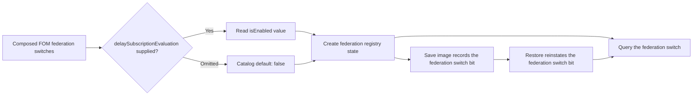
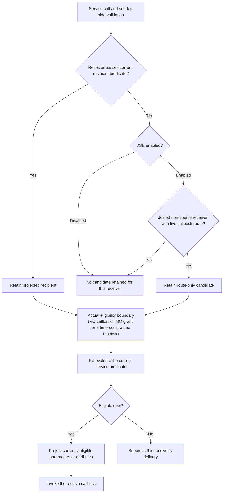
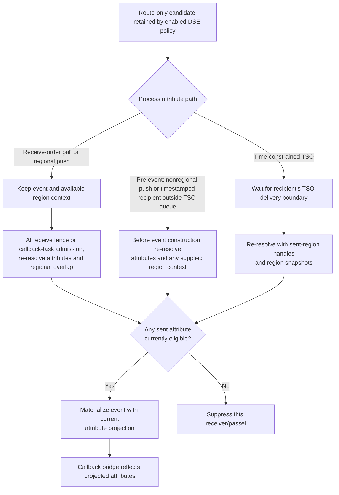
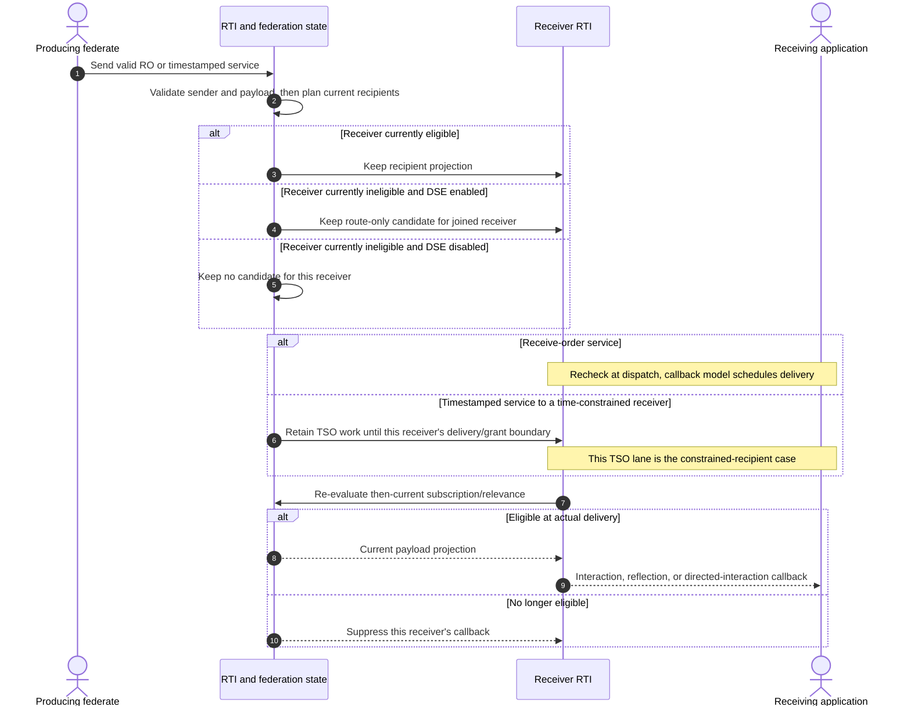

# HLA 1516.1-2025 Delay Subscription Evaluation Flow Guide

Delay Subscription Evaluation (DSE) changes **when the RTI decides whether a receiver is subscribed and relevant**. It does not change sender-side service validation, make delivery unconditional, or replace callback and time management. The practical difference is whether a joined receiver that is ineligible at send time can remain a candidate until the actual delivery boundary.

## Scope and authority

- **Edition:** IEEE 1516.1-2025 behavior only.
- **Implementation profile/boundary:** the embedded federation registry and the configured process endpoint are both represented. Eight focused DSE source files exercise embedded behavior; a separate process-boundary test covers regional receive-order attribute updates under `HLA_EVOKED` and `HLA_IMMEDIATE`, plus one immediate callback/resignation fence. Other process routes remain source-only unless a focused case is cited.
- **Normative pointer and verification limit:** the DSE planner and focused tests point to IEEE 1516.1-2025 §8.1.8 for the actual-delivery evaluation rule. The official [IEEE 1516.1-2025 Federate Interface Specification](https://standards.ieee.org/ieee/1516.1/6688/) is normative authority, but its public product page offers purchase/subscription access rather than the clause text. The plain-language rule below is a conservative reader paraphrase; verify exact normative wording and applicability against an authorized copy. Umbra observations are separate and are not a conformance claim.
- **Switch surface:** the RTI exposes [`getDelaySubscriptionEvaluationSwitch()`](../../third_party/ieee1516.1-2025/include/RTI/RTIambassador.h#L2228). The 2025 MIM reports `HLAdelaySubscriptionEvaluation` as a Static switch value ([MIM entry](../../third_party/ieee1516.2-2025/resources/mim/HLAstandardMIM-2025.xml#L857)).
- **OMT authority:** the bundled MIM entry belongs to the official [IEEE 1516.2-2025 Object Model Template Specification](https://standards.ieee.org/ieee/1018/6689/).
- **Evidence limit:** focused tests show only their exercised scenarios, not every service, region topology, transport, callback schedule, or deployment. No Requirements Lab rows are created or changed.

For adjacent behavior, see the [object-attribute subscription-state guide](HLA-2025-OBJECT-ATTRIBUTE-SUBSCRIPTION-STATE-FLOW-GUIDE.md) for declaration state, the [2025 time-management guide](HLA-2025-TIME-MANAGEMENT-GUIDE.md) for grant state, the [DDM and regions guide](HLA-2025-DATA-DISTRIBUTION-AND-REGIONS-FLOW-GUIDE.md) for region state, the [save/restore guide](HLA-2025-FEDERATION-SAVE-RESTORE-FLOW-GUIDE.md), and the [directed-interaction guide](HLA-2025-DIRECTED-INTERACTION-FLOW-GUIDE.md). This guide focuses on the cross-cutting eligibility timing rule instead of absorbing those state machines.

## HLA concept: eligibility timing is not a delivery guarantee

The reader-level model is simple: DSE changes **when** receiver subscription and relevance are evaluated, not whether the sender's service call is valid or whether a callback is guaranteed. A receiver must still qualify under the service's applicable rules when delivery is considered. This is a paraphrase pending verification against the full §8.1.8 text, not a quotation or complete statement of every service-specific rule.

Keep these three questions separate:

1. **Was the service valid when called?** Sender membership, interaction publication, object/attribute authority, parameter handles, target knowledge, and supplied region validity remain ordinary send-side checks.
2. **When is receiver eligibility evaluated?** The HLA-level distinction is the evaluation point: a receiver that is ineligible at send time can still qualify when the enabled DSE rule defers that decision to delivery. In Umbra's embedded implementation, a currently eligible receiver may be planned with its projection at send time; when the current predicate fails, the RTI can retain a route-only candidate for a joined, non-source member with a live callback route, then compute the projection later. “Route-only candidate” describes Umbra's work item, not HLA terminology or a required RTI architecture.
3. **When can the callback run?** `HLA_EVOKED` or `HLA_IMMEDIATE` selects how an
   admitted callback is invoked, but it is not the only delivery gate. In
   Umbra's embedded 2025 path, a time-constrained receiver can have
   receive-order work deferred while Time Granted when asynchronous delivery
   is disabled; enabling asynchronous delivery or making a time advance
   pending opens that receive-order gate. Asynchronous delivery does not
   release TSO work early. See the [time-management guide's receive-order
   gate](HLA-2025-TIME-MANAGEMENT-GUIDE.md#receive-order-and-asynchronous-delivery)
   and its focused [temporal-state test](../../cpp/tests/ieee1516_2025_asynchronous_delivery_temporal_state_catch2.cpp#L5)
   and [TSO-exclusion test](../../cpp/tests/ieee1516_2025_asynchronous_delivery_tso_exclusion_catch2.cpp#L5).
   These are adjacent time-management evidence, not additional DSE test cases
   or process-profile evidence. A TSO grant constrains delivery to a
   time-constrained receiver; do not treat that grant as a gate for every
   recipient of a timestamped service. DSE's eligibility decision, the
   receive-order temporal gate, and the callback model are separate. The
   [time-management guide](HLA-2025-TIME-MANAGEMENT-GUIDE.md) provides the
   broader temporal state model.

An enabled switch therefore means **“defer the receiver-eligibility decision,” not “deliver regardless.”** A later subscription can make a retained candidate eligible. In the embedded callback paths and focused cases, a later unsubscribe or region change can also suppress work that was previously planned; those callback-time rechecks are implementation/test evidence, not a claim that every RTI uses Umbra's candidate representation.

### Object state is not an interaction history

A late object subscription and a late interaction subscription can both change
what a receiver observes, but the underlying things are different. When an
existing object becomes newly discoverable, the selected embedded 2025 path
first establishes that receiver's object knowledge, then may reflect the
currently held values for the subscribed attributes. This is initial object
state, not a replay of the publisher's earlier update call; see the
[subscription-state guide](HLA-2025-OBJECT-ATTRIBUTE-SUBSCRIPTION-STATE-FLOW-GUIDE.md#late-subscription-can-mean-two-different-receiver-states)
and its [focused late-subscription test](../../cpp/tests/subscribe_object_class_attributes_discovery_catch2.cpp#L180).
The test observes discovery and selected values, but its separate callback
collections do not assert their relative order; the exact §5.8 obligation
remains unverified against the licensed clause text.

An interaction is instead one discrete send. A later subscription does not
create that event or replay arbitrary interaction history. In the focused
embedded receive-order case below, the receiver is already joined but has no
subscription when the send occurs. With DSE enabled, Umbra retains a
route-only candidate for that particular send; subscribing before the actual
callback boundary can make that same event eligible. With the switch disabled,
the focused case retains no such candidate and produces no callback for that
send ([test](../../cpp/tests/ieee1516_2025_delay_subscription_evaluation_receive_order_interaction_catch2.cpp#L3),
[planner](../../cpp/src/internal/federation/federation_registry_receive_order_interactions.cpp#L16)).
This is a bounded embedded source/test comparison, not a complete normative
statement or process-profile result; exact §8.1.8 wording remains open.

## Switch lifetime: federation policy, not a per-send option

In the surveyed implementation, the federation switch is read from the composed FOM when the federation is created. If the switch is omitted, the catalog's default remains disabled; focused tests check that default and an enabled FOM value through the public getter. The switch is federation state shared by its joined members, not a setting passed to each send.

This lifetime is backed by [FOM switch parsing](../../cpp/src/internal/fom/libxml2_fom_composer.cpp#L1799), [federation initialization](../../cpp/src/internal/federation/federation_registry_membership_lifecycle.cpp#L127), and [state-image capture](../../cpp/src/internal/federation/federation_registry_state_image_capture.cpp#L60)/[restore](../../cpp/src/internal/federation/federation_registry_state_image_restore.cpp#L60). The switch persistence links are source evidence; the bounded DSE test set did not include a focused save/restore DSE case. See the save/restore guide for the larger restoration lifecycle.

## Recipient state machine

The important state is not simply “subscribed” or “not subscribed.” For each send and receiver, distinguish a recipient projected now, a route-only candidate retained for later evaluation, no candidate, and a candidate later suppressed by current state.

For an enabled switch, the embedded planners retain a route-only candidate for each joined non-source member with a callback route when the normal send-time predicate found no recipient. Ordinary interaction and attribute-update entries leave their received parameter/attribute projection unset until delivery; a directed interaction retains its sent class but still rechecks its target and receiver selector. In these embedded paths, the service-specific recipient predicate is checked again at the delivery boundary. This is why a late subscription may admit a callback, but an unsubscribe before callback dispatch suppresses it even if the receiver qualified earlier. The candidate and projection details are implementation mechanics for the HLA-level timing distinction above.

The send-time recipient loop is over the federation's **current members**. DSE does not save a candidate for a federate that has not joined yet, and it does not bypass sender-side validation. For attribute and directed-object services, the ordinary known-object and ownership predicates still apply at the delivery boundary.

## Receive order, TSO, and callback model are separate axes

For a receive-order service, the later subscription check is at callback dispatch. Under `HLA_EVOKED`, that means the receiver evokes callbacks; with `HLA_IMMEDIATE`, the service may dispatch immediately. Tests use `disableCallbacks()`/`enableCallbacks()` to create a controlled interval in which subscription state changes before the queued immediate callback is allowed to run.

The TSO cases in this guide use a time-constrained receiver: the [focused interaction case](../../cpp/tests/ieee1516_2025_delay_subscription_evaluation_timestamped_interaction_catch2.cpp#L54) explicitly enables time constraint, and its grant is the tested delivery fence. A timestamped send does not put every recipient on that fence. In a separate embedded attribute case, a non-time-constrained recipient has no TSO queue entry and receives the timestamped reflection through a receive-order callback ([test](../../cpp/tests/timestamped_default_region_attribute_mixed_fanout_catch2.cpp#L278)). For the embedded interaction and attribute paths, source shows that this receive-order callback rechecks the current projection immediately before user code ([interaction callback](../../cpp/src/internal/runtime/umbra_rti_ambassador_tso_receive_order_interaction.cpp#L117), [attribute callback](../../cpp/src/internal/runtime/umbra_rti_ambassador.cpp#L1507)); focused DSE tests do not isolate this unconstrained-recipient case.

The sequence below summarizes the embedded callback/grant paths exercised by the focused
DSE cases; process behavior has different source-observed seams. For process receive-order
ordinary and directed interactions, the send service re-resolves a route-only candidate while
preparing its outgoing event ([ordinary](../../cpp/src/internal/federation/process_federation_service_interaction_send.cpp#L514),
[directed](../../cpp/src/internal/federation/process_federation_service_interaction_send.cpp#L807)).
The process callback bridge then delivers the already projected event to user code
([ordinary callback](../../cpp/src/internal/federation/process_federation_callback_bridge.cpp#L214),
[directed callback](../../cpp/src/internal/federation/process_federation_callback_bridge.cpp#L184));
this source path is distinct from the embedded callback-entry recheck and does not establish
an equivalent receiver-side re-evaluation at callback time. Process TSO delivery has a separate,
later projection check: ordinary interactions re-resolve at queued TSO delivery
([dispatcher](../../cpp/src/internal/federation/process_federation_service_tso_delivery.cpp#L209)),
while directed interactions use the timestamped directed-recipient projection
([dispatcher](../../cpp/src/internal/federation/process_federation_service_tso_payload_dispatch.cpp#L83)).

Attribute updates expose a distinct process boundary and two receive-order
recheck timings, plus an important existing-push limitation. In the pre-event
path, an unprojected route-only candidate is
re-resolved while the service constructs the event; the lookup receives the
sent attribute handles and, when supplied, the passel's sent-region handles
and committed snapshots
([branch selection](../../cpp/src/internal/federation/process_federation_service_attribute_value_updates.cpp#L214),
[pre-event lookup](../../cpp/src/internal/federation/process_federation_service_attribute_value_updates.cpp#L219)).
Pull delivery and regional push use `recheckAtReceive`: the event carries the
available region context and the receiving service re-resolves the attributes
and overlap before returning the projected event
([event preparation](../../cpp/src/internal/federation/process_federation_service_attribute_value_updates.cpp#L245),
[receive-side recheck](../../cpp/src/internal/federation/process_federation_service_receive.cpp#L52)).
Thus the current source passes regional context in both process receive-order
lookup paths; the earlier concern that those lookups omitted it is not borne
out by the code. Do not read those paths as covering every push mode: when
receive-order push is enabled without sent-region handles,
`recheckAtReceive` is false and the source says nonregional push remains on its
existing path pending a separate DSE slice ([branch and scope note](../../cpp/src/internal/federation/process_federation_service_attribute_value_updates.cpp#L210)).
An unprojected candidate on that path is re-resolved before event construction,
not at the receiving service boundary. This is source-only; no focused process
DSE test demonstrates late-subscription admission or suppression for
nonregional push. The callback bridge then calls `reflectAttributeValues`
without another DSE projection check
([bridge](../../cpp/src/internal/federation/process_federation_callback_bridge.cpp#L361)).
Queued process TSO attribute delivery has its own recipient-dispatch recheck
and also passes the sent-region handles and snapshots
([dispatcher](../../cpp/src/internal/federation/process_federation_service_tso_delivery.cpp#L64)).
These remain source observations for process interactions and TSO delivery.
The regional process attribute path has focused evidence below, but nonregional
receive-order push does not. Do not extrapolate the regional attribute test to
other services or push modes, or treat any one process route as proof of
end-to-end parity. When the process queues a timestamped passel, only recipients
currently time-constrained enter its TSO queue ([queue predicate and recipient
set](../../cpp/src/internal/federation/process_federation_service_attribute_value_updates.cpp#L64),
[per-recipient diversion](../../cpp/src/internal/federation/process_federation_service_attribute_value_updates.cpp#L201));
recipients outside that set fall through the per-recipient event path. A
route-only candidate on that path is rechecked before event construction
([pre-event lookup](../../cpp/src/internal/federation/process_federation_service_attribute_value_updates.cpp#L218)),
not at the later TSO delivery fence. This timestamped process branch is
source-only; the focused process DSE case below covers regional receive-order
updates, not timestamped attribute delivery.
DSE does not advance time, grant a request, or change the per-recipient
retraction lifecycle.

The shared decision is about the current **nonempty attribute projection**,
not an all-or-nothing match of the original set: a passel can produce a
reflection for the subset still subscribed and regionally relevant, but is
suppressed when no sent attribute remains eligible. The three branches have
different source-observed timing; only the regional receive-order branch has
the focused process DSE coverage listed below.

The specific predicates differ by service. Interactions re-evaluate the interaction subscription; attribute updates re-evaluate relevant attributes and, for regional forms, receiver region overlap; directed interactions also re-evaluate target knowledge and the universal/by-ownership selector. DSE does not collapse those semantics into one common subscription type. The directed-service path is detailed in the linked directed-interaction guide.

For regional sends, the accepted send also preserves the producer's committed region realization while the receiver's subscription/overlap is considered at delivery. DSE changes receiver eligibility timing; it does not erase DDM constraints or make non-overlapping regions relevant. See the DDM/regions guide for region commit and overlap state.

## Focused test evidence

| Path | Focused evidence and what it establishes |
| --- | --- |
| Ordinary receive-order interaction | [Test](../../cpp/tests/ieee1516_2025_delay_subscription_evaluation_receive_order_interaction_catch2.cpp#L3): a late subscription admits the send only when DSE is enabled; an unsubscribe before the actual callback suppresses in both switch modes. Covers `HLA_EVOKED` and controlled `HLA_IMMEDIATE`. |
| Ordinary receive-order attribute update | [Test](../../cpp/tests/ieee1516_2025_delay_subscription_evaluation_receive_order_attribute_update_catch2.cpp#L3): isolates update delivery from discovery, admits after a late attribute subscription only when enabled, and suppresses after unsubscribe in both modes. |
| Timestamped interaction | [Test](../../cpp/tests/ieee1516_2025_delay_subscription_evaluation_timestamped_interaction_catch2.cpp#L3): a subscription added before the receiver's time-2 grant admits the queued interaction when enabled; unsubscribing before time 3 suppresses it. Exercises callback models and order/time fields. |
| Timestamped attribute update | [Test](../../cpp/tests/ieee1516_2025_delay_subscription_evaluation_timestamped_attribute_update_catch2.cpp#L3): covers delayed subscription evaluation at a TSO reflection boundary. |
| Timestamped regional interaction | [Test](../../cpp/tests/ieee1516_2025_delay_subscription_evaluation_timestamped_regional_interaction_catch2.cpp#L3): adds a matching regional subscription after send and before grant; the enabled case delivers, while removing the declaration before the next grant suppresses. |
| Timestamped regional attribute update | [Test](../../cpp/tests/ieee1516_2025_delay_subscription_evaluation_timestamped_regional_attribute_catch2.cpp#L3): exercises the same late regional eligibility and later suppression for reflection. |
| Receive-order directed interaction | [Test](../../cpp/tests/delay_subscription_evaluation_directed_interaction_catch2.cpp#L95): adds a universal selector between send and callback; the enabled case delivers. |
| Timestamped directed interaction | [Test](../../cpp/tests/delay_subscription_evaluation_timestamped_directed_interaction_catch2.cpp#L129): checks selector evaluation at TSO delivery, including switch-dependent recipient/retraction behavior in this directed-service path. |
| Process regional receive-order attribute update | [EVOKED process case](../../cpp/tests/ieee1516_2025_connection_delayed_regional_attribute_update_catch2.cpp#L523) checks enabled/disabled late-subscription eligibility at the receive fence and uses the original sent-region snapshot; [IMMEDIATE process case](../../cpp/tests/ieee1516_2025_connection_delayed_regional_attribute_update_catch2.cpp#L550) checks re-evaluation at callback-task admission, including suppression after a receiver-region change. In this fixture, [host setup](../../cpp/tests/ieee1516_2025_connection_delayed_regional_attribute_update_catch2.cpp#L167) sets `pushReceiveOrderEvents` false for EVOKED (pull) and true for IMMEDIATE (push), as defined by the [service option](../../cpp/src/internal/federation/process_federation_service.hpp#L31). This is test setup, not a general rule equating callback model with HLA delivery mode. Both exercise the configured process endpoint. |
| Process immediate callback/resignation fence | [Process case](../../cpp/tests/ieee1516_2025_connection_delayed_regional_attribute_update_catch2.cpp#L539): an in-progress reflection holds Resign until callback return; the same ambassador then rejoins with a new member ID. This is one tested callback/Resign schedule, not a general ordering rule. |

The eight named DSE source files above are embedded/development-profile tests.
The additional process cases cover regional receive-order attribute delivery
only. The process interaction paths and process TSO attribute delivery have
source-observed recheck points but no focused DSE test in this bounded survey;
nonregional receive-order push also lacks focused DSE evidence. Do not treat
this narrow process test as proof of the remaining process routes.

## Implementation map and limits

- [2025 FOM parsing of the DSE switch](../../cpp/src/internal/fom/libxml2_fom_composer.cpp#L1799)
- [Federation switch initialization](../../cpp/src/internal/federation/federation_registry_membership_lifecycle.cpp#L127)
- [Receive-order interaction recipient planning](../../cpp/src/internal/federation/federation_registry_receive_order_interactions.cpp#L16)
- [Receive-order attribute-update recipient planning](../../cpp/src/internal/federation/federation_registry_attribute_value_update_requests.cpp#L93)
- [Process receive-order interaction planner call](../../cpp/src/internal/federation/process_federation_service_interaction_send.cpp#L389) and [deferred recipient recheck](../../cpp/src/internal/federation/process_federation_service_interaction_send.cpp#L514)
- [Process receive-order directed-interaction recheck](../../cpp/src/internal/federation/process_federation_service_interaction_send.cpp#L807) and [callback bridge delivery of the projected event](../../cpp/src/internal/federation/process_federation_callback_bridge.cpp#L214)
- [Process receive-order attribute-update planning](../../cpp/src/internal/federation/process_federation_service_attribute_value_updates.cpp#L44), [recheck branch and pre-event lookup](../../cpp/src/internal/federation/process_federation_service_attribute_value_updates.cpp#L214), and [receive-boundary recheck with region context](../../cpp/src/internal/federation/process_federation_service_receive.cpp#L52); both current recheck paths pass source-region handles/snapshots when present
- [Process TSO attribute projection at recipient dispatch](../../cpp/src/internal/federation/process_federation_service_tso_delivery.cpp#L64) and [attribute callback bridge](../../cpp/src/internal/federation/process_federation_callback_bridge.cpp#L361)
- [Process ordinary TSO projection](../../cpp/src/internal/federation/process_federation_service_tso_delivery.cpp#L209) and [directed TSO projection](../../cpp/src/internal/federation/process_federation_service_tso_payload_dispatch.cpp#L83)
- [Embedded receive-order callback projection](../../cpp/src/internal/runtime/umbra_rti_ambassador_interaction_callbacks.cpp#L77)
- [TSO interaction delivery projection](../../cpp/src/internal/runtime/umbra_rti_ambassador_time_advance_dispatch.cpp#L270) and [attribute reflection projection](../../cpp/src/internal/runtime/umbra_rti_ambassador_time_advance_dispatch.cpp#L361)

This guide does not enumerate every service-specific sender check, callback exception, region update race, time-management combination, save/restore payload, or transport. It explains the cross-cutting eligibility timing rule and points to focused guides for those states.
