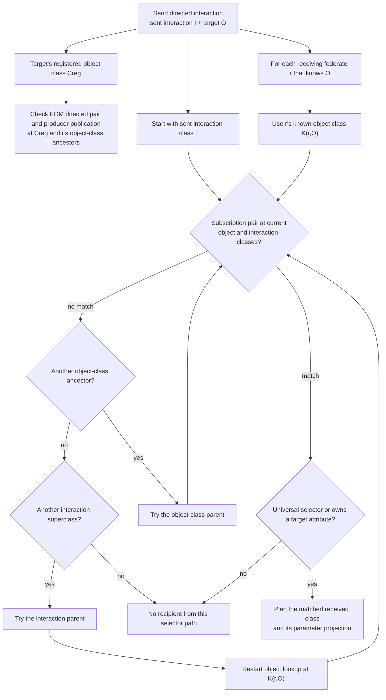
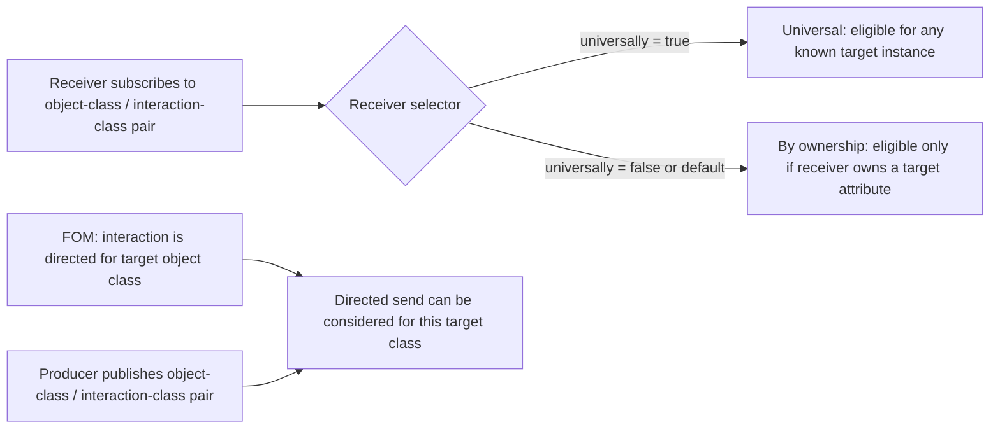
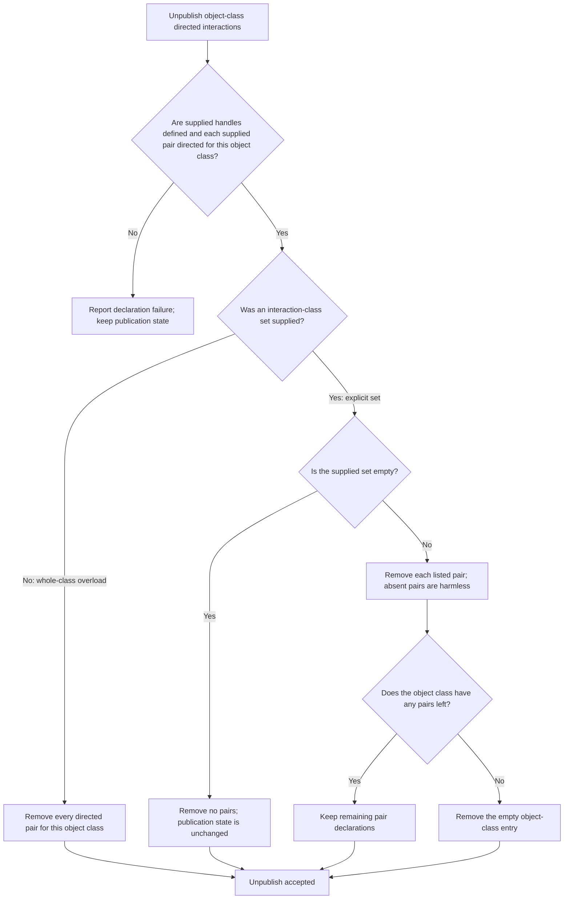
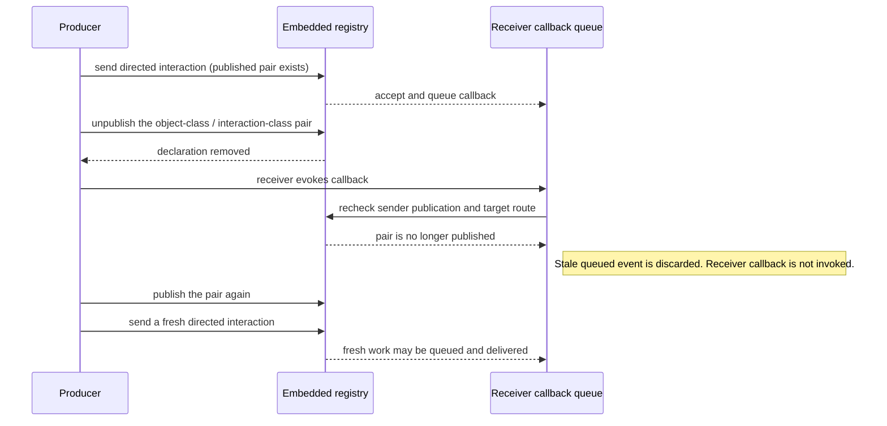
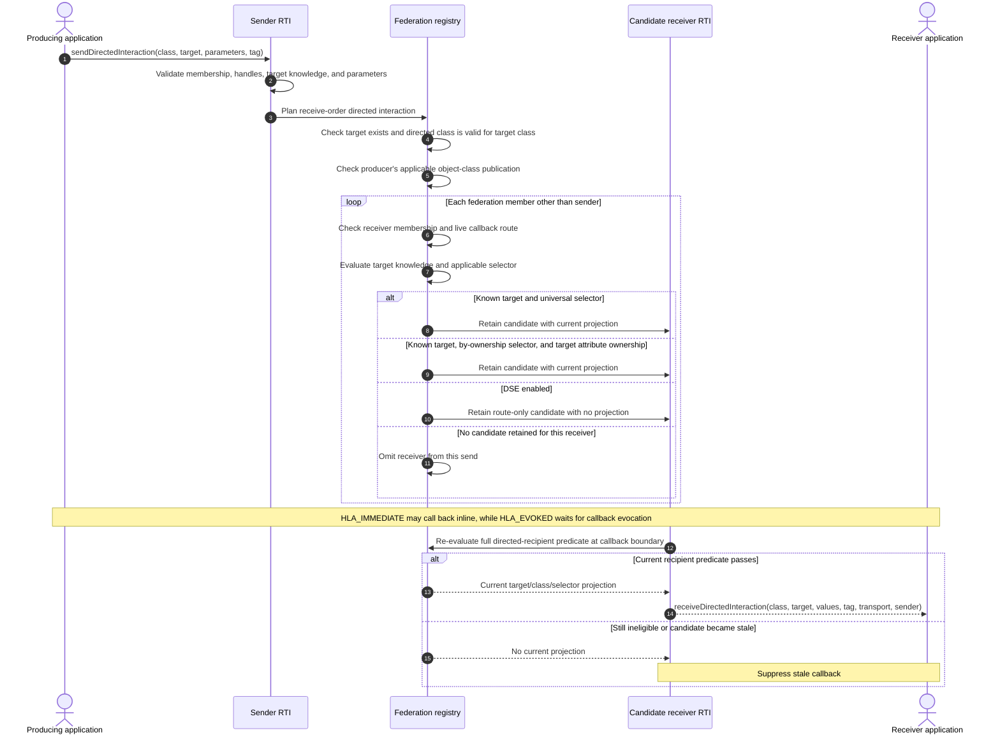
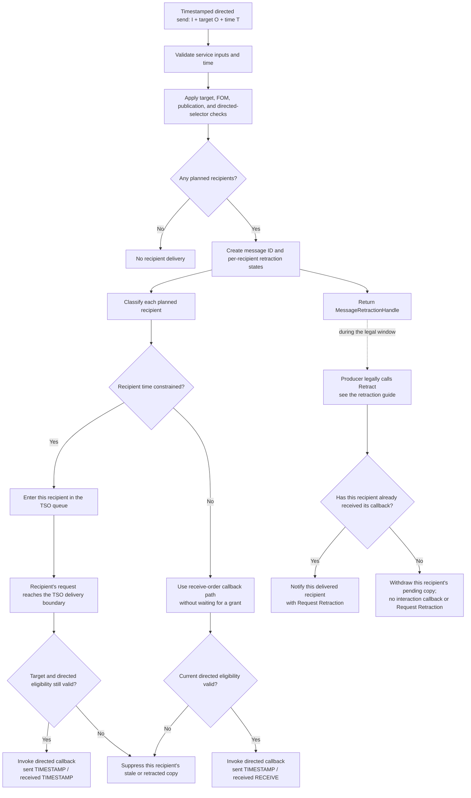
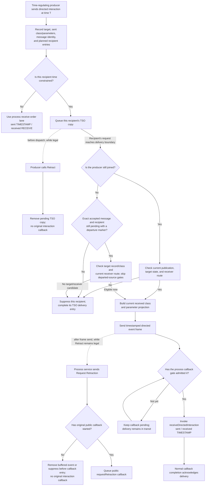
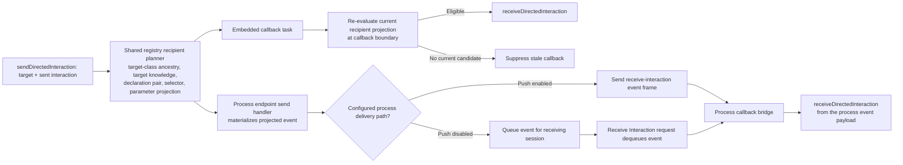

# HLA 1516.1-2025 Directed Interaction Flow Guide

This guide follows one directed-interaction send from the declarations that
make it legal to the receiver callback. The key to reading the flow is that
the sender chooses a **target object instance**; the RTI then selects zero or
more receiving federates. The target is not a recipient list.

## Scope and authority

- **Edition:** IEEE 1516.1-2025 only. The 2010 API/runtime is a separate
  compatibility stream; this guide does not infer equivalence or parity.
- **Implementation profiles surveyed:** embedded federation management and selected
  process-endpoint integration paths.
- **Normative authority:** the [official IEEE 1516.1-2025 Federate Interface
  Specification](https://standards.ieee.org/ieee/1516.1/6688/). The vendored
  2025 C++ interface labels both `sendDirectedInteraction` overloads as 6.14
  and `receiveDirectedInteraction` as 6.15. Consult the standard itself for
  normative rules; implementation and test links below describe Umbra behavior
  only.
- **Evidence limit:** a focused passing test establishes its exercised
  scenario, not complete support or conformance. No Requirements Lab rows are
  created or changed by this guide.

For the broader information path, a concise [ordinary-versus-directed routing
comparison](HLA-2025-OBJECT-AND-INTERACTION-INFORMATION-FLOW-GUIDE.md#same-payload-family-different-routing-question),
and the [cross-service class ancestry map](HLA-2025-OBJECT-AND-INTERACTION-INFORMATION-FLOW-GUIDE.md#class-ancestry-has-different-jobs-in-different-paths),
see the [object and interaction information flow overview](HLA-2025-OBJECT-AND-INTERACTION-INFORMATION-FLOW-GUIDE.md).
For shared timing/retraction and declaration details, use the [time
management](HLA-2025-TIME-MANAGEMENT-GUIDE.md), [TSO retraction
companion](HLA-2025-TSO-RETRACTION-FLOW-GUIDE.md), [DDM and
regions](HLA-2025-DATA-DISTRIBUTION-AND-REGIONS-FLOW-GUIDE.md), and [attribute
ownership](HLA-2025-ATTRIBUTE-OWNERSHIP-FLOW-GUIDE.md) guides. This document
keeps those adjacent state machines bounded rather than repeating them.

## Keep three identities separate

| Identity | Chosen by | Role in this service |
| --- | --- | --- |
| Producing federate | The caller of `sendDirectedInteraction` | Must satisfy membership, target-knowledge, and directed-publication checks. It is excluded from its own receiver fan-out. |
| Target object instance | The sender's `ObjectInstanceHandle` argument | Supplies the target identity. FOM/publication checks start from its registered class; each receiver's selector starts from the class at which that receiver knows it. |
| Receiving federate(s) | The RTI's routing pass | Each candidate must have a live callback route, know the target, and satisfy an applicable directed subscription/selector. One send may reach multiple receivers. |

The target owner and sender need not be the same federate. A receiver can also
be the target owner without being the sender. Directed interactions therefore
combine an interaction payload with an object-instance context, but do not
turn into an attribute update.

## The declaration matrix and receiver selector

Two declarations participate on different sides:

- The producer uses `publishObjectClassDirectedInteractions(objectClass,
  interactionClasses)`. The declaration is associated with an **object class
  and interaction class**, not just the ordinary interaction publication.
- A receiver uses `subscribeObjectClassDirectedInteractions(objectClass,
  interactionClasses, universally)`. The pinned 2025 API defaults
  `universally` to `false`; Umbra maps `false` to by-ownership and `true` to
  universal. The focused test omits the argument for by-ownership and passes
  `true` for universal. An empty class set preserves the existing selector
  kind in that test.
- The FOM and producer-publication checks use the target's registered object
  class and its object-class ancestors.
- Receiver selection is a separate question for each federate: its target
  object-class context is the class at which that federate knows the object,
  and its directed subscription is paired with an interaction class. Do not
  collapse the receiver-known class into the producer's registered class.

The current embedded receive-order source therefore has two independent class
axes. It checks directed-pair validity and producer publication from the
target's registered class. For each receiver, it starts object-class selector
lookup from that receiver's known class for the target. For each candidate
interaction class—starting with the sent class and then its parents—the
selector helper searches that object class and its parents for a matching
`(object class, interaction class)` subscription. The first applicable pair
supplies the receiver selector and planned received interaction class;
parameter projection is then checked against that interaction class. See the
[pair and publication walk](../../cpp/src/internal/federation/federation_registry_directed_interactions.cpp#L15),
[receive-order recipient planner](../../cpp/src/internal/federation/federation_registry_directed_interactions.cpp#L140),
and [selector lookup helper](../../cpp/src/internal/federation/federation_registry_directed_interactions.cpp#L97).
This is a current-source map, not a normative inheritance rule.

The focused embedded receipt case distinguishes these contexts: the producer
registers a child target, the receiver discovers it at the base class, and the
receiver has both a base-object/base-interaction universal subscription and a
deeper child-object/child-interaction subscription. Sending the child
interaction produces one callback using the base interaction class. The latest
retained CTest log records this case passing with 35 assertions
([case](../../cpp/tests/directed_interaction_inherited_receipt_catch2.cpp#L88),
[selected callback-class assertion](../../cpp/tests/directed_interaction_inherited_receipt_catch2.cpp#L191)).
This is evidence for that embedded receive-order fixture only. It does not establish
the normative inheritance rule, object-ancestor fallback, parameter
projection, TSO routing, process-endpoint behavior, or 2010 behavior.

The selector answers **which receivers may get a send for this target**. It
does not transfer ownership, make an unknown object known, or select the
interaction's parameters. The public API signatures are in the [2025 RTI
ambassador header](../../third_party/ieee1516.1-2025/include/RTI/RTIambassador.h#L495)
for publication and [subscription](../../third_party/ieee1516.1-2025/include/RTI/RTIambassador.h#L603).
For comparison with discovery's known-class selection, attribute projection,
and ordinary interaction-class promotion, see the object-information guide's
[cross-path class ancestry map](HLA-2025-OBJECT-AND-INTERACTION-INFORMATION-FLOW-GUIDE.md#class-ancestry-has-different-jobs-in-different-paths).

### A target object is not a DDM region

Keep the directed-send target and a DDM region as different concepts. The
2025 `sendDirectedInteraction` service carries an interaction class and an
`ObjectInstanceHandle`; its directed publication/subscription services use
object-class and interaction-class handles, with the receiver subscription's
`universally` selector. By contrast, the regional interaction services take
`RegionHandleSet` arguments for subscription or send. An object-instance
handle is therefore not a region designator, and the universal/by-ownership
selector is not a region-overlap test. See the [directed send declaration](../../third_party/ieee1516.1-2025/include/RTI/RTIambassador.h#L796),
[regional send](../../third_party/ieee1516.1-2025/include/RTI/RTIambassador.h#L1631),
and [regional subscription](../../third_party/ieee1516.1-2025/include/RTI/RTIambassador.h#L1595),
alongside the separate [regional interaction guide](HLA-2025-DATA-DISTRIBUTION-AND-REGIONS-FLOW-GUIDE.md#interactions-explicit-and-default-region-paths).

This is an API-shape distinction, not a claim that every normative rule
involving directed interactions and DDM has been established here. Do not add
a region-overlap gate to this flow without checking the applicable standard
text; keep regional routing in its own guide meanwhile.

## Unpublishing removes a producer route and fences queued callbacks

Unpublishing is a producer-side declaration change; it does not edit a
receiver's subscription. In the embedded registry, a supplied non-empty set
removes those object-class/interaction-class pairs, an explicitly supplied
empty set removes none, and the whole-class overload removes every pair for
that object class. Removing the final pair also removes the now-empty
publisher declaration entry for that object class. The operation is idempotent
when the requested pair is already absent.
These are implementation observations, not a claim about every transport
profile.

The overload distinction matters: `unpublishObjectClassDirectedInteractions(c)`
means “remove this class's directed publications,” while
`unpublishObjectClassDirectedInteractions(c, {})` supplies a set that happens
to contain no pairs. The service-report test also preserves that distinction
as `null` versus `[]`; its assertion is about reporting shape, while the
registry source above establishes the declaration-state behavior.

For receive-order work in the embedded path, a successful send can already
have queued a callback before the producer withdraws its declaration. The
callback path checks current declaration state again when the callback is
evoked: the queued item is suppressed if its producer route has since been
removed. Republishing permits a **new** send; it does not revive the stale
queued callback.

The second diagram is specifically the embedded receive-order behavior
exercised by the linked test; it does not specify timestamped delivery or
process-endpoint callback revalidation.

## Receive-order send: validate, fan out, then dispatch

In the embedded receive-order path, the registry plans candidates at send time
and rechecks each at callback dispatch. With Delay Subscription Evaluation
enabled, a joined non-source receiver with a live route may be retained
route-only when its current target or selector predicate fails. The callback
recheck is why an unsubscribe, target departure, or other state change can
make queued work stale.
The chart shows that directed-specific branch; the [DSE guide](HLA-2025-DELAY-SUBSCRIPTION-EVALUATION-FLOW-GUIDE.md)
explains the cross-service switch behavior.

In the embedded registry, a by-ownership candidate passes when it owns **at
least one attribute on the target instance**. The producing federate is not
considered a receiver. The sender's publication check and the receiver's
selector are separate checks: satisfying one does not imply the other.

The `receiveDirectedInteraction` overloads include the target object handle,
parameter values, user tag, transportation, and producing federate; the
timestamped overload additionally carries time, sent/received order, and an
optional retraction handle ([2025 callback declarations](../../third_party/ieee1516.1-2025/include/RTI/FederateAmbassador.h#L290)).
This callback payload is another reason to keep target context distinct from
recipient identity.

## Timestamped send is the same routing question at a different time boundary

Timestamped directed interaction still names one target and uses directed
publication/subscription selection. For the embedded path below, scope this
map to a time-regulating producer and an interaction whose planned order is
`TIMESTAMP`. The RTI first plans the same target-specific recipient set; then
each planned recipient takes a different temporal lane based on whether that
federate is time constrained. It is still one send and one target—not a
recipient-list API.

In the current embedded implementation, one message identity and retraction
ledger cover all planned recipients, but only time-constrained recipients are
inserted into the time coordinator's TSO queue. A non-time-constrained
recipient follows the receive-order callback path without waiting for its
grant; its callback reports sent order `TIMESTAMP` and received order
`RECEIVE`. A constrained recipient waits for its TSO delivery boundary, where
the target and directed-recipient predicate are rechecked before a callback
with received order `TIMESTAMP`. Callback-model gates still control when user
code runs, and grant/callback ordering depends on the receiver's advance
service. The broader [time-management guide](HLA-2025-TIME-MANAGEMENT-GUIDE.md)
and [TSO retraction guide](HLA-2025-TSO-RETRACTION-FLOW-GUIDE.md) retain the
complete grant and per-recipient retraction state machines.

This split does not mean there are two sends or two retraction handles. In the
embedded source, the retraction record tracks every planned recipient while
the time coordinator queues only constrained recipients. The focused mixed
fanout case observes the non-constrained recipient's callback first with
sent=`TIMESTAMP` / received=`RECEIVE`, then retracts: that delivered recipient
gets Request Retraction, while the queued constrained recipient gets neither
the original interaction nor Request Retraction after its advance. This is a
bounded implementation/test observation, not a complete normative description
of every eligibility or retraction window.

The split is grounded in the embedded implementation and its directed tests,
not presented as a complete normative statement about all service, callback,
or advance-mode combinations. In particular, the diagram omits time/lookahead
legality and exact grant ordering. Retract remains governed by its own
producer-side legality and recipient ledger; the [retraction guide's
mixed-recipient trace](HLA-2025-TSO-RETRACTION-FLOW-GUIDE.md#a-mixed-recipient-walkthrough)
explains that state machine in full.

The process endpoint has its own callback boundary. Its send handler splits
planned recipients between TSO queue entries and receive-order events; when a
TSO directed event reaches its delivery boundary, the process dispatcher
rechecks the recipient projection and sends an event frame. The client-side
callback gate and completion acknowledgement are part of that process route;
they are not the embedded callback-task path shown above. A focused
`HLA_EVOKED` process-endpoint case observes the directed callback before the
matching grant after callbacks are re-enabled. The [time-management guide's
TSO lifecycle](HLA-2025-TIME-MANAGEMENT-GUIDE.md#timestamped-message-lifecycle-and-callback-order)
and [process endpoint guide's in-transit case](HLA-2025-PROCESS-ENDPOINT-REQUEST-AND-CALLBACK-FLOW-GUIDE.md#3-a-timestamped-process-delivery-stays-in-transit-through-callback-completion)
carry the wider grant and acknowledgement flows; this guide does not claim
embedded/process parity.

### Process TSO delivery retains the message but rechecks its directed route

This process-only source map follows the time-constrained-recipient branch of a
timestamped directed send. At acceptance, the service records the original
target, sent interaction class and parameter handles, timestamp, message
identity, and planned recipients. When a recipient's TSO copy becomes
deliverable, the dispatcher resolves that recipient again and uses the current
received interaction class and parameter projection to build the event. The
recipient identity and accepted message survive; the earlier projection is
not treated as an unconditional promise of callback delivery.

For a producer that is still a federation member, the delivery-time predicate
uses current directed publication as well as the current target and receiver
conditions. Thus an unpublish before dispatch, a target that is gone or marked
`deleteAccepted`, or a receiver that no longer knows the target or matches a
directed selector can cause this recipient's TSO copy to be suppressed. The
process service completes the suppressed recipient's delivery entry without
sending a directed-interaction frame. This is source-derived process behavior,
not a portable cancellation rule or a focused process-test result.

Departure is not one generic retention state. The registry checks the exact
accepted message and recipient: the message ID must identify this producer,
target, and sent interaction class; the queued message must list this receiver;
and the retraction ledger must still say that receiver is pending. Only then
can one of two source-side markers authorize the departed producer's accepted
work:

| Exit path | Per-message ledger marker | Meaning in this process route |
| --- | --- | --- |
| Voluntary Resign | `producerResigned` | Preserves each still-pending accepted recipient; it is not limited by a connection-loss cutoff. |
| Forced Connection Lost | `deliveryRequiredAfterConnectionLoss` | Set only for a timestamp at or before the departed regulator's captured current time, when the time value is available, compatible, and comparable. A later or uncomparable timestamp gets no such marker. |

These markers terminalize the producer's retraction record without changing a
still-pending recipient state. For a verified departed-source message, the
directed resolver does not reapply the departed producer's membership,
publication, or known-object gates, and it does not reject the target solely
because it is marked `deleteAccepted`. The object record and sent class still
have to be valid, and the receiver must still be joined, know the target, and
have a current matching directed selector; the received class and parameter
projection are selected for that recipient at delivery time. This is a
message-and-recipient exception, not a frozen route or permission to deliver
other work from a departed producer.

For connection loss, the shared registry also has a narrow grant-boundary
exception when removal of the lost regulator makes ordinary GALT undefined: it
can let a surviving recipient reach a boundary needed for a pending marked
message. This does not mark messages after the captured cutoff for delivery.
The [lifecycle guide](HLA-2025-FEDERATION-AND-FEDERATE-LIFECYCLE-FLOW-GUIDE.md)
and [time-management guide](HLA-2025-TIME-MANAGEMENT-GUIDE.md#timestamped-message-lifecycle-and-callback-order)
carry the wider time-state context. These are source observations; the full
normative §4.4 text is not reproduced here.

A legal producer `Retract` is a separate operation from this live-eligibility
recheck and has two process cutoffs. Before dispatch, it removes a pending
recipient copy from the TSO queue, so no original interaction frame is sent.
After the process service has sent the frame, a still-legal `Retract` can send a
Request Retraction event to that pushed recipient. If the original callback
has not started, the client removes the still-buffered event or the callback
bridge suppresses it before user-code entry; if the callback has started, the
bridge queues the public `requestRetraction` callback. This post-frame path is
source-derived and has no focused process test for a queued directed TSO
interaction. The [TSO retraction guide's process-buffer discussion](HLA-2025-TSO-RETRACTION-FLOW-GUIDE.md#configured-process-callback-buffers-are-a-separate-boundary)
covers the wider callback/retraction lifecycle; it does not establish this
directed-TSO case as tested or normative.

The figure intentionally draws only the constrained recipient's TSO branch;
the receive-order branch is not queued for a grant. The retraction branch is a
process-source observation: dispatch records the pushed recipient after
sending the frame ([dispatcher](../../cpp/src/internal/federation/process_federation_service_tso_payload_dispatch.cpp#L161));
the service emits Request Retraction to that session ([service](../../cpp/src/internal/federation/process_federation_service_retraction.cpp#L200)),
the client removes a matching buffered interaction event ([client](../../cpp/src/internal/federation/process_federation_client.cpp#L512)),
and the callback bridge admits the public retraction callback only after the
original callback has started ([bridge](../../cpp/src/internal/federation/process_federation_callback_bridge.cpp#L1509)).
The focused process callback-gating test does not exercise this retraction
branch. The figure also omits a throwing callback, whose missing-ack/in-transit
consequence is mapped in the [process endpoint guide](HLA-2025-PROCESS-ENDPOINT-REQUEST-AND-CALLBACK-FLOW-GUIDE.md#3-a-timestamped-process-delivery-stays-in-transit-through-callback-completion).
The focused process callback-gating case demonstrates a directed TSO callback
before its matching grant after the disabled-callback gate opens. It does not
change publication or target state, nor retract the queued constrained copy.
The separate process directed-send test retracts timestamped work before and
after callback only on its receive-order (`receivedOrder=RECEIVE`) lane. The
embedded target-departure case does suppress an accepted time-seven directed
copy after a time-six deletion, but it is not process evidence. No focused
process test currently covers unpublish, target departure, or Retract after a
directed TSO recipient has been queued.

## What the surveyed tests demonstrate

| Scenario | Evidence and bounded observation |
| --- | --- |
| Receiver-known target class and interaction superclass | [Embedded inherited-receipt case](../../cpp/tests/directed_interaction_inherited_receipt_catch2.cpp#L88): producer registers and publishes the child object/interaction pair; receiver knows the target at the base object class, subscribes to the base interaction there, and also subscribes to the child pair at the deeper object class. The passing 35-assertion case observes one callback with the base interaction class. Empty parameters; no process, TSO, 2010, object-ancestor-fallback, or normative-rule coverage. |
| Universal versus by-ownership selector | [Embedded selector-kind case](../../cpp/tests/directed_interaction_subscription_kind_catch2.cpp#L112): the target owner and universal subscriber receive; a known non-owner using the default selector does not. It also checks the empty-class-set selector behavior. |
| Receive-order DSE route-only candidate | [Embedded development-profile case](../../cpp/tests/delay_subscription_evaluation_directed_interaction_catch2.cpp#L95): a selector added after send admits a retained route-only candidate only when DSE is enabled; unsubscribe before the next callback suppresses it. Both `HLA_IMMEDIATE` and `HLA_EVOKED` are exercised. |
| Known target, sender excluded, declaration routing | [Embedded known-target case](../../cpp/tests/directed_interaction_known_target_catch2.cpp#L121): validates callback routing, target/payload context, subscription and publication withdrawal fencing, republish for fresh work, and stale work after target departure. |
| Unpublish overload shape and service reporting | [Embedded service-report case](../../cpp/tests/ieee1516_2025_unpublish_object_class_directed_interactions_service_report_file_catch2.cpp#L68): distinguishes a supplied set, an explicit empty set, and the whole-class overload in the service-report arguments; the registry's mutation semantics are source-observed above. |
| Parameter set is checked | [Directed parameter contract case](../../cpp/tests/directed_interaction_known_target_catch2.cpp#L318): rejects unavailable parameters and forwards exactly the supplied values. |
| Timestamped eligibility can be deferred | [Timestamped Delay Subscription Evaluation case](../../cpp/tests/delay_subscription_evaluation_timestamped_directed_interaction_catch2.cpp#L129): covers delayed selector evaluation for a TSO directed send. |
| TSO queue and retraction | [Timestamped directed-interaction retraction case](../../cpp/tests/timestamped_directed_interaction_retraction_catch2.cpp#L150): covers queue-before-grant behavior and retraction in the embedded profile. |
| Mixed constrained/non-constrained recipients share retraction state | [Embedded mixed-fanout case](../../cpp/tests/ieee1516_2025_request_retraction_directed_interaction_mixed_fanout_catch2.cpp#L3): the non-constrained recipient receives the directed interaction with sent `TIMESTAMP` / received `RECEIVE`; retract then notifies that delivered recipient and suppresses the constrained recipient's queued copy before its grant, without Request Retraction to the latter. Existing source/test evidence only; not rerun for this documentation change. |
| Accepted directed TSO work after producer resignation | [Embedded multi-recipient resignation case](../../cpp/tests/timestamped_directed_interaction_multi_recipient_source_resignation_catch2.cpp#L172): a queued send survives producer resignation for FQR, TARA, and NMRA recipients; each recipient's directed callback is observed in its advance flow with the original producer handle. This is a selected embedded development-profile scenario, not a universal resignation rule. |
| Directed TSO work after producer Connection Lost | [Embedded at-cutoff case](../../cpp/tests/connection_loss_directed_tso_catch2.cpp#L158) observes a time-6 directed callback before the receiver's time-6 grant after the producer's embedded transport fails; [late-request/automatic-delete case](../../cpp/tests/connection_loss_directed_tso_late_tar_catch2.cpp#L168) observes the marked directed callback before grant and delays independent object-removal cleanup until a later receive-order request. The [selector-change case](../../cpp/tests/connection_loss_directed_selector_mutation_catch2.cpp#L197) changes the receiver from universal to by-ownership after source loss, and the [unsubscribe case](../../cpp/tests/connection_loss_directed_selector_mutation_catch2.cpp#L354) removes the selector; both suppress the pending directed callback. These all explicitly exercise the embedded transport, not the process endpoint. The process route is source-mapped above; no focused process test combining queued directed TSO with producer resignation or Connection Lost was found in this survey. |
| Process TSO callback gate and grant order | [2025 process-endpoint callback-gating case](../../cpp/tests/ieee1516_2025_connection_tso_directed_interaction_callback_gating_catch2.cpp#L459): in `HLA_EVOKED`, a timestamped directed event at time 5 remains uncalled while callbacks are disabled; after enabling them, the test observes interaction callback then grant and checks `TIMESTAMP` / `TIMESTAMP` plus a valid retraction handle. This does not establish embedded behavior or all process callback modes. Not rerun for this documentation change. |
| Process directed TSO retraction timing limit | [Process directed-send callback case](../../cpp/tests/ieee1516_2025_connection_directed_interaction_callback_catch2.cpp#L1073) checks timestamped Retract before callback and Request Retraction after callback under both callback models, but the receiver observes `receivedOrder=RECEIVE`; it is not a time-constrained queued-TSO case. The TSO-specific process gate above does not retract or mutate declarations. |
| Target departure after directed TSO acceptance | [Embedded target-departure case](../../cpp/tests/ieee1516_2025_timestamped_directed_target_departure_catch2.cpp#L4): a time-six object removal is delivered before the queued time-seven directed interaction; the later target recheck suppresses the directed callback. This does not establish process behavior. |
| Timed save/restore retains a later directed TSO message | [Embedded HLA_EVOKED save/restore case](../../cpp/tests/timed_restore_live_tso_directed_interaction_catch2.cpp#L165); [worked trace in the save/restore guide](HLA-2025-FEDERATION-SAVE-RESTORE-FLOW-GUIDE.md#worked-case-a-timed-save-retains-later-directed-tso-work): at save time 6, timestamp-8 directed work remains pending, is delivered after restore and FQR, then the original handle can generate Request Retraction. Actual/optimistic grant fields are separately documented in the time-management guide. This is embedded development-profile evidence only. |
| Multiple process-endpoint receivers | [2025 process multi-recipient case](../../cpp/tests/ieee1516_2025_connection_directed_interaction_multi_recipient_catch2.cpp#L458): an exact-class send reaches two subscribed receivers and not its sender under both callback models. The fixture maps `HLA_IMMEDIATE` to pushed events [here](../../cpp/tests/ieee1516_2025_connection_directed_interaction_multi_recipient_catch2.cpp#L582) and includes both [HLA_EVOKED and HLA_IMMEDIATE sections](../../cpp/tests/ieee1516_2025_connection_directed_interaction_multi_recipient_catch2.cpp#L1027). It does not test ancestor selection or callback timing relative to service return. |

The process-endpoint case establishes multi-recipient delivery for its tested
path, with exact-class declarations and both callback models. The process send
handler calls the same registry planner used by the embedded path, so the
registered-class ancestor lookup for directed declarations and the separate
receiver-known-class/interaction-class selector search are shared at the
source level. The test does not exercise an ancestor
declaration or selector. The passing embedded inherited-receipt case above
does not broaden this process evidence: it uses the embedded endpoint only.

### 2025 receive-order delivery has a profile boundary

The routing decision is shared, but the callback boundary is not. The embedded
receive-order callback closure asks the registry for a fresh recipient
projection immediately before invoking user code. The process send handler
materializes a recipient-specific `ProcessFederationInteractionEvent` from the
send plan (and re-resolves route-only candidates during that send operation).
Depending on configuration, it either pushes a receive-interaction event
frame or queues the event for a later `Receive Interaction` request. The
process callback bridge forwards the event's selected class, target, parameter
projection, tag, and producer; neither delivery path performs the embedded
callback-time registry re-plan.
The source survey found no focused process test that changes a directed
subscription, unpublishes the producer's object-class/interaction-class pair,
or deletes the target after send acceptance but before callback delivery. Do
not infer the resulting stale-work behavior from the multi-recipient case.
Timestamped delivery has additional per-recipient TSO gates and is not
represented by this receive-order comparison.

The process branch describes the inspected 2025 receive-order route only. Its
missing callback-time re-plan is a source observation, not a normative claim
or a tested stale-delivery result. In particular, the process send handler
materializes the selected recipient, target, class, and parameter projection;
the directed-unpublish handler updates the registry declaration, while the
inspected push/queue and callback paths show no rewrite or eligibility re-plan
for that already-materialized receive-order event. This source survey does not
establish whether every process delivery mode will invoke the callback after
producer unpublication. The embedded
[accepted-send/unpublish test](../../cpp/tests/directed_interaction_known_target_catch2.cpp#L253)
does show suppression before callback dispatch in that profile; do not carry
that tested embedded result over to process. In the process multi-recipient case,
`HLA_IMMEDIATE` enables the pushed-event option and `HLA_EVOKED` uses the pull
receive service. Both sections assert one callback for each receiver and none
for the sender, with the expected class, target, tag, producer, and
transportation; the parameter map is empty. This exact-class fixture does not
establish ancestor selection, callback timing relative to service return, or
post-acceptance mutation behavior.

## Source map and known limits

- [2025 public directed service declarations](../../third_party/ieee1516.1-2025/include/RTI/RTIambassador.h#L495)
- [Shared registry directed declaration and selector rules](../../cpp/src/internal/federation/federation_registry_directed_interactions.cpp#L15)
- [Embedded directed unpublish state transition](../../cpp/src/internal/federation/federation_registry_directed_interactions.cpp#L363)
- [Shared registry receive-order recipient predicate](../../cpp/src/internal/federation/federation_registry_directed_interactions.cpp#L140)
- [Shared registry receive-order send planning](../../cpp/src/internal/federation/federation_registry.cpp#L1769)
- [Shared registry DSE route-only candidate retention](../../cpp/src/internal/federation/federation_registry.cpp#L1864)
- [Embedded send service paths](../../cpp/src/internal/runtime/umbra_rti_ambassador_directed_interaction_services.cpp#L44)
- [Embedded timestamped directed fanout and constrained-recipient queue selection](../../cpp/src/internal/runtime/umbra_rti_ambassador_directed_interaction_services.cpp#L646)
- [Embedded directed TSO enqueue and per-recipient retraction ledger](../../cpp/src/internal/federation/federation_registry_time_tso_enqueue.cpp#L904)
- [Embedded TSO callback-boundary recipient recheck](../../cpp/src/internal/runtime/umbra_rti_ambassador_time_advance_dispatch.cpp#L625)
- [Embedded callback-time recipient recheck](../../cpp/src/internal/runtime/umbra_rti_ambassador_interaction_callbacks.cpp#L122)
- [Embedded unpublish service overloads](../../cpp/src/internal/runtime/umbra_rti_ambassador_interaction_declaration_services.cpp#L455)
- [Process directed-send call into the shared registry planner](../../cpp/src/internal/federation/process_federation_service_interaction_send.cpp#L657)
- [Process TSO directed message and recipient enqueue](../../cpp/src/internal/federation/process_federation_service_interaction_send.cpp#L716)
- [Process TSO directed delivery-time recipient recheck](../../cpp/src/internal/federation/process_federation_service_tso_payload_dispatch.cpp#L39)
- [Shared directed recipient predicate for target, publication, and current selector](../../cpp/src/internal/federation/federation_registry_directed_interactions.cpp#L140)
- [Timestamped directed recipient resolver and source-departure exception](../../cpp/src/internal/federation/federation_registry.cpp#L1926)
- [Voluntary-resign and connection-loss TSO ledger markers](../../cpp/src/internal/federation/federation_registry_resign_lifecycle.cpp#L994)
- [Stored departure markers and recipient-state meaning](../../cpp/src/internal/federation/federation_registry.hpp#L2232)
- [Connection-loss cutoff capture](../../cpp/src/internal/federation/federation_registry_resign_lifecycle.cpp#L29)
- [Post-loss grant boundary for marked TSO work](../../cpp/src/internal/federation/federation_registry.cpp#L1195)
- [Process Resign entry into the shared resignation transition](../../cpp/src/internal/federation/process_federation_service_request_handlers.cpp#L136)
- [Process Connection Lost entry into shared registry cleanup](../../cpp/src/internal/federation/process_federation_service_connection_loss.cpp#L164)
- [Process Retract path for pending TSO fanout](../../cpp/src/internal/federation/process_federation_service_retraction.cpp#L128)
- [Shared per-recipient TSO retraction ledger](../../cpp/src/internal/federation/federation_registry_tso_delivery.cpp#L115)
- [Process receive-order directed event construction](../../cpp/src/internal/federation/process_federation_service_interaction_send.cpp#L819)
- [Process directed unpublish declaration handler](../../cpp/src/internal/federation/process_federation_service_declarations.cpp#L91)
- [Process receive-order directed event push/queue](../../cpp/src/internal/federation/process_federation_service_interaction_send.cpp#L866)
- [Process timestamped directed fanout and TSO enqueue](../../cpp/src/internal/federation/process_federation_service_interaction_send.cpp#L768)
- [Process directed TSO recipient recheck and event-frame dispatch](../../cpp/src/internal/federation/process_federation_service_tso_payload_dispatch.cpp#L82)
- [Process per-recipient event construction and push dispatch](../../cpp/src/internal/federation/process_federation_service_interaction_send.cpp#L856)
- [Process pull receive dequeue](../../cpp/src/internal/federation/process_federation_service_receive.cpp#L70)
- [Process callback bridge for directed interactions](../../cpp/src/internal/federation/process_federation_callback_bridge.cpp#L184)
- [Process multi-recipient public test](../../cpp/tests/ieee1516_2025_connection_directed_interaction_multi_recipient_catch2.cpp#L457)

This survey is intentionally bounded to the send/declaration/receiver flow and
the source-departure branch described above. It does not claim every
ResignAction or automatic Connection Lost combination, exception mapping, MOM
side effect, transport implementation, or time-management combination. One
embedded timed save/restore case is indexed above; its full
queue-cut and rehydration chronology belongs to the [save/restore guide](HLA-2025-FEDERATION-SAVE-RESTORE-FLOW-GUIDE.md#worked-case-a-timed-save-retains-later-directed-tso-work),
while callback-time grant-frontier details belong to the [time-management
guide](HLA-2025-TIME-MANAGEMENT-GUIDE.md). The 2010 reference RTI remains
documented separately in the [2010 flow guide](HLA-2010-REFERENCE-RTI-FLOW-GUIDE.md).
