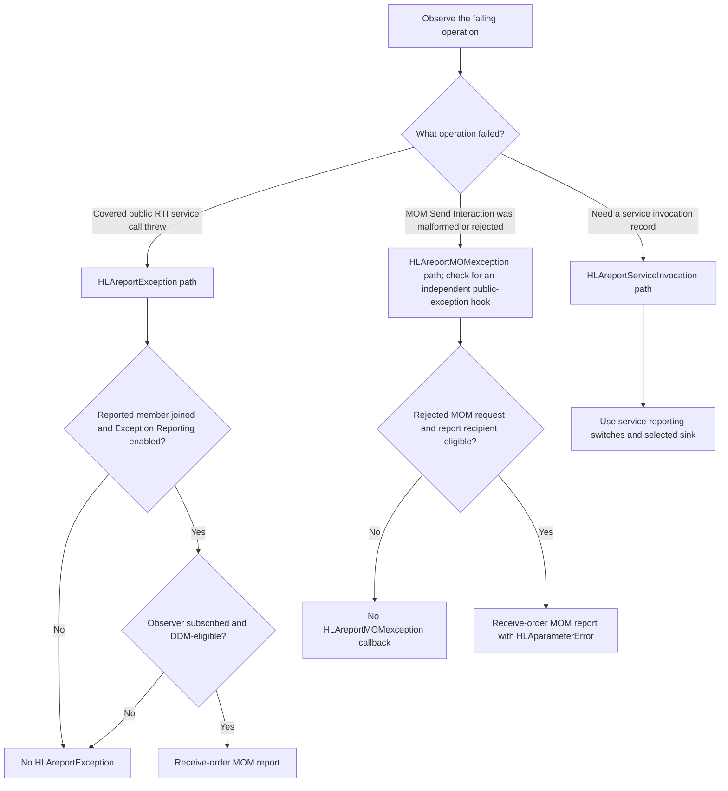
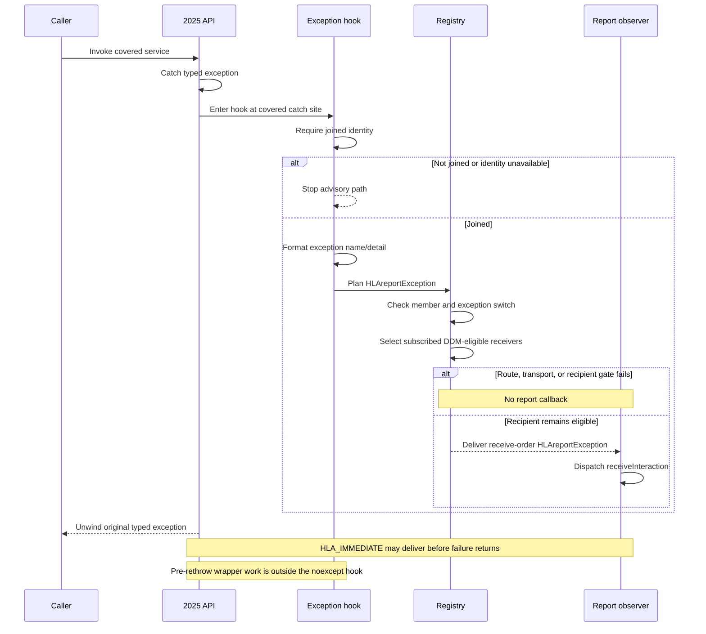
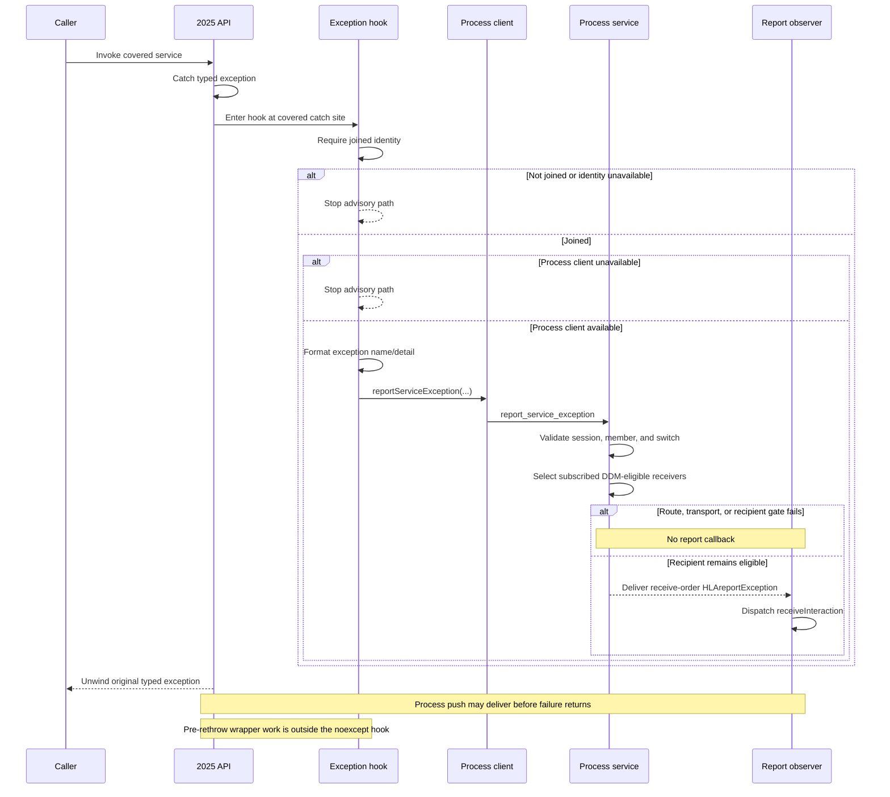
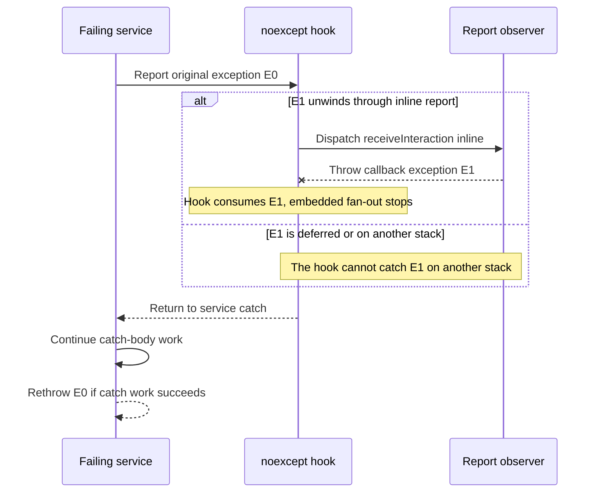
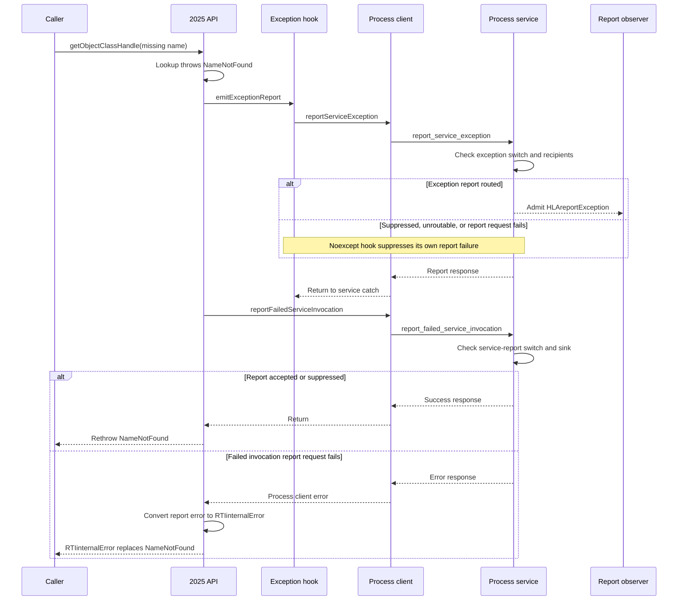
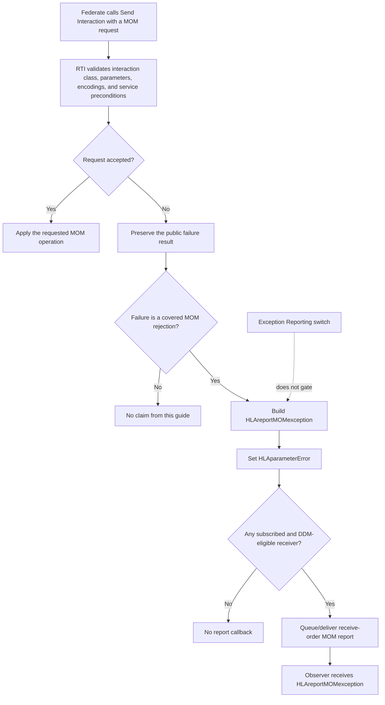
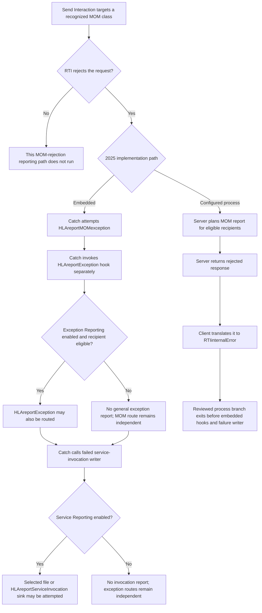

# IEEE 1516.1-2025 Exception-Reporting Flow Guide

An HLA report is a separate observation path from the service or management
event it describes. Ask three questions independently: what result did the
calling federate observe, was a report produced, and which federate could
observe that report and when? The absence of an observed report does not
establish service success: switches, recipient eligibility, and callback
delivery are separate gates. Interpret a received report according to its
type rather than as a generic exception signal. The similarly named
`HLAreportException` and `HLAreportMOMexception` interactions describe distinct
paths; `HLAreportServiceInvocation` is a third, separately configured report
path.

This guide explains those distinctions through selected Umbra behavior. It is
not a substitute for the standard, a complete service-coverage inventory, or a
conformance claim.

**Edition:** IEEE 1516.1-2025 / IEEE 1516.2-2025 MIM only. This guide does not
describe the 2010 reference-RTI stream or imply cross-edition equivalence.

**Implementation profile:** the management-enabled Umbra provider, including
embedded-federation and process-endpoint paths where noted. Branches and test
observations below are scoped to the linked implementation and cases.

## The C++ API boundary

Read the caller's service result from that service's declared contract. For
example, `RTIambassador::getObjectClassHandle` returns an
`ObjectClassHandle` or throws the typed `NameNotFound` exception. A report is
not a second return value: an eligible observer receives a MOM interaction
through `FederateAmbassador::receiveInteraction`. These are distinct API
directions even when an immediate callback is dispatched before the original
service call finishes unwinding. Callback timing changes when the observer
runs; it does not turn the observer's report into the caller's service result.

The pinned [2025 service signature and throws](../../third_party/ieee1516.1-2025/include/RTI/RTIambassador.h#L1702),
[typed exception contract](../../third_party/ieee1516.1-2025/include/RTI/Exception.h#L20),
and [interaction callback overloads](../../third_party/ieee1516.1-2025/include/RTI/FederateAmbassador.h#L262)
make this API boundary concrete. The callback timing examples below remain
profile-specific; see the separate [callback/service-ordering guide](HLA-2025-CALLBACK-AND-SERVICE-ORDERING-FLOW-GUIDE.md).

## The three report paths relevant to exception reporting

The word “exception report” is often used loosely. First identify what failed
and what the report is trying to tell the receiver:

| Path | What it describes | Selection rule in the covered Umbra paths | Does the reported member’s Exception Reporting switch gate it? |
| --- | --- | --- | --- |
| `HLAreportServiceInvocation` | A service invocation record (success or failure), optionally routed to the file or interaction sink. | Service-reporting configuration and destination/subscription rules; see the [service-invocation trace comparison](HLA-2025-SERVICE-INVOCATION-REPORTING-FLOW-GUIDE.md#three-distinct-traces-call-outcome-invocation-report-requested-mom-report). | No; this is a separate reporting feature. |
| `HLAreportException` | An exception raised by a covered public RTI service call. | The reported member’s Exception Reporting switch must be enabled; an observer must also be eligible for the report interaction. | **Yes.** |
| `HLAreportMOMexception` | A MOM interaction that is malformed or rejected by MOM/service preconditions. | Subscription to the report interaction, plus the implementation’s recipient/DDM rules. | **No.** |

This is the set of report paths relevant to exception reporting, not a catalog
of every `HLAreport...` interaction in the MIM. A valid explicit request such
as federation-scoped `HLArequestFOMmoduleData` can produce a separate
`HLAreportFOMmoduleData` interaction about requested state
([MIM request](../../third_party/ieee1516.2-2025/resources/mim/HLAstandardMIM-2025.xml#L2586),
[paired report](../../third_party/ieee1516.2-2025/resources/mim/HLAstandardMIM-2025.xml#L2657)).
That request-driven report is neither a failed service-invocation report nor
`HLAreportMOMexception`; see the distinct
[Federation MOM request/report flow](HLA-2025-FEDERATION-MOM-FLOW-GUIDE.md#federation-reports-are-receive-order-interactions).

The last column is about this exception-report route, not about whether the
original service call succeeds. If this route is suppressed, its hook returns
without changing the service exception. The `noexcept` hook also suppresses
failures in the exception-report attempt itself. Some public service wrappers
then attempt a separate `HLAreportServiceInvocation`; that later reporting
step has its own failure boundary and can affect the public outcome, as shown
in [the combined process-path trace](#when-both-process-report-routes-apply).

For a portable reasoning lens that separates a service result, committed
state, report path, and observer visibility, see the
[cross-cutting state/event/observation guide](HLA-2025-CROSS-CUTTING-STATE-EVENT-OBSERVATION-GUIDE.md#a-service-result-committed-state-and-a-report-are-separate-traces).

## A quick decision map

The diagram is an orientation aid, not a universal rule for every RTI service
or every malformed MOM class. `HLAreportException` is emitted only at public
API catch sites that call the exception-report hook. The linked tests exercise
specific such sites and MOM inputs.

The branches classify what a report means; they are not necessarily mutually
exclusive. For a covered failed `Send Interaction` on a recognized MOM class,
the current embedded catch attempts both the MOM-rejection report and the
general exception-report hook. The configured-process path has a different
source boundary, shown under [Route B](#a-mom-rejection-may-also-enter-the-general-exception-hook).

## Route A: a covered public service raises an exception

Exception origin and report routing are separate questions. Under
HLA_IMMEDIATE, an API exception thrown by application callback code may
unwind into the producer's public-service catch; `HLAreportException` then
depends on that wrapper's explicit hook site. Under HLA_EVOKED, the original
producer service has returned and the callback exception instead unwinds from
the active Evoke call in the inspected path. See the callback guide's
[call-stack example](HLA-2025-CALLBACK-AND-SERVICE-ORDERING-FLOW-GUIDE.md#which-public-call-is-active-when-the-callback-throws)
for one source-bounded embedded Send Interaction case. This does not claim
that every callback exception is reportable or that all services share this
catch behavior.

For a recipient-side process callback exception that reaches a request-backed
service wrapper, see the Callback and Service Ordering guide's
[concrete `getInteractionClassHandle` example](HLA-2025-CALLBACK-AND-SERVICE-ORDERING-FLOW-GUIDE.md#one-public-wrapper-process-getinteractionclasshandle).
That is an implementation case study, not a rule that every public service
uses the same catch/report sequence.

The next two traces share the same HLAreportException outcome but keep the
embedded registry route separate from the process endpoint request/event
path. They do not imply shared internal scheduling or profile parity.

### Embedded federation route

### Process endpoint route

### Read the exception-report path in phases

1. **The exception-report hook is advisory.** A covered service catches the
   public 2025 `Exception` and invokes the `noexcept` report hook. Failures in
   that hook's own planning/transport work do not replace the caught service
   exception. A wrapper may perform additional work after the hook and before
   its final `throw`; see the process-specific combined trace below.
2. **The exception switch belongs to the member being reported.** A successful
   report plan requires that member to still belong to the federation and that
   its Exception Reporting switch be on. The default tested state is off.
3. **Switch-on does not mean broadcast.** The reporting interaction itself
   must be subscribed to, and its `HLAfederate`-scoped endpoint/region and
   parameter projection determine eligible recipients. A matching parent
   subscription may receive only inherited parameters.
4. **The process endpoint treats the server as authority.** The binding sends
   the exception data to the process service; the service re-reads its own
   registry instead of trusting a cached client switch. Prepared report events
   carry private routing identity so delivery can be rechecked against current
   membership, switch, subscription, and recipient state. That identity is
   not an application parameter or the callback’s producing-federate handle.
5. **Callback timing is separate from report eligibility.** Push versus pull
   event transport and `HLA_EVOKED` versus `HLA_IMMEDIATE` callback models
   affect when delivery is observed. An unsubscribe or switch change before
   callback admission can suppress a prepared report in the covered process
   path. The report being receive-order does not create a new timestamped
   delivery rule.

### If the exception-report callback itself throws

Keep the exception that caused the report (`E0`) separate from an application
exception thrown while handling the resulting `HLAreportException` callback
(`E1`). `HLA_IMMEDIATE` may nest callback execution in an active service call;
`HLA_EVOKED` moves callback entry to a later Evoke call. The callback model
describes delivery policy, not a universal catch or translation rule: the
active call stack and the particular RTI wrapper determine which exception
reaches the application.

The `noexcept` [`emitExceptionReport` hook](../../cpp/src/internal/runtime/umbra_rti_ambassador_mom_service_report_interaction.cpp#L184)
also contains an application exception only when that exception unwinds back
through this report attempt. In the embedded path, [`queueExceptionReport`](../../cpp/src/internal/runtime/umbra_rti_ambassador_mom_service_report_interaction.cpp#L30)
submits recipient routes one at a time, and the [immediate dispatcher](../../cpp/src/internal/callbacks/callback_dispatcher.cpp#L122)
can invoke a task before submission returns. If an enabled `HLA_IMMEDIATE`
`receiveInteraction` runs inline on the submitting thread and throws, the hook's
outer catch suppresses that callback exception; the synchronous recipient loop
also stops at that submission, so later planned routes are not submitted by
that attempt. This preserves the original service exception at this hook, but
does not promise complete report fan-out.

A callback deferred by the recipient's receive-order/time gate, queued behind
another immediate drainer, delivered by a different process client's
request/pump, or run later by `HLA_EVOKED` is not unwinding through this hook's
call stack. Its exception follows the ordinary callback dispatch boundary in
the [callback guide](HLA-2025-CALLBACK-AND-SERVICE-ORDERING-FLOW-GUIDE.md#which-public-call-is-active-when-the-callback-throws).
Umbra's [receive-order helper](../../cpp/src/internal/runtime/umbra_rti_ambassador.cpp#L1097)
applies the separate recipient time-state gate described in the
[time-management guide](HLA-2025-TIME-MANAGEMENT-GUIDE.md); that deferral does
not make this report timestamped.
For the process profile, keep the report request/response and the recipient's
event/callback exchange distinct; only a callback exception that propagates
back through this same hook call is caught here.

This is source-derived boundary behavior, not a normative callback rule. The
focused [process exception-report scenario](../../cpp/tests/ieee1516_2025_connection_process_mom_service_exception_report_catch2.cpp#L461)
uses a recording, non-throwing receiver across its callback-model and event
transport sections; it does not test this exception path. In the process
combined-report case below, a later failed service-report request can still
replace the original service exception after this hook returns.

### When both process report routes apply

For a joined 2025 process-endpoint caller, a failed `GetObjectClassHandle`
can enter two distinct report paths when both configurations select them:
`emitExceptionReport` submits the `HLAreportException` request first, and the
catch body then submits the failed `HLAreportServiceInvocation` request. The
two routes consult independent switches and may have different recipients or
destinations. The sequence shows source/RPC attempt order only; it does not
establish callback arrival order.

This is source-derived combined behavior, not a tested two-switch scenario.
The focused [exception-report test](../../cpp/tests/ieee1516_2025_connection_process_mom_service_exception_report_catch2.cpp#L460)
explicitly enables Exception Reporting but does not configure Service
Reporting. The focused [failed-GetObjectClassHandle service-report case](../../cpp/tests/ieee1516_2025_connection_process_service_report_matrix_catch2.cpp#L189)
explicitly enables Service Reporting but does not configure Exception
Reporting. Neither case asserts both reports, their relative callback
arrival, or the public exception outcome when the second reporting request
fails.

The source does establish the catch-body order: the [public service catch](../../cpp/src/internal/runtime/umbra_rti_ambassador_object_class_lookup.cpp#L98)
calls the [exception-report hook](../../cpp/src/internal/runtime/umbra_rti_ambassador_mom_service_report_interaction.cpp#L184)
before the [failed-service-report helper](../../cpp/src/internal/runtime/umbra_rti_ambassador_service_report_writers.cpp#L252).
The [process client](../../cpp/src/internal/federation/process_federation_client_federation_management.cpp#L429)
and [server report handlers](../../cpp/src/internal/federation/process_federation_service_reporting.cpp#L89)
keep these as separate requests. The exception hook is `noexcept` and swallows
its own failures; afterward, the service-report helper converts a failed
process report request into `RTIinternalError`. Because that conversion
happens before the catch body's final `throw`, this later failure can replace
the original `NameNotFound`. A suppressed service report returns normally,
allowing the original exception to be rethrown. Do not generalize this
process-path boundary to the embedded writer path or to 2010.

### `HLAreportException` payload at the callback boundary

The implementation encodes the inherited `HLAfederate` reference together
with the leaf parameters `HLAservice` and `HLAexception`. The callback is an
RTI-originated receive-order interaction using reliable transportation, an
empty user tag, an invalid/default producer handle, and no sent-region set in
the focused cases. Do not mistake the private “reported member” routing value
for the callback producer: the member being described is carried by
`HLAfederate`.

## Route B: a MOM interaction is rejected

The current focused cases use `HLAsetSwitches` and show two distinct
rejection classes:

| Rejection | Example in the focused cases | `HLAparameterError` in the report |
| --- | --- | --- |
| Malformed request | No required parameter, unknown parameter, or malformed parameter value. | `true` |
| Well-formed request rejected by a service precondition | Attempt to enable Service Reporting while the relevant report interaction is subscribed. | `false` |

`HLAparameterError` describes the rejection category; it does not say whether
the API caller receives an exception. In these cases the caller receives the
failure while eligible observers can receive the distinct MOM report. In the
process endpoint, report planning/delivery and the rejected response share a
transport boundary; if the reporting send itself fails, the process path can
surface an internal transport failure. Do not generalize best-effort behavior
from the embedded `noexcept` hook to every process failure mode.

### `HLAreportMOMexception` payload and recipient projection

The leaf report includes inherited `HLAfederate` plus `HLAservice`,
`HLAexception`, and `HLAparameterError`. The focused tests decode the
`HLAfederateHandle` reference encoding rather than treating it as an integer.
An observer subscribed to the report subclass receives all applicable
parameters; a subscription to the parent report class can project only the
inherited `HLAfederate` parameter. The tested callback metadata is RTI-owned,
receive-order, reliable, empty-tag, invalid/default producer, and without sent
regions.

`HLAreportMOMexception` is independent of the subject's Exception Reporting
switch. The configured-process [MOM payload case](../../cpp/tests/ieee1516_2025_connection_process_mom_exception_report_parameters_catch2.cpp#L460)
explicitly asserts that the switch is false while observing and decoding the
MOM rejection report. The report interaction subscription and current recipient
eligibility still matter; “not switch-gated” does not mean “broadcast.”

### A MOM rejection may also enter the general exception hook

For the covered `Send Interaction` wrappers, the MOM report and the public
service-exception report are separate attempts. In the embedded path, a
recognized MOM class is retained before request validation; the catch attempts
`HLAreportMOMexception`, then invokes `emitExceptionReport`. The latter can
route `HLAreportException` only through its own switch and eligible-recipient
checks. Thus an enabled, eligible embedded case can attempt both reports, but
the current focused tests do not configure and assert both routes together.
After those exception hooks, the embedded catch also calls the failed service-
invocation writer; its independent Service Reporting switch and sink can
therefore make a third report attempt (`HLAreportServiceInvocation` or a file
record). No cited test observes all three routes for one failed call.

The configured-process `HLAsetSwitches` path differs. The server plans and
enqueues an eligible `HLAreportMOMexception` before returning the rejected
service response. The public process `Send Interaction` branch translates
that rejection to `RTIinternalError` and exits before reaching the later
embedded catch or the failed service-invocation writer. The focused process
test asserts the caller error and MOM report, but does not exercise the general
Exception Reporting route. This is a source-path distinction, not a normative
rule or a claim of profile parity; event enqueue order is not callback-arrival
order.

The [embedded malformed/rejected-MOM test](../../cpp/tests/ieee1516_2025_federation_mom_exception_report_catch2.cpp#L4)
and [configured-process malformed `HLAsetSwitches` test](../../cpp/tests/ieee1516_2025_connection_process_mom_malformed_exception_catch2.cpp#L460)
exercise the MOM-report path, not a combined two-report case. The latter
does not subscribe to or assert `HLAreportException`; the separate process [payload test](../../cpp/tests/ieee1516_2025_connection_process_mom_exception_report_parameters_catch2.cpp#L460)
explicitly checks Exception Reporting off while observing the MOM report. The
embedded wrapper's [catch order](../../cpp/src/internal/runtime/umbra_rti_ambassador_interaction_send_services.cpp#L2395)
attempts both hooks; the process [early client branch](../../cpp/src/internal/runtime/umbra_rti_ambassador_interaction_send_services.cpp#L57)
and [server rejection/report path](../../cpp/src/internal/federation/process_federation_service_interaction_send.cpp#L263)
show the different boundary. Neither profile's cited tests assert both
exception-report interactions for one failed call, and no cited test asserts
all three report routes together. Do not infer `HLAreportServiceInvocation`
from either exception-report path: the embedded ordinary-send catch proceeds
to a separate failed-invocation writer, while the reviewed configured-process
ordinary-send branch exits before that writer. See the
[service-invocation guide's failed-send boundary](HLA-2025-SERVICE-INVOCATION-REPORTING-FLOW-GUIDE.md#failed-invocation-reporting-is-wrapper-specific).

## One concrete trace

The process service-exception case makes the two independent controls visible:

1. Join with Exception Reporting off.
2. Fail `Get Object Class Handle` for an unknown object class. The caller gets
   `NameNotFound`; after callbacks are drained, the observer has no report.
3. Enable Exception Reporting and repeat the failure. A subscribed, eligible
   observer receives one `HLAreportException` with the original service label
   and exception text.
4. Disable the switch through the MOM `HLAsetSwitches` interaction. Another
   failure produces no new exception report; re-enable it and reporting
   resumes.
5. Disable callbacks, create a pending report, unsubscribe before callback
   admission, then re-enable and drain. The stale report is suppressed; a new
   report is delivered after resubscription.
6. Force the exception-report operation itself to fail. The public failed
   lookup still exposes the original typed `NameNotFound`, rather than
   replacing it with that hook's report-transport failure. This does not test
   failure of the later `HLAreportServiceInvocation` request described above.

The linked scenario repeats under evoked/immediate callbacks and process
pull/push event delivery. These are tested combinations, not a proof that every
interleaving or callback scheduler has identical behavior.

## Normative source, implementation evidence, and a known source ambiguity

- **Normative edition:** use [IEEE 1516.1-2025](https://standards.ieee.org/ieee/1516.1/6688/)
  and the matching 2025 OMT/MIM source for MOM declarations and the exception
  reporting behavior in §11.5.1. The IEEE page identifies the active 2025
  edition and its supersession of 2010; it is not a substitute for the licensed
  clause text.
- **Vendored model source:**
  [`HLAstandardMIM-2025.xml`](../../third_party/ieee1516.2-2025/resources/mim/HLAstandardMIM-2025.xml)
  supplies the interaction hierarchy, parameters, dimensions, and delivery
  declarations consumed by this implementation.
- **Known wording ambiguity:** the vendored MIM's `HLAservice` semantics under
  `HLAreportException` appear to describe `HLAreportMOMexception`, including
  the latter interaction name. The issue and bounded interpretation are
  recorded in [MOM service reporting design](MOM-SERVICE-REPORTING-DESIGN.md).
  Keep the two routes separate in code and explanation; do not silently repair
  or reinterpret the official artifact in this guide.
- **Implementation is not normative text:** source links below identify the
  current Umbra paths. A comment or passing test establishes implementation
  behavior only for the stated scenario.

## Evidence map

### `HLAreportException`

- [2025 ambassador report hook and callback encoder](../../cpp/src/internal/runtime/umbra_rti_ambassador_mom_service_report_interaction.cpp#L184)
- [Embedded report planning, switch check, recipients, and callback-time recheck](../../cpp/src/internal/federation/federation_registry.cpp#L1661)
- [Process endpoint authoritative switch/recipient planning](../../cpp/src/internal/federation/process_federation_service_reporting.cpp#L107)
- [Process callback-time recheck handler](../../cpp/src/internal/federation/process_federation_service_reporting.cpp#L398)
- [Process client exception-report recheck](../../cpp/src/internal/federation/process_federation_client_federation_management.cpp#L502)
- [Public process exception report, switch changes, subscription changes, callback timing, and preserved original exception](../../cpp/tests/ieee1516_2025_connection_process_mom_service_exception_report_catch2.cpp#L460)
- [Concurrent report recheck and public request ownership](../../cpp/tests/ieee1516_2025_connection_process_exception_report_concurrency_catch2.cpp#L460)
- [Exception Reporting switch through public and MOM controls](../../cpp/tests/ieee1516_2025_connection_process_mom_exception_reporting_switch_catch2.cpp#L459)

### `HLAreportMOMexception`

- [Embedded registry route and recipient selection](../../cpp/src/internal/federation/federation_registry_mom_exception_reporting.cpp#L19)
- [Process Send Interaction validation and rejected-request reporting](../../cpp/src/internal/federation/process_federation_service_interaction_send.cpp#L183)
- [Separate report payload types and switch-gating distinction](../../cpp/src/internal/federation/federation_registry_mom_report_types.hpp#L80)
- [Embedded malformed/rejected MOM interactions, including parameter-error classification](../../cpp/tests/ieee1516_2025_federation_mom_exception_report_catch2.cpp#L4)
- [Process malformed `HLAsetSwitches` report](../../cpp/tests/ieee1516_2025_connection_process_mom_malformed_exception_catch2.cpp#L459)
- [Process inherited `HLAfederate`, four-parameter payload, Exception Reporting explicitly false, parent projection, both callback models and event transports](../../cpp/tests/ieee1516_2025_connection_process_mom_exception_report_parameters_catch2.cpp#L460)

## Limits and handoff

- The guide does not claim every public service catch site is instrumented or
  that every public service exception should generate `HLAreportException`.
- It does not cover the full `HLAreportServiceInvocation` payload/file/report
  lifecycle; use its [three-trace comparison](HLA-2025-SERVICE-INVOCATION-REPORTING-FLOW-GUIDE.md#three-distinct-traces-call-outcome-invocation-report-requested-mom-report).
- Focused MOM tests do not cover every MOM interaction family, malformed
  encoding, rejection policy, remote failure, or all concurrency schedules.
- Callback ordering observed in the tests is Umbra behavior for those cases;
  it is not presented here as a universal normative ordering guarantee.
- The 2010 reference RTI has its own [separate bounded flow guide](HLA-2010-REFERENCE-RTI-FLOW-GUIDE.md).
  This 2025 guide does not infer that the 2010 stream emits either report.
- No Requirements Lab rows were edited or added for this documentation work.
  This guide neither changes requirement mappings nor establishes conformance.

Before calling this guide visually reviewed, render each Mermaid diagram with
GitHub's Markdown/Mermaid renderer or an approved local renderer. Static link
and fence checks alone do not verify diagram layout. Continue the collection
with the next distinct high-value behavior area in
[the flow-guide backlog](HLA-BEHAVIOR-FLOW-GUIDES.md), without crossing the
2010/2025 boundary.
