# IEEE 1516.1-2025 Federation and Federate Lifecycle

This guide separates the lifetime of an RTI ambassador, a joined federate, and
the federation execution itself. It then traces how voluntary resignation and
connection loss remove membership, because those exits have different
validation, cleanup, and callback paths.

## Scope and authority

- **Edition boundary:** IEEE 1516.1-2025 only. The 2010 API/runtime and its
  tests remain a separate compatibility stream; this guide makes no
  cross-edition equivalence claim.
- **Implementation boundary:** the embedded federation-management development
  profile and selected 2025 integration tests. Process-endpoint service
  handling is linked where useful but is not claimed to have identical
  lifecycle coverage.
- **Normative authority:** the [official IEEE 1516.1-2025 Federate Interface
  Specification](https://standards.ieee.org/ieee/1516.1/6688/). Check exact
  service clauses before using this guide as a requirement or conformance
  statement. Clause notes already present in source comments are navigation
  clues, not a substitute for that standard.
- **Evidence rule:** implementation links describe current Umbra behavior;
  tests establish only their named scenario. This guide is explanatory
  documentation, not new Requirements Lab evidence.

Related state machines stay separate: see the [time-management guide](HLA-2025-TIME-MANAGEMENT-GUIDE.md),
[object and interaction information-flow guide](HLA-2025-OBJECT-AND-INTERACTION-INFORMATION-FLOW-GUIDE.md),
[ownership guide](HLA-2025-ATTRIBUTE-OWNERSHIP-FLOW-GUIDE.md), and
[save/restore guide](HLA-2025-FEDERATION-SAVE-RESTORE-FLOW-GUIDE.md). The
separate [2025 authorization guide](HLA-2025-AUTHORIZATION-FLOW-GUIDE.md)
traces credential gates before Create, Destroy, and Join; successful
authorization is not a federation-state transition by itself.

## Three lifetimes, not one

Keep these identities distinct:

1. **RTI ambassador connection:** whether this local ambassador is connected
   to its RTI session.
2. **Federate membership:** whether that ambassador currently represents a
   member of a particular federation execution.
3. **Federation execution:** whether the named execution exists in RTI state.

Creating an execution does not itself join it. Successful Resign ends one
membership lifetime; it does not itself Destroy the execution. Do not equate
Resign with Disconnect: the pinned 2025 API exposes them as separate services
([`resignFederationExecution`](../../third_party/ieee1516.1-2025/include/RTI/RTIambassador.h#L250),
[`disconnect`](../../third_party/ieee1516.1-2025/include/RTI/RTIambassador.h#L110)),
and a [focused embedded test](../../cpp/tests/ieee1516_2025_embedded_resign_action_final_federate_catch2.cpp#L32)
rejoins through the same ambassador immediately after Resign, without an
intervening Disconnect. That is evidence for the tested 2025 path, not every
profile. A later Connect is a separate transition if the ambassador has
disconnected. In the current embedded implementation, an execution with no
joined federates remains available until an explicit Destroy succeeds.

Keep each service's declared C++ result separate from those lifetime facts:
Connect returns `ConfigurationResult`, Join returns the new
`FederateHandle`, and Create, Destroy, Resign, and Disconnect return `void`.
In particular, Join's handle identifies the caller's new membership; it does
not imply that another federate already knows the corresponding `HLAfederate`
MOM object. The pinned 2025 API declares [Connect](../../third_party/ieee1516.1-2025/include/RTI/RTIambassador.h#L55),
[Disconnect](../../third_party/ieee1516.1-2025/include/RTI/RTIambassador.h#L110),
[Create](../../third_party/ieee1516.1-2025/include/RTI/RTIambassador.h#L128),
[Destroy](../../third_party/ieee1516.1-2025/include/RTI/RTIambassador.h#L179),
[Join](../../third_party/ieee1516.1-2025/include/RTI/RTIambassador.h#L212), and
[Resign](../../third_party/ieee1516.1-2025/include/RTI/RTIambassador.h#L250)
with these separate return types; observer discovery remains a separate
visibility path below.

The associated `HLAfederate` MOM instance is a representation of each joined
member, not a fourth membership state: the 2025 MIM requires one instance per
joined federate, while each observer's knowledge of that instance depends on
the object-discovery path. See the joined-federate MOM guide's [reader
model](HLA-2025-JOINED-FEDERATE-MOM-OBJECT-LIFECYCLE-FLOW-GUIDE.md#readers-model-membership-is-not-observer-knowledge).

### The operations affect different lifetime scopes

This orientation map relates the three scopes without expanding their
preconditions or cleanup rules. A joined membership associates a federate,
represented through an RTI ambassador, with an execution; the ambassador
connection, membership, and execution are not the same lifetime.

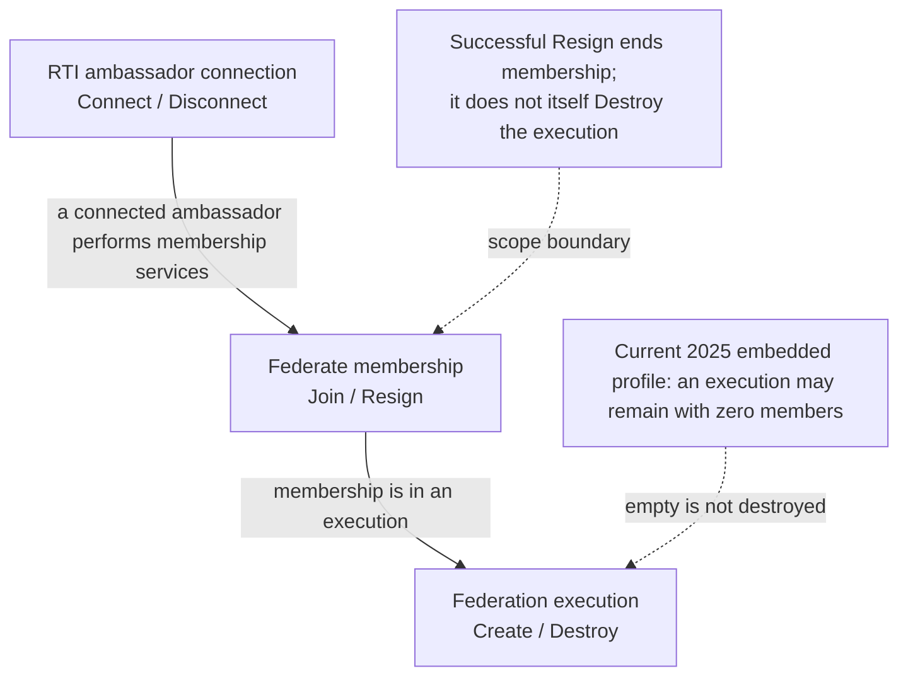

Read this as a scope map, not a single combined state machine. The following
local-ambassador and federation-execution diagrams give their respective
transitions; the Join/Resign and Create/Destroy sequence then shows how those
lifetimes interact in the current 2025 implementation.

### Local ambassador/federate state

The runtime has a small local lifecycle state machine. A rejected Join, Resign,
or Disconnect does not commit the corresponding local transition. Connection
loss is different from voluntary resignation: the local connection state
becomes disconnected while the registry performs forced member cleanup.

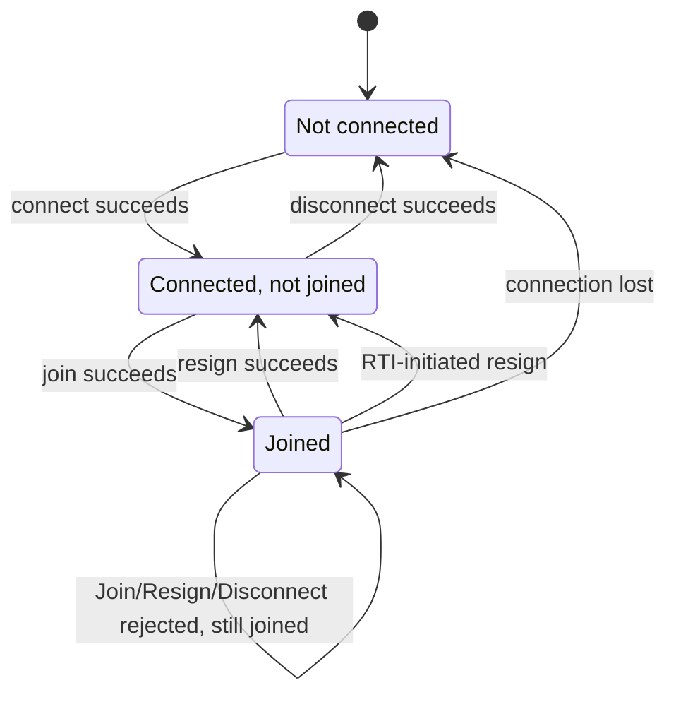

This diagram is local to an RTI ambassador. It does not describe whether the
federation execution exists or how other members are affected.
In particular, the pinned Disconnect contract rejects a joined caller with
`FederateIsExecutionMember`, and the selected lifecycle test observes that
rejected self-transition before Resign ([API](../../third_party/ieee1516.1-2025/include/RTI/RTIambassador.h#L106),
[test](../../cpp/tests/ieee1516_2025_federation_resign_lifecycle_catch2.cpp#L51)).
For the detailed Connect preconditions, configuration result, callback setup,
and post-resign Disconnect teardown, see the
[2025 connection/configuration companion](HLA-2025-CONNECTION-AND-CONFIGURATION-FLOW-GUIDE.md).

### The API distinguishes connection failures from membership failures

These selected exceptions show which connection, membership, or execution
state boundary each service touches. This is not a complete exception list or
a validation-order specification. In particular, member listing reports a
missing execution through its callback contract rather than declaring
`FederationExecutionDoesNotExist` on the request.

| Service | Relevant declared exceptions | State distinction |
| --- | --- | --- |
| [Connect, §4.2](../../third_party/ieee1516.1-2025/include/RTI/RTIambassador.h#L55) | `AlreadyConnected` | A local connection already exists. |
| [Create, §4.5](../../third_party/ieee1516.1-2025/include/RTI/RTIambassador.h#L128) | `NotConnected`; `FederationExecutionAlreadyExists` | A connection is required; creation establishes an execution, not the creator's membership. |
| [Destroy, §4.6](../../third_party/ieee1516.1-2025/include/RTI/RTIambassador.h#L179) | `NotConnected`; `FederatesCurrentlyJoined`; `FederationExecutionDoesNotExist` | A connection is required; the target must exist and have no joined members. |
| [Member listing, §4.9](../../third_party/ieee1516.1-2025/include/RTI/RTIambassador.h#L194) | `NotConnected` | Connection is sufficient in the embedded path; the caller need not join the listed execution. |
| [Join, §4.11](../../third_party/ieee1516.1-2025/include/RTI/RTIambassador.h#L212) | `NotConnected`; `FederationExecutionDoesNotExist`; `FederateAlreadyExecutionMember` | A connection and existing target execution are required; an already-joined caller cannot join again. |
| [Resign, §4.12](../../third_party/ieee1516.1-2025/include/RTI/RTIambassador.h#L250) | `NotConnected`; `FederateNotExecutionMember` | The caller must be connected and joined; successful Resign ends only its membership. |
| [Disconnect, §4.3](../../third_party/ieee1516.1-2025/include/RTI/RTIambassador.h#L110) | `FederateIsExecutionMember` | Membership must be ended before the connected ambassador disconnects. |

In particular, `NotConnected` and `FederateNotExecutionMember` are not
synonyms. The API declarations do not establish which exception takes
precedence if more than one listed condition applies. Umbra's additional
`NotConnected` result for Disconnect is an implementation observation, not an
exception listed by the pinned Disconnect declaration; see the companion's
[Disconnect evidence](HLA-2025-CONNECTION-AND-CONFIGURATION-FLOW-GUIDE.md#3-disconnect-requires-an-unjoined-connection-and-tears-down-in-order).
For member listing, the same embedded
[query flow](#federation-member-listing-reports-a-snapshot) shows the
connected-but-unjoined caller and callback-reported missing execution. That
link describes the embedded path; the configured-process snapshot and callback
route are traced separately below.
The selected [embedded lifecycle case](../../cpp/tests/ieee1516_2025_federation_resign_lifecycle_catch2.cpp#L4)
exercises successful Create/Destroy, duplicate Create/Join, and Destroy while
members remain, but not disconnected Create/Destroy calls. The [member-list
test helper](../../cpp/tests/ieee1516_2025_federation_listing_test_support.hpp#L43)
does check `NotConnected` before connecting its unjoined observer. Read this as
a service-scope comparison, not as a complete seven-service test matrix.

### Federation-execution state

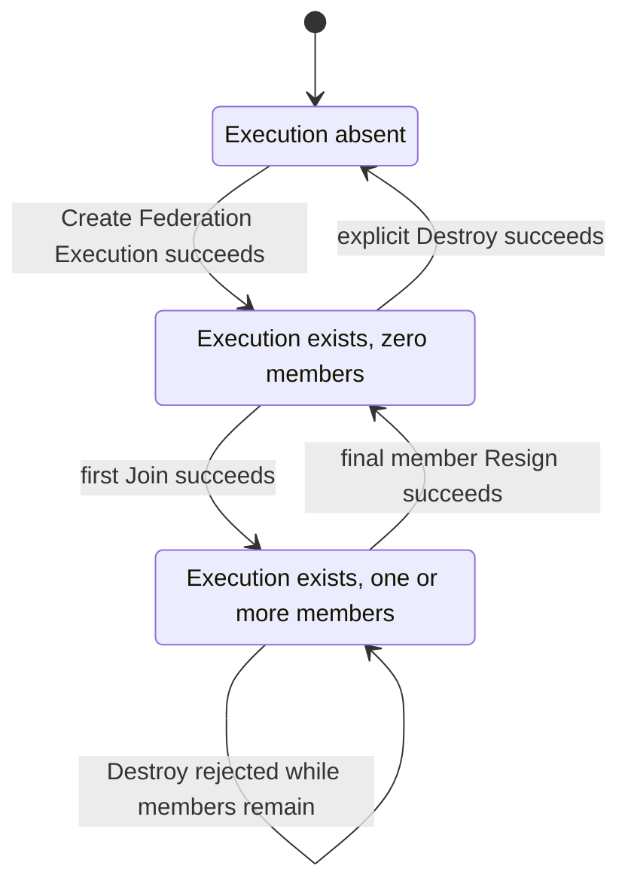

The empty-execution state is a real, useful state, not a synonym for
“destroyed.” It allows a later federate to join the same execution. The 2025
final-member tests additionally show the implementation's mandatory object
cleanup at that boundary; see the resignation section below.

### The execution catalog and member roster expose different state

`listFederationExecutions()` asks which execution records exist;
`listFederationExecutionMembers(name)` asks who belongs to one existing
execution. Reading those observations together makes the empty-execution state
visible:

| Execution state | `reportFederationExecutions` snapshot | Member-list callback |
| --- | --- | --- |
| Execution absent | No entry for its name | `reportFederationExecutionDoesNotExist(name)` |
| Execution exists with no joined members | Entry remains in the catalog | `reportFederationExecutionMembers(name, {})` with an empty roster |
| Execution exists with joined members | Entry remains in the catalog | `reportFederationExecutionMembers(name, members)` with that roster snapshot |

A successful final-member Resign in the current 2025 Umbra path changes the
execution from the last row to the empty-roster row; it does not remove the
catalog entry. A successful Destroy removes the execution, so a later roster
request follows the absent row. Each request is a snapshot, not a standing
feed; request again to observe a later
state. For the individual callback and callback-model paths, see [catalog
listing](#federation-execution-listing-reports-a-catalog-snapshot) and
[member listing](#federation-member-listing-reports-a-snapshot).

The registry's catalog query walks execution records regardless of member
count ([catalog query](../../cpp/src/internal/federation/federation_registry_catalog_queries.cpp#L32)),
while its member query returns no value only when the execution is absent and
otherwise returns the current member vector
([roster query](../../cpp/src/internal/federation/federation_registry_catalog_queries.cpp#L42)).
The embedded adapter maps absence to the distinct missing-execution callback
and an existing empty vector to an ordinary roster report
([catalog adapter](../../cpp/src/internal/runtime/umbra_rti_ambassador.cpp#L2705),
[roster adapter](../../cpp/src/internal/runtime/umbra_rti_ambassador.cpp#L2781)).
The process service uses the same registry distinction before returning its
catalog or roster response ([process listing handlers](../../cpp/src/internal/federation/process_federation_service_federation_listing.cpp#L7)).

#### Final Resign and Destroy have distinct observer paths

In the embedded path, successful final-member Resign leaves the execution
record in place, but no joined member remains to observe its terminal
membership change through MOM. The registry erases the departing member
([membership removal](../../cpp/src/internal/federation/federation_registry_resign_lifecycle.cpp#L1103))
before the adapter schedules the conditional `HLAfederatesInFederation` update
([Resign adapter](../../cpp/src/internal/runtime/umbra_rti_ambassador_federation_lifecycle.cpp#L1070)).
The MOM planner filters known receivers against the current member map
([recipient membership gate](../../cpp/src/internal/federation/federation_registry_attribute_value_update_requests.cpp#L647)),
so its recipient set is empty. The departing member's `HLAfederate` object also
has no surviving known receiver for removal and is discarded from the registry
([member-object cleanup](../../cpp/src/internal/federation/federation_registry_resign_lifecycle.cpp#L1031),
[empty-recipient erase](../../cpp/src/internal/federation/federation_registry_resign_lifecycle.cpp#L1067)).
These are source-derived routing outcomes, not callback assertions; the
[Federation MOM](HLA-2025-FEDERATION-MOM-FLOW-GUIDE.md#one-membership-change-two-mom-observation-paths)
and [Joined-Federate MOM](HLA-2025-JOINED-FEDERATE-MOM-OBJECT-LIFECYCLE-FLOW-GUIDE.md#resignation-removes-visibility-before-forgetting-the-snapshot)
guides trace the two projections separately.

A still-connected, nonmember ambassador can use the listing services, as the
[embedded listing case](../../cpp/tests/federation_listing_catch2.cpp#L394)
demonstrates. If it requests the roster after final Resign but before Destroy,
the source path returns an existing-execution report with an empty member vector.
After successful Destroy, a catalog request omits the execution and a roster
request uses the missing-execution callback; registry Destroy erases the
execution record ([Destroy transition](../../cpp/src/internal/federation/federation_registry_membership_lifecycle.cpp#L150)).
For the embedded route, the service captures each result when the request is
handled; callback-model choice changes delivery timing, not the captured
value. `HLA_EVOKED` work can wait for a later evoke, while the embedded
`HLA_IMMEDIATE` dispatcher may drain during submit after the capture locks are
released ([adapter submission](../../cpp/src/internal/runtime/umbra_rti_ambassador.cpp#L2771),
[dispatcher](../../cpp/src/internal/callbacks/callback_dispatcher.cpp#L164)).
The configured-process route takes a correlated request/response, then submits
the decoded report to the client's local dispatcher
([client request](../../cpp/src/internal/federation/process_federation_client_federation_management.cpp#L49),
[client adapter](../../cpp/src/internal/runtime/umbra_rti_ambassador.cpp#L2805)).
A Destroy after a process roster snapshot can likewise precede observation of
the captured report. The process-specific sequence below illustrates one
possible schedule: a second client destroys an already-empty execution after
the first response is decoded but before its callback task is submitted. The
first result remains the copied roster; a later request sees absence. This is
source-derived interleaving, not a guaranteed cross-client order or a tested
case.
The process member-list test covers both callback models
([test](../../cpp/tests/federation_listing_catch2.cpp#L416)); the embedded
member-list case covers `HLA_EVOKED`, while its `HLA_IMMEDIATE` assertion covers
the catalog service only
([embedded test](../../cpp/tests/federation_listing_catch2.cpp#L394),
[immediate catalog call](../../cpp/tests/ieee1516_2025_federation_listing_test_support.hpp#L99)).
No focused test requests an existing empty roster, queries the execution after
Destroy, or interleaves Destroy between a listing snapshot and callback
delivery. The configured-process Resign route is separate; the Federation MOM
guide records its source-observed membership-reflection limit.

Focused embedded listing evidence creates two executions, joins one, and checks
that both remain in the catalog, that the joined execution reports its member,
and that a missing name produces the missing-execution callback. The process
catalog case seeds two empty executions; its separate roster case checks two
members, then one after connection loss, plus a missing name. Neither focused
path requests the roster of an existing zero-member execution, so the empty
roster row above is source-derived rather than an end-to-end test result
([embedded listing assertions](../../cpp/tests/ieee1516_2025_federation_listing_test_support.hpp#L67),
[process catalog scenario](../../cpp/tests/federation_listing_catch2.cpp#L380),
[process roster scenario](../../cpp/tests/federation_listing_catch2.cpp#L416)).
The configured-process listing scenarios use a loopback endpoint served by a
test thread; they do not launch a separate operating-system process.

The lifecycle and MOM tests cover adjacent transitions, but do not close that
gap. The embedded [Create/Join/Resign/Destroy case](../../cpp/tests/ieee1516_2025_federation_resign_lifecycle_catch2.cpp#L4)
resigns both members and then destroys the execution without requesting its
catalog or roster. The embedded [federation MOM membership case](../../cpp/tests/ieee1516_2025_federation_mom_membership_boundaries_catch2.cpp#L118)
observes the membership value change from two federates to one while its
observer remains joined; it does not observe the final one-to-zero change or
the post-Destroy missing-execution callback. Its missing-name assertion uses a
name that was never created, not an execution destroyed during the case. The
empty roster after final-member Resign is source-derived, while the terminal
MOM value has no remaining joined receiver in the embedded path.
For the observer-facing projections and their separate callback paths, see
the [Federation MOM membership map](HLA-2025-FEDERATION-MOM-FLOW-GUIDE.md#one-membership-change-two-mom-observation-paths)
and [joined-federate MOM lifecycle](HLA-2025-JOINED-FEDERATE-MOM-OBJECT-LIFECYCLE-FLOW-GUIDE.md#readers-model-membership-is-not-observer-knowledge).

##### A captured empty-roster callback can outlive Destroy

This is one source-derived embedded 2025 schedule with a connected, nonmember
reader using `HLA_EVOKED`. Final Resign leaves an existing execution with no
joined members. The reader captures that empty roster, then a different
connected nonmember destroys the execution before the reader evokes. The
queued callback still carries the earlier snapshot; a new listing request
after Destroy takes the separate missing-execution path. The chart is not a
normative callback-order rule, and no focused test covers the full interleaving.

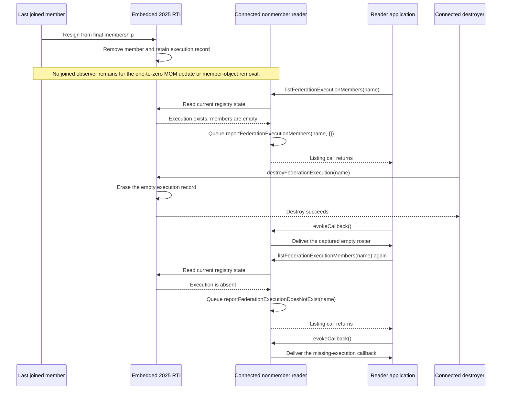

The [listing adapter](../../cpp/src/internal/runtime/umbra_rti_ambassador.cpp#L2781)
captures the registry result before submitting the callback; the [dispatcher](../../cpp/src/internal/callbacks/callback_dispatcher.cpp#L164)
queues `HLA_EVOKED` work. The [Destroy transition](../../cpp/src/internal/federation/federation_registry_membership_lifecycle.cpp#L150)
erases the execution record, not the reader's callback task. Existing [embedded listing test](../../cpp/tests/federation_listing_catch2.cpp#L394)
prove that a connected nonmember can list, but do not combine final Resign,
empty-roster capture, Destroy, and later Evoke. The configured-process listing
and callback route remains separate in the preceding cross-profile discussion.

### Same-name recreation is fresh; restore must be explicit

Destroy ends the execution record. Creating another execution under the same
name initializes new execution-owned state; it does not revive the old member,
object, identity, or reservation maps. A separately persisted save image can
still be selected by an explicit Restore after Join. The two paths are distinct:

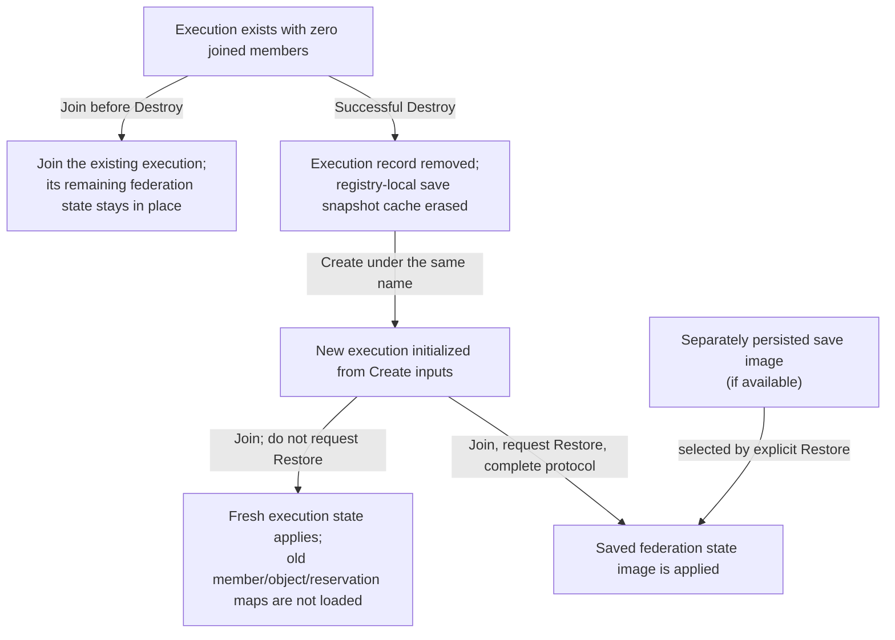

This is current embedded 2025 behavior. The registry's [Create](../../cpp/src/internal/federation/federation_registry_membership_lifecycle.cpp#L66)
builds a new `Federation`; successful [Destroy](../../cpp/src/internal/federation/federation_registry_membership_lifecycle.cpp#L158)
erases that execution and its registry-local snapshot cache. A filesystem-backed
save image is separate. The focused [fresh-registry reservation test](../../cpp/tests/ieee1516_2025_public_fresh_registry_object_name_reservations_restore_catch2.cpp#L54)
saves two names, resigns and destroys the execution, creates the same name in a
new registry sharing the save store, and then explicitly restores. Its first
Join handle compares equal to the old handle value *before* Restore; the new
registry's [`nextFederateId_` counter](../../cpp/src/internal/federation/federation_registry.hpp#L3271)
has restarted, so equality does not show execution continuity. After Restore, a
repeated reservation fails because the saved claims were reloaded. This is a
fresh-registry test within one process, not an
operating-system process-restart result. The saved image contains the historical [federate-name index](../../cpp/src/internal/federation/federation_state_image.hpp#L851), [object instances](../../cpp/src/internal/federation/federation_state_image.hpp#L853), and [reserved names](../../cpp/src/internal/federation/federation_state_image.hpp#L891);
there is no focused public assertion that queries an old handle after a same-name
Create without Restore.
The [Save/Restore identity comparison](HLA-2025-FEDERATION-SAVE-RESTORE-FLOW-GUIDE.md#federate-identity-and-object-instance-identity-rehydrate-differently)
shows the distinct embedded test outcome for live federate handles and restored
object-instance handles; it does not generalize that mapping to another profile.

## Federation execution listing reports a catalog snapshot

`listFederationExecutions()` requests one catalog report through
`FederateAmbassador::reportFederationExecutions`. Each entry carries the
execution name and its logical-time implementation name. This is a catalog
snapshot, not a standing notification feed: a later Create or Destroy requires
another request. It is separate from
[`listFederationExecutionMembers(name)`](#federation-member-listing-reports-a-snapshot),
which asks for a roster within one named execution and has a distinct
missing-execution callback.

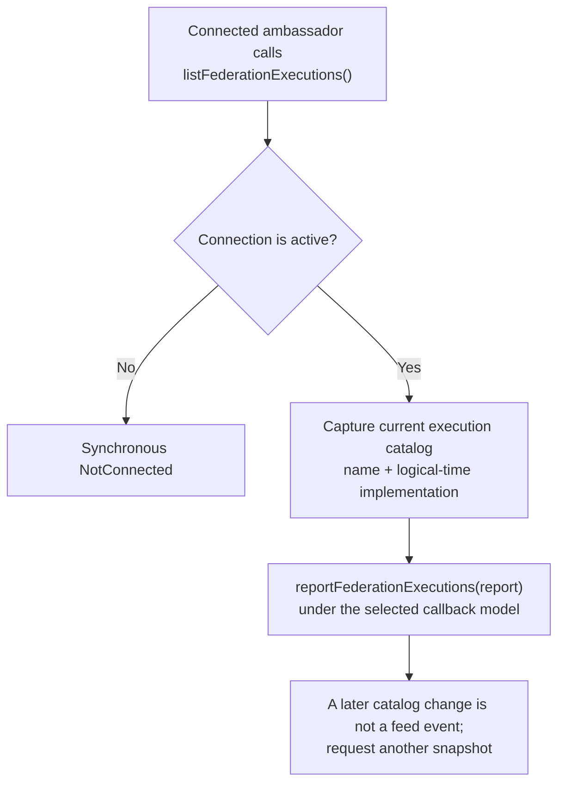

The pinned C++ API pairs the `void` request in
[§4.7](../../third_party/ieee1516.1-2025/include/RTI/RTIambassador.h#L180)
with the report callback in
[§4.8](../../third_party/ieee1516.1-2025/include/RTI/FederateAmbassador.h#L45).
In the embedded adapter, Umbra copies the registry's execution summaries from
the [registry query](../../cpp/src/internal/federation/federation_registry_catalog_queries.cpp#L32)
and submits the callback after releasing its runtime locks in the
[public adapter](../../cpp/src/internal/runtime/umbra_rti_ambassador.cpp#L2705),
allowing the callback to re-enter the RTI. The configured-process route obtains
the catalog in the [service handler](../../cpp/src/internal/federation/process_federation_service_federation_listing.cpp#L50)
before constructing the same public report. The
[focused embedded test](../../cpp/tests/federation_listing_catch2.cpp#L394)
checks an unjoined connected caller, both callback models, the returned names
and time-implementation values, and a queued report discarded by Disconnect.
The [configured-process test](../../cpp/tests/federation_listing_catch2.cpp#L380)
checks the report under both callback models. These are implementation and
test observations, not a full interpretation of §4.7/§4.8 or a claim about
catalog behavior across independent RTI providers. Callback-model timing is
explained in the [callback and service-ordering guide](HLA-2025-CALLBACK-AND-SERVICE-ORDERING-FLOW-GUIDE.md).

## Federation member listing reports a snapshot

`listFederationExecutionMembers` is an observation, not a Join or a membership
subscription. In the embedded 2025 path, a connected ambassador can request a
list without itself joining the named execution. The adapter captures the
current members, builds a report, and submits a callback task. If the named
execution is absent, it submits `reportFederationExecutionDoesNotExist`
instead; absence is not a synchronous `FederationExecutionDoesNotExist` throw
in this path. A disconnected caller is rejected synchronously with
`NotConnected` before a report is submitted.

The captured member vector is a point-in-time snapshot. With `HLA_EVOKED`,
membership can change after the service call but before the application evokes
the report, so the delivered list need not describe callback-time membership.
The embedded focused test checks the EVOKED success and missing-execution
callbacks. It does not change membership between request and evoke, so snapshot
staleness is inferred from the source's copy-before-dispatch order rather than
demonstrated as a race scenario. Its immediate-mode assertion exercises
`listFederationExecutions`, not this member-list service; direct IMMEDIATE
coverage for the embedded member-list route remains absent. The
adapter uses the shared dispatcher, whose immediate model drains during
`submit`.

### Configured-process route: the service snapshot precedes the client callback

When the public ambassador uses a configured process endpoint, it sends the
same member-list request through `ProcessFederationClient`. The service checks
that the transport session is registered, obtains a copied member vector from
the authoritative registry, and returns either that roster or a
`federationExists == false` result. The client adapter then constructs the
matching FederateAmbassador report and submits it to its local callback
dispatcher. The process route therefore has a server snapshot point followed
by a response and a separate client callback-observation point.

The process route has two different timing boundaries. First the service fixes
which member records answer the request. Later, after the response reaches the
client, the callback model controls when the application observes that result.

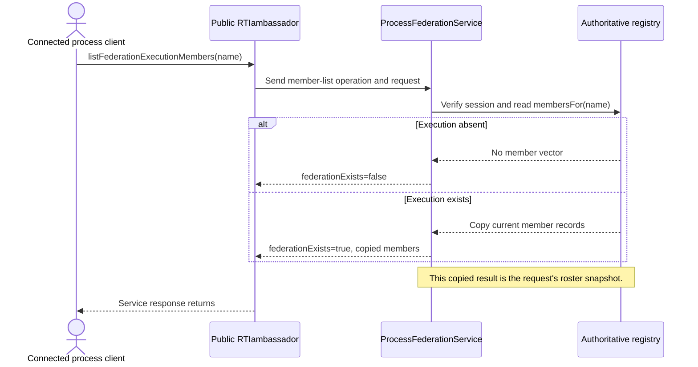

After the response is decoded, the process client submits the corresponding
member-list or missing-execution report through its callback dispatcher. This
second diagram shows callback observation; it does not change the earlier
roster snapshot.

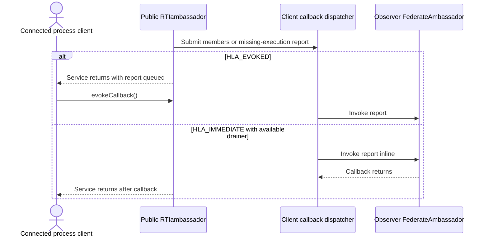

The callback-model branches above depict enabled callback dispatch; the
`HLA_IMMEDIATE` branch also assumes the submitting thread can own the immediate
drainer. If another thread already owns it, this report is appended to the
FIFO and the listing service can return while it waits behind the active
callback. The elected drainer continues with queued work after that callback
returns, provided callbacks remain enabled. If callbacks are disabled, the
report stays pending until they are enabled; enabling can resume an immediate
drain. In `HLA_EVOKED`, enabling only opens the gate: an enabled later Evoke is
still needed to enter the queued report. See the callback guide's
[dispatcher flow](HLA-2025-CALLBACK-AND-SERVICE-ORDERING-FLOW-GUIDE.md#callback-task-dispatch)
and [enable behavior](HLA-2025-CALLBACK-AND-SERVICE-ORDERING-FLOW-GUIDE.md#enable-callbacks-changes-state-before-an-immediate-backlog-can-throw),
the [dispatcher implementation](../../cpp/src/internal/callbacks/callback_dispatcher.cpp#L119),
and the generic [two-producer immediate test](../../cpp/tests/callback_dispatcher_catch2.cpp#L99).
That concurrency test establishes queueing and FIFO delivery after the active
callback releases; it does not exercise this process member-list service.

The following source-derived schedule uses a destroyable empty execution. The
second client can complete Destroy after the first service snapshot and response
but before the first adapter submits its callback task. This is a possible
cross-client interleaving, not a guaranteed order or a normative callback rule.

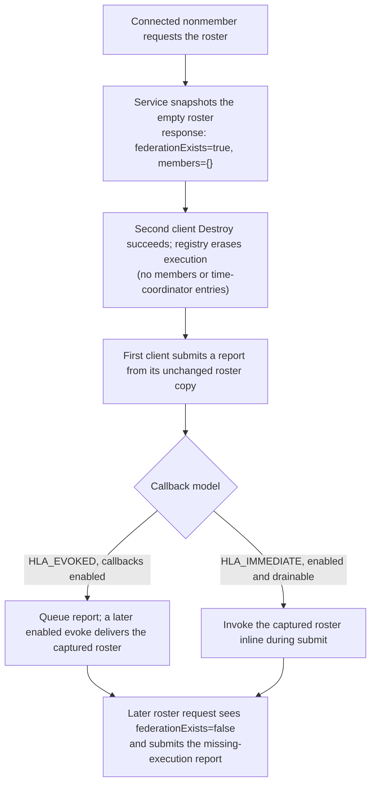

The process [Destroy handler](../../cpp/src/internal/federation/process_federation_service_lifecycle.cpp#L260)
does not revisit the first response's copied roster. Its callback task belongs
to the listing client's local dispatcher, which the remote Destroy does not
sweep. The [registry Destroy transition](../../cpp/src/internal/federation/federation_registry_membership_lifecycle.cpp#L150)
erases only after both members and time coordination are empty. For
`HLA_IMMEDIATE`, this example places Destroy in the source-visible gap after
response decoding and before callback submission; the callback then runs inline
when the dispatcher is enabled and drainable. With callbacks disabled or
another thread already draining, the task may stay queued. For `HLA_EVOKED`,
the queued callback can wait until an enabled evoke after Destroy. A new request
observes the absent execution and submits the distinct missing-execution
report. If a different thread owns the immediate drainer, the listing
submission appends behind that thread's active callback; the elected drainer
continues with the report after the active callback returns if callbacks
remain enabled. If dispatch is disabled first, the report stays pending until
the appropriate enable/Evoke path resumes it. Generic dispatcher coverage
checks immediate FIFO contention and disabled-queue behavior
([contended producers](../../cpp/tests/callback_dispatcher_catch2.cpp#L99),
[immediate enable](../../cpp/tests/callback_dispatcher_catch2.cpp#L307),
[disabled Evoke](../../cpp/tests/callback_dispatcher_catch2.cpp#L364)); the
process listing and Destroy tests do not cover this interleaving or these
callback gates.

The process service's [member-list handler](../../cpp/src/internal/federation/process_federation_service_federation_listing.cpp#L7)
uses the same registry [snapshot copy](../../cpp/src/internal/federation/federation_registry_catalog_queries.cpp#L42);
the operation is routed through the
[client](../../cpp/src/internal/federation/process_federation_client_federation_management.cpp#L49)
and [service dispatcher](../../cpp/src/internal/federation/process_federation_service_dispatch.cpp#L17).
The public adapter takes the configured-process branch at
[request routing](../../cpp/src/internal/runtime/umbra_rti_ambassador.cpp#L2799),
receives the result at [response handling](../../cpp/src/internal/runtime/umbra_rti_ambassador.cpp#L2814),
and submits the callback after the response at
[callback admission](../../cpp/src/internal/runtime/umbra_rti_ambassador.cpp#L2851).
The [process host's per-connection worker](https://github.com/sheepfling/umbra/blob/c9c5a9e410539b039cd8bba35b53d0ef2b24d180/cpp/src/internal/federation/process_federation_service_host.cpp#L167)
serves accepted sessions on a separate thread, and the focused listing scenario
uses two service sessions, so the chart's competing-client schedule is
possible in this adapter topology. The [dispatcher submit path](../../cpp/src/internal/callbacks/callback_dispatcher.cpp#L164)
queues `HLA_EVOKED` tasks and drains enabled `HLA_IMMEDIATE` work inline
([immediate drain](../../cpp/src/internal/callbacks/callback_dispatcher.cpp#L302)).

The focused [process member-list scenario](../../cpp/tests/federation_listing_catch2.cpp#L416)
uses two public clients connected to a `ProcessFederationService` in the Catch2
process. Under both callback models, it observes two members, requests another
snapshot after one session's forced connection loss and observes the survivor,
then receives the missing-execution report
([assertions](../../cpp/tests/federation_listing_catch2.cpp#L303),
[post-loss snapshot](../../cpp/tests/federation_listing_catch2.cpp#L319),
[missing execution](../../cpp/tests/federation_listing_catch2.cpp#L331),
[both callback-model sections](../../cpp/tests/federation_listing_catch2.cpp#L416)).
It does not mutate membership between the service response and callback entry,
and it does not launch a separate coordinator process. The process route now
has focused coverage, but callback-time staleness and independent-host
behavior remain outside that scenario. These are implementation-evidence
limits, not normative claims or evidence about the separate 2010 stream.
The separate process Destroy host case[^worktree-source]
destroys only after members have resigned; it does not combine Destroy with a
captured member-list response. The production coordinator path[^worktree-source]
also tests successful Create/Join/Resign/Destroy without that interleaving.

The pinned 2025 C++ API labels the request §4.9 and the success / missing
callbacks §4.10 / §4.11 ([request](../../third_party/ieee1516.1-2025/include/RTI/RTIambassador.h#L194),
[member report](../../third_party/ieee1516.1-2025/include/RTI/FederateAmbassador.h#L54),
[missing-execution report](../../third_party/ieee1516.1-2025/include/RTI/FederateAmbassador.h#L61)).
These clause labels and interface shapes orient the reader; the implementation
flow below is source-observed behavior, not a complete normative clause
interpretation. The checked-in [official API import](../../third_party/ieee1516.1-2025/README.md)
contains C++ headers rather than the full standard text; IEEE's public
[1516.1-2025 record](https://standards.ieee.org/ieee/1516.1/6688/) provides
edition and access information but not the §4.9–§4.11 clause prose. The
snapshot-before-Destroy schedule therefore remains an Umbra source-derived
possibility, with no claim that the standard specifies its cross-client timing.

### Public HLA shape: a query produces a report, not a membership feed

Read the public interface as one request followed by its corresponding member
listing or missing-execution report. The callback model governs when the
application observes that report; it does not turn this query into a standing
subscription to Join and Resign events. This is an API-role map, not a claim
about the exact snapshot instant or callback ordering. The following
embedded and configured-process traces show their separate implementation
boundaries.

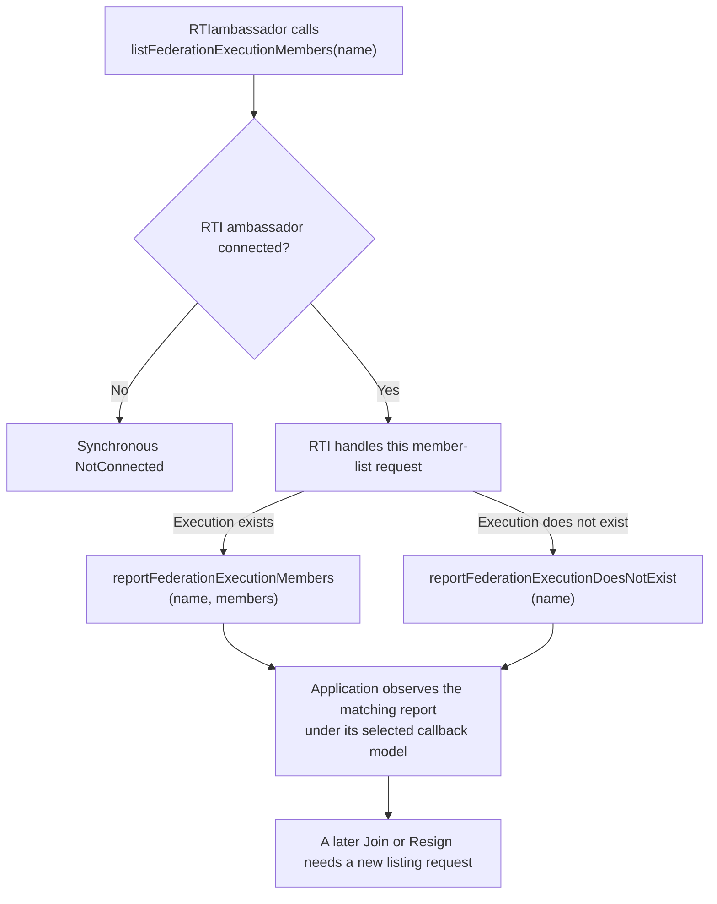

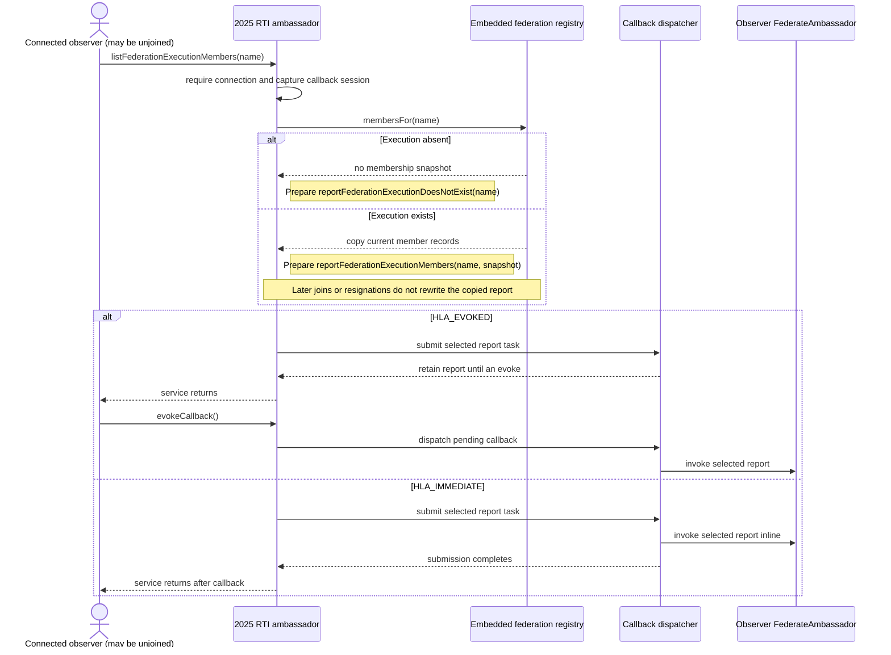

This query does not create a lasting member feed: a later Join or Resign is not
automatically reported by this request. Ask again for a new snapshot. The
embedded path is shown above and linked in the evidence map. The configured-
process path has a separate server snapshot and client callback sequence below.

## Create, join, and destroy

Creation validates a federation definition and establishes federation-owned
catalog, handle directories, switches, and time-coordination state. Join
creates a new member identity and registers that member with the execution's
coordination and callback routes. Destroy is a separate operation and is
rejected while members remain (or the time coordinator is not empty).

The sequence below begins after the public RTIambassador's local authorization
gate. If configured, Create authorizes before FOM preparation and Join
authorizes before the backend membership request; a denial returns to the
caller without reaching the registry transition shown here. An authorization
pass only opens that gate: the selected backend still validates the FOM,
execution, and membership conditions before committing state. The 2025
[authorization flow](HLA-2025-AUTHORIZATION-FLOW-GUIDE.md#three-authorization-scopes)
shows the gate and its result mapping; this lifecycle sequence focuses on what
follows it.

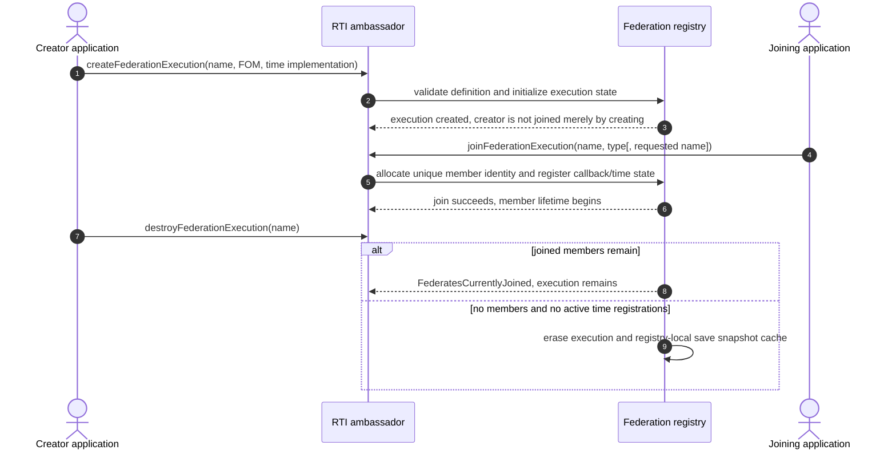

In this implementation, additional-FOM joins reconcile handle directories
against the replacement catalog and cannot silently change the time
implementation while existing members are joined. These are useful review
boundaries, not an exhaustive account of FOM merge rules; composition belongs
to its own documentation and tests.

There is also a post-commit failure edge in the embedded implementation: the
registry commits the additional modules and new membership together, then the
ambassador initializes joined-federate service-report/lifecycle state. If that
later setup fails, rollback resigns the applicant but does not restore the
previous catalog. This is source-observed, not an HLA rule, and no focused test
covers catalog state after an additional-FOM post-commit failure. See the FOM
guide's [additional-module Join boundary](HLA-2025-FOM-MODULE-ADMISSION-AND-COMPOSITION-FLOW-GUIDE.md#join-with-additional-fom-modules-replace-definition-and-add-member-together).

The ordinary 2025 federation-lifecycle scenario exercises invalid creation
designators, duplicate execution creation, duplicate member names, disconnect
while joined, destroy while joined, a valid additional-FOM join, invalid
ResignAction rejection, successful resignations, and explicit destroy after
the members leave. Separately, the focused authorization case rejects Create
while its FOM path is deliberately missing, demonstrating that the call
returns the authorization outcome before reaching that FOM failure; the Join
case denies a requested name and later succeeds with the same name after an
accepted authorization result. These are embedded 2025 observations, not
process-endpoint parity or a normative exception-priority claim. See the
[Create authorization case](../../cpp/tests/ieee1516_2025_authorization_catch2.cpp#L433)
and [Join authorization case](../../cpp/tests/ieee1516_2025_authorization_catch2.cpp#L554)
for the exact evidence.

### Configured-process Destroy returns a registry outcome, not a member event

The 2025 process endpoint handles Destroy as a correlated request and response.
The service's [`handleDestroy`](../../cpp/src/internal/federation/process_federation_service_lifecycle.cpp#L260)
calls the shared [registry Destroy transition](../../cpp/src/internal/federation/federation_registry_membership_lifecycle.cpp#L150)
and encodes its outcome in a `DestroyResult` carried by a normal transport-OK
response. The [process client](../../cpp/src/internal/federation/process_federation_client_federation_management.cpp#L43)
decodes that result. On success, the public
[ambassador adapter](../../cpp/src/internal/runtime/umbra_rti_ambassador_federation_lifecycle.cpp#L283)
clears federation-scoped update-rate history through its
[cleanup helper](../../cpp/src/internal/runtime/umbra_rti_ambassador.cpp#L1965).
The registry transition erases the execution and its registry-local
save-snapshot cache; separately persisted save images are not that cache.

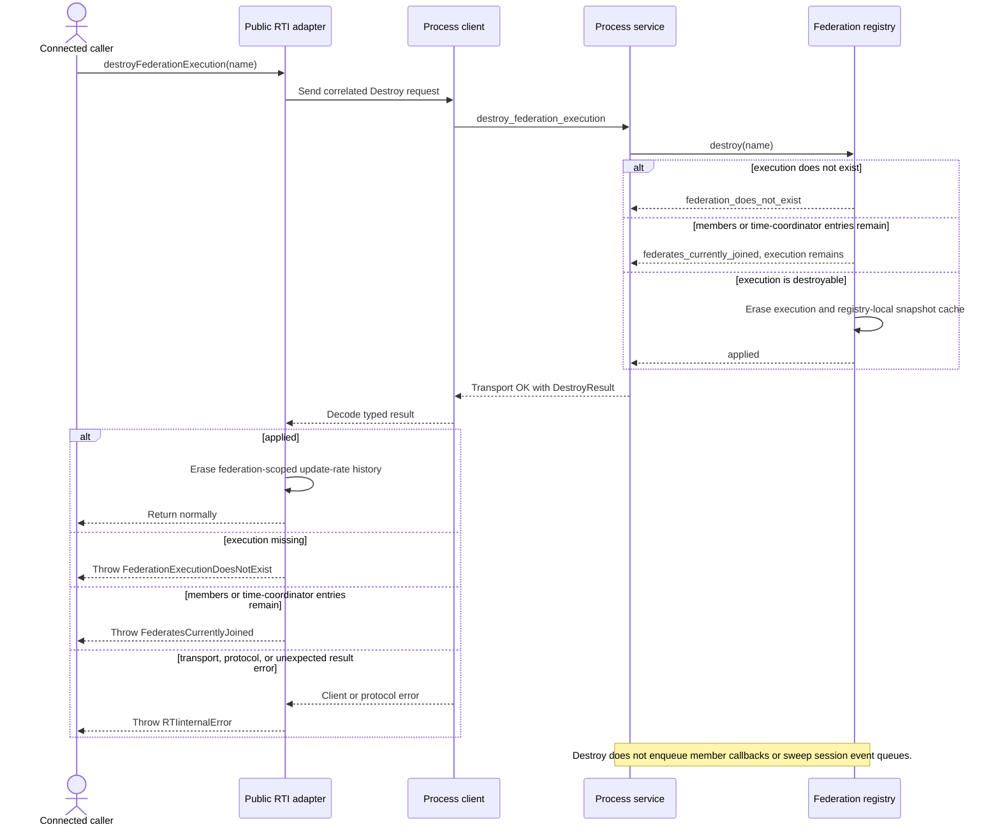

The registry requires both an empty member list and an empty time coordinator;
either nonempty state maps to `FederatesCurrentlyJoined` in the public API.
Expected registry outcomes travel inside the normal transport response, so
they are distinct from transport or protocol errors. The inspected Destroy
handler has no recipient projection or session-cleanup call; unlike final
Resign, successful Destroy is not a member-exit callback path. This is a
source-level statement about the current process adapter, not a normative
claim about observer notification. A connected client observes absence on a
later catalog or member-list request, as covered by the
[configured-process listing snapshot flow](#configured-process-route-the-service-snapshot-precedes-the-client-callback).

The process host case checks that destroying an absent name throws and that a
destroyable execution can be removed after its members leave, but its absent-
name assertion does not check the exception type
(host cases[^worktree-source],
post-Resign Destroy[^worktree-source]).
The production-coordinator scenario also completes public process Create,
Join, Resign, and Destroy
(scenario[^worktree-source]).
The focused `FederatesCurrentlyJoined` exception assertion is in the embedded
2025 lifecycle scenario
([case](../../cpp/tests/ieee1516_2025_federation_resign_lifecycle_catch2.cpp#L4));
the reviewed process cases do not assert that exact error mapping or a
Destroy/listing interleaving.

### The federation and member MOM projections follow different scopes

The 2025 MIM defines one RTI-owned `HLAmanager.HLAfederation` instance per
execution and one `HLAmanager.HLAfederate` instance per joined federate
([federate class](../../third_party/ieee1516.2-2025/resources/mim/HLAstandardMIM-2025.xml#L48),
[federation class](../../third_party/ieee1516.2-2025/resources/mim/HLAstandardMIM-2025.xml#L658)). The
diagram connects those cardinalities to the lifecycle above. It is an Umbra
implementation overlay, not a claim that the standard prescribes this setup
order or callback timing. `HLAfederation` is ensured during non-legacy 2025
Join setup; each production-backed member lifetime gets its own report-file
location and `HLAfederate` snapshot.

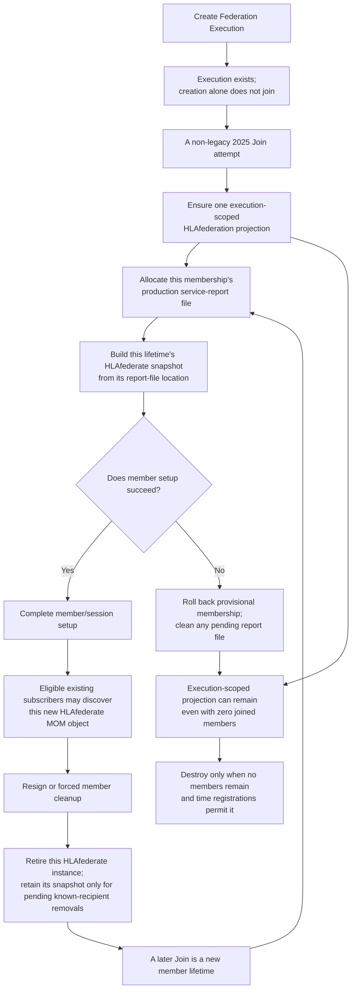

Here, the discovery arrow is observer-side: existing federation members with
an eligible `HLAfederate` subscription may discover the newly joined member's
RTI-owned MOM object. It does not mean Join backfills every existing ordinary
application object to the new member. Ordinary instances are planned for a
receiving member when that member's subscription is evaluated; the embedded
and process subscription paths use their respective ordinary-object and
joined-federate MOM planners ([embedded subscription path](../../cpp/src/internal/runtime/umbra_rti_ambassador_object_class_subscription.cpp#L584),
[process subscription path](../../cpp/src/internal/federation/process_federation_service_declarations.cpp#L232)).
For the MOM-object Join path, embedded and process services separately plan
discovery of the new member object for eligible existing subscribers
([embedded Join](../../cpp/src/internal/runtime/umbra_rti_ambassador_federation_lifecycle.cpp#L734),
[process Join](../../cpp/src/internal/federation/process_federation_service_lifecycle.cpp#L840)).
Focused public cases observe a later joined-federate lifetime through an
already subscribed observer in both profiles ([embedded](https://github.com/sheepfling/umbra/blob/c9c5a9e410539b039cd8bba35b53d0ef2b24d180/cpp/tests/ieee1516_2025_joined_federate_mom_public_object_lifecycle_catch2.cpp#L237),
[process](../../cpp/tests/ieee1516_2025_connection_process_joined_federate_mom_report_file_catch2.cpp#L512)).
These cases do not establish a universal callback order across profiles. For
the configured-process event's journey from a stream frame through the client
callback bridge, see the [process endpoint callback path](HLA-2025-PROCESS-ENDPOINT-REQUEST-AND-CALLBACK-FLOW-GUIDE.md#2-from-a-stream-frame-to-an-official-callback).

#### Join commit and new-member MOM discovery are separated differently by profile

The following sequence compares implementation boundaries for the new
`HLAfederate` object. It is source-derived and does not assert a cross-profile
callback order. In the embedded path, report/MOM setup and the ambassador's
local Joined transition precede discovery planning; an `HLA_IMMEDIATE`
observer route may enter the observer callback inline before the joining call
returns. In the configured-process path, the service installs its session and
queues the discovery event before sending the Join response; the public client
applies its local Joined transition after receiving that response. Event
delivery uses the process callback bridge, so its timing relative to the
joiner's response is not established here.

**Embedded profile** — membership, report/MOM setup, and the ambassador's
local Joined transition precede discovery planning. The immediate callback
route can enter an existing observer's callback inline; the evoked route queues
it for a later callback service.

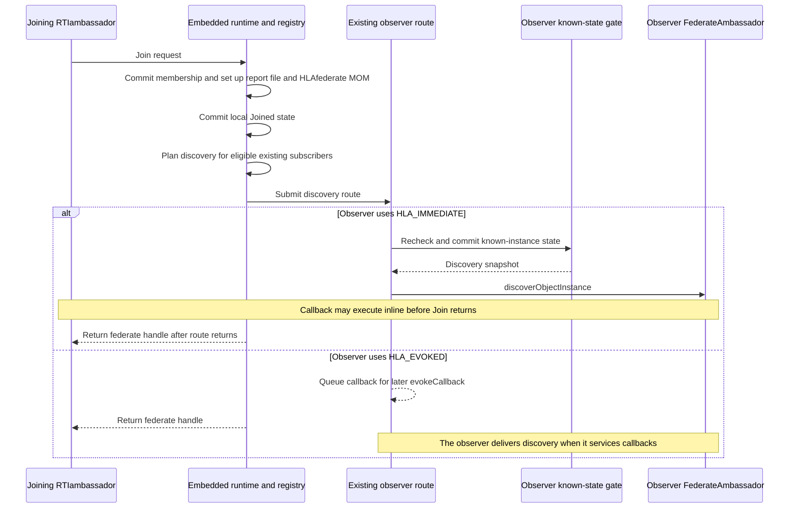

**Configured-process profile** — the service commits membership and installs
its session state, then enqueues observer discovery before returning the Join
response. The public client commits its local Joined state after receiving
that response.

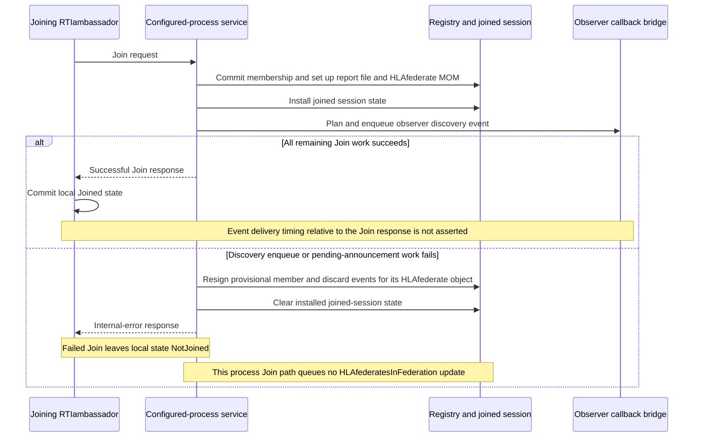

The configured-process Join is provisional until its remaining service work
has completed. If discovery enqueue or pending synchronization
announcement work fails, the service resigns the provisional member,
discards pending events for its `HLAfederate` object, clears the joined-session
state, and returns an internal-error response. The public client applies its
local Joined transition only after a successful response
[service rollback](../../cpp/src/internal/federation/process_federation_service_lifecycle.cpp#L799),
[pending-object-event discard](../../cpp/src/internal/federation/process_federation_service_lifecycle.cpp#L808),
[session-state cleanup](../../cpp/src/internal/federation/process_federation_service_lifecycle.cpp#L812),
[local Join transition](../../cpp/src/internal/runtime/umbra_rti_ambassador_federation_lifecycle.cpp#L410)).
This rollback path is different from the embedded `HLA_IMMEDIATE` observer
callback exception below: the configured-process test injects a service-side
failure after joined-federate discovery work has been queued, then verifies
that the observer receives neither the failed lifetime's discovery nor its
initial reflection before a same-name retry. The process test also observes
the old object's removal before the successful retry's discovery and initial
reflection; this is that selected `HLA_EVOKED` schedule, not a cross-profile
or standard callback-order guarantee
([configured-process regression](../../cpp/tests/ieee1516_2025_connection_process_mom_resign_removal_order_catch2.cpp#L355)).
The same focused case separately fails after a pending synchronization-point
announcement has been queued, then verifies that the failed member does not
remain in the synchronization set and that a successful retry announces the
point once ([injected failure](../../cpp/tests/ieee1516_2025_connection_process_mom_resign_removal_order_catch2.cpp#L442),
[retry assertion](../../cpp/tests/ieee1516_2025_connection_process_mom_resign_removal_order_catch2.cpp#L478)).
These injections cover discovery-enqueue and announcement-queue rollback
points. The process profile's missing Federation-list update is covered in
[the Federation MOM source review](HLA-2025-FEDERATION-MOM-FLOW-GUIDE.md#2025-process-profile-membership-list-updates-at-join-and-resign).

The process Join path has no separate federation-level membership-count update
to leak across this rollback boundary. After enqueueing the new
`HLAfederate` discovery, it attempts pending synchronization-point
announcements and returns the successful Join response. Its handler has no
federation MOM conditional-update call; the shared process helper updates
member-scoped values in reporting and interaction-send paths, not Join
([helper](../../cpp/src/internal/federation/process_federation_service_notifications.cpp#L132),
[reporting](../../cpp/src/internal/federation/process_federation_service_reporting.cpp#L508),
[interaction send](../../cpp/src/internal/federation/process_federation_service_interaction_send.cpp#L376)).
The MIM nevertheless lists `HLAfederatesInFederation` as Conditional on
Join/Resign ([MIM row](../../third_party/ieee1516.2-2025/resources/mim/HLAstandardMIM-2025.xml#L684)). The absent process enqueue is a
source-observed profile gap, not a conformance conclusion; licensed §§4.11/6.9/6.11 text is not present in this checkout.
The Federation MOM guide documents this source distinction and the lack
of a focused process observer test for automatic or requested list delivery.
Its embedded membership-reflection test is not process-profile evidence
([Federation MOM review](HLA-2025-FEDERATION-MOM-FLOW-GUIDE.md#2025-process-profile-membership-list-updates-at-join-and-resign)).
The process rollback test subscribes only to `HLAfederateName`
([test scope](../../cpp/tests/ieee1516_2025_connection_process_mom_resign_removal_order_catch2.cpp#L291)). The Join handler proceeds from
[member-object discovery](../../cpp/src/internal/federation/process_federation_service_lifecycle.cpp#L830) to pending announcements and the
[successful response](../../cpp/src/internal/federation/process_federation_service_lifecycle.cpp#L857).

The embedded callback-time gate commits the observer's known-instance state
before invoking `discoverObjectInstance`; for an RTI-owned MOM instance, its
initial attribute reflection is a following step on that route
([embedded delivery gate](../../cpp/src/internal/runtime/umbra_rti_ambassador_object_instance_lifecycle_callbacks.cpp#L261)).
The inline-entry possibility comes from the embedded immediate-route comment
and queue call site ([Join discovery submission](../../cpp/src/internal/runtime/umbra_rti_ambassador_object_instance_lifecycle_callbacks.cpp#L930)).
On the process side, the service enqueues planned discoveries before returning
the successful Join response ([process Join handler](../../cpp/src/internal/federation/process_federation_service_lifecycle.cpp#L840));
the public ambassador commits its local lifecycle after receiving that result
([process client Join transition](../../cpp/src/internal/runtime/umbra_rti_ambassador_federation_lifecycle.cpp#L410)).
The focused [embedded public lifecycle case](https://github.com/sheepfling/umbra/blob/c9c5a9e410539b039cd8bba35b53d0ef2b24d180/cpp/tests/ieee1516_2025_joined_federate_mom_public_object_lifecycle_catch2.cpp#L237)
and [configured-process report-file case](../../cpp/tests/ieee1516_2025_connection_process_joined_federate_mom_report_file_catch2.cpp#L512)
observe joined-federate discovery across a later lifetime, but neither asserts
discovery callback timing relative to the joining call's return. They also do
not establish complete behavior parity. The separate configured-process
failure/retry case above exercises rollback after discovery work is staged;
it still does not establish callback timing relative to a successful Join
response.

#### An immediate discovery callback can fail after Join has committed

This is a source-derived embedded 2025 edge, not a tested HLA guarantee. The
joining ambassador commits its registry membership and local Joined state
before it submits planned MOM discoveries. In an `HLA_IMMEDIATE` route, the
observer's `discoverObjectInstance` can therefore throw through the Join call
after that transition has committed.

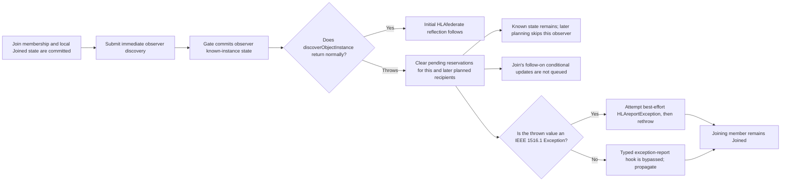

The observer known-state gate runs before the callback, and the MOM
initial-value reflection is later in the same route
([delivery route](../../cpp/src/internal/runtime/umbra_rti_ambassador_object_instance_lifecycle_callbacks.cpp#L261)).
The immediate dispatcher propagates callback exceptions to its submitter
([immediate drain](../../cpp/src/internal/callbacks/callback_dispatcher.cpp#L279));
the discovery loop then clears pending reservations from the failing recipient
through the end of its planned vector while preserving any committed known
state ([recipient cleanup](../../cpp/src/internal/runtime/umbra_rti_ambassador_object_instance_lifecycle_callbacks.cpp#L950),
[reservation cancellation](../../cpp/src/internal/federation/federation_registry_object_discovery_routes.cpp#L164)).
Join's `Exception` catch calls the `noexcept` best-effort exception reporter
and rethrows, while non-HLA exception types bypass that typed catch
([Join local transition](../../cpp/src/internal/runtime/umbra_rti_ambassador_federation_lifecycle.cpp#L719),
[Join exception catch](../../cpp/src/internal/runtime/umbra_rti_ambassador_federation_lifecycle.cpp#L799),
[reporter](../../cpp/src/internal/runtime/umbra_rti_ambassador_mom_service_report_interaction.cpp#L227)).
Because membership and local Joined state precede recipient callback submission,
this post-commit exception does not roll the joining member back. A callback
that throws after discovery begins can leave the observer knowing the
`HLAfederate` object without its initial attribute reflection; a later planner
skips already-known observers. The cited public MOM tests cover successful
discovery only; they do not throw from this Join-triggered callback or check
these partial effects.

Read the two branches as different owners, not as one MOM object's lifetime.
Successful Resign ends membership and retires that member's public object;
the callback-time removal ledger may temporarily retain its private snapshot.
The `HLAfederation` object is execution-scoped; its conditional
`HLAfederatesInFederation` value represents the current membership set. The
embedded [membership-boundary test](../../cpp/tests/ieee1516_2025_federation_mom_membership_boundaries_catch2.cpp#L118)
observes that conditional reflection; the inspected process MOM cases do not
directly observe `HLAfederation` discovery or those reflections. See the
separate [federation-scoped MOM
flow](HLA-2025-FEDERATION-MOM-FLOW-GUIDE.md#one-object-belongs-to-the-federation-execution)
and [joined-federate MOM lifecycle](HLA-2025-JOINED-FEDERATE-MOM-OBJECT-LIFECYCLE-FLOW-GUIDE.md#resignation-removes-visibility-before-forgetting-the-snapshot)
for their detailed flows.

Connect and Disconnect bound which local ambassador can invoke these services;
they do not own either MOM object's lifetime, and Resign remains separate from
Disconnect. The source ordering is profile-specific: the [embedded Join
path](../../cpp/src/internal/runtime/umbra_rti_ambassador_federation_lifecycle.cpp#L604)
establishes federation state before report/MOM setup, then applies its local
Join transition and plans discovery; the [process Join
path commits registry membership, installs the session, and then plans
discovery ([registry Join commit](../../cpp/src/internal/federation/process_federation_service_lifecycle.cpp#L650),
[session installation](../../cpp/src/internal/federation/process_federation_service_lifecycle.cpp#L792),
[discovery planning](../../cpp/src/internal/federation/process_federation_service_lifecycle.cpp#L830)).
Both implementations can fail
after registry membership commits but before reporting Join success. Rollback
resigns the provisional member and pending-file cleanup removes an allocated
report file; the process service also clears session state if failure occurs
after session installation ([embedded rollback](../../cpp/src/internal/runtime/umbra_rti_ambassador_federation_lifecycle.cpp#L573),
[process rollback](../../cpp/src/internal/federation/process_federation_service_lifecycle.cpp#L799),
[process session cleanup](../../cpp/src/internal/federation/process_federation_service_lifecycle.cpp#L812),
[pending-file cleanup](../../cpp/src/internal/observability/pending_service_report_file_cleanup.hpp#L18)).
In both paths, the execution-scoped `HLAfederation` record is established
before report-file setup and is not removed by member rollback; registry Resign
explicitly preserves federation-execution MOM objects
([retained MOM state](../../cpp/src/internal/federation/federation_registry_resign_lifecycle.cpp#L1026)).
It can therefore remain with zero members until the execution is destroyed.

Focused failure evidence covers parts of that sequence. The embedded
[writer-creation failure test](../../cpp/tests/service_report_writer_failure_catch2.cpp#L92)
observes `RTIinternalError`, then proves the requested name is available to a
peer Join; it does not inspect whether `HLAfederation` remains. The private
configured-process [Join rollback test](../../cpp/tests/process_federation_service_join_rollback_catch2.cpp#L39)
injects failures after report-file allocation and after session installation,
checks that failed Joins leave no member or report file, and succeeds when it
retries the same name. It does not assert execution-scoped MOM residue or
public callback delivery. Separately, the process public
[report-file test](../../cpp/tests/ieee1516_2025_connection_process_joined_federate_mom_report_file_catch2.cpp#L499)
observes a fresh `HLAfederate` identity and a distinct report path after
rejoin while the prior file remains intact. These are bounded, complementary
results, not a claim of complete endpoint parity. A test-only in-memory report
store does not invent a public path, and the 2025 runtime's [2010 compatibility
guard](../../cpp/src/internal/runtime/umbra_rti_ambassador_federation_lifecycle.cpp#L604)
does not synthesize these 2025 MOM projections for a 2010 FOM.

### A Join does not define every active protocol's participant set

Joining changes federation membership, but any in-flight protocol that tracks
participants has its own admission rule. Keep the following 2025 evidence
separate; this map is a cross-guide orientation, not one combined Join
algorithm or a normative claim about all profiles.

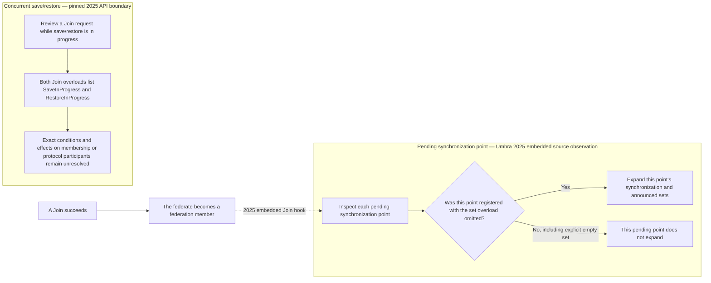

The synchronization branch is an Umbra implementation observation, not a
claim that IEEE 1516.1 requires this late-join expansion. The [embedded Join
hook](../../cpp/src/internal/runtime/umbra_rti_ambassador_federation_lifecycle.cpp#L747),
[registry expansion gate](../../cpp/src/internal/federation/federation_registry.cpp#L233),
and [stored overload-presence flag](../../cpp/src/internal/federation/federation_registry.cpp#L174),
together with the [focused registry test](../../cpp/tests/ieee1516_2025_federation_registry_synchronization_point_late_join_explicit_set_catch2.cpp#L16),
show expansion for an omitted-set point and no expansion for an explicit
non-empty set. Explicit-empty behavior and a partial-achievement-before-Join
interleaving are source-derived, not covered by that test; see the
[synchronization guide](HLA-2025-FEDERATION-SYNCHRONIZATION-FLOW-GUIDE.md#late-joiners-change-only-an-expandable-barrier)
for their exact boundaries.
The save/restore branch is intentionally unresolved: the pinned API annotations
name `SaveInProgress` and `RestoreInProgress`, but do not establish every
precondition or what happens to either protocol's participant set. See the
[save/restore Join boundary](HLA-2025-FEDERATION-SAVE-RESTORE-FLOW-GUIDE.md#join-crosses-a-separate-membership-admission-boundary)
for the evidence layers and the §4.11 follow-up. Do not transfer the
synchronization-point rule to save/restore, nor infer 2010 or process-profile
parity from these 2025 observations.

The inspected registry implementation exposes an additional boundary between
membership and operation participants. When save operation state is created,
its status map is initialized from the current member map
([save operation](../../cpp/src/internal/federation/federation_registry_save_control.cpp#L64));
restore admission similarly initializes its status map from current members
([restore operation](../../cpp/src/internal/federation/federation_registry_restore_control.cpp#L1126)).
The Join commit inserts a member through a separate membership path
([Join commit](../../cpp/src/internal/federation/federation_registry_membership_lifecycle.cpp#L515));
the inspected Join path has no corresponding update to an active Save or
Restore status map. If Join crosses an active operation, the source therefore
does not show the newcomer being added to that operation's participant ledger.
This is a conditional implementation observation, not evidence that Join is
admitted or rejected, a public outcome, or the normative participant rule. No
focused test attempts this interleaving.
After a Restore request is admitted, its saved-to-live member mapping is a
separate question from Join admission; see the
[embedded Restore identity-matching path](HLA-2025-FEDERATION-SAVE-RESTORE-FLOW-GUIDE.md#embedded-durable-image-identity-matching).

## Voluntary resignation: validate before removing membership

In the selected 2025 embedded path, resignation is not just a local state
toggle. Umbra first validates the
action and current member state, then evaluates pending ownership work,
attribute ownership, delete privilege, and callback routes needed by that
action. A rejected resignation leaves the member joined. On success the
registry applies the selected cleanup, removes the member from time and
declaration ledgers, clears its reservations/regions and per-instance
knowledge, then erases the member identity. The local ambassador transitions
out of the joined state and discards callbacks that are stale for that
departing member; callbacks prepared for survivors are delivered on their own
routes.

Forced `ConnectionLost` is a different entry path: it uses the member's stored
automatic directive and a forced-loss cleanup overlay. The [side-by-side
comparison](#voluntary-resign-and-forced-connectionlost-use-different-entry-contracts)
shows where the admission, local-session, survivor-callback, and timestamp
boundaries diverge.

An in-flight synchronization point has its own participant-set transition:
the registry removes the departing ID from the synchronization, announced,
and achieved sets, then either keeps the remaining barrier pending or plans
`federationSynchronized` for its remaining participants. See the [2025
barrier-departure flow](HLA-2025-FEDERATION-SYNCHRONIZATION-FLOW-GUIDE.md#member-departure-can-close-a-pending-barrier)
for the source-bounded transition and adapter-order caveat.

The callback-reset description above is specific to the selected 2025 embedded
path. Do not transfer it to the distinct process endpoint: successful process
Resign cancels exception-report projections but does not reset the shared
dispatcher queue. See the [process-profile Resign trace in the callback
guide](HLA-2025-CALLBACK-AND-SERVICE-ORDERING-FLOW-GUIDE.md#process-profile-resign-and-queued-callback-work).
That source-derived trace shows a possible dispatch path; it does not establish
that unrelated queued work is delivered after Resign or that such delivery is
normatively permitted.

### ResignAction names requested cleanup; they are not the leave transition

The pinned 2025 API presents `ResignAction` as one enum choice. Use its names
to distinguish the cleanup a caller requests from the RTI's admission checks
and from the successful end of membership:

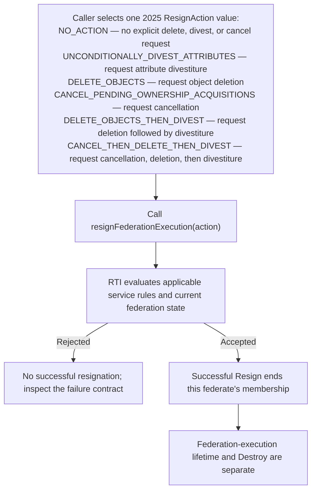

This is an orientation map of API vocabulary, not a normative decision table:
an action name does not guarantee the requested cleanup can complete, and
`NO_ACTION` does not mean “no state can change.” Exact guards, ordering, and
effects require the full standard and profile evidence. The pinned
[`ResignAction` enum](../../third_party/ieee1516.1-2025/include/RTI/Enums.h#L34)
and [`resignFederationExecution` declaration](../../third_party/ieee1516.1-2025/include/RTI/RTIambassador.h#L250)
anchor the API terms; the implementation-specific sequence and selected
embedded action cases below show only their bounded profile behavior. The
three-lifetimes overview above keeps successful membership departure separate
from destruction of the execution.

#### Current embedded 2025 action map

The embedded registry decodes the public value into three independent
requests: cancel acquisition-side work, delete eligible objects, and divest
remaining owned attributes. Before mutating object or ownership state, it
checks tracked pending acquisition work, ownership that would remain after
eligible deletion, and callback routes required by the selected effects.
Source comments associate the acquisition guard with §4.12.3 and the
final-member rule with §4.12.4; the full clause prose is not pinned here, so
this is a source map, not an independent normative interpretation.

| 2025 API value | Current embedded request and guard | Focused evidence |
| --- | --- | --- |
| `UNCONDITIONALLY_DIVEST_ATTRIBUTES` | Request divestiture; tracked acquisition-side work blocks voluntary Resign. Remaining owned attributes enter the assumption-search path. | [Divestiture scenarios](../../cpp/tests/ieee1516_2025_embedded_resign_action_divestiture_catch2.cpp#L4) |
| `DELETE_OBJECTS` | Request deletion of objects where the leaver owns `HLAprivilegeToDeleteObject`; pending work blocks, and ownership left on an undeleted object can still reject the service. | [Delete/removal case](../../cpp/tests/ieee1516_2025_embedded_resign_action_delete_objects_catch2.cpp#L4) |
| `CANCEL_PENDING_OWNERSHIP_ACQUISITIONS` | Cancel the leaver's tracked acquisition-side work. Cancellation alone does not divest attributes the leaver still owns. | [Regular](../../cpp/tests/ieee1516_2025_embedded_resign_action_cancel_pending_acquisition_catch2.cpp#L4), [If Available](../../cpp/tests/ieee1516_2025_embedded_resign_action_cancel_if_available_pending_catch2.cpp#L4), and [negotiated](../../cpp/tests/ieee1516_2025_embedded_resign_action_cancel_negotiated_pending_catch2.cpp#L4) cases |
| `DELETE_OBJECTS_THEN_DIVEST` | Request deletion, then divest ownership on retained objects; it does not cancel pending acquisition-side work. | [Mixed delete/divest case](../../cpp/tests/ieee1516_2025_embedded_resign_action_delete_then_divest_catch2.cpp#L4) |
| `CANCEL_THEN_DELETE_THEN_DIVEST` | Request all three phases in that order, allowing tracked pending acquisition work to be resolved before leaving. | [Pending-work and combined-action case](../../cpp/tests/ieee1516_2025_embedded_resign_action_pending_acquisition_catch2.cpp#L4) |
| `NO_ACTION` | Request none of the three effects. Pending work or ownership that cannot be removed by an eligible delete pass can reject resignation. | [Final-member `NO_ACTION` case (the mandatory delete overlay also applies)](../../cpp/tests/ieee1516_2025_embedded_resign_action_final_federate_catch2.cpp#L4) |

The selected action decides whether the voluntary path requests a delete pass;
it does not itself make every member forget the object at one instant. For
survivor selection, per-receiver known-object revalidation, and the callback
producer snapshot, follow the Object and Interaction guide's [Delete, Remove,
and per-receiver cleanup flow](HLA-2025-OBJECT-AND-INTERACTION-INFORMATION-FLOW-GUIDE.md#object-removal-delete-callback-and-per-receiver-cleanup).

The current source adds a final-member Delete Objects pass regardless of the
supplied enum; other requested flags remain in effect. Thus final-member
`NO_ACTION` can still remove eligible objects. This overlay belongs to the
voluntary embedded path shown below. Forced connection loss instead uses the
member's configured automatic directive plus forced cleanup and is kept in the
separate [connection-loss row](#what-is-state-that-survives-an-exit).

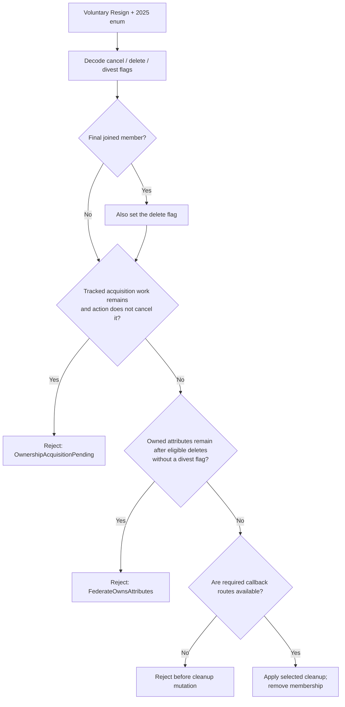

The source order is flag decoding, final-member overlay, admission checks,
route preflight, requested cancellation, eligible deletion, remaining
divestiture, and membership removal ([flag decoding and overlay](../../cpp/src/internal/federation/federation_registry_resign_lifecycle.cpp#L79),
[pending-work guard](../../cpp/src/internal/federation/federation_registry_resign_lifecycle.cpp#L202),
[remaining-ownership guards](../../cpp/src/internal/federation/federation_registry_resign_lifecycle.cpp#L265),
[route preflight](../../cpp/src/internal/federation/federation_registry_resign_lifecycle.cpp#L284),
[cancellation](../../cpp/src/internal/federation/federation_registry_resign_lifecycle.cpp#L464),
[deletion](../../cpp/src/internal/federation/federation_registry_resign_lifecycle.cpp#L569),
[divestiture](../../cpp/src/internal/federation/federation_registry_resign_lifecycle.cpp#L639),
[member removal](../../cpp/src/internal/federation/federation_registry_resign_lifecycle.cpp#L1104)).
The flow is an embedded implementation trace: selected tests cover
representative rows, not every combination of action, acquisition ledger,
delete privilege, peer eligibility, callback model, and member count.

The sequence below follows the eligible path; admission and route failures are
shown in the flowchart above.

```mermaid
sequenceDiagram
  actor Member as Departing application
  participant RTI as Embedded RTI ambassador
  participant Registry as Embedded federation registry
  participant CallbackPath as Survivor callback path
  actor Survivor as Surviving federate

  Member->>RTI: resignFederationExecution(action)
  RTI->>Registry: Commit selected cleanup and member removal
  Registry->>Registry: Plan survivor notifications
  Registry->>Registry: Remove departing state and membership
  Registry-->>RTI: Return committed Resign result
  RTI->>RTI: Leave Joined and reset departing callback queue
  opt survivor has an induced callback
    RTI->>CallbackPath: Submit task to survivor's route
    CallbackPath-->>Survivor: Observe callback under selected model
  end
```

Keep the departing and surviving callback paths separate. The embedded
ambassador resets the leaver's local callback queue, then submits induced
ownership/removal work to the surviving members' own routes
([queue reset](../../cpp/src/internal/runtime/umbra_rti_ambassador_federation_lifecycle.cpp#L990),
[survivor work submission](../../cpp/src/internal/runtime/umbra_rti_ambassador_federation_lifecycle.cpp#L1058)).
In the focused `HLA_EVOKED` `DELETE_OBJECTS_THEN_DIVEST` case, the resign call
returns while the peer's removal and assumption callbacks are still
unobserved; later `evokeCallback` observes assumption before removal
([test](../../cpp/tests/ieee1516_2025_embedded_resign_action_delete_then_divest_catch2.cpp#L62)).
That is one embedded scenario, not a general ResignAction ordering rule. Read
the [callback-model guide](HLA-2025-CALLBACK-AND-SERVICE-ORDERING-FLOW-GUIDE.md)
for the broader immediate-versus-evoked observation boundary; neither this
diagram nor the cited action test establishes the corresponding
`HLA_IMMEDIATE` action-specific sequence or a normative before/after-return
rule.

Keep the process-endpoint observation separate: its selected `HLA_EVOKED`
`NO_ACTION` resign/rejoin test observes removal of the old joined-federate MOM object
before discovery and reflection of the new membership's object. That is a
process-profile MOM-lifecycle case, not evidence for process parity across the
six user-selected cleanup actions or for a general callback-order rule; see
the [joined-federate MOM guide](HLA-2025-JOINED-FEDERATE-MOM-OBJECT-LIFECYCLE-FLOW-GUIDE.md#separate-2025-process-endpoint-evidence).

### A resignation during an active save fails the save for survivors

This embedded 2025 `HLA_EVOKED` case exposes two separate gates. A callback
cannot call `resignFederationExecution` while it is being invoked; after that
callback returns, the same member may resign. If a save is still active, the
registry plans `FEDERATE_RESIGNED_DURING_SAVE` for the remaining members, clears
the save operation, and then removes the departing member. The departing member
does not receive a stale save-failure callback after its callback route is
reset.

```mermaid
sequenceDiagram
  actor Requester as Save requester / survivor
  participant RTI as Embedded 2025 RTI
  actor Survivor as Other surviving member
  actor Departing as Departing member

  Note over Requester,Departing: One focused HLA_EVOKED schedule, not a global callback-order rule
  Requester->>RTI: requestFederationSave(label)
  RTI-->>Requester: initiateFederateSave(label)
  RTI-->>Survivor: initiateFederateSave(label)
  RTI-->>Departing: initiateFederateSave(label)
  Survivor->>RTI: federateSaveBegun()
  Departing->>RTI: federateSaveBegun(), then Resign in callback
  RTI-->>Departing: CallNotAllowedFromWithinCallback
  Note over Departing: Callback returns, then retry Resign outside it

  Departing->>RTI: resignFederationExecution(NO_ACTION)
  RTI->>RTI: End active save for survivors, remove departing member
  RTI-->>Requester: federationNotSaved(FEDERATE_RESIGNED_DURING_SAVE)
  RTI-->>Survivor: federationNotSaved(FEDERATE_RESIGNED_DURING_SAVE)
  Note over Departing: No save-failure callback is delivered to this leaver

  Requester->>RTI: requestFederationSave(newLabel)
  RTI-->>Requester: initiateFederateSave(newLabel)
  RTI-->>Survivor: initiateFederateSave(newLabel)
  Note over Requester,Survivor: The focused test completes this later save successfully
```

The test deliberately drives the `Held` member's initiation first, then invokes
the departing member's callback so it can distinguish the in-callback
`CallNotAllowedFromWithinCallback` from the successful retry after callback
return. It asserts that the owner and held member each receive one
`FEDERATE_RESIGNED_DURING_SAVE` failure, the leaver receives none, and the
survivors can start and complete a fresh save. This is an embedded
development-profile observation, not a cross-profile ordering or conformance
claim. A separate `HLA_IMMEDIATE` case confirms the save-failure reason and a
successful later save for one survivor, but it does not cover multiple
survivors or the in-callback resignation guard shown here
([companion case](../../cpp/tests/ieee1516_2025_federation_management_save_restore_catch2.cpp#L347)).
The registry also applies the corresponding
`FEDERATE_RESIGNED_DURING_RESTORE` failure to surviving restore participants;
the separate `HLA_IMMEDIATE` restore scenario is linked in the evidence map.

### ResignAction effects in the current implementation

This is a compact reading aid, not the full normative decision table. Exact
preconditions and action ordering must be checked in the standard and source.
The ownership-specific pending-acquisition guard and member-scoped
reject-versus-cancel path are diagrammed in the [ownership persistence and
resignation companion](HLA-2025-OWNERSHIP-PERSISTENCE-AND-RESIGNATION-FLOW-GUIDE.md#2-resignation-with-pending-acquisition-work);
the table here stays focused on object and divestiture effects.
The Delete Objects rows describe deletion requested as part of voluntary
Resign; they do not describe a timestamped Delete's pending/delivered gates or
later Retract. See the [TSO Retraction deletion flow](HLA-2025-TSO-RETRACTION-FLOW-GUIDE.md#service-specific-effects-deletion-is-special)
for that separate lifecycle and its restore evidence.

| Action family | Current implementation effect | Important guard or caveat |
| --- | --- | --- |
| NO_ACTION | No requested object deletion or unconditional divestiture. | A voluntary resign can be rejected while the member still owns attributes or has certain pending acquisitions. |
| UNCONDITIONALLY_DIVEST_ATTRIBUTES | Request attribute divestiture without requesting object deletion. | Ownership callbacks and pending negotiations affect the path; see the ownership guide. |
| DELETE_OBJECTS | Request deletion of objects for which the member holds delete privilege. | May be rejected if owned attributes would remain on an object it cannot delete. |
| DELETE_OBJECTS_THEN_DIVEST | Delete eligible objects, then divest remaining owned attributes. | Its combination of effects differs from DELETE_OBJECTS alone. |
| CANCEL_PENDING_OWNERSHIP_ACQUISITIONS | Cancel pending acquisition work. | Does not by itself request object deletion or general divestiture. |
| CANCEL_THEN_DELETE_THEN_DIVEST | Combine acquisition cancellation, eligible object deletion, and divestiture. | Keep each phase visible; do not treat it as an alias for another action. |

#### Directive 5 cancels acquisitions before deleting and divesting retained objects

The current embedded registry applies the combined action in separate passes.
After validation and route preflight, it removes the departing member's
acquisition-side requests and negotiated candidates, accepts deletes for the
preplanned eligible objects, then divests that member's attributes on
instances that remain. A deleted instance skips the divestiture pass because
its ownership and pending-operation ledgers were cleared with the deletion.
Divestiture of a retained instance opens or continues ownership-assumption
search; the returned callback work is still an offer and does not itself
transfer ownership.

```mermaid
flowchart TD
  Valid["D5 passes validation<br/>and route preflight"] --> Cancel["Cancel leaver's requests<br/>and negotiated candidates"]
  Cancel --> Instance["For each object<br/>in the prepared plan"]
  Instance --> Delete{"Eligible<br/>for delete?"}
  Delete -->|Yes| Remove["Accept delete<br/>clear object ledgers<br/>reserve survivor removals"]
  Delete -->|No| Own{"Leaver owns attrs<br/>on retained object?"}
  Own -->|Yes| Divest["Clear leaver's ownership<br/>and update associations"]
  Divest --> Search["Plan eligible<br/>assumption offers"]
  Own -->|No| Retained["No ownership pass"]
  Remove --> Done["All planned objects processed"]
  Search --> Done
  Retained --> Done
  Done --> Leave["Remove member<br/>return callback work"]
  Leave --> Project["Adapter projects work to<br/>survivor routes"]
  Project --> Observe["Callback observation<br/>is profile-specific"]
```

This is an embedded-source phase trace, not a complete normative decision
table or a single tested D5 schedule. The [directive 5 case](../../cpp/tests/ieee1516_2025_embedded_resign_action_pending_acquisition_catch2.cpp#L36)
checks cancellation of a regular pending acquisition and successful Resign;
the [delete-then-divest case](../../cpp/tests/ieee1516_2025_embedded_resign_action_delete_then_divest_catch2.cpp#L62)
checks deletion plus divestiture of a retained object's attributes and the
resulting callbacks. The [delete-only case](../../cpp/tests/ieee1516_2025_embedded_resign_action_delete_objects_catch2.cpp#L41)
and [unconditional-divestiture cases](../../cpp/tests/ieee1516_2025_embedded_resign_action_divestiture_catch2.cpp#L128)
cover those component paths separately. The direct D5 case does not include a
negotiated candidate. Other Confirm Divestiture cases use D5 during teardown
after their assertions; they do not establish the candidate's post-Resign
callback or ownership outcome.
The source phases are [cancellation](../../cpp/src/internal/federation/federation_registry_resign_lifecycle.cpp#L464),
[deletion](../../cpp/src/internal/federation/federation_registry_resign_lifecycle.cpp#L568),
and [divestiture](../../cpp/src/internal/federation/federation_registry_resign_lifecycle.cpp#L639).

#### The pending-acquisition preflight is role-sensitive

In the 2025 **embedded registry**, the voluntary-resign guard is not a check for
“any pending ownership callback.” It scans these five registry records before
the action mutates state. For four action values—`NO_ACTION`,
`UNCONDITIONALLY_DIVEST_ATTRIBUTES`, `DELETE_OBJECTS`, and
`DELETE_OBJECTS_THEN_DIVEST`—a matching record rejects the attempt with the
ownership-acquisition-pending result. The two cancellation actions instead
proceed to remove the departing member's side of their pending work. On forced
connection loss, this rejection is skipped and acquisition-side cancellation
is enabled regardless of the configured directive. See the [guard and action
classification](../../cpp/src/internal/federation/federation_registry_resign_lifecycle.cpp#L80),
[role-sensitive record scan](../../cpp/src/internal/federation/federation_registry_resign_lifecycle.cpp#L146),
and [member-scoped cancellation pass](../../cpp/src/internal/federation/federation_registry_resign_lifecycle.cpp#L464).

| Record examined by the guard | Which role makes this member count? |
| --- | --- |
| Regular attribute-ownership acquisition request | The member is the requester. |
| If-Available acquisition request | The member is the requester, including a queued willing-to-acquire outcome. |
| Pending acquisition-cancellation record | The member is the requester whose cancellation is still tracked. |
| Negotiated-divestiture candidate | The member is the prospective acquiring federate. |
| Pending Confirm Divestiture notification | The member is the notification recipient. |

This is deliberately narrower than “all ownership-related state.” For
example, pending If-Wanted divestiture notifications are removed in the
cancellation pass by recipient identity, but are not one of the five records
used by this rejection guard. Ownership-query records and queued assumption
callback markers are invalidated by separate cleanup steps. The Ownership
guide's [accepted object-deletion flow](HLA-2025-ATTRIBUTE-OWNERSHIP-FLOW-GUIDE.md#accepted-object-deletion-invalidates-pending-ownership-work)
traces the per-instance callback gates. Identify the underlying record and the
member's role before predicting whether a voluntary attempt rejects, cancels
work, or merely suppresses a stale callback.

The cancellation action also does not guarantee that resignation succeeds:
the independent owned-attribute guard can still reject a member that requested
neither deletion nor divestiture. Likewise, the mandatory final-member delete
pass does not bypass the earlier pending-acquisition check. These are
embedded-source observations, not the full normative decision table or a
process-profile claim. The focused embedded tests demonstrate regular-request
rejection and cancellation, If-Available cleanup, and negotiated-candidate
cleanup; they do not exercise every record/action cross-product or the forced-
loss overlay.

For the current implementation, the last joined member causes a delete-object
pass even if it supplied NO_ACTION. This does not mean the federation
execution itself is destroyed. In the focused test, the last member resigns
with NO_ACTION, rejoins the same still-existing execution under a fresh member
lifetime, and reserves the name of the object removed during final-member
cleanup. For the per-receiver known-object commit and the distinction from
`localDeleteObjectInstance`, see the [object and interaction flow guide's
disappearance comparison](HLA-2025-OBJECT-AND-INTERACTION-INFORMATION-FLOW-GUIDE.md#diagnose-disappearance-by-asking-which-state-changed).

That mandatory final-member delete pass is distinct from a non-final
producer's voluntary Resign. A focused 2025 embedded case shows that
`UNCONDITIONALLY_DIVEST_ATTRIBUTES` can remove the producer while already
accepted timestamped-deletion copies remain queued for their receivers. Each
receiver then observes its own removal before its grant; the case does not
cover post-Resign Retract, forced ConnectionLost, or the configured-process
path. See the [timestamped-deletion/Resign sequence](HLA-2025-OBJECT-AND-INTERACTION-INFORMATION-FLOW-GUIDE.md#voluntary-resign-preserves-accepted-timestamped-deletions-for-receivers).

#### Configured-process Resign projects the registry result before replying

In the 2025 configured-process endpoint, [`handleResign`](../../cpp/src/internal/federation/process_federation_service_request_handlers.cpp#L136)
validates that the transport session and request identify the same joined
member, then passes the supplied action to the same
[`EmbeddedFederationRegistry`](../../cpp/src/internal/federation/process_federation_service.hpp#L139)
transition used by the embedded path. The process-specific boundary begins
after that registry transition returns:

1. **Validate and apply the action.** `handleResign` checks the session/member
   identity and calls `registry_.resign` with the supplied action. Both
   endpoints therefore enter the same registry action and guard logic.
2. **Project recipient work.** [`dispatchConnectionLossResult`](../../cpp/src/internal/federation/process_federation_service_connection_loss.cpp#L19)
   routes ownership-acquisition work, ownership-assumption recipients, object
   removals, synchronization notifications, and any supplied FederateLost
   report into process event queues or Push delivery. In the inspected source,
   it does not consume the result's Save or Restore notification vectors.
3. **Handle projection failure.** If dispatch returns false, `handleResign`
   returns an internal-error response. The registry has already applied the
   Resign transition, and the inspected handler shows no rollback. Earlier
   result families or recipients may already have been queued or sent; grant
   reevaluation and departing-session cleanup are skipped.
4. **Reevaluate and finish.** After projection succeeds, the service
   reevaluates pending time-advance grants. A non-applied result also returns
   internal error, after the registry transition and event projection but
   before departing-session cleanup. Only the success path dispatches the
   grants, clears the departing session's joined state and queued event
   collections, and returns success.

```mermaid
flowchart TD
    A["Validate session and member"] -->|invalid| R["Rejected response"]
    A -->|valid| B["Apply registry Resign transition"]
    B -->|not applied| R
    B -->|applied: registry state committed| C["Project result families in order to Pull queues or Push delivery"]
    C -->|projection fails| P["Internal-error response<br/>No rollback; earlier queue or send work may remain<br/>Skip grant reevaluation and session cleanup"]
    C -->|projection succeeds| D["Reevaluate time-advance grants"]
    D -->|not applied| G["Internal-error response<br/>Registry change and projected work remain<br/>Skip departing-session cleanup"]
    D -->|applied| E["Dispatch newly eligible grants"]
    E --> F["Clear departing server session state and queues"]
    F --> S["Success response"]
```

Before projecting the result,
[`dispatchConnectionLossResult`](../../cpp/src/internal/federation/process_federation_service_connection_loss.cpp#L19)
removes the departing member's pending ownership-acquisition events from
session queues. It then attempts acquisition work, ownership assumptions,
object removals, and synchronization notifications in source order; ConnectionLost
also attempts the optional FederateLost report afterward. It does not consume
the Save or Restore vectors. Pull is the default in
[`ProcessFederationServiceOptions`](../../cpp/src/internal/federation/process_federation_service.hpp#L79);
Push is an option. In
[Push removal delivery](../../cpp/src/internal/federation/process_federation_service_object_instance_removal.cpp#L75),
the receiver-side removal commit precedes the send, so a send failure can
leave an already committed prefix. These are implementation boundaries, not
callback-order requirements: this trace does not establish whether a callback
runs before or after the Resign response.

On an error response,
[`ProcessFederationClient::resignFederationExecution`](../../cpp/src/internal/federation/process_federation_client_federation_management.cpp#L214)
throws and
[`UmbraRtiAmbassador::resignFederationExecution`](../../cpp/src/internal/runtime/umbra_rti_ambassador_federation_lifecycle.cpp#L805)
translates that to `RTIinternalError`; the client's successful Resign cleanup
of its joined identity and pending callbacks occurs only after an OK response.
This describes the current source path and does not claim recovery or retry
semantics.

These post-registry steps are source-visible. The focused process
[`NO_ACTION` Resign case](../../cpp/tests/ieee1516_2025_connection_process_mom_resign_removal_order_catch2.cpp#L38)
checks the HLAfederate removal before later rejoined-object discovery; it does
not assert other action-specific projections, either post-commit error path,
partial Push delivery, or callback ordering relative to the response. The
test leaves `pushReceiveOrderEvents` at its default `false` setting.

The service uses the same registry action and guard logic, but its per-recipient
event projection and response boundary are process-specific. The callback
guide's [process-profile Resign trace](HLA-2025-CALLBACK-AND-SERVICE-ORDERING-FLOW-GUIDE.md#process-profile-resign-and-queued-callback-work)
continues from server-side queued work into client buffering and callback
dispatch; it does not establish that post-Resign callbacks are normatively
permitted. Do not infer that each action has a tested process/embedded parity
case from the shared registry call.

## Connection loss: forced resignation is a different entry path

Connection loss is not an application call to
`resignFederationExecution(action)`: the adapter reports the failed connection,
and the registry reads the last automatic directive stored for that member
before entering the shared resignation transition with a forced-loss flag.
Keep the configured action, forced-loss cleanup, and last-member rule separate:

| Layer | Current 2025 implementation effect | Evidence boundary |
| --- | --- | --- |
| Per-member automatic directive | Supplies the ordinary action-specific delete/divest/cancellation plan selected for this lost membership. The registry reads that member's stored value at loss; it is not a new action chosen by the disconnected application. | The [registry loss entry](../../cpp/src/internal/federation/federation_registry.cpp#L426) reads the member value; [Join seeds each member from the composed FDD](../../cpp/src/internal/federation/federation_registry_membership_lifecycle.cpp#L390). |
| Forced-loss safety overlay | Cancels the departed member's pending acquisition work regardless of the selected directive. If it still owns attributes, the transition also sends those through divestiture processing even for `NO_ACTION` (or `DELETE_OBJECTS` without delete privilege). This does not itself imply object deletion. | The [forced transition](../../cpp/src/internal/federation/federation_registry_resign_lifecycle.cpp#L108) sets acquisition cancellation and [forces the owned-attribute divest path](../../cpp/src/internal/federation/federation_registry_resign_lifecycle.cpp#L259). An [embedded `NO_ACTION` loss case](../../cpp/tests/ieee1516_2025_connection_lost_automatic_no_action_forced_resign_catch2.cpp#L5) observes a retained object, an ownership-assumption callback, and no removal callback. |
| Last joined member | Adds the final-member object-deletion pass regardless of the supplied action. This is the last-member rule, not a connection-loss-only rule; ordinary object eligibility still applies. | The [final-member transition](../../cpp/src/internal/federation/federation_registry_resign_lifecycle.cpp#L117) and focused [final-member transport-loss case](../../cpp/tests/ieee1516_2025_connection_lost_final_federate_directive_two_catch2.cpp#L5) are implementation/scenario evidence, not a complete normative decision table. |

The shared member-removal cleanup also releases that member's unconsumed
object-instance name reservations and removes its own entries from per-instance known-object
state. Those are separate from the conditional federation-wide object/name
purge and from survivor-side removal delivery, which remain governed by the
selected action, last-member rule, and per-recipient state. See the [reservation
ownership and lifetime flow](HLA-2025-OBJECT-INSTANCE-NAME-RESERVATION-FLOW-GUIDE.md#4-reservation-ownership-and-lifetime)
and [federate-local object-instance lookup](HLA-2025-NAME-AND-HANDLE-RESOLUTION-FLOW-GUIDE.md#4-object-instance-lookup-is-federate-local-knowledge).
The reservation guide's timestamped-deletion flow separates that time gate
from unconsumed-name cleanup. Its latest CTest result used a runtime older than
the current source and is not current-source confirmation.

This is a map of Umbra's 2025 path, not an independent interpretation of the
standard's full `ResignAction` requirements. Survivor callbacks remain subject
to known-object state, support switches, and usable callback routes.

### Voluntary Resign and forced ConnectionLost use different entry contracts

Both routes enter the shared registry resignation machinery in the current
implementation, but the public service passes the caller's action with the
forced-loss flag clear; `connectionLost` reads the member's automatic directive
and sets that flag. This source-level reuse does not make the two exits
equivalent ([public Resign entry](../../cpp/src/internal/federation/federation_registry.cpp#L346),
[forced-loss entry](../../cpp/src/internal/federation/federation_registry.cpp#L426),
[shared transition](../../cpp/src/internal/federation/federation_registry_resign_lifecycle.cpp#L13)).

| Boundary | Voluntary `resignFederationExecution(action)` | Forced `ConnectionLost` |
| --- | --- | --- |
| Trigger and disposition | A connected member calls the public service with a `ResignAction`; the embedded preflight can reject before removing membership. | A transport failure enters adapter cleanup; the registry uses that member's stored automatic directive. |
| Cleanup admission | Pending-acquisition, remaining-ownership, and required-route checks can reject the voluntary transition. | Forced loss skips the voluntary pending-acquisition rejection and adds acquisition-side cancellation; the directive and last-member rule still shape deletion/divestiture. |
| Local lifetime | On commit, the ambassador leaves Joined state. Embedded and process cleanup/response boundaries differ; see [process Resign](HLA-2025-CALLBACK-AND-SERVICE-ORDERING-FLOW-GUIDE.md#process-profile-resign-and-queued-callback-work). | The local ambassador becomes Not Connected. Embedded cleanup resets the lost ambassador's dispatcher; the process loss handler retains its client and queued-work path. See [ConnectionLost callback handling](HLA-2025-CALLBACK-AND-SERVICE-ORDERING-FLOW-GUIDE.md#connectionlost-producer-exception-containment-and-backend-specific-cleanup). |
| Other-member observations | Action-dependent ownership/removal work follows survivor routes; the federation membership-list projection is a separate MOM path. Voluntary exit does not take the fault-driven Federate-Lost report path. | `HLAreportFederateLost`, survivor `HLAfederate` removal, and the failed member's local `connectionLost` callback are separate paths; their order is profile-specific ([callback map](HLA-2025-CALLBACK-AND-SERVICE-ORDERING-FLOW-GUIDE.md#connectionlost-and-survivor-remove-callbacks-are-separate-streams)). |
| Timestamped work | Some non-deleting voluntary actions preserve an already accepted timestamped deletion for receiver-side delivery. | When the lost member is time regulating and a last-granted time is captured, that time supplies the loss-specific TSO cutoff; see the [forced-loss cutoff trace](HLA-2025-OBJECT-AND-INTERACTION-INFORMATION-FLOW-GUIDE.md#forced-connectionlost-uses-the-lost-regulators-last-granted-time-cutoff) and [Time Management](HLA-2025-TIME-MANAGEMENT-GUIDE.md) for general temporal eligibility. |

These are implementation-path comparisons, not a complete normative Resign
decision table. The focused voluntary `DELETE_OBJECTS_THEN_DIVEST` case and the
forced-loss report-order case cover different scenarios; they do not establish
profile parity or a universal callback order
([voluntary action case](../../cpp/tests/ieee1516_2025_embedded_resign_action_delete_then_divest_catch2.cpp#L62),
[forced-loss report case](../../cpp/tests/ieee1516_2025_connection_lost_report_ordering_catch2.cpp#L5)).

In the configured-process profile, remote membership cleanup and the failed
client's callback are two independent consequences of the broken session. The
server host detects its dead session and calls the federation service; the
client-side adapter separately handles its local transport failure. The local
callback is not sent over the failed connection, and the source does not
establish an ordering between host cleanup and local callback delivery.

```mermaid
sequenceDiagram
  accTitle: 2025 process ConnectionLost has independent local and host paths
  accDescr: The failed member's adapter marks it Not Connected and submits its local connectionLost callback. Separately, the host removes membership, plans HLAfederate object removals for known survivors with usable routes, and may route HLAreportFederateLost to subscribed survivors whose endpoint region matches. These paths have different audiences; source submission order is not a public callback-order guarantee.
  autonumber
  participant Lost as Lost member
  participant Client as Local RTI adapter
  participant Host as Host and process service
  participant Registry as Federation registry
  participant Peer as Survivor

  par Failed member's local adapter path
    Client->>Client: observe transport failure
    Client->>Client: mark ambassador Not Connected
    Client-->>Lost: submit local connectionLost callback
  and Host-side membership and survivor path
    Host->>Host: detect terminal session failure
    Host->>Registry: plan FederateLost report
    Host->>Registry: apply forced connectionLost transition
    Registry-->>Host: membership result and report plan
    Host-->>Peer: HLAfederate Remove<br/>only if known and routable
    Host-->>Peer: optional HLAreportFederateLost<br/>if subscribed and region matches
  end
```

The `par` frame represents independent detection and cleanup paths; it does
not establish which side observes failure first. The callback to the lost
application is local adapter reporting; it is not a message sent over the
connection that has already failed. The remote `HLAreportFederateLost` is a
separate Receive-order MOM interaction delivered to eligible survivors; its
selection is covered in the [Federation MOM report flow](HLA-2025-FEDERATION-MOM-FLOW-GUIDE.md#a-federate-lost-mom-report-is-distinct-from-local-loss-and-object-removal).
Survivor object removals depend on the configured directive, known-object
state, support switches, callback routes, and profile. The process service
submits object-removal effects before the optional report, but that source order
does not establish the survivors' callback order. The joined-member
`HLAfederate` object removal has its own observer ledger and missing-route
behavior; see the [Joined-Federate MOM lifecycle flow](HLA-2025-JOINED-FEDERATE-MOM-OBJECT-LIFECYCLE-FLOW-GUIDE.md#forced-loss-can-skip-an-observer-whose-callback-route-is-unavailable).

### Separate observations follow forced ConnectionLost

The registry membership transition is the common state change. Federation
MOM reflection, per-member object removal, the Federate-Lost interaction, and
the lost member's local callback are separate projections from it; their
recipient sets overlap only when each path's own rules select the same federate.

- **The federation-scoped `HLAfederatesInFederation` attribute:** this is a
  conditional reflection on the `HLAfederation` object, separate from the
  departing member's `HLAfederate` object and the Federate-Lost interaction.
  The embedded adapter queues the update after loss. The inspected process
  connection-loss dispatcher has no explicit enqueue for it. A current
  worktree process TCK source contains a post-loss reflection assertion, but
  this documentation review has no execution result; the source/expectation
  boundary remains unresolved. The [Federation MOM guide](HLA-2025-FEDERATION-MOM-FLOW-GUIDE.md#forced-connection-loss-has-its-own-membership-list-path)
  records the MIM scope and profile-specific evidence.
- **The survivor's `HLAfederate` object:** the RTI-owned object leaves when its
  represented membership ends, independent of the federate-created-object
  `ResignAction`. Removal is planned for survivors that knew the instance and
  still have a usable callback route. Forced cleanup can skip a survivor with
  no route. The [Joined-Federate MOM guide](HLA-2025-JOINED-FEDERATE-MOM-OBJECT-LIFECYCLE-FLOW-GUIDE.md#forced-loss-can-skip-an-observer-whose-callback-route-is-unavailable)
  traces that private observer ledger.
- **The `HLAreportFederateLost` interaction:** this is a distinct Receive-order
  MOM report. Its plan captures the lost member and last granted time before
  membership removal, then selects other members by interaction subscription
  and endpoint-region routing. No eligible recipient does not prevent forced
  cleanup. The [Federation MOM guide](HLA-2025-FEDERATION-MOM-FLOW-GUIDE.md#a-federate-lost-mom-report-is-distinct-from-local-loss-and-object-removal)
  details those rules.
- **The failed ambassador's local `connectionLost` callback:** only the
  disconnected member's adapter submits this callback. It is not delivered
  through the failed process socket and is not a notification to survivors.

Source submission order differs by profile: the embedded adapter submits report
work before its object-removal work, while the configured-process service
submits cleanup events before its report. The existing embedded ordering case
checks report-before-`DELETE_OBJECTS` removal of an application object; it does
not check order against removal of the RTI-owned `HLAfederate` object. The
joined-federate MOM lifecycle case checks object removal after explicit Resign,
not forced loss. No focused case asserts `HLAfederate` object removal after
`ConnectionLost`; treat that path as source-derived, and do not infer a public
callback-order guarantee ([report/removal case](../../cpp/tests/ieee1516_2025_connection_lost_report_ordering_catch2.cpp#L92),
[explicit-Resign MOM case](../../cpp/tests/ieee1516_2025_joined_federate_mom_public_object_lifecycle_catch2.cpp#L287)).

The hosted portable TCK scenario at the reviewed `c9c5a9e` snapshot verifies
the reliable report's four parameters, federate identity and name, a decodable
logical timestamp, and eventual local `connectionLost`
([historical hosted scenario](https://github.com/sheepfling/umbra/blob/c9c5a9e410539b039cd8bba35b53d0ef2b24d180/packages/hla-rti-cpp-tck/src/portable_tck.cpp#L2463));
that run does not establish current-source behavior. The checked-in focused
2025 Catch2 sources now provide directly inspectable embedded assertions:
[the HLA_EVOKED report case](../../cpp/tests/ieee1516_2025_connection_lost_federate_lost_mom_interaction_catch2.cpp#L5)
decodes all four report parameters and checks that an unsubscribed member gets
no interaction;
[the HLA_IMMEDIATE case](../../cpp/tests/ieee1516_2025_connection_lost_federate_lost_mom_immediate_catch2.cpp#L5)
checks the local `connectionLost` callback and subscribed report before the
fault fixture returns;
[the regional cases](../../cpp/tests/ieee1516_2025_connection_lost_federate_lost_mom_regional_catch2.cpp#L5)
and [their HLA_IMMEDIATE counterpart](../../cpp/tests/ieee1516_2025_connection_lost_federate_lost_mom_regional_immediate_catch2.cpp#L5)
check matching versus disjoint report regions; and the
[two-survivor ordering case](../../cpp/tests/ieee1516_2025_connection_lost_report_ordering_catch2.cpp#L5)
checks report-before-`DELETE_OBJECTS` removal for each survivor's application
object. These links describe checked-in test assertions; this documentation
review did not rerun them or claim a fresh execution result. They do not
establish equivalent configured-process runtime behavior or a public
callback-order rule.
The current worktree 2025 process TCK source[^worktree-source] contains
assertions for exact timestamp equality with the loss cutoff, TSO-before-grant
ordering, post-loss federation-member reflection, and a public member-list query
showing only the survivor. It also checks post-loss synchronization with the
survivor. No execution result for these current-source assertions was reviewed
in this documentation increment; the pinned hosted run record covers an earlier
scenario. The current source uses Push and has no Pull case. It does not
establish ordering among the report, local loss callback, and membership
observations, test Pull delivery, or assert removal of the lost member's
`HLAfederate` MOM object. The Federation MOM guide records that the inspected
process loss dispatcher has no explicit enqueue for the member-list update.
Do not confuse terminal socket loss with the private
`forceFederateResignationForTesting` control. That fixture control calls
`registry_.resign(..., NO_ACTION)`, re-evaluates time grants, and sends a
`federate_resigned` event over a still-usable session. The process client turns
that event into the local `federateResigned` callback and clears pending events;
it is not the host's `connectionLost` path and does not establish public
ConnectionLost behavior (test control[^worktree-source],
[fixture invocation](../../cpp/tests/process_federation_service_probe.cpp#L2492),
[forced-resignation handler hookup](../../cpp/src/internal/federation/process_federation_client.cpp#L362),
[runtime callback handler](../../cpp/src/internal/runtime/umbra_rti_ambassador_membership_loss.cpp#L177)).
Connection-loss TSO cutoff behavior is deliberately only marked here; the
[Time Management guide](HLA-2025-TIME-MANAGEMENT-GUIDE.md) owns timestamp
eligibility and delivery ordering. The [Object and Interaction guide's forced
loss case](HLA-2025-OBJECT-AND-INTERACTION-INFORMATION-FLOW-GUIDE.md#forced-connectionlost-uses-the-lost-regulators-last-granted-time-cutoff)
traces an accepted timestamped object deletion through that cutoff to each
receiver.
The same membership transition can also close or preserve a pending
synchronization barrier; see the [2025 synchronization guide's member-departure
boundary](HLA-2025-FEDERATION-SYNCHRONIZATION-FLOW-GUIDE.md#member-departure-can-close-a-pending-barrier).

### The automatic directive is seeded per member, then overridden per member

The composed FDD's `HLAautomaticResignAction` support-switch value seeds each
membership when it joins. `getAutomaticResignDirective` reads that member's
value and `setAutomaticResignDirective` changes only the caller's membership;
it does not rewrite the federation default or a peer's directive. The
[support-switch scenario](../../cpp/tests/support_switch_state_catch2.cpp#L4)
checks the FDD seed and peer-isolated override. A separate embedded
[`DELETE_OBJECTS` loss case](../../cpp/tests/ieee1516_2025_connection_lost_automatic_delete_resign_directive_catch2.cpp#L5)
checks the configured action's removal result.

```mermaid
sequenceDiagram
  autonumber
  participant FDD as Composed FDD
  participant Registry as Federation registry
  participant Directive as Per-member directive field (registry state)
  participant Lost as Member A
  participant Peer as Member B
  participant RTI as RTI adapter
  participant Transport as Transport

  Note over FDD,Directive: HLAautomaticResignAction supplies each member's initial directive
  Lost->>Registry: Join
  Registry->>Directive: Seed Member A directive from the composed FDD
  Peer->>Registry: Join
  Registry->>Directive: Seed Member B directive from the composed FDD
  Lost->>Registry: setAutomaticResignDirective(action A)
  Registry->>Directive: Update only Member A's slot
  Note over Registry,Directive: Member B retains its own directive
  Transport--xRTI: connection failure for Member A
  RTI->>Registry: connectionLost(Member A)
  Registry->>Directive: Read Member A's current directive
  Note over Registry,Directive: Apply forced resign using action A
  Note over Registry,Directive: Forced acquisition cleanup and final-member rules still apply
  Registry-->>Peer: action- and route-dependent survivor notifications
```

The [embedded pending-acquisition loss case](../../cpp/tests/ieee1516_2025_connection_lost_automatic_cancel_pending_acquisition_catch2.cpp#L5)
also observes stale acquisition-side work being suppressed, but configures
`CANCEL_PENDING_OWNERSHIP_ACQUISITIONS` itself; it does not by itself prove
that the forced overlay is independent of the selected action. The `NO_ACTION`
owned-attribute case above demonstrates forced divestiture under a different
directive. Together these remain selected embedded 2025 scenarios, not the
full action/ownership-state matrix.

The 2025 process profile has a separate entry path: its
[`ProcessFederationService::connectionLost`](../../cpp/src/internal/federation/process_federation_service_connection_loss.cpp#L170)
passes endpoint loss through the registry and projects the resulting events.
Adapter-managed process TCK scenarios cover configured
[`UNCONDITIONALLY_DIVEST_ATTRIBUTES`](../../packages/hla-rti-cpp-tck/src/tck_connection_lifecycle.cpp#L252)
and [`CANCEL_PENDING_OWNERSHIP_ACQUISITIONS`](../../packages/hla-rti-cpp-tck/src/tck_connection_lifecycle.cpp#L358);
the [current-process runner](../../packages/hla-rti-cpp-tck/adapters/current-process/run_connection_loss.py#L232)
selects the loss fixture. Those scenario sources do not cover the process
profile's forced overlay under `NO_ACTION`, nor do they establish profile
parity or a callback-order guarantee. These were inspected, not run in this
documentation pass.

### Process endpoint: host retention and the local callback boundary

The production host has separate normal-disconnect, terminal-session, and
shutdown paths. When a normal `serveOne` loop ends, `serveConnection` marks the
session inactive and closes that worker connection; it does not immediately
apply registry `connectionLost`. The host retains the same session record so
the client can Resume before `RTI_TIMEOUT_PURGE` expires. A successful Resume
continues that private session without a registry loss transition. A rejected
Resume, a serving exception, or purge expiry removes the host's session record
and attempts `ProcessFederationService::connectionLost`.

For terminal-session and purge cleanup, `service.detach(session)` follows only
when connection-loss processing succeeds. A false return can mean that the
registry transition did not apply, or that membership changed before survivor
effect projection failed, possibly after partial enqueue or send work. The
host records the failure and skips `detach`; these paths do not retry the
connection-loss adapter. Explicit host shutdown differs: it records a loss
failure if one occurs, then still detaches each captured session. Detaching
clears service-owned session routing and pending pushed-retraction recipient
references; it is not itself the registry membership transition.

The repository now has a production coordinator runtime entry point used by
the coordinator executable and by a separate-process integration probe. The
runtime owns one `EmbeddedFederationRegistry` and one
`ProcessFederationServiceHost` for its lifetime. Its stop path closes the
listener and client connections, joins the serving workers, then calls
`connectionLost` and `detach` for each remaining server session. The earlier
public host integration test still covers only unjoined clients and a
stalled-hello shutdown. A separate production-runtime test now covers two
joined public clients: one in the Catch2 process and one in an independently
launched client process. After the coordinator is stopped, both clients
observe their local `connectionLost` callback. The test does not assert which
server-side survivor effects are delivered during shutdown or the ordering
between registry cleanup and each client's local callback. Keep those limits
distinct from the current-process fault fixture, which explicitly applies
forced registry loss (through `ProcessFederationService::connectionLost` for
the Federate-Lost report scenario, or an equivalent registry-plus-dispatch
path for cleanup scenarios), then detaches the session and closes its socket.

The client's local path starts separately. It first attempts transport Resume
within `FED_TIMEOUT_RECONNECT`; only a terminal Resume result or exhausted
recovery window reaches the ambassador failure handler. If the process
endpoint is still joined, the adapter transitions it to Not Connected and
submits the public `connectionLost` callback through the shared dispatcher.
This callback is local; it is not sent across the failed socket and does not
perform the host's registry cleanup. The client and host timers start from
different events, so local callback submission does not establish when the
host removes federation membership. The [Process Endpoint recovery flow](HLA-2025-PROCESS-ENDPOINT-REQUEST-AND-CALLBACK-FLOW-GUIDE.md#4-temporary-process-session-recovery)
shows the independent deadlines and their outcomes.

Server-session events, frames buffered in the process client, and tasks already
submitted to the callback dispatcher are separate stores. The failed-request
path dispatches terminal transport failures rather than draining buffered
events, while client close clears those buffers. Existing process TCK scenarios
exercise the local `connectionLost` callback under both callback models and the
fixture's selected survivor effects, but do not assert post-loss delivery of a
buffered event or an already-queued unrelated callback. The callback guide's
[backend-specific ConnectionLost map](HLA-2025-CALLBACK-AND-SERVICE-ORDERING-FLOW-GUIDE.md#connectionlost-producer-exception-containment-and-backend-specific-cleanup)
covers the shared-dispatcher boundary.

```mermaid
stateDiagram-v2
  accTitle: 2025 configured-process host session states
  accDescr: A disconnected process session remains resumable until the host purge deadline. Rejected Resume and host shutdown take separate terminal paths into service loss processing.
  state "Serving" as Serving
  state "Inactive; same session retained" as Inactive
  state "Purge expired" as Purged
  state "Terminal session failure" as TerminalCleanup
  state "Host stopping" as HostStopping
  [*] --> Serving
  Serving --> Inactive : worker disconnect
  Serving --> Inactive : RTI_TIMEOUT_HEART expires
  Inactive --> Serving : same-session Resume accepted before RTI_TIMEOUT_PURGE
  Inactive --> Purged : RTI_TIMEOUT_PURGE expires
  Serving --> TerminalCleanup : Resume rejected, protocol failure, or serving exception
  Serving --> HostStopping : service host shutdown
  Inactive --> HostStopping : service host shutdown
```

```mermaid
flowchart TD
  accTitle: 2025 process-host ConnectionLost and detach outcomes
  accDescr: Purge, terminal-session failure, and host shutdown all invoke service connectionLost. Purge and terminal paths detach only after success; shutdown detaches captured sessions even after recording a failure.
  Origin{"Why is the host removing this session?"}
  Origin -->|Purge expiry| Purge["Remove host record after RTI_TIMEOUT_PURGE"]
  Origin -->|Terminal Resume/session failure| Terminal["terminateSession removes host record"]
  Origin -->|Host shutdown| Shutdown["Process remaining sessions after workers stop"]
  Purge --> Loss["ProcessFederationService::connectionLost(session)"]
  Terminal --> Loss
  Shutdown --> Loss
  Loss --> Membership{"Joined federate still registered?"}
  Membership -->|No| Noop["Successful no-op;<br/>no registry member to remove"]
  Membership -->|Yes| Registry["Registry applies forced ConnectionLost<br/>and projects eligible survivor effects"]
  Noop --> Outcome{"Loss processing succeeds?"}
  Registry --> Outcome
  Outcome -->|Yes| Detach["Detach service-owned session routing"]
  Outcome -->|No or throws| Record["Record loss or projection failure"]
  Record --> ShutdownFailure{"Was this host shutdown?"}
  ShutdownFailure -->|Yes| Detach
  ShutdownFailure -->|No; purge or terminal path| SkipDetach["Skip Detach;<br/>service routing may remain"]
```

Process evidence distinguishes normal worker exit from terminal cleanup. A
normal disconnect marks the session inactive; the host waits until
`RTI_TIMEOUT_PURGE` before removing its record and applying the session
connection-loss transition (worker state[^worktree-source],
purge path[^worktree-source],
[loss adapter](../../cpp/src/internal/federation/process_federation_service_connection_loss.cpp#L194),
[Detach](../../cpp/src/internal/federation/process_federation_service.cpp#L145)).
The host removes its own record before calling the loss adapter. If notification
projection fails after registry membership is removed, purge and terminal-resume
paths record the failure, do not retry the adapter, and skip `Detach`; the
process service can retain its session mapping. Host shutdown is separate and
still detaches captured sessions after recording a loss failure
(terminal cleanup[^worktree-source],
[shutdown cleanup](../../cpp/src/internal/federation/process_federation_service_host.cpp#L206)).
No focused host test injects this projection failure. The host-options purge
case[^worktree-source]
verifies membership removal after its directly supplied timeout values. The
separate RID timeout case[^worktree-source]
observes retention after 120 ms, a successful resume, and eventual removal
under the private RID values; it does not assert exact timeout boundaries. The
multi-client host case[^worktree-source]
uses unjoined clients. The stalled-hello case[^worktree-source]
does not exercise joined-member cleanup. The separate current-process ConnectionLost fixture applies registry loss,
detaches, and closes the receiver: its Federate-Lost report branch calls
`service.connectionLost` and then closes the session
(loss call[^worktree-source],
detach and close[^worktree-source]);
the cleanup-only branch applies the registry transition and dispatches its result.
This is controlled fixture behavior, not the production host's `serveConnection`
path and not the `federate_resigned` test hook described above.
The [connection-loss projection](../../cpp/src/internal/federation/process_federation_service_connection_loss.cpp#L19)
forms survivor effects. The client [buffers event frames](../../cpp/src/internal/federation/process_federation_client.cpp#L451),
then its [request-catch failure dispatch](../../cpp/src/internal/federation/process_federation_client.cpp#L658)
dispatches transport failures without draining those events; [client close](../../cpp/src/internal/federation/process_federation_client_callback_dispatch.cpp#L638)
clears them. The local [process failure handler](../../cpp/src/internal/runtime/umbra_rti_ambassador_membership_loss.cpp#L104)
submits the callback, while the shared [dispatcher](../../cpp/src/internal/callbacks/callback_dispatcher.cpp#L122)
retains its normal callback-model behavior. The process TCK [waits for the standard
callback](../../packages/hla-rti-cpp-tck/src/tck_connection_lifecycle.cpp#L167);
the recorded [installed-package runs](../../packages/hla-rti-cpp-tck/README.md#L5010)
cover both callback models, not the pending-event backlog shown above.

### Stopping the authoritative coordinator ends both client sessions

In the selected production-runtime case, the coordinator owns a single
registry for the life of its process; there is no second authority in this
scenario. The server shutdown path applies its per-session loss transition,
while each client independently detects the closed endpoint and reports
`connectionLost` through its local RTI ambassador. The callback is a terminal
notification for these client sessions, not a resume or failover signal.

```mermaid
flowchart TD
  Clients["Two public clients join one execution:<br/>test-process client + independent client process"]
  Runtime["2025 coordinator runtime<br/>one registry for its process lifetime"]
  Stop["Focused test requests coordinator stop"]
  HostStop["Runtime calls host.stop()"]
  Close["Close listener and client connections"]
  WorkerJoin["Join serving workers"]
  Loss["For each remaining server session:<br/>connectionLost(session)"]
  Cleanup["Apply forced member cleanup<br/>and project survivor effects"]
  Detach["detach(session)"]
  RuntimeExit["Coordinator runtime returns"]
  Clients --> Runtime
  Stop --> HostStop --> Close
  Close --> WorkerJoin --> Loss --> Cleanup --> Detach --> RuntimeExit
  Close --> ClientDetect["Each client detects endpoint loss"]
  ClientDetect --> LocalState["Local RTI marks connection lost<br/>and submits callback"]
  LocalState --> Parent["Test-process client:<br/>evokeMultipleCallbacks delivers callback"]
  LocalState --> Child["Independent client:<br/>HLA_EVOKED loop delivers callback"]
  Parent --> Terminal["Terminal session notification;<br/>no restart, failover, or resumed membership"]
  Child --> Terminal
  Timing["The source and test show both routes;<br/>they do not establish relative cleanup/callback timing"] -.-> Cleanup
  Timing -.-> LocalState
```

The production-runtime test[^worktree-source]
starts the coordinator through the shared
`runProcessFederationService` entry point[^worktree-source],
joins the parent public RTI and an independent client process to the same
execution, then stops the coordinator. It checks the parent's callback and
fault description, the child's `connectionLost` marker, and both process exit
results. The
runtime entry point[^worktree-source]
documents that the registry is authoritative for its service lifetime;
[`host.stop`](../../cpp/src/internal/federation/process_federation_service_host.cpp#L170)
closes connections before applying per-session loss and detach. The client
probe's HLA_EVOKED loop[^worktree-source]
observes its callback locally. This is internal runtime evidence, not a
portable TCK result, a claim about surviving-member notifications, or evidence
of service continuity after authority loss.

### Active federation Save and Restore during member exit

This is Umbra 2025 member-exit behavior, not a general HLA rule for an
arbitrary RTI that detects a broken transport. The per-member automatic
directive and forced-loss cleanup above govern the member's object and
ownership disposition. The current registry also rejects Save admission while
Restore is active and Restore admission while Save is active, so the diagram's
operation choice is singular ([Save admission](../../cpp/src/internal/federation/federation_registry_save_control.cpp#L122),
[Restore admission](../../cpp/src/internal/federation/federation_registry_restore_control.cpp#L935)).
Keep membership exit separate from federation-wide
Save/Restore operation state: voluntary Resign and forced ConnectionLost both
enter the common registry [resignation transition](../../cpp/src/internal/federation/federation_registry_resign_lifecycle.cpp#L13),
with the forced-loss entry setting the cause flag
([Resign](../../cpp/src/internal/federation/federation_registry.cpp#L348),
[ConnectionLost](../../cpp/src/internal/federation/federation_registry.cpp#L426)).
If Save is active, forced loss plans `RTI_DETECTED_FAILURE_DURING_SAVE`
notifications, while voluntary Resign uses
`FEDERATE_RESIGNED_DURING_SAVE`. If Restore is active, both paths use
`FEDERATE_RESIGNED_DURING_RESTORE`. The active operation is cleared before the
departing member is removed. Notification planners filter to remaining eligible
participants and usable callback routes
([Save](../../cpp/src/internal/federation/federation_registry.cpp#L473),
[Restore](../../cpp/src/internal/federation/federation_registry.cpp#L521)).
These are source-observed Umbra transitions, not an independent interpretation
of the standard's failure-reason rules. The operation failure is separate from
the configured ResignAction and last-member object cleanup.

```mermaid
flowchart TD
  accTitle: 2025 registry transition when a member exits during Save or Restore
  accDescr: Voluntary Resign and detected ConnectionLost enter the common registry transition. It plans failure notifications for a live Save or Restore, clears that operation, and then completes membership removal. Save reason depends on the exit cause; Restore uses FEDERATE_RESIGNED_DURING_RESTORE for either cause.
  Start([Joined federate exits]) --> Trigger{How does membership end?}
  Trigger -->|Voluntary Resign| Voluntary[Registry Resign<br/>forcedConnectionLoss = false]
  Trigger -->|Detected ConnectionLost| Forced[Registry ConnectionLost<br/>forcedConnectionLoss = true]
  Voluntary --> Common[Enter common registry resignation transition]
  Forced --> Common
  Common --> Operation{Active federation operation?}
  Operation -->|Save| SaveReason{Forced connection loss?}
  Operation -->|Restore| RestorePlan[Plan failure notifications for eligible remaining Restore participants<br/>FEDERATE_RESIGNED_DURING_RESTORE]
  Operation -->|None| Remove[Complete registry membership transition]
  SaveReason -->|Yes| SaveLoss[Plan failure notifications for eligible remaining Save participants<br/>RTI_DETECTED_FAILURE_DURING_SAVE]
  SaveReason -->|No| SaveResign[Plan failure notifications for eligible remaining Save participants<br/>FEDERATE_RESIGNED_DURING_SAVE]
  SaveLoss --> SaveClear[Clear active Save operation]
  SaveResign --> SaveClear
  RestorePlan --> RestoreClear[Clear active Restore operation]
  SaveClear --> Remove[Complete registry membership transition]
  RestoreClear --> Remove
```

The registry decision ends at membership removal. The result's callback
projection then depends on the selected 2025 adapter; the diagram below keeps
that independent boundary separate from the shared registry transition.

```mermaid
flowchart TD
  accTitle: 2025 adapter projection of member-exit Save and Restore notifications
  accDescr: The embedded adapters submit both planned notification families. The configured-process dispatcher consumes neither Save nor Restore notifications and may still return success if the other projections it handles succeed. This is a source-level finding, not a tested process callback outcome.
  Result([Registry returns Save and Restore notification vectors]) --> Profile{Which 2025 adapter projects the result?}
  Profile -->|Embedded| Embedded[Embedded adapter]
  Embedded --> ESave[Submit Save notifications through Save callback path<br/>when present]
  Embedded --> ERestore[Submit Restore notifications through Restore callback path<br/>when present]
  Profile -->|Configured process| Process[Call dispatchConnectionLossResult]
  Process --> ProcessSave[Save notifications have no consumer here<br/>No Save enqueue or error from this vector]
  Process --> ProcessRestore[Restore notifications have no consumer here<br/>No Restore enqueue or error from this vector]
  ProcessSave --> ProcessReturn[Return true if handled result projections succeed]
  ProcessRestore --> ProcessReturn
```

The adapter projection differs by 2025 profile. The embedded voluntary-Resign
adapter extracts both notification vectors and submits them through the
ordinary Save/Restore callback paths to surviving members
([result extraction](../../cpp/src/internal/runtime/umbra_rti_ambassador_federation_lifecycle.cpp#L929),
[Save submission](../../cpp/src/internal/runtime/umbra_rti_ambassador_federation_lifecycle.cpp#L996),
[Restore submission](../../cpp/src/internal/runtime/umbra_rti_ambassador_federation_lifecycle.cpp#L999)).
The forced-loss membership adapter does the same
([result extraction](../../cpp/src/internal/runtime/umbra_rti_ambassador_membership_loss.cpp#L259),
[Save submission](../../cpp/src/internal/runtime/umbra_rti_ambassador_membership_loss.cpp#L432),
[Restore submission](../../cpp/src/internal/runtime/umbra_rti_ambassador_membership_loss.cpp#L435)).
The local `connectionLost` report is a separate adapter callback; it is not
sent to the lost endpoint over the failed connection. The process
[`dispatchConnectionLossResult`](../../cpp/src/internal/federation/process_federation_service_connection_loss.cpp#L19)
does not consume either `result.saveNotifications` or
`result.restoreNotifications`, and calls neither notification enqueue helper.
After the result families it does handle have been projected successfully, it
returns `true` without checking either vector
([return](../../cpp/src/internal/federation/process_federation_service_connection_loss.cpp#L167)).
The same result dispatcher is used by process
[connectionLost](../../cpp/src/internal/federation/process_federation_service_connection_loss.cpp#L170)
and voluntary process
[handleResign](../../cpp/src/internal/federation/process_federation_service_request_handlers.cpp#L160),
so this source-level Save/Restore projection gap applies to both routes. It
does not establish a tested client outcome or the normative rule.

The existing [voluntary active-save scenario](../../cpp/tests/ieee1516_2025_save_active_callback_resignation_guard_catch2.cpp#L4)
and [voluntary restore-resignation scenario](../../cpp/tests/ieee1516_2025_federation_management_save_restore_catch2.cpp#L518)
exercise voluntary-resignation reasons on embedded paths, not the forced
connection-loss Save reason or the configured-process projection. The focused
process host/runtime cases do not combine connection loss with an active Save
or Restore, and no such case was found in the connection-loss Catch2 files.
Keep those voluntary cases as comparators, not as proof of connection-loss
callback delivery. Sources: [forced versus voluntary Save reason selection](../../cpp/src/internal/federation/federation_registry_resign_lifecycle.cpp#L442),
[embedded Save submission](../../cpp/src/internal/runtime/umbra_rti_ambassador_membership_loss.cpp#L432),
[embedded Restore submission](../../cpp/src/internal/runtime/umbra_rti_ambassador_membership_loss.cpp#L435),
[embedded Save failure-reason assertion after voluntary Resign](../../cpp/tests/ieee1516_2025_federation_management_save_restore_catch2.cpp#L347),
and [Save/Restore protocol guide](HLA-2025-FEDERATION-SAVE-RESTORE-FLOW-GUIDE.md).
This lifecycle guide owns the membership-loss edge; the Save/Restore guide
owns the operation protocol. No 2010 behavior or profile parity is inferred.

### A lost regulator's TSO cutoff is a narrow exception

Umbra captures the lost time-regulating member's **last granted logical
time** before forced resignation removes its temporal state. For each of that
member's accepted TSO messages, the embedded registry marks loss-specific
delivery work only when the message time is comparable and `message time <=
cutoff`. A later message receives no guarantee from this cutoff rule; that is
not the same as proving every later message is immediately discarded. The
capture and marker are visible in the [forced-resign transition](../../cpp/src/internal/federation/federation_registry_resign_lifecycle.cpp#L13)
and its [TSO ledger update](../../cpp/src/internal/federation/federation_registry_resign_lifecycle.cpp#L1020).

Removing the regulator can leave the ordinary grant bound undefined. In that
case, a constrained receiver may use the narrow post-loss grant path only when
it has a time-advance request whose requested time reaches the earliest
pending marked message. A receiver that had not requested time before the loss
can still make a later request; the [grant exception](../../cpp/src/internal/federation/federation_registry.cpp#L1181)
is not a general way for an unregulated federate to receive arbitrary TSO
traffic. The source identifies this as the 2025 clause 4.4 behavior; the flow
below documents Umbra's implementation, not an independent interpretation of
the normative clause.
This diagram follows the embedded registry and its embedded transport-fault
tests only; selected process-endpoint lifecycle coverage elsewhere in this
guide does not establish equivalent process TSO-cutoff behavior.

A separate configured-process source trace sharpens that boundary. The process
transport host calls
[`ProcessFederationService::connectionLost`](../../cpp/src/internal/federation/process_federation_service_connection_loss.cpp#L170),
which applies the shared registry loss transition and dispatches its
`ConnectionLossResult`, but does not itself call
`reevaluateTimeAdvanceGrants`. The explicit process Resign handler and the
forced-resignation test hook do re-evaluate grants after member removal
([Resign](../../cpp/src/internal/federation/process_federation_service_request_handlers.cpp#L166),
forced test path[^worktree-source]).
A later process TAR registers with the same scheduler and may select the narrow
marked-message path, but that does not establish that an already-pending
survivor TAR is rechecked immediately when its producer is lost. The checked-in
at-cutoff and later-TAR cases use the embedded fixture, and no focused
configured-process TSO-cutoff case was found. Keep the process pending-TAR
outcome as an implementation/test gap; do not transfer the embedded test result
or infer a normative failure.

```mermaid
flowchart TD
  Capture[Capture lost regulator's last granted time C]
  Each{Each accepted TSO message from lost member}
  Mark[Mark for cutoff delivery when message time is at or before C]
  NoMarker[No cutoff marker or loss-specific guarantee for later or incomparable time]
  Remove[Remove failed member and regulating state]
  Bounds{Ordinary grant bound defined?}
  Normal[Use ordinary grant rules]
  Request{Receiver requested time reaches earliest marked message?}
  Wait[Wait for a qualifying time-advance request]
  Special[Allow the narrow post-loss grant path]
  Recheck{Current callback predicates still pass?}
  Deliver[Deliver queued TSO callback before grant]
  Suppress[Suppress stale callback]

  Capture --> Each
  Each -->|At or before cutoff| Mark
  Each -->|After cutoff or incomparable| NoMarker
  Mark --> Remove
  NoMarker --> Remove
  Remove --> Bounds
  Bounds -->|Yes| Normal --> Recheck
  Bounds -->|No| Request
  Request -->|No| Wait
  Request -->|Yes| Special --> Recheck
  Recheck -->|Yes| Deliver
  Recheck -->|No| Suppress
```

The exact-time and strictly-before tests exercise delivery at timestamps 6
and 5 against a lost regulator's last grant at 6; a separate test establishes
that a receiver can request time after the loss and then reach a marked
timestamp. These focused tests assert the TSO callback precedes the associated
grant callback. A further test unsubscribes after loss: the cutoff does not
override callback-time eligibility, so the attribute reflection is suppressed
and object cleanup follows its own later boundary. See the [cutoff test](../../cpp/tests/ieee1516_2025_connection_lost_tso_cutoff_catch2.cpp#L5),
[strictly-before test](../../cpp/tests/ieee1516_2025_connection_lost_tso_cutoff_less_than_catch2.cpp#L5),
[later-request test](../../cpp/tests/ieee1516_2025_connection_lost_tso_cutoff_later_tar_catch2.cpp#L5),
and [stale-subscription cleanup test](../../cpp/tests/connection_loss_attribute_update_tso_suppressed_cleanup_catch2.cpp#L154).
The TSO and retraction guides still own general timestamp legality, recipient
ledger transitions, and Retract behavior.

## What is state that survives an exit?

The useful cross-guide distinction is not simply “member left.” Ask separately
what happens to the departing member's local route, what survivors can observe,
what happens to objects, and whether the execution still exists. This is a
reader map of current 2025 implementation evidence, not a normative decision
table. Pending-acquisition and final-member cleanup details, and the
role-specific save-callback example, are embedded-profile observations; they do
not establish process-endpoint parity. Callback eligibility and detailed
object/ownership gates remain in the [object and interaction
guide](HLA-2025-OBJECT-AND-INTERACTION-INFORMATION-FLOW-GUIDE.md) and
[ownership guide](HLA-2025-ATTRIBUTE-OWNERSHIP-FLOW-GUIDE.md). For the
separate process-profile question of callback work already queued at Resign,
see the
[callback and service-ordering guide](HLA-2025-CALLBACK-AND-SERVICE-ORDERING-FLOW-GUIDE.md#process-profile-resign-and-queued-callback-work);
this lifecycle table does not claim that pending process callback work is canceled or delivered.

One concrete ownership case is the process-profile [push cancellation
confirmation](HLA-2025-ATTRIBUTE-OWNERSHIP-FLOW-GUIDE.md#push-delivery-commits-before-the-client-can-dispatch): after
its frame has been submitted to the local `HLA_EVOKED` dispatcher, the inspected path does not revalidate it after
object deletion or requester Resign. The focused process cancellation test exercises default-pull confirmation only, so
this is a source-derived possibility, not a tested post-Resign result or a portable HLA rule.

| Exit path | Departing member's view | Surviving members' view | Object and execution state |
| --- | --- | --- | --- |
| Successful voluntary resignation, peers remain | A successful service ends this membership lifetime and resets its local callback route. Pending acquisitions reject some action choices; cancellation choices remove the leaver's relevant tracked work but do not waive other guards. Rejected preflight leaves membership intact. | Action-dependent ownership, removal, and lifecycle notifications may be planned for peers. Each callback has its own delivery gate; in the active-save case, survivors receive `FEDERATE_RESIGNED_DURING_SAVE`, but the leaver does not. | Selected delete/divest effects are applied; the execution remains with its other members. |
| Successful voluntary resignation, final member | The same voluntary preflight still applies; being last does not bypass a pending-acquisition rejection. After it succeeds, the current embedded implementation performs the final-member delete-object pass, even with `NO_ACTION`. | There are no surviving members to notify. | Objects eligible for that pass are cleaned up. The execution remains present with zero members and can be joined again before explicit Destroy. |
| Connection loss, peers remain | The registry forcibly removes the member using its per-member automatic directive plus forced safety cleanup, including acquisition-work cancellation. The local `connectionLost` callback is adapter reporting, not a callback sent over the failed connection. | Object-removal callbacks depend on the directive, known objects, support switches, and usable routes. The separate Federate-Lost MOM report uses its own subscription/region selection and profile dispatch; see the [Federation MOM flow](HLA-2025-FEDERATION-MOM-FLOW-GUIDE.md#a-federate-lost-mom-report-is-distinct-from-local-loss-and-object-removal). | The member is removed; the execution remains available to its peers. A lost regulator's narrow TSO cutoff is a separate time-management rule. |
| Connection loss, final member | Forced cleanup applies, and the final-member delete pass still runs even if the configured automatic directive is `NO_ACTION`. In the focused embedded case, the local fault description is reported, no resignation description is reported, and the old connection is disconnected. | There are no surviving members. | The test reconnects through the same `RTIambassador` object, then joins as a fresh member lifetime; the tested object name becomes reusable. This does not resume the failed connection or old membership. The execution remains until explicit Destroy. See the [final-member transport-loss case](../../cpp/tests/ieee1516_2025_connection_lost_final_federate_directive_two_catch2.cpp#L5). |
| Explicit Destroy | This is not a member-exit callback or a substitute for resignation; it is a separate service issued while the execution is empty and otherwise destroyable. | No members remain to receive member callbacks. Other RTI connections and executions are outside this execution's lifetime. | Successful Destroy removes the execution and registry-local snapshot cache. A separately persisted save image can remain and must be explicitly restored into a later same-name Create; see [the recreation flow](#same-name-recreation-is-fresh-restore-must-be-explicit). |

These distinctions are particularly useful when debugging “I resigned but
could not re-create,” “the peer still received removal,” or “the final member
left but the federation name still exists.”

## Evidence map: implementation versus exercised scenarios

| Topic | Current implementation entry points | Focused test evidence |
| --- | --- | --- |
| Federate-Lost report planning and delivery | [embedded report plan](../../cpp/src/internal/federation/federation_registry_federate_lost_reporting.cpp#L84), [recipient routing](../../cpp/src/internal/federation/federation_registry_federate_lost_reporting.cpp#L157), [configured-process dispatch](../../cpp/src/internal/federation/process_federation_service_connection_loss.cpp#L19) | Tracked embedded tests assert four-parameter payload and subscriber filtering ([HLA_EVOKED](../../cpp/tests/ieee1516_2025_connection_lost_federate_lost_mom_interaction_catch2.cpp#L5), [HLA_IMMEDIATE](../../cpp/tests/ieee1516_2025_connection_lost_federate_lost_mom_immediate_catch2.cpp#L5)), matching/disjoint region selection ([HLA_EVOKED](../../cpp/tests/ieee1516_2025_connection_lost_federate_lost_mom_regional_catch2.cpp#L5), [HLA_IMMEDIATE](../../cpp/tests/ieee1516_2025_connection_lost_federate_lost_mom_regional_immediate_catch2.cpp#L5)), and report-before-application-object-removal order for two survivors ([ordering case](../../cpp/tests/ieee1516_2025_connection_lost_report_ordering_catch2.cpp#L5)). These links identify test assertions, not a fresh execution result; they do not prove configured-process parity or the order of removal for the RTI-owned `HLAfederate` object. |
| Local ambassador lifecycle | [FederateLifecycle transitions](../../cpp/src/internal/federation/federate_lifecycle.cpp#L11), [public lifecycle adapter](../../cpp/src/internal/runtime/umbra_rti_ambassador_federation_lifecycle.cpp#L147) | [federation create/join/resign/destroy scenario](../../cpp/tests/ieee1516_2025_federation_resign_lifecycle_catch2.cpp#L4) |
| Execution and membership registry | [create/destroy/join](../../cpp/src/internal/federation/federation_registry_membership_lifecycle.cpp#L66), [process service handlers](../../cpp/src/internal/federation/process_federation_service_lifecycle.cpp#L130) | [federation create/join/resign/destroy scenario](../../cpp/tests/ieee1516_2025_federation_resign_lifecycle_catch2.cpp#L4) |
| Federation member-list snapshot and callback | Embedded [ambassador query](../../cpp/src/internal/runtime/umbra_rti_ambassador.cpp#L2781) and [callback dispatcher](../../cpp/src/internal/callbacks/callback_dispatcher.cpp#L173); configured process [service handler](../../cpp/src/internal/federation/process_federation_service_federation_listing.cpp#L7), [registry snapshot copy](../../cpp/src/internal/federation/federation_registry_catalog_queries.cpp#L42), [client request](../../cpp/src/internal/federation/process_federation_client_federation_management.cpp#L49), and [service dispatch](../../cpp/src/internal/federation/process_federation_service_dispatch.cpp#L17). | [embedded listing test entry](../../cpp/tests/federation_listing_catch2.cpp#L394), [EVOKED member snapshot](../../cpp/tests/ieee1516_2025_federation_listing_test_support.hpp#L85), and [missing-execution callback](../../cpp/tests/ieee1516_2025_federation_listing_test_support.hpp#L94); its HLA_IMMEDIATE assertion covers the sibling execution-list service. The separate [process member-list test](../../cpp/tests/federation_listing_catch2.cpp#L416) covers both callback models and the post-loss snapshot; it does not mutate membership between response and callback or launch a separate coordinator process. |
| Process-host session loss versus fixture-driven loss | inactive worker and purge cleanup[^worktree-source], [session loss adapter](../../cpp/src/internal/federation/process_federation_service_connection_loss.cpp#L194), [service detach](../../cpp/src/internal/federation/process_federation_service.cpp#L145) | The host-options purge case[^worktree-source] injects private 40/160 ms host timeouts and verifies registry membership removal; the separate RID timeout case[^worktree-source] loads `RTI_TIMEOUT_HEART=0.04` and `RTI_TIMEOUT_PURGE=1.0`, observes membership retained after 120 ms and successful resume, then removal within a 3-second test window. It does not assert exact timeout boundaries. The multi-client host case[^worktree-source] uses unjoined clients. No focused test injects projection failure to check whether `Detach` is skipped. The fault fixture[^worktree-source] manually applies loss and detach. |
| Voluntary ResignAction | [resign transition and guards](../../cpp/src/internal/federation/federation_registry_resign_lifecycle.cpp#L13), [public resignation adapter](../../cpp/src/internal/runtime/umbra_rti_ambassador_federation_lifecycle.cpp#L800) | [final-member NO_ACTION cleanup and rejoin](../../cpp/tests/ieee1516_2025_embedded_resign_action_final_federate_catch2.cpp#L4), [delete/removal on resignation](../../cpp/tests/ieee1516_2025_embedded_resign_action_delete_objects_catch2.cpp#L4) |
| Process Resign and survivor event projection | [process `handleResign`](../../cpp/src/internal/federation/process_federation_service_request_handlers.cpp#L136), [registry-result event dispatch](../../cpp/src/internal/federation/process_federation_service_connection_loss.cpp#L19), [shared resignation transition](../../cpp/src/internal/federation/federation_registry_resign_lifecycle.cpp#L13) | [NO_ACTION HLAfederate removal before rejoined-object discovery](../../cpp/tests/ieee1516_2025_connection_process_mom_resign_removal_order_catch2.cpp#L38); this does not exercise the other action-specific cleanup effects. |
| Resignation during an active save or restore | [save failure planning](../../cpp/src/internal/federation/federation_registry_resign_lifecycle.cpp#L445), [restore failure planning](../../cpp/src/internal/federation/federation_registry_resign_lifecycle.cpp#L458), [callback guard](../../cpp/src/internal/runtime/umbra_rti_ambassador_federation_lifecycle.cpp#L806), [departed-queue reset and survivor notification submission](../../cpp/src/internal/runtime/umbra_rti_ambassador_federation_lifecycle.cpp#L990) | [HLA_EVOKED active-save callback rejection, multiple-survivor failure, and successful retry](../../cpp/tests/ieee1516_2025_save_active_callback_resignation_guard_catch2.cpp#L4); [HLA_IMMEDIATE save-failure reason and one-survivor retry](../../cpp/tests/ieee1516_2025_federation_management_save_restore_catch2.cpp#L347); [HLA_IMMEDIATE restore participant resignation failure](../../cpp/tests/ieee1516_2025_federation_management_save_restore_catch2.cpp#L518); [HLA_EVOKED departed-participant callback suppression](../../cpp/tests/ieee1516_2025_federation_management_save_restore_catch2.cpp#L769) |
| Automatic directive scope and connection loss | [Pinned 2025 get/set API](../../third_party/ieee1516.1-2025/include/RTI/RTIambassador.h#L2135), [FDD default copied into each member at Join](../../cpp/src/internal/federation/federation_registry_membership_lifecycle.cpp#L390), [get adapter](../../cpp/src/internal/runtime/umbra_rti_ambassador_support_switches.cpp#L17), [set adapter](../../cpp/src/internal/runtime/umbra_rti_ambassador_support_switches.cpp#L72), [member directive registry state](../../cpp/src/internal/federation/federation_registry_control_state.cpp#L255), [Connection Lost reads the current member value](../../cpp/src/internal/federation/federation_registry.cpp#L426), [forced acquisition cancellation](../../cpp/src/internal/federation/federation_registry_resign_lifecycle.cpp#L108), [forced attribute divestiture](../../cpp/src/internal/federation/federation_registry_resign_lifecycle.cpp#L259), [process connection-loss entry](../../cpp/src/internal/federation/process_federation_service_connection_loss.cpp#L170) | [FDD seed and peer-isolated override](../../cpp/tests/support_switch_state_catch2.cpp#L4), [configured DELETE_OBJECTS loss](../../cpp/tests/ieee1516_2025_connection_lost_automatic_delete_resign_directive_catch2.cpp#L5), [forced divestiture under NO_ACTION](../../cpp/tests/ieee1516_2025_connection_lost_automatic_no_action_forced_resign_catch2.cpp#L5), [pending-acquisition cleanup](../../cpp/tests/ieee1516_2025_connection_lost_automatic_cancel_pending_acquisition_catch2.cpp#L5), [final-member connection loss](../../cpp/tests/ieee1516_2025_connection_lost_final_federate_directive_two_catch2.cpp#L5); the process profile's [configured divestiture](../../packages/hla-rti-cpp-tck/src/tck_connection_lifecycle.cpp#L252) and [configured acquisition-cancellation](../../packages/hla-rti-cpp-tck/src/tck_connection_lifecycle.cpp#L358) scenarios are separate TCK evidence, not a forced-overlay parity claim. |
| Connection-loss TSO cutoff | [forced-loss cutoff capture](../../cpp/src/internal/federation/federation_registry_resign_lifecycle.cpp#L44), [inclusive `<=` message marker](../../cpp/src/internal/federation/federation_registry_resign_lifecycle.cpp#L1011), [post-loss grant exception](../../cpp/src/internal/federation/federation_registry.cpp#L1181) | [At-cutoff and before-cutoff delivery](../../cpp/tests/ieee1516_2025_connection_lost_tso_cutoff_catch2.cpp#L5), [request after loss](../../cpp/tests/ieee1516_2025_connection_lost_tso_cutoff_later_tar_catch2.cpp#L5), [callback-time stale suppression](../../cpp/tests/connection_loss_attribute_update_tso_suppressed_cleanup_catch2.cpp#L154) |

Selected embedded 2025 action tests make the table's boundaries concrete:

- **Pending-work guard and cancellation:** [rejection followed by the
  combined action](../../cpp/tests/ieee1516_2025_embedded_resign_action_pending_acquisition_catch2.cpp#L4),
  [regular-request cancellation](../../cpp/tests/ieee1516_2025_embedded_resign_action_cancel_pending_acquisition_catch2.cpp#L4),
  [If-Available cancellation](../../cpp/tests/ieee1516_2025_embedded_resign_action_cancel_if_available_pending_catch2.cpp#L4),
  [negotiated-transfer cancellation](../../cpp/tests/ieee1516_2025_embedded_resign_action_cancel_negotiated_pending_catch2.cpp#L4),
  and [post-confirmation resignation and Restore](../../cpp/tests/ieee1516_2025_public_confirm_divestiture_post_confirmation_resignation_restore_catch2.cpp#L211),
  which suppresses the departed candidate's notification while preserving the
  surviving candidate's notification in the restored federation.
- **Object and ownership effects:** [delete only](../../cpp/tests/ieee1516_2025_embedded_resign_action_delete_objects_catch2.cpp#L4),
  [delete then divest](../../cpp/tests/ieee1516_2025_embedded_resign_action_delete_then_divest_catch2.cpp#L4),
  [unconditional divestiture](../../cpp/tests/ieee1516_2025_embedded_resign_action_divestiture_catch2.cpp#L4),
  and the [final-member `NO_ACTION` pass](../../cpp/tests/ieee1516_2025_embedded_resign_action_final_federate_catch2.cpp#L4).

These are selected scenarios, not a full action-by-pending-ledger matrix or a
substitute for the normative decision table. The Confirm Divestiture case
exercises cancellation cleanup; it does not test the rejection outcome for the
other actions when that notification is pending. The public
[acquisition-cancellation Save/Restore case](../../cpp/tests/ieee1516_2025_public_ownership_acquisition_cancellation_restore_catch2.cpp#L182)
captures a pending cancellation, then the original owner resigns with the
combined action before the requester resigns with `NO_ACTION`. After a fresh
registry restores the image, the requester receives exactly one cancellation
callback after `federationRestored`, under both callback models. This proves a
bounded persistence and replay path; because the owner's combined action comes
first, it does not isolate the requester's resignation guard with that record
still pending. The guard's coverage of that record remains source-derived; the
focused action cases above do not exercise the full action-by-record
cross-product.

## Deliberate limits and next evidence

The action map above covers all six API enum values and the current embedded
registry's flag decoding, guards, and selected test paths; it is not a full IEEE
action-by-pending-ledger decision table. This guide also does not specify the
connection-failure policy for every transport, callback ordering for all
survivor notifications, every cleanup ledger, or complete MOM reporting.
The source includes a production coordinator runtime, and a focused
production-runtime test stops it while two public clients are joined. That
test observes both clients' local `connectionLost` callbacks; the older host
integration case still covers only unjoined sessions. The shutdown test does
not assert delivery of server-side survivor effects or relative cleanup and
callback timing. See [the coordinator-stop flow](#stopping-the-authoritative-coordinator-ends-both-client-sessions)
for those separate paths and limits.
Save/restore interlocks and general TSO cutoff details stay in their dedicated
guides. The cutoff flow records the implementation's clause 4.4 interpretation;
confirm the exact normative wording from the full standard before using it as
conformance guidance.
The 2010 lifecycle behavior is described separately in the [2010 reference-RTI
guide](HLA-2010-REFERENCE-RTI-FLOW-GUIDE.md); its different implementation
profile does not imply parity with these 2025 transitions or tests.

Callback queues, HLA_EVOKED versus HLA_IMMEDIATE behavior, re-entry boundaries,
delivery commit points, and ordering interactions with TSO and federation
callbacks are covered in the separate [callback and service-ordering guide](HLA-2025-CALLBACK-AND-SERVICE-ORDERING-FLOW-GUIDE.md).
On 2026-10-16, all 15 Mermaid diagrams then in this guide rendered with Mermaid
CLI 12.0.0. The revised host-versus-fixture process-loss chart was rendered
again and visually inspected locally on 2026-11-03; it is tall but legible
while scrolling. Its catch branch
shows the best-effort retry and unconditional detach without implying that the
registry transition or every survivor effect necessarily completed. Earlier
visual review of the active-save resignation sequence and connection-loss TSO
cutoff flow remains recorded above. Local rendering is not GitHub-renderer
verification. After publication, check changed diagrams on GitHub and record
any renderer-specific issue in the [flow-guide backlog](HLA-BEHAVIOR-FLOW-GUIDES.md).
On 2026-11-03, Mermaid CLI 12.0.0 rendered and local screenshot review covered
the member-list HLA/API request-report map, the configured-process member-list
sequence, and the production-coordinator stop flow. At that review the guide
had 17 diagrams. All three selected charts were readable without clipping or
overlap; the sequence is dense at full-page scale but its participants and
callback-model branches remain legible. The current guide has 27 diagrams; the
latest roadmap inventory records local render coverage for all 459 diagrams
across 32 guides. These are selected visual checks, not whole-guide screenshot
review or GitHub-renderer verification.
Verify exact clause 4.4 wording against the full official standard before
presenting the implementation flow as normative guidance. A 2010 lifecycle
survey remains a separate future topic; do not infer it from this 2025 guide.
Do not edit the HLA Requirements Lab during this Umbra documentation work.

[^worktree-source]: Source/test citations marked in this guide refer to current-worktree changes absent from the hosted base; those files are excluded from the documentation-only publication path set. The [hosted source-dependency audit](HLA-2025-HOSTED-SOURCE-DEPENDENCIES.json) records the exact paths, lines, and status.
