# IEEE 1516.1-2025 Federation and Federate Lifecycle

This guide separates the lifetime of an RTI ambassador, a joined federate, and
the federation execution itself. It then traces how voluntary resignation and
connection loss remove membership, because those exits have different
validation, cleanup, and callback paths.

## Scope and authority

- **Edition boundary:** IEEE 1516.1-2025 only. The 2010 API/runtime and its
  tests remain a separate compatibility stream; this guide makes no
  cross-edition equivalence claim.
- **Implementation boundary:** the embedded federation-management development
  profile and selected 2025 integration tests. Process-endpoint service
  handling is linked where useful but is not claimed to have identical
  lifecycle coverage.
- **Normative authority:** the [official IEEE 1516.1-2025 Federate Interface
  Specification](https://standards.ieee.org/ieee/1516.1/6688/). Check exact
  service clauses before using this guide as a requirement or conformance
  statement. Clause notes already present in source comments are navigation
  clues, not a substitute for that standard.
- **Evidence rule:** implementation links describe current Umbra behavior;
  tests establish only their named scenario. This guide is explanatory
  documentation, not new Requirements Lab evidence.

Related state machines stay separate: see the [time-management guide](HLA-2025-TIME-MANAGEMENT-GUIDE.md),
[object and interaction information-flow guide](HLA-2025-OBJECT-AND-INTERACTION-INFORMATION-FLOW-GUIDE.md),
[ownership guide](HLA-2025-ATTRIBUTE-OWNERSHIP-FLOW-GUIDE.md), and
[save/restore guide](HLA-2025-FEDERATION-SAVE-RESTORE-FLOW-GUIDE.md). The
separate [2025 authorization guide](HLA-2025-AUTHORIZATION-FLOW-GUIDE.md)
traces credential gates before Create, Destroy, and Join; successful
authorization is not a federation-state transition by itself.

## Three lifetimes, not one

Keep these identities distinct:

1. **RTI ambassador connection:** whether this local ambassador is connected
   to its RTI session.
2. **Federate membership:** whether that ambassador currently represents a
   member of a particular federation execution.
3. **Federation execution:** whether the named execution exists in RTI state.

Creating an execution does not itself join it. Successful Resign ends one
membership lifetime; it does not itself Destroy the execution. Do not equate
Resign with Disconnect: the pinned 2025 API exposes them as separate services
([`resignFederationExecution`](../../third_party/ieee1516.1-2025/include/RTI/RTIambassador.h#L250),
[`disconnect`](../../third_party/ieee1516.1-2025/include/RTI/RTIambassador.h#L110)),
and a [focused embedded test](../../cpp/tests/ieee1516_2025_embedded_resign_action_final_federate_catch2.cpp#L32)
rejoins through the same ambassador immediately after Resign, without an
intervening Disconnect. That is evidence for the tested 2025 path, not every
profile. A later Connect is a separate transition if the ambassador has
disconnected. In the current embedded implementation, an execution with no
joined federates remains available until an explicit Destroy succeeds.

Keep each service's declared C++ result separate from those lifetime facts:
Connect returns `ConfigurationResult`, Join returns the new
`FederateHandle`, and Create, Destroy, Resign, and Disconnect return `void`.
In particular, Join's handle identifies the caller's new membership; it does
not imply that another federate already knows the corresponding `HLAfederate`
MOM object. The pinned 2025 API declares [Connect](../../third_party/ieee1516.1-2025/include/RTI/RTIambassador.h#L55),
[Disconnect](../../third_party/ieee1516.1-2025/include/RTI/RTIambassador.h#L110),
[Create](../../third_party/ieee1516.1-2025/include/RTI/RTIambassador.h#L128),
[Destroy](../../third_party/ieee1516.1-2025/include/RTI/RTIambassador.h#L179),
[Join](../../third_party/ieee1516.1-2025/include/RTI/RTIambassador.h#L212), and
[Resign](../../third_party/ieee1516.1-2025/include/RTI/RTIambassador.h#L250)
with these separate return types; observer discovery remains a separate
visibility path below.

The associated `HLAfederate` MOM instance is a representation of each joined
member, not a fourth membership state: the 2025 MIM requires one instance per
joined federate, while each observer's knowledge of that instance depends on
the object-discovery path. See the joined-federate MOM guide's [reader
model](HLA-2025-JOINED-FEDERATE-MOM-OBJECT-LIFECYCLE-FLOW-GUIDE.md#readers-model-membership-is-not-observer-knowledge).

### The operations affect different lifetime scopes

This orientation map relates the three scopes without expanding their
preconditions or cleanup rules. A joined membership associates a federate,
represented through an RTI ambassador, with an execution; the ambassador
connection, membership, and execution are not the same lifetime.

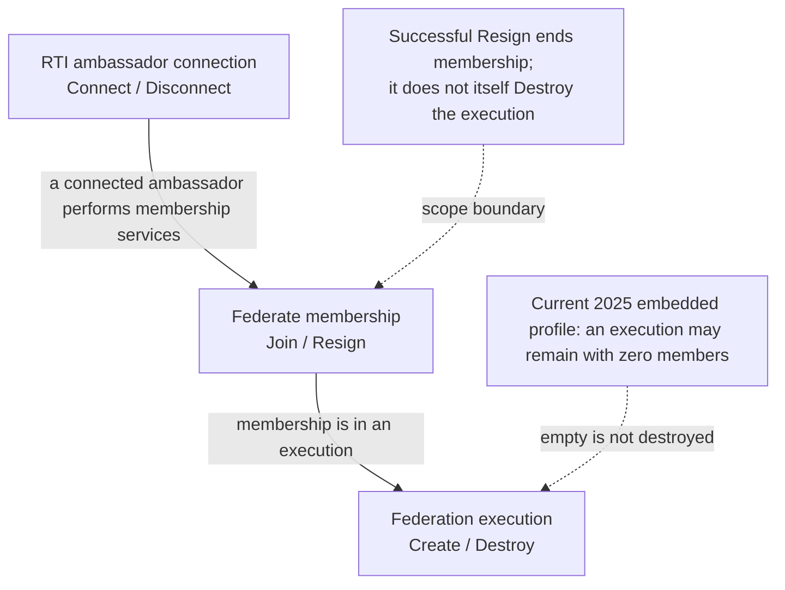

Read this as a scope map, not a single combined state machine. The following
local-ambassador and federation-execution diagrams give their respective
transitions; the Join/Resign and Create/Destroy sequence then shows how those
lifetimes interact in the current 2025 implementation.

### Local ambassador/federate state

The runtime has a small local lifecycle state machine. A rejected Join, Resign,
or Disconnect does not commit the corresponding local transition. Connection
loss is different from voluntary resignation: the local connection state
becomes disconnected while the registry performs forced member cleanup.

```mermaid
stateDiagram-v2
  state "Not connected" as NotConnected
  state "Connected, not joined" as NotJoined
  state "Joined" as Joined

  [*] --> NotConnected
  NotConnected --> NotJoined: connect succeeds
  NotJoined --> Joined: join succeeds
  Joined --> NotJoined: resign succeeds
  Joined --> NotJoined: RTI-initiated resign
  Joined --> NotConnected: connection lost
  NotJoined --> NotConnected: disconnect succeeds
  Joined --> Joined: Join, Resign, or Disconnect rejected; membership unchanged
```

This diagram is local to an RTI ambassador. It does not describe whether the
federation execution exists or how other members are affected.
In particular, the pinned Disconnect contract rejects a joined caller with
`FederateIsExecutionMember`, and the selected lifecycle test observes that
rejected self-transition before Resign ([API](../../third_party/ieee1516.1-2025/include/RTI/RTIambassador.h#L106),
[test](../../cpp/tests/ieee1516_2025_federation_resign_lifecycle_catch2.cpp#L51)).
For the detailed Connect preconditions, configuration result, callback setup,
and post-resign Disconnect teardown, see the
[2025 connection/configuration companion](HLA-2025-CONNECTION-AND-CONFIGURATION-FLOW-GUIDE.md).

### The API distinguishes connection failures from membership failures

These selected exceptions show which connection, membership, or execution
state boundary each service touches. This is not a complete exception list or
a validation-order specification. In particular, member listing reports a
missing execution through its callback contract rather than declaring
`FederationExecutionDoesNotExist` on the request.

| Service | Relevant declared exceptions | State distinction |
| --- | --- | --- |
| [Connect, §4.2](../../third_party/ieee1516.1-2025/include/RTI/RTIambassador.h#L55) | `AlreadyConnected` | A local connection already exists. |
| [Create, §4.5](../../third_party/ieee1516.1-2025/include/RTI/RTIambassador.h#L128) | `NotConnected`; `FederationExecutionAlreadyExists` | A connection is required; creation establishes an execution, not the creator's membership. |
| [Destroy, §4.6](../../third_party/ieee1516.1-2025/include/RTI/RTIambassador.h#L179) | `NotConnected`; `FederatesCurrentlyJoined`; `FederationExecutionDoesNotExist` | A connection is required; the target must exist and have no joined members. |
| [Member listing, §4.9](../../third_party/ieee1516.1-2025/include/RTI/RTIambassador.h#L194) | `NotConnected` | Connection is sufficient in the embedded path; the caller need not join the listed execution. |
| [Join, §4.11](../../third_party/ieee1516.1-2025/include/RTI/RTIambassador.h#L212) | `NotConnected`; `FederationExecutionDoesNotExist`; `FederateAlreadyExecutionMember` | A connection and existing target execution are required; an already-joined caller cannot join again. |
| [Resign, §4.12](../../third_party/ieee1516.1-2025/include/RTI/RTIambassador.h#L250) | `NotConnected`; `FederateNotExecutionMember` | The caller must be connected and joined; successful Resign ends only its membership. |
| [Disconnect, §4.3](../../third_party/ieee1516.1-2025/include/RTI/RTIambassador.h#L110) | `FederateIsExecutionMember` | Membership must be ended before the connected ambassador disconnects. |

In particular, `NotConnected` and `FederateNotExecutionMember` are not
synonyms. The API declarations do not establish which exception takes
precedence if more than one listed condition applies. Umbra's additional
`NotConnected` result for Disconnect is an implementation observation, not an
exception listed by the pinned Disconnect declaration; see the companion's
[Disconnect evidence](HLA-2025-CONNECTION-AND-CONFIGURATION-FLOW-GUIDE.md#3-disconnect-requires-an-unjoined-connection-and-tears-down-in-order).
For member listing, the same embedded
[query flow](#federation-member-listing-reports-a-snapshot) shows the
connected-but-unjoined caller and callback-reported missing execution; do not
generalize that implementation path to the process endpoint.
The selected [embedded lifecycle case](../../cpp/tests/ieee1516_2025_federation_resign_lifecycle_catch2.cpp#L4)
exercises successful Create/Destroy, duplicate Create/Join, and Destroy while
members remain, but not disconnected Create/Destroy calls. The [member-list
test helper](../../cpp/tests/ieee1516_2025_federation_listing_test_support.hpp#L43)
does check `NotConnected` before connecting its unjoined observer. Read this as
a service-scope comparison, not as a complete seven-service test matrix.

### Federation-execution state

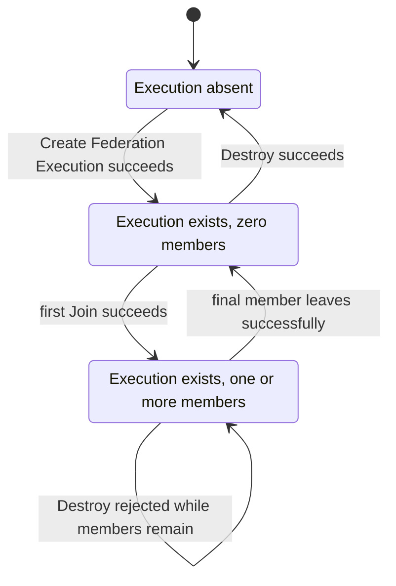

The empty-execution state is a real, useful state, not a synonym for
“destroyed.” It allows a later federate to join the same execution. The 2025
final-member tests additionally show the implementation's mandatory object
cleanup at that boundary; see the resignation section below.

## Federation member listing reports a snapshot

`listFederationExecutionMembers` is an observation, not a Join or a membership
subscription. In the embedded 2025 path, a connected ambassador can request a
list without itself joining the named execution. The adapter captures the
current members, builds a report, and submits a callback task. If the named
execution is absent, it submits `reportFederationExecutionDoesNotExist`
instead; absence is not a synchronous `FederationExecutionDoesNotExist` throw
in this path. A disconnected caller is rejected synchronously with
`NotConnected` before a report is submitted.

The captured member vector is a point-in-time snapshot. With `HLA_EVOKED`,
membership can change after the service call but before the application evokes
the report, so the delivered list need not describe callback-time membership.
The focused test checks the EVOKED success and missing-execution callbacks. The
test does not change membership between request and evoke, so snapshot
staleness is inferred from the source's copy-before-dispatch order rather than
demonstrated as a race scenario. The
adapter uses the shared dispatcher, whose immediate model drains during
`submit`, but the listing test's immediate-mode assertion exercises
`listFederationExecutions`, not this member-list service; direct IMMEDIATE
coverage for `listFederationExecutionMembers` remains a test gap.

### Process-endpoint boundary: no member-list route is established

The public adapter body currently takes the embedded federation-management
lock and reads `embeddedFederationManagement().registry().membersFor(...)`;
unlike neighboring process-backed services, this method has no
`processEndpointActive_` branch ([adapter](../../cpp/src/internal/runtime/umbra_rti_ambassador.cpp#L2576)).
The process transport operation inventory, client federation-management
methods, and service dispatch cover Create, Destroy, Join, and Resign but have
no member-list operation ([operation enum](../../cpp/src/internal/federation/transport_service_protocol.hpp#L21),
[client methods](../../cpp/src/internal/federation/process_federation_client_federation_management.cpp#L15),
[service dispatch](../../cpp/src/internal/federation/process_federation_service_dispatch.cpp#L13)).
The focused listing test is explicitly an embedded development-profile case
([test entry](../../cpp/tests/federation_listing_catch2.cpp#L72)); no
process-specific member-list test was found in this survey.

Therefore the copied-vector snapshot and callback timing above are evidenced
for the embedded route only. This adapter cannot obtain process-owner
membership through the process transport, and the exact result of invoking it
with a process-connected ambassador has not been tested. Treat that as a
process routing/coverage gap; do not infer a valid process snapshot, an empty
report, or process parity from the shared public API signature. This is an
implementation observation, not a normative interpretation or a statement
about the separate 2010 reference-RTI stream.

The pinned 2025 C++ API labels the request §4.9 and the success / missing
callbacks §4.10 / §4.11 ([request](../../third_party/ieee1516.1-2025/include/RTI/RTIambassador.h#L194),
[member report](../../third_party/ieee1516.1-2025/include/RTI/FederateAmbassador.h#L54),
[missing-execution report](../../third_party/ieee1516.1-2025/include/RTI/FederateAmbassador.h#L61)).
These clause labels and interface shapes orient the reader; the implementation
flow below is source-observed behavior, not a complete normative clause
interpretation.

### Public HLA shape: a query produces a report, not a membership feed

Read the public interface as one request followed by its corresponding member
listing or missing-execution report. The callback model governs when the
application observes that report; it does not turn this query into a standing
subscription to Join and Resign events. This is an API-role map, not a claim
about the exact snapshot instant or callback ordering; the sequence below is
the embedded implementation trace.

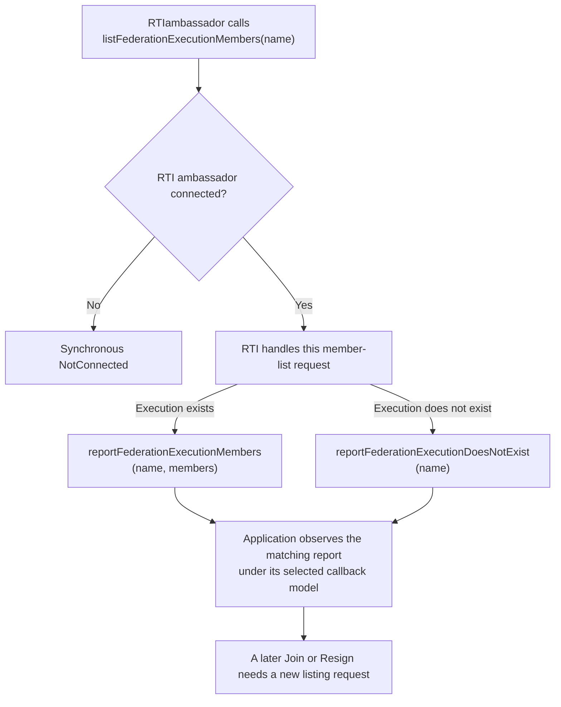

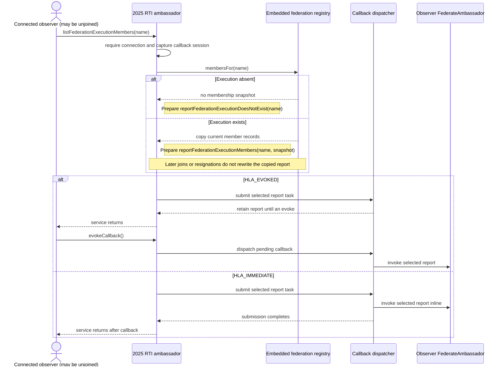

This query does not create a lasting member feed: a later Join or Resign is not
automatically reported by this request. Ask again for a new snapshot. The
embedded source and focused EVOKED case are linked in the evidence map; no
equivalent process-endpoint member-list path is claimed here.

## Create, join, and destroy

Creation validates a federation definition and establishes federation-owned
catalog, handle directories, switches, and time-coordination state. Join
creates a new member identity and registers that member with the execution's
coordination and callback routes. Destroy is a separate operation and is
rejected while members remain (or the time coordinator is not empty).

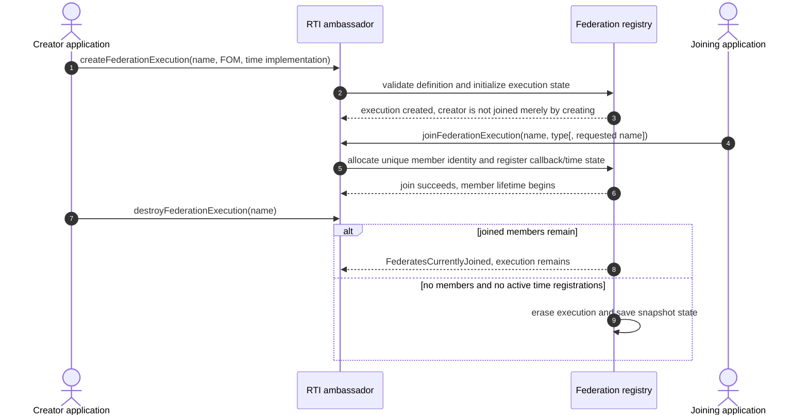

In this implementation, additional-FOM joins reconcile handle directories
against the replacement catalog and cannot silently change the time
implementation while existing members are joined. These are useful review
boundaries, not an exhaustive account of FOM merge rules; composition belongs
to its own documentation and tests.

There is also a post-commit failure edge in the embedded implementation: the
registry commits the additional modules and new membership together, then the
ambassador initializes joined-federate service-report/lifecycle state. If that
later setup fails, rollback resigns the applicant but does not restore the
previous catalog. This is source-observed, not an HLA rule, and no focused test
covers catalog state after an additional-FOM post-commit failure. See the FOM
guide's [additional-module Join boundary](HLA-2025-FOM-MODULE-ADMISSION-AND-COMPOSITION-FLOW-GUIDE.md#join-with-additional-fom-modules-replace-definition-and-add-member-together).

The ordinary 2025 federation-lifecycle scenario exercises invalid creation
designators, duplicate execution creation, duplicate member names, disconnect
while joined, destroy while joined, a valid additional-FOM join, invalid
ResignAction rejection, successful resignations, and explicit destroy after
the members leave. See the evidence table for the exact source and test.

### The federation and member MOM projections follow different scopes

The 2025 MIM defines one RTI-owned `HLAmanager.HLAfederation` instance per
execution and one `HLAmanager.HLAfederate` instance per joined federate
([federate class](../../third_party/ieee1516.2-2025/resources/mim/HLAstandardMIM-2025.xml#L52),
[federation class](../../third_party/ieee1516.2-2025/resources/mim/HLAstandardMIM-2025.xml#L658)). The
diagram connects those cardinalities to the lifecycle above. It is an Umbra
implementation overlay, not a claim that the standard prescribes this setup
order or callback timing. `HLAfederation` is ensured during non-legacy 2025
Join setup; each production-backed member lifetime gets its own report-file
location and `HLAfederate` snapshot.

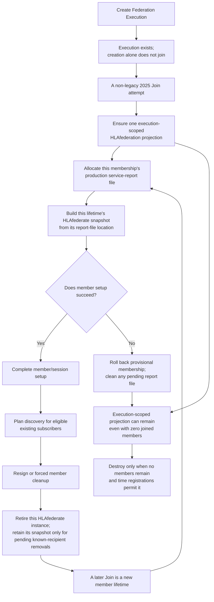

Read the two branches as different owners, not as one MOM object's lifetime.
Successful Resign ends membership and retires that member's public object;
the callback-time removal ledger may temporarily retain its private snapshot.
The `HLAfederation` object is execution-scoped; its conditional
`HLAfederatesInFederation` value represents the current membership set. The
embedded [membership-boundary test](../../cpp/tests/ieee1516_2025_federation_mom_membership_boundaries_catch2.cpp#L4)
observes that conditional reflection; the inspected process MOM cases do not
directly observe `HLAfederation` discovery or those reflections. See the
separate [federation-scoped MOM
flow](HLA-2025-FEDERATION-MOM-FLOW-GUIDE.md#one-object-belongs-to-the-federation-execution)
and [joined-federate MOM lifecycle](HLA-2025-JOINED-FEDERATE-MOM-OBJECT-LIFECYCLE-FLOW-GUIDE.md#resignation-removes-visibility-before-forgetting-the-snapshot)
for their detailed flows.

Connect and Disconnect bound which local ambassador can invoke these services;
they do not own either MOM object's lifetime, and Resign remains separate from
Disconnect. The source ordering is profile-specific: the [embedded Join
path](../../cpp/src/internal/runtime/umbra_rti_ambassador_federation_lifecycle.cpp#L604)
establishes federation state before report/MOM setup, then applies its local
Join transition and plans discovery; the [process Join
handler](../../cpp/src/internal/federation/process_federation_service_lifecycle.cpp#L257)
commits its session before planning discovery. In the embedded source, a
setup failure after establishing `HLAfederation` rolls back the provisional
member but does not remove the execution-scoped record; no focused
failed-first-Join test currently exercises that edge. The process
[report-file test](../../cpp/tests/ieee1516_2025_connection_process_joined_federate_mom_report_file_catch2.cpp#L499)
observes a fresh `HLAfederate` identity and a distinct report path after
rejoin while the prior file remains intact. That is bounded process evidence,
not a claim of complete endpoint parity. A test-only in-memory report store
does not invent a public path, and the 2025 runtime's [2010 compatibility
guard](../../cpp/src/internal/runtime/umbra_rti_ambassador_federation_lifecycle.cpp#L604)
does not synthesize these 2025 MOM projections for a 2010 FOM.

### A Join does not define every active protocol's participant set

Joining changes federation membership, but any in-flight protocol that tracks
participants has its own admission rule. Keep the following 2025 evidence
separate; this map is a cross-guide orientation, not one combined Join
algorithm or a normative claim about all profiles.

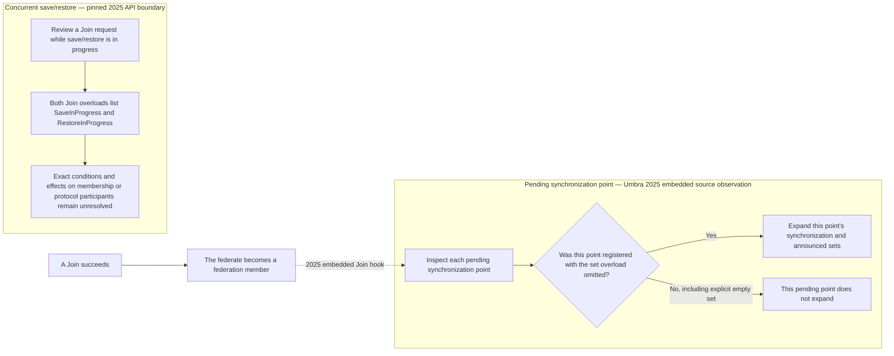

The synchronization branch is an Umbra implementation observation, not a
claim that IEEE 1516.1 requires this late-join expansion. The [embedded Join
hook](../../cpp/src/internal/runtime/umbra_rti_ambassador_federation_lifecycle.cpp#L747),
[registry expansion gate](../../cpp/src/internal/federation/federation_registry.cpp#L233),
and [stored overload-presence flag](../../cpp/src/internal/federation/federation_registry.cpp#L174),
together with the [focused registry test](../../cpp/tests/ieee1516_2025_federation_registry_synchronization_point_late_join_explicit_set_catch2.cpp#L16),
show expansion for an omitted-set point and no expansion for an explicit
non-empty set. Explicit-empty behavior and a partial-achievement-before-Join
interleaving are source-derived, not covered by that test; see the
[synchronization guide](HLA-2025-FEDERATION-SYNCHRONIZATION-FLOW-GUIDE.md#late-joiners-change-only-an-expandable-barrier)
for their exact boundaries.
The save/restore branch is intentionally unresolved: the pinned API annotations
name `SaveInProgress` and `RestoreInProgress`, but do not establish every
precondition or what happens to either protocol's participant set. See the
[save/restore Join boundary](HLA-2025-FEDERATION-SAVE-RESTORE-FLOW-GUIDE.md#join-crosses-a-separate-membership-admission-boundary)
for the evidence layers and the §4.11 follow-up. Do not transfer the
synchronization-point rule to save/restore, nor infer 2010 or process-profile
parity from these 2025 observations.

## Voluntary resignation: validate before removing membership

In the selected 2025 embedded path, resignation is not just a local state
toggle. Umbra first validates the
action and current member state, then evaluates pending ownership work,
attribute ownership, delete privilege, and callback routes needed by that
action. A rejected resignation leaves the member joined. On success the
registry applies the selected cleanup, removes the member from time and
declaration ledgers, clears its reservations/regions and per-instance
knowledge, then erases the member identity. The local ambassador transitions
out of the joined state and discards callbacks that are stale for that
departing member; callbacks prepared for survivors are delivered on their own
routes.

The callback-reset description above is specific to the selected 2025 embedded
path. Do not transfer it to the distinct process endpoint: successful process
Resign cancels exception-report projections but does not reset the shared
dispatcher queue. See the [process-profile Resign trace in the callback
guide](HLA-2025-CALLBACK-AND-SERVICE-ORDERING-FLOW-GUIDE.md#process-profile-resign-and-queued-callback-work).
That source-derived trace shows a possible dispatch path; it does not establish
that unrelated queued work is delivered after Resign or that such delivery is
normatively permitted.

### ResignAction names requested cleanup; they are not the leave transition

The pinned 2025 API presents `ResignAction` as one enum choice. Use its names
to distinguish the cleanup a caller requests from the RTI's admission checks
and from the successful end of membership:

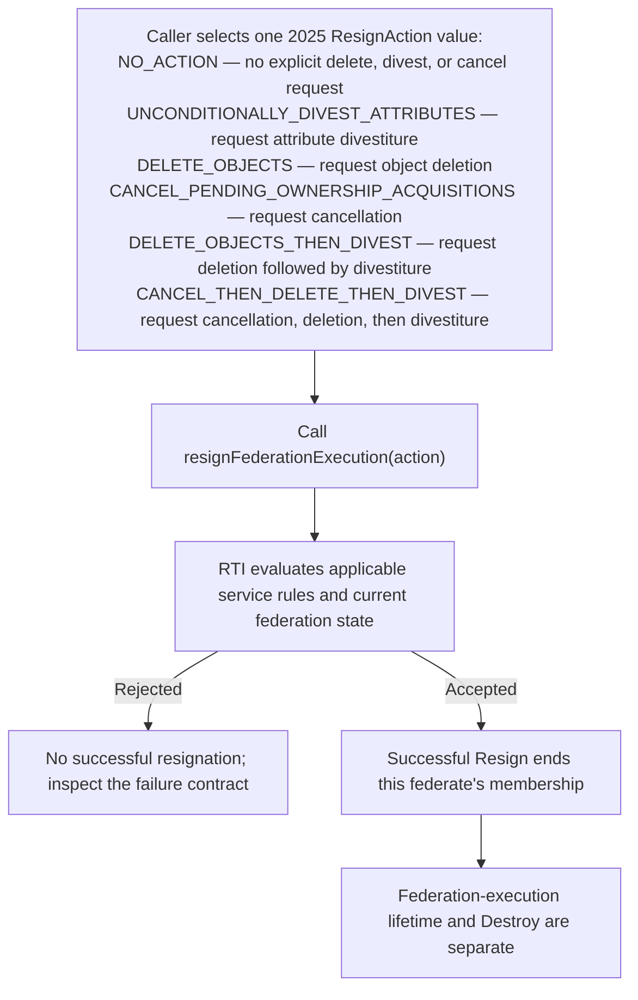

This is an orientation map of API vocabulary, not a normative decision table:
an action name does not guarantee the requested cleanup can complete, and
`NO_ACTION` does not mean “no state can change.” Exact guards, ordering, and
effects require the full standard and profile evidence. The pinned
[`ResignAction` enum](../../third_party/ieee1516.1-2025/include/RTI/Enums.h#L34)
and [`resignFederationExecution` declaration](../../third_party/ieee1516.1-2025/include/RTI/RTIambassador.h#L250)
anchor the API terms; the implementation-specific sequence and selected
embedded action cases below show only their bounded profile behavior. The
three-lifetimes overview above keeps successful membership departure separate
from destruction of the execution.

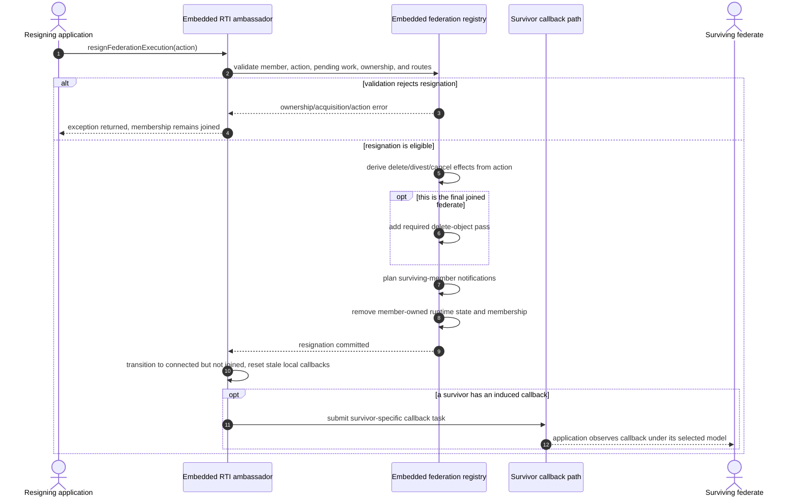

Keep the departing and surviving callback paths separate. The embedded
ambassador resets the leaver's local callback queue, then submits induced
ownership/removal work to the surviving members' own routes
([queue reset](../../cpp/src/internal/runtime/umbra_rti_ambassador_federation_lifecycle.cpp#L990),
[survivor work submission](../../cpp/src/internal/runtime/umbra_rti_ambassador_federation_lifecycle.cpp#L1058)).
In the focused `HLA_EVOKED` `DELETE_OBJECTS_THEN_DIVEST` case, the resign call
returns while the peer's removal and assumption callbacks are still
unobserved; later `evokeCallback` observes assumption before removal
([test](../../cpp/tests/ieee1516_2025_embedded_resign_action_delete_then_divest_catch2.cpp#L62)).
That is one embedded scenario, not a general ResignAction ordering rule. Read
the [callback-model guide](HLA-2025-CALLBACK-AND-SERVICE-ORDERING-FLOW-GUIDE.md)
for the broader immediate-versus-evoked observation boundary; neither this
diagram nor the cited action test establishes the corresponding
`HLA_IMMEDIATE` action-specific sequence or a normative before/after-return
rule.

Keep the process-endpoint observation separate: its selected `HLA_EVOKED`
`NO_ACTION` resign/rejoin test observes removal of the old joined-federate MOM object
before discovery and reflection of the new membership's object. That is a
process-profile MOM-lifecycle case, not evidence for process parity across the
six user-selected cleanup actions or for a general callback-order rule; see
the [joined-federate MOM guide](HLA-2025-JOINED-FEDERATE-MOM-OBJECT-LIFECYCLE-FLOW-GUIDE.md#separate-2025-process-endpoint-evidence).

### A resignation during an active save fails the save for survivors

This embedded 2025 `HLA_EVOKED` case exposes two separate gates. A callback
cannot call `resignFederationExecution` while it is being invoked; after that
callback returns, the same member may resign. If a save is still active, the
registry plans `FEDERATE_RESIGNED_DURING_SAVE` for the remaining members, clears
the save operation, and then removes the departing member. The departing member
does not receive a stale save-failure callback after its callback route is
reset.

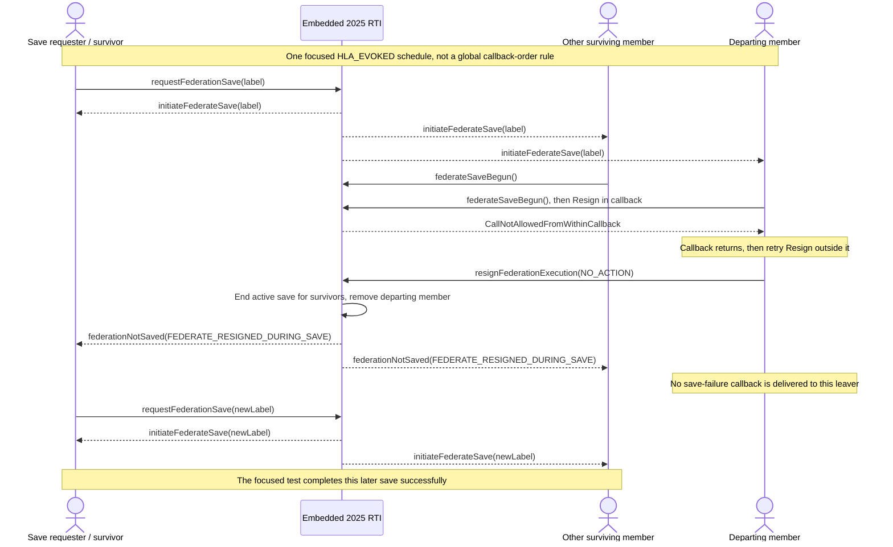

The test deliberately drives the `Held` member's initiation first, then invokes
the departing member's callback so it can distinguish the in-callback
`CallNotAllowedFromWithinCallback` from the successful retry after callback
return. It asserts that the owner and held member each receive one
`FEDERATE_RESIGNED_DURING_SAVE` failure, the leaver receives none, and the
survivors can start and complete a fresh save. This is an embedded
development-profile observation, not a cross-profile ordering or conformance
claim. A separate `HLA_IMMEDIATE` case confirms the save-failure reason and a
successful later save for one survivor, but it does not cover multiple
survivors or the in-callback resignation guard shown here
([companion case](../../cpp/tests/ieee1516_2025_federation_management_save_restore_catch2.cpp#L230)).
The registry also applies the corresponding
`FEDERATE_RESIGNED_DURING_RESTORE` failure to surviving restore participants;
the separate `HLA_IMMEDIATE` restore scenario is linked in the evidence map.

### ResignAction effects in the current implementation

This is a compact reading aid, not the full normative decision table. Exact
preconditions and action ordering must be checked in the standard and source.
The ownership-specific pending-acquisition guard and member-scoped
reject-versus-cancel path are diagrammed in the [ownership persistence and
resignation companion](HLA-2025-OWNERSHIP-PERSISTENCE-AND-RESIGNATION-FLOW-GUIDE.md#2-resignation-with-pending-acquisition-work);
the table here stays focused on object and divestiture effects.

| Action family | Current implementation effect | Important guard or caveat |
| --- | --- | --- |
| NO_ACTION | No requested object deletion or unconditional divestiture. | A voluntary resign can be rejected while the member still owns attributes or has certain pending acquisitions. |
| UNCONDITIONALLY_DIVEST_ATTRIBUTES | Request attribute divestiture without requesting object deletion. | Ownership callbacks and pending negotiations affect the path; see the ownership guide. |
| DELETE_OBJECTS | Request deletion of objects for which the member holds delete privilege. | May be rejected if owned attributes would remain on an object it cannot delete. |
| DELETE_OBJECTS_THEN_DIVEST | Delete eligible objects, then divest remaining owned attributes. | Its combination of effects differs from DELETE_OBJECTS alone. |
| CANCEL_PENDING_OWNERSHIP_ACQUISITIONS | Cancel pending acquisition work. | Does not by itself request object deletion or general divestiture. |
| CANCEL_THEN_DELETE_THEN_DIVEST | Combine acquisition cancellation, eligible object deletion, and divestiture. | Keep each phase visible; do not treat it as an alias for another action. |

#### The pending-acquisition preflight is role-sensitive

In the 2025 **embedded registry**, the voluntary-resign guard is not a check for
“any pending ownership callback.” It scans these five registry records before
the action mutates state. For four action values—`NO_ACTION`,
`UNCONDITIONALLY_DIVEST_ATTRIBUTES`, `DELETE_OBJECTS`, and
`DELETE_OBJECTS_THEN_DIVEST`—a matching record rejects the attempt with the
ownership-acquisition-pending result. The two cancellation actions instead
proceed to remove the departing member's side of their pending work. On forced
connection loss, this rejection is skipped and acquisition-side cancellation
is enabled regardless of the configured directive. See the [guard and action
classification](../../cpp/src/internal/federation/federation_registry_resign_lifecycle.cpp#L80),
[role-sensitive record scan](../../cpp/src/internal/federation/federation_registry_resign_lifecycle.cpp#L146),
and [member-scoped cancellation pass](../../cpp/src/internal/federation/federation_registry_resign_lifecycle.cpp#L462).

| Record examined by the guard | Which role makes this member count? |
| --- | --- |
| Regular attribute-ownership acquisition request | The member is the requester. |
| If-Available acquisition request | The member is the requester, including a queued willing-to-acquire outcome. |
| Pending acquisition-cancellation record | The member is the requester whose cancellation is still tracked. |
| Negotiated-divestiture candidate | The member is the prospective acquiring federate. |
| Pending Confirm Divestiture notification | The member is the notification recipient. |

This is deliberately narrower than “all ownership-related state.” For
example, pending If-Wanted divestiture notifications are removed in the
cancellation pass by recipient identity, but are not one of the five records
used by this rejection guard. Ownership-query records and queued assumption
callback markers are invalidated by separate cleanup steps. Identify the
underlying record and the member's role before predicting whether a voluntary
attempt rejects, cancels work, or merely suppresses a stale callback.

The cancellation action also does not guarantee that resignation succeeds:
the independent owned-attribute guard can still reject a member that requested
neither deletion nor divestiture. Likewise, the mandatory final-member delete
pass does not bypass the earlier pending-acquisition check. These are
embedded-source observations, not the full normative decision table or a
process-profile claim. The focused embedded tests demonstrate regular-request
rejection and cancellation, If-Available cleanup, and negotiated-candidate
cleanup; they do not exercise every record/action cross-product or the forced-
loss overlay.

For the current implementation, the last joined member causes a delete-object
pass even if it supplied NO_ACTION. This does not mean the federation
execution itself is destroyed. In the focused test, the last member resigns
with NO_ACTION, rejoins the same still-existing execution under a fresh member
lifetime, and reserves the name of the object removed during final-member
cleanup. For the per-receiver known-object commit and the distinction from
`localDeleteObjectInstance`, see the [object and interaction flow guide's
disappearance comparison](HLA-2025-OBJECT-AND-INTERACTION-INFORMATION-FLOW-GUIDE.md#diagnose-disappearance-by-asking-which-state-changed).

## Connection loss: forced resignation is a different entry path

Connection loss is not an application call to
`resignFederationExecution(action)`: the adapter reports the failed connection,
and the registry reads the last automatic directive stored for that member
before entering the shared resignation transition with a forced-loss flag.
Keep the configured action, forced-loss cleanup, and last-member rule separate:

| Layer | Current 2025 implementation effect | Evidence boundary |
| --- | --- | --- |
| Per-member automatic directive | Supplies the ordinary action-specific delete/divest/cancellation plan selected for this lost membership. The registry reads that member's stored value at loss; it is not a new action chosen by the disconnected application. | The [registry loss entry](../../cpp/src/internal/federation/federation_registry.cpp#L424) reads the member value; [Join seeds each member from the composed FDD](../../cpp/src/internal/federation/federation_registry_membership_lifecycle.cpp#L390). |
| Forced-loss safety overlay | Cancels the departed member's pending acquisition work regardless of the selected directive. If it still owns attributes, the transition also sends those through divestiture processing even for `NO_ACTION` (or `DELETE_OBJECTS` without delete privilege). This does not itself imply object deletion. | The [forced transition](../../cpp/src/internal/federation/federation_registry_resign_lifecycle.cpp#L108) sets acquisition cancellation and [forces the owned-attribute divest path](../../cpp/src/internal/federation/federation_registry_resign_lifecycle.cpp#L259). An [embedded `NO_ACTION` loss case](../../cpp/tests/ieee1516_2025_connection_lost_automatic_no_action_forced_resign_catch2.cpp#L5) observes a retained object, an ownership-assumption callback, and no removal callback. |
| Last joined member | Adds the final-member object-deletion pass regardless of the supplied action. This is the last-member rule, not a connection-loss-only rule; ordinary object eligibility still applies. | The [final-member transition](../../cpp/src/internal/federation/federation_registry_resign_lifecycle.cpp#L117) and focused [final-member transport-loss case](../../cpp/tests/ieee1516_2025_connection_lost_final_federate_directive_two_catch2.cpp#L5) are implementation/scenario evidence, not a complete normative decision table. |

This is a map of Umbra's 2025 path, not an independent interpretation of the
standard's full `ResignAction` requirements. Survivor callbacks remain subject
to known-object state, support switches, and usable callback routes.

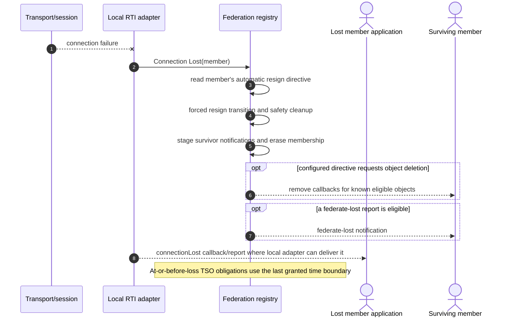

The callback to the lost application is local adapter reporting; it is not a
message sent over the connection that has already failed. Whether survivors
receive removal or federate-lost notifications depends on the configured
directive, known objects, support switches, callback routes, and profile.
Connection-loss TSO cutoff behavior is deliberately only marked here; the
[time-management guide](HLA-2025-TIME-MANAGEMENT-GUIDE.md) owns timestamp
eligibility and delivery ordering.
The same membership transition can also close or preserve a pending
synchronization barrier; see the [2025 synchronization guide's member-departure
boundary](HLA-2025-FEDERATION-SYNCHRONIZATION-FLOW-GUIDE.md#member-departure-can-close-a-pending-barrier).

### The automatic directive is seeded per member, then overridden per member

The composed FDD's `HLAautomaticResignAction` support-switch value seeds each
membership when it joins. `getAutomaticResignDirective` reads that member's
value and `setAutomaticResignDirective` changes only the caller's membership;
it does not rewrite the federation default or a peer's directive. The
[support-switch scenario](../../cpp/tests/support_switch_state_catch2.cpp#L4)
checks the FDD seed and peer-isolated override. A separate embedded
[`DELETE_OBJECTS` loss case](../../cpp/tests/ieee1516_2025_connection_lost_automatic_delete_resign_directive_catch2.cpp#L5)
checks the configured action's removal result.

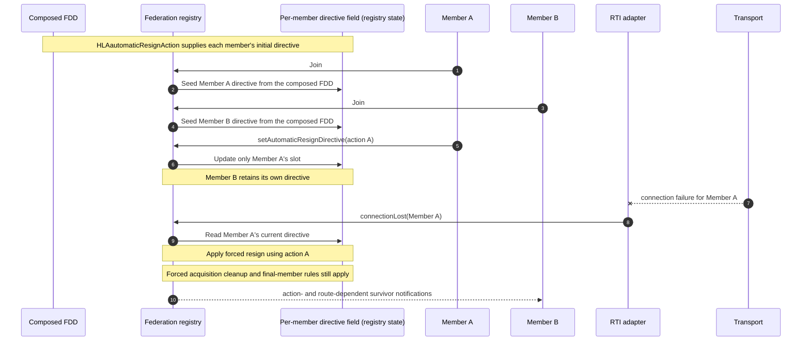

The [embedded pending-acquisition loss case](../../cpp/tests/ieee1516_2025_connection_lost_automatic_cancel_pending_acquisition_catch2.cpp#L5)
also observes stale acquisition-side work being suppressed, but configures
`CANCEL_PENDING_OWNERSHIP_ACQUISITIONS` itself; it does not by itself prove
that the forced overlay is independent of the selected action. The `NO_ACTION`
owned-attribute case above demonstrates forced divestiture under a different
directive. Together these remain selected embedded 2025 scenarios, not the
full action/ownership-state matrix.

The 2025 process profile has a separate entry path: its
[`ProcessFederationService::connectionLost`](../../cpp/src/internal/federation/process_federation_service_connection_loss.cpp#L164)
passes endpoint loss through the registry and projects the resulting events.
Adapter-managed process TCK scenarios cover configured
[`UNCONDITIONALLY_DIVEST_ATTRIBUTES`](../../packages/hla-rti-cpp-tck/src/tck_connection_lifecycle.cpp#L252)
and [`CANCEL_PENDING_OWNERSHIP_ACQUISITIONS`](../../packages/hla-rti-cpp-tck/src/tck_connection_lifecycle.cpp#L358);
the [current-process runner](../../packages/hla-rti-cpp-tck/adapters/current-process/run_connection_loss.py#L232)
selects the loss fixture. Those scenario sources do not cover the process
profile's forced overlay under `NO_ACTION`, nor do they establish profile
parity or a callback-order guarantee. These were inspected, not run in this
documentation pass.

### Process endpoint: server loss and local callback use separate paths

The current-process fault fixture first applies forced registry loss—through
`ProcessFederationService::connectionLost` for the Federate-Lost report
scenario, or the equivalent registry-plus-dispatch path for the cleanup
scenarios—then calls `service.detach(receiver)` and closes the receiver socket.
This is an adapter-managed schedule, not evidence that a production server
automatically maps an arbitrary socket EOF to registry cleanup; a bounded scan
found no caller of the service helper in `cpp/src`.

The client observes the later transport failure separately. Its local adapter
marks the process endpoint disconnected and submits the `connectionLost`
callback to the shared dispatcher; that handler neither performs server-side
registry cleanup nor resets the dispatcher. Server-session events, frames
buffered in the process client, and tasks already submitted to the callback
dispatcher are therefore distinct stores. The failed-request path dispatches
transport failures rather than draining buffered events, while client close
clears those buffers. Existing process TCK scenarios exercise the local
`connectionLost` callback under both callback models and the fixture's selected
survivor effects, but do not assert post-loss delivery of a buffered event or
an already-queued unrelated callback. The callback guide's
[backend-specific ConnectionLost map](HLA-2025-CALLBACK-AND-SERVICE-ORDERING-FLOW-GUIDE.md#connectionlost-producer-exception-containment-and-backend-specific-cleanup)
covers the shared-dispatcher boundary; the following diagram focuses on how
the server fixture, client buffer, and callback queue differ.

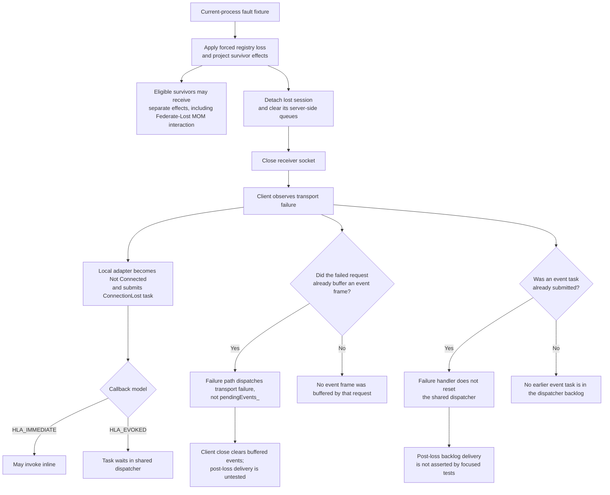

Process evidence: the [current-process fixture applies forced loss, detaches,
and closes the receiver](../../cpp/tests/process_federation_service_probe.cpp#L1036);
the [service detach](../../cpp/src/internal/federation/process_federation_service.cpp#L61)
removes its session, and the [connection-loss projection](../../cpp/src/internal/federation/process_federation_service_connection_loss.cpp#L19)
forms survivor effects. The client [buffers event frames](../../cpp/src/internal/federation/process_federation_client.cpp#L427),
then its [failed-request path](../../cpp/src/internal/federation/process_federation_client.cpp#L504)
dispatches transport failures without draining those events; [client close](../../cpp/src/internal/federation/process_federation_client_callback_dispatch.cpp#L567)
clears them. The local [process failure handler](../../cpp/src/internal/runtime/umbra_rti_ambassador_membership_loss.cpp#L104)
submits the callback, while the shared [dispatcher](../../cpp/src/internal/callbacks/callback_dispatcher.cpp#L122)
retains its normal callback-model behavior. The process TCK [waits for the standard
callback](../../packages/hla-rti-cpp-tck/src/tck_connection_lifecycle.cpp#L167);
the recorded [installed-package runs](../../packages/hla-rti-cpp-tck/README.md#L5010)
cover both callback models, not the pending-event backlog shown above.

### Active save and restore during connection loss

This is an Umbra 2025 connection-loss effect, not a general HLA rule for an
arbitrary RTI that detects a broken transport. The per-member automatic
directive and forced-loss cleanup above govern the member's object and
ownership disposition. Keep that membership exit separate from the
federation-wide Save/Restore operation state: in this implementation, the
common resignation transition also checks whether a Federation Save or Restore
is active. The [connection-loss entry](../../cpp/src/internal/federation/federation_registry.cpp#L424)
enters the common
[resignation transition](../../cpp/src/internal/federation/federation_registry_resign_lifecycle.cpp#L13),
whose [save and restore failure branches](../../cpp/src/internal/federation/federation_registry_resign_lifecycle.cpp#L438)
do not depend on the `forcedConnectionLoss` flag. If a save is active, the
registry plans `FEDERATE_RESIGNED_DURING_SAVE` completion notifications for
eligible remaining participants and clears the operation before removing the
lost member. Save participants still at `NO_SAVE_IN_PROGRESS` and participants
without a usable callback route are omitted. An active restore is similarly
failed with `FEDERATE_RESIGNED_DURING_RESTORE`, excluding the lost member and
members without a usable route, then cleared. The shared
[completion-notification planners](../../cpp/src/internal/federation/federation_registry.cpp#L471)
show these recipient gates. This operation failure is orthogonal to the
configured ResignAction and last-member object cleanup.

The adapter projection differs by 2025 profile. The embedded membership-loss
adapter takes both notification vectors from the registry result and submits
them through the ordinary Save/Restore callback paths to the surviving
members ([extraction](../../cpp/src/internal/runtime/umbra_rti_ambassador_membership_loss.cpp#L240),
[submission](../../cpp/src/internal/runtime/umbra_rti_ambassador_membership_loss.cpp#L415)).
The local `connectionLost` report is a separate adapter callback; it is not
sent to the lost endpoint over the failed connection. By contrast, both
process [connectionLost](../../cpp/src/internal/federation/process_federation_service_connection_loss.cpp#L164)
and voluntary process [handleResign](../../cpp/src/internal/federation/process_federation_service_request_handlers.cpp#L160)
pass their registry result through
[`dispatchConnectionLossResult`](../../cpp/src/internal/federation/process_federation_service_connection_loss.cpp#L19).
That dispatcher projects ownership work, object removals, synchronization
notifications, and an eligible federate-lost report, but does not enqueue the
result's Save or Restore notifications. Current source therefore shows the
process registry clearing an active operation without this dispatcher
delivering its planned failure events. This is a source-observed
implementation gap, not a verified runtime outcome or a portable HLA
guarantee.

The existing [voluntary active-save scenario](../../cpp/tests/ieee1516_2025_save_active_callback_resignation_guard_catch2.cpp#L4)
and [voluntary restore-resignation scenario](../../cpp/tests/ieee1516_2025_federation_management_save_restore_catch2.cpp#L365)
exercise the reason codes on embedded resignation paths, not transport loss.
No focused connection-loss-during-active-save/restore case was found in the
connection-loss Catch2 files or the process connection-lifecycle TCK source;
none was run for this audit. Keep the existing voluntary resignation sequence
as a comparator, not as proof of connection-loss callback delivery. The
[Save/Restore guide](HLA-2025-FEDERATION-SAVE-RESTORE-FLOW-GUIDE.md) owns the
operation protocol; this lifecycle guide records the membership-loss edge.
No 2010 behavior or profile parity is inferred.

### A lost regulator's TSO cutoff is a narrow exception

Umbra captures the lost time-regulating member's **last granted logical
time** before forced resignation removes its temporal state. For each of that
member's accepted TSO messages, the embedded registry marks loss-specific
delivery work only when the message time is comparable and `message time <=
cutoff`. A later message receives no guarantee from this cutoff rule; that is
not the same as proving every later message is immediately discarded. The
capture and marker are visible in the [forced-resign transition](../../cpp/src/internal/federation/federation_registry_resign_lifecycle.cpp#L29)
and its [TSO ledger update](../../cpp/src/internal/federation/federation_registry_resign_lifecycle.cpp#L1001).

Removing the regulator can leave the ordinary grant bound undefined. In that
case, a constrained receiver may use the narrow post-loss grant path only when
it has a time-advance request whose requested time reaches the earliest
pending marked message. A receiver that had not requested time before the loss
can still make a later request; the [grant exception](../../cpp/src/internal/federation/federation_registry.cpp#L1181)
is not a general way for an unregulated federate to receive arbitrary TSO
traffic. The source identifies this as the 2025 clause 4.4 behavior; the flow
below documents Umbra's implementation, not an independent interpretation of
the normative clause.
This diagram follows the embedded registry and its embedded transport-fault
tests only; selected process-endpoint lifecycle coverage elsewhere in this
guide does not establish equivalent process TSO-cutoff behavior.

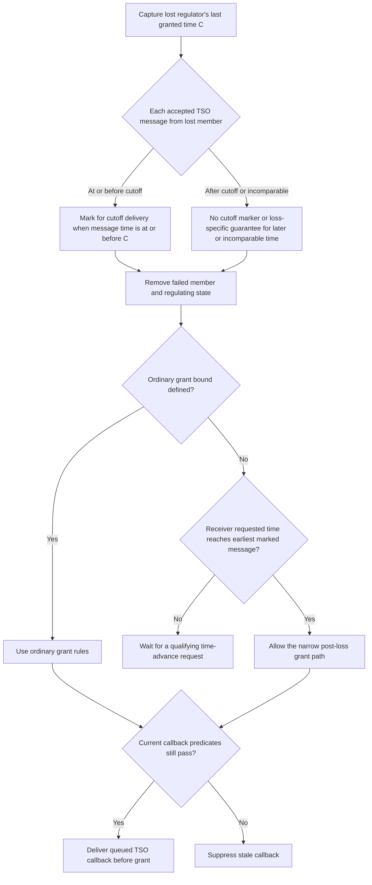

The exact-time and strictly-before tests exercise delivery at timestamps 6
and 5 against a lost regulator's last grant at 6; a separate test establishes
that a receiver can request time after the loss and then reach a marked
timestamp. These focused tests assert the TSO callback precedes the associated
grant callback. A further test unsubscribes after loss: the cutoff does not
override callback-time eligibility, so the attribute reflection is suppressed
and object cleanup follows its own later boundary. See the [cutoff test](../../cpp/tests/ieee1516_2025_connection_lost_tso_cutoff_catch2.cpp#L5),
[strictly-before test](../../cpp/tests/ieee1516_2025_connection_lost_tso_cutoff_less_than_catch2.cpp#L5),
[later-request test](../../cpp/tests/ieee1516_2025_connection_lost_tso_cutoff_later_tar_catch2.cpp#L5),
and [stale-subscription cleanup test](../../cpp/tests/connection_loss_attribute_update_tso_suppressed_cleanup_catch2.cpp#L154).
The TSO and retraction guides still own general timestamp legality, recipient
ledger transitions, and Retract behavior.

## What is state that survives an exit?

The useful cross-guide distinction is not simply “member left.” Ask separately
what happens to the departing member's local route, what survivors can observe,
what happens to objects, and whether the execution still exists. This is a
reader map of current 2025 implementation evidence, not a normative decision
table. Pending-acquisition and final-member cleanup details, and the
role-specific save-callback example, are embedded-profile observations; they do
not establish process-endpoint parity. Callback eligibility and detailed
object/ownership gates remain in the [object and interaction
guide](HLA-2025-OBJECT-AND-INTERACTION-INFORMATION-FLOW-GUIDE.md) and
[ownership guide](HLA-2025-ATTRIBUTE-OWNERSHIP-FLOW-GUIDE.md). For the
separate process-profile question of callback work already queued at Resign,
see the [callback and service-ordering guide](HLA-2025-CALLBACK-AND-SERVICE-ORDERING-FLOW-GUIDE.md#process-profile-resign-and-queued-callback-work); this lifecycle table does not claim that pending process callback work is canceled or delivered.

One concrete ownership case is the process-profile [push cancellation
confirmation](HLA-2025-ATTRIBUTE-OWNERSHIP-FLOW-GUIDE.md#push-delivery-commits-before-the-client-can-dispatch): after its frame has been submitted to the local `HLA_EVOKED` dispatcher, the inspected path does not revalidate it after object deletion or requester Resign. The focused process cancellation test exercises default-pull confirmation only, so this is a source-derived possibility, not a tested post-Resign result or a portable HLA rule.

| Exit path | Departing member's view | Surviving members' view | Object and execution state |
| --- | --- | --- | --- |
| Successful voluntary resignation, peers remain | A successful service ends this membership lifetime and resets its local callback route. Pending acquisitions reject some action choices; cancellation choices remove the leaver's relevant tracked work but do not waive other guards. Rejected preflight leaves membership intact. | Action-dependent ownership, removal, and lifecycle notifications may be planned for peers. Each callback has its own delivery gate; in the active-save case, survivors receive `FEDERATE_RESIGNED_DURING_SAVE`, but the leaver does not. | Selected delete/divest effects are applied; the execution remains with its other members. |
| Successful voluntary resignation, final member | The same voluntary preflight still applies; being last does not bypass a pending-acquisition rejection. After it succeeds, the current embedded implementation performs the final-member delete-object pass, even with `NO_ACTION`. | There are no surviving members to notify. | Objects eligible for that pass are cleaned up. The execution remains present with zero members and can be joined again before explicit Destroy. |
| Connection loss, peers remain | The registry forcibly removes the member using its per-member automatic directive plus forced safety cleanup, including acquisition-work cancellation. A `connectionLost` report is local adapter reporting, not a callback sent over the failed connection. | Removal and federate-lost notifications depend on directive, known objects, callback routes, support switches, and timing; loss does not guarantee a removal callback for every object. | The member is removed; the execution remains available to its peers. A lost regulator's narrow TSO cutoff is a separate time-management rule. |
| Connection loss, final member | Forced cleanup applies, and the final-member delete pass still runs even if the configured automatic directive is `NO_ACTION`. In the focused embedded case, the local fault description is reported, no resignation description is reported, and the old ambassador is disconnected. | There are no surviving members. | The tested object name becomes reusable after reconnecting and rejoining; the execution itself still exists until explicit Destroy. See the [final-member transport-loss case](../../cpp/tests/ieee1516_2025_connection_lost_final_federate_directive_two_catch2.cpp#L4). |
| Explicit Destroy | This is not a member-exit callback or a substitute for resignation; it is a separate service issued while the execution is empty and otherwise destroyable. | No members remain to receive member callbacks. Other RTI connections and executions are outside this execution's lifetime. | Successful Destroy erases the execution and its associated save snapshot state. |

These distinctions are particularly useful when debugging “I resigned but
could not re-create,” “the peer still received removal,” or “the final member
left but the federation name still exists.”

## Evidence map: implementation versus exercised scenarios

| Topic | Current implementation entry points | Focused test evidence |
| --- | --- | --- |
| Local ambassador lifecycle | [FederateLifecycle transitions](../../cpp/src/internal/federation/federate_lifecycle.cpp#L11), [public lifecycle adapter](../../cpp/src/internal/runtime/umbra_rti_ambassador_federation_lifecycle.cpp#L147) | [federation create/join/resign/destroy scenario](../../cpp/tests/ieee1516_2025_federation_resign_lifecycle_catch2.cpp#L4) |
| Execution and membership registry | [create/destroy/join](../../cpp/src/internal/federation/federation_registry_membership_lifecycle.cpp#L65), [process service handlers](../../cpp/src/internal/federation/process_federation_service_lifecycle.cpp#L130) | [federation create/join/resign/destroy scenario](../../cpp/tests/ieee1516_2025_federation_resign_lifecycle_catch2.cpp#L4) |
| Federation member-list snapshot and callback | [embedded query adapter](../../cpp/src/internal/runtime/umbra_rti_ambassador.cpp#L2576), [callback dispatcher submission](../../cpp/src/internal/callbacks/callback_dispatcher.cpp#L121); no process member-list operation appears in the [transport operation enum](../../cpp/src/internal/federation/transport_service_protocol.hpp#L21), [client management route](../../cpp/src/internal/federation/process_federation_client_federation_management.cpp#L15), or [service dispatch](../../cpp/src/internal/federation/process_federation_service_dispatch.cpp#L13). | [embedded listing test entry](../../cpp/tests/federation_listing_catch2.cpp#L72), [EVOKED member snapshot](../../cpp/tests/ieee1516_2025_federation_listing_test_support.hpp#L85), [missing-execution callback](../../cpp/tests/ieee1516_2025_federation_listing_test_support.hpp#L94); HLA_IMMEDIATE is exercised there only for the sibling execution-list service. No process-specific member-list test was found in this survey. |
| Voluntary ResignAction | [resign transition and guards](../../cpp/src/internal/federation/federation_registry_resign_lifecycle.cpp#L13), [public resignation adapter](../../cpp/src/internal/runtime/umbra_rti_ambassador_federation_lifecycle.cpp#L800) | [final-member NO_ACTION cleanup and rejoin](../../cpp/tests/ieee1516_2025_embedded_resign_action_final_federate_catch2.cpp#L4), [delete/removal on resignation](../../cpp/tests/ieee1516_2025_embedded_resign_action_delete_objects_catch2.cpp#L4) |
| Process Resign and survivor event projection | [process `handleResign`](../../cpp/src/internal/federation/process_federation_service_request_handlers.cpp#L136), [registry-result event dispatch](../../cpp/src/internal/federation/process_federation_service_connection_loss.cpp#L19), [shared resignation transition](../../cpp/src/internal/federation/federation_registry_resign_lifecycle.cpp#L13) | [NO_ACTION HLAfederate removal before rejoined-object discovery](../../cpp/tests/ieee1516_2025_connection_process_mom_resign_removal_order_catch2.cpp#L37); this does not exercise the other action-specific cleanup effects. |
| Resignation during an active save or restore | [save failure planning](../../cpp/src/internal/federation/federation_registry_resign_lifecycle.cpp#L445), [restore failure planning](../../cpp/src/internal/federation/federation_registry_resign_lifecycle.cpp#L456), [callback guard](../../cpp/src/internal/runtime/umbra_rti_ambassador_federation_lifecycle.cpp#L806), [departed-queue reset and survivor notification submission](../../cpp/src/internal/runtime/umbra_rti_ambassador_federation_lifecycle.cpp#L990) | [HLA_EVOKED active-save callback rejection, multiple-survivor failure, and successful retry](../../cpp/tests/ieee1516_2025_save_active_callback_resignation_guard_catch2.cpp#L4); [HLA_IMMEDIATE save-failure reason and one-survivor retry](../../cpp/tests/ieee1516_2025_federation_management_save_restore_catch2.cpp#L230); [restore participant resignation failure](../../cpp/tests/ieee1516_2025_federation_management_save_restore_catch2.cpp#L365) |
| Automatic directive scope and connection loss | [Pinned 2025 get/set API](../../third_party/ieee1516.1-2025/include/RTI/RTIambassador.h#L2135), [FDD default copied into each member at Join](../../cpp/src/internal/federation/federation_registry_membership_lifecycle.cpp#L390), [get adapter](../../cpp/src/internal/runtime/umbra_rti_ambassador_support_switches.cpp#L17), [set adapter](../../cpp/src/internal/runtime/umbra_rti_ambassador_support_switches.cpp#L72), [member directive registry state](../../cpp/src/internal/federation/federation_registry_control_state.cpp#L255), [Connection Lost reads the current member value](../../cpp/src/internal/federation/federation_registry.cpp#L424), [forced acquisition cancellation](../../cpp/src/internal/federation/federation_registry_resign_lifecycle.cpp#L108), [forced attribute divestiture](../../cpp/src/internal/federation/federation_registry_resign_lifecycle.cpp#L259), [process connection-loss entry](../../cpp/src/internal/federation/process_federation_service_connection_loss.cpp#L164) | [FDD seed and peer-isolated override](../../cpp/tests/support_switch_state_catch2.cpp#L4), [configured DELETE_OBJECTS loss](../../cpp/tests/ieee1516_2025_connection_lost_automatic_delete_resign_directive_catch2.cpp#L5), [forced divestiture under NO_ACTION](../../cpp/tests/ieee1516_2025_connection_lost_automatic_no_action_forced_resign_catch2.cpp#L5), [pending-acquisition cleanup](../../cpp/tests/ieee1516_2025_connection_lost_automatic_cancel_pending_acquisition_catch2.cpp#L5), [final-member connection loss](../../cpp/tests/ieee1516_2025_connection_lost_final_federate_directive_two_catch2.cpp#L5); the process profile's [configured divestiture](../../packages/hla-rti-cpp-tck/src/tck_connection_lifecycle.cpp#L252) and [configured acquisition-cancellation](../../packages/hla-rti-cpp-tck/src/tck_connection_lifecycle.cpp#L358) scenarios are separate TCK evidence, not a forced-overlay parity claim. |
| Connection-loss TSO cutoff | [Capture and `<=` message marker](../../cpp/src/internal/federation/federation_registry_resign_lifecycle.cpp#L29), [post-loss grant exception](../../cpp/src/internal/federation/federation_registry.cpp#L1181) | [At-cutoff and before-cutoff delivery](../../cpp/tests/ieee1516_2025_connection_lost_tso_cutoff_catch2.cpp#L5), [request after loss](../../cpp/tests/ieee1516_2025_connection_lost_tso_cutoff_later_tar_catch2.cpp#L5), [callback-time stale suppression](../../cpp/tests/connection_loss_attribute_update_tso_suppressed_cleanup_catch2.cpp#L154) |

Selected embedded 2025 action tests make the table's boundaries concrete:

- **Pending-work guard and cancellation:** [rejection followed by the
  combined action](../../cpp/tests/ieee1516_2025_embedded_resign_action_pending_acquisition_catch2.cpp#L4),
  [regular-request cancellation](../../cpp/tests/ieee1516_2025_embedded_resign_action_cancel_pending_acquisition_catch2.cpp#L4),
  [If-Available cancellation](../../cpp/tests/ieee1516_2025_embedded_resign_action_cancel_if_available_pending_catch2.cpp#L4),
  and [negotiated-transfer cancellation](../../cpp/tests/ieee1516_2025_embedded_resign_action_cancel_negotiated_pending_catch2.cpp#L4).
- **Object and ownership effects:** [delete only](../../cpp/tests/ieee1516_2025_embedded_resign_action_delete_objects_catch2.cpp#L4),
  [delete then divest](../../cpp/tests/ieee1516_2025_embedded_resign_action_delete_then_divest_catch2.cpp#L4),
  [unconditional divestiture](../../cpp/tests/ieee1516_2025_embedded_resign_action_divestiture_catch2.cpp#L4),
  and the [final-member `NO_ACTION` pass](../../cpp/tests/ieee1516_2025_embedded_resign_action_final_federate_catch2.cpp#L4).

These are selected scenarios, not a full action-by-pending-ledger matrix or a
substitute for the normative decision table.

## Deliberate limits and next evidence

This guide does not specify the full IEEE action decision table, connection
failure detection policy for every transport, callback ordering for all
survivor notifications, every cleanup ledger, or complete MOM reporting.
Save/restore interlocks and general TSO cutoff details stay in their dedicated
guides. The cutoff flow records the implementation's clause 4.4 interpretation;
confirm the exact normative wording from the full standard before using it as
conformance guidance.
The 2010 lifecycle behavior is described separately in the [2010 reference-RTI
guide](HLA-2010-REFERENCE-RTI-FLOW-GUIDE.md); its different implementation
profile does not imply parity with these 2025 transitions or tests.

Callback queues, HLA_EVOKED versus HLA_IMMEDIATE behavior, re-entry boundaries,
delivery commit points, and ordering interactions with TSO and federation
callbacks are covered in the separate [callback and service-ordering guide](HLA-2025-CALLBACK-AND-SERVICE-ORDERING-FLOW-GUIDE.md).
On 2026-10-14, all 15 current Mermaid diagrams in this guide rendered locally
with Mermaid CLI 12.0.0. The revised active-save resignation sequence and the
connection-loss TSO cutoff flow were visually inspected; the former was
simplified after its first preview showed unnecessarily dense dispatch detail.
These local checks are not GitHub-renderer verification. After publication,
check the changed diagrams on GitHub and record any renderer-specific issue in
the [flow-guide backlog](HLA-BEHAVIOR-FLOW-GUIDES.md). Verify exact clause 4.4
wording against the full official standard before presenting the implementation
flow as normative guidance. A 2010 lifecycle survey remains a separate future
topic; do not infer it from this 2025 guide.
Do not edit the HLA Requirements Lab during this Umbra documentation work.
