# IEEE 1516.1-2025 Federation-Scoped MOM Flow Guide

This guide follows the federation-scoped `HLAmanager.HLAfederation` object and
its request/report interactions. It explains why the object is not the same
thing as a joined member's `HLAmanager.HLAfederate` instance, how observers
learn its values, which operations update its conditional attributes, and how
federation reports travel as interactions rather than attribute reflections.

## Scope and authority

- **Normative model:** IEEE 1516.1-2025 and its 2025 MIM/OMT definitions.
  The [Federate Interface Specification](https://standards.ieee.org/ieee/1516.1/6688/)
  is the normative service authority. The official
  [1516.2-2025 MIM](../../third_party/ieee1516.2-2025/resources/mim/HLAstandardMIM-2025.xml)
  supplies the federation MOM class, attribute update types, and request/report
  interaction shapes. The MIM describes the model contract; it is not by
  itself proof that Umbra implements every path.
- **Implementation evidence:** the embedded 2025 federation-management
  development profile and its focused public-C++ tests. A separate process
  Join path establishes the federation-scoped registry record in source, but
  the reviewed public process tests exercise the member-scoped `HLAfederate`
  object rather than observing `HLAfederation` discovery and membership-value
  reflections. Process-specific evidence and that gap are stated below; no
  embedded/process parity is claimed.
- **Edition boundary:** this is a 2025 federation MOM explanation, not a 2010
  state machine. In the 2025 runtime's legacy-2010-FOM compatibility path, the
  Join adapter deliberately does not synthesize the 2025 federation MOM
  projection. The separate [2010 reference-RTI guide](HLA-2010-REFERENCE-RTI-FLOW-GUIDE.md)
  remains independent and is not evidence of this object's 2010 behavior.
- **Topic boundary:** this guide is about the execution-scoped
  `HLAmanager.HLAfederation` object and its report interactions. The separate
  [joined-federate MOM guide](HLA-2025-JOINED-FEDERATE-MOM-OBJECT-LIFECYCLE-FLOW-GUIDE.md)
  follows each membership's `HLAmanager.HLAfederate` object. The
  [service-invocation reporting guide](HLA-2025-SERVICE-INVOCATION-REPORTING-FLOW-GUIDE.md)
  follows a different family of MOM interactions.

## Three paths, three kinds of observation

The federation MOM uses ordinary HLA mechanisms, but its state and reports are
not interchangeable:

| What a subscriber observes | Mechanism | Example |
| --- | --- | --- |
| The RTI-owned `HLAfederation` object becomes known | Object-class subscription, `discoverObjectInstance`, and initial attribute reflection | Static federation name, RTI version, MIM designator, and time implementation |
| A value changes or is requested again | `reflectAttributeValues` for that known object instance | Conditional `HLAfederatesInFederation`; a current-value request can also return a conditional value |
| A federation report is requested | A `HLArequest...` interaction causes an RTI-originated `HLAreport...` interaction | FOM module contents or synchronization-point state |

The distinction matters when reading callbacks: a `reflectAttributeValues`
callback updates the known MOM object; a `receiveInteraction` callback carries
a report interaction. Neither callback is the same as the original Join,
resign, or request service completing.

## One membership change, two MOM observation paths

The 2025 MIM gives membership two distinct projections: one
`HLAmanager.HLAfederation` instance per execution and one
`HLAmanager.HLAfederate` instance per joined federate. It defines
`HLAfederatesInFederation` as conditional on Join or Resign and types its value
as `HLAfederateReferenceList`; each `HLAfederateReference` points to the
corresponding member object through `HLAfederateHandle` ([federation object and
membership attribute](../../third_party/ieee1516.2-2025/resources/mim/HLAstandardMIM-2025.xml#L658),
[member-object cardinality](../../third_party/ieee1516.2-2025/resources/mim/HLAstandardMIM-2025.xml#L52),
[reference type](../../third_party/ieee1516.2-2025/resources/mim/HLAstandardMIM-2025.xml#L3030),
[reference-list type](../../third_party/ieee1516.2-2025/resources/mim/HLAstandardMIM-2025.xml#L3704)).

The list value and the per-member object are related by identity, but they are
not the same object or callback path. A receiver may observe the changed list
as an attribute reflection and observe a joined member's MOM object through its
own discovery/removal lifecycle. A reference in the list is not itself a
`discoverObjectInstance` callback. These branches are receiver-scoped; neither
membership-service completion nor this map establishes their relative callback
order.

For the member object's pending-removal boundary and fresh identity on a later
rejoin, see the [joined-federate MOM lifecycle flow](HLA-2025-JOINED-FEDERATE-MOM-OBJECT-LIFECYCLE-FLOW-GUIDE.md#resignation-removes-visibility-before-forgetting-the-snapshot).

The MIM defines `HLAfederateReference` as a `FederateHandle` representation
that refers to the `HLAfederate` object's `HLAfederateHandle` attribute
([reference definition](../../third_party/ieee1516.2-2025/resources/mim/HLAstandardMIM-2025.xml#L3030)).
That identifies the federate, but it is not the receiver-facing
`ObjectInstanceHandle` used by object-instance support lookups and does not by
itself establish that this observer knows the referenced MOM object. The
membership test decodes and compares those federate handles, but does not test
object-instance lookup from a list element
([test](../../cpp/tests/ieee1516_2025_federation_mom_membership_boundaries_catch2.cpp#L78)).
The [name-and-handle guide](HLA-2025-NAME-AND-HANDLE-RESOLUTION-FLOW-GUIDE.md)
explains the receiver-local known-object boundary. In a separate
[joined-federate MOM test](https://github.com/sheepfling/umbra/blob/c9c5a9e410539b039cd8bba35b53d0ef2b24d180/cpp/tests/ieee1516_2025_joined_federate_mom_public_object_lifecycle_catch2.cpp#L133),
discovery supplies the `ObjectInstanceHandle` used by subsequent public
support lookups; it does not test the reverse inference from a list reference.

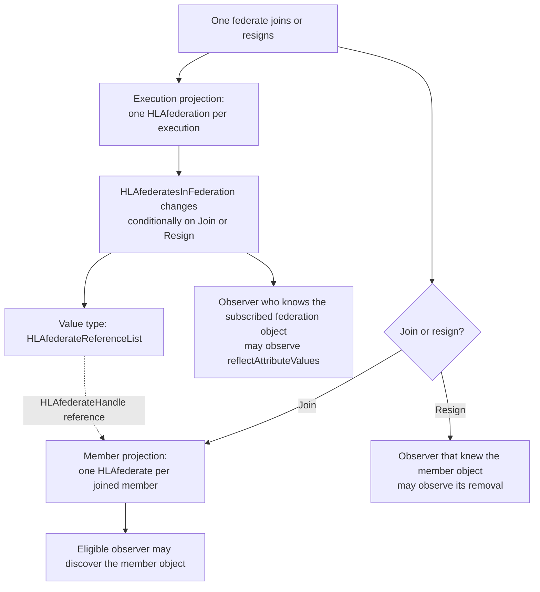

This is a scope map, not a callback timeline. The [embedded membership case](../../cpp/tests/ieee1516_2025_federation_mom_membership_boundaries_catch2.cpp#L4)
observes the list reflection after Join and Resign; the separate [embedded
member-object lifecycle case](https://github.com/sheepfling/umbra/blob/c9c5a9e410539b039cd8bba35b53d0ef2b24d180/cpp/tests/ieee1516_2025_joined_federate_mom_public_object_lifecycle_catch2.cpp#L5)
observes the member object's removal. The [process rejoin-order case](../../cpp/tests/ieee1516_2025_connection_process_mom_resign_removal_order_catch2.cpp#L37)
orders removal before rediscovery/reflection of that member object, but does
not observe the federation membership-list reflection. These separate cases
do not establish a cross-path callback order or embedded/process parity.
In the embedded membership case, the observer remains joined while a second
member joins and resigns, so the asserted list changes from two handles to
one. It does not cover final-member Resign, the empty execution catalog or
roster, or Destroy. The Lifecycle guide's [captured empty-roster sequence](HLA-2025-FEDERATION-AND-FEDERATE-LIFECYCLE-FLOW-GUIDE.md#a-captured-empty-roster-callback-can-outlive-destroy)
compares the roster and terminal observer paths. In the embedded source, Resign schedules the conditional
reflection after removing the departing member; the planner filters receivers
against current membership, so final-member Resign leaves no receiver for a
one-to-zero reflection. This source-derived result does not establish the
configured-process outcome: its separate Resign path does not enqueue the
federation membership-list reflection, as described in the
[process-profile section](#2025-process-profile-membership-list-updates-at-join-and-resign).

### Successful Restore keeps membership distinct from MOM update triggers

The durable image carries member records, but it does not save
`HLAfederatesInFederation` as a MOM attribute value. The bounded restore path
maps saved member identities onto the current live membership by federate
type; the retained-snapshot path is admitted only when its saved member
identity still matches. After restore, the value encoder reads the current
`Federation.members` map. In the inspected successful embedded path, Restore
does not run Join/Resign or enqueue the membership-list conditional update.
Consequently, the implementation source predicts that a later explicit value
request will encode the live member list, while Restore completion alone does
not schedule a membership-list reflection. This is a source observation, not
a claim that the standard forbids another provider behavior.

The embedded [membership-boundary test](../../cpp/tests/ieee1516_2025_federation_mom_membership_boundaries_catch2.cpp#L119)
checks a current-value request and conditional reflections after Join and
Resign, but does not cross Save/Restore. The configured-process endpoint has
no direct observer assertion for this Federation list; its existing evidence
gap is described above. The [joined-federate Restore flow](HLA-2025-JOINED-FEDERATE-MOM-OBJECT-LIFECYCLE-FLOW-GUIDE.md#restore-source-and-mom-projection-are-separate)
covers the separate member-scoped `HLAfederateState` transition.

The source layers are the [live membership-list encoder](../../cpp/src/internal/federation/federation_registry_mom_object_state.cpp#L650),
[saved-to-live identity mapping](../../cpp/src/internal/federation/federation_registry_restore_control.cpp#L52),
[current member-map application](../../cpp/src/internal/federation/federation_registry_state_image_restore.cpp#L930),
and [successful Restore application](../../cpp/src/internal/federation/federation_registry_restore_control.cpp#L1320).

### Forced connection loss has its own membership-list path

The 2025 MIM marks `HLAfederatesInFederation` Conditional on Join or Resign
([MIM row](../../third_party/ieee1516.2-2025/resources/mim/HLAstandardMIM-2025.xml#L684)).
It does not by itself establish whether a forced `ConnectionLost` transition
must produce the same update. Keep that normative question separate from the
following 2025 implementation observations.

The embedded adapter routes connection loss through the shared forced
resignation transition and then queues the Federation MOM conditional-update
helper for `HLAfederatesInFederation`. The configured process service also
calls the shared registry loss transition, but its inspected
`dispatchConnectionLossResult` projects ownership work, object removals,
synchronization notifications, and an eligible Federate-Lost report; it does
not enqueue a Federation membership-list attribute update. This is a source
boundary, not a conclusion about the normative connection-loss contract.

The process path reaches `resignLocked` through
[`ProcessFederationService::connectionLost`](../../cpp/src/internal/federation/process_federation_service_connection_loss.cpp#L164)
and [`EmbeddedFederationRegistry::connectionLost`](../../cpp/src/internal/federation/federation_registry.cpp#L424);
the shared transition receives `forcedConnectionLoss=true`
([`resignLocked`](../../cpp/src/internal/federation/federation_registry_resign_lifecycle.cpp#L13)).
That establishes shared membership cleanup, but it does not settle whether the
MIM's specifically stated “Federate joins or resigns” condition includes this
RTI-originated loss path ([MIM update condition](../../third_party/ieee1516.2-2025/resources/mim/HLAstandardMIM-2025.xml#L687)).
The process result type carries resignation cleanup work such as known-object
removals but has no Federation-object membership-update record
([`FederationRegistryResult`](../../cpp/src/internal/federation/federation_registry_service_types.hpp#L610));
[`dispatchConnectionLossResult`](../../cpp/src/internal/federation/process_federation_service_connection_loss.cpp#L19)
does not add one. By contrast, the embedded adapter explicitly queues this
attribute after the transition
([conditional-update submission](../../cpp/src/internal/runtime/umbra_rti_ambassador_membership_loss.cpp#L435)).

The current worktree's process TCK source (outside the docs-only candidate)
waits for the conditional reflection and then calls
`listFederationExecutionMembers`; that query is a separate observation of
membership and cannot stand in for the earlier MOM reflection assertion. I
found no saved CTest result for this worktree-only assertion in the `out`
directory.

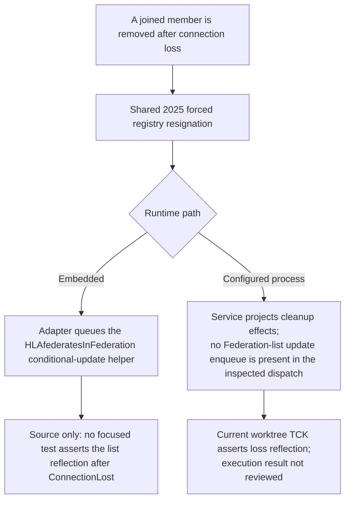

The [embedded loss path](../../cpp/src/internal/runtime/umbra_rti_ambassador_membership_loss.cpp#L167)
calls the registry's forced-loss entry at [the connectionLost branch](../../cpp/src/internal/runtime/umbra_rti_ambassador_membership_loss.cpp#L167)
and queues the conditional update at [the post-transition point](../../cpp/src/internal/runtime/umbra_rti_ambassador_membership_loss.cpp#L435).
The process route is visible in [`ProcessFederationService::connectionLost`](../../cpp/src/internal/federation/process_federation_service_connection_loss.cpp#L176)
and its [cleanup-result dispatcher](../../cpp/src/internal/federation/process_federation_service_connection_loss.cpp#L19).
The only focused test under `cpp/tests` that names `HLAfederatesInFederation`
observes ordinary Join and Resign; it does not inject connection loss
([embedded membership case](../../cpp/tests/ieee1516_2025_federation_mom_membership_boundaries_catch2.cpp#L119)).
The current worktree process TCK source `packages/hla-rti-cpp-tck/src/tck_connection_lifecycle.cpp`
contains a post-loss reflection assertion and a query for the survivor-only
member list [^worktree-source]. This docs-only review did not execute that
scenario. Its assertion is not runtime evidence, and the inspected process loss
dispatcher has no explicit enqueue for the conditional reflection; whether an
alternate path supplies it remains unverified. The process rejoin-order case
observes member-object removal and later rediscovery, not a Federation
membership-list reflection
([process case](../../cpp/tests/ieee1516_2025_connection_process_mom_resign_removal_order_catch2.cpp#L39)).
The embedded loss reflection remains source-only, and the process scenario's
runtime outcome is unknown. No callback timing or profile-parity claim is made.

## One object belongs to the federation execution

The embedded 2025 Join path establishes the federation-scoped object once,
independently of each member's private `HLAfederate` snapshot and report-file
lifetime. The registry validates the effective 2025 MIM class metadata and
retains the federation object with the execution. A successful individual
resignation changes membership state; it does not turn the shared object into
that member's object or remove the other members' known-object state.

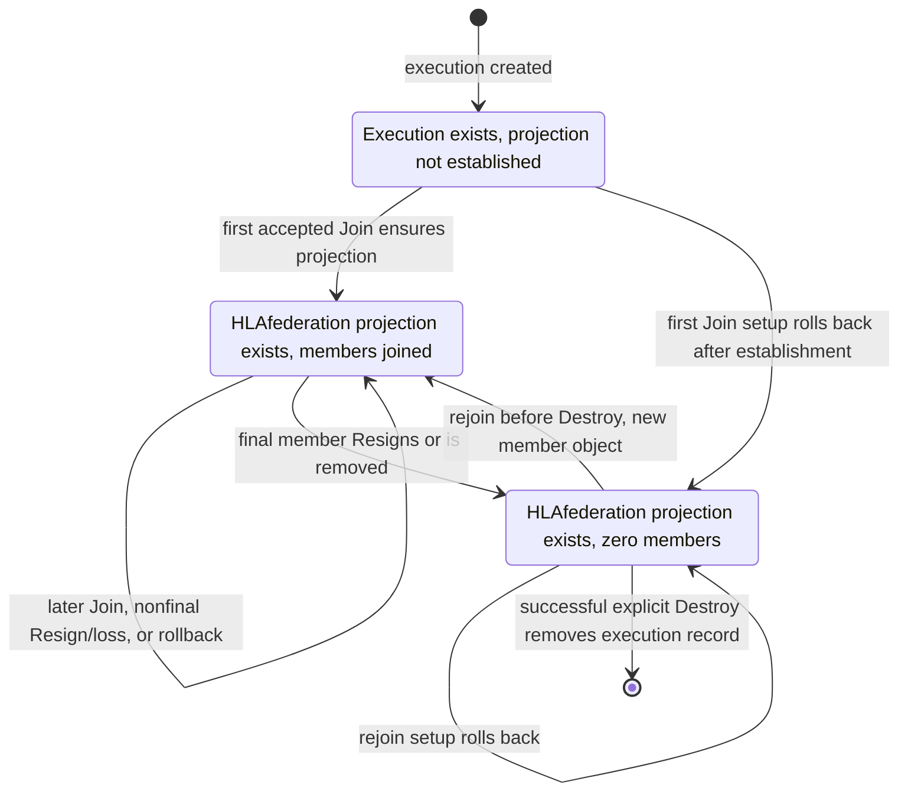

The empty state is registry state, not a callback milestone. Each `Federation`
keeps its RTI-owned MOM objects in a registry map. Final-member resignation
removes the departing member from the federation object's observer sets while
retaining its `federationExecutionObject` entry ([object map](../../cpp/src/internal/federation/federation_registry.hpp#L2705),
[resignation branch](../../cpp/src/internal/federation/federation_registry_resign_lifecycle.cpp#L1033)).
A Join before Destroy finds that entry already established
([existing-object check](../../cpp/src/internal/federation/federation_registry_mom_object_state.cpp#L367));
the member-scoped `HLAfederate` object has its separate retirement and pending
Remove-callback path ([lifecycle](HLA-2025-JOINED-FEDERATE-MOM-OBJECT-LIFECYCLE-FLOW-GUIDE.md#resignation-removes-visibility-before-forgetting-the-snapshot)).
Successful Destroy erases the execution record and the projection it owns
([Destroy](../../cpp/src/internal/federation/federation_registry_membership_lifecycle.cpp#L158)).
A same-name Create initializes a new `Federation`; it does not restore the old
projection ([Create construction](../../cpp/src/internal/federation/federation_registry_membership_lifecycle.cpp#L118),
[registry insertion](../../cpp/src/internal/federation/federation_registry_membership_lifecycle.cpp#L143),
[fresh Create versus explicit Restore](HLA-2025-FEDERATION-AND-FEDERATE-LIFECYCLE-FLOW-GUIDE.md#same-name-recreation-is-fresh-restore-must-be-explicit)).
These identity-continuity statements are source observations; no focused public
case observes the `HLAfederation` object through a final-member empty interval
and same-execution rejoin. The same registry check also applies when the first
Join establishes the object and then rolls back during member setup: a later
same-execution retry sees the existing record, so the source retains its
object-instance handle rather than allocating a replacement. The public
[writer-creation failure case](../../cpp/tests/service_report_writer_failure_catch2.cpp#L92)
proves the failed member name is reusable, but does not inspect that handle or
the residual Federation MOM record. A new subscriber becomes eligible for
discovery through the ordinary object-class subscription planner
([embedded planner call](../../cpp/src/internal/runtime/umbra_rti_ambassador_object_class_subscription.cpp#L136),
[registry discovery selection](../../cpp/src/internal/federation/federation_registry_object_discovery_routes.cpp#L79));
the retry test does not subscribe or assert a discovery callback. Successful
Destroy removes the execution record and is the retirement path shown here;
these continuity and discovery details remain source-derived rather than
asserted by a failed-first-Join/retry test.

The [embedded membership-boundary case](../../cpp/tests/ieee1516_2025_federation_mom_membership_boundaries_catch2.cpp#L119)
observes conditional list reflections while one member remains; after the last
observer Resigns, it immediately Destroys the execution. The [configured-process
Resign/rejoin case](../../cpp/tests/ieee1516_2025_connection_process_mom_resign_removal_order_catch2.cpp#L38)
observes old-member-object removal before new `HLAfederate` discovery/reflection
while a peer remains, but does not observe the federation object. Keep these
callbacks separate from the registry-state chart; process `HLAfederation`
continuity is not directly observed by these tests.

Read this as the lifecycle of the 2025 federation-scoped MOM projection, not
the existence or membership state of the federation execution. Create can
already leave an execution with zero members before this chart reaches either
projection-present state; the separate [execution-state flow](HLA-2025-FEDERATION-AND-FEDERATE-LIFECYCLE-FLOW-GUIDE.md#federation-execution-state)
covers absent, empty, and joined states through explicit Destroy. The Join and
rollback ordering below is an Umbra source observation, not a normative setup
sequence.

In the embedded path, registry membership is accepted and the federation MOM
object is established before the joining member's service-report file and
routes finish setup. If that later per-member setup fails, the Join call rolls
back the membership by resigning the new member; the registry resignation path
retains the execution-scoped federation MOM object. Thus this implementation
can establish the object during a Join attempt that ultimately fails. This is
source-observed, not covered by a focused failed-first-Join test. The
[Join rollback path](../../cpp/src/internal/runtime/umbra_rti_ambassador_federation_lifecycle.cpp#L574)
and [federation-object establishment](../../cpp/src/internal/runtime/umbra_rti_ambassador_federation_lifecycle.cpp#L616)
show the ordering; [resignation cleanup](../../cpp/src/internal/federation/federation_registry_resign_lifecycle.cpp#L1033)
keeps the federation object's record while removing the departing member's
known-object state. In the normal path, the object represents the federation
execution, not an individual member. Process-endpoint parity is not established
by these tests.

Connection loss enters the shared registry loss transition, and the registry
cleanup retains execution-scoped Federation MOM records while clearing the
departing member's known/pending-recipient state
([connection-loss entry](../../cpp/src/internal/federation/federation_registry.cpp#L426),
[MOM-ledger cleanup](../../cpp/src/internal/federation/federation_registry_resign_lifecycle.cpp#L1033)).
This is source evidence for the execution-object lifetime; the separate
membership-list subsection above records the adapter-level update difference.

When its service-report store is configured, the 2025 process Join handler
asks the registry to establish the execution-scoped Federation MOM object
before creating the joined member's report-file and `HLAfederate` state, then
commits the session and plans member-object discovery
([Federation MOM setup](../../cpp/src/internal/federation/process_federation_service_lifecycle.cpp#L726),
inside the [service-report-store branch](../../cpp/src/internal/federation/process_federation_service_lifecycle.cpp#L682));
the handler then creates the report file and member MOM object, installs session state, and plans
member discovery ([report-file creation](../../cpp/src/internal/federation/process_federation_service_lifecycle.cpp#L740),
[member MOM setup](../../cpp/src/internal/federation/process_federation_service_lifecycle.cpp#L766),
[session installation](../../cpp/src/internal/federation/process_federation_service_lifecycle.cpp#L792),
[discovery planning](../../cpp/src/internal/federation/process_federation_service_lifecycle.cpp#L830)).
The registry's resignation ledger explicitly keeps the federation-execution
record while removing the resigning member from its pending/known-recipient
sets, and separately retires that member's `HLAfederate` instance
([federation-object ledger](../../cpp/src/internal/federation/federation_registry_resign_lifecycle.cpp#L1033), [member-object cleanup](../../cpp/src/internal/federation/federation_registry_resign_lifecycle.cpp#L1038)).
These are process source observations. The focused process MOM cases currently
observe joined-federate object removal/rejoin and report-file behavior, not
public `HLAfederation` discovery or `HLAfederatesInFederation` reflections;
see the [process membership-list trace](#2025-process-profile-membership-list-updates-at-join-and-resign) and process evidence section in the
[joined-federate MOM guide](HLA-2025-JOINED-FEDERATE-MOM-OBJECT-LIFECYCLE-FLOW-GUIDE.md#separate-2025-process-endpoint-evidence).

Discovery remains subscription-scoped. A joined federate subscribes to the
`HLAmanager.HLAfederation` class, then learns the RTI-owned instance through the
ordinary object callback route. A conditional attribute is not necessarily an
initial-value reflection merely because the instance is discovered; a
federate can request the current value after it knows the instance.

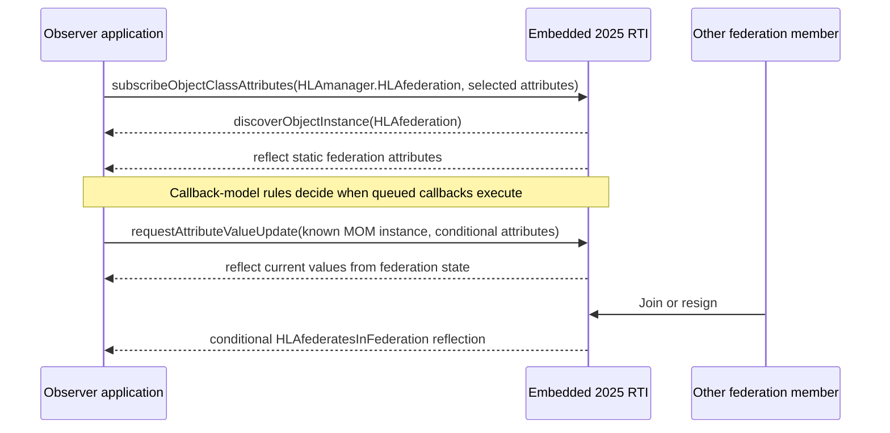

The [static-configuration test](../../cpp/tests/ieee1516_2025_federation_mom_static_configuration_catch2.cpp#L4)
subscribes to eight static federation values and checks their initial reflection
along the discovery path. The
[membership-boundary test](../../cpp/tests/ieee1516_2025_federation_mom_membership_boundaries_catch2.cpp#L4)
shows the key edge: `HLAfederatesInFederation` is conditional, so the observer
subscribes, waits for discovery, explicitly requests the current membership
value, and then sees updated reflections at Join and resignation boundaries.
That test also treats the object as a normal known instance and checks its
reliable transportation metadata; it does not make the per-member
`HLAfederate` and federation `HLAfederation` lifetimes equivalent.

### A late observer should request the current member list

The pinned API makes `subscribeObjectClassAttributes` a joined-member service
([§5.8 declaration](../../third_party/ieee1516.1-2025/include/RTI/RTIambassador.h#L535)).
A federate joining after other members therefore cannot establish that
subscription before its own Join. The MIM says Join/Resign triggers a
conditional `HLAfederatesInFederation` update, but does not specify that a
member subscribing afterward receives the earlier update as a discovery-time
replay. If the application needs the complete current membership list, the
Federation-MOM path is to subscribe, learn the `HLAfederation` instance, and
request the current conditional value; the MIM requires a response to
attribute-value requests regardless of whether the attribute is Static or
Conditional ([federation object semantics](../../third_party/ieee1516.2-2025/resources/mim/HLAstandardMIM-2025.xml#L660)).

The public `listFederationExecutionMembers` service is a separate view of
membership. Its success callback is a report, and each pinned
`FederationExecutionMemberInformation` contains a federate name and type; a
missing execution uses a different report callback ([request](../../third_party/ieee1516.1-2025/include/RTI/RTIambassador.h#L194),
[success report](../../third_party/ieee1516.1-2025/include/RTI/FederateAmbassador.h#L54),
[missing-execution report](../../third_party/ieee1516.1-2025/include/RTI/FederateAmbassador.h#L61),
[record fields](../../third_party/ieee1516.1-2025/include/RTI/Typedefs.h#L114)). It does not
reflect `HLAfederatesInFederation` or return that attribute's federate-handle
references. The [lifecycle guide's member-list flow](HLA-2025-FEDERATION-AND-FEDERATE-LIFECYCLE-FLOW-GUIDE.md#federation-member-listing-reports-a-snapshot)
traces this report path separately from the Federation MOM attribute; its
[configured-process sequence](HLA-2025-FEDERATION-AND-FEDERATE-LIFECYCLE-FLOW-GUIDE.md#configured-process-route-the-service-snapshot-precedes-the-client-callback)
shows the roster snapshot before response and callback observation. That
focused process scenario covers both callback models and a post-loss snapshot,
but not membership mutation between response and callback.

Use the Federation MOM route when the application needs the typed membership
attribute and its later Conditional reflections; use the member-list service
for its name-and-type report. The two paths have different payloads and
observation points; this comparison does not establish callback ordering or
cross-profile access parity.

The focused membership test follows the observer-first case: it joins and
subscribes before the subject joins, explicitly requests the initial current
list, then observes the subject's later Join/Resign updates. It does not test
an observer joining an already populated execution
([test setup and request](../../cpp/tests/ieee1516_2025_federation_mom_membership_boundaries_catch2.cpp#L26)).
This documents the request as the supported current-value path; it does not
claim a universal absence of additional reflections or prescribe callback
ordering.

### Subscription eligibility is separate from known-object lifetime

In the embedded 2025 registry, an object-class subscription can make a member
eligible for the `HLAfederation` discovery planner. The planner walks the MOM
class and its ancestors and looks for an active subscription to at least one
effective MOM attribute. For an explicit regional declaration, eligibility
requires an active region that overlaps the execution object's immutable
federate point; a disjoint regional declaration at that class does not fall
back to ordinary subscription matching. The ordinary subscription adapter
and the regional adapter both re-run MOM discovery planning after committing
their declaration
([ordinary subscribe](../../cpp/src/internal/runtime/umbra_rti_ambassador_object_class_subscription.cpp#L118),
[regional subscribe](../../cpp/src/internal/runtime/umbra_rti_ambassador_object_class_subscription.cpp#L463),
[eligibility predicate](../../cpp/src/internal/federation/federation_registry_mom_object_state.cpp#L572)).

This eligibility check controls becoming known, not forgetting an instance.
Unsubscribe mutates the declaration ledger and computes ordinary
application-object scope changes; that scope planner iterates the
federate-created object map, while the federation MOM object's known-recipient
ledger is separate. The unsubscribe adapter does not plan MOM discovery or
MOM removal. A member that already knows `HLAfederation` therefore remains in
its known-object ledger after unsubscribe; a later subscription does not
create a second discovery for that same known instance. These are embedded
registry observations, not claims about a standard-required callback trace
([unsubscribe transition](../../cpp/src/internal/federation/federation_registry_object_attribute_declarations.cpp#L261),
[ordinary scope planner](../../cpp/src/internal/federation/federation_registry_attribute_relevance.cpp#L577),
[MOM known-state check](../../cpp/src/internal/federation/federation_registry_object_discovery_routes.cpp#L79)).

The focused [static-configuration case](../../cpp/tests/ieee1516_2025_federation_mom_static_configuration_catch2.cpp#L27)
observes discovery and initial static reflection after an active subscription;
the [membership-boundary case](../../cpp/tests/ieee1516_2025_federation_mom_membership_boundaries_catch2.cpp#L119)
also observes discovery before requesting a Conditional membership value.
Neither checks passive-only eligibility, a disjoint regional declaration,
unsubscribe after discovery, or a repeated subscription after unsubscribe.
Those edges remain source-derived and would need focused public tests before
being described as tested behavior. The separate configured-process
subscription planner has similar registry checks, but these embedded cases do
not establish process callback parity.

## Conditional values have different authoritative triggers

The MIM marks attributes as `Static` or `Conditional` and names the events that
drive conditional updates. Umbra stores the federation object snapshot in the
registry; service-specific paths update that source and queue the normal MOM
attribute-reflection route. A later current-value request reads the current
snapshot, not a replay of the event that originally changed it.

The following table is a representative map of embedded 2025 producers to the
conditional federation value they update, not a complete inventory of
implemented MOM attributes:

| Representative producer path | Federation MOM value updated |
| --- | --- |
| Member Join or resignation | `HLAfederatesInFederation` |
| Join adds FOM modules | `HLAFOMmoduleDesignatorList`, `HLAcurrentFDD` |
| Federation-scoped `HLAsetSwitches` changes Auto Provide | `HLAautoProvide` |
| Save request, initiation, or successful commit | Next-save and last-save values |

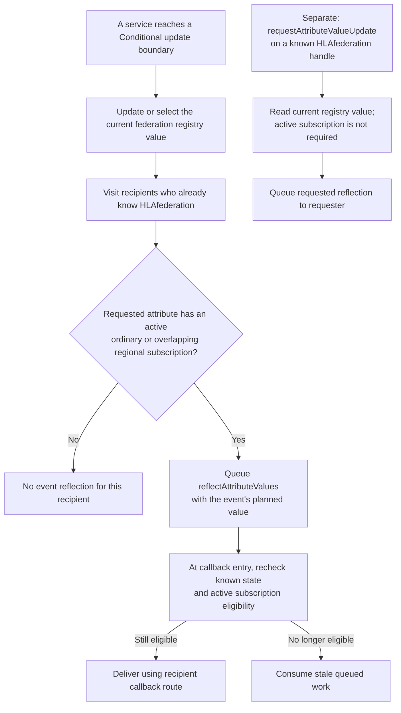

For event-triggered work, the helper first plans values for the object's known
recipients with active-subscription filtering, then queues a callback route
with those planned values. At callback entry the registry plans again, so a
recipient who has resigned, lost known state, or ceased to have an eligible
subscription does not receive stale work. The planned event value is retained
for an eligible callback even if registry state changes before dispatch. The
separate direct request path checks that the requesting member knows the MOM
object, reads its current value, and does not require an active subscription
([event planner and callback recheck](../../cpp/src/internal/runtime/umbra_rti_ambassador_object_instance_lifecycle_callbacks.cpp#L975),
[known/active recipient filter](../../cpp/src/internal/federation/federation_registry_attribute_value_update_requests.cpp#L629),
[direct MOM request path](../../cpp/src/internal/runtime/umbra_rti_ambassador_request_attribute_value_updates.cpp#L139)).
The chart describes the embedded 2025 implementation; it does not assert one
callback order across callback models or parity with the configured process
endpoint.

This is a map of representative producers, not a promise that every federation
MOM attribute is implemented. The 2025 MIM identifies `HLAfederatesInFederation`
as conditional on Join/resignation, and the FOM module list and `HLAcurrentFDD`
as conditional on successful Create/Join changes. The save name/time values
have their own save-ledger boundaries, documented in the
[save/restore guide](HLA-2025-FEDERATION-SAVE-RESTORE-FLOW-GUIDE.md). The
execution-scoped next/last-save values are distinct from each member's
`HLAfederateState`: the [joined-federate state flow](HLA-2025-JOINED-FEDERATE-MOM-OBJECT-LIFECYCLE-FLOW-GUIDE.md#snapshot-values-and-live-state-are-different-kinds-of-data)
shows its save/restore projection, and the guide's [process evidence section](HLA-2025-JOINED-FEDERATE-MOM-OBJECT-LIFECYCLE-FLOW-GUIDE.md#separate-2025-process-endpoint-evidence)
records the lack of a direct process assertion for that attribute. The
federation `HLAsetSwitches` path in this profile handles the Auto Provide
switch; its discovery and provider-eligibility behavior is covered in the
[Auto Provide guide](HLA-2025-AUTO-PROVIDE-FLOW-GUIDE.md).

The [MIM membership rows](../../third_party/ieee1516.2-2025/resources/mim/HLAstandardMIM-2025.xml#L684),
[FOM-list and current-FDD rows](../../third_party/ieee1516.2-2025/resources/mim/HLAstandardMIM-2025.xml#L723),
[membership-boundary test](../../cpp/tests/ieee1516_2025_federation_mom_membership_boundaries_catch2.cpp#L119),
[conditional-current-FDD test](../../cpp/tests/federation_mom_current_fdd_catch2.cpp#L180),
[save-conditionals test](../../cpp/tests/federation_mom_save_conditionals_catch2.cpp#L183)
provide focused public callback evidence for the membership, FOM, and save
value paths. The [Auto Provide MOM switch case](../../cpp/tests/auto_provide_mom_catch2.cpp#L120)
exercises the federation switch mutation and its operational effect, but does
not assert the `HLAautoProvide` reflection itself. These tests exercise the
embedded development profile; they are not a claim that every conditional
attribute or backend is covered.

### Save-history MOM values cross the image boundary at different times

The four federation-scoped fields are conditional, but the live values and the
saved image cross different boundaries. `HLAnextSaveName` and
`HLAnextSaveTime` describe the upcoming save; the live registry clears them
when a timed save is admitted. At the final successful completion, the
registry first captures and commits the image, then advances the live
`HLAlastSaveName` and `HLAlastSaveTime` to the just-completed save. Thus an
image labeled `B` contains the prior last-save values, while the live
`HLAfederation` object reports `B` after the commit succeeds. This is Umbra's
observed snapshot boundary, not a normative persistence rule.

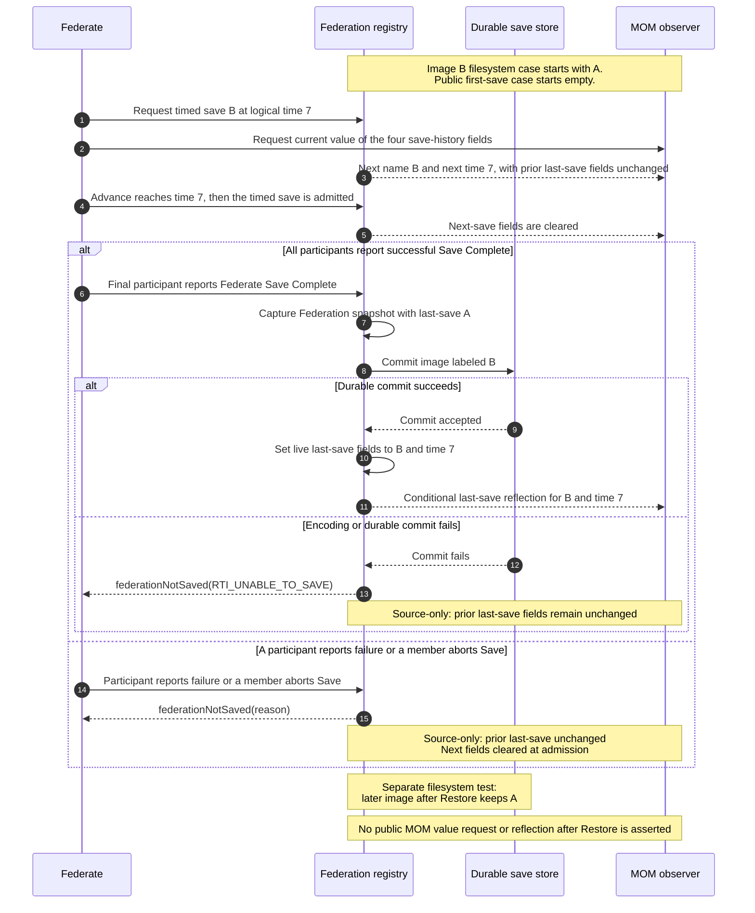

The chart cross-reads two focused cases; it is not one end-to-end scenario.
The [public embedded test](../../cpp/tests/federation_mom_save_conditionals_catch2.cpp#L183)
uses a timed save to observe pending next-save values, their clearing at save
admission, and live last-save values after successful completion. Its explicit
current-value request after `Request Federation Save` does not isolate that
request's automatic conditional reflection. The separate
[filesystem-image test](../../cpp/tests/ieee1516_2025_federation_registry_save_history_conditionals_filesystem_restart_catch2.cpp#L3)
proves that the image for a second save contains the first completed save's
name, and that restoring the image preserves that value into a later image;
it does not observe a public `HLAfederation` reflection after Restore. No
configured-process test directly queries or asserts these four MOM fields.
This federation-scoped history also remains separate from the per-member
`HLAfederateState` Save/Restore projection in the
[joined-federate MOM guide](HLA-2025-JOINED-FEDERATE-MOM-OBJECT-LIFECYCLE-FLOW-GUIDE.md#snapshot-values-and-live-state-are-different-kinds-of-data).

For an admitted save that fails, the inspected registry clears the pending
next-save values at admission, then sends `federationNotSaved` for a participant
failure, explicit abort, or image encode/commit failure. It advances live
`HLAlastSave*` only when the image was stored, so those failed paths retain the
prior live last-save values ([participant failure](../../cpp/src/internal/federation/federation_registry_save_control.cpp#L1084),
[abort](../../cpp/src/internal/federation/federation_registry_save_control.cpp#L1118),
[commit outcome gate](../../cpp/src/internal/federation/federation_registry_save_control.cpp#L1037)).
The configured-process not-complete test and internal commit-failure test
assert the terminal callback/reason, but not the four MOM values
([process callback](../../cpp/tests/ieee1516_2025_connection_process_federation_save_not_complete_catch2.cpp#L564),
[commit failure](../../cpp/tests/ieee1516_2025_federation_registry_save_commit_failure_catch2.cpp#L3)).
This is an implementation observation, not evidence of public MOM value
reflections after failure or abort.

The source boundaries are the 2025 MIM's [last-save](../../third_party/ieee1516.2-2025/resources/mim/HLAstandardMIM-2025.xml#L771)
and [next-save](../../third_party/ieee1516.2-2025/resources/mim/HLAstandardMIM-2025.xml#L804)
rows, the [timed-save pending fields](../../cpp/src/internal/federation/federation_registry_save_control.cpp#L527)
and [clear at admission](../../cpp/src/internal/federation/federation_registry_save_control.cpp#L779),
[image capture](../../cpp/src/internal/federation/federation_registry_state_image_capture.cpp#L64),
[snapshot before live completion update](../../cpp/src/internal/federation/federation_registry_save_control.cpp#L1013),
[live last-save update](../../cpp/src/internal/federation/federation_registry_save_control.cpp#L1044),
[current MOM value encoding](../../cpp/src/internal/federation/federation_registry_mom_object_state.cpp#L688),
and [save-history rehydration](../../cpp/src/internal/federation/federation_registry_state_image_restore.cpp#L75).

### The effective model, MOM projections, and module reports are different views

A successful Create or module-adding Join can change the federation's current
composed model. Keep that effective model distinct from the MOM values that
describe its inputs or expose its serialized current FDD:

| View | What it represents | How to observe or interpret it |
| --- | --- | --- |
| Effective federation model | The complete accepted module set after composition. The embedded lookup tests observe already-joined members resolving declarations contributed by a successful Join; the configured-process case checks lookup by the joining client. | Follow the [FOM admission/composition guide's Join boundary](HLA-2025-FOM-MODULE-ADMISSION-AND-COMPOSITION-FLOW-GUIDE.md#join-with-additional-fom-modules-replace-definition-and-add-member-together). The lookup results are profile-bounded and do not establish embedded/process parity. |
| Federation MOM object, `HLAmanager.HLAfederation` | Its `HLAFOMmoduleDesignatorList` describes federation-level module designators supplied through Create/Join; `HLAcurrentFDD` is the Current FDD realized from successful Create/Join changes. Both are Conditional in the MIM. | The MIM defines their automatic update conditions ([list](../../third_party/ieee1516.2-2025/resources/mim/HLAstandardMIM-2025.xml#L726), [Current FDD](../../third_party/ieee1516.2-2025/resources/mim/HLAstandardMIM-2025.xml#L743)). A known Conditional attribute can also be requested for its current value ([class semantics](../../third_party/ieee1516.2-2025/resources/mim/HLAstandardMIM-2025.xml#L658)). The bounded embedded and process source/test evidence follows. |
| Joined-member MOM object, `HLAmanager.HLAfederate` | Its same-named `HLAFOMmoduleDesignatorList` is Static and lists modules supplied by that particular federate at Join—not every module in the federation's effective model. | This is a different MIM row ([member attribute](../../third_party/ieee1516.2-2025/resources/mim/HLAstandardMIM-2025.xml#L138)). The public object-lifecycle test verifies the reflected member list matches its Join-supplied module ([test](https://github.com/sheepfling/umbra/blob/c9c5a9e410539b039cd8bba35b53d0ef2b24d180/cpp/tests/ieee1516_2025_joined_federate_mom_public_object_lifecycle_catch2.cpp#L128)); a separate private snapshot test corroborates the Join-scoped value but is not public callback evidence ([snapshot test](../../cpp/tests/ieee1516_2025_joined_federate_mom_fom_module_snapshot_integration_catch2.cpp#L32)). |
| FOM module-data request/report | A request selects one module's retained content by an index in the applicable federation or member list. | `HLAreportFOMmoduleData` carries module content as a MOM interaction; it is neither the composed Current FDD nor an attribute reflection. See [the two request/report scopes](#the-same-short-fom-request-name-appears-under-two-mom-roots). |

**Bounded embedded implementation and test evidence.** The federation-object
projection reads the current `federation.definition`, filters to FOM modules,
and encodes the first designator for each canonical source identity; the
standard MIM module is not part of this list ([module-list encoder](../../cpp/src/internal/federation/federation_registry_mom_object_state.cpp#L110),
[federation-list helper](../../cpp/src/internal/federation/federation_registry_mom_object_state.cpp#L154),
[federation attribute lookup](../../cpp/src/internal/federation/federation_registry_mom_object_state.cpp#L661)).
When a Join supplies additional modules, the embedded lifecycle path queues
Conditional updates for both the federation module list and `HLAcurrentFDD`
([Join update path](../../cpp/src/internal/runtime/umbra_rti_ambassador_federation_lifecycle.cpp#L794)).
This is source evidence for that embedded Join path, not proof of a Create
update path or profile parity.

The MIM also requires only the first designator when identical FOM modules
are supplied, for both the federation and joined-member lists ([member rule](../../third_party/ieee1516.2-2025/resources/mim/HLAstandardMIM-2025.xml#L148),
[federation rule](../../third_party/ieee1516.2-2025/resources/mim/HLAstandardMIM-2025.xml#L735)).
For the 2025 list projection, the embedded encoder keeps the first designator
for each qualifying validated module content; path identity alone does not
define equality. The federation projection and member snapshot call this same
encoder ([encoder](../../cpp/src/internal/federation/federation_registry_mom_object_state.cpp#L110),
[federation projection](../../cpp/src/internal/federation/federation_registry_mom_object_state.cpp#L161),
[member snapshot](../../cpp/src/internal/federation/federation_registry_mom_object_state.cpp#L328)).
A private registry test supplies two validated records with the same canonical
source path but different designators, then verifies the member snapshot has
one entry and retains the first designator ([test setup](../../cpp/tests/federation_registry_composed_fom_catch2.cpp#L62),
[count assertion](../../cpp/tests/federation_registry_composed_fom_catch2.cpp#L156),
[first-designator assertion](../../cpp/tests/federation_registry_composed_fom_catch2.cpp#L160)).
That is private member-snapshot evidence, not a public service test. The public
lifecycle test exercises one joined-member module only
([assertion](https://github.com/sheepfling/umbra/blob/c9c5a9e410539b039cd8bba35b53d0ef2b24d180/cpp/tests/ieee1516_2025_joined_federate_mom_public_object_lifecycle_catch2.cpp#L128)).
A separate embedded Create-designator case subscribes to the federation
object, requests its list, and checks the exact supplied designator; variants
cover Create with or without an explicit MIM and a file URL
([case](../../cpp/tests/ieee1516_2025_federation_mom_membership_boundaries_catch2.cpp#L83),
[request and value assertion](../../cpp/tests/ieee1516_2025_federation_mom_membership_boundaries_catch2.cpp#L62)).
This verifies the request-time current value after an observer joins a
federation created with that module, not the MIM Conditional reflection
triggered by Create or an updated list after an additional-module Join. The
pinned MIM states the first-designator outcome but does not define
how to decide that two modules are identical. The checked-in IEEE resource
package contains the MIM, schemas, and examples, not the normative OMT clause
text; IEEE SA lists the full specification separately from its resource download
([1516.2-2025 publication and access](https://standards.ieee.org/ieee/1516.2/6689/)).
Accordingly, identical content at distinct canonical paths remains unresolved:
`sourcePath` is Umbra's implementation key, not an established normative
definition.

The focused public-test search finds three separate observations: a request-time
federation list after Create, the joined-member `HLAfederate` list, and the
federation's `HLAcurrentFDD` reflection after an additional-module Join. No
focused public observer test asserts the automatic Conditional list reflection
or a changed federation list after an additional-module Join. The member-list
test ([public assertion](https://github.com/sheepfling/umbra/blob/c9c5a9e410539b039cd8bba35b53d0ef2b24d180/cpp/tests/ieee1516_2025_joined_federate_mom_public_object_lifecycle_catch2.cpp#L128))
must not be read as evidence for the federation object; the current-FDD test
([Join reflection](../../cpp/tests/federation_mom_current_fdd_catch2.cpp#L287))
does not assert the list attribute. These tests were inspected, not rerun.

The model-lookup path, the federation's conditional attribute projection, the
member's Join-input list, and the module-content report answer different
questions. In particular, a current-value request is not a module-data report,
and neither MOM list is a replacement for resolving names against the effective
composed model.

### Catalog and Federation MOM values across Join failures and Restore

The successful-Join row above is only one way the current definition can
change. Keep the effective catalog, the two federation-scoped MOM values, and
their automatic reflection as separate observations:

| Event | Model and projected Federation MOM values | Reflection and focused evidence |
| --- | --- | --- |
| Successful additional-module Join | The registry commits the composed replacement definition with the new member; both MOM values project that definition. | Embedded Join queues both attributes. The focused public observer sees only an `HLAcurrentFDD` reflection and confirms a later request returns it; the Create-designator test does not cover this Join update. The configured-process Join path queues neither Federation attribute; its value request is source-mapped, without a focused process observer test. |
| Rejection before registry commit | The prior definition remains selected, so both MOM values remain based on it. | The focused process invalid-additional-FOM case checks unchanged module count and a valid retry; it does not assert reflection or byte-for-byte FDD equality. |
| Setup failure after registry commit | Rollback resigns the new member, but the inspected process path does not restore the prior definition. A later explicit Federation MOM value request reads the current definition for both Federation-level `HLAFOMmoduleDesignatorList` and `HLAcurrentFDD`. The same-named member list is captured on a separate `HLAfederate` object and follows that object's removal lifecycle; it does not supply either Federation-level value. | This is a source-derived value-projection inference, not a tested failed-Join outcome. No focused case combines post-commit additional-module failure with a later observer request/reflection. The Join path has no Federation Conditional update enqueue. Keep module-data reports separate; see [the two MOM request/report scopes](#the-same-short-fom-request-name-appears-under-two-mom-roots), including the configured-process report boundary. |
| Restore using a retained in-process snapshot | The save-time private snapshot is a full `Federation` copy, so both MOM values project its restored definition. | The inspected Restore completion path does not enqueue these attributes. No focused test observes either value or reflection across Restore. |
| Restore using only the durable state image | `FederationStateImage` has no FOM catalog field. This path starts with the current live federation and leaves its definition selected, so both MOM values project that live catalog. | The inspected Restore completion path does not enqueue these attributes. No focused test observes either value or reflection across this path. |

These are bounded implementation findings. The pinned MIM rows name Create and
Join as the triggers for the two Conditional attributes ([module-list
condition](../../third_party/ieee1516.2-2025/resources/mim/HLAstandardMIM-2025.xml#L726),
[Current FDD condition](../../third_party/ieee1516.2-2025/resources/mim/HLAstandardMIM-2025.xml#L743));
they do not settle whether Restore must replace the Current FOM or schedule a
reflection. Consult the canonical 1516.1-2025 Restore clauses before making a
normative claim. IEEE's [official listing](https://standards.ieee.org/ieee/1516.1/6688/)
offers purchase or subscription access, and IEEE separately advertises free
account-based read access to selected standards through its [Standards Reading
Room](https://standards.ieee.org/access-standards/). Public pages do not
confirm whether 1516.1-2025 is included, and the full prose is not vendored in
this checkout. The
relevant implementation boundaries are the [embedded Join enqueue](../../cpp/src/internal/runtime/umbra_rti_ambassador_federation_lifecycle.cpp#L794),
[pre-commit rejection test](../../cpp/tests/process_federation_additional_fom_catch2.cpp#L550),
[post-commit Join rollback](HLA-2025-FOM-MODULE-ADMISSION-AND-COMPOSITION-FLOW-GUIDE.md#join-with-additional-fom-modules-replace-definition-and-add-member-together),
[save-time snapshot capture](../../cpp/src/internal/federation/federation_registry_save_control.cpp#L1013),
[durable image shape](../../cpp/src/internal/federation/federation_state_image.hpp#L802),
[Restore source selection](../../cpp/src/internal/federation/federation_registry_restore_control.cpp#L1191),
[definition application](../../cpp/src/internal/federation/federation_registry_state_image_restore.cpp#L917),
[embedded Restore completion adapter](../../cpp/src/internal/runtime/umbra_rti_ambassador_federation_save_restore.cpp#L1060),
and [configured-process Restore completion](../../cpp/src/internal/federation/process_federation_service_save_restore.cpp#L361).
The focused [`HLAcurrentFDD` test](../../cpp/tests/federation_mom_current_fdd_catch2.cpp#L180)
covers an additional-module Join and a later value request, not post-commit
failure or Save/Restore. In the configured-process path, the request handler
routes a known RTI-owned Federation MOM object to the direct MOM value planner
([process request path](../../cpp/src/internal/federation/process_federation_service_attribute_update_requests.cpp#L40),
[current-value projection](../../cpp/src/internal/federation/federation_registry_mom_object_state.cpp#L703)).
For a still-joined observer that knows the Federation MOM object and invokes
the explicit request path, `HLAcurrentFDD` is encoded from
`federation.definition.fdd`, while the
Federation module-designator list is encoded from the same current definition;
neither value is read from the joining member's Join-input list. The source
rollback resigns the joining member and clears its session/events but contains
no replacement-definition restoration ([rollback](HLA-2025-FOM-MODULE-ADMISSION-AND-COMPOSITION-FLOW-GUIDE.md#join-with-additional-fom-modules-replace-definition-and-add-member-together)).
Therefore a subsequent request is expected to project the retained catalog if
that source-observed post-commit state occurs. No test asserts that sequence,
and the process Join path has no Federation-object Conditional update enqueue.
That source fact does not turn the later query projection into an automatic
reflection or establish the full failed-Join callback outcome.
The FOM-module-data report remains a separate interaction path. Its Federation
and joined-member request trees select different content scopes; the configured
process Federation request has no inspected report planner, so its runtime
result remains unverified. Do not treat a `HLAreportFOMmoduleData` interaction
as either an attribute reflection or proof that the automatic Conditional
update was emitted.

### 2025 process profile: Federation MOM after an additional-module Join

The pinned MIM makes federation `HLAFOMmoduleDesignatorList` Conditional when
Create/Join adds FOM modules, and `HLAcurrentFDD` Conditional when those services
modify the Current FOM subset ([module-list condition](../../third_party/ieee1516.2-2025/resources/mim/HLAstandardMIM-2025.xml#L726),
[Current FDD condition](../../third_party/ieee1516.2-2025/resources/mim/HLAstandardMIM-2025.xml#L743)). The following is a
source-mapped process-profile trace, not a replacement for that MIM condition
or a full IEEE 1516.1 conformance determination:

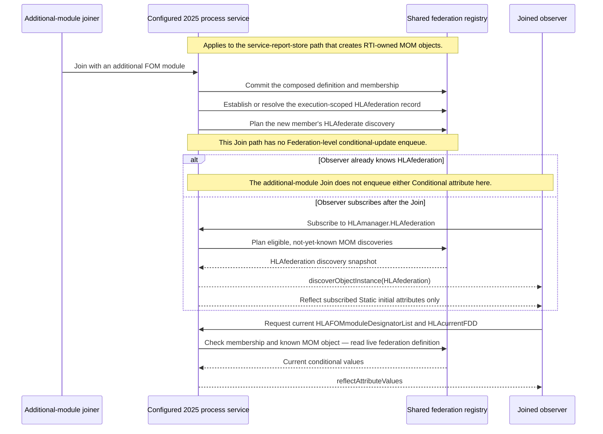

This trace is bounded to the configured process source. Federation MOM object
setup occurs inside the service-report-store Join path; after the Join commits,
that handler queues discovery for the joining member's `HLAfederate` object, not
a Federation-object module-list or Current-FDD update
([Join setup](../../cpp/src/internal/federation/process_federation_service_lifecycle.cpp#L726),
[member discovery](../../cpp/src/internal/federation/process_federation_service_lifecycle.cpp#L830)). The process subscription
route does include the execution-scoped object in its RTI-owned MOM discovery
ledger, despite the helper's joined-federate name; the planner still applies
subscription eligibility and known/pending-recipient checks
([subscription planner](../../cpp/src/internal/federation/process_federation_service_declarations.cpp#L228),
[MOM discovery planner](../../cpp/src/internal/federation/federation_registry_object_discovery_routes.cpp#L96)). Its event staging
places discovery before optional initial MOM values, while the Federation
object's initial-value map contains only MIM Static attributes—not these
Conditional fields ([event staging](../../cpp/src/internal/federation/process_federation_service_object_discovery.cpp#L90),
[Static initial values](../../cpp/src/internal/federation/federation_registry_mom_object_state.cpp#L47)). The exact staging differs by
process receive mode:

| Process receive path | Source-level event staging | Evidence boundary |
| --- | --- | --- |
| Pull / server queues | During each planned discovery, append the discovery event and then its optional initial-value event to separate per-session queues. | The queues are consumed through distinct receive operations; enqueue order alone does not establish a public callback sequence. See [queue insertion](../../cpp/src/internal/federation/process_federation_service_object_discovery.cpp#L145) and [receive selection](../../cpp/src/internal/federation/process_federation_service_receive.cpp#L109). |
| Push / unsolicited messages | Collect discoveries and initial MOM values in separate vectors; send the discovery vector before the initial-value vector, rather than sending one discovery/value pair per object. | This is transport-message send order, not a callback-order guarantee. See [push collection](../../cpp/src/internal/federation/process_federation_service_object_discovery.cpp#L129) and [batch sends](../../cpp/src/internal/federation/process_federation_service_object_discovery.cpp#L145). |

The configured-process MOM test observes two discoveries and two reflections,
then correlates a reflection with its object by handle; it stores the two
callback kinds separately and does not assert their relative order. Its observer
uses `HLA_EVOKED`, so it does not test the pushed initial-value path
([observer setup](../../cpp/tests/ieee1516_2025_connection_process_joined_federate_mom_report_file_catch2.cpp#L328),
[assertions](../../cpp/tests/ieee1516_2025_connection_process_joined_federate_mom_report_file_catch2.cpp#L359)). Treat the sequence above as source-level
projection, not callback-order evidence or a normative rule.

The process service's conditional-update helper resolves the joined member's
`HLAfederate` object and class. Its two current callers follow exception-
reporting switch changes and request only the member's
`HLAexceptionReporting` attribute ([`HLAsetSwitches` caller](../../cpp/src/internal/federation/process_federation_service_interaction_send.cpp#L375),
[exception-reporting switch caller](../../cpp/src/internal/federation/process_federation_service_reporting.cpp#L508),
[member-only helper](../../cpp/src/internal/federation/process_federation_service_notifications.cpp#L132)). Neither is
the additional-module Join path, so this helper does not supply the missing federation-scoped Join update. A direct
current-value request uses the
shared MOM value planner, which rejects a non-member or unknown MOM object and
projects the latest module list/Current FDD from the federation definition
([process request path](../../cpp/src/internal/federation/process_federation_service_attribute_update_requests.cpp#L40),
[known-object check](../../cpp/src/internal/federation/federation_registry_attribute_value_update_requests.cpp#L488),
[planner defaults](../../cpp/src/internal/federation/federation_registry.hpp#L1330),
[live module-list projection](../../cpp/src/internal/federation/federation_registry_mom_object_state.cpp#L695),
[live Current-FDD projection](../../cpp/src/internal/federation/federation_registry_mom_object_state.cpp#L703)). This request path does not set the planner's optional active-subscription
filter; the known-object condition remains. These are source observations, not
process-test results.

The configured-process additional-FOM test asserts class lookup/name after
Join, not `HLAfederation` discovery or reflection ([public assertions](../../cpp/tests/process_federation_additional_fom_catch2.cpp#L385)). No focused public process
observer assertion was found for either federation Conditional field. The
embedded `HLAcurrentFDD` reflection test remains separate and does not prove
process delivery. Treat the MIM-trigger versus process-Join enqueue difference
as an implementation evidence gap, not a completed conformance finding; the
full licensed §§4.11/6.9/6.11 prose is not present in this checkout.

### 2025 process profile: membership-list updates at Join and Resign

The 2025 MIM marks federation-level `HLAfederatesInFederation` Conditional on
member Join or Resign ([MIM row](../../third_party/ieee1516.2-2025/resources/mim/HLAstandardMIM-2025.xml#L684)). The
following trace is a source-bounded process profile; it is not an embedded callback trace or a complete conformance
determination:

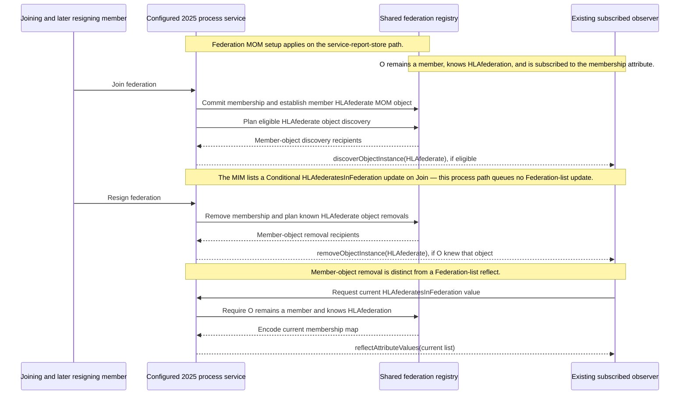

The process Join handler establishes the execution-scoped `HLAfederation` MOM
object only inside its service-report-store branch, then queues discovery for
the joining member's `HLAfederate` object
([Join setup](../../cpp/src/internal/federation/process_federation_service_lifecycle.cpp#L726),
[member discovery](../../cpp/src/internal/federation/process_federation_service_lifecycle.cpp#L830)). Process
`handleResign` dispatches the registry's object-removal results; the resignation planner retains the execution MOM
record for surviving members, clears the departing member's known-object state for it, and separately plans removal of
that member's `HLAfederate` object for surviving observers that knew it
([resign handler](../../cpp/src/internal/federation/process_federation_service_request_handlers.cpp#L136),
[removal dispatch](../../cpp/src/internal/federation/process_federation_service_connection_loss.cpp#L83),
[federation-object ledger](../../cpp/src/internal/federation/federation_registry_resign_lifecycle.cpp#L1033), [member-object cleanup](../../cpp/src/internal/federation/federation_registry_resign_lifecycle.cpp#L1038)). The process
automatic conditional-update helper resolves a joined member's `HLAfederate` object; its call sites are reporting and
interaction-send paths, not Join or Resign
([member-scoped helper](../../cpp/src/internal/federation/process_federation_service_notifications.cpp#L132),
[reporting call site](../../cpp/src/internal/federation/process_federation_service_reporting.cpp#L508),
[interaction call site](../../cpp/src/internal/federation/process_federation_service_interaction_send.cpp#L376)).

A separate current-value request is source-supported for a surviving member that knows the Federation MOM object: the
process request handler uses the shared MOM planner, which checks membership and known-object state, while the
Federation attribute projection encodes the current registry membership map
([process request path](../../cpp/src/internal/federation/process_federation_service_attribute_update_requests.cpp#L35),
[known-object check](../../cpp/src/internal/federation/federation_registry_attribute_value_update_requests.cpp#L371),
[live membership projection](../../cpp/src/internal/federation/federation_registry_mom_object_state.cpp#L643)). That
call uses the planner's default `requireActiveSubscription = false`
([planner declaration](../../cpp/src/internal/federation/federation_registry.hpp#L1265)); this request path does not
establish that automatic Conditional reflections are queued.

Although the shared planner and registry ledger use joined-federate-oriented names, the execution-level object is stored
in that same ledger with `federationExecutionObject = true`
([execution-object registration](../../cpp/src/internal/federation/federation_registry_mom_object_state.cpp#L484)); the
value projection uses that flag to encode the live federation membership map. This is a source-path clarification, not
test evidence.

The focused embedded membership test observes list reflections at Join and Resign
([embedded test](../../cpp/tests/ieee1516_2025_federation_mom_membership_boundaries_catch2.cpp#L4)). The process
resignation test instead checks removal of the departed member's `HLAfederate` object before rediscovery/reflection of a
later member ([process test](../../cpp/tests/ieee1516_2025_connection_process_mom_resign_removal_order_catch2.cpp#L39));
it does not assert the Federation membership-list reflection. The exact attribute-name search found no
configured-process observer test for `HLAfederatesInFederation`, either for automatic Join/Resign reflection or the
explicit current-value request. The process enqueue and request outcomes therefore remain source-only and unresolved
against the full licensed §§4.11/6.9/6.11 text; do not infer 2010 or embedded/process parity.

## Creation-time federation policy versus per-member switch seeding

“Switch” does not imply one shared lifetime or one shared source. These two
diagrams compare only the tested 2025 advisory settings below: the federation-scoped
`Advisories Use Known Class` value is captured from the Create-time model,
whereas object-class and interaction-relevance advisory values are initialized
for the member being joined from that Join's effective composed FDD.

**Federation-scoped Create-time value**

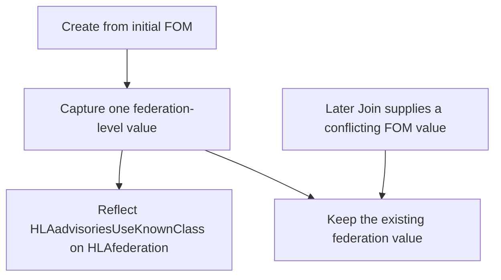

**Member-scoped Join-time initialization**

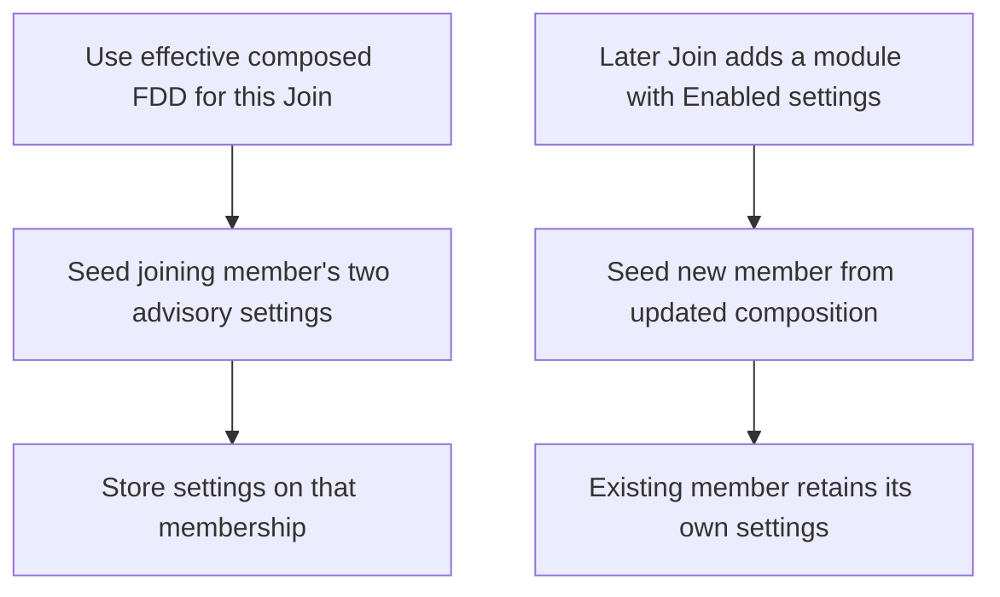

These diagrams correspond to two separate focused test cases, not one combined fixture. The
[known-class test body](../../cpp/tests/advisories_use_known_class_switch_catch2.cpp#L4)
sets up creation with the switch enabled, then a later Join with a conflicting
Disabled value; its assertions require both members to read the shared enabled
value. The
[advisory-seeding test body](../../cpp/tests/join_advisory_switch_seed_catch2.cpp#L4)
sets up an initial member with default-disabled advisory settings, then a Join
with an FOM whose object-class and interaction-relevance values are Enabled;
its assertions require the new member to read Enabled while the first remains
Disabled. The
[static federation MOM test body](../../cpp/tests/ieee1516_2025_federation_mom_static_configuration_catch2.cpp#L4)
also asserts the initial `HLAadvisoriesUseKnownClass` reflection.

Both focused switch cases were built and rerun locally, but each currently
fails during `createFederationExecution` with `Unknown exception`, before its
switch assertions. Treat both diagrams as source-derived and test-mapped, not as a
behavior verified by those test runs; the setup failure remains to be
investigated.

The source mirrors that distinction: federation creation captures global
catalog values in the federation record
([registry creation](../../cpp/src/internal/federation/federation_registry_membership_lifecycle.cpp#L120));
each Join seeds the new membership from the replacement/current definition,
without rewriting existing membership fields
([member initialization](../../cpp/src/internal/federation/federation_registry_membership_lifecycle.cpp#L373)).
The joined-federate
[`HLAsetSwitches` test](../../cpp/tests/mom_federate_set_switches_catch2.cpp#L67)
also demonstrates why the interaction name must not be treated as a universal
switch setter: its tested parameters update a defined support/reporting subset,
and selected relevance-switch getters remain unchanged. The advisory consumers
and their independent callback rules stay in the
[relevance-advisory guide](HLA-2025-RELEVANCE-ADVISORY-FLOW-GUIDE.md).

Here “Static” in the `HLAfederation` MIM row names its MOM reflection category;
the Create-time capture and no-divergence claim above are the narrower Umbra
behavior established by the cited source and tests. This comparison is for the
embedded 2025 profile only; it says nothing about the separate 2010 stream or
untested backend parity.

### Switch storage, current MOM projection, and Conditional reflection are separate

The short interaction name `HLAsetSwitches` occurs under two different 2025
MOM roots. Resolve the full class path before deciding which state is being
adjusted; the federation-wide and joined-federate forms are not one universal
switch map ([federation class](../../third_party/ieee1516.2-2025/resources/mim/HLAstandardMIM-2025.xml#L2536),
[joined-federate class](../../third_party/ieee1516.2-2025/resources/mim/HLAstandardMIM-2025.xml#L984)):

| 2025 `HLAsetSwitches` path | Standard parameters interpreted | State and current MOM projection |
| --- | --- | --- |
| `HLAmanager.HLAfederation.HLAadjust.HLAsetSwitches` | `HLAautoProvide` (`HLAswitch`) | Federation-wide Auto Provide state; projected as `HLAfederation.HLAautoProvide`. See the [Auto Provide guide](HLA-2025-AUTO-PROVIDE-FLOW-GUIDE.md). |
| `HLAmanager.HLAfederate.HLAadjust.HLAsetSwitches` | `HLAobjectClassRelevanceAdvisory`, `HLAattributeRelevanceAdvisory`, `HLAattributeScopeAdvisory`, `HLAinteractionRelevanceAdvisory`, `HLAconveyRegionDesignatorSets`, `HLAserviceReporting`, `HLAexceptionReporting`, and `HLAsendServiceReportsToFile` (`HLAswitch`); `HLAautomaticResignAction` (`HLAresignAction`) | Per-member switch state; corresponding current values are projected on that member's `HLAfederate` MOM object and exposed by the matching getters. |

For these pinned MIM types, `HLAswitch` uses `HLAinteger32BE` with Disabled = 0
and Enabled = 1, while `HLAresignAction` uses `HLAinteger32BE` values 0 through
5 ([`HLAswitch`](../../third_party/ieee1516.2-2025/resources/mim/HLAstandardMIM-2025.xml#L3144),
[`HLAresignAction`](../../third_party/ieee1516.2-2025/resources/mim/HLAstandardMIM-2025.xml#L3102)).
The runtime therefore has two decoders: one for the 0/1 switch and another
that maps the six resign-action enumerators to `ResignAction` values
([embedded decoders](../../cpp/src/internal/runtime/umbra_rti_ambassador_interaction_send_mom_controls.cpp#L60),
[process decoders](../../cpp/src/internal/federation/process_federation_service_interaction_send.cpp#L44)).

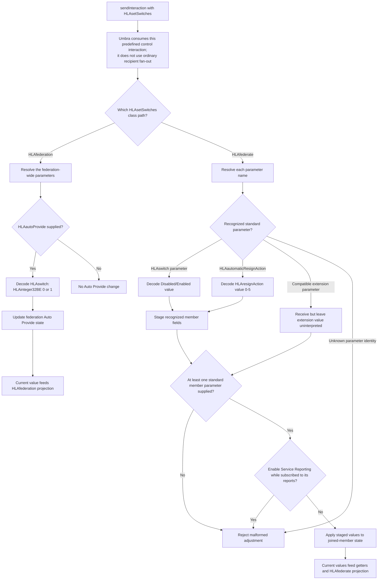

Both public profiles intercept these predefined classes before ordinary
interaction fan-out. In the member-scoped route, recognized parameters are
collected before the registry update; a compatible extension parameter is
left uninterpreted, but an extension-only member adjustment has no recognized
standard field to apply. The registry checks the Service Reporting
subscription interlock before mutating any supplied member field, so a
rejected mixed adjustment does not partially apply its other staged values
([registry guard and update](../../cpp/src/internal/federation/federation_registry_control_state.cpp#L582)).
The process handler also reports malformed member adjustments through its MOM
exception path; the precise process tests below cover selected failures, not
every malformed combination.

The pinned 2025 MIM marks all nine joined-federate switch attributes as
Conditional, each when its corresponding switch value changes. Each
`HLAsetSwitches` parameter maps to the same-named attribute on that member's
`HLAfederate` MOM object. The source paths do not schedule those Conditional
updates alike:

| Joined-federate parameter → `HLAfederate` attribute | 2025 MIM condition | Embedded `HLAsetSwitches` work when supplied | Configured-process `HLAsetSwitches` enqueue |
| --- | --- | --- | --- |
| [`HLAobjectClassRelevanceAdvisory`](../../third_party/ieee1516.2-2025/resources/mim/HLAstandardMIM-2025.xml#L535) | Conditional when its switch changes | Yes | No |
| [`HLAattributeRelevanceAdvisory`](../../third_party/ieee1516.2-2025/resources/mim/HLAstandardMIM-2025.xml#L547) | Conditional when its switch changes | Yes | No |
| [`HLAattributeScopeAdvisory`](../../third_party/ieee1516.2-2025/resources/mim/HLAstandardMIM-2025.xml#L559) | Conditional when its switch changes | Yes | No |
| [`HLAinteractionRelevanceAdvisory`](../../third_party/ieee1516.2-2025/resources/mim/HLAstandardMIM-2025.xml#L571) | Conditional when its switch changes | Yes | No |
| [`HLAconveyRegionDesignatorSets`](../../third_party/ieee1516.2-2025/resources/mim/HLAstandardMIM-2025.xml#L583) | Conditional when its switch changes | Yes | No |
| [`HLAautomaticResignAction`](../../third_party/ieee1516.2-2025/resources/mim/HLAstandardMIM-2025.xml#L595) | Conditional when its action changes | Yes | No |
| [`HLAserviceReporting`](../../third_party/ieee1516.2-2025/resources/mim/HLAstandardMIM-2025.xml#L607) | Conditional when its switch changes | Yes | No |
| [`HLAexceptionReporting`](../../third_party/ieee1516.2-2025/resources/mim/HLAstandardMIM-2025.xml#L619) | Conditional when its switch changes | Yes | Yes; this is the only member field passed to the enqueue helper |
| [`HLAsendServiceReportsToFile`](../../third_party/ieee1516.2-2025/resources/mim/HLAstandardMIM-2025.xml#L631) | Conditional when its switch changes | Yes | No |

The embedded handler maps every supplied member field to its corresponding
MOM attribute before planning the work
([field-to-attribute map](../../cpp/src/internal/runtime/umbra_rti_ambassador_interaction_send_mom_controls.cpp#L704)).
The configured-process handler applies the supplied update to registry state,
but its `HLAsetSwitches` path calls the Conditional-update enqueue helper only
for `HLAexceptionReporting`
([enqueue condition](../../cpp/src/internal/federation/process_federation_service_interaction_send.cpp#L532),
[Conditional planner](../../cpp/src/internal/federation/process_federation_service_notifications.cpp#L152)).
The stored values remain available to getters and the member's current MOM
projection ([projection](../../cpp/src/internal/federation/federation_registry_mom_object_state.cpp#L808)).
Keep state storage, current-value projection, and event delivery to eligible
MOM-object recipients distinct:

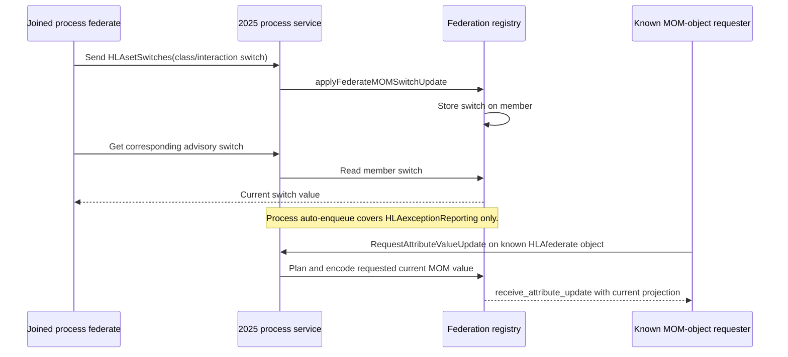

The process service decodes `HLAsetSwitches` and stores supplied member
switches through `applyFederateMOMSwitchUpdate` ([handler](../../cpp/src/internal/federation/process_federation_service_interaction_send.cpp#L511),
[member-state update](../../cpp/src/internal/federation/federation_registry_control_state.cpp#L582)).
The public getter reads that state, and the `HLAfederate` projection encodes the
same member fields ([projection](../../cpp/src/internal/federation/federation_registry_mom_object_state.cpp#L808)).
An explicit `requestAttributeValueUpdate` is a separate route: the process
handler asks the registry for the current MOM projection and sends the result
to the requester ([request path](../../cpp/src/internal/federation/process_federation_service_attribute_update_requests.cpp#L45)).
That current-value response is not evidence that the switch mutation queued an
automatic Conditional reflection.

The focused configured-process evidence is split by question: the public
[`HLAautoProvide` case](../../cpp/tests/ieee1516_2025_connection_catch2.cpp#L918)
toggles federation state and has server-side registry assertions; the
[member switch case](../../cpp/tests/ieee1516_2025_connection_process_mom_set_switches_catch2.cpp#L51)
uses public setters/getters; a [compatible-subclass case](../../cpp/tests/ieee1516_2025_connection_catch2.cpp#L1129)
covers ignored extension values. Separate process cases cover a malformed
switch value, unknown parameter, malformed resign action, and the Service
Reporting interlock with its MOM-exception behavior
([value](../../cpp/tests/ieee1516_2025_connection_process_mom_malformed_value_catch2.cpp#L460),
[parameter](../../cpp/tests/ieee1516_2025_connection_process_mom_malformed_parameter_catch2.cpp#L460),
[resign action](../../cpp/tests/ieee1516_2025_connection_process_mom_malformed_resign_action_catch2.cpp#L460),
[interlock](../../cpp/tests/ieee1516_2025_connection_catch2.cpp#L1390),
[MOM exception](../../cpp/tests/ieee1516_2025_connection_catch2.cpp#L1554)).
These cases do not establish every multi-parameter failure combination or
process reflection behavior for all Conditional member attributes. The
embedded conditional-reflection test exercises the nine individual support-
service setters through its [shared assertion helper](../../cpp/tests/ieee1516_2025_joined_federate_mom_conditional_reflections_catch2.cpp#L187),
beginning with the [individual switch setters](../../cpp/tests/ieee1516_2025_joined_federate_mom_conditional_reflections_catch2.cpp#L325); its separate
`HLAsetSwitches` portion supplies only `HLAserviceReporting` and asserts that
one reflection ([switch interaction](../../cpp/tests/ieee1516_2025_joined_federate_mom_conditional_reflections_catch2.cpp#L391),
[reflection assertion](../../cpp/tests/ieee1516_2025_joined_federate_mom_conditional_reflections_catch2.cpp#L410)).
Its recorded run fails during federation creation before reaching those
assertions, so they remain test-source expectations rather than observed
runtime evidence. The configured-process member-switch test checks stored
values through public getters but does not attach an observer to assert
`HLAfederate` reflections ([test](../../cpp/tests/ieee1516_2025_connection_process_mom_set_switches_catch2.cpp#L52),
[getter assertions](../../cpp/tests/ieee1516_2025_connection_process_mom_set_switches_catch2.cpp#L348)).

The registry directly assigns each supplied member value. Embedded work
selection and the configured-process `HLAexceptionReporting` enqueue guard
both depend on parameter presence; neither compares prior and new values at
that producer edge. A same-value resubmission therefore reaches the
work-scheduling decision, but no focused observer assertion establishes
whether it produces a delivered reflection. The configured-process source
finding remains that eight of the nine MIM-Conditional attributes do not enter
its automatic enqueue call. These are implementation-path observations, not a
conformance conclusion or an embedded/process equivalence claim. No 2010
behavior is implied.

## Explicit MOM requests return current values through a separate path

The 2025 MIM says the RTI shall answer a Request Attribute Value Update for
`HLAmanager.HLAfederate` or one of its known instances using the ordinary
instance attribute update mechanism, regardless of whether the requested
attribute is Static, Periodic, or Conditional ([class semantics](../../third_party/ieee1516.2-2025/resources/mim/HLAstandardMIM-2025.xml#L53)).
This is a federate-initiated request for current values; it is not the same
event as an attribute's automatic update condition firing.

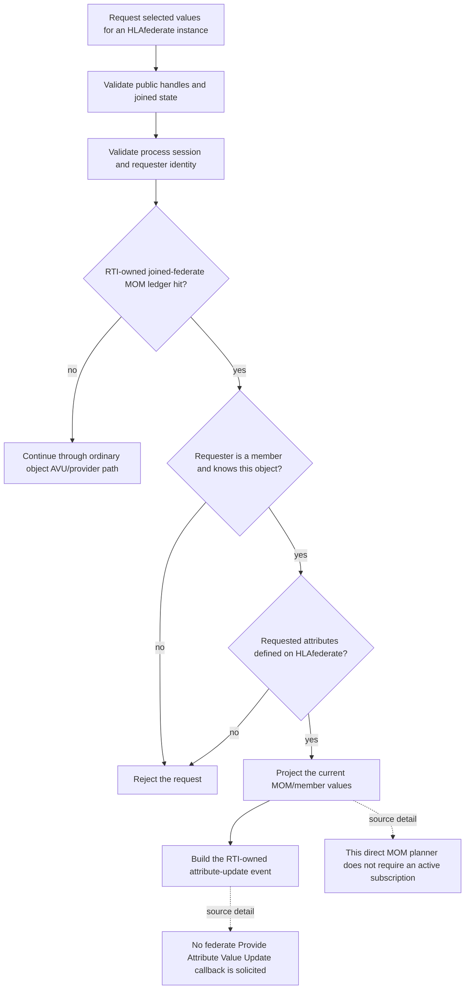

The `no` branch remains the ordinary object-instance request path; see the
[2025 Attribute Value Update Request guide](HLA-2025-ATTRIBUTE-VALUE-UPDATE-REQUEST-FLOW-GUIDE.md)
for provider selection and solicitation. It is intentionally not collapsed
into the RTI-owned MOM ledger path here.

**Process mapping.** The public adapter checks the opaque object/attribute
handles and joined state, then sends copied request values to the configured
process endpoint ([adapter](../../cpp/src/internal/runtime/umbra_rti_ambassador_request_attribute_value_updates.cpp#L23)).
The service verifies the session, federation, and requesting member before
trying the RTI-owned MOM ledger ahead of the ordinary object-request planner
([service path](../../cpp/src/internal/federation/process_federation_service_attribute_update_requests.cpp#L13)).
For a joined-federate MOM instance, the registry requires current membership
and known-object state, verifies each requested attribute against the
`HLAfederate` class, and projects current values
([MOM request planner](../../cpp/src/internal/federation/federation_registry_attribute_value_update_requests.cpp#L344),
[MOM value projection](../../cpp/src/internal/federation/federation_registry_mom_object_state.cpp#L1078)).
This direct planner call uses the declaration's default
`requireActiveSubscription = false`; the requester must still know the MOM
instance. That is an implementation detail, not a claim that the focused test
exercises an unsubscribed request ([planner declaration](../../cpp/src/internal/federation/federation_registry.hpp#L1265)).

The RTI-owned branch constructs an attribute-update event directly for the
requester; it does not solicit a federate `provideAttributeValueUpdate`
callback ([direct MOM branch](../../cpp/src/internal/federation/process_federation_service_attribute_update_requests.cpp#L30)).
Depending on the process service option, that event is pushed or queued for a
receive poll ([event selection](../../cpp/src/internal/federation/process_federation_service_attribute_update_requests.cpp#L64)).
The client submits it to the process callback bridge, which delivers
`reflectAttributeValues` ([client dispatch](../../cpp/src/internal/federation/process_federation_client_callback_dispatch.cpp#L36),
[bridge submission](../../cpp/src/internal/federation/process_federation_callback_bridge.cpp#L1624),
[callback invocation](../../cpp/src/internal/federation/process_federation_callback_bridge.cpp#L362)).

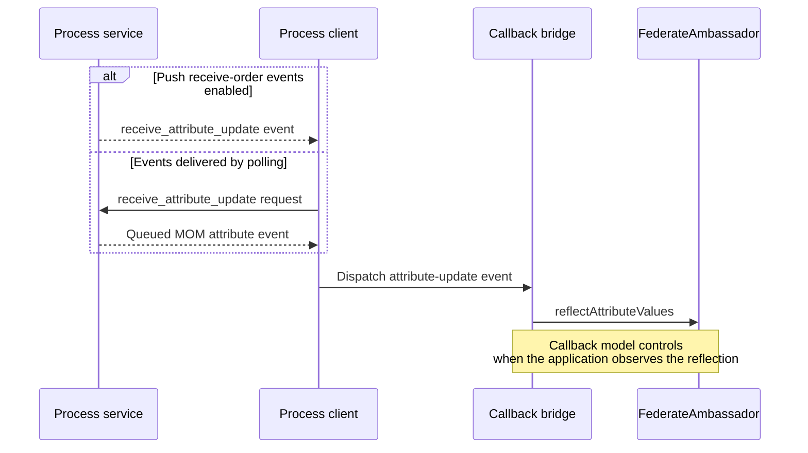

In the focused public process test, an `HLA_EVOKED` observer subscribes to and
discovers the subject's `HLAfederate` object, requests `HLAreportServiceFile`,
then evokes callbacks and checks one new reflection for that object containing
the current path ([test setup](../../cpp/tests/ieee1516_2025_connection_process_joined_federate_mom_report_file_catch2.cpp#L328),
[request](../../cpp/tests/ieee1516_2025_connection_process_joined_federate_mom_report_file_catch2.cpp#L437),
[reflection assertions](../../cpp/tests/ieee1516_2025_connection_process_joined_federate_mom_report_file_catch2.cpp#L457)).
`HLAreportServiceFile` itself is Conditional in the MIM
([attribute row](../../third_party/ieee1516.2-2025/resources/mim/HLAstandardMIM-2025.xml#L643)); the test supports this
explicit current-value route, but does not test the attribute's automatic update condition, an unsubscribed request,
failure cases, or callback timing under other callback models.

## Report-file condition and Join-time value

The pinned MIM marks `HLAreportServiceFile` Conditional when both
`HLAserviceReporting` and `HLAsendServiceReportsToFile` first become true
([MIM condition](../../third_party/ieee1516.2-2025/resources/mim/HLAstandardMIM-2025.xml#L646)).
Umbra's source records a standards-source conflict: IEEE 1516.1-2025 Table 8
calls this attribute Static, while the unmodified IEEE 1516.2-2025 MIM gives
it that Conditional trigger. The implementation accepts those two metadata
forms while retaining the MIM catalog entry; this documentation records the
observed paths without deciding which source controls conformance
([source comment and validation](../../cpp/src/internal/federation/federation_registry_mom_object_state.cpp#L306)).

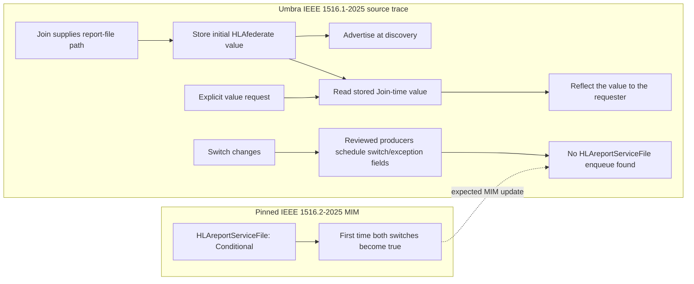

When their service-report store is configured, both 2025 Join paths allocate
the per-member report file and use its location to establish the RTI-owned
`HLAfederate` snapshot before returning successful Join: the embedded path
creates its writer and then establishes the MOM
object ([writer allocation](../../cpp/src/internal/runtime/umbra_rti_ambassador_federation_lifecycle.cpp#L637),
[MOM setup](../../cpp/src/internal/runtime/umbra_rti_ambassador_federation_lifecycle.cpp#L659));
the configured-process path follows the same order
([writer allocation](../../cpp/src/internal/federation/process_federation_service_lifecycle.cpp#L738),
[MOM setup](../../cpp/src/internal/federation/process_federation_service_lifecycle.cpp#L764)).
The joined-federate value lookup returns that Join-time snapshot before trying
other value sources
([snapshot construction](../../cpp/src/internal/federation/federation_registry_mom_object_state.cpp#L355),
[value projection](../../cpp/src/internal/federation/federation_registry_mom_object_state.cpp#L643)).
The focused embedded case checks the absolute advertised path on initial
reflection and then verifies that an explicit request returns the same path
([case](../../cpp/tests/joined_federate_mom_report_file_catch2.cpp#L127),
[path assertions](../../cpp/tests/joined_federate_mom_report_file_catch2.cpp#L225),
[request result](../../cpp/tests/joined_federate_mom_report_file_catch2.cpp#L248)).
This establishes Join-time current-value availability, not the Conditional
MIM-triggered automatic update.
The embedded switch setters pass their corresponding switch attribute names
to the conditional-work helper, which turns those supplied names directly
into update handles without adding dependent MIM attributes
([helper](../../cpp/src/internal/runtime/umbra_rti_ambassador_object_instance_lifecycle_callbacks.cpp#L1120)).
The configured-process `HLAsetSwitches` path schedules only
`HLAexceptionReporting`, and its direct file-switch setter only stores the
switch. The reviewed producers contain no enqueue for
`HLAreportServiceFile`
([embedded Service Reporting setter](../../cpp/src/internal/runtime/umbra_rti_ambassador_service_reporting_switches.cpp#L119),
[embedded file-switch setter](../../cpp/src/internal/runtime/umbra_rti_ambassador_service_reporting_switches.cpp#L418),
[process HLAsetSwitches](../../cpp/src/internal/federation/process_federation_service_interaction_send.cpp#L532),
[process file-switch setter](../../cpp/src/internal/federation/process_federation_service_reporting.cpp#L595)).

The tests establish bounded facts, not the MIM-triggered callback: the process
switch case turns both switches on and checks that the server-side file path
stays stable, without a second observer
([switch sequence](../../cpp/tests/ieee1516_2025_connection_process_mom_set_switches_catch2.cpp#L294),
[path assertion](../../cpp/tests/ieee1516_2025_connection_process_mom_set_switches_catch2.cpp#L128)).
The process report-file case toggles only the file switch and explicitly
requests the same path
([request](../../cpp/tests/ieee1516_2025_connection_process_joined_federate_mom_report_file_catch2.cpp#L451),
[switch sequence](../../cpp/tests/ieee1516_2025_connection_process_joined_federate_mom_report_file_catch2.cpp#L481)).
The embedded public case turns on both switches, then makes an explicit
request; it does not separate a possible queued automatic reflection from
that request
([switches](https://github.com/sheepfling/umbra/blob/c9c5a9e410539b039cd8bba35b53d0ef2b24d180/cpp/tests/ieee1516_2025_joined_federate_mom_public_object_lifecycle_catch2.cpp#L268),
[request](https://github.com/sheepfling/umbra/blob/c9c5a9e410539b039cd8bba35b53d0ef2b24d180/cpp/tests/ieee1516_2025_joined_federate_mom_public_object_lifecycle_catch2.cpp#L273)).
Taken together with the producer paths above, this leaves the MIM trigger's
automatic reflection unverified by focused observer evidence. Treat the
source/MIM difference as an open behavior question until the Table 8/MIM
conflict is resolved against the pinned normative text.

Keep the two observation paths separate: an explicit request is answered for
the requesting federate from current state, while a Conditional update is
triggered by its specified event and planned for eligible receivers. The
periodic refresh schedule is a third path: `HLAsetTiming` controls when
Periodic member attributes are refreshed, independently of an explicit
request. The [joined-federate MOM guide](HLA-2025-JOINED-FEDERATE-MOM-OBJECT-LIFECYCLE-FLOW-GUIDE.md#explicit-requests-and-periodic-refresh-are-independent)
explains that cadence and the limits on callback-timing claims. The process
test is 2025 configured-endpoint evidence only; it establishes no 2010 behavior
or embedded/process parity.

## Federation reports are receive-order interactions

The 2025 MIM defines federation MOM requests such as
`HLArequestFOMmoduleData`, `HLArequestMIMdata`,
`HLArequestSynchronizationPoints`, and
`HLArequestSynchronizationPointStatus` as interactions, not attribute-value
requests. In the reviewed embedded 2025 implementation paths, the RTI validates
the joined requester and request-specific input, reads the authoritative
module/MIM/synchronization state, builds the paired `HLAreport...` interaction,
and selects report recipients through the ordinary interaction-subscription
route. The configured-process report path is bounded separately below.

This explicit request/report path is distinct from subject-switch-controlled
`HLAreportServiceInvocation` traffic, which describes a public service call
rather than the requested current Federation MOM state. Compare the separate
[service-invocation reporting guide](HLA-2025-SERVICE-INVOCATION-REPORTING-FLOW-GUIDE.md#three-distinct-traces-call-outcome-invocation-report-requested-mom-report).
Malformed or rejected MOM requests use the separate `HLAreportMOMexception`
path; for the per-profile relationship to `HLAreportException`, see the
[exception-reporting guide](HLA-2025-EXCEPTION-REPORTING-FLOW-GUIDE.md#a-mom-rejection-may-also-enter-the-general-exception-hook).

### A Federate-Lost MOM report is distinct from local loss and object removal

The 2025 MIM says `HLAreportFederateLost` shall be sent when a federate is lost
from the federation due to a fault. The interaction is reliable and Receive
order, and uses the `HLAfederate` dimension. Its timestamp is the last-known-
good logical time to which the lost member was granted
([MIM definition](../../third_party/ieee1516.2-2025/resources/mim/HLAstandardMIM-2025.xml#L1879)).
Eligible survivors receive the remote report through `receiveInteraction`. It
is separate from the lost endpoint's local `FederateAmbassador::connectionLost`
callback and from a survivor's `removeObjectInstance` callback for a known
`HLAfederate` MOM object. The [Lifecycle guide's three-observation summary](HLA-2025-FEDERATION-AND-FEDERATE-LIFECYCLE-FLOW-GUIDE.md#separate-observations-follow-forced-connectionlost)
compares their audiences and evidence limits.

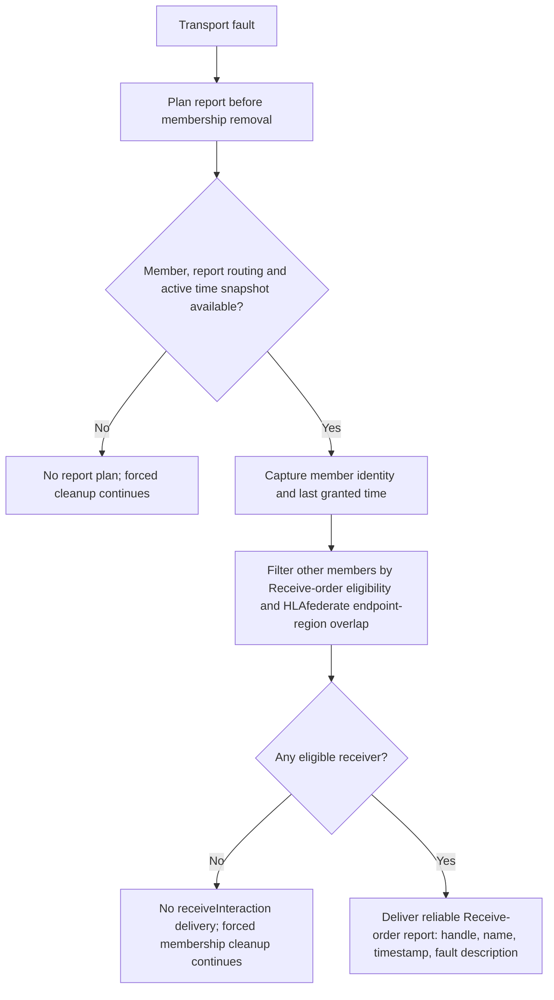

The registry planner snapshots the member identity and active time state before
the member is removed. It selects other members through the RTI receive-order
route and an internal endpoint region for the lost member's normalized
`HLAfederate` coordinate
([report planner](../../cpp/src/internal/federation/federation_registry_federate_lost_reporting.cpp#L84)).
The shared recipient selector applies interaction-class ancestry and
subscription relevance, then checks the recipient subscription against that
endpoint region ([selector](../../cpp/src/internal/federation/federation_registry.cpp#L1586)).
In that selector, active subscriptions establish interaction relevance;
recipient matching then walks the class ancestry and requires default-region
or explicit-region overlap. A passive subscription can participate after an
active subscription has established relevance. This is the current shared
selector implementation, and no Federate-Lost-specific case isolates passive
subscription or class-promotion behavior.
An otherwise valid plan can therefore have no eligible receivers. In that
case the embedded adapter's recipient loop submits no callback, and the
configured-process service's nonempty-recipient gate emits no report event;
the forced membership-loss transition and its cleanup still proceed
([embedded submission](../../cpp/src/internal/runtime/umbra_rti_ambassador_membership_loss.cpp#L26),
[process dispatch gate](../../cpp/src/internal/federation/process_federation_service_connection_loss.cpp#L97)).
The focused tests cover subscribed versus unsubscribed recipients and regional
match versus disjoint cases, but do not isolate a loss where every survivor is
ineligible. This empty-recipient behavior is source-derived.

The payload carries the lost federate handle, name, last granted time, and fault
description. Embedded callback execution projects the recipient route again,
so a survivor that leaves or changes its interaction route while an
`HLA_EVOKED` report waits may no longer receive it
([callback-time projection](../../cpp/src/internal/runtime/umbra_rti_ambassador_membership_loss.cpp#L74)).
These are implementation checks, not additional normative trigger rules. No
focused test covers a queued report whose recipient changes state before
invocation.

**Profile-specific dispatch**

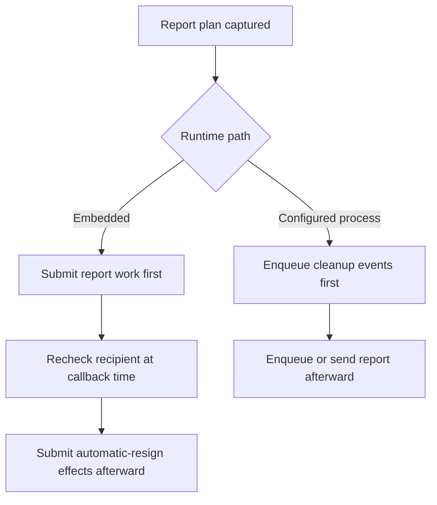

The embedded adapter submits report work before automatic-resignation effects
([report submission](../../cpp/src/internal/runtime/umbra_rti_ambassador_membership_loss.cpp#L371)).
A focused `HLA_EVOKED` case observes the report before `DELETE_OBJECTS` removal
for each of two survivors. It does not establish ordering against every
removal type or the lost application's local callback
([report/removal ordering case](../../cpp/tests/ieee1516_2025_connection_lost_report_ordering_catch2.cpp#L5)).
Other embedded cases cover subscribed versus unsubscribed recipients, the
four-value payload, and reliable Receive-order delivery
([evoked report case](../../cpp/tests/ieee1516_2025_connection_lost_federate_lost_mom_interaction_catch2.cpp#L5));
HLA_IMMEDIATE delivery ([immediate case](../../cpp/tests/ieee1516_2025_connection_lost_federate_lost_mom_immediate_catch2.cpp#L5));
and matching versus disjoint regional subscriptions under both callback
models ([HLA_EVOKED](../../cpp/tests/ieee1516_2025_connection_lost_federate_lost_mom_regional_catch2.cpp#L5),
[HLA_IMMEDIATE](../../cpp/tests/ieee1516_2025_connection_lost_federate_lost_mom_regional_immediate_catch2.cpp#L67)).
The HLA_IMMEDIATE case observes the report and local loss callback before the
fault-injection service returns, but does not assert their relative order.

The configured-process service captures the plan before registry membership
removal. Its dispatcher enqueues object-removal and synchronization events
before it enqueues or sends the Federate-Lost event, using the selected Push or
Pull receive path ([loss transition](../../cpp/src/internal/federation/process_federation_service_connection_loss.cpp#L176),
[cleanup dispatch](../../cpp/src/internal/federation/process_federation_service_connection_loss.cpp#L83),
[report dispatch](../../cpp/src/internal/federation/process_federation_service_connection_loss.cpp#L97)).
This is process-source enqueue/send order. The bounded 2025 test inventory has
one promoted configured-process `HLAreportFederateLost` scenario. The hosted
portable TCK scenario verifies the reliable four-parameter report, federate
identity and name, a decodable logical timestamp, and eventual local
`connectionLost`
([hosted scenario at the reviewed snapshot](https://github.com/sheepfling/umbra/blob/c9c5a9e410539b039cd8bba35b53d0ef2b24d180/packages/hla-rti-cpp-tck/src/portable_tck.cpp#L2463)).
Its adapter-managed installed-package run and contract twin passed under both
callback models ([hosted run record](https://github.com/sheepfling/umbra/blob/c9c5a9e410539b039cd8bba35b53d0ef2b24d180/packages/hla-rti-cpp-tck/README.md#L6799)).
The current worktree scenario adds an application TSO at the loss cutoff,
exact equality between the reported timestamp and that cutoff, TSO callback
before the survivor's cutoff grant, a post-loss `HLAfederatesInFederation`
snapshot, and a public member-list query containing only the survivor
(current scenario[^worktree-source]).
It also registers and completes a survivor-only synchronization point with
an empty failed-to-sync set. These later assertions are present in current
source; the hosted run record above validates only the hosted version. The
current source uses the process fixture's Push receive path and has no Pull
case. The current assertions do not establish relative callback order among
the report, local loss callback, membership reflection, and object-removal
callbacks, or assert retirement of
the lost member's `HLAfederate` MOM object. Pull behavior and Push/Pull parity
with embedded delivery remain unestablished.

#### Configured-process report delivery and local loss use separate paths

The service-side report is delivered to surviving members. The failed
member's own process client separately detects its transport failure and
queues the local `FederateAmbassador::connectionLost` callback. The two paths
do not share one callback queue, so the chart does not imply an order between
the survivor report and the failed application's local notification.

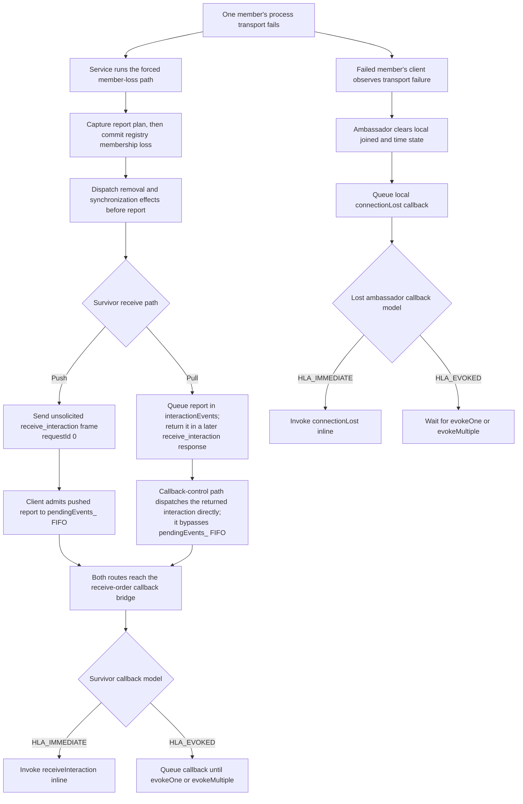

For this report, the service marks the event as RTI-owned MOM traffic and
reliable. Push sends it as an unsolicited event after cleanup dispatch; Pull
stores it in `interactionEvents`, which the next receive request drains. On
receipt, pushed interactions enter the client FIFO, while a polled interaction
is returned separately and dispatched directly by the callback-control
service. Both routes converge on `submitReceiveOrder` and the public
`receiveInteraction` callback. The [Process Endpoint receiver map](HLA-2025-PROCESS-ENDPOINT-REQUEST-AND-CALLBACK-FLOW-GUIDE.md#cross-family-queue-order-and-test-boundary)
describes that distinction in the shared process path.

The failed client's transport handler instead calls the local ambassador
transition, clears its local joined/time state, and submits
`connectionLost` through its `CallbackSession`. The process service-host
partition case[^worktree-source]
observes local loss callbacks for the two clients cut off from one ingress;
it does not inspect a survivor's Federate-Lost report. The focused public
process [Evoke interaction case](../../cpp/tests/ieee1516_2025_connection_receive_evoke_catch2.cpp#L457)
and [immediate delivery case](../../cpp/tests/ieee1516_2025_connection_process_asynchronous_delivery_catch2.cpp#L75)
cover ordinary interactions, not this RTI-owned MOM event. The current-worktree
Federate-Lost process TCK scenario[^worktree-source]
extends the [hosted portable scenario](https://github.com/sheepfling/umbra/blob/c9c5a9e410539b039cd8bba35b53d0ef2b24d180/packages/hla-rti-cpp-tck/src/portable_tck.cpp#L2463)
with cutoff TSO delivery/order and post-loss membership checks. It covers the
report through the process Push route; the hosted run record above does not
validate these added assertions. They establish no callback-order relation
between the report, local loss, and membership callbacks, and do not cover the
Pull branch. Push/Pull receipt and
HLA_IMMEDIATE/HLA_EVOKED scheduling remain distinct boundaries, and the
focused cases do not cover every pairing.
`disableCallbacks` applies to each receiving ambassador's callback dispatcher,
not to the report plan or membership-loss transition. Its effect on a delayed
survivor report and the profile-specific local `connectionLost` reset behavior
are compared in the [Callback and Service Ordering guide](HLA-2025-CALLBACK-AND-SERVICE-ORDERING-FLOW-GUIDE.md#callback-enable-gates-for-federate-lost-and-local-connectionlost).
The [subscription-change subsection](HLA-2025-CALLBACK-AND-SERVICE-ORDERING-FLOW-GUIDE.md#if-the-subscription-changes-before-callback-entry)
also traces what an unsubscribe during the disabled interval changes in each
profile, and what already queued process reports retain.

The source route is visible in the [service's report event construction and
Push/Pull branch](../../cpp/src/internal/federation/process_federation_service_connection_loss.cpp#L176),
[Pull queue removal](../../cpp/src/internal/federation/process_federation_service_receive.cpp#L123),
[pushed-frame admission](../../cpp/src/internal/federation/process_federation_client.cpp#L460),
[client FIFO dispatch](../../cpp/src/internal/federation/process_federation_client_callback_dispatch.cpp#L298),
[direct poll dispatch](../../cpp/src/internal/runtime/umbra_rti_ambassador_callback_control_services.cpp#L274),
and the [receive-order bridge](../../cpp/src/internal/federation/process_federation_callback_bridge.cpp#L1346).
The failed endpoint's [process-client callback binding](../../cpp/src/internal/runtime/umbra_rti_ambassador_connect_services.cpp#L238)
and [local transport-failure transition](../../cpp/src/internal/runtime/umbra_rti_ambassador_membership_loss.cpp#L122)
show its separate callback path.

### The same short FOM request name appears under two MOM roots

Do not identify a MOM request by its final class name alone. The 2025 MIM
defines `HLArequestFOMmoduleData` and `HLAreportFOMmoduleData` in both the
execution-scoped `HLAmanager.HLAfederation` tree and the member-scoped
`HLAmanager.HLAfederate` tree. These are distinct, fully qualified interaction
classes with different module lists and request shapes:

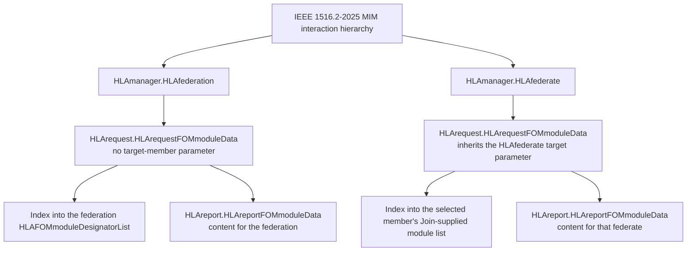

| MIM branch | Fully qualified request → report | Meaning of the module index |
| --- | --- | --- |
| Federation | `HLAmanager.HLAfederation.HLArequest.HLArequestFOMmoduleData` → `HLAmanager.HLAfederation.HLAreport.HLAreportFOMmoduleData` | Selects a module in the federation's list assembled from Create and Join inputs ([MIM rows](../../third_party/ieee1516.2-2025/resources/mim/HLAstandardMIM-2025.xml#L723), [request](../../third_party/ieee1516.2-2025/resources/mim/HLAstandardMIM-2025.xml#L2586), [report](../../third_party/ieee1516.2-2025/resources/mim/HLAstandardMIM-2025.xml#L2657)). |
| Joined federate | `HLAmanager.HLAfederate.HLArequest.HLArequestFOMmoduleData` → `HLAmanager.HLAfederate.HLAreport.HLAreportFOMmoduleData` | Selects a module in the targeted federate's Join-supplied list; the request inherits `HLAfederate` from its interaction-class ancestor ([target parameter](../../third_party/ieee1516.2-2025/resources/mim/HLAstandardMIM-2025.xml#L909), [request](../../third_party/ieee1516.2-2025/resources/mim/HLAstandardMIM-2025.xml#L1200), [report](../../third_party/ieee1516.2-2025/resources/mim/HLAstandardMIM-2025.xml#L1909)). See the [embedded index-mapping evidence limit](#member-scoped-index-after-join-embedded-mapping-needs-a-focused-check). |

For the separate requester-versus-receiver lifetime question, see the
[federation-scoped departure comparison](#federation-scoped-requester-departure-has-no-member-target-gate).

#### Federation index after an additional Join: embedded mapping needs a focused check

The MIM defines `HLAFOMmoduleIndicator` as the order number of the requested
module in the federation's `HLAFOMmoduleDesignatorList` ([request semantics](../../third_party/ieee1516.2-2025/resources/mim/HLAstandardMIM-2025.xml#L2586)).
An accepted additional-module Join changes the federation definition; this is
separate from the resulting composed `HLAcurrentFDD` and from the retained
module text carried in a report.

The inspected embedded paths do not use one shared index projection. The
federation MOM list filters to FOM modules and, for 2025, keeps qualifying
modules whose validated content changes designated FOM areas while retaining
only the first equal content ([list encoder](../../cpp/src/internal/federation/federation_registry_mom_object_state.cpp#L110),
[federation projection](../../cpp/src/internal/federation/federation_registry_mom_object_state.cpp#L161),
[contribution classification](../../cpp/src/internal/fom/libxml2_fom_composer.cpp#L2139)).
The federation report planner instead builds a vector from every retained FOM
record and removes repeats by canonical `sourcePath`, then applies the
indicator to that vector while planning the report ([content projection](../../cpp/src/internal/federation/federation_registry_mom_federation_content_reporting.cpp#L26),
[request planner](../../cpp/src/internal/federation/federation_registry_mom_federation_content_reporting.cpp#L53)).
For an uncomplicated definition where each module contributes unique content
and has a unique canonical path, both passes preserve definition order; that
is a source-derived expectation, not a multi-module test result. If the
accepted definition retains content-identical FOM records at distinct paths,
the list can keep one designator while the report vector keeps both records.
A non-contributing FOM record can also remain in the report vector while being
absent from the list. Either case could shift later positions; neither has a
focused public test. The source therefore does not establish that every report
index resolves to the module named at that position in the exposed list.

The focused embedded federation request case reports index `0` for the single
Create-supplied Restaurant module and checks that an unavailable index is
rejected ([request test](../../cpp/tests/federation_mom_current_fdd_catch2.cpp#L325)).
The MIM defines `HLAindex` as `HLAinteger32BE` with semantics `NA` and calls
`HLAFOMmoduleIndicator` an order number ([type](../../third_party/ieee1516.2-2025/resources/mim/HLAstandardMIM-2025.xml#L3004),
[request parameter](../../third_party/ieee1516.2-2025/resources/mim/HLAstandardMIM-2025.xml#L2595));
the checked-in MIM does not state whether that number is zero-based. Umbra's
test establishes that `0` selects its single module in this implementation,
and the planner uses it as a C++ vector index. That does not establish a
normative index base. A separate test joins an object-only extension and
observes a changed `HLAcurrentFDD`, but does not request module data afterward
([additional-Join test](../../cpp/tests/federation_mom_current_fdd_catch2.cpp#L287)).
No cited test covers index-to-content alignment after Join or the two
deduplication edge cases above. Keep the MIM's order-number contract distinct
from the implementation evidence; do not claim those embedded edge cases are
verified or infer ordering for a request concurrent with Join.

#### Member-scoped index after Join: embedded mapping needs a focused check

The member-scoped MIM gives `HLAFOMmoduleIndicator` the order number in the
target federate's `HLAFOMmoduleDesignatorList`; that list represents the FOM
modules supplied by that federate at Join, with only the first designator for
identical modules ([member list](../../third_party/ieee1516.2-2025/resources/mim/HLAstandardMIM-2025.xml#L138),
[request semantics](../../third_party/ieee1516.2-2025/resources/mim/HLAstandardMIM-2025.xml#L1200)).
This is a per-member input snapshot, separate from the federation-wide list and
the composed `HLAcurrentFDD`.

The embedded Join path also constructs two separate projections. The public
member list is encoded from `fomModulesSpecifiedAtJoin`; the 2025 encoder keeps
qualifying module contents and de-duplicates by validated content ([list encoder](../../cpp/src/internal/federation/federation_registry_mom_object_state.cpp#L110),
[Join snapshot encoding](../../cpp/src/internal/federation/federation_registry_mom_object_state.cpp#L328)).
The retained report-content snapshot instead includes every Join-supplied FOM
record and de-duplicates by canonical `sourcePath` ([content snapshot builder](../../cpp/src/internal/federation/federation_registry_mom_object_state.cpp#L147),
[snapshot assignment](../../cpp/src/internal/federation/federation_registry_mom_object_state.cpp#L378)).
The request planner applies `HLAFOMmoduleIndicator` to that retained-content
vector ([planner](../../cpp/src/internal/federation/federation_registry_mom_fom_module_data_reporting.cpp#L30),
[indexed lookup](../../cpp/src/internal/federation/federation_registry_mom_fom_module_data_reporting.cpp#L94)).
Thus the list and report can have different positions when a Join-supplied
module contributes no listed FOM content or identical content is supplied
through different paths. Source inspection does not establish index-to-content
alignment for those multi-module edge cases.

The public member-report test requests index `0` when its subject supplied one
FOM module at Join ([request case](https://github.com/sheepfling/umbra/blob/c9c5a9e410539b039cd8bba35b53d0ef2b24d180/cpp/tests/ieee1516_2025_federation_mom_fom_module_data_report_catch2.cpp#L60)).
The public lifecycle test verifies a one-module Join list; the private snapshot
test verifies one retained designator when the same canonical source is
supplied twice, but neither compares a multi-module public list with a report
payload ([public list assertion](https://github.com/sheepfling/umbra/blob/c9c5a9e410539b039cd8bba35b53d0ef2b24d180/cpp/tests/ieee1516_2025_joined_federate_mom_public_object_lifecycle_catch2.cpp#L128),
[private duplicate-path case](../../cpp/tests/federation_registry_composed_fom_catch2.cpp#L63),
[count assertion](../../cpp/tests/federation_registry_composed_fom_catch2.cpp#L156)).
Keep the MIM's per-member index meaning distinct from the embedded evidence;
do not infer cross-member, federation-list, Current-FDD, or concurrent
request/Join behavior from these cases.

The MIM establishes this naming and data-scope distinction. The selected
embedded tests below illustrate each path; they do not replace the full
1516.1 service contract or establish process-backend parity. The member path's
Join-supplied list is captured in its `HLAfederate` snapshot; see the joined
guide's [Join boundary](HLA-2025-JOINED-FEDERATE-MOM-OBJECT-LIFECYCLE-FLOW-GUIDE.md#join-builds-the-object-before-making-the-member-visible).
The separate [FOM additional-module Join flow](HLA-2025-FOM-MODULE-ADMISSION-AND-COMPOSITION-FLOW-GUIDE.md#join-with-additional-fom-modules-replace-definition-and-add-member-together)
explains how the federation's effective model changes. These references keep
the target member's input list distinct from the federation list and composed
Current FDD.
Umbra also keeps separate [member-scoped](../../cpp/src/internal/fom/hla_names.hpp#L49)
and [federation-scoped](../../cpp/src/internal/fom/hla_names.hpp#L43) fully
qualified names; those constants corroborate its dispatch vocabulary, while
the MIM is the source for the HLA class hierarchy.

The two index contracts and embedded report projections can be compared
side-by-side:

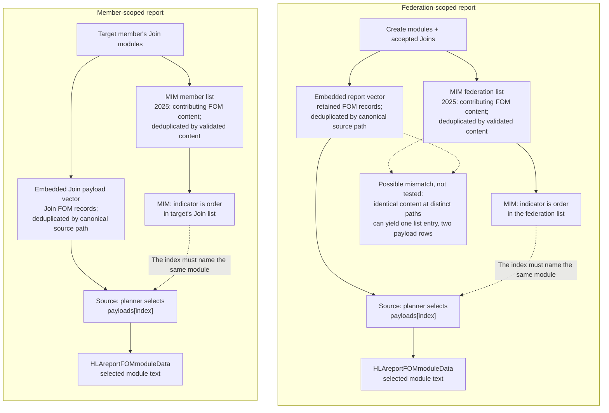

The embedded vectors and list projections are built differently: the list
filters/de-duplicates validated module content, while the report vector
de-duplicates by canonical source path. Keep both projections distinct from
the federation's composed `HLAcurrentFDD` above.

#### Configured-process federation request follows a different source path

The embedded report planner is not evidence for the configured-process route.
When the process endpoint is active, public `sendInteraction` copies the
interaction values into a process request and returns through the client path
before reaching the embedded MOM request handlers
([process-client branch](../../cpp/src/internal/runtime/umbra_rti_ambassador_interaction_send_services.cpp#L51)).
The process service has specific branches for several MOM controls, but the
federation FOM-module request has no matching branch in the inspected
`handleSendInteraction` path. It falls through to the ordinary
`planReceiveOrderInteraction` route; that planner requires the sender to have
published the interaction class
[MOM-specific branches](../../cpp/src/internal/federation/process_federation_service_interaction_send.cpp#L127),
[generic planner and rejection path](../../cpp/src/internal/federation/process_federation_service_interaction_send.cpp#L546),
[generic publication check](../../cpp/src/internal/federation/federation_registry_receive_order_interactions.cpp#L48)).
The 2025 MIM class is marked `Subscribe`
([federation request class and sharing](../../third_party/ieee1516.2-2025/resources/mim/HLAstandardMIM-2025.xml#L2587)).
If the ordinary planner accepts a request, the process service follows its
generic recipient route; the inspected path does not select module contents or
plan a federation `HLAreportFOMmoduleData`. This is a source trace, not a
configured-process runtime result or a normative interpretation of the MIM
sharing value.

```mermaid
flowchart TD
  accTitle: 2025 configured-process federation FOM-module request path
  accDescr: The process endpoint forwards the public request through a generic Send Interaction route. The inspected process service has no federation FOM-module report plan; its generic planner requires publication. The MIM marks this request class Subscribe. Runtime behavior for this combination is not established by a focused process test.

  APP["Application sends federation<br/>HLArequestFOMmoduleData"] --> CLIENT["Process-active sendInteraction<br/>encodes class and parameters"]
  CLIENT --> SERVICE["ProcessFederationService<br/>handleSendInteraction"]
  SERVICE --> CONTROL["Class-specific MOM branches<br/>for selected controls"]
  CONTROL --> FALLTHROUGH["No federation FOM-module<br/>report branch in this path"]
  FALLTHROUGH --> PLAN["planReceiveOrderInteraction<br/>generic receive-order planner"]
  PLAN --> PUBLISHED{"Requester published<br/>this interaction class?"}
  PUBLISHED -->|"No"| REJECT["Generic service request<br/>is rejected"]
  PUBLISHED -->|"Yes"| ROUTE["Generic subscribed-recipient<br/>interaction routing"]
  ROUTE --> NOREPORT["No module-content selection<br/>or FOM-module report plan"]
  MIM["2025 MIM: request sharing<br/>is Subscribe"] -.-> PUBLISHED
```

The portable C++ TCK has a public federation report scenario that requests
index `0` and checks one adapter-supplied FOM payload, but it uses the provider
selected by its adapter and does not identify this configured-process path
([scenario](../../packages/hla-rti-cpp-tck/src/tck_federation_mom_content_scenarios.cpp#L784),
[request](../../packages/hla-rti-cpp-tck/src/tck_federation_mom_content_scenarios.cpp#L675),
[payload assertions](../../packages/hla-rti-cpp-tck/src/tck_federation_mom_content_scenarios.cpp#L728)).
The additional-module Join case in the embedded Catch2 suite checks the changed
`HLAcurrentFDD`, not a later FOM-module request
([Join assertions](../../cpp/tests/federation_mom_current_fdd_catch2.cpp#L287)).
No focused public case in the inspected sources combines the configured-process
endpoint, an additional-module Join, and a federation FOM-module report.

The joined-member `HLArequestFOMmoduleData` has the same process source gap but
a different target: the MIM says to report content supplied by the target
federate at Join, selected by its member-scoped module list
([member request](../../third_party/ieee1516.2-2025/resources/mim/HLAstandardMIM-2025.xml#L1200)).
The configured-process send handler contains no member-report planner call and
falls through to the generic interaction planner/publication check
([process handler](../../cpp/src/internal/federation/process_federation_service_interaction_send.cpp#L546),
[publication predicate](../../cpp/src/internal/federation/federation_registry_receive_order_interactions.cpp#L48)).
That route does not decode the inherited `HLAfederate` target or use
`HLAFOMmoduleIndicator` to select the target's Join snapshot. If the generic
planner accepts the send, it selects ordinary subscribed recipients and builds
receive-order events from the request's class selection, parameter projection,
and sent payload ([process event creation](../../cpp/src/internal/federation/process_federation_service_interaction_send.cpp#L696));
the callback bridge delivers those events through `receiveInteraction`
([bridge](../../cpp/src/internal/federation/process_federation_callback_bridge.cpp#L227)).
No member-scoped `HLAreportFOMmoduleData` plan is created on that path. This is
a source trace, not a caller-visible result: it does not establish that a
configured-process caller reaches the accepted branch or observes a particular
exception. No focused configured-process test sends this member-scoped request.

```mermaid
flowchart TD
  TARGET["2025 member request inherits HLAfederate target<br/>HLAFOMmoduleIndicator selects a Join-list module"] --> SEND["Requester sends HLArequestFOMmoduleData"]
  SEND --> HANDLER["Configured-process handleSendInteraction"]
  HANDLER --> SPECIAL{"Member FOM-report branch present?"}
  SPECIAL -->|No| GENERIC["Pass original send to generic receive-order planner"]
  GENERIC --> PUBLISH{"Requester published this class?"}
  PUBLISH -->|No| REJECT["Generic planner rejects the send"]
  PUBLISH -->|Yes| RECIPIENTS["Select ordinary subscribed recipients"]
  RECIPIENTS --> EVENT["Create event from request class selection,<br/>recipient parameter projection, and sent payload"]
  EVENT --> CALLBACK["Ordinary receive-order callback bridge<br/>uses receiveInteraction"]
  EVENT -.-> NOREPORT["No target lookup, Join-snapshot index lookup,<br/>or HLAreportFOMmoduleData construction"]
```

```mermaid
sequenceDiagram
  participant Requester as Requesting federate
  participant RTI as Federation registry / RTI
  participant Observer as Report subscriber

  Requester->>RTI: sendInteraction(HLArequest..., request-specific input)
  Note over Requester,RTI: FOM-module requests carry HLAFOMmoduleIndicator
  RTI->>RTI: Validate joined requester and request-specific input
  alt Rejected request (selected embedded cases)
    RTI-->>Requester: Synchronous typed exception — no state report
  else Accepted request (selected embedded HLA_EVOKED path)
    RTI->>RTI: Read retained module/MIM or active synchronization state
    RTI->>RTI: Freeze report data and plan then-current recipients
    RTI->>RTI: Queue reliable receive-order callback tasks
    RTI-->>Requester: sendInteraction returns normally
    Note over Observer,RTI: Callback waits for evokeCallback()
    Observer->>RTI: evokeCallback()
    RTI->>RTI: Recheck planned recipient's membership and subscription
    alt Still eligible
      RTI-->>Observer: receiveInteraction(HLAreport...)
    else Eligibility changed
      RTI->>RTI: Suppress this callback
    end
  end
```

The request and report classes are defined in the 2025 MIM's federation
`HLArequest` and `HLAreport` groups. For FOM module data, the index selects an
entry in the federation's retained module list; an invalid index is rejected
synchronously rather than producing a stale report. Synchronization-point
reports read the registry's current in-progress point/status state. The report
is RTI-originated reliable receive-order traffic and is delivered as
`receiveInteraction`, not reflected as an attribute of the `HLAfederation`
object. Keep three traces distinct: the requesting federate's synchronous
`sendInteraction` result; the requested `HLAreport...` state response; and a
separate, switch-controlled report about the `SendInteraction` call:
`HLAreportServiceInvocation` when the interaction sink is selected, or a file
record when the file sink is selected ([service-invocation guide](HLA-2025-SERVICE-INVOCATION-REPORTING-FLOW-GUIDE.md#three-distinct-traces-call-outcome-invocation-report-requested-mom-report)).
In the selected embedded
`HLA_EVOKED` test, a valid request returns normally before the observer's
report callback is evoked; an unavailable module index and an unexpected MIM
parameter instead throw synchronously and produce no state-report callback.
That callback timing is test evidence for this profile/path, not a claim about
every callback model or the process endpoint.

The [focused request test](../../cpp/tests/federation_mom_current_fdd_catch2.cpp#L324)
shows the normal return before observer evocation and checks that its invalid
index and unexpected-parameter requests yield no report. The [embedded
`SendInteraction` handler](../../cpp/src/internal/runtime/umbra_rti_ambassador_interaction_send_services.cpp#L782)
validates and plans the request, then calls the selected per-invocation
reporting path before [queuing the federation report](../../cpp/src/internal/runtime/umbra_rti_ambassador_interaction_send_services.cpp#L964).
That is source order only: the cited request test does not enable or assert
both report families, so it does not establish their observer callback order.

Report contents and recipient eligibility have different observation times.
Planning freezes the report data and selects recipients using their current
subscriptions. When a queued callback reaches invocation, the runtime checks
each planned recipient's current membership and subscription again. An
unsubscribe after the request can therefore suppress a queued callback
without changing the already formed report; a later subscription does not add
a recipient to the earlier plan. The source shows these two gates in the
[FOM/MIM callback helper](../../cpp/src/internal/runtime/umbra_rti_ambassador_mom_fom_module_reports.cpp#L23)
and the [synchronization report callback paths](../../cpp/src/internal/runtime/umbra_rti_ambassador_mom_synchronization_reports.cpp#L55).
Focused tests observe unsubscribe-before-evoke suppression for a federation
FOM report and the synchronization-points list; the status-report planner has
the same source recheck, but that case does not assert suppression. The
member-scoped FOM report uses the shared callback helper, but its focused case
does not change eligibility before Evoke. The post-plan subscription behavior
is source-derived, not a normative ordering claim ([federation FOM test](../../cpp/tests/federation_mom_current_fdd_catch2.cpp#L180),
[points-list test](../../cpp/tests/ieee1516_2025_federation_mom_synchronization_reports_catch2.cpp#L175),
[member-scoped FOM test](https://github.com/sheepfling/umbra/blob/c9c5a9e410539b039cd8bba35b53d0ef2b24d180/cpp/tests/ieee1516_2025_federation_mom_fom_module_data_report_catch2.cpp#L51)).

### Member FOM report target resigns while the callback waits

The member-scoped request plan captures the original reported-member ID and
copies the indexed module content when the request is handled
([planner](../../cpp/src/internal/federation/federation_registry_mom_fom_module_data_reporting.cpp#L30),
[indexed snapshot read](../../cpp/src/internal/federation/federation_registry_mom_fom_module_data_reporting.cpp#L94)).
The queued callback retains that ID and encoded report payload. When the
callback runs, its resolver checks that both the original reported member and
the receiving member still belong to the federation, then rebuilds the current
report routing ([callback helper](../../cpp/src/internal/runtime/umbra_rti_ambassador_mom_fom_module_reports.cpp#L23),
[member and receiver recheck](../../cpp/src/internal/federation/federation_registry_mom_fom_module_data_reporting.cpp#L141)).
If the original member has resigned by that check, the old report is
suppressed. A later same-name Join receives a fresh member ID: the registry
advances its member-ID counter and removes the old ID/name mapping during
Resign ([Join allocation](../../cpp/src/internal/federation/federation_registry_membership_lifecycle.cpp#L343),
[ID advancement](../../cpp/src/internal/federation/federation_registry_membership_lifecycle.cpp#L612),
[Resign removal](../../cpp/src/internal/federation/federation_registry_resign_lifecycle.cpp#L1104)).
That new ID cannot make the old report current again.

```mermaid
flowchart TD
  PLAN["Accept member FOM request<br/>capture target ID and module content"] --> QUEUE["Queue receive-order report"]
  QUEUE --> CHECK{"Is that same target ID<br/>still a federation member at callback check?"}
  CHECK -->|Yes| RECEIVER{"Is the planned receiver<br/>still eligible?"}
  RECEIVER -->|Yes| DELIVER["Deliver HLAreportFOMmoduleData"]
  RECEIVER -->|No| DROP_RECEIVER["Suppress: receiver left<br/>or unsubscribed"]
  CHECK -->|No| DROP_TARGET["Suppress: original target ID left"]
  DROP_TARGET --> REJOIN{"Does the target later rejoin<br/>with the same name?"}
  REJOIN -->|Yes| NEW["New member identity and HLAfederate object;<br/>old report stays suppressed"]
  REJOIN -->|No| END["Old report remains suppressed"]
```

Resign can retain the old private `HLAfederate` snapshot while known observers
still have pending Remove Object Instance callbacks
([resignation removal ledger](../../cpp/src/internal/federation/federation_registry_resign_lifecycle.cpp#L1038)).
That retention supports object-removal cleanup; it does not retarget or revive
the already queued FOM report. The member-report callback releases the
registry lock after resolving current eligibility and before calling
`receiveInteraction`, so this source trace does not establish a strict order
when a concurrent Resign races after the recheck but before callback entry.

This retained snapshot does not make the departed member a valid target for a
new request. The embedded report planner checks that both requester and target
are current federation members before it searches the joined-member snapshot
ledger ([membership gates and later snapshot lookup](../../cpp/src/internal/federation/federation_registry_mom_fom_module_data_reporting.cpp#L40)).
Resign removes the departing ID from federation membership, while pending
Remove Object Instance callbacks can keep its MOM snapshot in the ledger
([resign cleanup](../../cpp/src/internal/federation/federation_registry_resign_lifecycle.cpp#L1038)).
Thus a retained object is cleanup state, not renewed request authority: a new
request naming that departed target is rejected at the planner's target
membership gate before snapshot content is considered. This is a source trace
of the embedded planner, not a claim about the public exception or a tested
request-after-Resign scenario.

The focused [embedded member-report case](https://github.com/sheepfling/umbra/blob/c9c5a9e410539b039cd8bba35b53d0ef2b24d180/cpp/tests/ieee1516_2025_federation_mom_fom_module_data_report_catch2.cpp#L67)
requests and evokes the report while its target remains joined. The separate
[process report-file rejoin case](../../cpp/tests/ieee1516_2025_connection_process_joined_federate_mom_report_file_catch2.cpp#L499)
observes a fresh `HLAfederate` object and report-file path after same-name
rejoin, but it does not exercise a queued FOM report. The reviewed cases do
not combine target Resign/rejoin with a waiting member-scoped report; the
suppression rule above is bounded to the embedded source recheck and is not a
normative callback-order claim or process-parity result.

### New member-scoped request after same-name rejoin

A new request is resolved against the new membership lifetime. In the
embedded path, `GetFederateHandle(name)` looks up the currently joined member
by name and returns that member's current ID
([lookup](../../cpp/src/internal/runtime/umbra_rti_ambassador_federate_identity_lookup.cpp#L51)).
The request itself carries an encoded `HLAfederate` handle; the handler decodes
that value and passes its ID to the report planner
([request decode and planner status mapping](../../cpp/src/internal/runtime/umbra_rti_ambassador_interaction_send_services.cpp#L1060)).
After same-name rejoin, the old ID is not reused as the new membership: Join
advances the registry's federate ID counter
([allocation](../../cpp/src/internal/federation/federation_registry_membership_lifecycle.cpp#L359),
[counter advancement](../../cpp/src/internal/federation/federation_registry_membership_lifecycle.cpp#L629)).
So a requester must name the current federate handle for the new membership;
the request does not resolve a stale handle to a same-name member. In this
handler, a target ID that is not currently a member maps to
`FederateNotExecutionMember`; no focused test asserts that result for an old
handle after rejoin.

The new member's report snapshot is established from that Join's validated
FOM-module inputs ([snapshot construction](../../cpp/src/internal/federation/federation_registry_mom_object_state.cpp#L392),
[module-content selection](../../cpp/src/internal/federation/federation_registry_mom_object_state.cpp#L147)).
The report planner checks current membership and then reads the indexed text
from the snapshot associated with the current target ID
([planner](../../cpp/src/internal/federation/federation_registry_mom_fom_module_data_reporting.cpp#L40)).
This is separate from the old callback's captured target ID and copied report
text. The existing focused report case requests the subject's own module while
it remains joined; neither it nor the process report-file rejoin case tests a
new member-scoped FOM-module request after a same-name rejoin. Index alignment
with `HLAFOMmoduleDesignatorList` retains the separate caveat documented
[above](#member-scoped-index-after-join-embedded-mapping-needs-a-focused-check).

```mermaid
sequenceDiagram
  participant Member as Target federate name
  participant RTI as Embedded 2025 RTI
  participant Requester
  participant Observer

  Requester->>RTI: Earlier request targets member ID A
  RTI-->>Observer: Queue old report with ID A and copied content
  Member->>RTI: Resign old membership (ID A)
  Note over RTI: Old HLAfederate snapshot may remain for pending Remove callbacks
  Member->>RTI: Rejoin with same name
  RTI->>RTI: Allocate current membership ID B and create new Join snapshot
  Requester->>RTI: GetFederateHandle(name) → ID B
  Requester->>RTI: HLArequestFOMmoduleData(target=ID B, index=i)
  RTI->>RTI: Check target membership and read index i from ID B snapshot
  RTI-->>Observer: Queue report for the new membership's selected module text
```

This sequence is an embedded-source explanation, not a callback-order or
cross-profile guarantee. The focused tests do not cover this rejoin-and-new-
request sequence.

### Requester Resign after an accepted member report request

The request sender and the reported `HLAfederate` are separate roles. The
2025 MIM supplies `HLAfederate` on the member-request interaction hierarchy as
the joined federate handle, and its paired report is scoped by the
`HLAfederate` dimension ([inherited request parameter](../../third_party/ieee1516.2-2025/resources/mim/HLAstandardMIM-2025.xml#L915),
[member request](../../third_party/ieee1516.2-2025/resources/mim/HLAstandardMIM-2025.xml#L1200),
[member report](../../third_party/ieee1516.2-2025/resources/mim/HLAstandardMIM-2025.xml#L1909)).
Those entries identify the report target; this review does not infer a
requester-cancellation rule from them.

In the embedded 2025 handler, the requester must be joined when the request is
accepted, and the named target is resolved separately before the registry
plans the report ([request handler](../../cpp/src/internal/runtime/umbra_rti_ambassador_interaction_send_services.cpp#L1026),
[registry plan call](../../cpp/src/internal/runtime/umbra_rti_ambassador_interaction_send_services.cpp#L1113)).
The resulting plan carries the reported-member ID, index, copied module text,
routing, and recipient list; it has no requester-ID field
([plan type](../../cpp/src/internal/federation/federation_registry_mom_report_types.hpp#L224)).
Each queued callback retains the original reported-member ID and its own
receiving-member ID; the callback resolver rechecks those two identities and
the receiver's current subscription/region eligibility
([callback capture and resolver](../../cpp/src/internal/runtime/umbra_rti_ambassador_mom_fom_module_reports.cpp#L23),
[member/receiver check](../../cpp/src/internal/federation/federation_registry_mom_fom_module_data_reporting.cpp#L141)).

For a request whose sender differs from its target, a requester Resign after
acceptance does not appear in the independent observers' queued eligibility
checks. If the target and an observer remain joined and eligible, their
planned callback can still deliver. If the requester was also selected as a
report receiver, a callback addressed to it cannot pass its own membership
check if it reaches that resolver after Resign; this is a separate
per-recipient outcome. If the requester and reported target are the same
member, the target-Resign gate above applies and suppresses the report. These
are source-derived embedded paths, not a general normative cancellation rule
or process-profile result.

```mermaid
sequenceDiagram
  participant Requester as Requesting federate
  participant Target as Reported federate
  participant RTI as Embedded 2025 RTI
  participant Observer as Independent report observer

  Requester->>RTI: Send accepted member request naming Target
  RTI->>RTI: Validate requester and target membership
  RTI->>RTI: Copy Target module and queue recipient callbacks
  Note over Requester,RTI: Queued report retains Target ID and receiver IDs, not Requester ID
  Requester->>RTI: Resign before Observer evokes
  RTI->>RTI: Remove Requester membership
  Note over Target,RTI: Target remains joined in this scenario
  Observer->>RTI: evokeCallback()
  RTI->>RTI: Recheck Target ID and this Observer's eligibility
  alt Target and Observer remain eligible
    RTI-->>Observer: receiveInteraction(HLAreportFOMmoduleData)
  else Target or Observer no longer eligible
    RTI->>RTI: Suppress this callback
  end
```

The focused successful [member-report case](https://github.com/sheepfling/umbra/blob/c9c5a9e410539b039cd8bba35b53d0ef2b24d180/cpp/tests/ieee1516_2025_federation_mom_fom_module_data_report_catch2.cpp#L59)
uses the requesting subject as the reported target, so it does not establish
the distinct-requester case. The Table 7 S-leaf case checks missing request
arguments, not a successful request followed by requester Resign
(parameter-required case[^worktree-source]).
The reviewed public cases therefore do not verify whether independent
observers receive a queued report after a distinct requester leaves.

### Federation-scoped requester departure has no member-target gate

The federation branch of the 2025 MIM request has no `HLAfederate` target;
its paired report describes module content for the federation. The member
branch instead inherits an `HLAfederate` target and scopes its report to that
member ([federation request/report](../../third_party/ieee1516.2-2025/resources/mim/HLAstandardMIM-2025.xml#L2586),
[member request/report](../../third_party/ieee1516.2-2025/resources/mim/HLAstandardMIM-2025.xml#L1200)).
This changes which identity can gate a queued callback:

| Callback identity | Member-scoped report | Federation-scoped report |
| --- | --- | --- |
| Request acceptance | Checks the requester and resolves the named target separately. | Checks that the requester is a current member; the request names no report target. |
| Identity retained for callback-time report gating | The original reported-member ID is retained and rechecked, along with the receiver ID. | No requester or reported-member ID is retained as a report gate; each receiver ID is rechecked. |
| MIM report scope | Content for the target member, selected through its Join-supplied module list. | Specified module content for the federation; embedded index alignment has the separate caveat above. |

In the embedded federation path, the handler passes the requester ID to the
planner for its acceptance-time membership check
([handler](../../cpp/src/internal/runtime/umbra_rti_ambassador_interaction_send_services.cpp#L916),
[planner](../../cpp/src/internal/federation/federation_registry_mom_federation_content_reporting.cpp#L53)).
The resulting plan stores the index, module text, routing, and recipients, but
no requester ID ([plan type](../../cpp/src/internal/federation/federation_registry_mom_report_types.hpp#L253)).
At queue time the shared callback helper receives a sentinel in its reported-ID
slot, and the federation resolver ignores that slot. It resolves the planned
receiver against current federation membership and report eligibility
([queue and resolver selection](../../cpp/src/internal/runtime/umbra_rti_ambassador_mom_fom_module_reports.cpp#L143),
[federation receiver check](../../cpp/src/internal/federation/federation_registry_mom_federation_content_reporting.cpp#L130)).

Thus the inspected embedded callback path has no requester-ID recheck for an
independent observer: if that observer remains a member and eligible, the
requester's identity is not part of its resolver inputs. If the requester is
also a selected receiver, that receiver's own membership check applies. This
is a source trace, not a normative cancellation rule or a guarantee about a
concurrent Resign and callback schedule. The focused public test sends the
request as `subject` and receives it as a separate `observer`, then verifies
unsubscribe-before-Evoke suppression; it leaves the requester joined through
delivery and does not test requester Resign before Evoke
([federation report case](../../cpp/tests/federation_mom_current_fdd_catch2.cpp#L324)).

Focused public-C++ evidence:

- [Federation-scoped FOM-module requests](../../cpp/tests/federation_mom_current_fdd_catch2.cpp#L324)
  use the dimensionless federation interaction classes and check returned
  content, receive-order callback delivery, subscription revalidation, and
  synchronous invalid-index rejection.
- In that same [focused request test](../../cpp/tests/federation_mom_current_fdd_catch2.cpp#L324),
  federation `HLArequestMIMdata` is sent with an empty parameter map and
  produces one `HLAreportMIMdata` whose sole `HLAMIMdata` value decodes to
  text containing `Standard MOM`. The test also checks reliable receive-order
  delivery and synchronous rejection of an unexpected request parameter. The
  pinned MIM defines the request as Subscribe and the report as a reliable,
  receive-order Publish interaction ([request](../../third_party/ieee1516.2-2025/resources/mim/HLAstandardMIM-2025.xml#L2601),
  [report and parameter](../../third_party/ieee1516.2-2025/resources/mim/HLAstandardMIM-2025.xml#L2677));
  this is embedded test evidence, not configured-process parity.
- [Joined-federate FOM-module request/report](https://github.com/sheepfling/umbra/blob/c9c5a9e410539b039cd8bba35b53d0ef2b24d180/cpp/tests/ieee1516_2025_federation_mom_fom_module_data_report_catch2.cpp#L32) uses the distinct
  member-scoped class and inherited `HLAfederate` request target. The pinned
  case requests index 0, returns selected embedded content, and targets the
  sending member itself; cross-member requester/target pairs remain untested.
  The current worktree case also enables `ConveyRegionDesignatorSets` and checks
  one `HLAfederate` designator with bounds from the normalized target handle to
  its next value (switch[^worktree-source], reported bounds[^worktree-source]).
  These current-only test assertions are not a new normative rule.
- [Federation current-FDD object coverage](../../cpp/tests/federation_mom_current_fdd_catch2.cpp#L180)
  exercises retained current model content through the object-attribute route.
- [Synchronization list/status reports](../../cpp/tests/ieee1516_2025_federation_mom_synchronization_reports_catch2.cpp#L4)
  checks the paired report interactions and their encoded current state.

### Federation synchronization queries: active point list and roster status

The federation MOM offers two read-only synchronization queries. The
parameterless `HLArequestSynchronizationPoints` asks for all in-progress points
and returns `HLAreportSynchronizationPoints` with the `HLAsyncPoints` list. The
named `HLArequestSynchronizationPointStatus` carries one `HLAsyncPointName` and
returns that name plus `HLAsyncPointFederates`, a list of associated
federate/status records. The pinned MIM marks both requests Subscribe and each
paired report Publish; both are reliable and receive-order. Each request's MIM
semantics specify its corresponding report ([list request and report](../../third_party/ieee1516.2-2025/resources/mim/HLAstandardMIM-2025.xml#L2559),
[status request and report](../../third_party/ieee1516.2-2025/resources/mim/HLAstandardMIM-2025.xml#L2569),
[status record type](../../third_party/ieee1516.2-2025/resources/mim/HLAstandardMIM-2025.xml#L3765),
[status enumerators](../../third_party/ieee1516.2-2025/resources/mim/HLAstandardMIM-2025.xml#L3157)).
Neither query announces, achieves, or closes a synchronization point. For
registration, participant sets, achievement/completion transitions, and
membership changes, see the broader [2025 Federation Synchronization guide](HLA-2025-FEDERATION-SYNCHRONIZATION-FLOW-GUIDE.md).

| Report parameter | Pinned MIM shape | Focused-test decoding |
| --- | --- | --- |
| `HLAsyncPoints` | `HLAsyncPointList`: dynamic `HLAvariableArray` of `HLAunicodeString` labels ([type](../../third_party/ieee1516.2-2025/resources/mim/HLAstandardMIM-2025.xml#L3676)) | Decoded as a variable array of Unicode labels ([test](../../cpp/tests/ieee1516_2025_federation_mom_synchronization_reports_catch2.cpp#L75)). |
| `HLAsyncPointFederates` | `HLAsyncPointFederateList`: dynamic `HLAvariableArray` of `HLAsyncPointFederate` fixed records. Each record contains an encoded `HLAfederate` reference and an `HLAfederateSyncStatus` value ([list](../../third_party/ieee1516.2-2025/resources/mim/HLAstandardMIM-2025.xml#L3683), [record](../../third_party/ieee1516.2-2025/resources/mim/HLAstandardMIM-2025.xml#L3765)). | The test decodes each federate reference to a public handle and reads the status as `HLAinteger32BE` ([test](../../cpp/tests/ieee1516_2025_federation_mom_synchronization_reports_catch2.cpp#L88)). It compares members by handle and does not establish a list ordering. |

```mermaid
flowchart TD
  Request["Federation synchronization query:<br/>HLArequestSynchronizationPoints or HLArequestSynchronizationPointStatus"] --> Profile{"Implementation profile?"}
  MIM["Pinned 1516.2-2025 MIM:<br/>both requests Subscribe; paired reports are Publish,<br/>reliable receive-order and specified by the request semantics"] -.-> Request

  Profile -->|Embedded| Validate{"Joined requester and valid required input?"}
  Validate -->|"No / malformed"| Reject["Synchronous typed rejection"]
  Validate -->|"Yes"| Query{"Request class?"}
  Query -->|"HLArequestSynchronizationPoints;<br/>no parameters"| ReadList["Snapshot the active synchronization-point set<br/>while handling the request"]
  ReadList --> ListReport["HLAreportSynchronizationPoints<br/>HLAsyncPoints list"]
  Query -->|"HLArequestSynchronizationPointStatus;<br/>one HLAsyncPointName"| Lookup{"Label in current synchronization-point registry?"}
  Lookup -->|"No"| Empty["Preserve requested label;<br/>federate/status list is empty"]
  Lookup -->|"Yes"| Roster["Snapshot that point's synchronization set<br/>while handling the request"]
  Roster --> Announced{"Federate is announced?"}
  Announced -->|"No"| NoActivity["NoActivity (0)"]
  Announced -->|"Yes"| Achieved{"Federate has achieved?"}
  Achieved -->|"No"| Moving["MovingToSyncPoint (2)"]
  Achieved -->|"Yes"| Waiting["WaitingForRestOfFederation (3)"]
  Empty --> StatusReport["HLAreportSynchronizationPointStatus<br/>label + list of federate-handle/status records"]
  NoActivity --> StatusReport
  Moving --> StatusReport
  Waiting --> StatusReport
  ListReport --> Route["Queue the formed report snapshot<br/>for eligible subscribers"]
  StatusReport --> Route
  Route --> Callback["receiveInteraction<br/>Selected HLA_EVOKED test: callback after evokeCallback"]

  Profile -->|Configured process| ProcessRoute["No synchronization-query branch;<br/>request reaches generic receive-order planning"]
  ProcessRoute --> Published{"Sender published<br/>the request interaction class?"}
  Published -->|No| ProtocolReject["Generic planner rejects<br/>the unpublished interaction class"]
  ProtocolReject --> PublicError["Non-OK response becomes a client error;<br/>public sendInteraction maps it to RTIinternalError"]
  Published -->|Yes| ProcessFanout["Generic send path plans and queues/pushes<br/>the original request interaction to recipients"]
  ProcessFanout --> NoReport["Generic route reads no synchronization state<br/>and constructs no paired report"]
```

The status names and numeric values come from the pinned MIM. The reviewed
embedded planner maps a federate outside the announced set to `NoActivity`
(0), an announced but not-yet-achieved federate to `MovingToSyncPoint` (2),
and an achieved federate to `WaitingForRestOfFederation` (3). Although the MIM
also defines `AttemptingToRegisterSyncPoint` (1), this planner does not emit it;
that source observation is not a claim that the implementation exhausts every
normative case. The focused test directly observes the 2-to-3 change for the
subject while the observer remains at 2, and a request for an unknown label
still returns a status report with an empty roster. It does not exercise the
0 or 1 statuses ([test](../../cpp/tests/ieee1516_2025_federation_mom_synchronization_reports_catch2.cpp#L150),
[planner](../../cpp/src/internal/federation/federation_registry_mom_synchronization_reporting.cpp#L124),
[MIM status values](../../third_party/ieee1516.2-2025/resources/mim/HLAstandardMIM-2025.xml#L3157)).
After the final participant achieves, the embedded registry erases the point
([completion](../../cpp/src/internal/federation/federation_registry.cpp#L342));
the status planner preserves the requested label and leaves its roster empty
when that label is absent ([planner](../../cpp/src/internal/federation/federation_registry_mom_synchronization_reporting.cpp#L133)).
The focused case checks the completed point disappearing from the all-points
list, but does not issue a named-status query for that completed label
([completion assertion](../../cpp/tests/ieee1516_2025_federation_mom_synchronization_reports_catch2.cpp#L228)).
Therefore the completed-label status response is source-derived, not directly
asserted by the test; its response shape matches the tested unknown-label path.

In the embedded path, the handlers form report data during synchronous request
processing: the list planner copies active labels, and the status planner
copies the roster statuses while holding the registry lock. The runtime then
queues that formed report for later delivery. The focused `HLA_EVOKED` test
confirms that the requester returns from `sendInteraction` before the observer
calls `evokeCallback`. Read these values as a request-time snapshot, not a
callback-time re-query; if synchronization state changes before delivery, a
new request is needed to observe it. The test demonstrates a status change
across two separate requests, but does not force a state change between one
request's snapshot and its callback ([list planner](../../cpp/src/internal/federation/federation_registry_mom_synchronization_reporting.cpp#L22),
[status planner](../../cpp/src/internal/federation/federation_registry_mom_synchronization_reporting.cpp#L124),
[status handler](../../cpp/src/internal/runtime/umbra_rti_ambassador_interaction_send_services.cpp#L759),
[focused test](../../cpp/tests/ieee1516_2025_federation_mom_synchronization_reports_catch2.cpp#L150)).

The same test's unsubscribe-before-evoke check is for
`HLAreportSynchronizationPoints`, not the status report, so status-report
delivery-time subscription revalidation is source-observed but not separately
asserted by that case.

In the embedded registry, a member departure removes that federate from a
pending point's synchronization, announced, and achieved sets before checking
whether the remaining barrier is complete. If the point remains pending, a
later status request therefore snapshots a roster without the departed ID; if
departure closes the barrier, the point is erased and a later status request
for that label follows the unknown-label path. The [Synchronization guide's
departure section](HLA-2025-FEDERATION-SYNCHRONIZATION-FLOW-GUIDE.md#member-departure-can-close-a-pending-barrier)
documents the source transition and the selected barrier-completion test. No
focused test combines departure with a subsequent status request, so the
query-after-departure outcomes remain source-derived.

#### Configured-process request route: evidence boundary

The configured-process route has no focused synchronization-query test or
dedicated synchronization-report planner. Its public `sendInteraction` path
uses the generic process receive-order planner, which requires the sender to
have published the interaction class. If that check fails, the server rejects
the request, the client converts the non-OK response to
`ProcessFederationClientError`, and the public wrapper maps it to
`RTIinternalError`. If publication passes, the generic path plans and queues
or pushes the original interaction to its recipients; the reviewed path does
not read synchronization state or construct the paired list/status report.
The pinned MIM marks both requests `Subscribe`. The configured-process
publication service nevertheless accepts any defined interaction-class
handle: its registry check verifies membership and class validity but does not
inspect the MIM sharing value. Thus the generic published branch is reachable
in current source if a client explicitly publishes a request handle. This is
an implementation observation, not a claim that publishing a Subscribe MOM
class is normatively permitted. No focused process test covers that sequence,
so its public outcome remains unobserved. The generic branch itself does not
read synchronization state or construct the paired report; do not infer
process/embedded parity ([MIM request](../../third_party/ieee1516.2-2025/resources/mim/HLAstandardMIM-2025.xml#L2569),
[embedded status handler](../../cpp/src/internal/runtime/umbra_rti_ambassador_interaction_send_services.cpp#L759),
[process public path](../../cpp/src/internal/runtime/umbra_rti_ambassador_interaction_send_services.cpp#L57),
[process generic planner and rejection](../../cpp/src/internal/federation/process_federation_service_interaction_send.cpp#L546),
[ordinary publication check](../../cpp/src/internal/federation/federation_registry_receive_order_interactions.cpp#L49),
[generic recipient event](../../cpp/src/internal/federation/process_federation_service_interaction_send.cpp#L696),
[process client error](../../cpp/src/internal/federation/process_federation_client_value_services.cpp#L26),
[process publication API](../../cpp/src/internal/runtime/umbra_rti_ambassador_interaction_declaration_services.cpp#L69),
[process declaration handler](../../cpp/src/internal/federation/process_federation_service_request_handlers.cpp#L324),
[registry publication validation](../../cpp/src/internal/federation/federation_registry_directed_interactions.cpp#L262),
[public exception translation](../../cpp/src/internal/runtime/umbra_rti_ambassador_interaction_send_services.cpp#L137)).

The [federation report planner](../../cpp/src/internal/federation/federation_registry_mom_federation_content_reporting.cpp#L52)
and [synchronization report planner](../../cpp/src/internal/federation/federation_registry_mom_synchronization_reporting.cpp#L22)
show where federation state becomes a report plan. The runtime's
[Join-time object setup](../../cpp/src/internal/runtime/umbra_rti_ambassador_federation_lifecycle.cpp#L616)
and [registry object foundation](../../cpp/src/internal/federation/federation_registry_mom_object_state.cpp#L378)
show the distinct object-lifecycle path.

The configured-process boundary remains unverified for federation-scoped
FOM-module-data, MIM-data, synchronization-point-list, and synchronization-
point-status requests, and for the member-scoped FOM-module-data request. The
public process `sendInteraction` path forwards the parameter values and tag
in its private envelope. The server has specific branches for selected MOM
operations, then sends other classes through the ordinary receive-order
interaction planner ([public process request](../../cpp/src/internal/runtime/umbra_rti_ambassador_interaction_send_services.cpp#L57),
[server special cases](../../cpp/src/internal/federation/process_federation_service_interaction_send.cpp#L127),
[generic planner call](../../cpp/src/internal/federation/process_federation_service_interaction_send.cpp#L546),
[ordinary planner's publication check](../../cpp/src/internal/federation/federation_registry_receive_order_interactions.cpp#L49)). The 2025 MIM marks both
`HLArequestFOMmoduleData`, federation `HLArequestMIMdata`,
`HLArequestSynchronizationPoints`, and
`HLArequestSynchronizationPointStatus` as `Subscribe` interactions ([member FOM
request](../../third_party/ieee1516.2-2025/resources/mim/HLAstandardMIM-2025.xml#L1200),
[federation FOM request](../../third_party/ieee1516.2-2025/resources/mim/HLAstandardMIM-2025.xml#L2586),
[federation MIM request](../../third_party/ieee1516.2-2025/resources/mim/HLAstandardMIM-2025.xml#L2601),
[synchronization requests](../../third_party/ieee1516.2-2025/resources/mim/HLAstandardMIM-2025.xml#L2559)). A bounded
source/test search found no process-specific FOM/MIM/synchronization report planner
or configured-process test for these request routes. The configured-process
publication registry accepts any defined interaction class without checking
its MIM sharing value, so publication of these Subscribe request handles is
source-reachable; this does not establish normative permission. An
unpublished class is rejected and the public process wrapper maps that client
failure to `RTIinternalError`; a published class follows ordinary interaction
delivery without a report planner in this route. No focused process test
executes those requests or observes a paired report; source shows the generic
published route creates no RTI-generated paired report. Keep
actual outcomes and process/embedded parity unclaimed.

## Keep these boundaries visible

- **Object versus report:** subscription to the `HLAfederation` object yields
  discovery/reflection callbacks. Subscribing to an `HLAreport...` interaction
  yields `receiveInteraction`; one is not a substitute for the other.
- **Federation versus member:** one federation object represents the execution;
  each joined member may separately have a private `HLAfederate` MOM object.
  In the pinned 2025 MIM, `HLAfederation` attributes are Static or Conditional,
  with no Periodic attributes ([MIM](../../third_party/ieee1516.2-2025/resources/mim/HLAstandardMIM-2025.xml#L658)).
  `HLAsetTiming` and periodic counters therefore belong to the member-scoped
  `HLAfederate` object and remain in the joined-federate guide/design evidence.
- **2025 versus 2010:** the 2025 runtime explicitly gates this projection when
  a legacy 2010 FOM compatibility profile is selected. This is an implementation
  boundary inside the 2025 runtime, not a flow for the 2010 reference RTI.
- **Evidence versus conformance:** the cited Catch2 tests are tagged
  `[development-profile]`. They establish tested behavior for those scenarios,
  not full IEEE conformance, process-backend parity, or completeness of the
  federation MOM surface.

## Evidence and remaining questions

The [federation MOM section of the implementation dossier](MOM-SERVICE-REPORTING-DESIGN.md#L1510)
records the current value sources and the test/profile limitations. Before
calling this topic complete, review the federation object and report paths
against the licensed IEEE 1516.1-2025 text (not only the MIM), validate any
uncovered report/error cases, add direct process-endpoint observation coverage
for the federation-scoped object if that profile needs to be established, and
render this guide in a local Mermaid renderer and GitHub after publication.
Keep unresolved normative, process-endpoint, and 2010 questions labeled rather
than inferring answers from the embedded tests.

[^worktree-source]: Source/test citations marked in this guide refer to current-worktree changes absent from the hosted base; those files are excluded from the documentation-only publication path set. The [hosted source-dependency audit](HLA-2025-HOSTED-SOURCE-DEPENDENCIES.json) records the exact paths, lines, and status.
