# IEEE 1516.1-2025 Federation-Scoped MOM Flow Guide

This guide follows the federation-scoped `HLAmanager.HLAfederation` object and
its request/report interactions. It explains why the object is not the same
thing as a joined member's `HLAmanager.HLAfederate` instance, how observers
learn its values, which operations update its conditional attributes, and how
federation reports travel as interactions rather than attribute reflections.

## Scope and authority

- **Normative model:** IEEE 1516.1-2025 and its 2025 MIM/OMT definitions.
  The [Federate Interface Specification](https://standards.ieee.org/ieee/1516.1/6688/)
  is the normative service authority. The official
  [1516.2-2025 MIM](../../third_party/ieee1516.2-2025/resources/mim/HLAstandardMIM-2025.xml)
  supplies the federation MOM class, attribute update types, and request/report
  interaction shapes. The MIM describes the model contract; it is not by
  itself proof that Umbra implements every path.
- **Implementation evidence:** the embedded 2025 federation-management
  development profile and its focused public-C++ tests. A separate process
  Join path establishes the federation-scoped registry record in source, but
  the reviewed public process tests exercise the member-scoped `HLAfederate`
  object rather than observing `HLAfederation` discovery and membership-value
  reflections. Process-specific evidence and that gap are stated below; no
  embedded/process parity is claimed.
- **Edition boundary:** this is a 2025 federation MOM explanation, not a 2010
  state machine. In the 2025 runtime's legacy-2010-FOM compatibility path, the
  Join adapter deliberately does not synthesize the 2025 federation MOM
  projection. The separate [2010 reference-RTI guide](HLA-2010-REFERENCE-RTI-FLOW-GUIDE.md)
  remains independent and is not evidence of this object's 2010 behavior.
- **Topic boundary:** this guide is about the execution-scoped
  `HLAmanager.HLAfederation` object and its report interactions. The separate
  [joined-federate MOM guide](HLA-2025-JOINED-FEDERATE-MOM-OBJECT-LIFECYCLE-FLOW-GUIDE.md)
  follows each membership's `HLAmanager.HLAfederate` object. The
  [service-invocation reporting guide](HLA-2025-SERVICE-INVOCATION-REPORTING-FLOW-GUIDE.md)
  follows a different family of MOM interactions.

## Three paths, three kinds of observation

The federation MOM uses ordinary HLA mechanisms, but its state and reports are
not interchangeable:

| What a subscriber observes | Mechanism | Example |
| --- | --- | --- |
| The RTI-owned `HLAfederation` object becomes known | Object-class subscription, `discoverObjectInstance`, and initial attribute reflection | Static federation name, RTI version, MIM designator, and time implementation |
| A value changes or is requested again | `reflectAttributeValues` for that known object instance | Conditional `HLAfederatesInFederation`; a current-value request can also return a conditional value |
| A federation report is requested | A `HLArequest...` interaction causes an RTI-originated `HLAreport...` interaction | FOM module contents or synchronization-point state |

The distinction matters when reading callbacks: a `reflectAttributeValues`
callback updates the known MOM object; a `receiveInteraction` callback carries
a report interaction. Neither callback is the same as the original Join,
resign, or request service completing.

## One membership change, two MOM observation paths

The 2025 MIM gives membership two distinct projections: one
`HLAmanager.HLAfederation` instance per execution and one
`HLAmanager.HLAfederate` instance per joined federate. It defines
`HLAfederatesInFederation` as conditional on Join or Resign and types its value
as `HLAfederateReferenceList`; each `HLAfederateReference` points to the
corresponding member object through `HLAfederateHandle` ([federation object and
membership attribute](../../third_party/ieee1516.2-2025/resources/mim/HLAstandardMIM-2025.xml#L658),
[member-object cardinality](../../third_party/ieee1516.2-2025/resources/mim/HLAstandardMIM-2025.xml#L52),
[reference type](../../third_party/ieee1516.2-2025/resources/mim/HLAstandardMIM-2025.xml#L3030),
[reference-list type](../../third_party/ieee1516.2-2025/resources/mim/HLAstandardMIM-2025.xml#L3704)).

The list value and the per-member object are related by identity, but they are
not the same object or callback path. A receiver may observe the changed list
as an attribute reflection and observe a joined member's MOM object through its
own discovery/removal lifecycle. A reference in the list is not itself a
`discoverObjectInstance` callback. These branches are receiver-scoped; neither
membership-service completion nor this map establishes their relative callback
order.

The MIM defines `HLAfederateReference` as a `FederateHandle` representation
that refers to the `HLAfederate` object's `HLAfederateHandle` attribute
([reference definition](../../third_party/ieee1516.2-2025/resources/mim/HLAstandardMIM-2025.xml#L3030)).
That identifies the federate, but it is not the receiver-facing
`ObjectInstanceHandle` used by object-instance support lookups and does not by
itself establish that this observer knows the referenced MOM object. The
membership test decodes and compares those federate handles, but does not test
object-instance lookup from a list element
([test](../../cpp/tests/ieee1516_2025_federation_mom_membership_boundaries_catch2.cpp#L78)).
The [name-and-handle guide](HLA-2025-NAME-AND-HANDLE-RESOLUTION-FLOW-GUIDE.md)
explains the receiver-local known-object boundary. In a separate
[joined-federate MOM test](../../cpp/tests/ieee1516_2025_joined_federate_mom_public_object_lifecycle_catch2.cpp#L133),
discovery supplies the `ObjectInstanceHandle` used by subsequent public
support lookups; it does not test the reverse inference from a list reference.

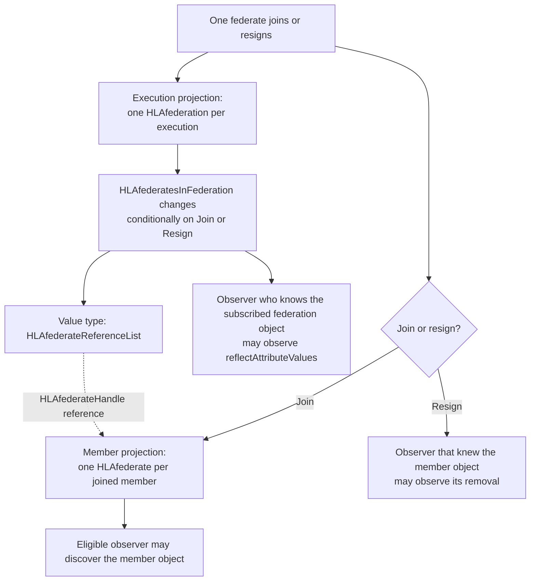

This is a scope map, not a callback timeline. The [embedded membership case](../../cpp/tests/ieee1516_2025_federation_mom_membership_boundaries_catch2.cpp#L4)
observes the list reflection after Join and Resign; the separate [embedded
member-object lifecycle case](../../cpp/tests/ieee1516_2025_joined_federate_mom_public_object_lifecycle_catch2.cpp#L4)
observes the member object's removal. The [process rejoin-order case](../../cpp/tests/ieee1516_2025_connection_process_mom_resign_removal_order_catch2.cpp#L37)
orders removal before rediscovery/reflection of that member object, but does
not observe the federation membership-list reflection. These separate cases
do not establish a cross-path callback order or embedded/process parity.

## One object belongs to the federation execution

The embedded 2025 Join path establishes the federation-scoped object once,
independently of each member's private `HLAfederate` snapshot and report-file
lifetime. The registry validates the effective 2025 MIM class metadata and
retains the federation object with the execution. A successful individual
resignation changes membership state; it does not turn the shared object into
that member's object or remove the other members' known-object state.

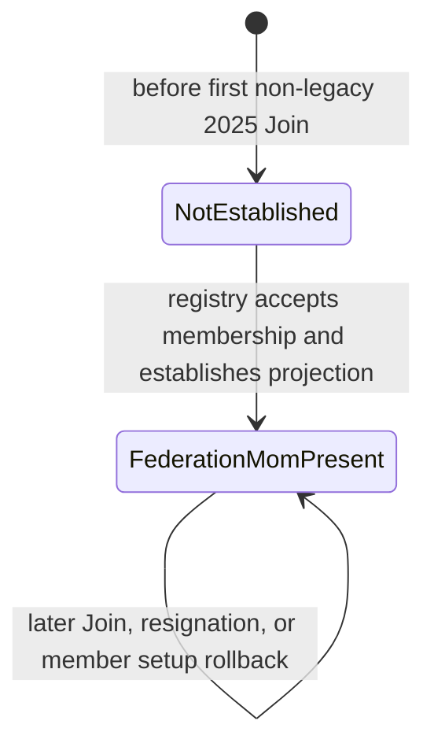

Read this as the lifecycle of the 2025 federation-scoped MOM projection, not
the existence or membership state of the federation execution. Create can
already leave an execution with zero members before this chart reaches
`FederationMomPresent`; the separate [execution-state flow](HLA-2025-FEDERATION-AND-FEDERATE-LIFECYCLE-FLOW-GUIDE.md#federation-execution-state)
covers absent, empty, and joined states through explicit Destroy. The Join and
rollback ordering below is an Umbra source observation, not a normative setup
sequence.

In the embedded path, registry membership is accepted and the federation MOM
object is established before the joining member's service-report file and
routes finish setup. If that later per-member setup fails, the Join call rolls
back the membership by resigning the new member; the registry resignation path
retains the execution-scoped federation MOM object. Thus this implementation
can establish the object during a Join attempt that ultimately fails. This is
source-observed, not covered by a focused failed-first-Join test. The
[Join rollback path](../../cpp/src/internal/runtime/umbra_rti_ambassador_federation_lifecycle.cpp#L574)
and [federation-object establishment](../../cpp/src/internal/runtime/umbra_rti_ambassador_federation_lifecycle.cpp#L616)
show the ordering; [resignation cleanup](../../cpp/src/internal/federation/federation_registry_resign_lifecycle.cpp#L1021)
keeps the federation object's record while removing the departing member's
known-object state. In the normal path, the object represents the federation
execution, not an individual member. Process-endpoint parity is not established
by these tests.

When its service-report store is configured, the 2025 process Join handler
asks the registry to establish the execution-scoped Federation MOM object
before creating the joined member's report-file and `HLAfederate` state, then
commits the session and plans member-object discovery
([Federation MOM setup](../../cpp/src/internal/federation/process_federation_service_lifecycle.cpp#L612),
inside the [service-report-store branch](../../cpp/src/internal/federation/process_federation_service_lifecycle.cpp#L568)).
The registry's resignation ledger explicitly keeps the federation-execution
record while removing the resigning member from its pending/known-recipient
sets, and separately retires that member's `HLAfederate` instance
([shared resignation logic](../../cpp/src/internal/federation/federation_registry_resign_lifecycle.cpp#L1023)).
These are process source observations. The focused process MOM cases currently
observe joined-federate object removal/rejoin and report-file behavior, not
public `HLAfederation` discovery or `HLAfederatesInFederation` reflections;
see the [process membership-list trace](#2025-process-profile-membership-list-updates-at-join-and-resign) and process evidence section in the
[joined-federate MOM guide](HLA-2025-JOINED-FEDERATE-MOM-OBJECT-LIFECYCLE-FLOW-GUIDE.md#separate-2025-process-endpoint-evidence).

Discovery remains subscription-scoped. A joined federate subscribes to the
`HLAmanager.HLAfederation` class, then learns the RTI-owned instance through the
ordinary object callback route. A conditional attribute is not necessarily an
initial-value reflection merely because the instance is discovered; a
federate can request the current value after it knows the instance.

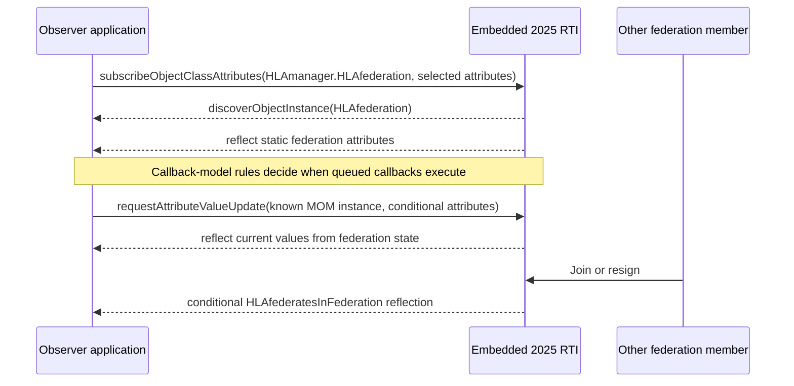

The [static-configuration test](../../cpp/tests/ieee1516_2025_federation_mom_static_configuration_catch2.cpp#L4)
subscribes to eight static federation values and checks their initial reflection
along the discovery path. The
[membership-boundary test](../../cpp/tests/ieee1516_2025_federation_mom_membership_boundaries_catch2.cpp#L4)
shows the key edge: `HLAfederatesInFederation` is conditional, so the observer
subscribes, waits for discovery, explicitly requests the current membership
value, and then sees updated reflections at Join and resignation boundaries.
That test also treats the object as a normal known instance and checks its
reliable transportation metadata; it does not make the per-member
`HLAfederate` and federation `HLAfederation` lifetimes equivalent.

### A late observer should request the current member list

The pinned API makes `subscribeObjectClassAttributes` a joined-member service
([§5.8 declaration](../../third_party/ieee1516.1-2025/include/RTI/RTIambassador.h#L535)).
A federate joining after other members therefore cannot establish that
subscription before its own Join. The MIM says Join/Resign triggers a
conditional `HLAfederatesInFederation` update, but does not specify that a
member subscribing afterward receives the earlier update as a discovery-time
replay. If the application needs the complete current membership list, the
affirmative path is to subscribe, learn the `HLAfederation` instance, and
request the current conditional value; the MIM requires a response to
attribute-value requests regardless of whether the attribute is Static or
Conditional ([federation object semantics](../../third_party/ieee1516.2-2025/resources/mim/HLAstandardMIM-2025.xml#L660)).

The focused membership test follows the observer-first case: it joins and
subscribes before the subject joins, explicitly requests the initial current
list, then observes the subject's later Join/Resign updates. It does not test
an observer joining an already populated execution
([test setup and request](../../cpp/tests/ieee1516_2025_federation_mom_membership_boundaries_catch2.cpp#L26)).
This documents the request as the supported current-value path; it does not
claim a universal absence of additional reflections or prescribe callback
ordering.

## Conditional values have different authoritative triggers

The MIM marks attributes as `Static` or `Conditional` and names the events that
drive conditional updates. Umbra stores the federation object snapshot in the
registry; service-specific paths update that source and queue the normal MOM
attribute-reflection route. A later current-value request reads the current
snapshot, not a replay of the event that originally changed it.

The following table is a representative map of embedded 2025 producers to the
conditional federation value they update, not a complete inventory of
implemented MOM attributes:

| Representative producer path | Federation MOM value updated |
| --- | --- |
| Member Join or resignation | `HLAfederatesInFederation` |
| Join adds FOM modules | `HLAFOMmoduleDesignatorList`, `HLAcurrentFDD` |
| Federation-scoped `HLAsetSwitches` changes Auto Provide | `HLAautoProvide` |
| Save request, initiation, or successful commit | Next-save and last-save values |

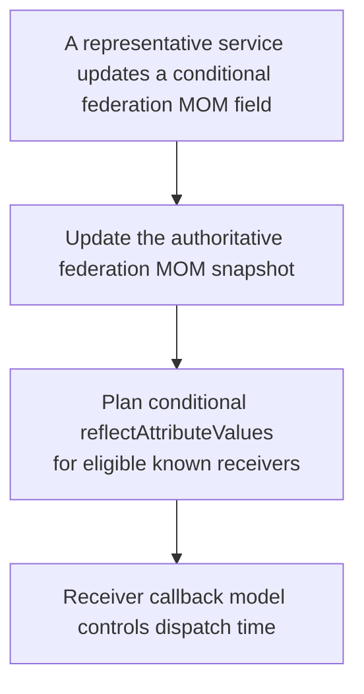

This is a map of representative producers, not a promise that every federation
MOM attribute is implemented. The 2025 MIM identifies `HLAfederatesInFederation`
as conditional on Join/resignation, and the FOM module list and `HLAcurrentFDD`
as conditional on successful Create/Join changes. The save name/time values
have their own save-ledger boundaries, documented in the
[save/restore guide](HLA-2025-FEDERATION-SAVE-RESTORE-FLOW-GUIDE.md). The
federation `HLAsetSwitches` path in this profile handles the Auto Provide
switch; its discovery and provider-eligibility behavior is covered in the
[Auto Provide guide](HLA-2025-AUTO-PROVIDE-FLOW-GUIDE.md).

The [MIM membership rows](../../third_party/ieee1516.2-2025/resources/mim/HLAstandardMIM-2025.xml#L684),
[FOM-list and current-FDD rows](../../third_party/ieee1516.2-2025/resources/mim/HLAstandardMIM-2025.xml#L723),
[conditional-current-FDD test](../../cpp/tests/federation_mom_current_fdd_catch2.cpp#L180),
and [save-conditionals test](../../cpp/tests/federation_mom_save_conditionals_catch2.cpp#L183)
provide focused evidence for these separate state sources. The tests exercise
the embedded development profile; they are not a claim that every conditional
attribute or backend is covered.

### The effective model, MOM projections, and module reports are different views

A successful Create or module-adding Join can change the federation's current
composed model. Keep that effective model distinct from the MOM values that
describe its inputs or expose its serialized current FDD:

| View | What it represents | How to observe or interpret it |
| --- | --- | --- |
| Effective federation model | The complete accepted module set after composition. The embedded lookup tests observe already-joined members resolving declarations contributed by a successful Join; the configured-process case checks lookup by the joining client. | Follow the [FOM admission/composition guide's Join boundary](HLA-2025-FOM-MODULE-ADMISSION-AND-COMPOSITION-FLOW-GUIDE.md#join-with-additional-fom-modules-replace-definition-and-add-member-together). The lookup results are profile-bounded and do not establish embedded/process parity. |
| Federation MOM object, `HLAmanager.HLAfederation` | Its `HLAFOMmoduleDesignatorList` describes federation-level module designators supplied through Create/Join; `HLAcurrentFDD` is the Current FDD realized from successful Create/Join changes. Both attributes are Conditional in the MIM. | The MIM defines their automatic update conditions ([list](../../third_party/ieee1516.2-2025/resources/mim/HLAstandardMIM-2025.xml#L723), [Current FDD](../../third_party/ieee1516.2-2025/resources/mim/HLAstandardMIM-2025.xml#L740)). Once the object is known, an explicit `requestAttributeValueUpdate` also returns the requested current value through the normal attribute-reflection mechanism, regardless of Conditional policy ([class semantics](../../third_party/ieee1516.2-2025/resources/mim/HLAstandardMIM-2025.xml#L658)). The focused embedded test observes a changed `HLAcurrentFDD` reflection after Join and confirms a later request returns that same value ([Join reflection](../../cpp/tests/federation_mom_current_fdd_catch2.cpp#L287), [current-value request](../../cpp/tests/federation_mom_current_fdd_catch2.cpp#L311)). |
| Joined-member MOM object, `HLAmanager.HLAfederate` | Its same-named `HLAFOMmoduleDesignatorList` is Static and lists modules supplied by that particular federate at Join—not every module in the federation's effective model. | This is a different MIM row ([member attribute](../../third_party/ieee1516.2-2025/resources/mim/HLAstandardMIM-2025.xml#L138)). The public object-lifecycle test verifies the reflected member list matches its Join-supplied module ([test](../../cpp/tests/ieee1516_2025_joined_federate_mom_public_object_lifecycle_catch2.cpp#L125)); a separate private snapshot test corroborates the Join-scoped value but is not public callback evidence ([snapshot test](../../cpp/tests/ieee1516_2025_joined_federate_mom_fom_module_snapshot_integration_catch2.cpp#L32)). |
| FOM module-data request/report | A request selects one module's retained content by an index in the applicable federation or member list. | `HLAreportFOMmoduleData` carries module content as a MOM interaction; it is neither the composed Current FDD nor an attribute reflection. See [the two request/report scopes](#the-same-short-fom-request-name-appears-under-two-mom-roots). |

**Bounded embedded implementation and test evidence.** The federation-object
projection reads the current `federation.definition`, filters to FOM modules,
and encodes the first designator for each canonical source identity; the
standard MIM module is not part of this list ([module-list encoder](../../cpp/src/internal/federation/federation_registry_mom_object_state.cpp#L110),
[federation-list helper](../../cpp/src/internal/federation/federation_registry_mom_object_state.cpp#L154),
[federation attribute lookup](../../cpp/src/internal/federation/federation_registry_mom_object_state.cpp#L660)).
When a Join supplies additional modules, the embedded lifecycle path queues
Conditional updates for both the federation module list and `HLAcurrentFDD`
([Join update path](../../cpp/src/internal/runtime/umbra_rti_ambassador_federation_lifecycle.cpp#L761)).
This is source evidence for that embedded Join path, not proof of a Create
update path or profile parity.

The MIM also requires only the first designator when identical FOM modules
are supplied, for both the federation and joined-member lists ([member rule](../../third_party/ieee1516.2-2025/resources/mim/HLAstandardMIM-2025.xml#L148),
[federation rule](../../third_party/ieee1516.2-2025/resources/mim/HLAstandardMIM-2025.xml#L735)).
The embedded encoder implements this by keeping the first designator per
canonical `sourcePath`; the federation projection and member snapshot call the
same encoder ([encoder](../../cpp/src/internal/federation/federation_registry_mom_object_state.cpp#L110),
[federation projection](../../cpp/src/internal/federation/federation_registry_mom_object_state.cpp#L154),
[member snapshot](../../cpp/src/internal/federation/federation_registry_mom_object_state.cpp#L321)).
A private registry test supplies two validated records with the same canonical
source path but different designators, then verifies the member snapshot has
one entry and retains the first designator ([test setup](../../cpp/tests/federation_registry_composed_fom_catch2.cpp#L62),
[count assertion](../../cpp/tests/federation_registry_composed_fom_catch2.cpp#L156),
[first-designator assertion](../../cpp/tests/federation_registry_composed_fom_catch2.cpp#L160)).
That is private member-snapshot evidence, not a public service test. The public
lifecycle test exercises one Join module only ([assertion](../../cpp/tests/ieee1516_2025_joined_federate_mom_public_object_lifecycle_catch2.cpp#L128));
no focused federation-wide list test was found. The pinned MIM states the
first-designator outcome but does not define how to decide that two modules
are identical. The checked-in IEEE resource package contains the MIM, schemas,
and examples, not the normative OMT clause text; IEEE SA lists the full
specification separately from its resource download
([1516.2-2025 publication and access](https://standards.ieee.org/ieee/1516.2/6689/)).
Accordingly, identical content at distinct canonical paths remains unresolved:
`sourcePath` is Umbra's implementation key, not an established normative
definition.

The focused public-test search found assertions for the joined-member
`HLAfederate` list and for the separate federation `HLAcurrentFDD` reflection,
but no public observer assertion for a federation-wide module-list change
after Create/Join. The member-list test ([public assertion](../../cpp/tests/ieee1516_2025_joined_federate_mom_public_object_lifecycle_catch2.cpp#L125))
must not be read as evidence for the federation object; the current-FDD test
([Join reflection](../../cpp/tests/federation_mom_current_fdd_catch2.cpp#L287))
does not assert the list attribute. These tests were inspected, not rerun.

The model-lookup path, the federation's conditional attribute projection, the
member's Join-input list, and the module-content report answer different
questions. In particular, a current-value request is not a module-data report,
and neither MOM list is a replacement for resolving names against the effective
composed model.

### 2025 process profile: Federation MOM after an additional-module Join

The pinned MIM makes federation `HLAFOMmoduleDesignatorList` Conditional when
Create/Join adds FOM modules, and `HLAcurrentFDD` Conditional when those services
modify the Current FOM subset ([module-list condition](../../third_party/ieee1516.2-2025/resources/mim/HLAstandardMIM-2025.xml#L723),
[Current FDD condition](../../third_party/ieee1516.2-2025/resources/mim/HLAstandardMIM-2025.xml#L743)). The following is a
source-mapped process-profile trace, not a replacement for that MIM condition
or a full IEEE 1516.1 conformance determination:

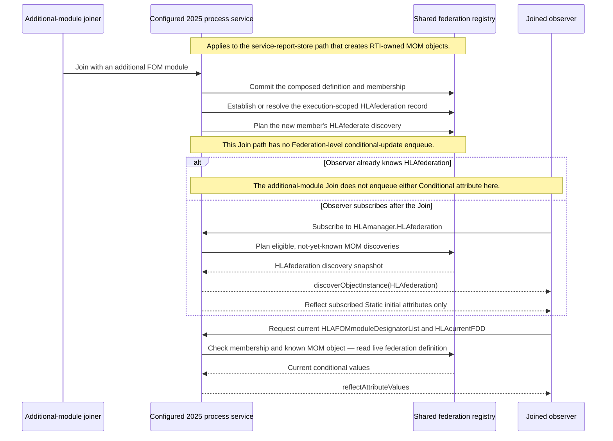

This trace is bounded to the configured process source. Federation MOM object
setup occurs inside the service-report-store Join path; after the Join commits,
that handler queues discovery for the joining member's `HLAfederate` object, not
a Federation-object module-list or Current-FDD update
([Join setup](../../cpp/src/internal/federation/process_federation_service_lifecycle.cpp#L568),
[member discovery](../../cpp/src/internal/federation/process_federation_service_lifecycle.cpp#L709)). The process subscription
route does include the execution-scoped object in its RTI-owned MOM discovery
ledger, despite the helper's joined-federate name; the planner still applies
subscription eligibility and known/pending-recipient checks
([subscription planner](../../cpp/src/internal/federation/process_federation_service_declarations.cpp#L228),
[MOM discovery planner](../../cpp/src/internal/federation/federation_registry_object_discovery_routes.cpp#L96)). Its discovery enqueue
orders `discoverObjectInstance` before initial MOM values, while the Federation
object's initial-value map contains only MIM Static attributes—not these
Conditional fields ([event staging](../../cpp/src/internal/federation/process_federation_service_object_discovery.cpp#L90),
[Static initial values](../../cpp/src/internal/federation/federation_registry_mom_object_state.cpp#L47)).

The process service's automatic conditional helper resolves a member's
`HLAfederate` object and class, so it does not supply the missing federation-
scoped Join update ([member-only helper](../../cpp/src/internal/federation/process_federation_service_notifications.cpp#L40)). A direct current-value request uses the
shared MOM value planner, which rejects a non-member or unknown MOM object and
projects the latest module list/Current FDD from the federation definition
([process request path](../../cpp/src/internal/federation/process_federation_service_attribute_update_requests.cpp#L35),
[known-object check](../../cpp/src/internal/federation/federation_registry_attribute_value_update_requests.cpp#L371),
[live module/FDD projection](../../cpp/src/internal/federation/federation_registry_mom_object_state.cpp#L656)). This request path does not set the planner's optional active-subscription
filter; the known-object condition remains. These are source observations, not
process-test results.

The configured-process additional-FOM test asserts class lookup/name after
Join, not `HLAfederation` discovery or reflection ([test](../../cpp/tests/process_federation_additional_fom_catch2.cpp#L219)). No focused public process
observer assertion was found for either federation Conditional field. The
embedded `HLAcurrentFDD` reflection test remains separate and does not prove
process delivery. Treat the MIM-trigger versus process-Join enqueue difference
as an implementation evidence gap, not a completed conformance finding; the
full licensed §§4.11/6.9/6.11 prose is not present in this checkout.

### 2025 process profile: membership-list updates at Join and Resign

The 2025 MIM marks federation-level `HLAfederatesInFederation` Conditional on
member Join or Resign ([MIM row](../../third_party/ieee1516.2-2025/resources/mim/HLAstandardMIM-2025.xml#L684)). The following trace is a source-bounded process profile; it is not an embedded callback trace or a complete conformance determination:

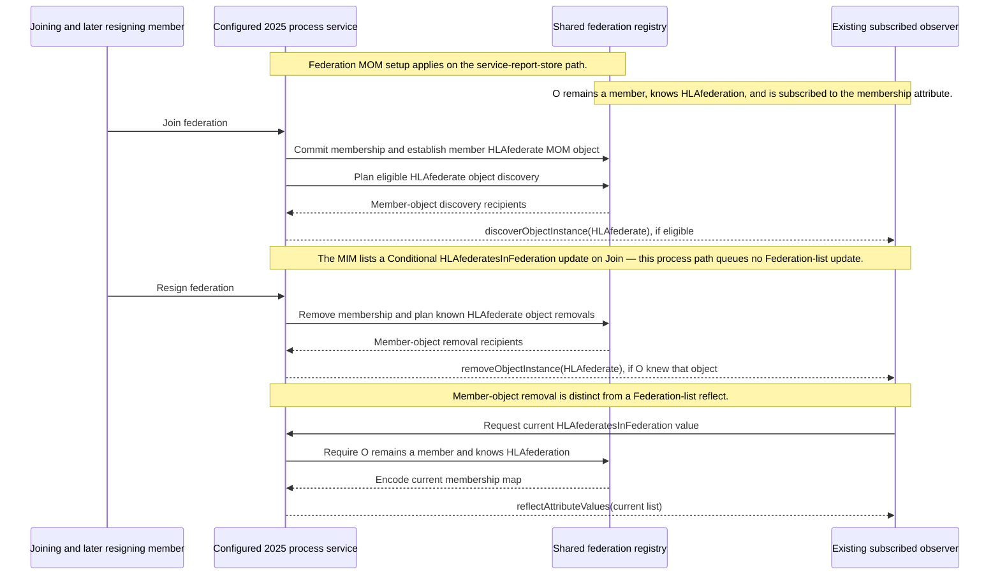

The process Join handler establishes the execution-scoped `HLAfederation` MOM
object only inside its service-report-store branch, then queues discovery for
the joining member's `HLAfederate` object ([Join setup](../../cpp/src/internal/federation/process_federation_service_lifecycle.cpp#L568), [member discovery](../../cpp/src/internal/federation/process_federation_service_lifecycle.cpp#L709)). Process `handleResign` dispatches the registry's object-removal results; the resignation planner retains the execution MOM record for surviving members, clears the departing member's known-object state for it, and separately plans removal of that member's `HLAfederate` object for surviving observers that knew it ([resign handler](../../cpp/src/internal/federation/process_federation_service_request_handlers.cpp#L136), [removal dispatch](../../cpp/src/internal/federation/process_federation_service_connection_loss.cpp#L66), [registry resignation](../../cpp/src/internal/federation/federation_registry_resign_lifecycle.cpp#L1023)). The process automatic conditional-update helper resolves a joined member's `HLAfederate` object; its call sites are reporting and interaction-send paths, not Join or Resign ([member-scoped helper](../../cpp/src/internal/federation/process_federation_service_notifications.cpp#L40), [reporting call site](../../cpp/src/internal/federation/process_federation_service_reporting.cpp#L508), [interaction call site](../../cpp/src/internal/federation/process_federation_service_interaction_send.cpp#L376)).

A separate current-value request is source-supported for a surviving member that knows the Federation MOM object: the process request handler uses the shared MOM planner, which checks membership and known-object state, while the Federation attribute projection encodes the current registry membership map ([process request path](../../cpp/src/internal/federation/process_federation_service_attribute_update_requests.cpp#L35), [known-object check](../../cpp/src/internal/federation/federation_registry_attribute_value_update_requests.cpp#L371), [live membership projection](../../cpp/src/internal/federation/federation_registry_mom_object_state.cpp#L643)). That call uses the planner's default `requireActiveSubscription = false` ([planner declaration](../../cpp/src/internal/federation/federation_registry.hpp#L1265)); this request path does not establish that automatic Conditional reflections are queued.

The focused embedded membership test observes list reflections at Join and Resign ([embedded test](../../cpp/tests/ieee1516_2025_federation_mom_membership_boundaries_catch2.cpp#L4)). The process resignation test instead checks removal of the departed member's `HLAfederate` object before rediscovery/reflection of a later member ([process test](../../cpp/tests/ieee1516_2025_connection_process_mom_resign_removal_order_catch2.cpp#L39)); it does not assert the Federation membership-list reflection. The exact attribute-name search found no process observer test for `HLAfederatesInFederation`. Treat the process enqueue difference as source-only and unresolved against the full licensed §§4.11/6.9/6.11 text; do not infer 2010 or embedded/process parity.

## Creation-time federation policy versus per-member switch seeding

“Switch” does not imply one shared lifetime or one shared source. These two
diagrams compare only the tested 2025 advisory settings below: the federation-scoped
`Advisories Use Known Class` value is captured from the Create-time model,
whereas object-class and interaction-relevance advisory values are initialized
for the member being joined from that Join's effective composed FDD.

**Federation-scoped Create-time value**

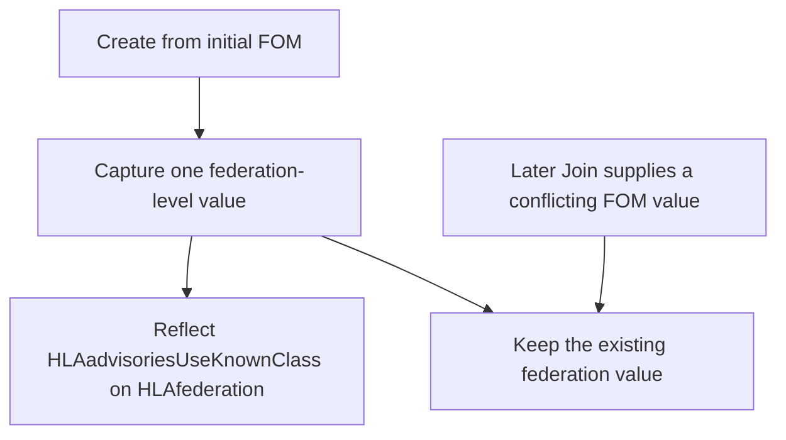

**Member-scoped Join-time initialization**

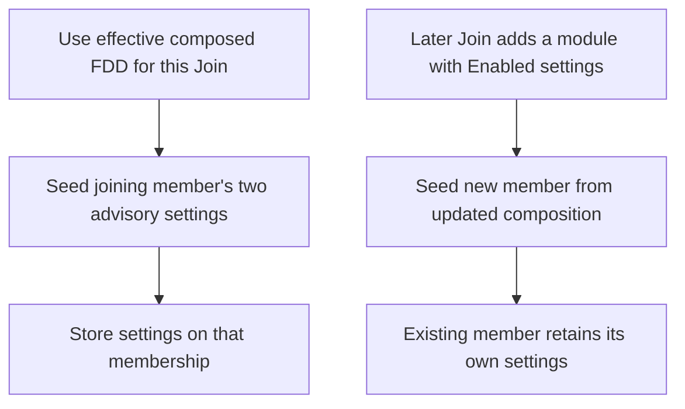

These diagrams correspond to two separate focused test cases, not one combined fixture. The
[known-class test body](../../cpp/tests/advisories_use_known_class_switch_catch2.cpp#L4)
sets up creation with the switch enabled, then a later Join with a conflicting
Disabled value; its assertions require both members to read the shared enabled
value. The
[advisory-seeding test body](../../cpp/tests/join_advisory_switch_seed_catch2.cpp#L4)
sets up an initial member with default-disabled advisory settings, then a Join
with an FOM whose object-class and interaction-relevance values are Enabled;
its assertions require the new member to read Enabled while the first remains
Disabled. The
[static federation MOM test body](../../cpp/tests/ieee1516_2025_federation_mom_static_configuration_catch2.cpp#L4)
also asserts the initial `HLAadvisoriesUseKnownClass` reflection.

Both focused switch cases were built and rerun locally, but each currently
fails during `createFederationExecution` with `Unknown exception`, before its
switch assertions. Treat both diagrams as source-derived and test-mapped, not as a
behavior verified by those test runs; the setup failure remains to be
investigated.

The source mirrors that distinction: federation creation captures global
catalog values in the federation record
([registry creation](../../cpp/src/internal/federation/federation_registry_membership_lifecycle.cpp#L120));
each Join seeds the new membership from the replacement/current definition,
without rewriting existing membership fields
([member initialization](../../cpp/src/internal/federation/federation_registry_membership_lifecycle.cpp#L373)).
The joined-federate
[`HLAsetSwitches` test](../../cpp/tests/mom_federate_set_switches_catch2.cpp#L67)
also demonstrates why the interaction name must not be treated as a universal
switch setter: its tested parameters update a defined support/reporting subset,
and selected relevance-switch getters remain unchanged. The advisory consumers
and their independent callback rules stay in the
[relevance-advisory guide](HLA-2025-RELEVANCE-ADVISORY-FLOW-GUIDE.md).

Here “Static” in the `HLAfederation` MIM row names its MOM reflection category;
the Create-time capture and no-divergence claim above are the narrower Umbra
behavior established by the cited source and tests. This comparison is for the
embedded 2025 profile only; it says nothing about the separate 2010 stream or
untested backend parity.

### Switch storage, current MOM projection, and Conditional reflection are separate

The 2025 MIM makes `HLAobjectClassRelevanceAdvisory` and
`HLAinteractionRelevanceAdvisory` Conditional attributes of the joined
federate's `HLAfederate` MOM object, with update conditions tied to changes in
their corresponding switches ([object-class row](../../third_party/ieee1516.2-2025/resources/mim/HLAstandardMIM-2025.xml#L535),
[interaction row](../../third_party/ieee1516.2-2025/resources/mim/HLAstandardMIM-2025.xml#L571)).
Keep the stored value, its current MOM projection, and event delivery to
eligible MOM-object recipients distinct:

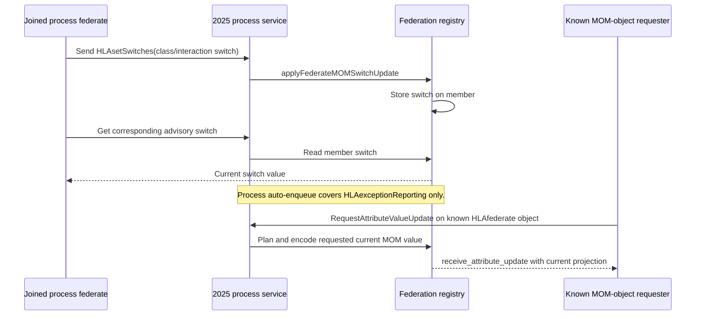

The process service decodes `HLAsetSwitches` and stores supplied advisory
switches through `applyFederateMOMSwitchUpdate` ([handler](../../cpp/src/internal/federation/process_federation_service_interaction_send.cpp#L330),
[member-state update](../../cpp/src/internal/federation/federation_registry_control_state.cpp#L582)).
The public getter reads that state, and the `HLAfederate` projection encodes the
same member fields ([projection](../../cpp/src/internal/federation/federation_registry_mom_object_state.cpp#L770)).
An explicit `requestAttributeValueUpdate` is a separate route: the process
handler asks the registry for the current MOM projection and sends the result
to the requester ([request path](../../cpp/src/internal/federation/process_federation_service_attribute_update_requests.cpp#L12)).
That current-value response is not evidence that the switch mutation queued an
automatic Conditional reflection.

The profile split is material. After applying a switch update, the embedded
`HLAsetSwitches` path collects every supplied switch's corresponding MOM
attribute and plans conditional work ([embedded path](../../cpp/src/internal/runtime/umbra_rti_ambassador_interaction_send_mom_controls.cpp#L697)).
The process `HLAsetSwitches` handler instead enqueues a joined-federate MOM
conditional update only when `exceptionReporting` was supplied; its class- and
interaction-relevance updates do not enter that enqueue call
([process post-apply path](../../cpp/src/internal/federation/process_federation_service_interaction_send.cpp#L354)).
Accordingly, the focused process test verifies stored switch values through
public getters but does not set up a second receiver or assert
`HLAfederate` reflection ([test](../../cpp/tests/ieee1516_2025_connection_process_mom_set_switches_catch2.cpp#L52),
[getter assertions](../../cpp/tests/ieee1516_2025_connection_process_mom_set_switches_catch2.cpp#L349)).
This is a source-observed process-path gap against the MIM's stated update
conditions, not a conformance conclusion or an embedded/process equivalence
claim. No 2010 behavior is implied.

## Explicit MOM requests return current values through a separate path

The 2025 MIM says the RTI shall answer a Request Attribute Value Update for
`HLAmanager.HLAfederate` or one of its known instances using the ordinary
instance attribute update mechanism, regardless of whether the requested
attribute is Static, Periodic, or Conditional ([class semantics](../../third_party/ieee1516.2-2025/resources/mim/HLAstandardMIM-2025.xml#L53)).
This is a federate-initiated request for current values; it is not the same
event as an attribute's automatic update condition firing.

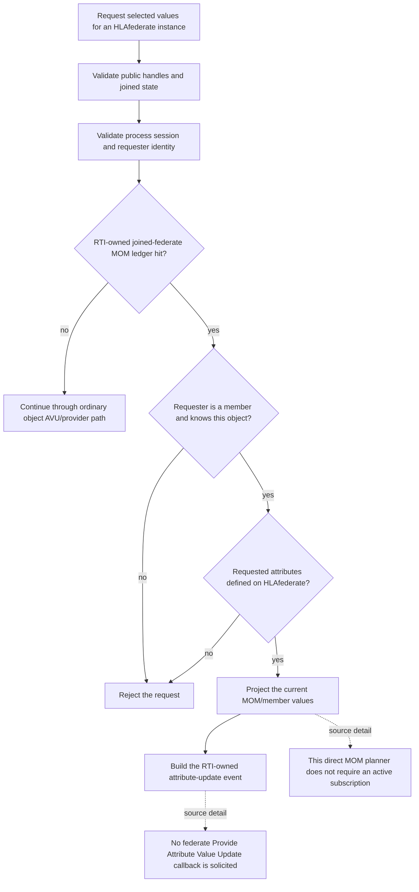

The `no` branch remains the ordinary object-instance request path; see the
[2025 Attribute Value Update Request guide](HLA-2025-ATTRIBUTE-VALUE-UPDATE-REQUEST-FLOW-GUIDE.md)
for provider selection and solicitation. It is intentionally not collapsed
into the RTI-owned MOM ledger path here.

**Process mapping.** The public adapter checks the opaque object/attribute
handles and joined state, then sends copied request values to the configured
process endpoint ([adapter](../../cpp/src/internal/runtime/umbra_rti_ambassador_request_attribute_value_updates.cpp#L23)).
The service verifies the session, federation, and requesting member before
trying the RTI-owned MOM ledger ahead of the ordinary object-request planner
([service path](../../cpp/src/internal/federation/process_federation_service_attribute_update_requests.cpp#L13)).
For a joined-federate MOM instance, the registry requires current membership
and known-object state, verifies each requested attribute against the
`HLAfederate` class, and projects current values
([MOM request planner](../../cpp/src/internal/federation/federation_registry_attribute_value_update_requests.cpp#L344),
[MOM value projection](../../cpp/src/internal/federation/federation_registry_mom_object_state.cpp#L1078)).
This direct planner call uses the declaration's default
`requireActiveSubscription = false`; the requester must still know the MOM
instance. That is an implementation detail, not a claim that the focused test
exercises an unsubscribed request ([planner declaration](../../cpp/src/internal/federation/federation_registry.hpp#L1265)).

The RTI-owned branch constructs an attribute-update event directly for the
requester; it does not solicit a federate `provideAttributeValueUpdate`
callback ([direct MOM branch](../../cpp/src/internal/federation/process_federation_service_attribute_update_requests.cpp#L30)).
Depending on the process service option, that event is pushed or queued for a
receive poll ([event selection](../../cpp/src/internal/federation/process_federation_service_attribute_update_requests.cpp#L64)).
The client submits it to the process callback bridge, which delivers
`reflectAttributeValues` ([client dispatch](../../cpp/src/internal/federation/process_federation_client_callback_dispatch.cpp#L23),
[bridge submission](../../cpp/src/internal/federation/process_federation_callback_bridge.cpp#L1281),
[callback invocation](../../cpp/src/internal/federation/process_federation_callback_bridge.cpp#L261)).

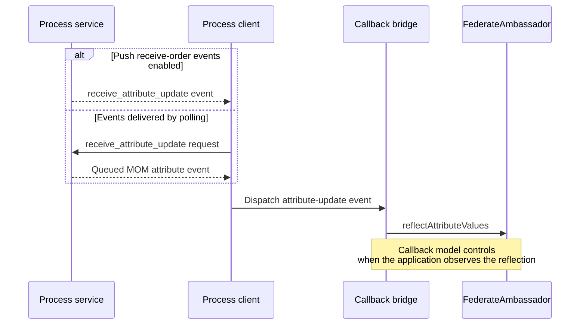

In the focused public process test, an `HLA_EVOKED` observer subscribes to and
discovers the subject's `HLAfederate` object, requests `HLAreportServiceFile`,
then evokes callbacks and checks one new reflection for that object containing
the current path ([test setup](../../cpp/tests/ieee1516_2025_connection_process_joined_federate_mom_report_file_catch2.cpp#L328),
[request](../../cpp/tests/ieee1516_2025_connection_process_joined_federate_mom_report_file_catch2.cpp#L437),
[reflection assertions](../../cpp/tests/ieee1516_2025_connection_process_joined_federate_mom_report_file_catch2.cpp#L457)).
`HLAreportServiceFile` itself is Conditional in the MIM ([attribute row](../../third_party/ieee1516.2-2025/resources/mim/HLAstandardMIM-2025.xml#L643)); the test supports this explicit current-value route, but does not test the attribute's automatic update condition, an unsubscribed request, failure cases, or callback timing under other callback models.

Keep the two observation paths separate: an explicit request is answered for
the requesting federate from current state, while a Conditional update is
triggered by its specified event and planned for eligible receivers. The
process test is 2025 configured-endpoint evidence only; it establishes no
2010 behavior or embedded/process parity.

## Federation reports are receive-order interactions

Federation MOM requests such as `HLArequestFOMmoduleData`,
`HLArequestMIMdata`, `HLArequestSynchronizationPoints`, and
`HLArequestSynchronizationPointStatus` are not attribute-value requests. The
RTI validates the joined requester and request-specific input, reads the
authoritative module/MIM/synchronization state, builds the paired
`HLAreport...` interaction, and selects report recipients through the ordinary
interaction-subscription route.

This explicit request/report path is distinct from subject-switch-controlled
`HLAreportServiceInvocation` traffic, which describes a public service call
rather than the requested current Federation MOM state. Compare the separate
[service-invocation reporting guide](HLA-2025-SERVICE-INVOCATION-REPORTING-FLOW-GUIDE.md#three-distinct-traces-call-outcome-invocation-report-requested-mom-report).

### The same short FOM request name appears under two MOM roots

Do not identify a MOM request by its final class name alone. The 2025 MIM
defines `HLArequestFOMmoduleData` and `HLAreportFOMmoduleData` in both the
execution-scoped `HLAmanager.HLAfederation` tree and the member-scoped
`HLAmanager.HLAfederate` tree. These are distinct, fully qualified interaction
classes with different module lists and request shapes:

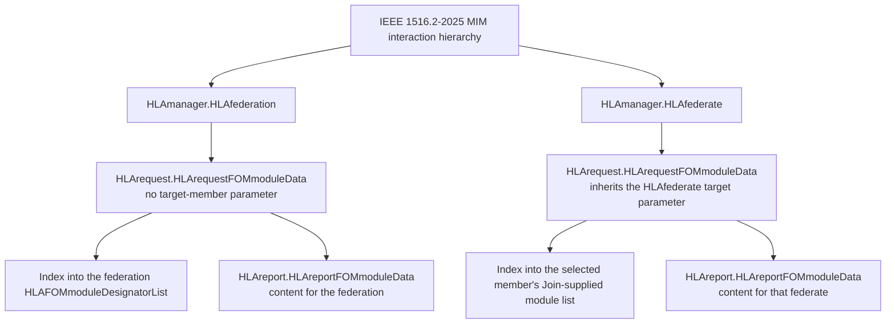

| MIM branch | Fully qualified request → report | Meaning of the module index |
| --- | --- | --- |
| Federation | `HLAmanager.HLAfederation.HLArequest.HLArequestFOMmoduleData` → `HLAmanager.HLAfederation.HLAreport.HLAreportFOMmoduleData` | Selects a module in the federation's list assembled from Create and Join inputs ([MIM rows](../../third_party/ieee1516.2-2025/resources/mim/HLAstandardMIM-2025.xml#L723), [request](../../third_party/ieee1516.2-2025/resources/mim/HLAstandardMIM-2025.xml#L2586), [report](../../third_party/ieee1516.2-2025/resources/mim/HLAstandardMIM-2025.xml#L2657)). |
| Joined federate | `HLAmanager.HLAfederate.HLArequest.HLArequestFOMmoduleData` → `HLAmanager.HLAfederate.HLAreport.HLAreportFOMmoduleData` | Selects a module in the targeted federate's Join-supplied list; the request inherits `HLAfederate` from its interaction-class ancestor ([target parameter](../../third_party/ieee1516.2-2025/resources/mim/HLAstandardMIM-2025.xml#L909), [request](../../third_party/ieee1516.2-2025/resources/mim/HLAstandardMIM-2025.xml#L1200), [report](../../third_party/ieee1516.2-2025/resources/mim/HLAstandardMIM-2025.xml#L1909)). |

The MIM establishes this naming and data-scope distinction. The selected
embedded tests below illustrate each path; they do not replace the full
1516.1 service contract or establish process-backend parity. The member path's
snapshot lifecycle remains in the [joined-federate MOM guide](HLA-2025-JOINED-FEDERATE-MOM-OBJECT-LIFECYCLE-FLOW-GUIDE.md).
Umbra also keeps separate [member-scoped](../../cpp/src/internal/fom/hla_names.hpp#L49)
and [federation-scoped](../../cpp/src/internal/fom/hla_names.hpp#L45) fully
qualified names; those constants corroborate its dispatch vocabulary, while
the MIM is the source for the HLA class hierarchy.

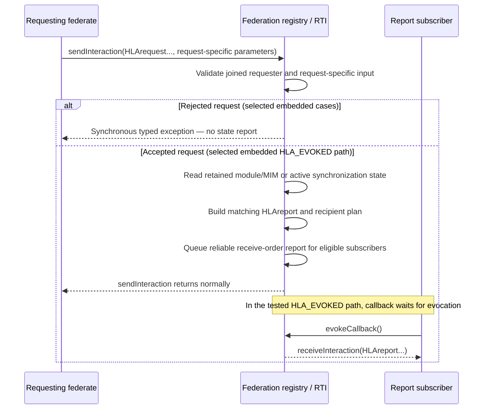

The request and report classes are defined in the 2025 MIM's federation
`HLArequest` and `HLAreport` groups. For FOM module data, the index selects an
entry in the federation's retained module list; an invalid index is rejected
synchronously rather than producing a stale report. Synchronization-point
reports read the registry's current in-progress point/status state. The report
is RTI-originated reliable receive-order traffic and is delivered as
`receiveInteraction`, not reflected as an attribute of the `HLAfederation`
object. Keep three traces distinct: the requesting federate's synchronous
`sendInteraction` result; the requested `HLAreport...` state response; and a
separate, switch-controlled report about the `SendInteraction` call:
`HLAreportServiceInvocation` when the interaction sink is selected, or a file
record when the file sink is selected ([service-invocation guide](HLA-2025-SERVICE-INVOCATION-REPORTING-FLOW-GUIDE.md#three-distinct-traces-call-outcome-invocation-report-requested-mom-report)).
In the selected embedded
`HLA_EVOKED` test, a valid request returns normally before the observer's
report callback is evoked; an unavailable module index and an unexpected MIM
parameter instead throw synchronously and produce no state-report callback.
That callback timing is test evidence for this profile/path, not a claim about
every callback model or the process endpoint.

The [focused request test](../../cpp/tests/federation_mom_current_fdd_catch2.cpp#L324)
shows the normal return before observer evocation and checks that its invalid
index and unexpected-parameter requests yield no report. The [embedded
`SendInteraction` handler](../../cpp/src/internal/runtime/umbra_rti_ambassador_interaction_send_services.cpp#L782)
validates and plans the request, then calls the selected per-invocation
reporting path before [queuing the federation report](../../cpp/src/internal/runtime/umbra_rti_ambassador_interaction_send_services.cpp#L964).
That is source order only: the cited request test does not enable or assert
both report families, so it does not establish their observer callback order.

Focused public-C++ evidence:

- [Federation-scoped FOM-module and MIM requests](../../cpp/tests/federation_mom_current_fdd_catch2.cpp#L324)
  use the dimensionless federation interaction classes and check returned
  content, receive-order callback delivery, subscription revalidation, and
  synchronous invalid-index/unexpected-parameter rejection.
- [Joined-federate FOM-module request/report](../../cpp/tests/ieee1516_2025_federation_mom_fom_module_data_report_catch2.cpp#L4)
  uses the separate member-scoped class, includes its inherited `HLAfederate`
  target parameter, and checks the selected embedded report content. Its case
  targets the sending member itself; it does not establish every cross-member
  requester/target combination.
- [MIM data and current-FDD requests](../../cpp/tests/federation_mom_current_fdd_catch2.cpp#L180)
  exercise the retained current model content through the standard MOM route.
- [Synchronization list/status reports](../../cpp/tests/ieee1516_2025_federation_mom_synchronization_reports_catch2.cpp#L4)
  checks the paired report interactions and their encoded current state.

The [federation report planner](../../cpp/src/internal/federation/federation_registry_mom_federation_content_reporting.cpp#L52)
and [synchronization report planner](../../cpp/src/internal/federation/federation_registry_mom_synchronization_reporting.cpp#L22)
show where federation state becomes a report plan. The runtime's
[Join-time object setup](../../cpp/src/internal/runtime/umbra_rti_ambassador_federation_lifecycle.cpp#L616)
and [registry object foundation](../../cpp/src/internal/federation/federation_registry_mom_object_state.cpp#L373)
show the distinct object-lifecycle path.

## Keep these boundaries visible

- **Object versus report:** subscription to the `HLAfederation` object yields
  discovery/reflection callbacks. Subscribing to an `HLAreport...` interaction
  yields `receiveInteraction`; one is not a substitute for the other.
- **Federation versus member:** one federation object represents the execution;
  each joined member may separately have a private `HLAfederate` MOM object.
  In the pinned 2025 MIM, `HLAfederation` attributes are Static or Conditional,
  with no Periodic attributes ([MIM](../../third_party/ieee1516.2-2025/resources/mim/HLAstandardMIM-2025.xml#L658)).
  `HLAsetTiming` and periodic counters therefore belong to the member-scoped
  `HLAfederate` object and remain in the joined-federate guide/design evidence.
- **2025 versus 2010:** the 2025 runtime explicitly gates this projection when
  a legacy 2010 FOM compatibility profile is selected. This is an implementation
  boundary inside the 2025 runtime, not a flow for the 2010 reference RTI.
- **Evidence versus conformance:** the cited Catch2 tests are tagged
  `[development-profile]`. They establish tested behavior for those scenarios,
  not full IEEE conformance, process-backend parity, or completeness of the
  federation MOM surface.

## Evidence and remaining questions

The [federation MOM section of the implementation dossier](MOM-SERVICE-REPORTING-DESIGN.md#L1510)
records the current value sources and the test/profile limitations. Before
calling this topic complete, review the federation object and report paths
against the licensed IEEE 1516.1-2025 text (not only the MIM), validate any
uncovered report/error cases, add direct process-endpoint observation coverage
for the federation-scoped object if that profile needs to be established, and
render this guide in a local Mermaid renderer and GitHub after publication.
Keep unresolved normative, process-endpoint, and 2010 questions labeled rather
than inferring answers from the embedded tests.
