# IEEE 1516.1-2025 Federation Save and Restore: Contributor Guide

This guide explains federation save and restore as a coordinated, asynchronous
protocol. It is intended to help contributors understand the boundaries before
reading the implementation; it is not a substitute for the standard, a new
source of requirements, or a claim of conformance.

## Scope and authority

- **Standard boundary:** IEEE 1516.1-2025 only. The 2010 API and runtime are a
  separate compatibility stream and are deliberately not described or compared
  here.
- **Implementation boundary:** the current embedded federation-management
  development profile, its durable state-image path, and selected 2025
  process-endpoint callback tests. These are distinct evidence scopes; neither
  represents all installation or deployment modes.
- **Authority order:** the [official IEEE 1516.1-2025 Federate Interface
  Specification](https://standards.ieee.org/ieee/1516.1/6688/) defines
  normative behavior. Its federation-management save/restore service clauses
  are in the §4.19–§4.35 range; §4.19.6 is a useful timed-save pointer. Confirm
  exact text and applicability in the official standard. The repository's
  pinned traceability mappings are navigation aids, not normative authority.
- **Public text availability, checked 2026-11-09:** the IEEE record lists
  purchase and subscription access. Its linked [public download
  archive](https://standards.ieee.org/wp-content/uploads/2025/08/1516.1-2025_downloads.zip)
  contains one nested API XML archive. That archive has 284 files: 44 C++
  headers, 230 Java API files, four XML files, three protobuf files, and three
  XML schemas. It contains no PDF, DOC/DOCX, RTF, HTML, or plain-text copy of
  the standard. The downloadable API vocabulary cannot establish normative
  Save/Restore failure triggers.
- **Evidence boundary:** source files show Umbra's present control flow; tests
  prove only their named scenarios. Internal registry tests are implementation
  evidence, not public-API or conformance evidence.

For related but separate state machines, see the [2025 time-management guide](HLA-2025-TIME-MANAGEMENT-GUIDE.md), the
[core attribute ownership guide](HLA-2025-ATTRIBUTE-OWNERSHIP-FLOW-GUIDE.md) and its
[persistence/resignation companion](HLA-2025-OWNERSHIP-PERSISTENCE-AND-RESIGNATION-FLOW-GUIDE.md), and the
[DDM/regions guide](HLA-2025-DATA-DISTRIBUTION-AND-REGIONS-FLOW-GUIDE.md). This guide points to those areas where their
state affects a save image; it does not merge their rules into save/restore.

## The mental model

There are two coordinated checkpoints, not one:

1. Each federate saves its **application-owned state** after the RTI tells it
   to begin. The federate then reports progress or failure through the RTI
   service API.
2. The RTI coordinates saving its **federation-owned state** and reports the
   federation-wide result. A participant successfully reporting
   `federateSaveComplete` is not itself proof that the federation save
   succeeded; the federation-level outcome is the relevant boundary.

Restore has the corresponding two responsibilities. Each federate restores
its own application state after `initiateFederateRestore` and reports its
local result; the RTI coordinates the federation-wide restore, including its
own federation state. Request acceptance is not successful restoration: a
request can fail before the protocol begins, and an accepted restore can still
fail later. The exact participant and callback-order rules belong to the
standard, not this responsibility-level summary.

The practical distinction is:

> “I saved/restored my federate” is not the same event as “the federation save/
> restore completed.”

### Conceptual responsibility map (orientation, not a normative sequence)

This map foregrounds the HLA responsibility boundary without choosing an RTI
architecture, storage format, callback-dispatch model, or exact participant
set. It is a reading aid; use the 2025 standard for service preconditions,
participant rules, ordering, and failure semantics.

```mermaid
flowchart TB
  subgraph Save["Federation save"]
    S0["Request save"] --> S1{"Request admitted?"}
    S1 -- "no" --> S2["Request fails before save protocol"]
    S1 -- "yes" --> S3["RTI initiates participant save work"]
    S3 --> S4["Each federate saves its application-owned state"]
    S4 --> S5["Each federate reports its local result"]
    S5 --> S6["RTI coordinates participant results and saves RTI-owned federation state"]
    S6 --> S7["Federation-level saved or not-saved outcome"]
  end

  subgraph Restore["Federation restore"]
    R0["Request restore"] --> R1{"Request admitted?"}
    R1 -- "no" --> R2["Request fails before restore protocol"]
    R1 -- "yes" --> R3["RTI initiates participant restore work"]
    R3 --> R4["Each federate restores its application-owned state"]
    R4 --> R5["Each federate reports its local result"]
    R5 --> R6["RTI coordinates participant results and restores RTI-owned federation state"]
    R6 --> R7["Federation-level restored or not-restored outcome"]
  end
```

The central invariant for reading the detailed flows is scope: a local
application checkpoint and its completion report are not the RTI's federation
checkpoint or the federation-level outcome. The save and restore protocols
have corresponding responsibilities, but are not interchangeable state
machines.

### Join crosses a separate membership-admission boundary

A Join request is a federation membership change, while save and restore are
already coordinating work for a federation. The pinned 2025 interface lists
`SaveInProgress` and `RestoreInProgress` on both Join overloads. That is an
important signal that these protocol states belong in a Join review; the
exception list alone does not establish every triggering condition or explain
how a Join interacts with the save/restore participant set.

Keep this separate from the synchronization guide's source-derived late-join
expansion flow: it concerns that barrier's participant set, not the
save/restore participant set. The synchronization-point flow and its
source/test evidence do not establish whether Join is admitted during an
active save or restore.
See [late joiners and expandable barriers](HLA-2025-FEDERATION-SYNCHRONIZATION-FLOW-GUIDE.md#late-joiners-change-only-an-expandable-barrier).
For the cross-protocol orientation that contrasts those two participant-set
questions, see [Join and active protocol participant sets](HLA-2025-FEDERATION-AND-FEDERATE-LIFECYCLE-FLOW-GUIDE.md#a-join-does-not-define-every-active-protocols-participant-set).

Keep three membership moments separate. When the embedded Save operation is
created, its initial status ledger is populated from the members already in
the execution ([status snapshot](../../cpp/src/internal/federation/federation_registry_save_control.cpp#L64));
the representative interlock case joins both participants before requesting
Save ([setup](../../cpp/tests/ieee1516_2025_representative_save_restore_interlock_catch2.cpp#L34)).
A Join attempted after Save or Restore is active is a different question: the
API names `SaveInProgress` and `RestoreInProgress`, but the inspected paths and
focused tests do not establish its admission or effects. At Restore admission,
the embedded registry snapshots current member IDs into
`RestoreOperation::statuses`, initially marked `FEDERATE_RESTORING`
([status snapshot](../../cpp/src/internal/federation/federation_registry_restore_control.cpp#L1126)).
The Join transaction inserts membership through a separate map operation
([membership insertion](../../cpp/src/internal/federation/federation_registry_membership_lifecycle.cpp#L515));
the inspected Join path does not update an already-active Restore status map.
If Join is admitted after the snapshot, the reviewed source does not show the
new ID added to that operation ledger. This is conditional source evidence; it
does not establish Join admission, ordering, or public result. Later, Restore's
embedded durable-image path compares the already-joined roster with the saved
member types and counts, then applies its supported identity mapping
([durable-image match](#embedded-durable-image-identity-matching)). That
Restore-time validation is not evidence for the active-Join rule or its
normative participant selection.

| Evidence layer | What is established | What remains open |
| --- | --- | --- |
| Pinned 2025 API | Both Join overloads list `SaveInProgress` and `RestoreInProgress` ([unnamed RestoreInProgress entry](../../third_party/ieee1516.1-2025/include/RTI/RTIambassador.h#L205), [named RestoreInProgress entry](../../third_party/ieee1516.1-2025/include/RTI/RTIambassador.h#L227)). | The annotations do not supply the exact preconditions, ordering, or membership effects. |
| Embedded Umbra path | The inspected adapter prepares and validates Join state before calling the registry membership operation ([adapter](../../cpp/src/internal/runtime/umbra_rti_ambassador_federation_lifecycle.cpp#L364), [registry](../../cpp/src/internal/federation/federation_registry_membership_lifecycle.cpp#L237)). No explicit active-save/restore predicate is visible in those inspected sections. | That bounded source observation is not proof of behavior for every interleaving or an HLA rule. |
| Process Umbra path | The process service serializes concurrent Join preparation/commit, checks the session, prepares an optional additional-FOM definition, and then calls the registry membership operation ([`handleJoin` and its Join-only lock](../../cpp/src/internal/federation/process_federation_service_lifecycle.cpp#L302), [registry call](../../cpp/src/internal/federation/process_federation_service_lifecycle.cpp#L650), [membership transaction](../../cpp/src/internal/federation/federation_registry_membership_lifecycle.cpp#L238)). No explicit save/restore-phase predicate is visible in those inspected paths. | The Join lock does not establish arbitration with save/restore. No focused case attempts Join during an active protocol, so admission, ordering, and membership effects remain unresolved for this profile. |
| Focused interlock case | The representative 2025 test joins both participants before requesting save, then checks a selected set of service interlocks during save and restore ([setup](../../cpp/tests/ieee1516_2025_representative_save_restore_interlock_catch2.cpp#L34), [save phase](../../cpp/tests/ieee1516_2025_representative_save_restore_interlock_catch2.cpp#L68), [restore-phase assertions](../../cpp/tests/ieee1516_2025_representative_save_restore_interlock_catch2.cpp#L252)). | It does not attempt Join during an active save or restore, so it does not resolve Join's exception timing or membership effects. |

In the reviewed embedded path, Join proceeds through connection, membership,
and model checks without an explicit save/restore-phase predicate. In the
process profile, `handleJoin` serializes Join requests with one another, then
calls the registry membership operation; the inspected handler and registry
commit path expose no save/restore-phase predicate. The Join lock is not
evidence of arbitration with save or restore, and registry locking alone does
not establish the intended Join admission rule or a guaranteed user-visible
result. These are bounded
source observations, not proof of every interleaving. The focused interlock
case tests other services after save/restore begins, but performs no in-flight
Join. Neither source nor that test resolves the standard's Join contract.

Treat the relationship as an open contract question until the full 2025
Join conditions in §4.11 are checked alongside the save/restore clauses that
define operation participation and state. Do not infer either “Join is allowed
while a save/restore is active” or “Join must be rejected” from the source
paths or `@throws` list alone. The official standard is the authority for
resolving this boundary; this table records where the code review currently
stops.

The official access recheck was refreshed on 2026-11-09; see the
[Scope and authority](#scope-and-authority) note for the public archive contents.
That archive does not include the §4.11 clause text. The exact Join precondition
and participant effects therefore remain open pending an authorized copy; the
exception annotations are not being promoted into a complete normative rule.

An accepted save request can also wait for a time-management boundary before
initiation. In this implementation, constrained members and timestamped
messages can therefore affect *when* `initiateFederateSave` is dispatched.
Use the time-management guide's [temporal-eligibility and callback-observation
map](HLA-2025-TIME-MANAGEMENT-GUIDE.md#temporal-eligibility-and-callback-observation-are-separate-gates)
for grant/TSO ordering; this guide only marks that boundary.

## Vocabulary and callback/service roles

| Phase | Federate-facing API | Meaning in this guide |
| --- | --- | --- |
| Request a save | `requestFederationSave` | Ask the RTI to coordinate a federation save, optionally at logical time. Acceptance does not necessarily mean initiation has happened. |
| Save begins | `initiateFederateSave` callback, then `federateSaveBegun` | The RTI tells each participant to take its local checkpoint; the participant reports that its save work has begun. |
| Local save result | `federateSaveComplete` or `federateSaveNotComplete` | One participant reports its result. This alone does not complete the federation save. |
| Federation save result | `federationSaved` or `federationNotSaved` callback | RTI-wide result after participant coordination and RTI image handling. |
| Request a restore | `requestFederationRestore` | Select a prior save label. A request failure is distinct from a restore that has already begun and later fails. |
| Restore begins | `requestFederationRestoreSucceeded`, `federationRestoreBegun`, `initiateFederateRestore` callbacks | The accepted request is announced, then each participating federate is told to restore its local state. |
| Local restore result | `federateRestoreComplete` or `federateRestoreNotComplete` | One participant reports its result. The RTI waits for the federation-level barrier. |
| Federation restore result | `federationRestored` or `federationNotRestored` callback | Final RTI-wide outcome after internal state rehydration or a failure path. |

The pinned 2025 [`requestFederationSave`](../../third_party/ieee1516.1-2025/include/RTI/RTIambassador.h#L300)
and [`requestFederationRestore`](../../third_party/ieee1516.1-2025/include/RTI/RTIambassador.h#L374)
service signatures return `void`; neither returns a save/restore result. For
restore, [`requestFederationRestoreSucceeded`](../../third_party/ieee1516.1-2025/include/RTI/FederateAmbassador.h#L130)
reports request admission, while [`federationRestored`](../../third_party/ieee1516.1-2025/include/RTI/FederateAmbassador.h#L155)
is the later federation-level outcome. Likewise, `federationSaved` is distinct
from normal return of `requestFederationSave`. These are separate API surfaces,
not a promise that callback entry always follows method return; callback timing
must be read under the selected callback model.

### Callback delivery crosses two independent gates

The event route and callback model answer different questions. The configured
process service chooses whether it pushes receive-order events or leaves them
for a client poll; the callback model then chooses whether the common
dispatcher invokes a submitted callback inline or waits for an explicit Evoke.
The embedded adapter skips the process transport gate and submits directly to
the member's dispatcher. A pushed event can therefore still wait in an
`HLA_EVOKED` queue.

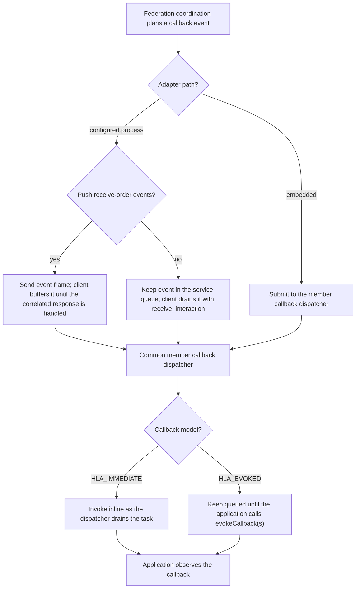

This sketch assumes callback delivery is enabled. `disableCallbacks` adds
another queue gate, and `enableCallbacks` alone does not dispatch queued
`HLA_EVOKED` work; see the [dispatcher mechanics guide](HLA-2025-CALLBACK-AND-SERVICE-ORDERING-FLOW-GUIDE.md#umbra-dispatcher-mechanics-submitted-is-not-invoked).

The dispatcher implements the second gate: `HLA_IMMEDIATE` drains submitted
work inline ([immediate branch](../../cpp/src/internal/callbacks/callback_dispatcher.cpp#L136),
[inline drain](../../cpp/src/internal/callbacks/callback_dispatcher.cpp#L151)), while
`HLA_EVOKED` invokes queued work through `evokeCallback` or `evokeMultiple`
([Evoke path](../../cpp/src/internal/callbacks/callback_dispatcher.cpp#L156)). The
process transport gate is `ProcessFederationServiceOptions::pushReceiveOrderEvents`:
Save stages pushed frames or appends to its polling queue ([Push](../../cpp/src/internal/federation/process_federation_service_notifications.cpp#L450),
[Poll](../../cpp/src/internal/federation/process_federation_service_notifications.cpp#L459));
Restore does the same ([Push](../../cpp/src/internal/federation/process_federation_service_notifications.cpp#L519),
[Poll](../../cpp/src/internal/federation/process_federation_service_notifications.cpp#L528)). A
`receive_interaction` poll selects synchronization announcements, federation-
synchronized events, Save, Restore, then interaction events ([queue selection](../../cpp/src/internal/federation/process_federation_service_receive.cpp#L99));
the client and RTI callback pump issue that poll during Evoke ([client request](../../cpp/src/internal/federation/process_federation_client_value_services.cpp#L219),
[RTI pump](../../cpp/src/internal/runtime/umbra_rti_ambassador_callback_control_services.cpp#L269)). This
queue priority and transport choice are Umbra implementation details; they do
not establish a normative callback-order rule across members.

The API distinction also remains visible across both gates. Save admission has
no success callback: initiation and the final federation result are later
events. Restore has `requestFederationRestoreSucceeded` for successful request
admission, followed by restore-begun, per-member initiation, and the final
federation result. The callback model can change when those callbacks are
observed, but it does not turn a normal `void` service return into a
Save/Restore result.

The focused tests cover these combinations at different depths:

| Adapter event path | `HLA_IMMEDIATE` | `HLA_EVOKED` |
| --- | --- | --- |
| Embedded | Successful two-member Save and Restore under both models ([case](../../cpp/tests/ieee1516_2025_federation_management_save_restore_catch2.cpp#L639); [model runs](../../cpp/tests/ieee1516_2025_federation_management_save_restore_catch2.cpp#L765)). | Same case. |
| Configured process, polling (`pushReceiveOrderEvents = false`) | No focused public accepted-request-to-terminal Save/Restore test combining polling with `HLA_IMMEDIATE` found. | Save uses polling and leaves the terminal callback unobserved until Evoke ([polling setup](../../cpp/tests/ieee1516_2025_connection_federation_save_catch2.cpp#L498), [before Evoke](../../cpp/tests/ieee1516_2025_connection_federation_save_catch2.cpp#L583), [after Evoke](../../cpp/tests/ieee1516_2025_connection_federation_save_catch2.cpp#L585)); single-member Restore uses polling and defers its success callback until Evoke ([polling setup](../../cpp/tests/ieee1516_2025_connection_synchronization_restore_catch2.cpp#L819), [before Evoke](../../cpp/tests/ieee1516_2025_connection_synchronization_restore_catch2.cpp#L918), [after Evoke](../../cpp/tests/ieee1516_2025_connection_synchronization_restore_catch2.cpp#L920)); the two-member Restore status/lifecycle case checks callbacks after Evoke ([polling setup](../../cpp/tests/ieee1516_2025_connection_synchronization_restore_catch2.cpp#L1720), [member callback](../../cpp/tests/ieee1516_2025_connection_synchronization_restore_catch2.cpp#L1992), [terminal callback](../../cpp/tests/ieee1516_2025_connection_synchronization_restore_catch2.cpp#L2095)). |
| Configured process, pushed events (`pushReceiveOrderEvents = true`) | Two-member Save checks both `federationSaved` counts after Complete ([case](../../cpp/tests/ieee1516_2025_process_pushed_ownership_assumption_save_restore_catch2.cpp#L62), [pushed option](../../cpp/tests/ieee1516_2025_process_pushed_ownership_assumption_save_restore_catch2.cpp#L121), [completion assertions](../../cpp/tests/ieee1516_2025_process_pushed_ownership_assumption_save_restore_catch2.cpp#L422)); the same two-member case checks both `federationRestored` counts after Restore Complete ([Restore calls](../../cpp/tests/ieee1516_2025_process_pushed_ownership_assumption_save_restore_catch2.cpp#L440), [callback assertions](../../cpp/tests/ieee1516_2025_process_pushed_ownership_assumption_save_restore_catch2.cpp#L446)). The separate one-member lifecycle also covers a prerequisite Save ([test](../../cpp/tests/ieee1516_2025_connection_restore_success_lifecycle_immediate_catch2.cpp#L561)). | A two-member pushed Save/Restore case uses `HLA_EVOKED` and later checks each member's Save-complete and Restore-complete callbacks after explicit Evokes ([case](../../cpp/tests/ieee1516_2025_process_pushed_ownership_assumption_evoked_save_restore_catch2.cpp#L62), [pushed option](../../cpp/tests/ieee1516_2025_process_pushed_ownership_assumption_evoked_save_restore_catch2.cpp#L144), [candidate Save assertion](../../cpp/tests/ieee1516_2025_process_pushed_ownership_assumption_evoked_save_restore_catch2.cpp#L482), [candidate Restore assertion](../../cpp/tests/ieee1516_2025_process_pushed_ownership_assumption_evoked_save_restore_catch2.cpp#L488), [owner Save assertion](../../cpp/tests/ieee1516_2025_process_pushed_ownership_assumption_evoked_save_restore_catch2.cpp#L493), [owner Restore assertion](../../cpp/tests/ieee1516_2025_process_pushed_ownership_assumption_evoked_save_restore_catch2.cpp#L504)). |

The pushed `HLA_EVOKED` case does not establish every callback-order
combination. No focused public accepted-request-to-terminal test combining
configured-process polling and `HLA_IMMEDIATE` was found; that is a coverage
gap, not evidence that the profile is unsupported. This matrix records evidence
bounds, not conformance.

`abortFederationSave`, `abortFederationRestore`, and the status query/report
services are related control paths. They do not replace the per-participant
completion protocol.

## Status queries are read-only callback snapshots

The 2025 API methods `queryFederationSaveStatus` (§4.25) and
`queryFederationRestoreStatus` (§4.34) return `void`; their data arrives
through the distinct `federationSaveStatusResponse` (§4.26) and
`federationRestoreStatusResponse` (§4.35) callbacks. The pinned
[save-status query](../../third_party/ieee1516.1-2025/include/RTI/RTIambassador.h#L364)
and [restore-status query](../../third_party/ieee1516.1-2025/include/RTI/RTIambassador.h#L413),
with their [save-status callback](../../third_party/ieee1516.1-2025/include/RTI/FederateAmbassador.h#L124)
and [restore-status callback](../../third_party/ieee1516.1-2025/include/RTI/FederateAmbassador.h#L166),
show that service/callback split.

In the current embedded path, a query snapshots the operation ledger for the
requesting member, releases native locks, and routes one status-response
callback to that requester. It does not start, advance, complete, or abort a
save or restore. Save responses are `(federate, save status)` pairs. Restore
responses carry pre-restore handle, post-restore handle, and restore status;
with no restore active, the current implementation reports
`NO_RESTORE_IN_PROGRESS` and an invalid post-restore handle. The opposite
operation remains a service gate: querying save status while restore is in
progress, or restore status while save is in progress, is rejected.

In the embedded implementation, the adapter entry points are
[queryFederationSaveStatus](../../cpp/src/internal/runtime/umbra_rti_ambassador_federation_save_restore.cpp#L864)
and
[queryFederationRestoreStatus](../../cpp/src/internal/runtime/umbra_rti_ambassador_federation_save_restore.cpp#L1579);
the registry constructs the corresponding [save snapshot](../../cpp/src/internal/federation/federation_registry_save_control.cpp#L1127)
and [restore snapshot](../../cpp/src/internal/federation/federation_registry_restore_control.cpp#L1800).

The following save sequence is the embedded `HLA_IMMEDIATE` integration
scenario. It shows three independent snapshots: participants instructed to
save, participants saving, and no save in progress after the federation save
finishes. The final `federationSaved` notification remains the operation's
completion signal; the status query is only an observation.

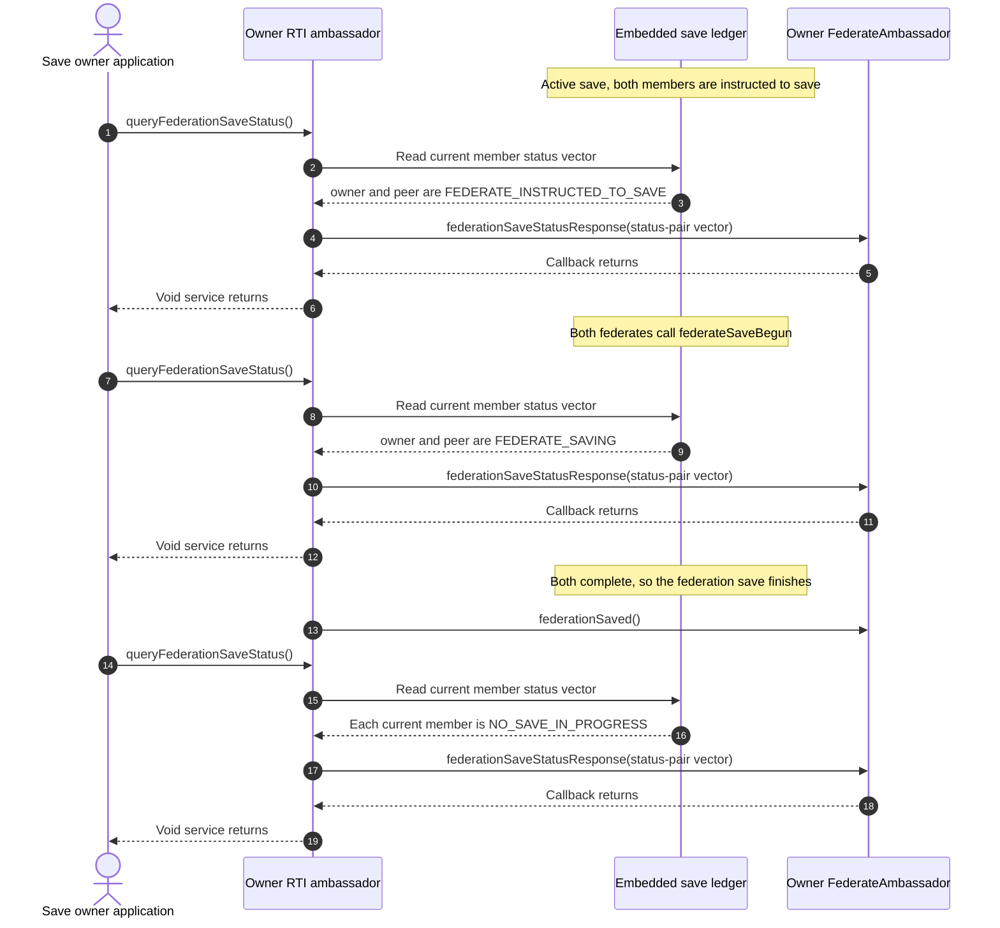

Restore uses a different status descriptor and includes the post-restore
handle. This embedded `HLA_IMMEDIATE` scenario queries while participants are
restoring, then again after `federationRestored`:

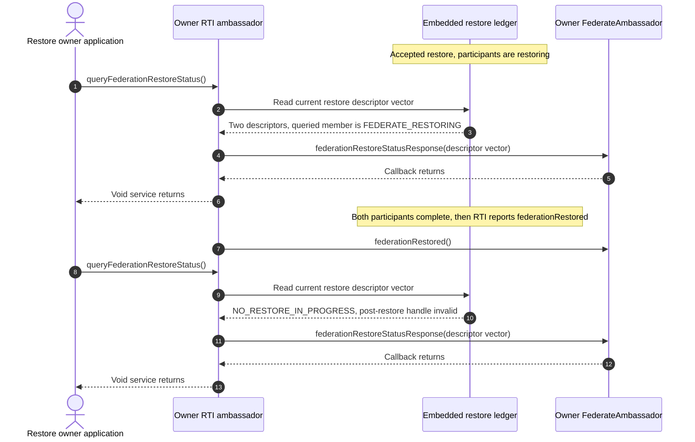

These are current-profile observations, not a complete normative status table.
The save case checks both members at `FEDERATE_INSTRUCTED_TO_SAVE`, then
`FEDERATE_SAVING`, then `NO_SAVE_IN_PROGRESS`. The restore case checks two
restoring members and the post-completion idle result. Each diagram is bounded
to its named embedded test and `HLA_IMMEDIATE`; the adapter also has a separate
process-endpoint protocol path, so the diagrams do not assert process/embedded
parity, HLA_EVOKED callback timing, or all status transitions.

### Configured process endpoint: private query result versus status callback

The public status query still returns `void`. In the process profile, the
correlated response contains a private control status (`applied` or a service
failure), not the snapshot data. The registry's read-only snapshot is routed
separately as a requester-only Save or Restore notification; the callback
bridge projects Save status pairs, or Restore descriptors with pre- and
post-restore handles, into the corresponding public status-response callback.
This does not advance the save/restore protocol or replace its separate
`federationSaved` / `federationRestored` outcome.

For pushed service delivery, the status event is sent before the correlated
query response. The client buffers it until the matching response arrives,
then unlocks and submits the callback before returning the private result to the
adapter. Consequently, `HLA_IMMEDIATE` may enter the callback before the query
service returns; `HLA_EVOKED` queues the callback task for a later evoke. With
polling delivery, the event remains in the recipient session queue for a later
`receive_interaction` request. Push/poll and callback model remain separate.
Focused status cases cover pushed events with `HLA_IMMEDIATE` and polling with
`HLA_EVOKED`; the other two status-query combinations are untested. The transport ordering
below is source-derived, not an HLA callback-order rule.

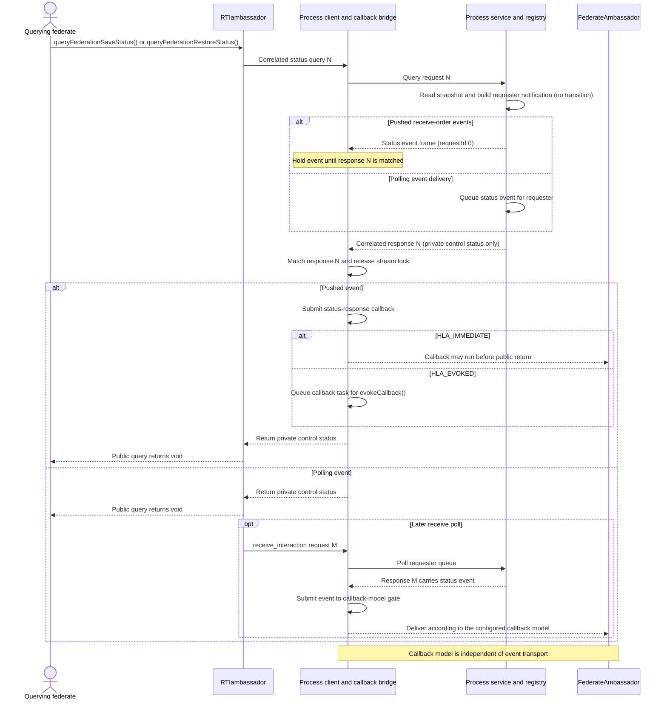

The process handlers for [Save status](../../cpp/src/internal/federation/process_federation_service_save_restore.cpp#L253)
and [Restore status](../../cpp/src/internal/federation/process_federation_service_save_restore.cpp#L590)
ask the registry for a snapshot ([Save](../../cpp/src/internal/federation/federation_registry_save_control.cpp#L1127),
[Restore](../../cpp/src/internal/federation/federation_registry_restore_control.cpp#L1800)), then use the shared
[Save](../../cpp/src/internal/federation/process_federation_service_notifications.cpp#L417)
and [Restore](../../cpp/src/internal/federation/process_federation_service_notifications.cpp#L481)
event queues. The [public Save adapter](../../cpp/src/internal/runtime/umbra_rti_ambassador_federation_save_restore.cpp#L864)
and [Restore adapter](../../cpp/src/internal/runtime/umbra_rti_ambassador_federation_save_restore.cpp#L1579),
the [response matcher](../../cpp/src/internal/federation/process_federation_client.cpp#L894),
and the [Save](../../cpp/src/internal/federation/process_federation_callback_bridge.cpp#L954)
and [Restore](../../cpp/src/internal/federation/process_federation_callback_bridge.cpp#L1027)
callback projections show the private-result boundary. Process Save-status query
coverage includes polling with `HLA_EVOKED`: the one-member process case queries
during the active Save and checks `FEDERATE_INSTRUCTED_TO_SAVE`, then
`FEDERATE_SAVING` ([case](../../cpp/tests/ieee1516_2025_connection_federation_save_catch2.cpp#L2592),
[queries and assertions](../../cpp/tests/ieee1516_2025_connection_federation_save_catch2.cpp#L2707)).
A pushed `HLA_IMMEDIATE` case queries after a failed Save and checks
`NO_SAVE_IN_PROGRESS` ([case](../../cpp/tests/ieee1516_2025_connection_process_federation_save_not_complete_status_terminal_immediate_catch2.cpp#L459),
[assertion](../../cpp/tests/ieee1516_2025_connection_process_federation_save_not_complete_status_terminal_immediate_catch2.cpp#L562));
a separate two-member polling/`HLA_EVOKED` case checks both terminal idle
statuses after failure ([case](../../cpp/tests/ieee1516_2025_connection_process_federation_save_not_complete_status_terminal_multi_federate_catch2.cpp#L459),
[queries and assertions](../../cpp/tests/ieee1516_2025_connection_process_federation_save_not_complete_status_terminal_multi_federate_catch2.cpp#L671)).
No focused process case queries an active Save under `HLA_IMMEDIATE`, asserts
a status snapshot after successful Save completion, or covers polling with
`HLA_IMMEDIATE` / pushed delivery with `HLA_EVOKED`. These are test-coverage
bounds, not claims that those profiles are unsupported. Process Restore-status queries
cover pushed `HLA_IMMEDIATE` ([config](../../cpp/tests/ieee1516_2025_connection_process_federation_restore_status_immediate_catch2.cpp#L482), [status](../../cpp/tests/ieee1516_2025_connection_process_federation_restore_status_immediate_catch2.cpp#L578)) and polling
`HLA_EVOKED` ([config](../../cpp/tests/ieee1516_2025_connection_synchronization_restore_catch2.cpp#L1324), [query](../../cpp/tests/ieee1516_2025_connection_synchronization_restore_catch2.cpp#L1437), [status](../../cpp/tests/ieee1516_2025_connection_synchronization_restore_catch2.cpp#L1445)); the
latter defers the public status callback until Evoke ([pending](../../cpp/tests/ieee1516_2025_connection_synchronization_restore_catch2.cpp#L1438), [delivered](../../cpp/tests/ieee1516_2025_connection_synchronization_restore_catch2.cpp#L1440)). Single-member idle/active/terminal
vectors are asserted ([idle](../../cpp/tests/ieee1516_2025_connection_synchronization_restore_catch2.cpp#L1620), [active](../../cpp/tests/ieee1516_2025_connection_synchronization_restore_catch2.cpp#L1646), [terminal](../../cpp/tests/ieee1516_2025_connection_synchronization_restore_catch2.cpp#L1661)); two-member active/waiting/terminal vectors are asserted ([active](../../cpp/tests/ieee1516_2025_connection_synchronization_restore_catch2.cpp#L2031), [waiting](../../cpp/tests/ieee1516_2025_connection_synchronization_restore_catch2.cpp#L2068), [terminal](../../cpp/tests/ieee1516_2025_connection_synchronization_restore_catch2.cpp#L2113)). The other two process status-query transport/model combinations remain untested.

## Save flow: request, participant work, and the commit barrier

The sequence below separates the application's checkpoint from the RTI's
durable commit. It omits the detailed time-grant algorithm; the optional gate
is the handoff to the time-management state machine.

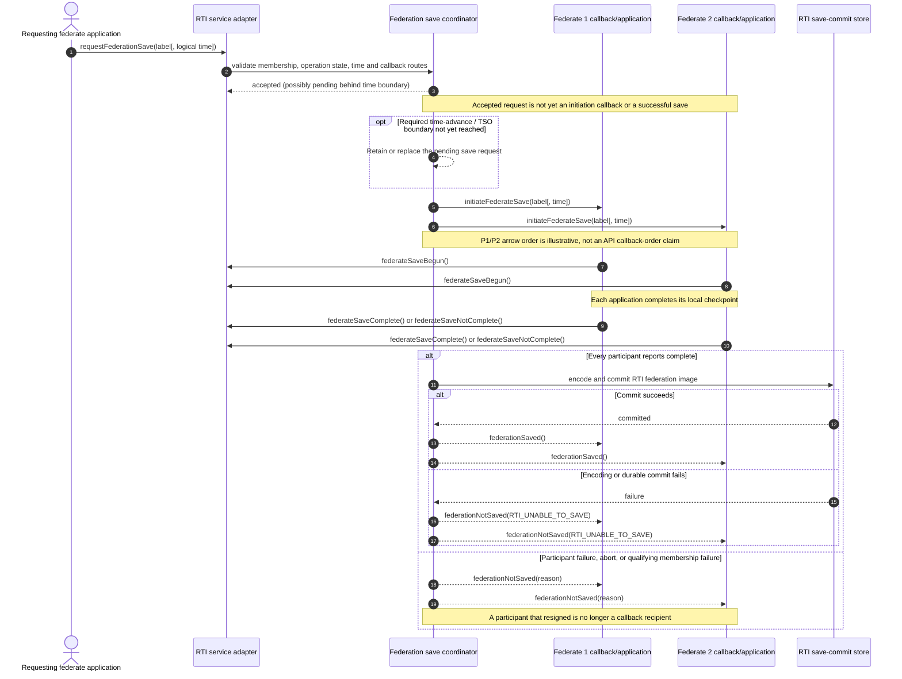

The current registry state machine is:

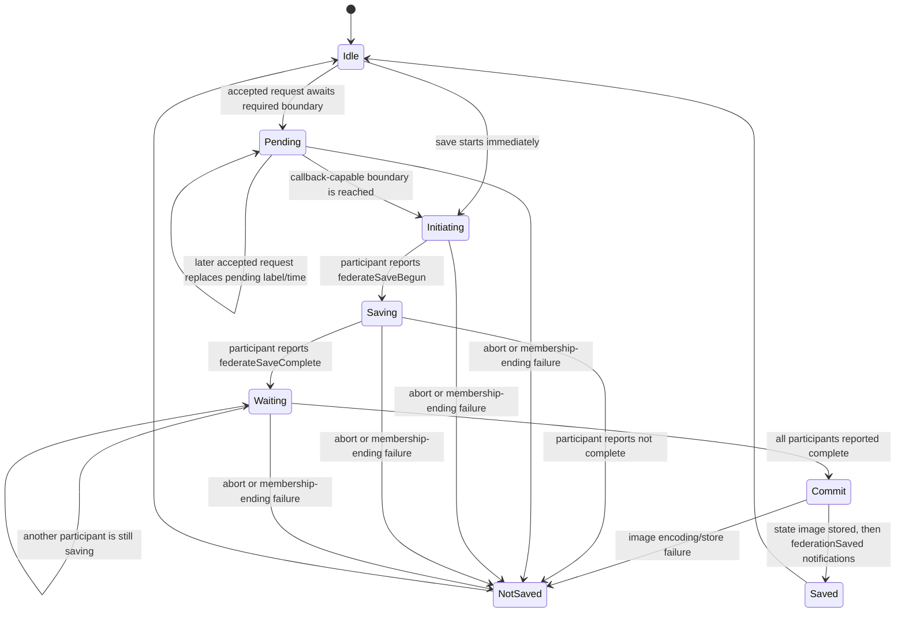

The state diagram is a teaching summary of current coordinator behavior, not a
replacement for the standard's participant-status rules. In particular:

- In the embedded profile, an untimed save is immediate only when no
  time-constrained member requires a callback-capable boundary. Otherwise the
  accepted request is retained until the constrained members can receive
  initiation at the right time-advance boundary.
- A timed request must use the federation's logical-time representation and
  name a time strictly later than each time-constrained member's current time.
  Acceptance can leave initiation pending; a later accepted request replaces
  the pending label and time. The embedded per-member admission checks are
  traced below.
- `federateSaveBegun` only changes that participant's coordinator status to
  saving. `federateSaveComplete` moves it to the waiting-for-federation barrier;
  it is the *last* participant's completion that makes the RTI encode and
  commit the image.
- The commit precedes `federationSaved`. If the store throws or the image
  cannot be materialized, the coordinator reports a failed federation save
  instead of claiming a restorable snapshot exists.
- A participant failure callback, RTI abort, and a member leaving during Save
  are different inputs to the failure path. The current membership-exit path
  and its profile-specific delivery limits are traced below.

### Embedded timed Save admission is checked per constrained member

The high-level Save diagram compresses this embedded callback gate. When the
federation has time-constrained members, each member's own callback-capable
advance checkpoint is evaluated separately. If no member is time constrained,
this gate does not apply and the timed request starts after the other admission
checks. At each constrained member's checkpoint, that member's advance mode
must qualify at the Save time, and it must have no queued or in-transit TSO
timestamp at or before the Save time. Before the first `SaveOperation` is
opened, every other constrained member must already have a qualifying advance
queued for dispatch. Their own TSO blockers are checked when they reach their
admission checkpoints. The remaining non-constrained members are instructed
after the last constrained initiation is admitted.

In the current embedded predicate, TAR and NMR can qualify when the requested
time is greater than or equal to the Save time; TARA and NMRA require it to be
strictly greater; FQR uses an actual grant strictly greater than the Save time.
These are source observations, not a claim about the normative Save rule or
configured-process parity. The full FQR actual/optimistic-time interaction is
in the [Time Management guide](HLA-2025-TIME-MANAGEMENT-GUIDE.md#fqr-actual-grant-and-optimistic-floor).

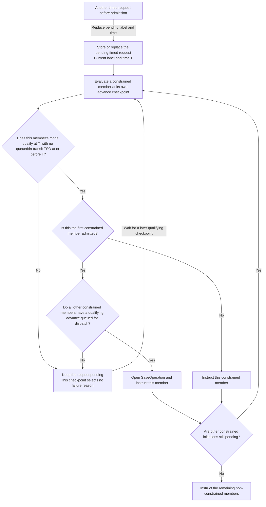

The source path is in the [timed-request validation and replacement](../../cpp/src/internal/federation/federation_registry_save_control.cpp#L485), [mode-specific advance predicate](../../cpp/src/internal/federation/federation_registry_save_control.cpp#L600), [queued/in-transit TSO check](../../cpp/src/internal/federation/federation_registry_save_control.cpp#L630), [all-constrained scheduled-advance gate](../../cpp/src/internal/federation/federation_registry_save_control.cpp#L729), and [per-member and final-participant admission](../../cpp/src/internal/federation/federation_registry_save_control.cpp#L783). The ordinary and FQR dispatch checkpoints are in [time advance](../../cpp/src/internal/runtime/umbra_rti_ambassador_time_advance_dispatch.cpp#L794) and [Flush Queue dispatch](../../cpp/src/internal/runtime/umbra_rti_ambassador_time_advance_dispatch.cpp#L884).

The embedded `HLA_EVOKED` [in-transit TSO case](../../cpp/tests/ieee1516_2025_timed_save_in_transit_tso_admission_catch2.cpp#L53) requests Save inside a timestamped-interaction callback. It asserts that initiation has not happened before that callback returns ([assertion](../../cpp/tests/ieee1516_2025_timed_save_in_transit_tso_admission_catch2.cpp#L86)) and then checks the later per-recipient callback orders ([receiver](../../cpp/tests/ieee1516_2025_timed_save_in_transit_tso_admission_catch2.cpp#L109), [regulating owner](../../cpp/tests/ieee1516_2025_timed_save_in_transit_tso_admission_catch2.cpp#L113)). A separate [FQR boundary case](../../cpp/tests/ieee1516_2025_timed_save_flush_queue_admission_catch2.cpp#L54) delivers a TSO at time 5 but leaves the Save pending at actual grant 5; actual grant 6 subsequently admits it ([later boundary](../../cpp/tests/ieee1516_2025_timed_save_flush_queue_admission_catch2.cpp#L88)). These are selected embedded development-profile tests, not normative callback-order rules or proof of configured-process parity.

The focused [embedded replacement case](../../cpp/tests/ieee1516_2025_federation_management_save_restore_catch2.cpp#L65) requests time 5 and then time 7 before any Initiate Federate Save callback, advances to 7, and observes only the final label and time. The configured-process [replacement case](../../cpp/tests/ieee1516_2025_connection_process_federation_save_timed_replacement_catch2.cpp#L703) covers the same replacement boundary in that profile. Neither test leaves the requested time unreachable or asserts a terminal failure notification. The current-source selector scan found no `SAVE_TIME_CANNOT_BE_HONORED` selection; the [failure-reason table](#save-failure-reason-vocabulary-and-source-selectors) records the formatter-only occurrence and unresolved normative trigger. This evidence supports pending replacement, not a normative failure rule.

### Member exit during an active Save

The active `SaveOperation` keeps a status entry for each member. Depending on
the initiation path, some entries can still be `NO_SAVE_IN_PROGRESS`; the
completion-notification builder skips those entries because Initiate Federate
Save was not invoked for them ([immediate operation setup](../../cpp/src/internal/federation/federation_registry_save_control.cpp#L64),
[time-gated setup](../../cpp/src/internal/federation/federation_registry_save_control.cpp#L365),
[completion filtering](../../cpp/src/internal/federation/federation_registry.cpp#L471)).
Voluntary Resign and forced ConnectionLost both enter the shared `resignLocked`
transition ([Resign](../../cpp/src/internal/federation/federation_registry.cpp#L344),
[ConnectionLost](../../cpp/src/internal/federation/federation_registry.cpp#L424)).
If a Save is active, the transition plans its failure notifications before
clearing the operation and removing the departing member's callback route
([shared transition](../../cpp/src/internal/federation/federation_registry_resign_lifecycle.cpp#L438)).
The Save notification builder skips members that never received Initiate
Federate Save, excludes the departing ID, and creates notifications only for
remaining IDs with a callback route
([recipient filters](../../cpp/src/internal/federation/federation_registry.cpp#L483)).

The source currently passes `FEDERATE_RESIGNED_DURING_SAVE` for both voluntary
Resign and forced ConnectionLost. The pinned 2025 API also lists
`RTI_DETECTED_FAILURE_DURING_SAVE` ([SaveFailureReason values](../../third_party/ieee1516.1-2025/include/RTI/Enums.h#L63)),
but the inspected membership-loss implementation does not select it. This is
a description of the current source path, not a claim about which reason the
standard requires for detected connection loss.

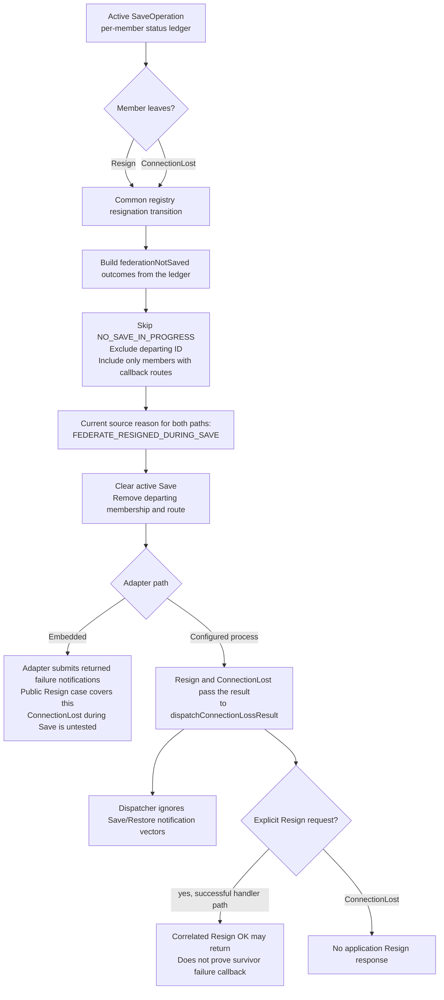

The embedded Resign adapter submits the registry's Save notifications, and
its public tests cover both an outstanding Save and a departure from an
Initiate Federate Save callback ([outstanding Save](../../cpp/tests/ieee1516_2025_federation_management_save_restore_catch2.cpp#L369),
[active-callback guard assertion](../../cpp/tests/ieee1516_2025_save_active_callback_resignation_guard_catch2.cpp#L55)).
The embedded forced-membership-loss adapter captures the registry's Save and
Restore vectors and submits both after the membership transition
([result capture](../../cpp/src/internal/runtime/umbra_rti_ambassador_membership_loss.cpp#L240),
[notification submission](../../cpp/src/internal/runtime/umbra_rti_ambassador_membership_loss.cpp#L415)).
No focused test covers ConnectionLost during an active Save.

In the configured-process profile, explicit Resign and ConnectionLost pass the
registry result through `dispatchConnectionLossResult` ([Resign dispatch call](../../cpp/src/internal/federation/process_federation_service_request_handlers.cpp#L160),
[ConnectionLost dispatch call](../../cpp/src/internal/federation/process_federation_service_connection_loss.cpp#L174),
[dispatcher](../../cpp/src/internal/federation/process_federation_service_connection_loss.cpp#L19)).
The dispatcher does not enqueue `saveNotifications` or `restoreNotifications`;
this is a source-level projection gap, not a tested public outcome. If the
explicit Resign handler completes successfully, it still returns correlated
`ok` ([response path](../../cpp/src/internal/federation/process_federation_service_request_handlers.cpp#L175)).
That response acknowledges the Resign request path; it does not prove that
surviving members received `federationNotSaved`. ConnectionLost has no
application Resign response. No focused configured-process case exercises a
member departure during active Save. The process Save-failure case instead
reports `FEDERATE_REPORTED_FAILURE_DURING_SAVE` before its cleanup Resign
([failure assertion](../../cpp/tests/ieee1516_2025_connection_process_federation_save_not_complete_catch2.cpp#L566),
[subsequent cleanup](../../cpp/tests/ieee1516_2025_connection_process_federation_save_not_complete_catch2.cpp#L568)).

### Worked case: FQR optimistic time and timed Save initiation

This embedded `HLA_EVOKED` case distinguishes the actual FQR grant, the
optimistic time, the current logical time, and a pending timed Save. The actual
grant is 5 while the optimistic time is 7; the application still queries
logical time 5. It then requests Save at 6. The request is accepted but
initiation remains pending until a later advance to 7 crosses the Save time.

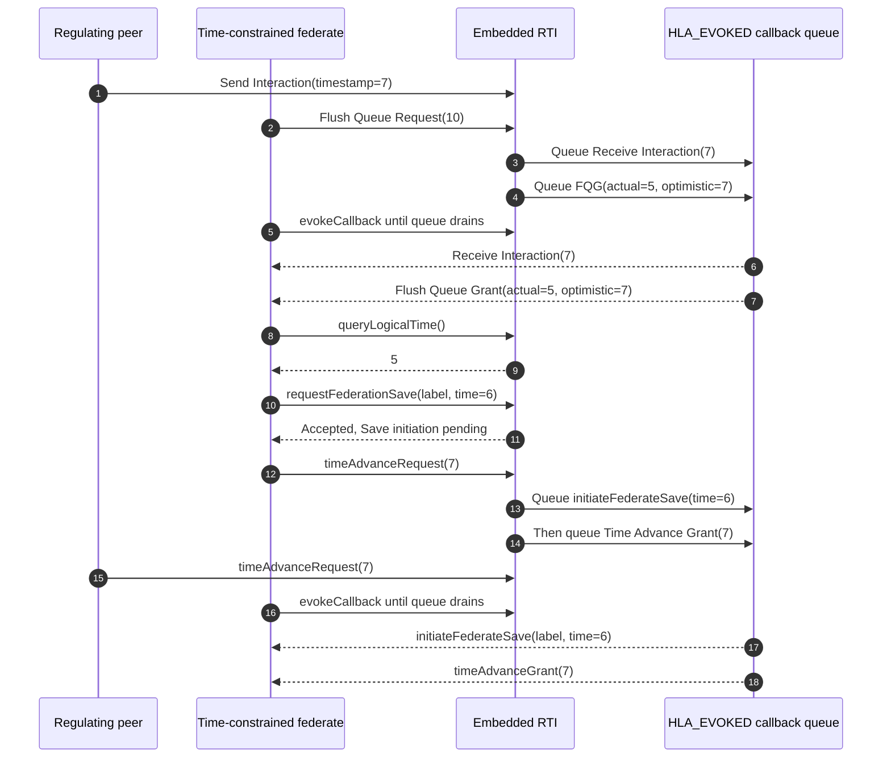

In the focused [test](../../cpp/tests/ieee1516_2025_federation_management_save_restore_catch2.cpp#L133),
the FQR reports actual 5 / optimistic 7, `queryLogicalTime` returns 5, and the
Save request at 6 is accepted without an initiation callback. The later TAR to
7 produces `initiateFederateSave` before the matching grant in the asserted
callback order (`grant`, interaction, FQG, Save initiation, grant; the first
grant is from the earlier advance to 4). This is one embedded implementation
trace under `HLA_EVOKED`, not a normative FQR or callback-order rule. The
[Time Management guide's FQR explanation](HLA-2025-TIME-MANAGEMENT-GUIDE.md#fqr-actual-grant-and-optimistic-floor)
keeps actual grant and optimistic floor distinct, and the [Save pre-grant
path](../../cpp/src/internal/federation/federation_registry_save_control.cpp#L719)
shows the scheduled-time admission check.

At the configured process endpoint, callback delivery adds another boundary
without changing these federation-level Save stages. The untimed
[`HLA_EVOKED` process Save case](../../cpp/tests/ieee1516_2025_connection_federation_save_catch2.cpp#L476)
returns from `requestFederationSave` before `initiateFederateSave`, and from
`federateSaveComplete` before `federationSaved`; explicit `evokeCallback` calls
then deliver each callback. A separate pushed-event
[`HLA_IMMEDIATE` failure case](../../cpp/tests/ieee1516_2025_connection_process_federation_save_not_complete_status_terminal_immediate_catch2.cpp#L459)
checks initiation and `federationNotSaved` after their inducing calls. The
source drains each pushed event within its correlated request before the
process client returns, but the focused test does not throw from a callback or
assert exception-after-admission behavior. These are distinct tested
configurations, not a universal process ordering rule: the callback model and
the process service's push-versus-poll choice are separate controls. The
general frame path is documented in the [process endpoint
guide](HLA-2025-PROCESS-ENDPOINT-REQUEST-AND-CALLBACK-FLOW-GUIDE.md#2-from-a-stream-frame-to-an-official-callback).

### Configured-process completion: participant success versus federation outcome

`federateSaveComplete()` reports that this participant finished its application
save; it does not promise that the federation image was committed. Only after
every participant reaches the waiting state does the coordinator encode and
commit the image, then return planned terminal notifications
([all-complete barrier](../../cpp/src/internal/federation/federation_registry_save_control.cpp#L988),
[image commit](../../cpp/src/internal/federation/federation_registry_save_control.cpp#L1025),
[notification construction](../../cpp/src/internal/federation/federation_registry_save_control.cpp#L1037)). A
successful commit plans `federationSaved`; an encoding or store failure plans
`federationNotSaved(RTI_UNABLE_TO_SAVE)`. The service routes those notifications
before its correlated response ([routing step](../../cpp/src/internal/federation/process_federation_service_save_restore.cpp#L239),
[accepted response](../../cpp/src/internal/federation/process_federation_service_save_restore.cpp#L246));
if routing fails, it returns an internal error instead ([error branch](../../cpp/src/internal/federation/process_federation_service_save_restore.cpp#L244)). This
is an Umbra configured-process trace, not a normative callback-order rule.

The diagrams separate the federation's terminal outcome from when the
application observes its callback. The first follows a participant completion
through the federation barrier, last-member image commit, and successful event
send and correlated response; earlier participants can receive an applied
response while the federation still waits at the barrier. The second starts
after the process client has matched that response and buffered the terminal
event, then contrasts callback observation under `HLA_IMMEDIATE` and
`HLA_EVOKED`. On the successful pushed-event path, the service enqueues the
terminal notification before returning its correlated response
([Push staging](../../cpp/src/internal/federation/process_federation_service_notifications.cpp#L450),
[send loop](../../cpp/src/internal/federation/process_federation_service_notifications.cpp#L469),
[correlated response](../../cpp/src/internal/federation/process_federation_service_save_restore.cpp#L246)).

#### Pushed notification failure after save-state resolution

One additional configured-process failure edge is source-visible but is not
covered by those success-path diagrams:

- The registry resolves the federation save before the service routes its
  terminal notifications
  ([image commit](../../cpp/src/internal/federation/federation_registry_save_control.cpp#L1025)). If notification
  encoding or a pushed send fails, the handler returns an internal-error response
  ([service error branch](../../cpp/src/internal/federation/process_federation_service_save_restore.cpp#L244)).
- Pushed terminal frames are sent one recipient at a time
  ([send loop](../../cpp/src/internal/federation/process_federation_service_notifications.cpp#L465),
  [send call](../../cpp/src/internal/federation/process_federation_service_notifications.cpp#L469)); a later failure
  can therefore occur after earlier frames were already sent. No rollback of the resolved save state or prior frames is
  visible.
- If the requesting member's terminal frame is already buffered, the client drains pushed events before the public Save
  Complete adapter checks the decoded federation-control result
  ([client drain](../../cpp/src/internal/federation/process_federation_client.cpp#L919),
  [public status check](../../cpp/src/internal/runtime/umbra_rti_ambassador_federation_save_restore.cpp#L600)). A
  returning `HLA_IMMEDIATE` callback may run before the ambassador maps the service failure to `RTIinternalError`
  ([public error mapping](../../cpp/src/internal/runtime/umbra_rti_ambassador_federation_save_restore.cpp#L617)); under
  `HLA_EVOKED`, the task may remain queued for a later Evoke
  ([queued task insertion](../../cpp/src/internal/callbacks/callback_dispatcher.cpp#L135),
  [evoked dispatch](../../cpp/src/internal/callbacks/callback_dispatcher.cpp#L156)).

This is a composition of source paths, not a tested public outcome: no reviewed
process test injects a partial notification-send failure. It does not establish
a standard callback rule or a result for a failed connection.

##### Federation outcome after participant completion

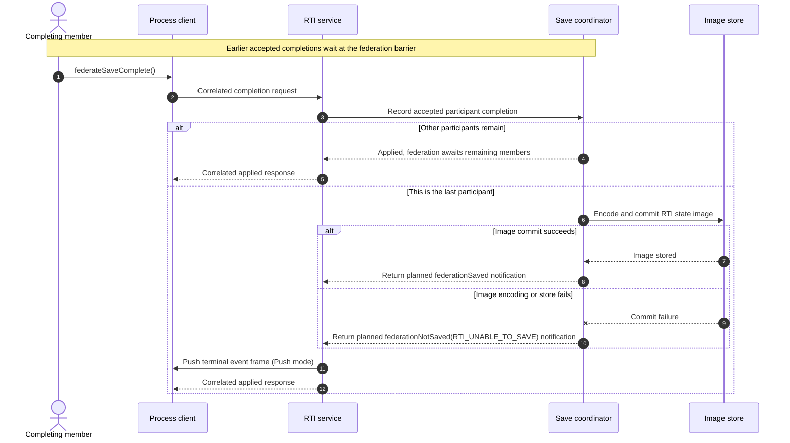

The applied response for the last participant means its completion was
accepted; it is not a claim that the federation image committed. The configured-
process polling test confirms `federationSaved` is still absent after Complete
and appears after explicit Evoke ([before](../../cpp/tests/ieee1516_2025_connection_federation_save_catch2.cpp#L583),
[after](../../cpp/tests/ieee1516_2025_connection_federation_save_catch2.cpp#L585)). The injected
commit-failure test is registry-level and asserts `RTI_UNABLE_TO_SAVE`
([assertion](../../cpp/tests/ieee1516_2025_federation_registry_save_commit_failure_catch2.cpp#L36));
it is not a process endpoint failure test.

##### Process callback observation and service-report boundary

The following sequence starts after the process client has matched the
correlated response and has the terminal event buffered. It contrasts inline
`HLA_IMMEDIATE` dispatch with deferred `HLA_EVOKED` observation; it does not
assert a general callback-order rule across endpoint profiles.

```mermaid
sequenceDiagram
  autonumber
  actor App as Application
  participant RTI as RTI API
  participant Client as Process client
  participant Dispatcher as Callback queue
  participant FA as Ambassador

  Note over RTI,Client: Applied response matched, terminal event buffered
  alt HLA_IMMEDIATE callback returns
    Client->>FA: federationSaved() or federationNotSaved(reason)
    FA-->>Client: Callback returns
    Client-->>RTI: Return decoded applied result
    RTI->>RTI: Append FederateSaveComplete(true) report if selected
    RTI-->>App: Service returns
  else HLA_IMMEDIATE callback throws an RTI Exception
    Client->>FA: Invoke terminal save callback
    FA--xClient: RTI Exception
    Client--xRTI: Complete call throws before returning its result
    RTI->>RTI: Attempt HLAreportException
    Note over RTI,App: Success report skipped, save outcome already resolved
  else HLA_EVOKED
    Client->>Dispatcher: Queue terminal callback task
    Client-->>RTI: Return decoded applied result
    RTI->>RTI: Append FederateSaveComplete(true) report if selected
    RTI-->>App: Service returns before callback observation
    App->>RTI: evokeCallback()
    RTI->>FA: federationSaved() or federationNotSaved(reason)
  end
```

The process client matches the correlated response and drains pushed events
before its typed `federateSaveComplete` method returns
([response validation](../../cpp/src/internal/federation/process_federation_client.cpp#L894),
[pushed-event drain](../../cpp/src/internal/federation/process_federation_client.cpp#L919),
[Save callback projection](../../cpp/src/internal/federation/process_federation_callback_bridge.cpp#L921)).
Under `HLA_IMMEDIATE`, callback submission invokes the callback inline
([dispatcher](../../cpp/src/internal/callbacks/callback_dispatcher.cpp#L136)),
so the terminal callback precedes the wrapper's successful service-report
append. If an RTI `Exception` escapes from that callback, the public call can
throw after the coordinator has already committed the image or resolved the
failed-save outcome; the wrapper attempts `HLAreportException`, and its later
`FederateSaveComplete(true)` append is skipped
([public adapter](../../cpp/src/internal/runtime/umbra_rti_ambassador_federation_save_restore.cpp#L598),
[report append](../../cpp/src/internal/runtime/umbra_rti_ambassador_federation_save_restore.cpp#L608),
[exception handler](../../cpp/src/internal/runtime/umbra_rti_ambassador_federation_save_restore.cpp#L671)).
No compensating rollback is shown. Under `HLA_EVOKED`, the drain queues the
callback task, the service call can return and record the participant's
successful Complete choice, and the terminal callback is observed later
during Evoke. In Umbra's report representation, `true` describes the member's
Complete service choice, not success of the federation-wide image commit
([report fields](../../cpp/src/internal/runtime/umbra_rti_ambassador_federation_save_restore.cpp#L659)).

The one-member configured-process `HLA_EVOKED` Save case uses polling, not
pushed events ([server option](../../cpp/tests/ieee1516_2025_connection_federation_save_catch2.cpp#L498));
its completion assertions show `federationSaved` unobserved after
`federateSaveComplete()` and delivered by an explicit Evoke
([assertions](../../cpp/tests/ieee1516_2025_connection_federation_save_catch2.cpp#L583)).
A separate multi-member pushed-event `HLA_EVOKED` Save/Restore case enables
push mode ([service option](../../cpp/tests/ieee1516_2025_process_pushed_ownership_assumption_evoked_save_restore_catch2.cpp#L144)),
completes both members ([completion calls](../../cpp/tests/ieee1516_2025_process_pushed_ownership_assumption_evoked_save_restore_catch2.cpp#L435)),
and later observes the last member's `federationSaved` callback after explicit
Evoke ([callback assertion](../../cpp/tests/ieee1516_2025_process_pushed_ownership_assumption_evoked_save_restore_catch2.cpp#L482)).
That case does not assert the terminal callback count immediately after each
Complete call, so it is not a direct timing assertion for that boundary.
The separate [internal commit-failure case](../../cpp/tests/ieee1516_2025_federation_registry_save_commit_failure_catch2.cpp#L4)
confirms that a failed store produces an unsuccessful terminal notification
with `RTI_UNABLE_TO_SAVE`; it is not a process-endpoint test. No focused public
process case throws from `federationSaved`/`federationNotSaved`, injects a
process-endpoint commit failure, or asserts service-report order. Those
branches below the diagram are source-derived and remain untested as public
process outcomes.

Read the immediate-callback exception branch narrowly. The process client
drains pushed events before returning from `federateSaveComplete`, and the
callback dispatcher rethrows an exception from an inline callback
([client drain](../../cpp/src/internal/federation/process_federation_client.cpp#L919),
[dispatcher](../../cpp/src/internal/callbacks/callback_dispatcher.cpp#L291)).
The adapter translates its recognized protocol, callback-bridge, and client
errors to `RTIinternalError` ([translation](../../cpp/src/internal/runtime/umbra_rti_ambassador_federation_save_restore.cpp#L617)),
then its outer HLA-`Exception` handler attempts `HLAreportException`
([handler](../../cpp/src/internal/runtime/umbra_rti_ambassador_federation_save_restore.cpp#L671));
an RTI exception thrown by the application callback also reaches that outer
handler. An unrelated non-RTI C++ exception is not matched by that handler, so
no `HLAreportException` attempt is shown for it. Either kind of escaping
callback exception occurs before the successful
`FederateSaveComplete(true)` service-report append. These are source-derived
wrapper paths: no focused process case injects these exception types or checks
the resulting reports.

#### A throwing initiation callback does not undo immediate process admission

This is a source-derived exception trace for an **untimed request that starts
immediately because no federation member is time constrained**, with pushed
events and the requesting member using `HLA_IMMEDIATE`. If any member is time
constrained, the registry retains the request as pending and this request path
does not yet create an active save operation or send `initiateFederateSave`;
the time-boundary behavior above applies instead. The trace also assumes the
server successfully sends the initiation frame and the correlated applied
response.

For the immediate-start path, the registry first creates the active save
operation and marks its members `FEDERATE_INSTRUCTED_TO_SAVE`, then returns
initiation notifications for the routes. The process service sends those event
frames before its correlated response. After matching that response and
releasing the stream lock, the client drains the pushed event before returning
the decoded result to the public adapter. If the requesting member's
`initiateFederateSave` callback throws `FederateInternalError` under
`HLA_IMMEDIATE`, the public `requestFederationSave` call can therefore throw
locally after the save has entered its instructed-to-save state. The wrapper's
successful service-report append is after the process-client call, so it is
skipped; its outer exception handler attempts `HLAreportException` and
rethrows. This path shows no rollback or failed-service-invocation report. The
server-side save operation remains active, and the throwing member has not
called `federateSaveBegun`; other participants may already have progressed.

With `HLA_EVOKED`, the request drain queues the initiation task instead. The
request can return and append its success service report; the callback is
observed only when the application later evokes it. This is not evidence about
what the Evoke service does if that callback throws. The comparison with the
[configured-process synchronization-point exception trace](HLA-2025-CALLBACK-AND-SERVICE-ORDERING-FLOW-GUIDE.md#mutating-process-wrapper-final-synchronization-point-achieved)
is useful: both show a local callback exception after a successful correlated
response, while their committed server state and service-specific reporting
remain distinct.

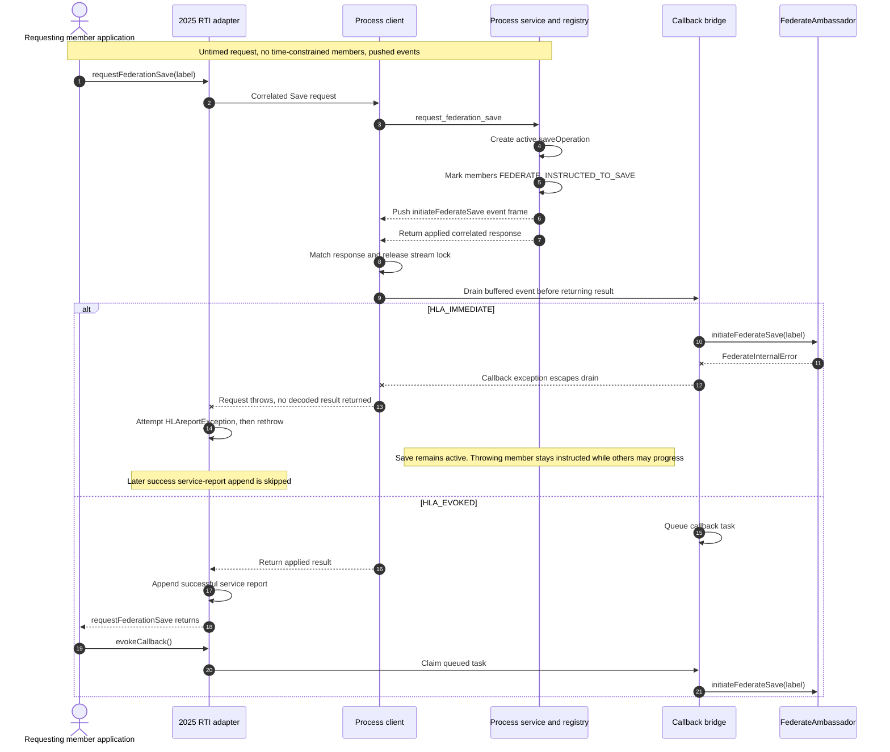

The [registry marks participants instructed](../../cpp/src/internal/federation/federation_registry_save_control.cpp#L64)
and [sets the active operation](../../cpp/src/internal/federation/federation_registry_save_control.cpp#L66)
before producing notifications; its [untimed constrained-member check](../../cpp/src/internal/federation/federation_registry_save_control.cpp#L163)
shows the pending alternative. The process handler's [registry call](../../cpp/src/internal/federation/process_federation_service_save_restore.cpp#L184),
[notification enqueue](../../cpp/src/internal/federation/process_federation_service_save_restore.cpp#L196),
and [applied response](../../cpp/src/internal/federation/process_federation_service_save_restore.cpp#L201)
show the server ordering, followed by the [pushed event send](../../cpp/src/internal/federation/process_federation_service_notifications.cpp#L469).
The [typed process-client request](../../cpp/src/internal/federation/process_federation_client_federation_management.cpp#L239)
uses [correlated-response validation](../../cpp/src/internal/federation/process_federation_client.cpp#L894) and releases the
[request exchange lock](../../cpp/src/internal/federation/process_federation_client.cpp#L915) before the
[pushed-event drain](../../cpp/src/internal/federation/process_federation_client.cpp#L919);
the [bridge invokes the application callback](../../cpp/src/internal/federation/process_federation_callback_bridge.cpp#L912).
The public adapter's [success-report append](../../cpp/src/internal/runtime/umbra_rti_ambassador_federation_save_restore.cpp#L170)
comes after the process-client result, while its [outer exception handler](../../cpp/src/internal/runtime/umbra_rti_ambassador_federation_save_restore.cpp#L241)
attempts `HLAreportException` and rethrows. The pinned callback signature lists
[`FederateInternalError`](../../third_party/ieee1516.1-2025/include/RTI/FederateAmbassador.h#L100).
The focused [process `HLA_IMMEDIATE` case](../../cpp/tests/ieee1516_2025_connection_process_federation_save_not_complete_status_terminal_immediate_catch2.cpp#L459)
uses a non-throwing callback; the [process `HLA_EVOKED` case](../../cpp/tests/ieee1516_2025_connection_federation_save_catch2.cpp#L476)
checks that initiation remains unobserved until explicit Evoke. Neither tests
a throwing initiation callback or proves the active-state consequence. For
the separate terminal-notification encode/push failure after the registry
transition, see [pushed notification failure after save-state
resolution](#pushed-notification-failure-after-save-state-resolution).

## Restore flow: admission is not completion

The restore request first selects and validates a saved image. Only an accepted
request starts the participant protocol. Each participant restores local
application state in its own callback path, then reports completion to the
RTI.

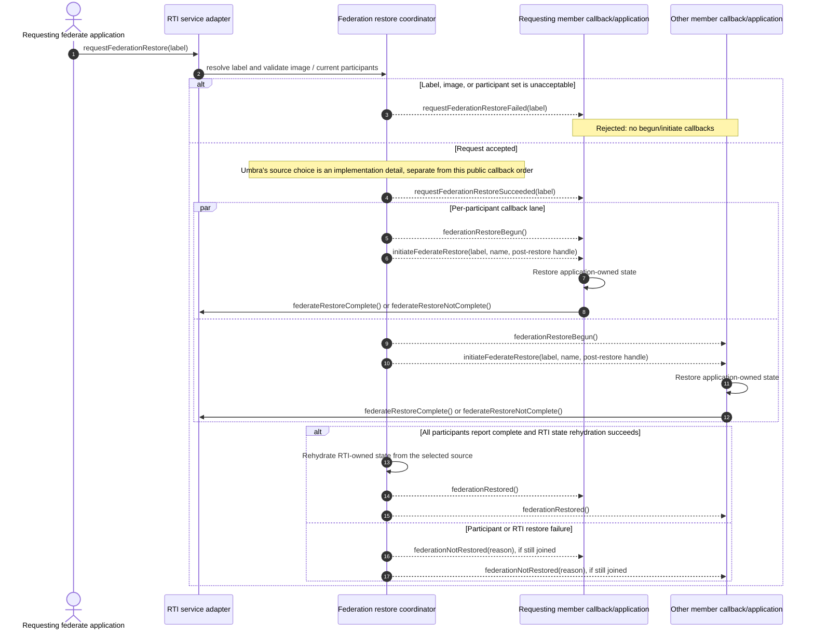

The requester is also one of the members restoring its local state. The lanes
show callbacks delivered to each member's `FederateAmbassador`; they do not
claim a global wall-clock interleaving between different callback queues.
The recipient map below describes current Umbra routing. Callback declarations
in the pinned [2025 API](../../third_party/ieee1516.1-2025/include/RTI/FederateAmbassador.h#L130)
do not by themselves establish normative receiver scope.

| Callback | Current Umbra recipient | Focused evidence |
| --- | --- | --- |
| `requestFederationRestoreFailed` / `requestFederationRestoreSucceeded` | The requesting federate only. The registry assigns the request outcome to `requestingFederateId` ([failed image](../../cpp/src/internal/federation/federation_registry_restore_control.cpp#L1089), [membership mismatch](../../cpp/src/internal/federation/federation_registry_restore_control.cpp#L1102), [success path](../../cpp/src/internal/federation/federation_registry_restore_control.cpp#L1131)). | The configured-process two-member case observes success on the requester before its begun/initiate callbacks ([assertion](../../cpp/tests/ieee1516_2025_connection_synchronization_restore_catch2.cpp#L1990)). |
| `federationRestoreBegun` | Every member in the active federation membership, including the requester; the registry plans one notification per member ([member loop](../../cpp/src/internal/federation/federation_registry_restore_control.cpp#L1142)). | The embedded two-member case checks the requester and peer ([requester](../../cpp/tests/ieee1516_2025_federation_management_save_restore_catch2.cpp#L747), [peer](../../cpp/tests/ieee1516_2025_federation_management_save_restore_catch2.cpp#L748)); the configured-process polling case checks both ([requester](../../cpp/tests/ieee1516_2025_connection_synchronization_restore_catch2.cpp#L1992), [peer](../../cpp/tests/ieee1516_2025_connection_synchronization_restore_catch2.cpp#L1996)). |
| `initiateFederateRestore` | Every member in that same loop, with that member's saved name and post-restore handle in the notification ([planning](../../cpp/src/internal/federation/federation_registry_restore_control.cpp#L1161)). | The embedded case checks both members' identity payloads ([assertions](../../cpp/tests/ieee1516_2025_restore_member_identity_rebinding_catch2.cpp#L148)); the configured-process test checks both initiation callbacks ([requester](../../cpp/tests/ieee1516_2025_connection_synchronization_restore_catch2.cpp#L1994), [peer](../../cpp/tests/ieee1516_2025_connection_synchronization_restore_catch2.cpp#L1998)). |
| `federationRestored` / `federationNotRestored` | Each operation member that remains joined and has a callback route; the completion planner can exclude a departed member ([planner](../../cpp/src/internal/federation/federation_registry.cpp#L545)). | The configured-process polling test observes terminal success for both members after both report completion ([requester](../../cpp/tests/ieee1516_2025_connection_synchronization_restore_catch2.cpp#L2095), [peer](../../cpp/tests/ieee1516_2025_connection_synchronization_restore_catch2.cpp#L2097)). |

On the configured-process path, the service resolves each planned
`receivingFederateId` to its session and carries it into the event
([routing](../../cpp/src/internal/federation/process_federation_service_notifications.cpp#L505));
the callback bridge dispatches the event kind to that session's ambassador
([dispatch](../../cpp/src/internal/federation/process_federation_callback_bridge.cpp#L974)).
The two-member polling case sets `pushReceiveOrderEvents = false` and connects
both members with `HLA_EVOKED` ([service option](../../cpp/tests/ieee1516_2025_connection_synchronization_restore_catch2.cpp#L1720),
[member connections](../../cpp/tests/ieee1516_2025_connection_synchronization_restore_catch2.cpp#L1954));
it observes request-success on the requester, begun/initiate on both members,
and terminal success for both. The embedded two-member case also covers both
callback models. These are implementation and test observations,
not normative receiver-scope claims. For the distinct implementation question
of which RTI state source is applied after that protocol, see the
[restore-source selection inset](#2025-umbra-restore-source-selection) below.

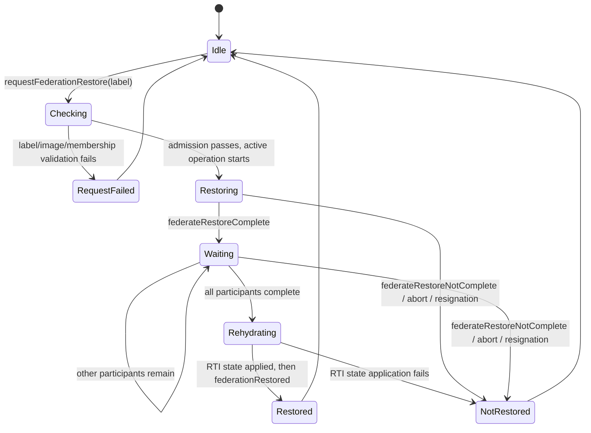

The direct `Checking` to `Restoring` transition is deliberate in the current
registry. After image, participant-set, and callback-route validation,
`requestFederationRestore` creates the active operation and plans the
request-success, begun, and initiate notifications; it does not wait for a
time-constrained member's time-advance boundary. The `Pending` state in the
[Save flow](#save-flow-request-participant-work-and-the-commit-barrier) is
Save-specific: the Save coordinator explicitly retains an untimed request when
a member is time constrained and waits for a callback-capable time-advance
boundary. See the [Restore admission path](../../cpp/src/internal/federation/federation_registry_restore_control.cpp#L917),
[operation and notification planning](../../cpp/src/internal/federation/federation_registry_restore_control.cpp#L1128),
and [Save time gate](../../cpp/src/internal/federation/federation_registry_save_control.cpp#L131).
This is a current-source distinction, not a normative HLA rule. Callback
observation may still be deferred by the selected callback model or process
transport, as shown below.

A saved pending `enableTimeConstrained` request is a separate time-state
restoration concern. The focused [fresh-registry case](../../cpp/tests/ieee1516_2025_durable_pending_time_constrained_restore_catch2.cpp#L37)
keeps the source callback uninvoked, saves the pending role state, accepts
Restore, completes the participant barrier, and then observes
`timeConstrainedEnabled` during Evoke
([Restore completion](../../cpp/tests/ieee1516_2025_durable_pending_time_constrained_restore_catch2.cpp#L70)).
It verifies restoration of a pending time-role callback, not a time-advance
delay before Restore admission.

### Worked case: restoring a pending Time Constrained request

This one-member, fresh-filesystem-registry case starts with the constrained
role off and an Enable Time Constrained generation pending. Under
`HLA_EVOKED`, the source callback is not invoked before Save. The image stores
the pending role state and generation, while the callback closure itself is
rebuilt against the rejoined federate. At final Restore completion, the
embedded registry applies the saved temporal state and checks its time bounds.
A restored pending enable is rebuilt only when the federation-time bounds are
available or undefined and, if GALT exists, the restored current time is
earlier than GALT. Otherwise the role remains pending. The one-member test
exercises the eligible branch.

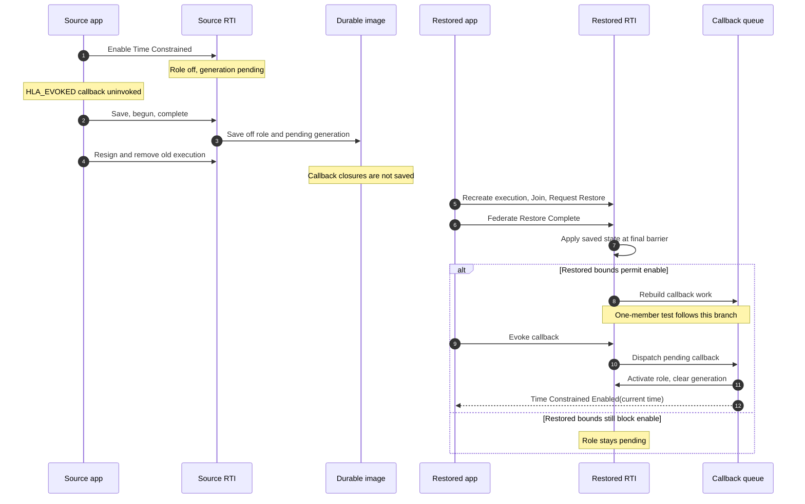

The saved time-state flags and generation are captured in the
[image](../../cpp/src/internal/federation/federation_registry_state_image_capture.cpp#L822)
and restored into the live time state by the
[image applier](../../cpp/src/internal/federation/federation_registry_state_image_restore.cpp#L158).
Fresh-registry Restore does not serialize callback closures; it rebuilds live
role dispatches against current members
([restore result](../../cpp/src/internal/federation/federation_registry_service_types.hpp#L532)).
After the Restore barrier, the registry rebuilds only eligible pending role
callbacks using the restored time bounds
([scheduler](../../cpp/src/internal/federation/federation_registry_tso_delivery.cpp#L1222)).
The public adapter submits role callbacks after the Restore lifecycle
notifications
([submission order](../../cpp/src/internal/runtime/umbra_rti_ambassador_federation_save_restore.cpp#L1380)).
The embedded callback dispatch sets the role active and clears its pending
generation immediately before calling the public callback
([dispatch](../../cpp/src/internal/runtime/umbra_rti_ambassador_time_advance_dispatch.cpp#L1159)).
The focused [test setup](../../cpp/tests/ieee1516_2025_durable_pending_time_constrained_restore_catch2.cpp#L37)
and [post-completion assertions](../../cpp/tests/ieee1516_2025_durable_pending_time_constrained_restore_catch2.cpp#L78)
prove callback delivery after Restore completion in this one-member embedded
case; they do not assert cross-callback order, query the role flag, or exercise
the GALT-blocked branch. The Time Management guide's
[role-state diagram](HLA-2025-TIME-MANAGEMENT-GUIDE.md#role-state-machines)
shows where this callback activates the role. This is an embedded
fresh-registry trace, not evidence for other 2025 endpoint implementations.
The configured-process Restore route has a separate current-source gap: Join
does not register the role-enable factory needed by Restore's dispatch
reconstruction, and the process completion handler has no projection for the
returned role work. The Time Management guide's
[configured-process role callback projection](HLA-2025-TIME-MANAGEMENT-GUIDE.md#configured-process-projection-of-restored-role-callbacks)
records the eligibility condition, missing-factory behavior, ordinary event-to-
client callback route, and focused-test limit. This source finding does not
settle the normative HLA Restore obligation.
The separate [configured-process pending-grant Restore trace](HLA-2025-TIME-MANAGEMENT-GUIDE.md#configured-process-delivery-of-a-restored-pending-time-advance-grant)
follows the rebuilt grant dispatch and the process handler's missing event
projection; it likewise records a source boundary, not a normative Restore
conclusion.

When restored bounds still block the transition, the embedded registry leaves
the pending generation in place. A later time-state change can make it eligible:
the time-advance grant dispatch updates the granting member's time and calls
`reevaluateTimeAdvanceGrants`, which also checks pending constrained-role
enables ([grant completion](../../cpp/src/internal/runtime/umbra_rti_ambassador_time_advance_dispatch.cpp#L862),
[eligibility pass](../../cpp/src/internal/federation/federation_registry_time_tso_enqueue.cpp#L122)).
The existing [GALT enable case](../../cpp/tests/available_time_advance_inclusive_galt_catch2.cpp#L1028)
shows the adjacent ordinary-request behavior: GALT equal to the requester's
current time remains blocked ([assertion](../../cpp/tests/available_time_advance_inclusive_galt_catch2.cpp#L1072)).
A later regulator advance moves GALT strictly past it, making the callback
eligible; it remains unobserved before Evoke
([still queued](../../cpp/tests/available_time_advance_inclusive_galt_catch2.cpp#L1078))
and is observed after Evoke
([callback assertion](../../cpp/tests/available_time_advance_inclusive_galt_catch2.cpp#L1080)).
That focused case does not save and restore the pending request, so the restored
GALT-blocked branch remains source-derived rather than directly tested.

### Process endpoint: callback frames and the public restore call boundary

The preceding diagram is the federation protocol view. The configured process
endpoint adds a transport boundary around the standard Restore callbacks. Keep
two questions separate: whether the service pushes event frames or retains
notifications for polling, and whether the application uses `HLA_IMMEDIATE`
or `HLA_EVOKED`. The public cases below exercise selected combinations, not an
exhaustive transport-by-callback-model matrix. The [process endpoint guide](HLA-2025-PROCESS-ENDPOINT-REQUEST-AND-CALLBACK-FLOW-GUIDE.md#2-from-a-stream-frame-to-an-official-callback)
covers the generic transport boundary.

#### Pushed-event service mode with `HLA_IMMEDIATE`

In the pushed-event service mode used by this trace, the service sends
restore-notification frames before returning its correlated control response.
The client buffers pushed frames while awaiting the matching response, then
drains them; with `HLA_IMMEDIATE`, callback-bridge submission enters the
federate ambassador inline.

This trace is bounded to the one-member, pushed-event `HLA_IMMEDIATE` public
process-endpoint tests. Their server runs in a worker thread over loopback TCP;
“process endpoint” here does not mean an RTI process crash/restart test.

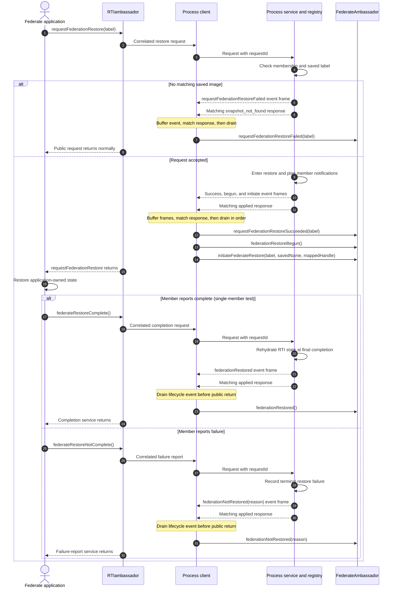

The early rejection is a normal void-service return accompanied by
`requestFederationRestoreFailed`; it does not enter the begun state. For an
accepted request, the correlated `applied` response is not the federation
outcome: the image is rehydrated only when the participant-completion barrier
is satisfied, and `federationRestored` or `federationNotRestored` reports that
later result. This one-member pushed-event trace does not establish callback
timing for polling mode, other transports, the embedded profile, or IEEE
1516.1-2010. Its immediate callback timing is not a claim about multi-member
restores; separate multi-member process evidence is listed below.

#### Polling service mode with `HLA_EVOKED`

The configured process endpoint also has direct public Restore tests using
`HLA_EVOKED` with `ProcessFederationServiceOptions{false}`. Here the service
keeps Restore notifications in the session queue. The public Restore service
returns before the federate ambassador observes them; a later
`evokeCallback(0.0)` polls the receive path and delivers the next callback.
In the one-member success case, explicit Evoke calls observe
`requestFederationRestoreSucceeded`, `federationRestoreBegun`, and
`initiateFederateRestore` in that order; `federateRestoreComplete` also returns
before a later Evoke delivers `federationRestored`.

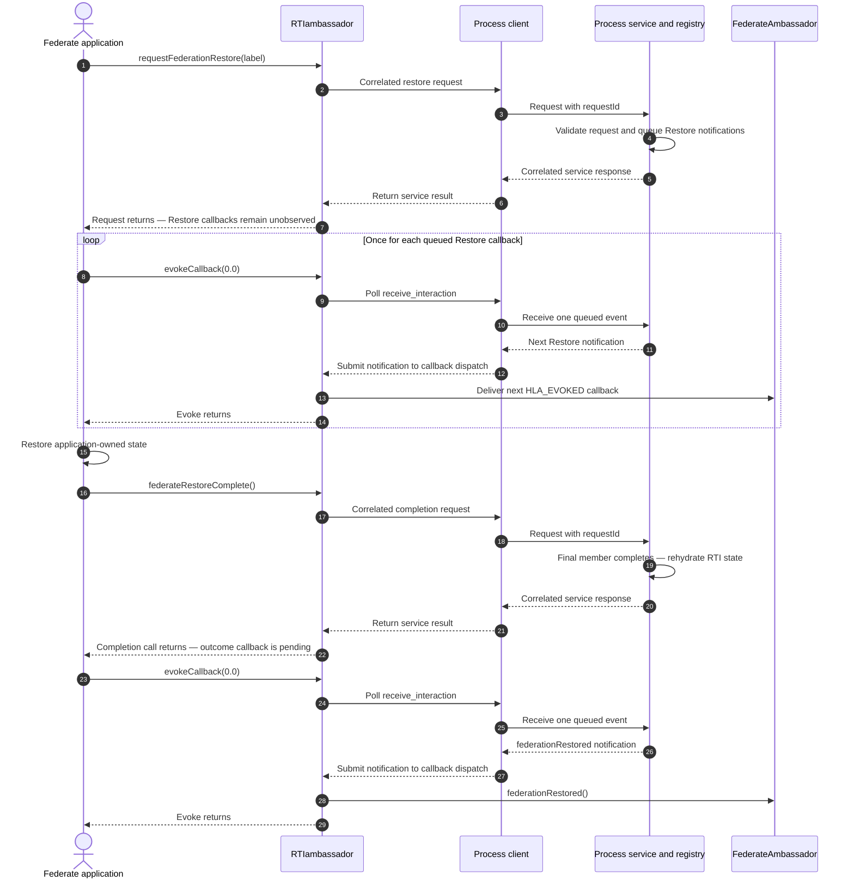

The polling trace is a separate one-member 2025 process case, also served by a
worker thread over loopback TCP; it is not an operating-system process restart.
The paired early-rejection case likewise returns from
`requestFederationRestore` with its failure callback still unobserved, then
delivers `requestFederationRestoreFailed` on explicit Evoke. A separate
two-member case queries each member's restore status and observes lifecycle
callbacks through Evoke; that is distinct evidence, not a widening of the
one-member sequence above. Finally, a different process test sets pushed-event
service mode and `HLA_EVOKED`: selected pushed frames enter the evoked callback
queue but remain uninvoked through service-level Save/Restore. This shows that
pushed frame receipt alone does not imply inline user callback execution; it
does not establish every transport/callback-model combination or general
callback ordering. None of these process tests establishes embedded parity or
2010 behavior.

#### Pushed notification delivery can fail after Restore admission

The process service calls the registry before it projects the accepted Restore
notifications. Registry admission has already created `restoreOperation` and
marked each participant `FEDERATE_RESTORING` by the time pushed-frame delivery
begins ([operation creation](../../cpp/src/internal/federation/federation_registry_restore_control.cpp#L1128),
[request handler](../../cpp/src/internal/federation/process_federation_service_save_restore.cpp#L344)).
Only the registry-accepted branch is shown here; durable-image or member-set
rejection returns before operation creation, as described in the early-rejection
table above. The notification helper skips recipients with no matching current session, then
sends the collected pushed frames one at a time. If a send fails, it returns
false; the request handler returns `internalError` without resetting the
registry operation ([frame send](../../cpp/src/internal/federation/process_federation_service_notifications.cpp#L534),
[failure return](../../cpp/src/internal/federation/process_federation_service_save_restore.cpp#L348)).
Frames sent earlier in that loop are not recalled, and this path does not add a
`requestFederationRestoreFailed` notification or roll back admission. A later
connection-loss or resignation transition may still change federation state;
the source observation here is limited to this request handler's failure path.

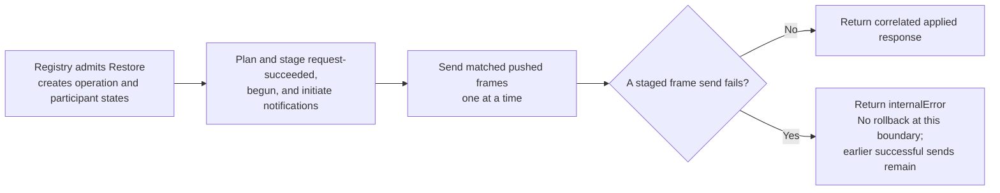

The focused public cases cover successful one-member pushed admission and a
missing-image rejection ([success lifecycle](../../cpp/tests/ieee1516_2025_connection_restore_success_lifecycle_immediate_catch2.cpp#L561),
[request rejection](../../cpp/tests/ieee1516_2025_connection_restore_request_failure_immediate_catch2.cpp#L544)).
They do not inject a failed notification send or assert partial multi-member
delivery. This is an implementation observation, not a callback rule from
IEEE 1516.1-2025.


#### Initiate callback identity across the process boundary

The lifecycle charts abbreviate the initiate callback, but its identity fields
stay distinct across the configured-process route. `ProcessFederationService`
uses the shared `EmbeddedFederationRegistry`; the
[registry planner](../../cpp/src/internal/federation/federation_registry_restore_control.cpp#L1161)
creates each initiate notification, following the
[identity matching described above](#embedded-durable-image-identity-matching).
The service then selects the receiving session by its current
`receivingFederateId` and copies the planned label, saved `federateName`,
pre-restore ID, and mapped post-restore ID into `ProcessFederationRestoreEvent`.
The event codec serializes the saved name and both IDs. The client decodes and
buffers or polls that event, then submits it to the callback bridge; for an
initiate event, the bridge constructs the public handle from the post-restore
ID and calls `initiateFederateRestore(label, saved name, current handle)`.
Therefore the process projection forwards the registry's saved-name/current-ID
pair; it does not remap identity a second time. The [shared registry type](../../cpp/src/internal/federation/process_federation_service.hpp#L798)
and [Restore request handoff](../../cpp/src/internal/federation/process_federation_service_save_restore.cpp#L344),
[notification projection](../../cpp/src/internal/federation/process_federation_service_notifications.cpp#L503),
[event encoding](../../cpp/src/internal/federation/process_federation_service_interaction_event_codecs.cpp#L835)
and [decoding](../../cpp/src/internal/federation/process_federation_service_interaction_event_codecs.cpp#L1595),
[client dispatch](../../cpp/src/internal/federation/process_federation_client_callback_dispatch.cpp#L225),
and [public callback projection](../../cpp/src/internal/federation/process_federation_callback_bridge.cpp#L992)
show those boundaries. Push versus polling selects how the event reaches the
client; `HLA_IMMEDIATE` versus `HLA_EVOKED` selects when the callback task is
invoked. The [generic process callback flow](HLA-2025-PROCESS-ENDPOINT-REQUEST-AND-CALLBACK-FLOW-GUIDE.md#2-from-a-stream-frame-to-an-official-callback)
covers those independent choices.

The focused process tests verify callback delivery and handle validity, but do
not assert the exact saved-name/current-handle pair after member IDs or names
change: the immediate case checks that the handle is valid, and the polling
case checks a nonempty name and valid handle
([immediate assertion](../../cpp/tests/ieee1516_2025_connection_process_federation_restore_status_immediate_catch2.cpp#L570),
[polling assertion](../../cpp/tests/ieee1516_2025_connection_synchronization_restore_catch2.cpp#L926)).
The [embedded rebind case](../../cpp/tests/ieee1516_2025_restore_member_identity_rebinding_catch2.cpp#L148)
checks the changed-name/changed-ID pairing directly. That does not make it an
end-to-end process transport test: the process field path above is source
evidence, while exact identity remapping through process delivery remains an
untested boundary.

#### Process adapter to saved Region state: source-derived path, not a process Region test

This map follows the configured 2025 process client/service into the shared
registry state-image machinery. It is an Umbra architecture trace, not an HLA
requirement and not evidence that a public process-endpoint call restores a
Region. The inspected process Save/Restore cases exercise lifecycle, status,
and callback transport but do not create or query Regions. A separate
file-backed registry test restores a Region into a second
`EmbeddedFederationRegistry` in the same test process; it does not traverse the
process client/service or restart the operating-system process.

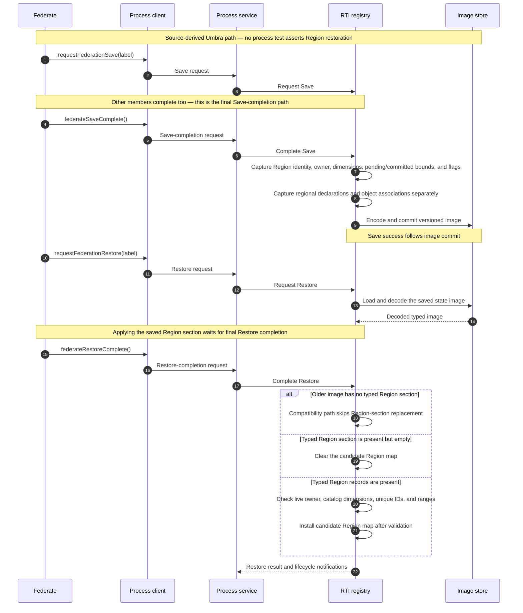

The process [Save client path](../../cpp/src/internal/federation/process_federation_client_federation_management.cpp#L239)
and [Restore client path](../../cpp/src/internal/federation/process_federation_client_federation_management.cpp#L426)
send control requests to the [Save handler](../../cpp/src/internal/federation/process_federation_service_save_restore.cpp#L11)
and [Restore handler](../../cpp/src/internal/federation/process_federation_service_save_restore.cpp#L323),
which delegate to the registry. The [save commit](../../cpp/src/internal/federation/federation_registry_save_control.cpp#L1020)
encodes the captured image before exposing Save success; the [capture](../../cpp/src/internal/federation/federation_registry_state_image_capture.cpp#L386)
records each Region, and the [versioned codec](../../cpp/src/internal/federation/federation_state_image.cpp#L1921)
stores a typed Region section. On restore, the [decoder](../../cpp/src/internal/federation/federation_state_image_decode.cpp#L1918)
distinguishes a missing legacy section from a present empty one, and the
[registry restore helper](../../cpp/src/internal/federation/federation_registry_state_image_restore.cpp#L315),
called at the [final Restore-completion boundary](../../cpp/src/internal/federation/federation_registry_restore_control.cpp#L1272),
rebuilds Regions against the restored catalog and member set. Regional
subscriptions, object update-region associations, and queued-message region
snapshots are separate image state; this map follows Region objects only.

The process service also handles per-session callback queues separately from
the registry's Region section. Before asking the registry to begin Save, the
service copies only supported ordinary receive-order attribute callbacks;
queued regional attribute callbacks cause an internal-error response in both
the [polling queue path](../../cpp/src/internal/federation/process_federation_service_save_restore.cpp#L84)
and the [pushed queue path](../../cpp/src/internal/federation/process_federation_service_save_restore.cpp#L122).
This guard concerns queued callback delivery. It does not reject the separate
registry-owned Region records or establish their behavior through the public
process endpoint.

The configured-process [Save](../../cpp/tests/ieee1516_2025_connection_federation_save_catch2.cpp#L476)
and [successful Restore lifecycle](../../cpp/tests/ieee1516_2025_connection_synchronization_restore_catch2.cpp#L795)
cases cited above cover process callbacks/status, not Region persistence. A
separate [Restore-status case](../../cpp/tests/ieee1516_2025_connection_process_federation_restore_status_immediate_catch2.cpp#L459)
also has no Region setup or query. The
direct [file-backed Region test](../../cpp/tests/ieee1516_2025_federation_registry_federation_owned_regions_filesystem_restart_catch2.cpp#L3)
checks handle, dimensions, and committed bounds across registry instances,
but its “restart” is construction of a second registry object in one test
process. Until a focused configured-process test creates, saves, mutates or
deletes, restores, and queries a Region, keep process-endpoint Region behavior
source-derived and unverified by that public boundary. Neither test family
establishes IEEE 1516.1-2010 behavior.

### Early rejection versus begun failure

| Observation | Request rejected before restore begins | Restore begins, then fails |
| --- | --- | --- |
| Typical current-profile trigger | Saved commit/image is missing, cannot be decoded or fails admission checks, or the current participant set cannot be matched to the saved set | A participant reports not complete, the request owner aborts, a participant resigns, or state application/rehydration fails after admission |
| Request callback | `requestFederationRestoreFailed(label)` to the requester | Requester's earlier `requestFederationRestoreSucceeded(label)` remains true as a statement that the request was accepted |
| Federation callbacks | No `federationRestoreBegun`, `initiateFederateRestore`, or final `federationNotRestored` for this rejected request | Participants already entered the restore protocol; `federationNotRestored(reason)` communicates the terminal outcome |
| Current source evidence | Request validation emits a `request_failed` notification and returns before creating the restore operation | Completion/failure helper fans the failure reason out to the still-joined restore participants |
| Focused process evidence | HLA_IMMEDIATE request rejection emits only `restore-request-failed` ([assertion](../../cpp/tests/ieee1516_2025_connection_restore_request_failure_immediate_catch2.cpp#L546)). | After admission, HLA_IMMEDIATE and HLA_EVOKED cases observe `request-succeeded → begun → initiate → not-restored` ([HLA_IMMEDIATE](../../cpp/tests/ieee1516_2025_connection_restore_failure_lifecycle_immediate_catch2.cpp#L574), [HLA_EVOKED](../../cpp/tests/ieee1516_2025_connection_synchronization_restore_catch2.cpp#L1103)); each uses one member. |

This comparison covers restore-specific image and participant validation
after the public service preconditions pass. Umbra queues
`requestFederationRestoreFailed` before creating a `RestoreOperation` when the
matching commit/image cannot be loaded, decoded, validated against the saved
identity, or matched to current membership. If state application or
rehydration fails after admission, the final failure path selects
`RTI_UNABLE_TO_RESTORE`. These are current source paths, not normative
classifications of the reason values. Preconditions such as not being a
member or having another Save/Restore in progress follow the adapter's typed synchronous exception path instead
([shared status mapping](../../cpp/src/internal/runtime/umbra_rti_ambassador_federation_save_restore.cpp#L93),
[configured-process request branch](../../cpp/src/internal/runtime/umbra_rti_ambassador_federation_save_restore.cpp#L982),
[embedded request branch](../../cpp/src/internal/runtime/umbra_rti_ambassador_federation_save_restore.cpp#L1025)).
That is the source boundary for this table, not a claim about every standard
exception or rejection rule.

Do not tell an application that a successful restore-request callback means the
restore itself succeeded. It means only that the request was admitted; the
terminal federation callback is later.

### Member exit during an active Restore

The shared registry transition plans
`FEDERATE_RESIGNED_DURING_RESTORE` from the captured Restore ledger before
clearing the active operation. It excludes the departing ID and only creates a
notification for a remaining ID whose member record and callback route still
exist ([transition](../../cpp/src/internal/federation/federation_registry_resign_lifecycle.cpp#L450),
[recipient filters](../../cpp/src/internal/federation/federation_registry.cpp#L529)). The embedded membership adapter
submits those notifications: its focused public case observes the survivor's
`federationNotRestored` callback and confirms the departing member receives no
Restore callbacks. The Lifecycle guide's [member-exit flow](HLA-2025-FEDERATION-AND-FEDERATE-LIFECYCLE-FLOW-GUIDE.md#active-federation-save-and-restore-during-member-exit)
shows the corresponding connection-loss and adapter paths. These are current
Umbra observations, not an independent statement of the standard's failure
reason for a detected transport loss.

The shared source selects `FEDERATE_RESIGNED_DURING_RESTORE` for both voluntary
Resign and forced ConnectionLost. The active-Save reason mapping and its
profile-specific notification paths are covered separately in
[Member exit during an active Save](#member-exit-during-an-active-save).
Neither source mapping establishes which failure reason IEEE requires after
detected connection loss.

The Restore participant set is captured at admission. The registry creates
`RestoreOperation.statuses` from the members present when the request is
accepted, marking each `FEDERATE_RESTORING`; those entries are the completion
barrier ([operation creation](../../cpp/src/internal/federation/federation_registry_restore_control.cpp#L1120),
[completion check](../../cpp/src/internal/federation/federation_registry_restore_control.cpp#L1206)).
The common completion helper builds outcomes from that ledger but only for
members and callback routes that still exist
([notification construction](../../cpp/src/internal/federation/federation_registry.cpp#L519)).

```mermaid
flowchart TD
  A["Restore accepted<br/>Capture current IDs as FEDERATE_RESTORING"] --> B{"Membership event before terminal result?"}

  B -->|Join attempt| J["API lists RestoreInProgress<br/>No phase gate in inspected Join paths<br/>If registry commit occurs, new ID is not in the ledger<br/>Public outcome untested"]

  B -->|Resign or ConnectionLost| L["Build failures from the captured ledger<br/>Exclude departing ID; keep still-routed members<br/>Reason: FEDERATE_RESIGNED_DURING_RESTORE<br/>Clear active Restore"]
  L --> E["Embedded<br/>Submit notifications<br/>Survivor callback tested"]
  L --> P["Configured process<br/>Restore vector not enqueued<br/>No focused departure case"]
```

The Join branch is an unresolved boundary, not permission to Join during
Restore. The pinned API lists `RestoreInProgress`; the inspected adapter,
process service, and registry membership paths do not show an active-Restore
gate ([API declaration](../../third_party/ieee1516.1-2025/include/RTI/RTIambassador.h#L227),
[embedded adapter](../../cpp/src/internal/runtime/umbra_rti_ambassador_federation_lifecycle.cpp#L364),
[process Join handler](../../cpp/src/internal/federation/process_federation_service_lifecycle.cpp#L302),
[registry Join transaction](../../cpp/src/internal/federation/federation_registry_membership_lifecycle.cpp#L238)).
If a Join reaches that registry transaction, it does not update the already
captured status ledger. A successful process-local restore also replaces the
live member map from the saved snapshot
([snapshot application](../../cpp/src/internal/federation/federation_registry_state_image_restore.cpp#L930)).
These source observations make the interleaving important to resolve, but no
focused test establishes public Join admission or its effects during active
Restore. Do not infer the normative rule from the exception list or the
implementation path.

The configured-process path diverges before its otherwise capable Restore
event pipeline. The process [`handleResign`](../../cpp/src/internal/federation/process_federation_service_request_handlers.cpp#L136)
passes its registry result to `dispatchConnectionLossResult` at the
[Resign dispatch call](../../cpp/src/internal/federation/process_federation_service_request_handlers.cpp#L160).
[Connection-loss cleanup](../../cpp/src/internal/federation/process_federation_service_connection_loss.cpp#L174)
passes its result to the same
[dispatcher](../../cpp/src/internal/federation/process_federation_service_connection_loss.cpp#L19).
The dispatcher does not consume either `result.saveNotifications` or
`result.restoreNotifications` in the inspected source ([dispatcher](../../cpp/src/internal/federation/process_federation_service_connection_loss.cpp#L19),
[success return](../../cpp/src/internal/federation/process_federation_service_connection_loss.cpp#L161)). If the other result
projections it handles succeed, it returns success without examining either
vector. The ordinary Restore service does call
[`enqueueFederationRestoreNotifications`](../../cpp/src/internal/federation/process_federation_service_notifications.cpp#L481),
but the member-exit dispatcher does not. This is a source-level projection
omission; no focused configured-process case establishes the public callback
outcome or the normative rule. If an explicit process Resign handler completes,
it can still return correlated `ok` after the dispatcher succeeds
([dispatch call](../../cpp/src/internal/federation/process_federation_service_request_handlers.cpp#L160),
[response](../../cpp/src/internal/federation/process_federation_service_request_handlers.cpp#L175));
that response does not establish that survivors received `federationNotRestored`.
Normal process Restore services do use that helper
([service call](../../cpp/src/internal/federation/process_federation_service_save_restore.cpp#L577));
it builds Restore events that the process event codec serializes and decodes
([encode](../../cpp/src/internal/federation/process_federation_service_interaction_event_codecs.cpp#L808),
[decode](../../cpp/src/internal/federation/process_federation_service_interaction_event_codecs.cpp#L1595)),
then the client and callback bridge project to the public Restore callbacks
([client Restore-event dispatch](../../cpp/src/internal/federation/process_federation_client_callback_dispatch.cpp#L375),
[callback mapping](../../cpp/src/internal/federation/process_federation_callback_bridge.cpp#L992)).
So this source gap is at membership-exit dispatch, before serialization or
public callback projection.

The reviewed process Restore cases cover successful completion, explicit participant failure,
abort, status, and early request rejection. The polling failure and abort cases each use one member,
so multi-member process failure routing is untested. No focused process case exercises an active
Restore followed by member Resign or connection loss. The process HLA_IMMEDIATE failure case invokes Resign only after it has observed
the terminal failure ([reason assertion](../../cpp/tests/ieee1516_2025_connection_restore_failure_lifecycle_immediate_catch2.cpp#L572),
[cleanup Resign](../../cpp/tests/ieee1516_2025_connection_restore_failure_lifecycle_immediate_catch2.cpp#L581));
that is not a member-exit-during-Restore case. The embedded [survivor failure assertion](../../cpp/tests/ieee1516_2025_federation_management_save_restore_catch2.cpp#L832)
and [departing-member suppression assertion](../../cpp/tests/ieee1516_2025_federation_management_save_restore_catch2.cpp#L841)
do not establish process behavior. Record the missing process projection as a source-level
finding, with no runtime callback or profile-parity claim.

### Read the worked cases as HLA questions, not one protocol

The following are independent 2025 embedded case studies, not stages of one
combined save/restore sequence. Read each by tracking which boundary it makes
visible; use the standard, not these traces, to answer the normative service
questions.

| HLA question | What these selected embedded cases show |
| --- | --- |
| What timestamped work is still pending at the selected save point? | [Timed save with later directed TSO work](#worked-case-a-timed-save-retains-later-directed-tso-work): work at time 8 remains pending across a save at time 6, then is observed after restore. This is not a universal cutoff rule. |
| Does a committed Region return if it was deleted after Save? | The [committed Region case](#worked-case-a-committed-region-returns-from-the-saved-image) restores the same handle, dimension set, and committed bounds in one embedded `HLA_IMMEDIATE` development-profile scenario. It does not establish process-endpoint, host-restart, pending-edit, or 2010 behavior. |
| Does federation-save completion mean every receiver observed queued work? | [Saved regional TSO interaction](#worked-case-a-saved-regional-tso-interaction-becomes-live-again): the receiver has not observed the interaction at save completion; in this trace it receives it after restore. |
| Can selected deferred ownership work be resumed? | The [ownership-persistence companion](HLA-2025-OWNERSHIP-PERSISTENCE-AND-RESIGNATION-FLOW-GUIDE.md) traces a pending release callback and a surviving Confirm Divestiture notification reconstructed for live recipients after fresh-registry restore. This is bounded embedded implementation evidence, not a general HLA persistence rule or process/restart guarantee. |
| Which saved retraction state and designator return with restored work? | The [regional interaction](#worked-case-a-saved-regional-tso-interaction-becomes-live-again) and [restored deletion](#worked-case-retracting-a-restored-deletion-after-one-recipient-receives-it) cases exercise the original designator after restore; they do not establish arbitrary image migration or restart portability. |
| Have all recipients observed the same portion of an operation? | In the [restored deletion retraction](#worked-case-retracting-a-restored-deletion-after-one-recipient-receives-it) case, A observes removal and then Request Retraction; B's pending removal is suppressed, and B gets neither callback. Both resolve the object afterward. This is not a general normative rule. |

The ownership row concerns work reconstructed from restore state. A separate
process HLA_EVOKED case follows discovery and ownership-assumption callbacks
already pushed to the live ambassador queue before Save; they remain
uninvoked through service-level Save/Restore and are observed later. See the
[ownership-persistence companion's callback-boundary comparison](HLA-2025-OWNERSHIP-PERSISTENCE-AND-RESIGNATION-FLOW-GUIDE.md#4-a-pushed-callback-queue-differs-from-restored-ownership-work).
These are different tests, not a general callback-order rule.

This question set is a reading aid, not an additional state machine. It extracts
the durable distinctions surfaced by the examples—checkpoint contents,
pending versus observed effects, restored control state, and recipient-specific
observation—without treating Umbra's queue or callback mechanics as HLA rules.

### Worked case: a committed Region returns from the saved image

This selected 2025 embedded `HLA_IMMEDIATE` case creates and commits an
unassociated Region, completes a one-member federation save, deletes the live
Region, then restores and queries the original handle. It is a bounded Umbra
case study, not a portable HLA persistence rule or proof of process/restart
behavior.
It isolates Region persistence; the [Save](#save-flow-request-participant-work-and-the-commit-barrier)
and [Restore](#restore-flow-admission-is-not-completion) sequences show the
broader callback protocol.

```mermaid
sequenceDiagram
  participant App as Joined federate
  participant RTI as Embedded 2025 RTI
  participant Image as Saved federation image

  Note over App,Image: Region-only one-member HLA_IMMEDIATE case
  App->>RTI: createRegion({serverId})
  App->>RTI: setRangeBounds(region, serverId, lower=2, upper=5)
  App->>RTI: commitRegionModifications({region})
  App->>RTI: requestFederationSave(label)
  RTI-->>App: initiateFederateSave(label)
  App->>RTI: federateSaveBegun()
  App->>RTI: federateSaveComplete()
  RTI->>Image: Capture the committed Region specification
  RTI-->>App: federationSaved()
  App->>RTI: deleteRegion(region)
  App->>RTI: requestFederationRestore(label)
  RTI-->>App: initiateFederateRestore(label)
  App->>RTI: federateRestoreComplete()
  RTI->>Image: Read the saved federation state
  RTI->>RTI: Rebuild the Region against the restored catalog and members
  RTI-->>App: federationRestored()
  App->>RTI: getDimensionHandleSet(region)
  RTI-->>App: {serverId}
  App->>RTI: getRangeBounds(region, serverId)
  RTI-->>App: lower=2, upper=5
```

The [public API integration case](../../cpp/tests/ieee1516_2025_federation_management_save_restore_catch2.cpp#L574)
asserts that the original `RegionHandle` is usable after restore and that its
dimension set and committed lower/upper bounds `(2,5)` return after the live
Region was deleted. The same image also contains a separate announced-but-unachieved
synchronization point; its restore meaning is covered in the
[synchronization guide](HLA-2025-FEDERATION-SYNCHRONIZATION-FLOW-GUIDE.md#saverestore-preserves-an-in-flight-barrier),
not merged into the Region state machine here.

The embedded image [captures the Region handle, owner, dimensions, pending and
committed bounds, and state flags](../../cpp/src/internal/federation/federation_registry_state_image_capture.cpp#L386).
The [restore path](../../cpp/src/internal/federation/federation_registry_state_image_restore.cpp#L315)
requires the saved owner to remain joined and validates the saved dimensions
and bounds against the restored catalog. Those source details are broader than
the test: this case checks committed bounds, not pending edits, associations,
subscriptions, multiple owners, or invalid-image branches.

The image also captures regional interaction-subscription handles and active
state ([capture](../../cpp/src/internal/federation/federation_registry_state_image_capture.cpp#L523)).
Restore checks that each inspected saved Region exists, belongs to the saved
federate, has a complete committed specification, and fits the interaction's
available dimensions before reinstalling the subscription
([restore](../../cpp/src/internal/federation/federation_registry_restore_declarations.cpp#L283)).
The queued-interaction cases below demonstrate delivery of already-saved work;
they do not establish new-send routing through a rehydrated regional
subscription.

This Restore path has a narrower implementation boundary than the public
service model. Image capture emits one record for every interaction-class/Region
pair, and the image codec preserves distinct, ordered pairs
([capture](../../cpp/src/internal/federation/federation_registry_state_image_capture.cpp#L522),
[codec validation](../../cpp/src/internal/federation/federation_state_image_codec_support.hpp#L1075)).
The current declaration-image admission check allows at most one regional
subscription record per saved federate; the focused regional-TSO image requires
exactly one record for each subscriber declaration
([general boundary](../../cpp/src/internal/federation/federation_registry_state_image_interaction_validation.cpp#L39),
[regional-TSO boundary](../../cpp/src/internal/federation/federation_registry_state_image_interaction_validation.cpp#L233)).
That gate is why declaration Restore can inspect the first record and reinsert
its Region handle and active flag
([restore](../../cpp/src/internal/federation/federation_registry_restore_declarations.cpp#L283)).
It describes the currently admitted image shapes; it is not a one-Region rule
for HLA subscriptions. A saved declaration with multiple subscribed Regions
falls outside these Restore image shapes.

The pinned 2025 API defines `RegionHandleSet` as `std::set<RegionHandle>` and
accepts it, with an `active` flag, in
[`subscribeInteractionClassWithRegions`](../../third_party/ieee1516.1-2025/include/RTI/RTIambassador.h#L1595)
([typedef](../../third_party/ieee1516.1-2025/include/RTI/Typedefs.h#L34)). The
signature has no one-member type bound. The checked-in import is the C++ API
header tree; its Save/Restore declarations provide section references and
exception lists, not the normative saved-state inventory. Therefore the API
and implementation evidence establish the current shape limit, but do not
settle whether Restore is required to preserve a multi-Region subscription.

The focused public cases use singleton subscription sets
([file-backed case](../../cpp/tests/ieee1516_2025_public_regional_interaction_tso_ddm_filesystem_restore_catch2.cpp#L93),
[fresh-registry case](../../cpp/tests/ieee1516_2025_public_fresh_registry_regional_interaction_restore_catch2.cpp#L150)).
They verify delivery of queued interactions after Restore
([file-backed assertion](../../cpp/tests/ieee1516_2025_public_regional_interaction_tso_ddm_filesystem_restore_catch2.cpp#L199),
[fresh-registry assertion](../../cpp/tests/ieee1516_2025_public_fresh_registry_regional_interaction_restore_catch2.cpp#L351));
they do not verify a new Send routed through a rehydrated subscription.

A live Region specification is also distinct from the source-region snapshot
carried by an outstanding timestamped interaction. The following
[regional-TSO case](#worked-case-a-saved-regional-tso-interaction-becomes-live-again)
traces that queued-message metadata and retraction state; it does not replace
this Region-object lifecycle example. Neither case establishes 2010 or
process-endpoint parity.

### Worked case: a saved regional TSO interaction becomes live again

This development-profile case connects three mechanisms that are easy to read
in isolation: an untimed save waits for a time-constrained member's advance
boundary, the RTI image captures a still-live regional TSO interaction, and
restore reestablishes the saved retraction state. The case uses two
`HLA_EVOKED` members. The publisher's region `[0,10]` overlaps the receiver's
`[5,15]`; it sends an explicit-source interaction at time 7. The receiver has
not received it when the save is taken.

```mermaid
sequenceDiagram
  autonumber
  participant Pub as Publisher
  participant RTI as Embedded registry
  participant Sub as Constrained receiver

  Note over Pub,Sub: 2025 embedded development profile, HLA_EVOKED
  Note over Pub,Sub: Publisher lookahead 5, source and receiver regions overlap
  Pub->>RTI: Send Interaction With Regions at time 7
  RTI-->>Pub: Return retraction handle h
  Note over RTI,Sub: Queued, no Receive Interaction yet

  Pub->>RTI: requestFederationSave(label), untimed
  RTI->>RTI: Retain request because receiver is time constrained
  Sub->>RTI: timeAdvanceRequest(1)
  par Publisher callback lane
    RTI-->>Pub: initiateFederateSave(label)
    Pub->>RTI: federateSaveBegun()
    Pub->>RTI: federateSaveComplete()
  and Receiver callback lane
    RTI-->>Sub: initiateFederateSave(label)
    Note over RTI,Sub: Initiation precedes constrained grant
    RTI-->>Sub: timeAdvanceGrant(1)
    Sub->>RTI: federateSaveBegun()
    Sub->>RTI: federateSaveComplete()
  end
  RTI->>RTI: Commit snapshot after all participants complete
  RTI-->>Pub: federationSaved()
  RTI-->>Sub: federationSaved()

  Pub->>RTI: retract(h) after the saved snapshot
  Pub->>RTI: retract(h) again
  Note over Pub,RTI: Repeat throws MessageCanNoLongerBeRetracted

  Pub->>RTI: requestFederationRestore(label)
  RTI-->>Pub: requestFederationRestoreSucceeded(label)
  par Restore participant lanes
    RTI-->>Pub: initiateFederateRestore(label)
    Pub->>RTI: federateRestoreComplete()
  and Receiver restore lane
    RTI-->>Sub: initiateFederateRestore(label)
    Sub->>RTI: federateRestoreComplete()
  end
  RTI->>RTI: Rehydrate the selected pre-retract snapshot
  RTI-->>Pub: federationRestored()
  RTI-->>Sub: federationRestored()
  Note over RTI,Sub: Restore rebinds payload, regions, and handle

  Sub->>RTI: flushQueueRequest(10)
  RTI-->>Sub: Receive Interaction at time 7 with publisher region set
  RTI-->>Sub: flushQueueGrant(10)
  Pub->>RTI: retract(original h) after restore
  RTI-->>Sub: Request Retraction(original designator)
  Pub->>RTI: retract(original h) again
  Note over Pub,RTI: Repeat throws MessageCanNoLongerBeRetracted
```

The key is snapshot timing: the successful first `Retract` above happens after
`federationSaved`, so it terminalizes the current execution, not the already
committed image. Restoring that earlier image makes the original designator
live again. The save/restore protocol callbacks are observed while the test
drains each `HLA_EVOKED` member with `evokeCallback()`. The later delivery is a
different implementation boundary: in this embedded path,
`flushQueueRequest(10)` flushes eligible receive callbacks and submits the
grant dispatch before returning; the test's following `evokeCallback(0.0)`
returns false. It observes the timestamp-7 interaction before
`flushQueueGrant(10)`. This is evidence for the selected implementation path,
not a general callback-model or normative portability claim. The callback
retains the publisher's source-region handle set because the receiver enabled
`Convey Region Designator Sets`.

The [embedded save-control source](../../cpp/src/internal/federation/federation_registry_save_control.cpp#L100)
retains an untimed request when a constrained member needs an advance boundary.
The [restore helper](../../cpp/src/internal/federation/federation_registry_restore_tso_payloads.cpp#L45)
reconstructs the saved interaction payload (timestamp, parameters, tag, and
region snapshots) and the separate Request Retraction record before replacing
the live maps. The test verifies this selected sequence, but it does not assert
an ordering vector for `initiateFederateSave` versus the grant; the source
comment supplies that boundary detail. This is not a general portability claim
or a normative standard interpretation: it covers this embedded
development-profile case, not process-endpoint restore, durable restart, or
the separate 2010 stream.

#### A fresh embedded registry can rebind two queued regional recipients

A companion 2025 public-API case uses a `FilesystemFederationSaveCommitStore`
and runs the scenario once with `HLA_EVOKED` and once with `HLA_IMMEDIATE`.
The timed image is committed at logical time 7 while a regional interaction
at time 9 still has two recipient queue entries. The old federates resign and
the original embedded registry is discarded; within the same test process, a
new embedded registry and new ambassador routes load the saved image. After
the old source Region is changed from `[2,4]` to `[9,11]`, Restore returns that
source Region to its saved `[2,4]` bounds and rebinds both recipient entries.
Each receiver then gets the saved payload once, with the original timestamp,
source-region set, and a supplied retraction handle.

```mermaid
sequenceDiagram
  autonumber
  participant Old as Old registry
  participant Store as Save file
  participant Fresh as New registry
  participant Members as Member apps

  Note over Old,Fresh: New registry in same OS process, separate HLA_EVOKED and HLA_IMMEDIATE runs
  Members->>Old: Create overlapping source and receiver Regions [2,4]
  Members->>Old: Subscribe two receivers and send regional TSO at T=9
  Old->>Store: Timed save at T=7 with payload, snapshot, and two recipient entries
  Note over Old,Members: No interaction callback before federationSaved
  Members->>Old: Mutate live source Region to [9,11]
  Old->>Old: Resign old members and discard registry
  Members->>Fresh: Create federation and join with new routes
  Members->>Fresh: Request Restore
  Fresh-->>Members: Initiate Restore for all three
  Members->>Fresh: All three complete Restore
  Fresh->>Store: Rehydrate the committed image
  Fresh-->>Members: federationRestored
  Note over Fresh: Restore source Region [2,4] and rebind two recipient entries
  Members->>Fresh: Publisher advances to 8 and receivers to 9
  Fresh-->>Members: Deliver both copies once with original Region and handle
  Note over Members: Handle isValid() is true, no Retract call after Restore
```

The focused [fresh-registry scenario](../../cpp/tests/ieee1516_2025_public_fresh_registry_regional_interaction_restore_catch2.cpp#L3)
decodes the saved image to check one TSO interaction and two recipient queue
entries, mutates the live source Region after the image is committed, resigns
the original members, then restores with new registry and callback-route
objects. It checks that both receivers get one restored interaction and that
the callback's retraction handle reports `isValid()`. It does not call
`Retract` after Restore; the prior development-profile case is the evidence
for that service outcome. Despite `process-restart` test tags, this scenario
does not launch a new operating-system process or use the configured-process
RTI endpoint. It is fresh-registry, file-backed save-image evidence within one
test process, not process-restart portability.

**Resignation is a different transition from restore.** In the DDM guide's
[source-resignation sequence](HLA-2025-DATA-DISTRIBUTION-AND-REGIONS-FLOW-GUIDE.md#a-queued-regional-interaction-survives-source-resignation),
the queued interaction still reaches its planned receiver using the captured
send-time source-region snapshot, but resignation terminalizes the producer's
current retraction record; a later producer call to `Retract` fails because the
producer has left the execution. Here, the saved image restores the earlier
live retraction record, allowing the still-joined publisher to retract the
original handle after delivery. The payload can survive both paths while
retraction eligibility differs.

### Worked case: an update-region association and queued TSO survive fresh-registry restore

This separate 2025 public integration case follows two pieces of state across
the image boundary: a publisher's object-attribute update-region association,
and an already accepted timestamped update whose recipient-specific queue
entries are still pending. It is an Umbra implementation trace, not a general
claim that HLA requires queued DDM work to be re-evaluated in this way.

```mermaid
sequenceDiagram
  autonumber
  participant Pub as Publisher
  participant RTI as Registry, old then fresh
  participant A as Receiver A
  participant B as Receiver B

  Note over Pub,B: Embedded public case in separate HLA_EVOKED and HLA_IMMEDIATE runs
  Pub->>RTI: Create source Region, lower=2 upper=4
  A->>RTI: Create receiver Region and subscribe to attribute
  B->>RTI: Create receiver Region and subscribe to attribute
  Pub->>RTI: Associate source Region with object attribute
  Pub->>RTI: Update attribute at time 9
  RTI-->>Pub: Return retraction handle
  Note over RTI,B: Two recipient entries queued, no reflection yet

  Pub->>RTI: Request save at time 7
  Note over Pub,B: All three members complete save work
  RTI->>RTI: Image stores object, 3 Regions, TSO payload, 2 recipients
  Pub->>RTI: Change live source bounds to lower=0 upper=2
  Pub->>RTI: Resign and destroy original execution
  RTI->>RTI: Create fresh registry in same process
  Pub->>RTI: Rejoin fresh execution
  A->>RTI: Rejoin fresh execution
  B->>RTI: Rejoin fresh execution

  Pub->>RTI: Request restore
  RTI->>RTI: Load image and restore object, Regions, update association
  RTI-->>Pub: InitiateFederateRestore
  RTI-->>A: InitiateFederateRestore
  RTI-->>B: InitiateFederateRestore
  Pub->>RTI: FederateRestoreComplete
  A->>RTI: FederateRestoreComplete
  B->>RTI: FederateRestoreComplete
  RTI-->>Pub: FederationRestored
  RTI-->>A: FederationRestored
  RTI-->>B: FederationRestored

  Pub->>RTI: Query restored source Region
  RTI-->>Pub: Original bounds, lower=2 upper=4
  Pub->>RTI: Change and commit bounds to lower=0 upper=2
  Pub->>RTI: TimeAdvanceRequest(8)
  A->>RTI: TimeAdvanceRequest(9)
  B->>RTI: TimeAdvanceRequest(9)
  RTI-->>A: Queued reflection at time 9 with original sent Region handle
  RTI-->>B: Queued reflection at time 9 with original sent Region handle
  Pub->>RTI: Cleanup, unassociate object attribute Region
```
The [focused public test](../../cpp/tests/ieee1516_2025_public_regional_attribute_update_tso_restore_catch2.cpp#L6)
uses a file-backed save store and a new `EmbeddedFederationRegistry` instance.
It decodes an image with one object, three Regions, one timestamped attribute
update, two queue entries, and one source-region snapshot. After restoring,
the test queries the original source handle at `(2,4)`, changes its live bounds
to `(0,2)`, then observes one reflection at time 9 at each receiver; each
callback carries the original source Region handle. Teardown also unassociates
the original object/attribute/Region pair. The test does not directly assert
the serialized `updateRegionHandles` field or send a new update through the
restored association.

The source [captures per-attribute update-region handles](../../cpp/src/internal/federation/federation_registry_state_image_capture.cpp#L948)
and [reconstructs that association](../../cpp/src/internal/federation/federation_registry_restore_ownership_ledgers.cpp#L329);
the TSO restore path [rehydrates source-region snapshots](../../cpp/src/internal/federation/federation_registry_restore_tso_payloads.cpp#L474).

A separate [public fresh-registry object-region association case](../../cpp/tests/ieee1516_2025_restore_object_region_association_catch2.cpp#L6)
inspects the saved association, rejoins the same members with new live
federate handles, restores the saved Region and object, then changes the ranges
and verifies a new receive-order update is reflected after overlap returns.
This directly exercises association reuse and owner rebinding; it is a fresh
registry within one OS process, not configured-process or OS-process-restart
evidence.
This test's “fresh registry” is not a new OS process or a configured process
endpoint. The separate [process-endpoint restore-status case](../../cpp/tests/ieee1516_2025_connection_process_federation_restore_status_immediate_catch2.cpp#L459)
checks restore callbacks and status through `ProcessFederationService`, but
does not set up or assert Region state. The inspected connection restore cases
therefore do not establish process-endpoint Region/association persistence or
host-restart behavior. Keep that profile boundary and the separate 2010 stream
explicit; ordinary process-endpoint DDM tests are not restore evidence.

### Worked case: a restored regional Update outlives its producer's Resign

Two 2025 embedded development-profile `HLA_EVOKED` cases continue the
single- and multi-recipient AttributeUpdate traces through one more transition:
after Restore, the publisher moves its live source Region out of overlap and
resigns with `UNCONDITIONALLY_DIVEST_ATTRIBUTES` while the accepted
timestamped Update is still pending. The source Region is restored to `[0,2]`,
then changed to `[3,4]`; the queued Update keeps
its invocation-time source snapshot. A separate regulator remains at time 6
with lookahead 1, allowing the surviving receiver or receivers to flush the
time-8 update after the publisher has left. Unlike the public fresh-registry
test above, these are in-place Restore calls on the existing embedded registry.

```mermaid
sequenceDiagram
  autonumber
  participant Pub as Publisher
  participant RTI as Embedded registry
  participant Recv as Receiver or receivers
  participant Clock as Independent regulator

  Note over Pub,Clock: 2025 development profile, HLA_EVOKED
  Pub->>RTI: Send regional Update at T=8 from source Region [0,2]
  Note over RTI,Recv: The timestamp-8 passel remains queued
  Pub->>RTI: Request timed Save at T=6
  Recv->>RTI: Advance to T=6
  Pub->>RTI: Advance to T=6
  Clock->>RTI: Advance to T=6
  RTI->>RTI: Save payload, source snapshot, and recipient entry or entries
  RTI-->>Pub: federationSaved
  RTI-->>Recv: federationSaved
  RTI-->>Clock: federationSaved
  Pub->>RTI: Mutate source Region to [0,1]
  Pub->>RTI: Restore the saved image
  RTI->>RTI: Restore source Region [0,2] and the pending Update
  RTI-->>Pub: federationRestored
  RTI-->>Recv: federationRestored
  RTI-->>Clock: federationRestored
  Pub->>RTI: Commit source Region bounds [3,4]
  Pub->>RTI: Resign with UNCONDITIONALLY_DIVEST_ATTRIBUTES
  Note over RTI,Recv: The accepted Update is still pending after source Resign
  Note over RTI,Clock: Clock remains at T=6 with lookahead 1
  Recv->>RTI: FlushQueueRequest(10)
  RTI-->>Recv: reflectAttributeValues at T=8 with sent Region and valid handle
  RTI-->>Recv: FlushQueueGrant(actual=7, optimistic=8)
```

The [single-recipient test](../../cpp/tests/timed_live_tso_regional_attribute_update_source_resignation_after_restore_catch2.cpp#L180)
uses `UNCONDITIONALLY_DIVEST_ATTRIBUTES`
([Resign call](../../cpp/tests/timed_live_tso_regional_attribute_update_source_resignation_after_restore_catch2.cpp#L415));
the [two-recipient test](../../cpp/tests/timed_live_tso_regional_attribute_update_multi_recipient_source_resignation_after_restore_catch2.cpp#L190)
uses the same action
([Resign call](../../cpp/tests/timed_live_tso_regional_attribute_update_multi_recipient_source_resignation_after_restore_catch2.cpp#L485)).
Both mutate the source before and after Restore, then resign it before the
receiver flush. They check one reflection per recipient, time 8, the original
sent Region designator, and a retraction handle whose `isValid()` query returns
true. Each receiver observes its reflection before its own
`flushQueueGrant(actual=7, optimistic=8)` in these scenarios; the two-recipient
case flushes the receivers separately, so it establishes no cross-receiver
callback order. Neither test invokes `Retract` after source Resign. A valid
handle object in the callback therefore does not establish that the departed
publisher can still call the service. This differs from the DDM guide's
[regional-interaction Resign case](HLA-2025-DATA-DISTRIBUTION-AND-REGIONS-FLOW-GUIDE.md#a-queued-regional-interaction-survives-source-resignation):
that test uses `NO_ACTION` and separately verifies that a later `Retract` fails
with `FederateNotExecutionMember`. The Lifecycle guide's
[ResignAction discussion](HLA-2025-FEDERATION-AND-FEDERATE-LIFECYCLE-FLOW-GUIDE.md#voluntary-resignation-validate-before-removing-membership)
describes accepted timestamped-deletion copies under
`UNCONDITIONALLY_DIVEST_ATTRIBUTES`; that is a different message family and
does not extend the regional-Update tests. The restored message snapshot is
distinct from the live Region removed with the publisher
([Resign cleanup](../../cpp/src/internal/federation/federation_registry_resign_lifecycle.cpp#L765),
[TSO payload rehydration](../../cpp/src/internal/federation/federation_registry_restore_tso_payloads.cpp#L474)).
The reported sent-region set and `retractionValid` field also describe different
values: the former copies RegionHandle designators, while the latter records
`MessageRetractionHandle::isValid()`. Neither test queries a retained Region
handle after callback return. Follow the DDM guide's
[callback-copy lifetime](HLA-2025-DATA-DISTRIBUTION-AND-REGIONS-FLOW-GUIDE.md#a-conveyed-region-designator-is-not-a-surviving-live-region)
for the distinction between a nonzero handle value and a Region that the RTI
can still resolve.

This is source/test evidence for the embedded development profile only, not a
normative callback-order rule or configured-process result.

### Worked case: a timed save retains later directed TSO work

This case shows the other side of the save-time boundary. A publisher sends a
timestamped directed interaction at time 8, then requests a timed save at time
6 while both members advance to 6. The save can commit with that later message
still pending; the receiver has not received it at the save boundary.

```mermaid
sequenceDiagram
  autonumber
  participant Pub as Publisher
  participant RTI as Embedded registry
  participant Sub as Receiver

  Note over Pub,Sub: 2025 embedded development profile, HLA_EVOKED
  Pub->>RTI: sendDirectedInteraction(target, values, time 8)
  RTI-->>Pub: Return retraction handle h
  Note over RTI,Sub: Directed TSO work is queued and no receive callback has occurred

  Pub->>RTI: requestFederationSave(label, time 6)
  Sub->>RTI: timeAdvanceRequest(6)
  Pub->>RTI: timeAdvanceRequest(6)
  par Save participants
    Pub->>RTI: federateSaveBegun()
    Pub->>RTI: federateSaveComplete()
  and Receiver save completion
    Sub->>RTI: federateSaveBegun()
    Sub->>RTI: federateSaveComplete()
  end
  RTI-->>Pub: federationSaved()
  RTI-->>Sub: federationSaved()
  Note over RTI,Sub: The test still observes no directed callback at save completion

  Pub->>RTI: retract(h) after save
  Pub->>RTI: retract(h) again
  Note over Pub,RTI: The repeated retract throws MessageCanNoLongerBeRetracted
  Pub->>RTI: requestFederationRestore(label)
  par Restore participants
    Pub->>RTI: federateRestoreComplete()
  and Receiver restore completion
    Sub->>RTI: federateRestoreComplete()
  end
  RTI-->>Pub: federationRestored()
  RTI-->>Sub: federationRestored()

  Sub->>RTI: flushQueueRequest(10)
  RTI-->>Sub: Receive Directed Interaction for target at time 8
  RTI-->>Sub: Flush Queue Grant (FQG), actual 7 and optimistic 8
  Sub->>RTI: evokeCallback(0.0)
  RTI-->>Sub: Return false, no callback remains pending
  Pub->>RTI: retract(original h) after restore
  RTI-->>Sub: Request Retraction(original designator)
  Pub->>RTI: retract(original h) again
  Note over Pub,RTI: The repeated retract again throws MessageCanNoLongerBeRetracted
```

The distinction from the regional interaction example above is the logical
save cut: the registry's timed-save gate waits on queued or in-transit TSO
messages at or before the requested save time. Here the interaction at 8 is
later than the save at 6, and the focused test observes it still pending when
the save completes. After restoring the pre-retraction image, a flush request
for 10 delivers the interaction at time 8 before the grant, and the test's
subsequent `evokeCallback(0.0)` returns false. In this embedded path,
`FlushQueueRequest` calls the eligible receive-callback flush before submitting
the grant dispatch; the flush invokes its selected callback closures
synchronously. See the [service boundary](../../cpp/src/internal/runtime/umbra_rti_ambassador_time_advance_services.cpp#L779),
[receive flush](../../cpp/src/internal/runtime/umbra_rti_ambassador_asynchronous_delivery.cpp#L33),
and [grant dispatch loop](../../cpp/src/internal/runtime/umbra_rti_ambassador_time_advance_dispatch.cpp#L36).
The dispatcher extracts the current recipient delivery set through final time
for FQR; this delivery frontier is distinct from the actual grant G=7 and
optimistic floor O=8 reported or retained by the FQG calculation. That is why
the time-8 interaction callback can precede FQG(actual=7) in this tested trace.
See the [Time Management guide's FQR model](HLA-2025-TIME-MANAGEMENT-GUIDE.md#fqr-actual-grant-and-optimistic-floor)
and the [FQR final-time delivery branch](../../cpp/src/internal/runtime/umbra_rti_ambassador_time_advance_dispatch.cpp#L231).
This is implementation/test evidence, not a general normative callback-model
claim.

This is one embedded `HLA_EVOKED` development-profile case, not a claim about
process endpoints, durable restart, standard portability, or the 2010 stream.

### Worked case: queued timestamped object deletion returns after fresh-registry restore

These public-API development-profile cases exercise `HLA_EVOKED` and
`HLA_IMMEDIATE`. The owner schedules object deletion at time 9 and requests a
timed save at 7. The image retains the still-live object together with its
pending deletion marker, message, recipient queue entries, and the object data
needed if the deletion is later retracted. The test tears down the source
registry, creates a fresh `EmbeddedFederationRegistry` over the same save
store, recreates the federation, and restores it. This is a fresh-registry
durable-image test inside one test process, not an operating-system process
restart.

```mermaid
sequenceDiagram
  autonumber
  participant Owner
  participant RTI as Embedded registry
  participant A as Constrained receiver A
  participant B as Constrained receiver B

  Note over Owner,B: 2025 embedded development profile, tested with HLA_EVOKED and HLA_IMMEDIATE
  Owner->>RTI: deleteObjectInstance(object, tag, time 9)
  RTI-->>Owner: Return retraction handle h
  Note over RTI,B: The object-removal callbacks have not happened yet

  Owner->>RTI: requestFederationSave(label, time 7)
  Owner->>RTI: timeAdvanceRequest(7)
  A->>RTI: timeAdvanceRequest(7)
  B->>RTI: timeAdvanceRequest(7)
  par Save initiation callbacks
    RTI-->>Owner: initiateFederateSave(label)
  and Receiver A
    RTI-->>A: initiateFederateSave(label)
  and Receiver B
    RTI-->>B: initiateFederateSave(label)
  end
  Owner->>RTI: federateSaveBegun()
  A->>RTI: federateSaveBegun()
  B->>RTI: federateSaveBegun()
  Owner->>RTI: federateSaveComplete()
  A->>RTI: federateSaveComplete()
  B->>RTI: federateSaveComplete()
  RTI->>RTI: Commit image with object, time-9 delete, recipients, and reconstitution data
  RTI-->>Owner: federationSaved()
  RTI-->>A: federationSaved()
  RTI-->>B: federationSaved()

  Note over Owner,B: Tear down source registry and members, then create a fresh registry and rejoin
  Owner->>RTI: requestFederationRestore(label)
  par Restore initiation callbacks
    RTI-->>Owner: initiateFederateRestore(label)
  and Receiver A
    RTI-->>A: initiateFederateRestore(label)
  and Receiver B
    RTI-->>B: initiateFederateRestore(label)
  end
  Owner->>RTI: federateRestoreComplete()
  A->>RTI: federateRestoreComplete()
  B->>RTI: federateRestoreComplete()
  RTI->>RTI: Rebind the saved delete to the restored object and current recipient routes
  RTI-->>Owner: federationRestored()
  RTI-->>A: federationRestored()
  RTI-->>B: federationRestored()

  Owner->>RTI: timeAdvanceRequest(8)
  A->>RTI: timeAdvanceRequest(9)
  B->>RTI: timeAdvanceRequest(9)
  RTI-->>A: removeObjectInstance at time 9
  RTI-->>A: timeAdvanceGrant
  RTI-->>B: removeObjectInstance at time 9
  RTI-->>B: timeAdvanceGrant
  Note over A,B: Both receivers now report the object instance as unknown
```

The figure compresses a callback-model-specific staging difference; it does
not assert one identical callback order for both runs. In the `HLA_EVOKED`
case, the owner's grant at time 7 is observed before the receivers issue their
advances. In the `HLA_IMMEDIATE` case, all three callback routes are disabled
while the members advance to 7, then re-enabled before the save callbacks are
drained. The common part of the trace is the saved time-9 deletion and its
post-restore delivery.

The focused case checks that each removal callback contains the original tag,
the restored producing federate, timestamp 9, timestamp order, and a valid
retraction designator. It observes `removeObjectInstance` before the grant for
each receiver in this scenario. This ordering is test evidence for these two
embedded callback-model runs, not a general callback-dispatch rule. See the
[queued-delete restore test](../../cpp/tests/ieee1516_2025_public_object_deletion_tso_restore_catch2.cpp#L7)
and the [delete payload restore/binding checks](../../cpp/src/internal/federation/federation_registry_restore_tso_payloads.cpp#L188).

### Worked case: retracting a restored deletion after one recipient receives it

A second fresh-registry test starts from a separate run of the same saved
time-9 deletion. After restore, receiver A flushes through time 9 and observes
the removal; receiver B has not yet received it. The owner then retracts the
original designator. The already-affected receiver gets `requestRetraction`,
while the still-pending recipient gets no such callback and never observes the
deletion. The test runs under both callback models.

```mermaid
sequenceDiagram
  autonumber
  participant Owner
  participant RTI as Fresh embedded registry
  participant A as Receiver A
  participant B as Receiver B

  Note over Owner,B: Separate 2025 embedded test run, HLA_EVOKED and HLA_IMMEDIATE
  Owner->>RTI: deleteObjectInstance(object, tag, time 9)
  RTI-->>Owner: Return original retraction handle h
  Owner->>RTI: requestFederationSave(label, time 7)
  Note over RTI,B: All members complete the time-7 save with deletion still pending
  Note over Owner,B: Tear down and rejoin through a fresh embedded registry, then restore
  Owner->>RTI: requestFederationRestore(label)
  par Restore initiation callbacks
    RTI-->>Owner: initiateFederateRestore(label)
  and Receiver A
    RTI-->>A: initiateFederateRestore(label)
  and Receiver B
    RTI-->>B: initiateFederateRestore(label)
  end
  Owner->>RTI: federateRestoreComplete()
  A->>RTI: federateRestoreComplete()
  B->>RTI: federateRestoreComplete()
  RTI-->>Owner: federationRestored()
  RTI-->>A: federationRestored()
  RTI-->>B: federationRestored()

  A->>RTI: flushQueueRequest(9)
  RTI-->>A: removeObjectInstance at time 9
  RTI-->>A: flushQueueGrant
  Note over B,RTI: B has not received the deletion
  A->>RTI: Look up the removed object by name
  RTI-->>A: ObjectInstanceNotKnown

  Owner->>RTI: retract(original h)
  RTI-->>A: requestRetraction(original designator)
  Note over RTI,B: B receives no requestRetraction callback
  A->>RTI: Look up the object by name again
  RTI-->>A: Return the original object handle
  B->>RTI: Look up the object by name
  RTI-->>B: Return the original object handle
  Note over Owner,RTI: Owner retains delete privilege

  Owner->>RTI: timeAdvanceRequest(8)
  B->>RTI: timeAdvanceRequest(9)
  Note over RTI,B: B receives neither removeObjectInstance nor requestRetraction
```

This trace makes the recipient boundary visible: retracting after A has received
the deletion restores A's object knowledge, while canceling the still-pending
delivery to B. It is not evidence for every callback policy, deployment path,
or portable process restart. The separate
[delivered-delete retraction test](../../cpp/tests/ieee1516_2025_public_object_deletion_retraction_restore_catch2.cpp#L7)
and [object lifecycle/retraction binding checks](../../cpp/src/internal/federation/federation_registry_restore_tso_payloads.cpp#L615)
are the evidence for this particular state transition.

## What the RTI image does—and does not—mean

The application save and the RTI state image are separate responsibilities.
The RTI image is not an automatic checkpoint of arbitrary application memory.

| State / artifact | Current Umbra handling | Reader's boundary |
| --- | --- | --- |
| Federate application state | Application code captures/restores it around `initiateFederateSave` / `initiateFederateRestore` | The RTI cannot reconstruct application-owned state unless the federate implements that work. |
| Process-local federation snapshot | The embedded registry retains a private snapshot keyed by save label | This is the richest restore source while that process-local snapshot remains available. |
| Durable RTI image | Versioned `FederationStateImage` is encoded and submitted to `FederationSaveCommitStore` before success notification | A successful storage call is required before Umbra reports federation save success. |
| Federation-scoped save-history values | `HLAnextSaveName` / `HLAnextSaveTime` describe the pending save and clear at timed-save admission. The image captures the prior `HLAlastSaveName` / `HLAlastSaveTime`; the live fields advance only after image commit succeeds. | This is distinct from member-scoped `HLAfederateState`. In inspected embedded failure paths, the prior live last-save fields remain unchanged after participant failure, abort, or commit failure; this is source-only, and the focused failure tests assert terminal outcomes rather than these MOM values. The [Federation MOM save-history review](HLA-2025-FEDERATION-MOM-FLOW-GUIDE.md#save-history-mom-values-cross-the-image-boundary-at-different-times) cross-reads a public embedded timed-save case and a separate filesystem-image case; no public MOM value or reflection after Restore is asserted. |
| RTI-owned 2025 MOM object map | Present in the retained process-local `Federation` copy; separate from `FederationStateImage`'s ordinary object-instance ledger | The retained-copy path restores the saved map. The bounded durable-image path applies supported state to the current live registry and does not reconstruct the MOM map from saved bytes; see the [joined-federate MOM Restore flow](HLA-2025-JOINED-FEDERATE-MOM-OBJECT-LIFECYCLE-FLOW-GUIDE.md#restore-source-and-mom-projection-are-separate). |
| Callback routes / closures | Kept as live runtime routes, not serialized into the durable state image | A process restart cannot revive a callback closure from the saved bytes. |
| Fresh-registry durable-image projection | The durable-image path validates federation, label, logical-time implementation, and member identity; it rehydrates supported route-free state and rebuilds selected work against current routes | Tested fresh-registry projections cover selected ledgers only; they do not establish OS-process restart or that every live callback-bearing operation is portable. |
| Temporal queues | Selected TSO payload, delivery-phase, and retraction records are represented in the image | Save/restore changes the future event queue; see the focused TSO-phase test and the time-management guide. |
| Other service-owned ledgers | Current code has typed rehydration helpers for regions, synchronization points, declarations, ownership, and other bounded state | Each ledger has its own supported-state predicates and focused tests; this table is not an exhaustive image schema. |

### Transport resume and Federation Restore have different owners

The companion [Process Endpoint guide's temporary session recovery](HLA-2025-PROCESS-ENDPOINT-REQUEST-AND-CALLBACK-FLOW-GUIDE.md#4-temporary-process-session-recovery)
describes Umbra's private socket-resume path. It resumes a retained session and
service-message history on the same live host; it is neither an HLA service nor
a call to `federateRestoreComplete`. That section labels its recovery source
and tests as current-worktree evidence and leaves host-process restart
unverified.

Keep the state boundaries side by side:

| Mechanism | State it carries forward | What success does not establish |
| --- | --- | --- |
| Temporary process-session resume | The existing private session identity and the missing suffix of retained service-message frames, provided the host still has that session and enough history | Federation-state restoration, recovery on a newly started host, or an HLA-wide reconnect guarantee |
| Federation Save/Restore | Supported `FederationStateImage` state and only the receive-order queue records explicitly admitted by the Save path; see [process push and polling queue boundaries](HLA-2025-FEDERATION-SAVE-RESTORE-FLOW-GUIDE.md#process-push-mode-keeps-interaction-frames-outside-the-service-save-queue) | Recreation of the old transport session or sequence history, or serialization of the client-owned `pendingEvents_` FIFO and callback-bridge tasks; see [frames already buffered at a request boundary](HLA-2025-FEDERATION-SAVE-RESTORE-FLOW-GUIDE.md#frames-already-buffered-at-a-saverestore-response-boundary) |

The evidence remains separate: the recovery cases keep a live service host,
while fresh-registry Restore cases exercise selected image projections. No
focused case here combines host-process restart, image Restore, and continued
delivery from the pre-restart transport session. Do not infer that one
mechanism completes or recovers the other.

### Interaction declarations in the durable image

Umbra captures publication and subscription declarations separately from
queued interaction messages. An ordinary subscription record carries its
`active` flag, matching the 2025
[`subscribeInteractionClass` signature](../../third_party/ieee1516.1-2025/include/RTI/RTIambassador.h#L577);
transportation state distinguishes committed overrides from pending changes.
The flow below describes the current durable-image helper and its
supported-shape gate, not a standard-prescribed sequence.

```mermaid
flowchart TD
  CAP["Capture per-federate declarations"] --> IMG["Encode declaration records"]
  IMG --> GATE{"Supported image shape?"}
  GATE -->|No| OUT["Shape is not admitted by this Restore path"]
  GATE -->|Yes| STAGE["Stage declarations per federate"]
  STAGE --> CHECK["Validate class handles and override values"]
  CHECK -->|Invalid| FAIL["Stop before declaration-map assignment"]
  CHECK -->|Valid| INSTALL["Install restored declaration map"]
  INSTALL --> USE["Future services use restored declarations"]
```

Capture serializes the per-federate sets and maps
([capture](../../cpp/src/internal/federation/federation_registry_state_image_capture.cpp#L506));
Restore admits a bounded image shape, validates the saved declarations, stages
them in a temporary map, then assigns that map after all records pass
([admission and rehydration](../../cpp/src/internal/federation/federation_registry_restore_declarations.cpp#L178),
[final assignment](../../cpp/src/internal/federation/federation_registry_restore_declarations.cpp#L353)).
The declarations affect future services after Restore; this is separate from
replaying an interaction that was already queued at Save time.

The [focused test evidence table](#focused-test-evidence) records public
fresh-registry cases for an active ordinary subscription, a committed
transportation override, and a pending transportation change. These cases
exercise future interaction services after Restore; they do not cover an
inactive ordinary subscription.

#### How a restored order override affects a later timestamped Send

Capture writes the sender's per-class interaction order override into the
declaration image. Restore validates the saved class and order value before
installing it ([capture](../../cpp/src/internal/federation/federation_registry_state_image_capture.cpp#L558),
[restore](../../cpp/src/internal/federation/federation_registry_restore_declarations.cpp#L246)).
When a later Send builds its plan, Umbra resolves the sender's override first
and falls back to the composed FOM class order when no override exists
([order lookup](../../cpp/src/internal/federation/federation_registry_catalog_queries.cpp#L884),
[ordinary interaction plan](../../cpp/src/internal/federation/federation_registry_receive_order_interactions.cpp#L74)).

For a timestamped Send, the selected order then meets the sender's current time
role and each recipient's time-constrained state. The embedded send path uses
the producer's regulating state and selected `TIMESTAMP` order to enter its TSO
path, then includes recipients whose constrained role is active or pending
([TSO gate](../../cpp/src/internal/runtime/umbra_rti_ambassador_timestamped_interaction_send.cpp#L322),
[recipient set](../../cpp/src/internal/runtime/umbra_rti_ambassador_timestamped_interaction_send.cpp#L314)).
The configured-process send handler applies the corresponding producer gate
from its time snapshot and uses the same active-or-pending recipient predicate
([process gate](../../cpp/src/internal/federation/process_federation_service_interaction_send.cpp#L562),
[recipient set](../../cpp/src/internal/federation/process_federation_service_interaction_send.cpp#L574)).
Recipients outside that set follow the Receive Order branch in the respective
send path. This is matching source logic, not a normative Restore algorithm or
evidence of end-to-end callback parity.

For the Restore-side time-role record behind the active-or-pending recipient
check, see the Time Management guide's [time-state and callback-queue boundary](HLA-2025-TIME-MANAGEMENT-GUIDE.md#saverestore-has-separate-time-state-and-callback-queue-boundaries).
That guide distinguishes applying the saved role state and rebuilding an
enable callback from classifying a later Send. No focused public case combines
a restored pending role with a new timestamped Send; the combined transition
remains source-derived and does not establish callback or delivery parity.

```mermaid
flowchart TD
  INSTALL["Install validated declaration map"] --> SEND["Later timestamped Send Interaction"]
  SEND --> RESOLVE["Resolve sending federate's effective order"]
  RESOLVE --> OVERRIDE{"Saved override for this class?"}
  OVERRIDE -->|Yes| SAVED["Use restored per-federate override"]
  OVERRIDE -->|No| FOM["Use composed FOM class order"]
  SAVED --> TSO{"Sender regulating and effective order TIMESTAMP?"}
  FOM --> TSO
  TSO -->|No| RO["Immediate Receive Order callbacks"]
  TSO -->|Yes| RECIPIENT{"Recipient time constrained or enable pending?"}
  RECIPIENT -->|Yes| QUEUE["Queue TSO delivery<br/>sent and received order TIMESTAMP"]
  RECIPIENT -->|No| IMMEDIATE["Immediate callback<br/>sent order TIMESTAMP; received order RECEIVE"]
  QUEUE --> GRANTS["Reevaluate pending time advances"]
```

The order-selection branch is in the ordinary interaction plan and the
timestamped-send implementation ([plan and TSO admission](../../cpp/src/internal/runtime/umbra_rti_ambassador_timestamped_interaction_send.cpp#L251),
[sender-role and recipient split](../../cpp/src/internal/runtime/umbra_rti_ambassador_timestamped_interaction_send.cpp#L322)).
The reviewed queued-TSO admission shape accepts at most one sender-side order
entry and, when present, ties it to the published class as `TIMESTAMP`
([regional TSO shape](../../cpp/src/internal/federation/federation_registry_state_image_interaction_validation.cpp#L246)).
Those are current image-shape limits, not a general HLA one-class or
one-order rule.

The public fresh-registry declaration test performs a new Send after Restore,
but does not set or assert an order override
([declaration test](../../cpp/tests/ieee1516_2025_public_mixed_interaction_declaration_restore_catch2.cpp#L6)).
The public regional TSO Restore test sets `TIMESTAMP` before Save and later
checks that the already-queued interaction is replayed with timestamp order
([queued-TSO test](../../cpp/tests/ieee1516_2025_public_regional_interaction_tso_ddm_filesystem_restore_catch2.cpp#L7),
[order assertions](../../cpp/tests/ieee1516_2025_public_regional_interaction_tso_ddm_filesystem_restore_catch2.cpp#L211)).
Neither test directly covers a new timestamped Send selecting the restored
override. That transition is source-derived in this review.

### 2025 Umbra restore-source selection

This implementation view is separate from the public callback sequence above.
The embedded registry selects a source when the request is admitted, then
applies it only after all participants report restore completion. Both source
paths require a matching durable commit; the retained in-process snapshot does
not bypass the commit check. The fresh-registry route is bounded to supported
route-free state and must not be read as an arbitrary process-restart recipe.

#### Restore admission selects the source

The source is recorded at request admission. This decision determines which
state is available for the later completion phase; it does not apply that
state yet.

```mermaid
flowchart TD
  REQUEST["Restore request for a saved label"] --> CAPTURE["Record whether a retained process-local snapshot exists"]
  CAPTURE --> LOAD["Load and decode durable commit:<br/>federation, label, logical-time implementation, members"]
  LOAD --> COMMIT{"Durable commit and encoded image are valid?"}
  COMMIT -->|No| REJECT["Request is not admitted<br/>No restore-begun or initiate callbacks"]
  COMMIT -->|Yes| LOCAL{"Retained full process-local snapshot?"}
  LOCAL -->|Yes| VERIFY_LOCAL{"Committed image matches retained full snapshot?"}
  LOCAL -->|No| VERIFY_IMAGE{"Durable image fits bounded fresh-registry predicates?"}
  VERIFY_LOCAL -->|No| REJECT
  VERIFY_LOCAL -->|Yes| MEMBERS{"Saved member identity matches live membership<br/>and current callback routes are available?"}
  VERIFY_IMAGE -->|No| REJECT
  VERIFY_IMAGE -->|Yes| MEMBERS
  MEMBERS -->|No| REJECT
  MEMBERS -->|Yes| SOURCE["Capture the selected source for this Restore"]
  SOURCE --> PROTOCOL["Admit public protocol:<br/>requester success, then per-member begun/initiate callbacks"]
```

#### Restore completion applies the selected source

Admission has succeeded before this flow starts. The captured source remains
the choice for this operation while the registry waits for each participant.

```mermaid
flowchart TD
  PROTOCOL["Restore protocol is active"] --> COMPLETE{"All participants report restore completion?"}
  COMPLETE -->|Not yet| WAIT["Restore remains in progress<br/>Await remaining participants"]
  WAIT --> COMPLETE
  COMPLETE -->|All complete| SOURCE{"Source captured for this restore"}
  SOURCE -->|Retained snapshot| SNAPSHOT["Restore the complete process-local Federation snapshot"]
  SOURCE -->|No retained snapshot| IMAGE["Start from current live membership<br/>and apply the bounded route-free state image"]
  SNAPSHOT --> COMMON["Apply shared typed RTI-state restore helpers"]
  IMAGE --> COMMON
  COMMON --> DURABLE{"Using the durable-image path?"}
  DURABLE -->|Yes| REBUILD["Rebuild selected supported work against current routes"]
  DURABLE -->|No| RETAIN["Continue with runtime-bound records from the retained snapshot"]
  REBUILD --> RESTORED["RTI state applied; federationRestored()"]
  RETAIN --> RESTORED
  PROTOCOL -. "participant failure, abort, or resignation" .-> FAILED["federationNotRestored(reason)"]
  COMMON -. "RTI rehydration or work rebuild fails" .-> FAILED
```

The admission decision is source-backed in
[`requestFederationRestore`](../../cpp/src/internal/federation/federation_registry_restore_control.cpp#L917):
the registry records whether a retained snapshot exists, loads and validates
the durable image, and checks the saved/current member identity before queuing
the public callback protocol. At completion, a retained snapshot supplies the
full private federation state; without one, the registry starts from current
live membership and materializes the bounded image, then rebuilds selected
work against current callback routes
([completion and rehydration](../../cpp/src/internal/federation/federation_registry_restore_control.cpp#L1259)).
The same-registry [saved object-management rollback case](../../cpp/tests/ieee1516_2025_federation_management_save_restore_catch2.cpp#L386)
exercises the retained-snapshot path. Fresh-registry evidence is narrower: the
[public TSO deletion restore](../../cpp/tests/ieee1516_2025_public_object_deletion_tso_restore_catch2.cpp#L7)
and [filesystem payload restore](../../cpp/tests/ieee1516_2025_federation_registry_timestamped_object_deletion_payload_filesystem_restart_catch2.cpp#L3)
create fresh registries within a test process and cover selected durable-image
ledgers, not an operating-system process restart. Neither path implies that
all callback-bearing work is durable or that the process endpoint follows the
same restoration profile.

#### Final participant completion and Restore operation lifetime

Each accepted `federateRestoreComplete` moves that member to
`FEDERATE_WAITING_FOR_FEDERATION_TO_RESTORE`. The registry keeps the active
Restore operation while any participant remains in `FEDERATE_RESTORING`; the
[two-member process test](../../cpp/tests/ieee1516_2025_connection_process_federation_restore_status_multi_federate_immediate_catch2.cpp#L840)
queries this intermediate state after the first completion. When the final
participant completes, the registry applies the selected snapshot to the live
federation. That state replacement clears `restoreOperation`
([state replacement](../../cpp/src/internal/federation/federation_registry_state_image_restore.cpp#L1002));
only after the restore and supported-work rebuilding finish does the registry
prepare successful `federationRestored` notification records
([completion planning](../../cpp/src/internal/federation/federation_registry_restore_control.cpp#L1687)).
The same process test observes the final callback and then queries
`NO_RESTORE_IN_PROGRESS` for both members
([terminal status assertions](../../cpp/tests/ieee1516_2025_connection_process_federation_restore_status_multi_federate_immediate_catch2.cpp#L881)).

At the configured-process boundary, the service enqueues terminal notification
records before returning the correlated Restore-control response
([enqueue](../../cpp/src/internal/federation/process_federation_service_save_restore.cpp#L392),
[response](../../cpp/src/internal/federation/process_federation_service_save_restore.cpp#L506)).
The successful response status is `applied`; the process adapter then dispatches
the buffered pushed events according to the configured callback model
([public completion path](../../cpp/src/internal/runtime/umbra_rti_ambassador_federation_save_restore.cpp#L1085)).
The response reports the service operation's result, while
`federationRestored` is a separate participant callback. The one-member
`HLA_IMMEDIATE` and polling `HLA_EVOKED` traces above show different observation
times; the cited two-member test is pushed `HLA_IMMEDIATE` evidence only.

In the configured-process success path, terminal Restore notifications are
enqueued before process-local ownership-assumption work. The service calls the
Restore notification enqueue first, and documents this as the callback-order
boundary
([service ordering](../../cpp/src/internal/federation/process_federation_service_save_restore.cpp#L392));
in pushed mode, that enqueue sends its event frames before returning
([Restore frame send](../../cpp/src/internal/federation/process_federation_service_notifications.cpp#L460)).
Only then does the service enqueue the ownership-assumption recipients
([assumption enqueue](../../cpp/src/internal/federation/process_federation_service_save_restore.cpp#L398)).
The ownership-delivery path sends the pushed assumption event afterward
([assumption frame send](../../cpp/src/internal/federation/process_federation_service_attribute_ownership_delivery.cpp#L243)).

The two focused tests use different service and callback modes. The
`HLA_IMMEDIATE` test uses pushed events and disables callbacks during Restore
([push option and callback gate](../../cpp/tests/ieee1516_2025_process_restored_ownership_assumption_immediate_catch2.cpp#L135)).
The service defers the assumption while callbacks are disabled, then sends it
when an enabled handle lookup flushes the deferred work
([defer](../../cpp/src/internal/federation/process_federation_service_attribute_ownership_delivery.cpp#L205),
[lookup fence](../../cpp/src/internal/federation/process_federation_service_handle_lookup.cpp#L101)).
After re-enabling callbacks, that test records callback names and directly
asserts `federationRestored` before
`requestAttributeOwnershipAssumption`
([ordered assertion](../../cpp/tests/ieee1516_2025_process_restored_ownership_assumption_immediate_catch2.cpp#L434)).

The `HLA_EVOKED` test instead uses polling service mode
([poll option](../../cpp/tests/ieee1516_2025_process_restored_ownership_assumption_catch2.cpp#L148)).
Polling selects queued Restore events before it reaches the ownership-event
queue
([Restore queue selection](../../cpp/src/internal/federation/process_federation_service_receive.cpp#L110),
[ownership queue selection](../../cpp/src/internal/federation/process_federation_service_receive.cpp#L422)).
The test observes the Restore callback while the assumption list is empty, then
observes one assumption after two later Evoke calls
([evoked observations](../../cpp/tests/ieee1516_2025_process_restored_ownership_assumption_catch2.cpp#L480)).
It does not record the intervening callback sequence. These are bounded
configured-process implementation tests for one saved pending
ownership-assumption scenario; they do not state a general normative callback
ordering rule or a complete transport-by-callback-model matrix.

#### Successful process Restore: lifecycle callback before a saved assumption

This sequence contrasts the two tested paths. In the pushed immediate case,
the saved assumption is held while callbacks are disabled and released at a
later receive-order fence. In the polling evoked case, Restore events are
selected ahead of ownership events, while other queued callbacks may occur
between the observations recorded by the test.

```mermaid
sequenceDiagram
  autonumber
  actor App as Federate application
  participant RTI as RTIambassador
  participant Client as Process client
  participant Service as Process service and registry
  participant FA as FederateAmbassador

  App->>RTI: federateRestoreComplete()
  RTI->>Client: Correlated completion request
  Client->>Service: Complete final participant
  Service->>Service: Apply image and prepare Restore notifications and assumption work

  alt Pushed events with HLA_IMMEDIATE and callbacks disabled
    Service-->>Client: federationRestored event frame
    Service->>Service: Defer assumption while callback gate is closed
    Service-->>Client: Matching applied response
    Client->>Client: Buffer frame, match response, submit callback task
    RTI-->>App: Completion call returns with callback still gated
    App->>RTI: enableCallbacks()
    App->>RTI: getObjectClassHandle() receive-order fence
    RTI->>Client: Correlated lookup request
    Client->>Service: Lookup with callbacks enabled
    Service-->>Client: Deferred assumption event frame
    Service-->>Client: Matching lookup response
    Client->>FA: federationRestored()
    Client->>FA: requestAttributeOwnershipAssumption()
    Note over Client,FA: Test directly asserts Restore complete before assumption
  else Polling with HLA_EVOKED
    Service->>Service: Queue Restore event before ownership-assumption event
    Service-->>Client: Matching applied response
    Client-->>RTI: Completion response while events remain in service queues
    RTI-->>App: Completion call returns
    loop Poll service events and deliver through Evoke
      App->>RTI: evokeCallback()
      RTI->>Client: Poll receive_interaction
      Client->>Service: Receive next event
      Service-->>Client: Select Restore queue before ownership queue
      Client->>FA: Deliver selected callback on Evoke
    end
    Note over Client,FA: Test sees Restore complete with no assumption, then sees the assumption after later Evokes
    Note over Client,FA: The test does not record intervening callback order
  end
```

#### Embedded public cross-check: same tested callback boundary, different delivery path

The embedded public test saves through one registry, destroys that federation,
then restores through a newly constructed `EmbeddedFederationRegistry` using
the same filesystem save store
([source registry](../../cpp/tests/ieee1516_2025_public_confirm_divestiture_assumption_fanout_restore_catch2.cpp#L99),
[fresh restore registry](../../cpp/tests/ieee1516_2025_public_confirm_divestiture_assumption_fanout_restore_catch2.cpp#L352)).
It runs both `HLA_EVOKED` and `HLA_IMMEDIATE` sections
([callback-model sections](../../cpp/tests/ieee1516_2025_public_confirm_divestiture_assumption_fanout_restore_catch2.cpp#L506))
and directly asserts the owner's `federationRestored` entry precedes its
ownership-assumption entry
([order assertion](../../cpp/tests/ieee1516_2025_public_confirm_divestiture_assumption_fanout_restore_catch2.cpp#L480)).
This is a fresh registry within one test process, not an operating-system
restart.

The embedded ambassador submits Restore lifecycle notifications before it
queues the rebound assumption recipient
([lifecycle submission](../../cpp/src/internal/runtime/umbra_rti_ambassador_federation_save_restore.cpp#L1200),
[assumption queue](../../cpp/src/internal/runtime/umbra_rti_ambassador_federation_save_restore.cpp#L1265)).
The registry builds recipients from the fresh-restored live image, while its
separate process-local-snapshot branch builds the corresponding work from the
retained process snapshot
([fresh-image rebind](../../cpp/src/internal/federation/federation_registry_restore_control.cpp#L1601),
[process-local rebind](../../cpp/src/internal/federation/federation_registry_restore_control.cpp#L1645)).
The public embedded and configured-process tests therefore support the same
observed callback boundary through distinct delivery adapters. Their coverage
does not establish an IEEE callback-order rule or every service/callback-model
combination.

#### Eligibility is rechecked at different profile boundaries

An ownership-assumption callback remains an offer, and its eligibility can
change while work waits. The embedded callback task asks the registry to
revalidate when that task begins, immediately before entering the
`FederateAmbassador`. The configured-process service validates while it
projects a pushed event or selects a polled event; the client bridge then
projects the event into the public callback without another registry check.
The dispatcher can defer that public callback under `HLA_EVOKED`.

```mermaid
flowchart LR
  subgraph Embedded[Embedded callback task]
    E0[Restore queues assumption task] --> E1[Task rechecks current eligibility]
    E1 --> E2{Offer still eligible?}
    E2 -->|No| E3[Suppress offer and continue search]
    E2 -->|Yes| E4[Enter FederateAmbassador callback]
  end

  subgraph Process[Configured-process event path]
    P0[Push: check before event frame<br/>Poll: check when selecting event] --> P1[Service consumes and projects offer]
    P1 --> P2[Event reaches client bridge]
    P2 --> P3[Dispatcher queues or runs bridge task]
    P3 --> P4[Bridge maps handles and tag<br/>without another registry check]
    P4 --> P5[Enter FederateAmbassador callback]
    P3 -.-> P6[HLA_EVOKED may defer task]
  end
```

The embedded recheck consumes the exact pending callback tuple before testing
current publication, ownership (including its negotiated-offer exception),
and pending acquisition or cancellation state. Missing membership, object
knowledge, or required model state can return before that tuple is consumed.
The process receive path performs the same registry delivery query while
projecting or selecting an event, but the later callback bridge only converts
the event and calls the public method. This is a source-observed difference in
where the live check occurs, not a claim that every intervening state change
produces a stale public callback.

The embedded Restore test proves a valid offer is delivered once and leaves the
candidate a non-owner; it does not change eligibility between Restore and
callback entry. A separate embedded divestiture test unpublishes a candidate
before a queued callback and verifies suppression plus a fresh offer after
republishing, but that case is not a Restore test. The configured-process
Restore tests exercise successful delivery and callback ordering; the pushed
`HLA_EVOKED` queue-retention case also leaves callbacks pending across
Save/Restore, but does not mutate publication, ownership, or membership after
event projection. No cited test changes those conditions in the
Restore-to-callback interval for the configured-process path. These are
implementation and test boundaries, not additional IEEE requirements.

If the recipient leaves after process event projection, lifecycle cleanup is a
separate queue boundary. A successful Resign clears service-side session
queues, the client event FIFO, and callback tasks still pending in the
dispatcher; a task already selected or executing is not withdrawn. RTI-forced
resignation clears the server session queues and, when the client processes its
forced-resignation event, resets pending dispatcher tasks before submitting
`federateResigned`. `ConnectionLost` instead retains the process client and
shared dispatcher, so buffered tasks and the local loss notification can race
for callback entry. No focused process test holds a restored assumption at any
of these lifecycle cutoffs. The source trace and its broader queue diagram are
in [Callback and Service Ordering](HLA-2025-CALLBACK-AND-SERVICE-ORDERING-FLOW-GUIDE.md#process-profile-resign-and-queued-callback-work).

There is a source-only failure edge inside the final-completion block. The
registry applies the snapshot and clears `restoreOperation` before rebuilding
supported callback work
([apply call](../../cpp/src/internal/federation/federation_registry_restore_control.cpp#L1320),
[state replacement](../../cpp/src/internal/federation/federation_registry_state_image_restore.cpp#L1002)).
A missing route for a restored work item can throw during that later rebuilding
([route check](../../cpp/src/internal/federation/federation_registry_restore_control.cpp#L1372)).
The catch attempts to append `federationNotRestored(RTI_UNABLE_TO_RESTORE)` and
returns `restore_failed`
([failure handling](../../cpp/src/internal/federation/federation_registry_restore_control.cpp#L1676)),
but the shared notification builder returns immediately when no Restore
operation exists
([builder guard](../../cpp/src/internal/federation/federation_registry.cpp#L527)).
Thus this post-apply catch does not add a failure notification record. The
configured-process service enqueues notifications only when the result contains
records, then returns the correlated `restore_failed` control status
([conditional enqueue](../../cpp/src/internal/federation/process_federation_service_save_restore.cpp#L392),
[response](../../cpp/src/internal/federation/process_federation_service_save_restore.cpp#L509)).
Both public adapter branches send non-`applied` results through the same status
mapper ([process](../../cpp/src/internal/runtime/umbra_rti_ambassador_federation_save_restore.cpp#L1089),
[embedded](../../cpp/src/internal/runtime/umbra_rti_ambassador_federation_save_restore.cpp#L1157));
`restore_failed` has no dedicated switch case and currently falls through to
`RTIinternalError`'s unknown-outcome fallback
([mapper](../../cpp/src/internal/runtime/umbra_rti_ambassador_federation_save_restore.cpp#L93),
[fallback](../../cpp/src/internal/runtime/umbra_rti_ambassador_federation_save_restore.cpp#L129)).
The snapshot has already replaced live state, and this path shows no rollback.
The specific missing-route condition appears guarded in ordinary membership
transitions: Restore admission checks every current member's callback route
before creating the operation
([admission route check](../../cpp/src/internal/federation/federation_registry_restore_control.cpp#L1113));
voluntary resignation plans Restore failure and clears the operation before
the route is erased
([Restore resignation handling](../../cpp/src/internal/federation/federation_registry_resign_lifecycle.cpp#L452),
[route removal](../../cpp/src/internal/federation/federation_registry_resign_lifecycle.cpp#L738)),
and forced connection loss enters the same registry resignation transition
([connection-loss entry](../../cpp/src/internal/federation/federation_registry.cpp#L449)).
When saved member identities change, admission restricts durable-image rebinding
to supported ledgers and rewrites those member references through the live
identity map
([identity rebinding](../../cpp/src/internal/federation/federation_registry_restore_control.cpp#L1062)).
These source checks make the missing-route throw look defensive under normal
membership paths, but no focused test injects a stale ledger or absent route,
so its unreachability is not proven.

The configured-process result can also retain work accumulated before a throw.
For example, a missing route later in the process-local ownership-assumption
rebind loop can leave earlier recipients in the result
([route check and append](../../cpp/src/internal/federation/federation_registry_restore_control.cpp#L1661)).
The service projects any such nonempty vector without checking for successful
Restore completion
([projection](../../cpp/src/internal/federation/process_federation_service_save_restore.cpp#L404)).
With pushed events and callbacks enabled, its ownership-delivery helper sends
the resulting `requestAttributeOwnershipAssumption` event before the correlated
response
([push path](../../cpp/src/internal/federation/process_federation_service_attribute_ownership_delivery.cpp#L243)).
The process client drains buffered pushed events after matching the response
and before returning to the adapter
([request-owned event dispatch](../../cpp/src/internal/federation/process_federation_client.cpp#L919));
the bridge submits it to the dispatcher, which projects the public assumption
callback
([bridge submission](../../cpp/src/internal/federation/process_federation_callback_bridge.cpp#L1859),
[callback projection](../../cpp/src/internal/federation/process_federation_callback_bridge.cpp#L559)).
An enabled `HLA_IMMEDIATE` dispatcher can enter application code inline;
`HLA_EVOKED` retains the task for a later Evoke
([immediate submission](../../cpp/src/internal/callbacks/callback_dispatcher.cpp#L178),
[evoked dispatch](../../cpp/src/internal/callbacks/callback_dispatcher.cpp#L207)).
The ambassador checks `restore_failed` before its explicit success-path event
drain
([status check](../../cpp/src/internal/runtime/umbra_rti_ambassador_federation_save_restore.cpp#L1087),
[success-path drain](../../cpp/src/internal/runtime/umbra_rti_ambassador_federation_save_restore.cpp#L1106)).
This is a source-composed possibility for a late throw in that loop, not a
tested or proven reachable outcome; no focused public test covers the
post-copy failure. It is separate from `federationNotRestored`, which this
catch does not add, and it is not a transactional guarantee or normative HLA
rule.

#### Configured-process replay can fail after state replacement

This is a later service boundary than the registry catch above. The process
handler calls `federateRestoreComplete` before it enqueues terminal lifecycle
notifications and saved receive-order work
([registry call](../../cpp/src/internal/federation/process_federation_service_save_restore.cpp#L382),
[registry state replacement](../../cpp/src/internal/federation/federation_registry_restore_control.cpp#L1320)).
Assuming the preceding notification and ownership-work enqueue steps succeed,
the service then rebuilds saved interaction and attribute-update queues. A
missing recipient session, a session whose federation no longer matches, or
a failed pushed attribute-frame send returns transport `internalError` from
the handler. In the send-failure branch, the pending pushed-update entry has
already been inserted
([interaction replay](../../cpp/src/internal/federation/process_federation_service_save_restore.cpp#L426),
[attribute replay](../../cpp/src/internal/federation/process_federation_service_save_restore.cpp#L449),
[pending insertion and frame send](../../cpp/src/internal/federation/process_federation_service_save_restore.cpp#L490)).
These returns happen after registry state replacement; the handler has no
rollback for the replaced state, already queued notifications, or inserted
pending update.

The two saved-event families have different process behavior. Restored receive-
order interactions are appended to `interactionEvents`; this block does not
send a pushed interaction frame. Restored attribute updates go to the polling
queue when push mode is off. In push mode, the service preserves or allocates
a delivery ID, inserts the event into `pendingPushedAttributeUpdates`, and
then sends a `receive_attribute_update` frame. Do not read the interaction
queueing branch as evidence of pushed interaction replay.

Terminal Restore notifications are handled before saved-event replay. In push
mode, notification frames can therefore reach the client while the completion
request is still in flight. The client request path drains the pushed events
captured during that request before `federateRestoreComplete` checks the
transport status; the ambassador then maps `ProcessFederationClientError` to
`RTIinternalError`
([notification order](../../cpp/src/internal/federation/process_federation_service_save_restore.cpp#L392),
[pushed notification send](../../cpp/src/internal/federation/process_federation_service_notifications.cpp#L538),
[pushed-event drain](../../cpp/src/internal/federation/process_federation_client.cpp#L917),
[default request dispatch and client status check](../../cpp/src/internal/federation/process_federation_client.hpp#L1015),
[client status check](../../cpp/src/internal/federation/process_federation_client_federation_management.cpp#L353),
[public error mapping](../../cpp/src/internal/runtime/umbra_rti_ambassador_federation_save_restore.cpp#L1111)).
Consequently, that public exception does not prove that no earlier pushed
Restore callback was submitted. With an enabled `HLA_IMMEDIATE` dispatcher,
the callback can enter application code inline; under `HLA_EVOKED`, its task
can remain queued for a later Evoke
([immediate submission](../../cpp/src/internal/callbacks/callback_dispatcher.cpp#L178),
[evoked dispatch](../../cpp/src/internal/callbacks/callback_dispatcher.cpp#L207)).
In polling mode, terminal Restore notifications are put in the service's
`restoreEvents` queue before replay; this failure path does not clear that
queue
([polling notification enqueue](../../cpp/src/internal/federation/process_federation_service_notifications.cpp#L528)).
These are source-order observations, not IEEE callback or rollback rules.

```mermaid
flowchart TD
  A["Registry replaces restored state"] --> B["Queue terminal Restore notifications<br/>then ownership work"]
  B --> C["Replay saved receive-order work"]
  C --> D{Replay admission succeeds}
  D -->|Yes| E["Return success response"]
  D -->|No| F["Return transport internalError<br/>No handler rollback"]
  F --> G["Client drains request-buffered pushed events<br/>before checking response status"]
  B -. "Push notifications may already be buffered" .-> G
  G --> H["Adapter maps ProcessFederationClientError<br/>to RTIinternalError"]
  G --> I["HLA_IMMEDIATE may enter callback inline<br/>HLA_EVOKED may leave the task queued"]
```

The focused process-service replay cases assert successful interaction and
attribute replay without a duplicate; the public Restore case asserts the
successful callback path. Those cases do not exercise a missing recipient or a
failed pushed attribute-frame send
([interaction assertion](../../cpp/tests/process_federation_service_catch2.cpp#L2547),
[no-duplicate assertion](../../cpp/tests/process_federation_service_catch2.cpp#L2555),
[attribute assertion](../../cpp/tests/process_federation_service_catch2.cpp#L2784),
[public callback assertion](../../cpp/tests/ieee1516_2025_connection_synchronization_restore_catch2.cpp#L932)).
The failure branches above are source-derived implementation behavior, not
test-proven outcomes or additional HLA requirements.

### In-flight work has protocol-specific restore dispositions

The image layers above do not imply that every item described as “pending” is
stored in the same way. At the save boundary, distinguish a value-only
protocol record, a callback frame already admitted to a live queue, and an
effect already observed by the application. This index summarizes selected
2025 Umbra scenarios so readers can find the relevant state machine; it is
implementation/test evidence, not a normative persistence matrix.

| State at the save boundary | Selected observed disposition | Focused guide and boundary |
| --- | --- | --- |
| Provider request or response | A still-pending class request is restored with its request tag and rebound to the original provider route; its callback is issued once after `federationRestored`. This case does not change ownership, so it does not establish owner-change replay or retargeting. A delivered receive-order response is not replayed, while a queued timestamped response retains values, sent-region snapshot, and retraction state and remains subject to the recipient time gate. | [Attribute update request flow](HLA-2025-ATTRIBUTE-VALUE-UPDATE-REQUEST-FLOW-GUIDE.md#3-saverestore-depends-on-which-lifecycle-stage-was-reached): selected embedded fresh-registry tests, not every overload or profile. |
| Regional class-request route | An embedded public fresh-registry test restores the request's attribute-to-region mapping and tag, then observes one provider callback after `federationRestored` under both `HLA_EVOKED` and `HLA_IMMEDIATE`. A separate internal-registry case checks one-shot route consumption, stale-region suppression, and provider departure. | [Attribute update request flow](HLA-2025-ATTRIBUTE-VALUE-UPDATE-REQUEST-FLOW-GUIDE.md#3-saverestore-depends-on-which-lifecycle-stage-was-reached): public callback evidence is embedded-only and the fresh registry is created within one test process. Configured-process source routes Save/Restore through the same registry, but no process test observes this RAVU callback across restore. |
| Ownership protocol work | Supported typed ownership facts are validated against restored members and object attributes; selected pending work is reconstructed against live routes. Reconstructing a release request is not itself an ownership transfer. | [Ownership persistence and resignation](HLA-2025-OWNERSHIP-PERSISTENCE-AND-RESIGNATION-FLOW-GUIDE.md#1-a-pending-release-callback-across-save-and-restore): bounded fresh-registry evidence. |
| TSO delivery and retraction | Selected queued payload, recipient delivery-phase, and retraction records survive the tested save/restore cut. The save-time boundary and each recipient’s delivery stage affect what happens next; this is not evidence that every TSO operation or callback ledger is portable. | [Time management: timestamped message lifecycle and callback order](HLA-2025-TIME-MANAGEMENT-GUIDE.md#timestamped-message-lifecycle-and-callback-order) and [TSO retraction](HLA-2025-TSO-RETRACTION-FLOW-GUIDE.md): follow their service- and recipient-specific gates. |
| Callback already admitted to a live `HLA_EVOKED` queue | One selected process-endpoint scenario leaves callback frames queued through service-level save/restore and delivers them later. Those frames are live-runtime queue entries, not records in the durable RTI image; the case does not restart the RTI host process. | [Ownership callback boundary](HLA-2025-OWNERSHIP-PERSISTENCE-AND-RESIGNATION-FLOW-GUIDE.md#4-a-pushed-callback-queue-differs-from-restored-ownership-work): process-profile test evidence only. |

These examples do not establish one HLA-wide rule that in-flight work is
preserved, canceled, or replayed. In particular, restoring a selected ledger
against current routes and retaining a queue in a still-live process are
different mechanisms; neither implies arbitrary crash recovery. For regional
class-level Request Attribute Value Update, configured-process Save/Restore
uses the shared registry image for the pending request ledger, but its provider
notification is a separate live session event or pushed frame. The process
Restore-completion handler does not explicitly enqueue a new RAVU callback, and
no focused process test combines a pending regional request with Save/Restore.
Thus callback replay and exactly-once delivery remain unverified for that
profile. See the [RAVU guide](HLA-2025-ATTRIBUTE-VALUE-UPDATE-REQUEST-FLOW-GUIDE.md)
for the detailed registry/event distinction and evidence links.

The process TSO acknowledgement is another distinct boundary. The process
guide's [timestamped-delivery trace](HLA-2025-PROCESS-ENDPOINT-REQUEST-AND-CALLBACK-FLOW-GUIDE.md#3-a-timestamped-process-delivery-stays-in-transit-through-callback-completion)
shows a recipient's coordinator entry remaining `inTransit` until the callback
completion hook sends a private acknowledgement. That entry can affect a
timed-save readiness check, but the TSO restore cases above are embedded
evidence; no focused process Save/Restore case tests an outstanding callback
acknowledgement across restore. Do not infer its persistence or replay from the
saved HLA TSO payload and retraction records.

### Restore is not an assumed crash-and-rejoin recipe

This guide starts from federates that are already joined to the current
execution. Umbra's current restore admission compares the saved member set with
the live member set and rejects a mismatch. Process-local restore can use the
full in-memory snapshot; a fresh-registry restore instead validates the durable
image and admits only supported route-free state. A fresh registry is not
necessarily a new operating-system process.

Keep federation-execution destruction separate from RTI process restart. In
the current embedded implementation, `Create` initializes a new execution and
successful `Destroy` erases its registry record and process-local snapshot
cache; the filesystem-backed save commit is separate. The Lifecycle guide's
[same-name recreation flow](HLA-2025-FEDERATION-AND-FEDERATE-LIFECYCLE-FLOW-GUIDE.md#same-name-recreation-is-fresh-restore-must-be-explicit)
shows that a new execution does not load the old state automatically: federates
must Join and explicitly request Restore. Its focused
[multi-member public case](../../cpp/tests/ieee1516_2025_federation_management_save_restore_catch2.cpp#L639)
commits after the last participant completes, resigns both members, destroys
the execution, constructs a fresh registry over the same filesystem store,
recreates the same execution name, rejoins, and restores under both callback
models. This is same-process fresh-registry evidence for that committed image;
it is not an RTI process-restart, arbitrary crash-recovery, or conformance
result. The exact normative persistence scope remains a §4.1.2 question for the
standard text, not something established by this Umbra trace.

The tests cited below do not establish that an arbitrary crashed federate can
reconnect under a new runtime identity and rejoin a save. Treat that as an open
recovery/deployment question, not as a consequence of the diagrams.

#### Embedded durable-image identity matching

Here, “membership matches” is more specific than equal member totals, but it
does not require saved and live federate IDs or names to be identical. This is
the current embedded durable-image implementation path, not a general HLA
identity-selection rule:

```mermaid
flowchart TD
  SAVED["Saved image members<br/>saved ID, saved name, federate type"] --> COMPARE
  LIVE["Already-joined members<br/>live ID, live name, federate type"] --> COMPARE
  COMPARE["Compare membership by federate type"] --> VALID["Require nonzero IDs, unique saved IDs,<br/>same type set and per-type counts"]
  VALID -->|Type/count mismatch| FAIL["Reject restore request<br/>before begun/initiate callbacks"]
  VALID -->|Counts match| PAIR["Within each type, sort saved and live IDs<br/>and pair them by position"]
  PAIR --> CHANGED{"Any paired ID or name differs?"}
  CHANGED -->|No| READY["Keep the selected image mapping"]
  CHANGED -->|Yes| SUPPORTED{"Image fits a currently supported<br/>identity-rebindable ledger slice?"}
  SUPPORTED -->|No| REJECT["Reject this image on the current path"]
  SUPPORTED -->|Yes| REBIND["Rebind supported saved references<br/>to live IDs; refresh member names"]
  READY --> ROUTES["Queue callbacks on current member routes"]
  REBIND --> ROUTES
  SAVEDNAME["Retain each saved name<br/>under its resolved live ID"] --> INIT["initiateFederateRestore(saved name,<br/>current live post-restore handle)"]
  ROUTES --> INIT
```

The embedded [mapper](../../cpp/src/internal/federation/federation_registry_restore_control.cpp#L52)
groups members by type and pairs sorted IDs within each group. It treats an ID
or name difference as an identity change ([comparison](../../cpp/src/internal/federation/federation_registry_restore_control.cpp#L101));
only a currently supported set of saved ledgers may pass the subsequent
[rebind gate](../../cpp/src/internal/federation/federation_registry_restore_control.cpp#L487).
The restore planner keeps the saved name keyed by the resolved live ID
([name map](../../cpp/src/internal/federation/federation_registry_restore_control.cpp#L1033))
and queues each initiate notification to that current member's route, carrying
the saved name and live handle ([notification construction](../../cpp/src/internal/federation/federation_registry_restore_control.cpp#L1165)).
These are source observations, not a claim that another RTI must pair same-type
members by numeric-ID order.

The focused [member-only rebind case](../../cpp/tests/ieee1516_2025_restore_member_identity_rebinding_catch2.cpp#L6)
joins two same-type members under new names and IDs in a fresh registry. It
asserts that the IDs changed, that each current member receives the matching
saved name and its current handle, and that the saved logical time/lookahead
return. The [equal-total, different-type-count case](../../cpp/tests/ieee1516_2025_restore_member_identity_rebinding_catch2.cpp#L378)
fails before begun/initiate callbacks. By contrast, the one-member
[reservation restore case](../../cpp/tests/ieee1516_2025_public_fresh_registry_object_name_reservations_restore_catch2.cpp#L4)
happens to reuse the numeric handle value ([assertion](../../cpp/tests/ieee1516_2025_public_fresh_registry_object_name_reservations_restore_catch2.cpp#L82));
that equality alone does not demonstrate an identity rebind. These fresh
registries run in one process and exercise the embedded profile; they do not
establish operating-system restart or configured-process behavior.

#### Federate identity and object-instance identity rehydrate differently

In the tested embedded fresh-registry path, membership references in saved
objects are rebound to the currently joined federates, while the object
instances keep their saved `HLAobjectInstanceHandle` values. The Restore mapper
rewrites each object's producing-federate ID and other saved member references
([object-member rebinding](../../cpp/src/internal/federation/federation_registry_restore_control.cpp#L812));
the installed snapshot then restores the object-instance map and name index
([object installation](../../cpp/src/internal/federation/federation_registry_state_image_restore.cpp#L965)).
The durable object record also carries its name, handle, and known-member/class
projection ([image capture](../../cpp/src/internal/federation/federation_registry_state_image_capture.cpp#L937),
[known-member capture](../../cpp/src/internal/federation/federation_registry_state_image_capture.cpp#L1226),
[known-member restore](../../cpp/src/internal/federation/federation_registry_restore_ownership_ledgers.cpp#L274)).

Two focused embedded cases expose different parts of the lookup transition.
The one-object case saves a projection containing only the publisher. After
`federationRestored`, the publisher resolves the saved name to the saved handle,
resolves that handle back to the name, and queries the known class. Later, the
receiver subscribes; its discovery callback carries the saved object handle
and name with the publisher's current federate handle, and the receiver then
passes both lookup directions and the known-class query
([one-object case](../../cpp/tests/ieee1516_2025_restore_member_identity_rebinding_catch2.cpp#L688),
[saved projection](../../cpp/tests/ieee1516_2025_restore_member_identity_rebinding_catch2.cpp#L823),
[publisher lookups](../../cpp/tests/ieee1516_2025_restore_member_identity_rebinding_catch2.cpp#L923),
[receiver discovery and lookups](../../cpp/tests/ieee1516_2025_restore_member_identity_rebinding_catch2.cpp#L972)).
The two-object case separately checks that both restored names resolve to their
saved object handles and that discovery/reflection use those handles with the
current producer identity
([two-object case](../../cpp/tests/ieee1516_2025_restore_member_identity_rebinding_catch2.cpp#L1015),
[member and lookup assertions](../../cpp/tests/ieee1516_2025_restore_member_identity_rebinding_catch2.cpp#L1260),
[discovery and reflection assertions](../../cpp/tests/ieee1516_2025_restore_member_identity_rebinding_catch2.cpp#L1368)).

The one-object case does not call the receiver's lookup services between the
`federationRestored` callback and its later subscription/discovery, so it does
not establish that intermediate result. The service paths are member-keyed:
forward lookup checks the named object against that member's known-object view,
and reverse lookup uses the same member-local snapshot
([forward lookup](../../cpp/src/internal/federation/federation_registry_object_instance_discovery_state.cpp#L152),
[reverse lookup](../../cpp/src/internal/federation/federation_registry_object_instance_discovery_state.cpp#L110)).
The [Name and Handle guide](HLA-2025-NAME-AND-HANDLE-RESOLUTION-FLOW-GUIDE.md#restore-rebinds-object-identity-but-lookups-remain-member-local)
connects these Restore outcomes to the general lookup boundary.

This is a source-derived result for the tested embedded durable-image slice,
not a portable promise that handles retain equal numeric values across
executions. It also does not establish configured-process transport behavior,
OS-process restart, or a 2010 result. Successful lookup after Restore also does
not demonstrate when a removed name becomes available for reuse.

```mermaid
flowchart TD
  LIVE["Prior execution<br/>live member and object maps"] --> SAVE["Completed Save<br/>separate durable image records members and objects"]
  SAVE --> DESTROY["Destroy removes the live execution record"]
  DESTROY --> CREATE["Create the same name and Join current members<br/>(different FederateHandles in this test)"]
  CREATE --> RESTORE{"Explicit Restore admitted?"}
  SAVE --> RESTORE
  RESTORE -->|"No"| FRESH["Use fresh Create state<br/>saved maps are not installed"]
  RESTORE -->|"Yes"| MATCH["Embedded matcher pairs saved members<br/>with the current joined members"]
  MATCH --> MEMBER["Rebind saved producer and member references<br/>to current federate IDs"]
  MATCH --> OBJECT["Install saved object records under their saved<br/>HLAobjectInstanceHandle keys and names"]
  MEMBER --> INIT["initiateFederateRestore carries the saved name<br/>and current FederateHandle"]
  OBJECT --> OWNER["After federationRestored, owner forward and reverse lookup<br/>resolve the saved name and handle (one-object case)"]
  OBJECT --> PEER["Later subscription and discovery: peer lookup and reflection<br/>use the saved object handle and current producer handle"]
```

The sequence summarizes that one embedded test path. The test uses
`HLA_EVOKED` and a fresh registry in the same operating-system process; it does
not assert a process-endpoint handle remapping result.

##### Configured-process lookup state precedes deferred Restore and discovery callbacks

The configured-process route is separate evidence. Its Restore request reaches
the shared registry ([service handler](../../cpp/src/internal/federation/process_federation_service_save_restore.cpp#L323),
[registry type](../../cpp/src/internal/federation/process_federation_service.hpp#L798));
the Restore event projects the saved member name and pre-/post-Restore member
IDs ([event projection](../../cpp/src/internal/federation/process_federation_service_notifications.cpp#L503)).
Object-instance name lookup separately asks that registry for the current
member's known-object snapshot and returns its handle
([lookup handler](../../cpp/src/internal/federation/process_federation_service_handle_lookup.cpp#L213)).
The focused process Restore assertions check a nonempty saved name and valid
current handle in the polling case, and handle validity in the immediate case
([polling](../../cpp/tests/ieee1516_2025_connection_synchronization_restore_catch2.cpp#L926),
[immediate](../../cpp/tests/ieee1516_2025_connection_process_federation_restore_status_immediate_catch2.cpp#L570)).
The process source makes the callback gap more precise. On the final successful
`federateRestoreComplete`, the service applies the registry transition before it
queues or pushes the Restore notifications. With `HLA_EVOKED`, the successful
process test observes `federationRestored` still pending after
`federateRestoreComplete` returns, then evokes it. The Restore path has already
installed the saved object and known-member projection by then; a subsequent
lookup service request queries that member-keyed registry view. Source ordering
therefore permits a saved member's lookup before its `federationRestored`
callback is invoked, but no process test asserts the lookup result in that
interval.

Discovery has a related but separate process commit point. The service calls
`beginObjectInstanceDiscovery` to establish the receiver's known-object view
before it queues or sends the discovery event. The client can buffer or defer
the event before the callback bridge invokes `discoverObjectInstance`. A lookup
while that callback is pending can query the already-committed view by source
ordering; the reviewed process tests do not query a peer during this interval.
The Name and Handle guide's [configured-process lookup note](HLA-2025-NAME-AND-HANDLE-RESOLUTION-FLOW-GUIDE.md#configured-process-discovery-commits-known-state-before-callback-delivery)
records this boundary alongside the embedded callback-time commit.

```mermaid
flowchart TD
  subgraph RESTORE["Process Restore of a saved object"]
    R0["Final successful federateRestoreComplete"] --> R1["Registry installs object, name index, and saved known-member projection"]
    R1 --> R2["Service queues or pushes federationRestored event"]
    R2 --> R3{"Which is invoked first?"}
    R3 -- "lookup request" --> R4["A member in the saved projection can query the restored view<br/>(source-derived; public result untested)"]
    R3 -- "deferred callback delivery" --> R5["federationRestored callback"]
  end
  subgraph DISCOVERY["Later process discovery for another member"]
    D0["Eligible discovery reaches the service"] --> D1["beginObjectInstanceDiscovery commits receiver known-object view"]
    D1 --> D2["Service queues or pushes discovery event"]
    D2 --> D3{"Which is invoked first?"}
    D3 -- "lookup request" --> D4["Member-keyed lookup can read the committed view<br/>(source-derived; public result untested)"]
    D3 -- "deferred callback delivery" --> D5["discoverObjectInstance callback"]
  end
```

This is configured-process source ordering for a deferred callback window, not
an HLA timing rule or an observed lookup result. The process lookup test checks
the registering member's forward/reverse round trip and unknown inputs under
both callback models, but it does not Restore or test a peer's discovery
([lookup case](../../cpp/tests/ieee1516_2025_connection_object_instance_lookup_catch2.cpp#L458)).
The successful process Restore test observes the pending-callback interval but
does not issue an object-instance lookup there
([Restore callback assertions](../../cpp/tests/ieee1516_2025_connection_synchronization_restore_catch2.cpp#L929)).
The embedded path commits known-object state inside the queued callback route,
immediately before invoking the callback; its before/after Evoke test does not
establish configured-process timing
([embedded callback route](../../cpp/src/internal/runtime/umbra_rti_ambassador_object_instance_lifecycle_callbacks.cpp#L268),
[embedded discovery test](../../cpp/tests/object_instance_registration_discovery_catch2.cpp#L181)).

## Implementation map

| Responsibility | Current source |
| --- | --- |
| Public save/restore services and embedded/process dispatch | [RTI ambassador save/restore services](../../cpp/src/internal/runtime/umbra_rti_ambassador_federation_save_restore.cpp) |
| Callback, report, and notification dispatch | [Save/restore notifications](../../cpp/src/internal/runtime/umbra_rti_ambassador_save_restore_notifications.cpp) |
| Process-boundary service forwarding | [Federation save/restore process service](../../cpp/src/internal/federation/process_federation_service_save_restore.cpp) |
| Process Restore notification polling | [`enqueueFederationRestoreNotifications`](../../cpp/src/internal/federation/process_federation_service_notifications.cpp#L481); [`handleReceiveInteraction`](../../cpp/src/internal/federation/process_federation_service_receive.cpp#L73); [`pumpProcessReceiveOrder`](../../cpp/src/internal/runtime/umbra_rti_ambassador_callback_control_services.cpp#L147) |
| Save participant ledger, time gates, image creation, abort and status | [Federation save control](../../cpp/src/internal/federation/federation_registry_save_control.cpp) |
| Restore admission, participant barrier, and rehydration | [Federation restore control](../../cpp/src/internal/federation/federation_registry_restore_control.cpp) |
| Saved live TSO Request Retraction ledger | [TSO payload restore](../../cpp/src/internal/federation/federation_registry_restore_tso_payloads.cpp#L45) |
| Saved TSO interaction payload | [TSO payload restore](../../cpp/src/internal/federation/federation_registry_restore_tso_payloads.cpp#L97) |
| Saved TSO attribute-update payload | [TSO payload restore](../../cpp/src/internal/federation/federation_registry_restore_tso_payloads.cpp#L360) |
| Saved TSO object-deletion payload and object-lifecycle binding | [TSO payload restore](../../cpp/src/internal/federation/federation_registry_restore_tso_payloads.cpp#L188) and [pending-deletion validation](../../cpp/src/internal/federation/federation_registry_restore_tso_payloads.cpp#L615) |
| Saved directed TSO interaction payload | [TSO payload restore](../../cpp/src/internal/federation/federation_registry_restore_tso_payloads.cpp#L503) |
| Commit abstraction | [Federation save commit store](../../cpp/src/internal/federation/federation_save_commit_store.cpp) and [store interface](../../cpp/src/internal/federation/federation_save_commit_store.hpp) |
| Encoded federation state image | [Federation state-image codec](../../cpp/src/internal/federation/federation_state_image.cpp) |

### Save failure reason vocabulary and source selectors

The pinned 2025 API declares six values for the `federationNotSaved` callback's
`SaveFailureReason` ([enum](../../third_party/ieee1516.1-2025/include/RTI/Enums.h#L63)).
Those names are callback vocabulary; the API header alone does not provide the
complete trigger-to-reason rule. The checked-in package manifest identifies the
pinned artifact as the C++ API header tree ([package manifest](../../third_party/ieee1516.1-2025/manifest.json));
the licensed clause prose is not present in this checkout. The public API
archive contents and access check are summarized in [Scope and authority](#scope-and-authority).
This table records selectors found in Umbra's current C++ source and the focused
evidence available for them. It is not a normative mapping.

| API reason | Current source selection | Focused evidence and limit |
| --- | --- | --- |
| `RTI_UNABLE_TO_SAVE` | Selected when image materialization or durable storage fails ([coordinator](../../cpp/src/internal/federation/federation_registry_save_control.cpp#L1040)). | The internal [commit-failure case](../../cpp/tests/ieee1516_2025_federation_registry_save_commit_failure_catch2.cpp#L40) asserts this reason; it is not a public process-endpoint commit-failure case. |
| `FEDERATE_REPORTED_FAILURE_DURING_SAVE` | Selected when a participant reports `federateSaveNotComplete` ([coordinator](../../cpp/src/internal/federation/federation_registry_save_control.cpp#L1087)). | The configured-process [terminal-failure case](../../cpp/tests/ieee1516_2025_connection_process_federation_save_not_complete_status_terminal_immediate_catch2.cpp#L560) observes it under `HLA_IMMEDIATE`; this does not establish every callback or transport profile. |
| `FEDERATE_RESIGNED_DURING_SAVE` | Selected by the common registry resignation transition for Resign and ConnectionLost ([transition](../../cpp/src/internal/federation/federation_registry_resign_lifecycle.cpp#L445)). | Embedded public cases assert it after an outstanding Save ([Resign](../../cpp/tests/ieee1516_2025_federation_management_save_restore_catch2.cpp#L368)) and after Resign from the initiation callback ([callback case](../../cpp/tests/ieee1516_2025_save_active_callback_resignation_guard_catch2.cpp#L66)). No focused ConnectionLost-during-Save case was found; the configured-process member-exit projection gap is described in [Member exit during an active Save](HLA-2025-FEDERATION-SAVE-RESTORE-FLOW-GUIDE.md#member-exit-during-an-active-save). |
| `RTI_DETECTED_FAILURE_DURING_SAVE` | No Save-path selector was found. The only `cpp/src` hit is the [MOM reason formatter](../../cpp/src/internal/observability/mom_service_report_encoding.cpp#L547), which converts the supplied enum to its Table 5 text. | No focused test references this value. The formatter is not a Save trigger; its normative condition remains unresolved. |
| `SAVE_TIME_CANNOT_BE_HONORED` | No Save-path selector was found. The only `cpp/src` hit is the [MOM reason formatter](../../cpp/src/internal/observability/mom_service_report_encoding.cpp#L549), which converts the supplied enum to its Table 5 text. | No focused test references this value. The formatter is not a Save trigger; its normative condition remains unresolved. |
| `SAVE_ABORTED` | Selected by `abortFederationSave` when it ends the active Save ([coordinator](../../cpp/src/internal/federation/federation_registry_save_control.cpp#L1121)). | The embedded [Save-control case](../../cpp/tests/ieee1516_2025_federation_save_control_catch2.cpp#L80) asserts the reason for both participants; no equivalent process-profile claim is made. |

An exact-value recheck on 2026-11-09 found that
`RTI_DETECTED_FAILURE_DURING_SAVE` and `SAVE_TIME_CANNOT_BE_HONORED` have no
Save-path selector in `cpp/src`; their only source occurrences are the MOM
reason formatter, and neither name appears in `cpp/tests`. This is current
Umbra evidence, not a claim that either normative condition is impossible.

The source scan is not a substitute for the licensed standard's reason
conditions. Keep the exact normative mapping open until the applicable 2025
clause text can be checked directly. `SaveStatus` values such as
`FEDERATE_INSTRUCTED_TO_SAVE` describe participant progress and are not
`SaveFailureReason` values.

### Restore failure reason vocabulary and source selectors

The pinned 2025 API declares five values for the `federationNotRestored`
callback's `RestoreFailureReason` ([enum](../../third_party/ieee1516.1-2025/include/RTI/Enums.h#L46)).
The API declaration does not establish each value's normative trigger. This
table records Umbra's current selectors and the focused evidence found; it is
not a standard-reason mapping.

| API reason | Current source selection | Focused evidence and limit |
| --- | --- | --- |
| `RTI_UNABLE_TO_RESTORE` | The registry supplies this reason for a missing process-local snapshot and for caught restore-stage exceptions ([missing snapshot](../../cpp/src/internal/federation/federation_registry_restore_control.cpp#L1237), [catch](../../cpp/src/internal/federation/federation_registry_restore_control.cpp#L1680)). A terminal failure record is produced only while `restoreOperation` still exists; a catch after snapshot application clears it cannot add a notification ([state reset](../../cpp/src/internal/federation/federation_registry_state_image_restore.cpp#L1002), [builder guard](../../cpp/src/internal/federation/federation_registry.cpp#L527)). | No focused assertion selecting this failure reason was found; reusable test-ambassador initial values are defaults, not evidence. A successful completion also carries this placeholder with `successful=true` ([success record](../../cpp/src/internal/federation/federation_registry_restore_control.cpp#L1703)). The process projection copies the success flag and reason separately ([field copy](../../cpp/src/internal/federation/process_federation_service_notifications.cpp#L510), [codec](../../cpp/src/internal/federation/process_federation_service_interaction_event_codecs.cpp#L841), [decode](../../cpp/src/internal/federation/process_federation_service_interaction_event_codecs.cpp#L1613)); the callback bridge chooses `federationRestored` versus `federationNotRestored` from the success flag ([bridge](../../cpp/src/internal/federation/process_federation_callback_bridge.cpp#L998)). |
| `FEDERATE_REPORTED_FAILURE_DURING_RESTORE` | Selected by `federateRestoreNotComplete` ([coordinator](../../cpp/src/internal/federation/federation_registry_restore_control.cpp#L1761)). | Embedded public assertions cover both participants ([failure lifecycle](../../cpp/tests/ieee1516_2025_federation_management_save_restore_catch2.cpp#L551)); configured-process tests assert the reason under `HLA_IMMEDIATE` ([process test](../../cpp/tests/ieee1516_2025_connection_restore_failure_lifecycle_immediate_catch2.cpp#L573)) and polling with `HLA_EVOKED` ([reason assertion](../../cpp/tests/ieee1516_2025_connection_synchronization_restore_catch2.cpp#L1101)). Each process failure case has one member; multi-member process failure routing and other profile combinations remain untested. |
| `FEDERATE_RESIGNED_DURING_RESTORE` | Selected by the common registry resignation transition for Resign and forced ConnectionLost ([transition](../../cpp/src/internal/federation/federation_registry_resign_lifecycle.cpp#L456)). | Embedded public tests assert the surviving member's reason after Resign ([failure lifecycle](../../cpp/tests/ieee1516_2025_federation_management_save_restore_catch2.cpp#L566), [callback-queue resignation case](../../cpp/tests/ieee1516_2025_federation_management_save_restore_catch2.cpp#L834)). The configured-process member-exit projection gap and lack of a focused process assertion are described in [Member exit during an active Restore](HLA-2025-FEDERATION-SAVE-RESTORE-FLOW-GUIDE.md#member-exit-during-an-active-restore). |
| `RTI_DETECTED_FAILURE_DURING_RESTORE` | No direct runtime selector was found in the current `cpp/src` scan. | The pinned 2025 API declares this value ([enum](../../third_party/ieee1516.1-2025/include/RTI/Enums.h#L49)), but exact-value searches found no selector in `cpp/src` and no use in `cpp/tests`. Do not infer its trigger from the enum name. |
| `RESTORE_ABORTED` | Selected by `abortFederationRestore` ([coordinator](../../cpp/src/internal/federation/federation_registry_restore_control.cpp#L1794)). | Embedded public assertions cover both participants ([failure lifecycle](../../cpp/tests/ieee1516_2025_federation_management_save_restore_catch2.cpp#L559)); configured-process tests assert the reason under `HLA_IMMEDIATE` ([process abort](../../cpp/tests/ieee1516_2025_connection_restore_abort_immediate_catch2.cpp#L571)) and polling with `HLA_EVOKED` ([reason assertion](../../cpp/tests/ieee1516_2025_connection_synchronization_restore_catch2.cpp#L1270)). Each process abort case has one member; multi-member process abort routing and other profile combinations remain untested. |

The exact normative mapping for Restore failure reasons also remains open
until the applicable licensed 2025 clause text can be checked directly.
`RestoreStatus` values such as `FEDERATE_RESTORING` describe participant
progress and are not `RestoreFailureReason` values.

The public ambassador adapter has both embedded and process-endpoint branches.
Follow the corresponding branch and test family when making a behavior claim;
do not assume a result in one transport path automatically proves the other.

## Process polling Restore can append a saved interaction beside a live copy

The saved state-image record and the per-session `interactionEvents` queue are
separate. In polling mode, the Save handler snapshots supported queued
interactions before requesting registry Save ([capture](../../cpp/src/internal/federation/process_federation_service_save_restore.cpp#L59)).
On successful Restore, the handler appends each saved interaction to the
receiving session's queue ([replay](../../cpp/src/internal/federation/process_federation_service_save_restore.cpp#L428));
this path does not clear `interactionEvents`. A later Receive Interaction poll
pops the queue front and returns it without comparing event identity
([poll](../../cpp/src/internal/federation/process_federation_service_receive.cpp#L113)).

The focused private process service/client test consumes the live event after
the Save image commits and before Restore. That removes the original queue
entry, so the saved replay is the only event left; the test observes it once
and then checks that no second event is returned
([test](../../cpp/tests/process_federation_service_catch2.cpp#L2426)).
The public in-process case that discards a later interaction destroys the
source registry and restores into a new registry; it cannot establish how a
configured-process session queue is reconciled
([embedded case](../../cpp/tests/public_save_restore_queued_ro_interaction_catch2.cpp#L204)).

If the saved event remains in `interactionEvents` when process Restore
completes, the current source path leaves that entry in place and appends the
saved record. Later polls can therefore return both copies. This is a
source-derived implementation risk, not a test-observed public callback result
or an HLA Save/Restore rule.

```mermaid
sequenceDiagram
  autonumber
  actor Producer as Producing federate
  participant Service as Configured-process service
  participant Registry as Federation registry and save image
  actor Receiver as Receiving federate

  Producer->>Service: Send ordinary receive-order interaction E
  Service->>Service: Queue E in receiver interactionEvents
  Producer->>Service: Request Save
  Service->>Registry: Capture supported queued E for Save
  Note over Registry: Save image commits after required participants complete

  alt Receiver polls E after Save commit and before Restore (focused test)
    Receiver->>Service: receive_interaction()
    Service-->>Receiver: Return and remove live E
    Producer->>Service: Complete successful Restore
    Service->>Registry: Read saved E from restored state
    Registry-->>Service: Return saved record E
    Service->>Service: Append restored E to interactionEvents
    Receiver->>Service: receive_interaction()
    Service-->>Receiver: Return restored E once
  else E remains queued when Restore completes (source-derived, untested)
    Producer->>Service: Complete successful Restore
    Service->>Registry: Read saved E from restored state
    Registry-->>Service: Return saved record E
    Service->>Service: Append restored E while original remains queued
    loop Later receive polls
      Receiver->>Service: receive_interaction()
      Service-->>Receiver: Pop next FIFO entry, no identity deduplication
    end
    Note over Service,Receiver: Both entries are available if the original E survives
  end
```

## Focused test evidence

| Scenario | Test evidence | What it demonstrates—and what it does not |
| --- | --- | --- |
| Ordinary interaction publication and subscription | [Fresh-registry declaration Restore](../../cpp/tests/ieee1516_2025_public_mixed_interaction_declaration_restore_catch2.cpp#L6) | The durable image records one published class and one active ordinary subscription; after fresh-registry Restore, a new Send is delivered. Both callback models are covered in the embedded development profile; `active=false` is not covered here. |
| Interaction order override and later timestamped Send | [Fresh-registry declaration Restore](../../cpp/tests/ieee1516_2025_public_mixed_interaction_declaration_restore_catch2.cpp#L208); [queued regional TSO Restore](../../cpp/tests/ieee1516_2025_public_regional_interaction_tso_ddm_filesystem_restore_catch2.cpp#L211) | The first sends after Restore but does not set or assert an order override. The second asserts `TIMESTAMP` on a message queued before Save and replayed after Restore. No focused public case here combines a restored order override with a new timestamped Send; that link is source-derived. |
| Committed interaction transportation override | [Committed override Restore](../../cpp/tests/ieee1516_2025_public_committed_interaction_transportation_type_override_restore_catch2.cpp#L7) | After fresh-registry Restore, a query and new Send both report/use `BEST_EFFORT`; the test saves after confirmation and does not cover pending-change replay. |
| Pending interaction transportation change | [Pending-change Restore](../../cpp/tests/ieee1516_2025_public_pending_interaction_transportation_type_change_restore_catch2.cpp#L7) | A combined attribute/interaction case observes the pending interaction confirmation after Restore, then queries and sends with the restored type; it is not an isolated interaction-only case. |
| Save status query snapshots | [Embedded save-control integration](../../cpp/tests/ieee1516_2025_federation_save_control_catch2.cpp#L4) | Under `HLA_IMMEDIATE`, checks both members as `FEDERATE_INSTRUCTED_TO_SAVE`, then both as `FEDERATE_SAVING`, then both as `NO_SAVE_IN_PROGRESS`; not every status or transition. |
| Active process Save status query | [Configured-process case](../../cpp/tests/ieee1516_2025_connection_federation_save_catch2.cpp#L2592); [active status assertions](../../cpp/tests/ieee1516_2025_connection_federation_save_catch2.cpp#L2707) | Polling delivery with `HLA_EVOKED`; one-member snapshots check `FEDERATE_INSTRUCTED_TO_SAVE` and `FEDERATE_SAVING`. The case reports participant failure afterward; it does not query a successful terminal Save. |
| Member departure during active Save | [Outstanding Save failure reason](../../cpp/tests/ieee1516_2025_federation_management_save_restore_catch2.cpp#L369); [callback-driven failure reason](../../cpp/tests/ieee1516_2025_save_active_callback_resignation_guard_catch2.cpp#L66), [departing-member suppression](../../cpp/tests/ieee1516_2025_save_active_callback_resignation_guard_catch2.cpp#L70), and [active-callback guard](../../cpp/tests/ieee1516_2025_save_active_callback_resignation_guard_catch2.cpp#L55) | Embedded public cases check survivor failure notification and suppress delivery to the departing member; the callback case also checks the callback reentrancy guard and a later successful Save. Neither covers ConnectionLost or configured-process member departure. |
| Successful configured-process Save callback profiles | [Polling/`HLA_EVOKED`, one member](../../cpp/tests/ieee1516_2025_connection_federation_save_catch2.cpp#L476); [pushed/`HLA_IMMEDIATE`, two members](../../cpp/tests/ieee1516_2025_process_pushed_ownership_assumption_save_restore_catch2.cpp#L422); [pushed/`HLA_EVOKED`, two members](../../cpp/tests/ieee1516_2025_process_pushed_ownership_assumption_evoked_save_restore_catch2.cpp#L435) | Polling/`HLA_EVOKED` observes `federationSaved` after explicit Evoke; pushed/`HLA_IMMEDIATE` checks both members' callback counts after both Complete calls; pushed/`HLA_EVOKED` later checks the saved callbacks after explicit Evokes. No focused successful process Save combines polling with `HLA_IMMEDIATE`; the pushed/`HLA_EVOKED` case is not a callback-count assertion immediately after each Complete call. |
| Process terminal Save status after failure | [One-member pushed/`HLA_IMMEDIATE`](../../cpp/tests/ieee1516_2025_connection_process_federation_save_not_complete_status_terminal_immediate_catch2.cpp#L459); [two-member polling/`HLA_EVOKED`](../../cpp/tests/ieee1516_2025_connection_process_federation_save_not_complete_status_terminal_multi_federate_catch2.cpp#L459) | After `federationNotSaved`, the first queries and checks one `NO_SAVE_IN_PROGRESS` status; the second queries from both members and checks both two-member vectors are idle. These failure cases do not establish a status snapshot after successful process Save completion. |
| Restore status query snapshots | [Active restoring status](../../cpp/tests/ieee1516_2025_federation_management_save_restore_catch2.cpp#L468); [terminal no-restore status](../../cpp/tests/ieee1516_2025_federation_management_save_restore_catch2.cpp#L504) | Under `HLA_IMMEDIATE`, checks two active descriptors and the queried member's `FEDERATE_RESTORING` status, then `NO_RESTORE_IN_PROGRESS` and an invalid post-restore handle after completion; not every descriptor value or callback profile. |
| Reserved object-name ownership survives a fresh-registry restore in the tested profile | [Two-federate public reservation-restore case](../../cpp/tests/ieee1516_2025_public_fresh_registry_object_name_reservations_restore_catch2.cpp#L128); [reservation lifecycle sequence](HLA-2025-OBJECT-INSTANCE-NAME-RESERVATION-FLOW-GUIDE.md#a-saved-reservation-remains-attached-to-its-federate-in-the-tested-profile) | The embedded `HLA_IMMEDIATE` case preserves the name with its original federate identity; a peer cannot release or reserve it until the owner releases it, after which the peer succeeds. The new registry is created within one test process, not an OS process restart. This is a bounded implementation/test observation, not a complete normative rule or process/2010 parity claim. |
| A completed federation save remains restorable after execution destruction and same-name recreation | [Multi-member save and fresh-filesystem-store restore](../../cpp/tests/ieee1516_2025_federation_management_save_restore_catch2.cpp#L639) | Runs under both callback models. The image appears only after the final participant completes; after all members resign and Destroy succeeds, a new registry sharing the filesystem store creates the same execution, rejoins the compatible members, explicitly restores, and observes `federationRestored` for both. This is a fresh registry in one OS process, not OS-process restart or arbitrary crash recovery; one tested image, not broad state portability or conformance. |
| Producer and receiver object-instance lookup after fresh-registry Restore | [One-object identity-rebind case](../../cpp/tests/ieee1516_2025_restore_member_identity_rebinding_catch2.cpp#L688); [identity-rebind trace above](#federate-identity-and-object-instance-identity-rehydrate-differently) | Under embedded `HLA_EVOKED`, the producer's name-to-handle and handle-to-name lookups succeed after `federationRestored`; after the receiver's later subscription and discovery callback, the receiver passes both lookups and the known-class query. No receiver lookup is attempted between Restore completion and discovery. The fresh registry is in one OS process; no configured-process parity, OS-process restart, or name-reuse result is shown. |
| Rejoined federate IDs change while two saved object handles remain usable | [Two-object identity-rebind case](../../cpp/tests/ieee1516_2025_restore_member_identity_rebinding_catch2.cpp#L1015) | The embedded `HLA_EVOKED` case asserts that name lookup returns each saved object handle, then checks discovery and later reflection use those handles with the current producer handle. It covers one fresh registry in the same OS process; configured-process behavior and a portable cross-execution handle guarantee are not established. |
| Timed save waits for constrained delivery and pending requests can be replaced | [Embedded timed federation save integration](../../cpp/tests/ieee1516_2025_federation_management_save_restore_catch2.cpp#L133) | Development-profile integration evidence for a timed save interaction with constrained time/TSO; not a general proof of all time policies. |
| Failed restore request, participant failure, abort, and resignation | [Embedded restore failure recovery](../../cpp/tests/ieee1516_2025_federation_management_save_restore_catch2.cpp#L518) | Shows missing-label failure callback, `FEDERATE_REPORTED_FAILURE_DURING_RESTORE`, `RESTORE_ABORTED`, and survivor notification after resignation. |
| RTI-owned synchronization-point and region state is reconstituted | [Synchronization/region restore](../../cpp/tests/ieee1516_2025_federation_management_save_restore_catch2.cpp#L574); [barrier achievement persistence and evidence boundary](HLA-2025-FEDERATION-SYNCHRONIZATION-FLOW-GUIDE.md#saverestore-preserves-an-in-flight-barrier); [restored barrier followed by member departure](HLA-2025-FEDERATION-SYNCHRONIZATION-FLOW-GUIDE.md#restored-barrier-followed-by-member-departure) | The public-API case restores a single-member announced-but-unachieved point and a Region deleted after Save; it does not exercise a multi-member barrier with partial achievement. |
| Region handle, owner, dimensions, and committed bounds survive file-backed fresh-registry Restore | [Registry-level filesystem case](../../cpp/tests/ieee1516_2025_federation_registry_federation_owned_regions_filesystem_restart_catch2.cpp#L3) | Rejoins the saved member, restores into a new embedded registry, and queries the original Region handle and bounds. The test creates a fresh registry in one OS process; its `[process-restart]` tag does not establish an OS process restart. |
| RTI commit happens before success notification | [Save commit ordering](../../cpp/tests/ieee1516_2025_federation_registry_save_commit_ordering_catch2.cpp#L3) | Internal registry evidence that the store receives a versioned image, including a queued TSO record, before success is reported. |
| A saved live regional TSO interaction returns after Restore | [Embedded live regional interaction restore](../../cpp/tests/restore_live_tso_regional_interaction_catch2.cpp#L176); [2025 public filesystem-backed case](../../cpp/tests/ieee1516_2025_public_regional_interaction_tso_ddm_filesystem_restore_catch2.cpp#L7); [saved TSO rehydration](../../cpp/src/internal/federation/federation_registry_restore_tso_payloads.cpp#L45) | The `HLA_EVOKED` development-profile cases restore queued work with its source-region designator. The 2025 public case mutates the live source range after Save, restores the saved range, and checks the queued interaction arrives with its original sent-region designator. These test queued delivery and source snapshot restoration, not new-send routing through a restored regional subscription, configured-process parity, OS-process restart, or 2010 behavior. |
| Two queued regional interaction recipients rebind in a fresh embedded registry | [Public fresh-registry case](../../cpp/tests/ieee1516_2025_public_fresh_registry_regional_interaction_restore_catch2.cpp#L3) | The file-backed save image contains one TSO interaction and two recipient entries; after the original registry is discarded, both recipients receive the restored payload under `HLA_EVOKED` and `HLA_IMMEDIATE`. The callback supplies a valid handle object, but the case does not invoke `Retract`. A fresh registry is created within the same OS process; no configured-process or process-restart result is shown. |
| A timed save retains later directed TSO work | [Embedded timed directed-restore case](../../cpp/tests/timed_restore_live_tso_directed_interaction_catch2.cpp#L165); [timed-save cutoff](../../cpp/src/internal/federation/federation_registry_save_control.cpp#L378); [worked trace above](#worked-case-a-timed-save-retains-later-directed-tso-work) | At save time 6, timestamp-8 directed work remains pending. After restore, the test observes delivery at time 8 before the FQ grant, then Request Retraction from the original handle. The embedded `FlushQueueRequest` path has dispatched both callbacks before the test's next `evokeCallback(0.0)`, which returns false; the grant reports actual 7 and optimistic 8. This is tested implementation behavior, not a general callback-model or normative rule. No process, durable-restart, or 2010 parity. |
| Regional TSO AttributeUpdate across embedded and fresh-registry Restore | [Embedded post-Restore Retract case](../../cpp/tests/restore_live_tso_regional_attribute_update_catch2.cpp#L157); [fresh-registry two-recipient case](../../cpp/tests/ieee1516_2025_public_regional_attribute_update_tso_restore_catch2.cpp#L6); [payload rehydration](../../cpp/src/internal/federation/federation_registry_restore_tso_payloads.cpp#L360); [update-region association rehydration](../../cpp/src/internal/federation/federation_registry_restore_ownership_ledgers.cpp#L329) | The one-recipient `HLA_EVOKED` development-profile case retracts after save, restores the earlier retraction state, delivers, then exercises Request Retraction. Separately, the public fresh-registry case stores one TSO update and two recipient entries in a file-backed image and restores them under `HLA_EVOKED` and `HLA_IMMEDIATE`; it checks the source Region returns to its saved bounds and both receivers reflect the payload once with the sent Region and a valid handle. That case does not call `Retract`, directly assert serialized `updateRegionHandles`, or send another update through the restored association. The new registry is created in the same test process; no configured-process, OS-process-restart, or 2010 result is shown. |
| Saved object update-region association is reused after public fresh-registry Restore | [Object-region association case](../../cpp/tests/ieee1516_2025_restore_object_region_association_catch2.cpp#L6); [association rehydration](../../cpp/src/internal/federation/federation_registry_restore_ownership_ledgers.cpp#L329) | Inspects the serialized Region handle and attribute association, restores the object and Region after member handles change, then verifies one new receive-order update is reflected when the ranges overlap. Fresh registry is within one OS process; no configured-process or OS-process-restart result is shown. |
| A restored regional TSO Update is delivered after producer Resign | [Single-recipient case](../../cpp/tests/timed_live_tso_regional_attribute_update_source_resignation_after_restore_catch2.cpp#L180); [two-recipient case](../../cpp/tests/timed_live_tso_regional_attribute_update_multi_recipient_source_resignation_after_restore_catch2.cpp#L190); [source Region cleanup](../../cpp/src/internal/federation/federation_registry_resign_lifecycle.cpp#L765); [TSO source-snapshot restore](../../cpp/src/internal/federation/federation_registry_restore_tso_payloads.cpp#L474) | The embedded `HLA_EVOKED` development-profile cases restore the time-8 regional Update, move the source Region to disjoint `[3,4]`, then Resign before receiver delivery. One or two surviving receivers later reflect once with the original sent Region and a valid handle; each sees reflection before its own FlushQueueGrant with actual 7 and optimistic 8. They do not invoke `Retract` after source Resign, and the two-recipient case asserts no cross-receiver order. No configured-process, OS-process-restart, or 2010 result is shown. |
| A queued timestamped object deletion returns through a fresh-registry restore | [Fresh-registry deletion restore](../../cpp/tests/ieee1516_2025_public_object_deletion_tso_restore_catch2.cpp#L7); [worked trace above](#worked-case-queued-timestamped-object-deletion-returns-after-fresh-registry-restore) | Under both callback models, the test saves a time-9 deletion at time 7, tears down the source registry, restores through a new embedded registry, then observes removal before each receiver's grant and checks the object is no longer known. The recorded 2026-10-10 rerun showed CTest #210 passing in both callback models outside the sandbox. Despite its process-restart tags, this is a fresh registry in one test process, not an OS process restart. Development-profile evidence only; no 2010 or process-endpoint parity. |
| A restored object deletion is retracted after delivery to only one recipient | [Fresh-registry delete retraction](../../cpp/tests/ieee1516_2025_public_object_deletion_retraction_restore_catch2.cpp#L7); [worked trace above](#worked-case-retracting-a-restored-deletion-after-one-recipient-receives-it) | Receiver A flushes and receives removal; the owner retracts the original designator; A receives `requestRetraction` and regains object lookup, while receiver B receives neither callback and retains lookup. The recorded 2026-10-10 rerun showed CTest #216 passing under both `HLA_EVOKED` and `HLA_IMMEDIATE` outside the sandbox. This is test-specific embedded behavior, not a general or 2010 callback claim. |
| Durable commit failure becomes a failed federation save | [Save commit failure](../../cpp/tests/ieee1516_2025_federation_registry_save_commit_failure_catch2.cpp#L3) | Injected internal storage failure yields an unsuccessful result and `RTI_UNABLE_TO_SAVE`; it is not a storage-engine crash-consistency test. |
| Internal restore ledger covers a timestamped object deletion across queued and in-transit recipients | [Filesystem payload restore case](../../cpp/tests/ieee1516_2025_federation_registry_timestamped_object_deletion_payload_filesystem_restart_catch2.cpp#L3) | The recorded 2026-10-10 rerun showed registrations #588 and #1708 passing outside the sandbox. The sandboxed direct validator exposed the cause of earlier failures: `std::filesystem::canonical` returned “Access is denied” for the checked-in standard-MIM path. The standalone [FDD materializer test](../../cpp/tests/libxml2_fom_composer_catch2.cpp#L372) also passed in that rerun. These are internal registry and validation results, not evidence of OS-process restart or public process-endpoint parity. CTest numbering varies by build. |
| TSO queued, in-transit, and delivered phases are restored distinctly | [TSO queue phase restore](../../cpp/tests/ieee1516_2025_federation_registry_restore_tso_queue_phase_state_image_catch2.cpp#L3) | Internal state-image evidence for a bounded queue ledger; not proof that every TSO-related callback ledger is restartable. |
| Configured-process queued ordinary receive-order replay | [Save queue capture](../../cpp/src/internal/federation/process_federation_service_save_restore.cpp#L59); [Restore queue reconciliation](../../cpp/src/internal/federation/process_federation_service_save_restore.cpp#L411); [pushed delivery-ID insertion](../../cpp/src/internal/federation/process_federation_service_save_restore.cpp#L490); [polling interaction replay](../../cpp/tests/process_federation_service_catch2.cpp#L2426); [pushed attribute-update replay](../../cpp/tests/process_federation_service_catch2.cpp#L2574); [polling attribute-update replay](../../cpp/tests/process_federation_service_catch2.cpp#L2804); [public process-endpoint attribute case](../../cpp/tests/public_save_restore_queued_ro_attribute_update_catch2.cpp#L210); [public embedded discard case](../../cpp/tests/public_save_restore_queued_ro_interaction_catch2.cpp#L204) | Process Save captures supported queued receive-order interactions and attribute updates into the state image. On successful polling Restore, the service clears each member's live attribute-update queue before adding saved updates; pushed attribute updates use `pushDeliveryId` and are sent only when newly inserted. The focused cases observe one replay without an extra delivery. The polling interaction test consumes its live copy before Restore, while the embedded public case destroys its source registry and restores into a new one. Neither establishes the configured-process outcome when the original interaction remains in the session queue. Source flow appends the restored record and the polling handler later pops FIFO entries without identity deduplication, so both copies are available in that case. This is an untested source-derived risk, not a confirmed public callback result or HLA rule. |
| Process-endpoint successful Restore callbacks | [One-member pushed/`HLA_IMMEDIATE` lifecycle](../../cpp/tests/ieee1516_2025_connection_restore_success_lifecycle_immediate_catch2.cpp#L561); [two-member pushed/`HLA_IMMEDIATE` lifecycle](../../cpp/tests/ieee1516_2025_process_pushed_ownership_assumption_save_restore_catch2.cpp#L440); [two-member pushed/`HLA_EVOKED` lifecycle](../../cpp/tests/ieee1516_2025_process_pushed_ownership_assumption_evoked_save_restore_catch2.cpp#L450) | The one-member case observes restore success/begun/initiate before `requestFederationRestore` returns and `federationRestored` before `federateRestoreComplete` returns. The two-member immediate case checks both terminal callback counts after both completion calls; the two-member evoked case checks each terminal callback after explicit Evokes. Polling/`HLA_EVOKED` evidence is listed separately below; no focused process success case combines polling with `HLA_IMMEDIATE`. |
| Process-endpoint Restore callbacks under `HLA_EVOKED` polling | [Successful Restore lifecycle](../../cpp/tests/ieee1516_2025_connection_synchronization_restore_catch2.cpp#L795); [early request failure](../../cpp/tests/ieee1516_2025_connection_synchronization_restore_catch2.cpp#L663); [multi-member status and lifecycle](../../cpp/tests/ieee1516_2025_connection_synchronization_restore_catch2.cpp#L1641) | Configures polling (`ProcessFederationServiceOptions{false}`) and `HLA_EVOKED`: after `federateRestoreComplete` returns, the successful case observes `federationRestored` still pending until explicit Evoke. It does not query object-instance lookup during that interval. The separate two-member case observes per-member restore statuses and callbacks; no 2010 or embedded parity. |
| Configured-process object lookup before Restore/discovery callback delivery | [Process lookup round trip](../../cpp/tests/ieee1516_2025_connection_object_instance_lookup_catch2.cpp#L458); [Restore callback window](../../cpp/tests/ieee1516_2025_connection_synchronization_restore_catch2.cpp#L929); [source-order trace above](#configured-process-lookup-state-precedes-deferred-restore-and-discovery-callbacks) | The lookup case checks one registering member's forward/reverse lookup and unknown inputs under both callback models; it does not Restore or use a peer. The Restore case shows `federationRestored` can remain pending after completion, but performs no lookup then. Service sources commit restored/discovered known-object state before deferred callback delivery, so a lookup result in either window remains source-derived and publicly untested. |
| Pushed process events with an `HLA_EVOKED` callback model | [Queued ownership callback across Save/Restore](../../cpp/tests/ieee1516_2025_process_pushed_ownership_assumption_evoked_save_restore_catch2.cpp#L62) | Configures pushed event frames and `HLA_EVOKED`; selected discovery, ownership, and Restore callbacks remain uninvoked through service-level Save/Restore until explicit Evoke. This is one queue-preservation case, not a full transport/callback-model matrix or a general callback-order rule. |
| Restored ownership-assumption callback order across profiles | [Embedded public fresh-registry restore](../../cpp/tests/ieee1516_2025_public_confirm_divestiture_assumption_fanout_restore_catch2.cpp#L480); [pushed process immediate case](../../cpp/tests/ieee1516_2025_process_restored_ownership_assumption_immediate_catch2.cpp#L434); [polled process evoked case](../../cpp/tests/ieee1516_2025_process_restored_ownership_assumption_catch2.cpp#L480) | The embedded test runs both callback models and directly asserts `federationRestored` precedes the assumption callback. The pushed process test directly asserts the same order after a callback gate and receive fence. The polled process test observes Restore complete while the assumption list is empty, then one assumption after two further Evokes; it does not record the complete intervening order. These are selected implementation cases, not a normative rule or a complete transport/callback matrix. |
| Eligibility recheck timing for restored ownership-assumption offers | [Embedded fresh-registry Restore](../../cpp/tests/ieee1516_2025_public_ownership_assumption_search_restore_catch2.cpp#L201); [embedded stale-unpublish case](../../cpp/tests/ieee1516_2025_unconditional_attribute_ownership_divestiture_catch2.cpp#L197); [process restored offer under `HLA_EVOKED`](../../cpp/tests/ieee1516_2025_process_restored_ownership_assumption_catch2.cpp#L480); [pushed process queue across Save/Restore](../../cpp/tests/ieee1516_2025_process_pushed_ownership_assumption_evoked_save_restore_catch2.cpp#L416) | Embedded rechecks at callback-task execution; configured process checks during event projection/selection before bridge dispatch. The cited tests cover valid Restore delivery and a separate non-Restore embedded stale-unpublish case, but none mutates eligibility after process projection and before public callback entry. No recipient-departure case is asserted for this Restore interval. |
| Process-endpoint restore status snapshot | [Restore status under HLA_IMMEDIATE](../../cpp/tests/ieee1516_2025_connection_process_federation_restore_status_immediate_catch2.cpp#L459) | Queries the single member as `FEDERATE_RESTORING` after request acceptance and then observes `federationRestored` after completion; not every status descriptor or callback profile. |
| Process-endpoint multi-member Restore status snapshots | [Multi-federate Restore status under HLA_IMMEDIATE](../../cpp/tests/ieee1516_2025_connection_process_federation_restore_status_multi_federate_immediate_catch2.cpp#L534) | Both querying members observe the two-member descriptor vector while both restore, while one waits and the other remains restoring, and after completion with `NO_RESTORE_IN_PROGRESS` and invalid post-restore handles. This is pushed `HLA_IMMEDIATE` evidence, not a full transport/callback-model matrix. |
| Process-endpoint early request failure | [Restore request failure under HLA_IMMEDIATE](../../cpp/tests/ieee1516_2025_connection_restore_request_failure_immediate_catch2.cpp#L544) | In the one-member pushed-event case, the public request returns normally with `requestFederationRestoreFailed` observed and no success/begun callbacks; not evidence for `HLA_EVOKED` or multi-member rejection timing. |
| Process-endpoint terminal Restore failure and abort | [failure reason under HLA_IMMEDIATE](../../cpp/tests/ieee1516_2025_connection_restore_failure_lifecycle_immediate_catch2.cpp#L573); [polling failure reason under HLA_EVOKED](../../cpp/tests/ieee1516_2025_connection_synchronization_restore_catch2.cpp#L1101); [polling abort reason under HLA_EVOKED](../../cpp/tests/ieee1516_2025_connection_synchronization_restore_catch2.cpp#L1270) | After accepted request callbacks, participant failure and abort each produce the asserted `federationNotRestored` reason after the configured-process event is delivered; each cited process case has one member. These tests do not establish multi-member failure/abort distribution or process member-departure behavior. |

**Recorded focused rerun (2026-10-10):** Public fresh-registry cases #210 and
#216 and internal filesystem registrations #588 and #1708 were reported passing
outside the sandbox (4/4 CTest registrations). The standalone FDD materializer
case #1627 was also reported passing in that rerun. A sandboxed
validation attempt returned `source_unreadable` because
`std::filesystem::canonical` reported “Access is denied” on the checked-in
standard-MIM path; the source is readable outside that execution boundary.
Earlier sandboxed `Unknown exception` results at Federation Create and
`source_unreadable` results must therefore not be interpreted as behavioral
failures. The passing public tests cover a fresh registry inside one process;
they do not establish OS-process restart or process-endpoint behavior. Keep
the worked traces bounded to the embedded 2025 scenarios and their actual
callback-model coverage.

The internal `[unit]` registry cases above are explicitly implementation
evidence. Development-profile integration tests and process-endpoint tests
have their own narrower scopes. None of these tests establishes full 2025
conformance.

## Process push mode keeps interaction frames outside the service Save queue

This is a configured-process implementation boundary, not an additional HLA
Save rule. With pushed receive-order events enabled, the service sends an
ordinary interaction as a `receive_interaction` frame instead of appending it
to the per-session `interactionEvents` polling queue
([send route](../../cpp/src/internal/federation/process_federation_service_interaction_send.cpp#L595),
[session queues](../../cpp/src/internal/federation/process_federation_service.hpp#L188)).
The client buffers that frame in `pendingEvents_`; its callback dispatcher later
pops the FIFO entry and submits it to the callback bridge
([frame buffering](../../cpp/src/internal/federation/process_federation_client.cpp#L715),
[bridge handoff](../../cpp/src/internal/federation/process_federation_client_callback_dispatch.cpp#L302)).
Depending on when Save is requested, the event may therefore be in transport,
the client FIFO, or the callback bridge. These queues have different owners.

The service's Save capture reflects that split. Polling mode serializes queued
`interactionEvents`. Push mode instead scans `pendingPushedAttributeUpdates`;
the current interaction send route has no corresponding pending-interaction
queue to serialize ([polling capture](../../cpp/src/internal/federation/process_federation_service_save_restore.cpp#L51),
[push-mode capture](../../cpp/src/internal/federation/process_federation_service_save_restore.cpp#L122),
[snapshot inputs](../../cpp/src/internal/federation/process_federation_service_save_restore.cpp#L179)).
The process service does not inspect the receiving client's `pendingEvents_` or
callback bridge queues while building those Save inputs. On Restore, the saved
interaction replay block appends a returned record to `interactionEvents`; it
does not send a `receive_interaction` frame from that block
([Restore replay](../../cpp/src/internal/federation/process_federation_service_save_restore.cpp#L426)).
That replay description belongs to the polling path and should not be projected
onto pushed delivery.

```mermaid
sequenceDiagram
  autonumber
  actor Producer as Producing federate
  participant Service as Configured-process service
  participant Image as Federation Save image
  participant Client as Receiving process client
  participant Bridge as Callback bridge

  alt Polling receive-order mode
    Producer->>Service: Send ordinary receive-order interaction E
    Service->>Service: Enqueue E in interactionEvents
    Producer->>Service: Request Save
    Service->>Image: Copy queued E into Save inputs
    Note over Image: Image commits after the required participants complete
    Producer->>Service: Complete successful Restore
    Image-->>Service: Return saved interaction E
    Service->>Service: Append E to interactionEvents
    Client->>Service: Poll Receive Interaction
    Service-->>Client: Return queued E
  else Pushed receive-order mode
    Producer->>Service: Send ordinary receive-order interaction E
    Service-->>Client: Send receive_interaction frame E
    Client->>Client: Buffer E in pendingEvents_ FIFO
    Client->>Bridge: Submit E when callback dispatch runs
    Producer->>Service: Request Save
    Service->>Image: Capture pending pushed attribute updates
    Note over Service,Image: No pushed interaction queue enters these Save inputs
    Note over Client,Bridge: The service Save path does not inspect these client queues
  end
```

The existing private process interaction Save/Restore case configures polling
mode, consumes the live event before Restore, and checks the restored copy
([case](../../cpp/tests/process_federation_service_catch2.cpp#L2426),
[polling option](../../cpp/tests/process_federation_service_catch2.cpp#L2439)).
The pushed process exactly-once case covers attribute reflection, not an
interaction frame ([case](../../cpp/tests/process_federation_service_catch2.cpp#L2574),
[push option and callback assertion](../../cpp/tests/process_federation_service_catch2.cpp#L2601)).
The public queued-interaction Save/Restore case exercises the embedded path,
not configured-process push mode
([embedded case](../../cpp/tests/public_save_restore_queued_ro_interaction_catch2.cpp#L35)).
The targeted test scan found no focused configured-process test for a pushed
ordinary interaction buffered during Save and Restore. This is an evidence gap;
it does not establish loss, duplication, or an HLA-wide persistence obligation.

### Frames already buffered at a Save/Restore response boundary

The configured-process Save and Restore client wrappers use the generic
`request()` helper with its default `dispatchCallbacks = true`
([Save wrapper](../../cpp/src/internal/federation/process_federation_client_federation_management.cpp#L239),
[Restore wrapper](../../cpp/src/internal/federation/process_federation_client_federation_management.cpp#L331),
[default](../../cpp/src/internal/federation/process_federation_client.hpp#L1012)).
While the correlated request is outstanding, `requestDepth_` keeps the
background dispatch loop from draining `pendingEvents_`; the stream reader can
still append incoming frames
([request start](../../cpp/src/internal/federation/process_federation_client.cpp#L838),
[frame buffer](../../cpp/src/internal/federation/process_federation_client.cpp#L715),
[dispatch predicate](../../cpp/src/internal/federation/process_federation_client.cpp#L727)).

After the response is matched, the request path releases the depth gate,
temporarily suppresses the background drain, and asks the requesting thread to
submit buffered events to the callback bridge in FIFO order
([response epilogue](../../cpp/src/internal/federation/process_federation_client.cpp#L903),
[request-owned drain](../../cpp/src/internal/federation/process_federation_client.cpp#L919),
[FIFO bridge handoff](../../cpp/src/internal/federation/process_federation_client_callback_dispatch.cpp#L302)).
That handoff is conditional: `dispatchPendingPushedEvents` returns immediately
if another thread already owns the client dispatch lease
([lease check](../../cpp/src/internal/federation/process_federation_client_callback_dispatch.cpp#L285)).
When that happens, releasing request-owned suppression wakes the regular
dispatch loop, but the Save/Restore wrapper does not wait for that other thread
to finish handing off every frame. Do not turn the request helper's
drain-before-return intent into a universal callback-before-return guarantee.

When the request-owned drain submits a receive-order interaction, the callback
bridge sends its task to the shared dispatcher. `HLA_IMMEDIATE` can run that
task during submission when the dispatcher is enabled and available; another
active immediate drainer can leave it queued behind that drainer. Under
`HLA_EVOKED`, the task waits for explicit Evoke
([bridge submission](../../cpp/src/internal/federation/process_federation_callback_bridge.cpp#L1378),
[dispatcher submission](../../cpp/src/internal/callbacks/callback_dispatcher.cpp#L135),
[Evoke path](../../cpp/src/internal/callbacks/callback_dispatcher.cpp#L156)).

Dispatcher admission is not the last gate for a process receive-order
interaction. When its task reaches the callback session, the bridge checks its
separate receive-order timing state. If the receiver is time constrained while
asynchronous delivery is disabled and no time advance is pending, the bridge
retains the application callback in its deferred queue; enabling asynchronous
delivery or starting a time advance can release eligible work
([gate state](../../cpp/src/internal/federation/process_federation_callback_bridge.cpp#L1201),
[check before callback](../../cpp/src/internal/federation/process_federation_callback_bridge.cpp#L1495),
[release on enable](../../cpp/src/internal/federation/process_federation_callback_bridge.cpp#L1521),
[release on a pending advance](../../cpp/src/internal/federation/process_federation_callback_bridge.cpp#L1544)).
So even an available `HLA_IMMEDIATE` dispatcher can defer public callback entry
past the Save/Restore request epilogue. The [Time Management guide's
configured-process receive-order gate](HLA-2025-TIME-MANAGEMENT-GUIDE.md#configured-process-receive-order-interaction-gate)
traces that independent timing condition.

Any lifecycle frames already read into `pendingEvents_` share its FIFO with the
interaction. That is process-stream arrival order, not a normative HLA callback
ordering rule. For the related request-response callback example and its
exception boundary, see the [Callback and Service Ordering guide's mutating
Synchronization Point Achieved path](HLA-2025-CALLBACK-AND-SERVICE-ORDERING-FLOW-GUIDE.md#mutating-process-wrapper-final-synchronization-point-achieved).

```mermaid
flowchart TD
  A[Save or Restore request outstanding: requestDepth blocks background draining] --> B[Frame E arrives before response and enters pendingEvents_]
  B --> C[Correlated response matched; requestDepth released]
  C --> D[Background drain suppressed while request thread tries to take the dispatch lease]
  D --> E{Lease available?}
  E -->|Yes| F[Request thread drains the FIFO to the callback bridge]
  E -->|No| G[Request thread returns without draining]
  G --> H[Suppression ends; regular client dispatch resumes]
  F --> I{Dispatcher model and state}
  H --> I
  I -->|HLA_IMMEDIATE; drainer available| J[Dispatcher task may run in request epilogue]
  I -->|HLA_IMMEDIATE; another drainer active| K[Task waits behind the active drainer]
  I -->|HLA_EVOKED| L[Task waits for explicit Evoke]
  J --> M{Receive-order timing gate open?}
  K --> M
  L --> M
  M -->|Yes| N[Application callback may enter]
  M -->|No| O[Bridge defers callback until timing eligibility changes]
```

The nearby pushed receive-order tests exercise the timing and callback-model
pieces separately from Save/Restore interleaving. With the receiver constrained
and a time advance pending, the `HLA_IMMEDIATE` case checks the callback count
after an unrelated class lookup; the `HLA_EVOKED` case performs the lookup,
then explicitly Evokes before checking the count
([immediate](../../cpp/tests/ieee1516_2025_connection_process_asynchronous_delivery_catch2.cpp#L317),
[evoked](../../cpp/tests/ieee1516_2025_connection_process_asynchronous_delivery_evoked_catch2.cpp#L327)).
Separate Save/Restore tests check pushed lifecycle callbacks under
`HLA_IMMEDIATE` and polling lifecycle callbacks under `HLA_EVOKED`
([pushed immediate Restore](../../cpp/tests/ieee1516_2025_connection_restore_success_lifecycle_immediate_catch2.cpp#L562),
[polling evoked Restore](../../cpp/tests/ieee1516_2025_connection_synchronization_restore_catch2.cpp#L918)).
None combines an ordinary pushed interaction already buffered at a Save/Restore
response with lifecycle frames in that same client FIFO. The cross-case remains
unverified; no callback order or delivery count is inferred.

## What this guide does not claim

- It does not describe IEEE 1516.1-2010 or assert that 2010 save/restore
  behavior matches 2025.
- It does not specify how an application serializes its own memory, files,
  random-number generators, or external resources.
- It does not promise arbitrary process-crash recovery, identity remapping,
  membership changes during restore, cross-version image migration, or
  portability of callback-bearing operations across a restart.
- It does not restate the time-management grant algorithm, attribute-ownership
  transfer protocol, or DDM routing rules. Their state can be present in or
  affected by a save image, but their own guides remain authoritative for those
  topics.
- It does not treat a query-plan mapping, passing development test, or durable
  record as evidence of standard conformance.

## Next reading path

For a first pass, read the save and restore diagrams, then follow the source
map's registry entry points, and inspect existing focused scenarios from the
embedded integration, registry-unit, and process-endpoint evidence classes.
Use their recorded results; do not rerun tests as part of reading or
documentation work. Request fresh runtime verification only if a material
claim cannot be responsibly documented from current evidence. When
interpreting a wait at a timed save boundary, use the [time-management
guide](HLA-2025-TIME-MANAGEMENT-GUIDE.md). For the next topic in the broader
documentation series, see the
[flow-guide backlog](HLA-BEHAVIOR-FLOW-GUIDES.md).
