# IEEE 1516.1-2025 Federation Save and Restore: Contributor Guide

This guide explains federation save and restore as a coordinated, asynchronous
protocol. It is intended to help contributors understand the boundaries before
reading the implementation; it is not a substitute for the standard, a new
source of requirements, or a claim of conformance.

## Scope and authority

- **Standard boundary:** IEEE 1516.1-2025 only. The 2010 API and runtime are a
  separate compatibility stream and are deliberately not described or compared
  here.
- **Implementation boundary:** the current embedded federation-management
  development profile, its durable state-image path, and selected 2025
  process-endpoint callback tests. These are distinct evidence scopes; neither
  represents all installation or deployment modes.
- **Authority order:** the [official IEEE 1516.1-2025 Federate Interface
  Specification](https://standards.ieee.org/ieee/1516.1/6688/) defines
  normative behavior. Its federation-management save/restore service clauses
  are in the §4.19–§4.35 range; §4.19.6 is a useful timed-save pointer. Confirm
  exact text and applicability in the official standard. The repository's
  pinned traceability mappings are navigation aids, not normative authority.
- **Evidence boundary:** source files show Umbra's present control flow; tests
  prove only their named scenarios. Internal registry tests are implementation
  evidence, not public-API or conformance evidence.

For related but separate state machines, see the [2025 time-management guide](HLA-2025-TIME-MANAGEMENT-GUIDE.md), the [core attribute ownership guide](HLA-2025-ATTRIBUTE-OWNERSHIP-FLOW-GUIDE.md) and its [persistence/resignation companion](HLA-2025-OWNERSHIP-PERSISTENCE-AND-RESIGNATION-FLOW-GUIDE.md), and the [DDM/regions guide](HLA-2025-DATA-DISTRIBUTION-AND-REGIONS-FLOW-GUIDE.md). This guide points to those areas where their state affects a save image; it does not merge their rules into save/restore.

## The mental model

There are two coordinated checkpoints, not one:

1. Each federate saves its **application-owned state** after the RTI tells it
   to begin. The federate then reports progress or failure through the RTI
   service API.
2. The RTI coordinates saving its **federation-owned state** and reports the
   federation-wide result. A participant successfully reporting
   `federateSaveComplete` is not itself proof that the federation save
   succeeded; the federation-level outcome is the relevant boundary.

Restore has the corresponding two responsibilities. Each federate restores
its own application state after `initiateFederateRestore` and reports its
local result; the RTI coordinates the federation-wide restore, including its
own federation state. Request acceptance is not successful restoration: a
request can fail before the protocol begins, and an accepted restore can still
fail later. The exact participant and callback-order rules belong to the
standard, not this responsibility-level summary.

The practical distinction is:

> “I saved/restored my federate” is not the same event as “the federation save/
> restore completed.”

### Conceptual responsibility map (orientation, not a normative sequence)

This map foregrounds the HLA responsibility boundary without choosing an RTI
architecture, storage format, callback-dispatch model, or exact participant
set. It is a reading aid; use the 2025 standard for service preconditions,
participant rules, ordering, and failure semantics.

```mermaid
flowchart TB
  subgraph Save["Federation save"]
    S0["Request save"] --> S1{"Request admitted?"}
    S1 -- "no" --> S2["Request fails before save protocol"]
    S1 -- "yes" --> S3["RTI initiates participant save work"]
    S3 --> S4["Each federate saves its application-owned state"]
    S4 --> S5["Each federate reports its local result"]
    S5 --> S6["RTI coordinates participant results and saves RTI-owned federation state"]
    S6 --> S7["Federation-level saved or not-saved outcome"]
  end

  subgraph Restore["Federation restore"]
    R0["Request restore"] --> R1{"Request admitted?"}
    R1 -- "no" --> R2["Request fails before restore protocol"]
    R1 -- "yes" --> R3["RTI initiates participant restore work"]
    R3 --> R4["Each federate restores its application-owned state"]
    R4 --> R5["Each federate reports its local result"]
    R5 --> R6["RTI coordinates participant results and restores RTI-owned federation state"]
    R6 --> R7["Federation-level restored or not-restored outcome"]
  end
```

The central invariant for reading the detailed flows is scope: a local
application checkpoint and its completion report are not the RTI's federation
checkpoint or the federation-level outcome. The save and restore protocols
have corresponding responsibilities, but are not interchangeable state
machines.

### Join crosses a separate membership-admission boundary

A Join request is a federation membership change, while save and restore are
already coordinating work for a federation. The pinned 2025 interface lists
`SaveInProgress` and `RestoreInProgress` on both Join overloads. That is an
important signal that these protocol states belong in a Join review; the
exception list alone does not establish every triggering condition or explain
how a Join interacts with the save/restore participant set.

Keep this separate from the synchronization guide's source-derived late-join
expansion flow: it concerns that barrier's participant set, not the
save/restore participant set. The synchronization-point flow and its
source/test evidence do not establish whether Join is admitted during an
active save or restore.
See [late joiners and expandable barriers](HLA-2025-FEDERATION-SYNCHRONIZATION-FLOW-GUIDE.md#late-joiners-change-only-an-expandable-barrier).
For the cross-protocol orientation that contrasts those two participant-set
questions, see [Join and active protocol participant sets](HLA-2025-FEDERATION-AND-FEDERATE-LIFECYCLE-FLOW-GUIDE.md#a-join-does-not-define-every-active-protocols-participant-set).

| Evidence layer | What is established | What remains open |
| --- | --- | --- |
| Pinned 2025 API | Both Join overloads list `SaveInProgress` and `RestoreInProgress` ([unnamed](../../third_party/ieee1516.1-2025/include/RTI/RTIambassador.h#L212), [named](../../third_party/ieee1516.1-2025/include/RTI/RTIambassador.h#L234)). | The annotations do not supply the exact preconditions, ordering, or membership effects. |
| Embedded Umbra path | The inspected adapter prepares and validates Join state before calling the registry membership operation ([adapter](../../cpp/src/internal/runtime/umbra_rti_ambassador_federation_lifecycle.cpp#L364), [registry](../../cpp/src/internal/federation/federation_registry_membership_lifecycle.cpp#L237)). No explicit active-save/restore predicate is visible in those inspected sections. | That bounded source observation is not proof of behavior for every interleaving or an HLA rule. |
| Process Umbra path | The process service serializes concurrent Join requests, checks the session, prepares an optional additional-FOM definition, and then calls the registry membership operation ([handler](../../cpp/src/internal/federation/process_federation_service_lifecycle.cpp#L193), [registry](../../cpp/src/internal/federation/federation_registry_membership_lifecycle.cpp#L238)). No explicit save/restore-phase predicate is visible in those inspected paths. | The Join lock does not establish arbitration with save/restore. No focused case attempts Join during an active protocol, so admission, ordering, and membership effects remain unresolved for this profile. |
| Focused interlock case | The representative 2025 test joins both participants before requesting save, then checks a selected set of service interlocks during save and restore ([setup](../../cpp/tests/ieee1516_2025_representative_save_restore_interlock_catch2.cpp#L34), [save phase](../../cpp/tests/ieee1516_2025_representative_save_restore_interlock_catch2.cpp#L68), [restore phase](../../cpp/tests/ieee1516_2025_representative_save_restore_interlock_catch2.cpp#L248)). | It does not attempt Join during an active save or restore, so it does not resolve Join's exception timing or membership effects. |

In the reviewed embedded path, Join proceeds through connection, membership,
and model checks without an explicit save/restore-phase predicate. In the
process profile, `handleJoin` serializes Join requests with one another, then
calls the registry membership operation; the inspected handler and registry
commit path expose no save/restore-phase predicate. The Join lock is not
evidence of arbitration with save or restore, and registry locking alone does
not establish the intended Join admission rule or a guaranteed user-visible
result. These are bounded
source observations, not proof of every interleaving. The focused interlock
case tests other services after save/restore begins, but performs no in-flight
Join. Neither source nor that test resolves the standard's Join contract.

Treat the relationship as an open contract question until the full 2025
Join conditions in §4.11 are checked alongside the save/restore clauses that
define operation participation and state. Do not infer either “Join is allowed
while a save/restore is active” or “Join must be rejected” from the source
paths or `@throws` list alone. The official standard is the authority for
resolving this boundary; this table records where the code review currently
stops.

An official-page recheck on 2026-10-14 found that the [IEEE product page and
its downloads](https://standards.ieee.org/ieee/1516.1/6688/) expose purchase
and subscription access plus a downloads ZIP, but not the §4.11 clause text.
The earlier archive inspection found a nested, machine-readable API package
(C++/Java interfaces, protobuf service shapes, schemas, MIM, and sample
models), but no normative standard text. The pinned
`third_party/ieee1516.1-2025` package likewise contains API headers, not a
specification PDF. The exact Join precondition and participant effects
therefore remain open pending an authorized copy; the exception annotations
are not being promoted into a complete normative rule.

An accepted save request can also wait for a time-management boundary before
initiation. In this implementation, constrained members and timestamped
messages can therefore affect *when* `initiateFederateSave` is dispatched.
Use the time-management guide's [temporal-eligibility and callback-observation
map](HLA-2025-TIME-MANAGEMENT-GUIDE.md#temporal-eligibility-and-callback-observation-are-separate-gates)
for grant/TSO ordering; this guide only marks that boundary.

## Vocabulary and callback/service roles

| Phase | Federate-facing API | Meaning in this guide |
| --- | --- | --- |
| Request a save | `requestFederationSave` | Ask the RTI to coordinate a federation save, optionally at logical time. Acceptance does not necessarily mean initiation has happened. |
| Save begins | `initiateFederateSave` callback, then `federateSaveBegun` | The RTI tells each participant to take its local checkpoint; the participant reports that its save work has begun. |
| Local save result | `federateSaveComplete` or `federateSaveNotComplete` | One participant reports its result. This alone does not complete the federation save. |
| Federation save result | `federationSaved` or `federationNotSaved` callback | RTI-wide result after participant coordination and RTI image handling. |
| Request a restore | `requestFederationRestore` | Select a prior save label. A request failure is distinct from a restore that has already begun and later fails. |
| Restore begins | `requestFederationRestoreSucceeded`, `federationRestoreBegun`, `initiateFederateRestore` callbacks | The accepted request is announced, then each participating federate is told to restore its local state. |
| Local restore result | `federateRestoreComplete` or `federateRestoreNotComplete` | One participant reports its result. The RTI waits for the federation-level barrier. |
| Federation restore result | `federationRestored` or `federationNotRestored` callback | Final RTI-wide outcome after internal state rehydration or a failure path. |

The pinned 2025 [`requestFederationSave`](../../third_party/ieee1516.1-2025/include/RTI/RTIambassador.h#L300)
and [`requestFederationRestore`](../../third_party/ieee1516.1-2025/include/RTI/RTIambassador.h#L374)
service signatures return `void`; neither returns a save/restore result. For
restore, [`requestFederationRestoreSucceeded`](../../third_party/ieee1516.1-2025/include/RTI/FederateAmbassador.h#L130)
reports request admission, while [`federationRestored`](../../third_party/ieee1516.1-2025/include/RTI/FederateAmbassador.h#L155)
is the later federation-level outcome. Likewise, `federationSaved` is distinct
from normal return of `requestFederationSave`. These are separate API surfaces,
not a promise that callback entry always follows method return; callback timing
must be read under the selected callback model.

`abortFederationSave`, `abortFederationRestore`, and the status query/report
services are related control paths. They do not replace the per-participant
completion protocol.

## Status queries are read-only callback snapshots

The 2025 API methods `queryFederationSaveStatus` (§4.25) and
`queryFederationRestoreStatus` (§4.34) return `void`; their data arrives
through the distinct `federationSaveStatusResponse` (§4.26) and
`federationRestoreStatusResponse` (§4.35) callbacks. The pinned
[save-status query](../../third_party/ieee1516.1-2025/include/RTI/RTIambassador.h#L364)
and [restore-status query](../../third_party/ieee1516.1-2025/include/RTI/RTIambassador.h#L413),
with their [save-status callback](../../third_party/ieee1516.1-2025/include/RTI/FederateAmbassador.h#L124)
and [restore-status callback](../../third_party/ieee1516.1-2025/include/RTI/FederateAmbassador.h#L166),
show that service/callback split.

In the current embedded path, a query snapshots the operation ledger for the
requesting member, releases native locks, and routes one status-response
callback to that requester. It does not start, advance, complete, or abort a
save or restore. Save responses are `(federate, save status)` pairs. Restore
responses carry pre-restore handle, post-restore handle, and restore status;
with no restore active, the current implementation reports
`NO_RESTORE_IN_PROGRESS` and an invalid post-restore handle. The opposite
operation remains a service gate: querying save status while restore is in
progress, or restore status while save is in progress, is rejected.

In the embedded implementation, the adapter entry points are
[queryFederationSaveStatus](../../cpp/src/internal/runtime/umbra_rti_ambassador_federation_save_restore.cpp#L859)
and
[queryFederationRestoreStatus](../../cpp/src/internal/runtime/umbra_rti_ambassador_federation_save_restore.cpp#L1511);
the registry constructs the corresponding [save snapshot](../../cpp/src/internal/federation/federation_registry_save_control.cpp#L958)
and [restore snapshot](../../cpp/src/internal/federation/federation_registry_restore_control.cpp#L1038).

The following save sequence is the embedded `HLA_IMMEDIATE` integration
scenario. It shows three independent snapshots: participants instructed to
save, participants saving, and no save in progress after the federation save
finishes. The final `federationSaved` notification remains the operation's
completion signal; the status query is only an observation.

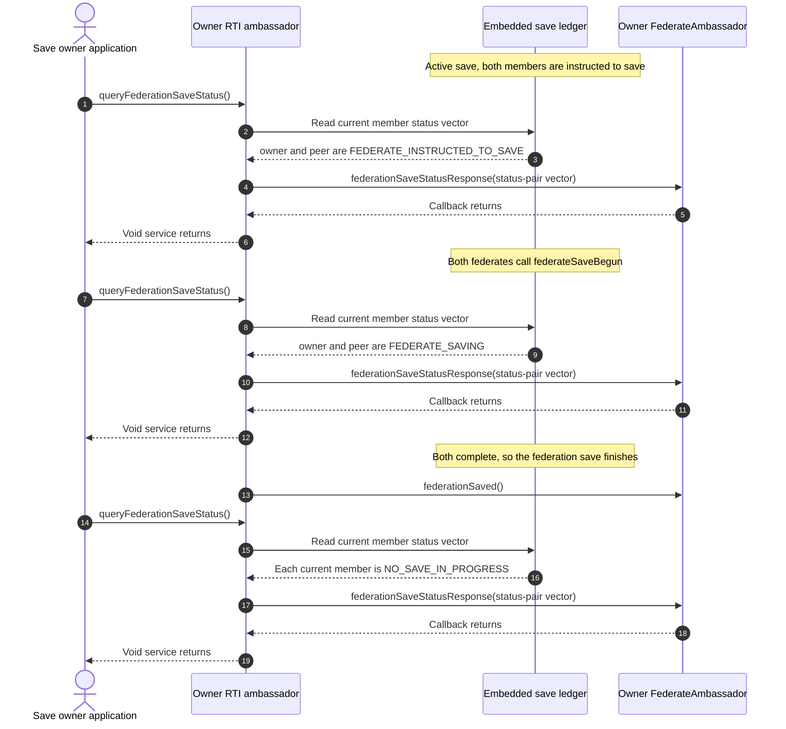

Restore uses a different status descriptor and includes the post-restore
handle. This embedded `HLA_IMMEDIATE` scenario queries while participants are
restoring, then again after `federationRestored`:

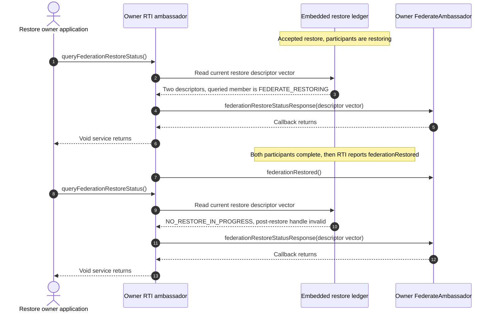

These are current-profile observations, not a complete normative status table.
The save case checks both members at `FEDERATE_INSTRUCTED_TO_SAVE`, then
`FEDERATE_SAVING`, then `NO_SAVE_IN_PROGRESS`. The restore case checks two
restoring members and the post-completion idle result. Each diagram is bounded
to its named embedded test and `HLA_IMMEDIATE`; the adapter also has a separate
process-endpoint protocol path, so the diagrams do not assert process/embedded
parity, HLA_EVOKED callback timing, or all status transitions.

### Configured process endpoint: private query result versus status callback

The public status query still returns `void`. In the process profile, the
correlated response contains a private control status (`applied` or a service
failure), not the snapshot data. The registry's read-only snapshot is routed
separately as a requester-only Save or Restore notification; the callback
bridge projects Save status pairs, or Restore descriptors with pre- and
post-restore handles, into the corresponding public status-response callback.
This does not advance the save/restore protocol or replace its separate
`federationSaved` / `federationRestored` outcome.

For pushed service delivery, the status event is sent before the correlated
query response. The client buffers it until the matching response arrives,
then unlocks and submits the callback before returning the private result to the
adapter. Consequently, `HLA_IMMEDIATE` may enter the callback before the query
service returns; `HLA_EVOKED` queues the callback task for a later evoke. With
polling delivery, the event remains in the recipient session queue for a later
`receive_interaction` request. Push/poll and callback-model selection are
separate controls, but the focused process status cases inspected here use
`HLA_IMMEDIATE` with pushed events. The transport ordering below is
source-derived, not an HLA callback-order rule.

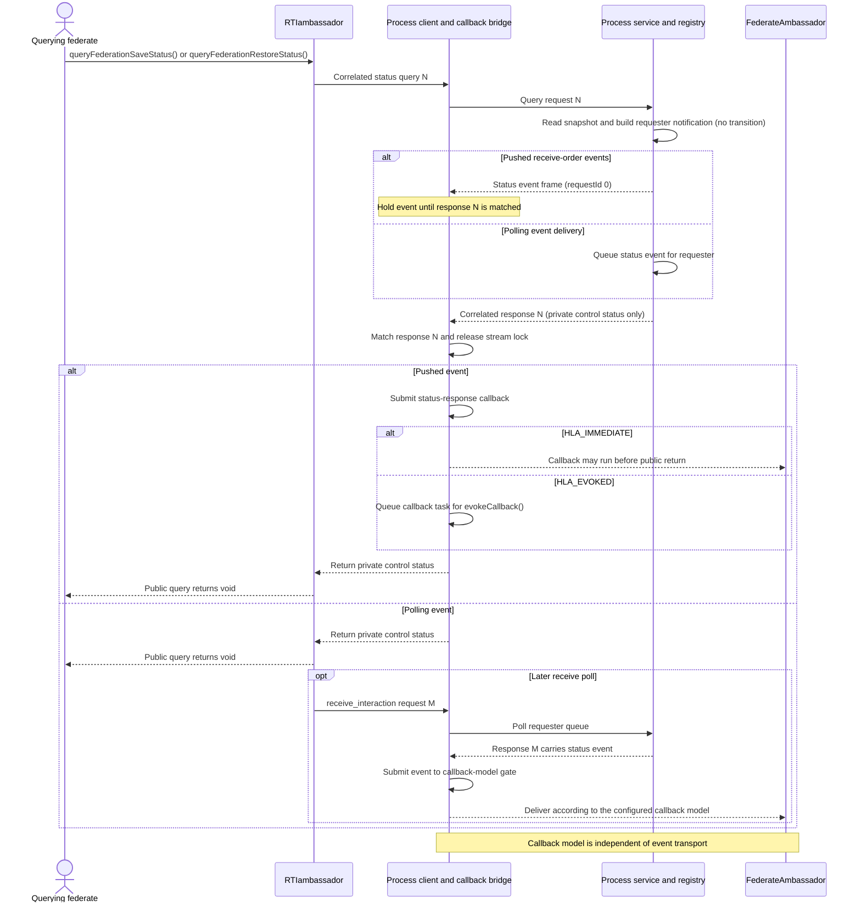

The process handlers for [Save status](../../cpp/src/internal/federation/process_federation_service_save_restore.cpp#L113)
and [Restore status](../../cpp/src/internal/federation/process_federation_service_save_restore.cpp#L348)
ask the registry for a snapshot ([Save](../../cpp/src/internal/federation/federation_registry_save_control.cpp#L958),
[Restore](../../cpp/src/internal/federation/federation_registry_restore_control.cpp#L1039)), then use the shared
[Save](../../cpp/src/internal/federation/process_federation_service_notifications.cpp#L326)
and [Restore](../../cpp/src/internal/federation/process_federation_service_notifications.cpp#L390)
event queues. The [public Save adapter](../../cpp/src/internal/runtime/umbra_rti_ambassador_federation_save_restore.cpp#L859)
and [Restore adapter](../../cpp/src/internal/runtime/umbra_rti_ambassador_federation_save_restore.cpp#L1511),
the [response matcher](../../cpp/src/internal/federation/process_federation_client.cpp#L504),
and the [Save](../../cpp/src/internal/federation/process_federation_callback_bridge.cpp#L925)
and [Restore](../../cpp/src/internal/federation/process_federation_callback_bridge.cpp#L1004)
callback projections show the private-result boundary. Focused tests cover terminal Save snapshots
after failure and active, waiting, and terminal Restore snapshots under
`HLA_IMMEDIATE`; they do not establish a process Save-status sequence while a
save is active, an HLA_EVOKED status-query case, or the full transport/callback
matrix.

## Save flow: request, participant work, and the commit barrier

The sequence below separates the application's checkpoint from the RTI's
durable commit. It omits the detailed time-grant algorithm; the optional gate
is the handoff to the time-management state machine.

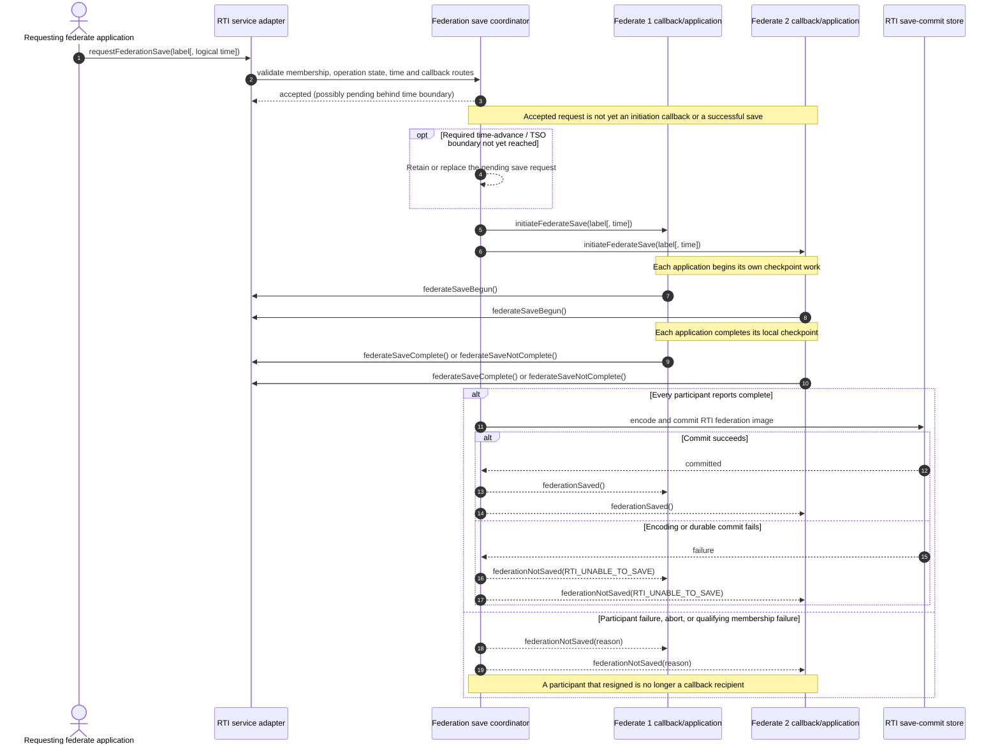

The current registry state machine is:

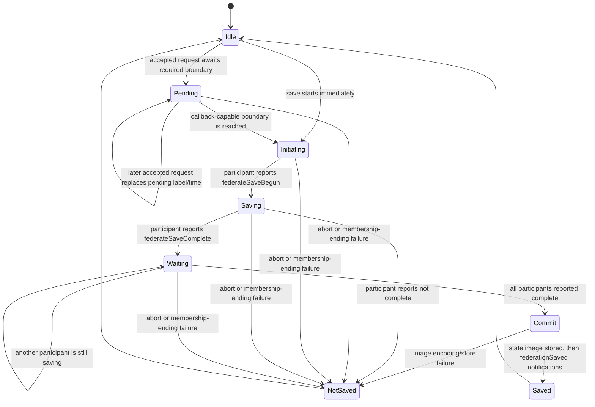

The state diagram is a teaching summary of current coordinator behavior, not a
replacement for the standard's participant-status rules. In particular:

- In the embedded profile, an untimed save is immediate only when no
  time-constrained member requires a callback-capable boundary. Otherwise the
  accepted request is retained until the constrained members can receive
  initiation at the right time-advance boundary.
- A timed request is validated against the federation's logical-time
  representation and constrained-member state. The current coordinator checks
  whether constrained members have reached the requested time and whether
  queued or in-transit TSO messages at or before that time still block save
  initiation. A later accepted request replaces the previous pending request.
- `federateSaveBegun` only changes that participant's coordinator status to
  saving. `federateSaveComplete` moves it to the waiting-for-federation barrier;
  it is the *last* participant's completion that makes the RTI encode and
  commit the image.
- The commit precedes `federationSaved`. If the store throws or the image
  cannot be materialized, the coordinator reports a failed federation save
  instead of claiming a restorable snapshot exists.
- The participant failure callback, RTI abort, and a participant leaving
  during save are different inputs to the failure path; use the reason value
  carried by the final callback rather than inferring a single generic cause.

At the configured process endpoint, callback delivery adds another boundary
without changing these federation-level Save stages. The untimed
[`HLA_EVOKED` process Save case](../../cpp/tests/ieee1516_2025_connection_federation_save_catch2.cpp#L457)
returns from `requestFederationSave` before `initiateFederateSave`, and from
`federateSaveComplete` before `federationSaved`; explicit `evokeCallback` calls
then deliver each callback. A separate pushed-event
[`HLA_IMMEDIATE` failure case](../../cpp/tests/ieee1516_2025_connection_process_federation_save_not_complete_status_terminal_immediate_catch2.cpp#L459)
checks initiation and `federationNotSaved` after their inducing calls. The
source drains each pushed event within its correlated request before the
process client returns, but the focused test does not throw from a callback or
assert exception-after-admission behavior. These are distinct tested
configurations, not a universal process ordering rule: the callback model and
the process service's push-versus-poll choice are separate controls. The
general frame path is documented in the [process endpoint
guide](HLA-2025-PROCESS-ENDPOINT-REQUEST-AND-CALLBACK-FLOW-GUIDE.md#2-from-a-stream-frame-to-an-official-callback).

#### Configured-process completion: participant success versus federation outcome

`federateSaveComplete()` reports that this participant finished its application
save; it does not promise that the federation image was committed. Only the
last participant reaches the coordinator's image-commit and notification path
([registry transition](../../cpp/src/internal/federation/federation_registry_save_control.cpp#L956)).
A successful commit queues `federationSaved`; an encoding or store failure
queues `federationNotSaved(RTI_UNABLE_TO_SAVE)`. On the successful event-send
path, the save-control response remains `applied` in either terminal outcome
because the participant's completion was accepted
([process handler](../../cpp/src/internal/federation/process_federation_service_save_restore.cpp#L208)).
This is an Umbra configured-process trace, not a new normative callback-order
rule.

The diagrams separate the federation's terminal outcome from when the
application observes its callback. The first follows a participant completion
through the federation barrier, last-member image commit, and successful event
send and correlated response; earlier participants can receive an applied
response while the federation still waits at the barrier. The second starts
after the process client has matched that response and buffered the terminal
event, then contrasts callback observation under `HLA_IMMEDIATE` and
`HLA_EVOKED`. On the successful pushed-event path, the service enqueues the
terminal notification before returning its correlated response
([notification path](../../cpp/src/internal/federation/process_federation_service_notifications.cpp#L417)).

##### Pushed notification failure after save-state resolution

One additional configured-process failure edge is source-visible but is not
covered by those success-path diagrams:

- The registry resolves the federation save before the service routes its
  terminal notifications ([registry transition](../../cpp/src/internal/federation/federation_registry_save_control.cpp#L956)). If notification encoding or a pushed send fails, the handler returns an internal-error response ([service error branch](../../cpp/src/internal/federation/process_federation_service_save_restore.cpp#L241)).
- Pushed terminal frames are sent one recipient at a time ([send loop](../../cpp/src/internal/federation/process_federation_service_notifications.cpp#L469)); a later failure can therefore occur after earlier frames were already sent. No rollback of the resolved save state or prior frames is visible.
- If the requesting member's terminal frame is already buffered, the client drains pushed events before the typed Save Complete method checks the response status ([client drain](../../cpp/src/internal/federation/process_federation_client.cpp#L614), [typed status check](../../cpp/src/internal/federation/process_federation_client_federation_management.cpp#L222)). A returning `HLA_IMMEDIATE` callback may run before the ambassador maps the service failure to `RTIinternalError` ([public error mapping](../../cpp/src/internal/runtime/umbra_rti_ambassador_federation_save_restore.cpp#L619)); under `HLA_EVOKED`, the task may remain queued for a later Evoke ([dispatcher submission](../../cpp/src/internal/callbacks/callback_dispatcher.cpp#L122), [evoked dispatch](../../cpp/src/internal/callbacks/callback_dispatcher.cpp#L156)).

This is a composition of source paths, not a tested public outcome: no reviewed
process test injects a partial notification-send failure. It does not establish
a standard callback rule or a result for a failed connection.

##### Federation outcome after participant completion

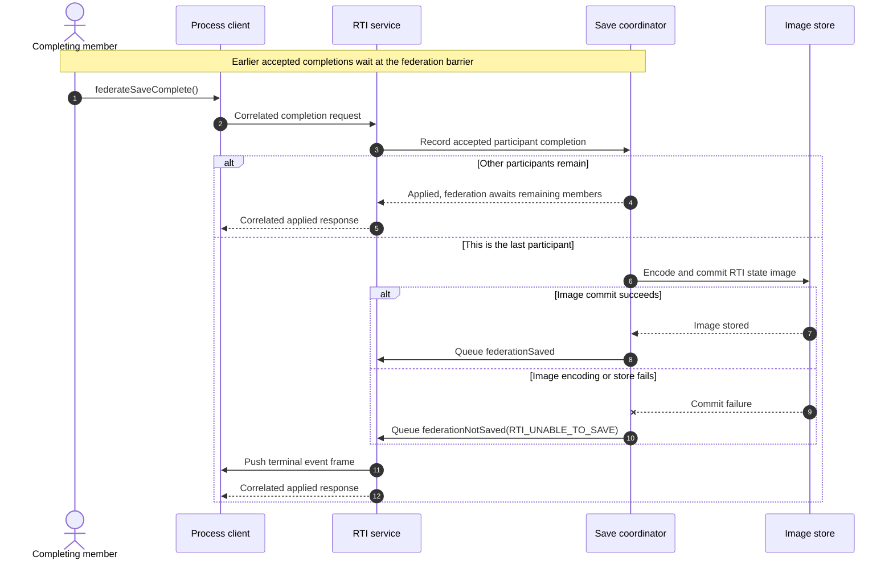

The applied response for the last participant means its completion was
accepted; it is not a claim that the federation image committed. The focused
process endpoint tests distinguish that response from terminal callbacks in
the tested paths, while the injected commit-failure test is registry-level,
not a process endpoint test.

##### Process callback observation and service-report boundary

The following sequence starts after the process client has matched the
correlated response and has the terminal event buffered. It contrasts inline
`HLA_IMMEDIATE` dispatch with deferred `HLA_EVOKED` observation; it does not
assert a general callback-order rule across endpoint profiles.

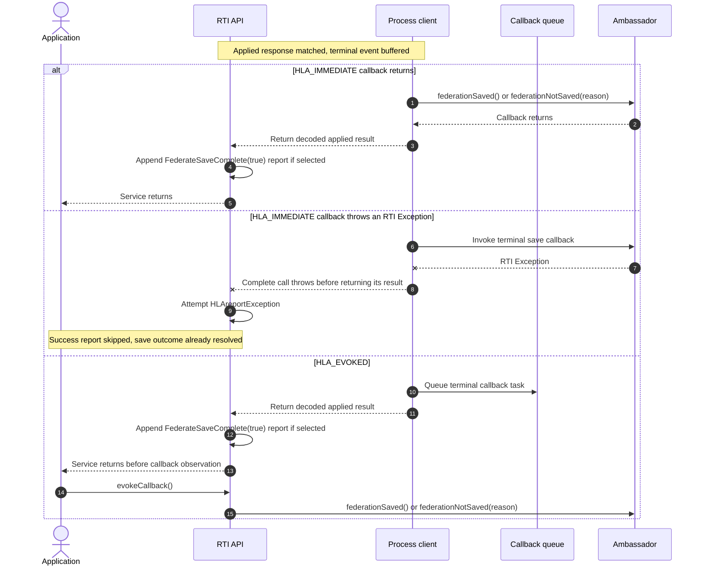

The process client matches the correlated response and drains pushed events
before its typed `federateSaveComplete` method returns
([response/drain](../../cpp/src/internal/federation/process_federation_client.cpp#L539),
[save callback bridge](../../cpp/src/internal/federation/process_federation_callback_bridge.cpp#L1853)).
Under `HLA_IMMEDIATE`, callback submission invokes the callback inline
([dispatcher](../../cpp/src/internal/callbacks/callback_dispatcher.cpp#L122)),
so the terminal callback precedes the wrapper's successful service-report
append. If an RTI `Exception` escapes from that callback, the public call can
throw after the coordinator has already committed the image or resolved the
failed-save outcome; the wrapper attempts `HLAreportException`, and its later
`FederateSaveComplete(true)` append is skipped
([public adapter](../../cpp/src/internal/runtime/umbra_rti_ambassador_federation_save_restore.cpp#L571),
[report append](../../cpp/src/internal/runtime/umbra_rti_ambassador_federation_save_restore.cpp#L606),
[exception handler](../../cpp/src/internal/runtime/umbra_rti_ambassador_federation_save_restore.cpp#L669)).
No compensating rollback is shown. Under `HLA_EVOKED`, the drain queues the
callback task, the service call can return and record the participant's
successful Complete choice, and the terminal callback is observed later
during Evoke. In Umbra's report representation, `true` describes the member's
Complete service choice, not success of the federation-wide image commit
([report fields](../../cpp/src/internal/runtime/umbra_rti_ambassador_federation_save_restore.cpp#L654)).

The one-member configured-process `HLA_EVOKED` Save case uses polling, not
pushed events ([server option](../../cpp/tests/ieee1516_2025_connection_federation_save_catch2.cpp#L498));
its completion assertions show `federationSaved` unobserved after
`federateSaveComplete()` and delivered by an explicit Evoke
([assertions](../../cpp/tests/ieee1516_2025_connection_federation_save_catch2.cpp#L581)).
A separate multi-member pushed-event `HLA_EVOKED` Save/Restore case enables
push mode ([service option](../../cpp/tests/ieee1516_2025_process_pushed_ownership_assumption_evoked_save_restore_catch2.cpp#L144)),
completes both members ([completion calls](../../cpp/tests/ieee1516_2025_process_pushed_ownership_assumption_evoked_save_restore_catch2.cpp#L435)),
and later observes the last member's `federationSaved` callback after explicit
Evoke ([callback assertion](../../cpp/tests/ieee1516_2025_process_pushed_ownership_assumption_evoked_save_restore_catch2.cpp#L482)).
That case does not assert the terminal callback count immediately after each
Complete call, so it is not a direct timing assertion for that boundary.
The separate [internal commit-failure case](../../cpp/tests/ieee1516_2025_federation_registry_save_commit_failure_catch2.cpp#L4)
confirms that a failed store produces an unsuccessful terminal notification
with `RTI_UNABLE_TO_SAVE`; it is not a process-endpoint test. No focused public
process case throws from `federationSaved`/`federationNotSaved`, injects a
process-endpoint commit failure, or asserts service-report order. Those
branches below the diagram are source-derived and remain untested as public
process outcomes.

Read the immediate-callback exception branch narrowly. The process client
drains pushed events before returning from `federateSaveComplete`, and the
callback dispatcher rethrows an exception from an inline callback
([client drain](../../cpp/src/internal/federation/process_federation_client.cpp#L614),
[dispatcher](../../cpp/src/internal/callbacks/callback_dispatcher.cpp#L271)).
The adapter translates its recognized protocol, callback-bridge, and client
errors to `RTIinternalError` ([translation](../../cpp/src/internal/runtime/umbra_rti_ambassador_federation_save_restore.cpp#L615)),
then its outer HLA-`Exception` handler attempts `HLAreportException`
([handler](../../cpp/src/internal/runtime/umbra_rti_ambassador_federation_save_restore.cpp#L669));
an RTI exception thrown by the application callback also reaches that outer
handler. An unrelated non-RTI C++ exception is not matched by that handler, so
no `HLAreportException` attempt is shown for it. Either kind of escaping
callback exception occurs before the successful
`FederateSaveComplete(true)` service-report append. These are source-derived
wrapper paths: no focused process case injects these exception types or checks
the resulting reports.

#### A throwing initiation callback does not undo immediate process admission

This is a source-derived exception trace for an **untimed request that starts
immediately because no federation member is time constrained**, with pushed
events and the requesting member using `HLA_IMMEDIATE`. If any member is time
constrained, the registry retains the request as pending and this request path
does not yet create an active save operation or send `initiateFederateSave`;
the time-boundary behavior above applies instead. The trace also assumes the
server successfully sends the initiation frame and the correlated applied
response.

For the immediate-start path, the registry first creates the active save
operation and marks its members `FEDERATE_INSTRUCTED_TO_SAVE`, then returns
initiation notifications for the routes. The process service sends those event
frames before its correlated response. After matching that response and
releasing the stream lock, the client drains the pushed event before returning
the decoded result to the public adapter. If the requesting member's
`initiateFederateSave` callback throws `FederateInternalError` under
`HLA_IMMEDIATE`, the public `requestFederationSave` call can therefore throw
locally after the save has entered its instructed-to-save state. The wrapper's
successful service-report append is after the process-client call, so it is
skipped; its outer exception handler attempts `HLAreportException` and
rethrows. This path shows no rollback or failed-service-invocation report. The
server-side save operation remains active, and the throwing member has not
called `federateSaveBegun`; other participants may already have progressed.

With `HLA_EVOKED`, the request drain queues the initiation task instead. The
request can return and append its success service report; the callback is
observed only when the application later evokes it. This is not evidence about
what the Evoke service does if that callback throws. The comparison with the
[configured-process synchronization-point exception trace](HLA-2025-CALLBACK-AND-SERVICE-ORDERING-FLOW-GUIDE.md#mutating-process-wrapper-final-synchronization-point-achieved)
is useful: both show a local callback exception after a successful correlated
response, while their committed server state and service-specific reporting
remain distinct.

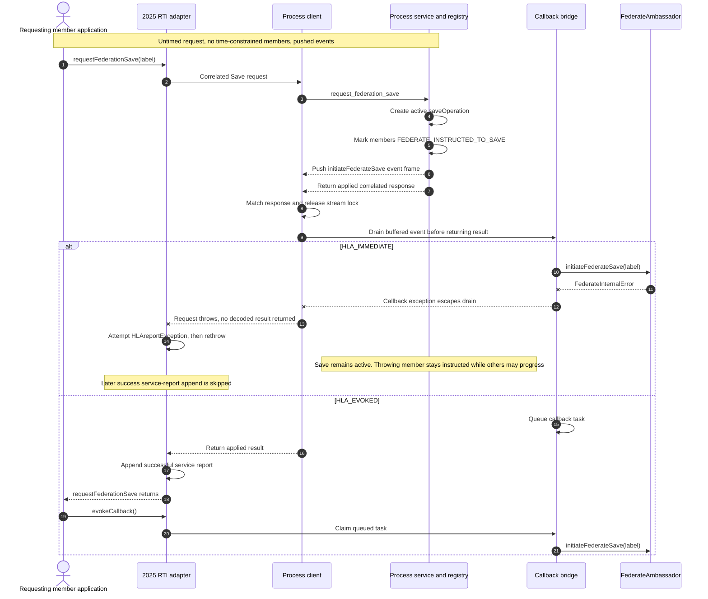

The [registry marks participants instructed](../../cpp/src/internal/federation/federation_registry_save_control.cpp#L64)
and [sets the active operation](../../cpp/src/internal/federation/federation_registry_save_control.cpp#L66)
before producing notifications; its [untimed constrained-member check](../../cpp/src/internal/federation/federation_registry_save_control.cpp#L163)
shows the pending alternative. The process handler's [registry call](../../cpp/src/internal/federation/process_federation_service_save_restore.cpp#L184),
[notification enqueue](../../cpp/src/internal/federation/process_federation_service_save_restore.cpp#L196),
and [applied response](../../cpp/src/internal/federation/process_federation_service_save_restore.cpp#L201)
show the server ordering, followed by the [pushed event send](../../cpp/src/internal/federation/process_federation_service_notifications.cpp#L471).
The [typed process-client request](../../cpp/src/internal/federation/process_federation_client_federation_management.cpp#L179)
uses a [response match and unlock](../../cpp/src/internal/federation/process_federation_client.cpp#L610)
before the [callback drain](../../cpp/src/internal/federation/process_federation_client.cpp#L614);
the [bridge invokes the application callback](../../cpp/src/internal/federation/process_federation_callback_bridge.cpp#L911).
The public adapter's [success-report append](../../cpp/src/internal/runtime/umbra_rti_ambassador_federation_save_restore.cpp#L170)
comes after the process-client result, while its [outer exception handler](../../cpp/src/internal/runtime/umbra_rti_ambassador_federation_save_restore.cpp#L241)
attempts `HLAreportException` and rethrows. The pinned callback signature lists
[`FederateInternalError`](../../third_party/ieee1516.1-2025/include/RTI/FederateAmbassador.h#L100).
The focused [process `HLA_IMMEDIATE` case](../../cpp/tests/ieee1516_2025_connection_process_federation_save_not_complete_status_terminal_immediate_catch2.cpp#L459)
uses a non-throwing callback; the [process `HLA_EVOKED` case](../../cpp/tests/ieee1516_2025_connection_federation_save_catch2.cpp#L457)
checks that initiation remains unobserved until explicit Evoke. Neither tests
a throwing initiation callback or proves the active-state consequence. For
the separate terminal-notification encode/push failure after the registry
transition, see [pushed notification failure after save-state
resolution](#pushed-notification-failure-after-save-state-resolution).

## Restore flow: admission is not completion

The restore request first selects and validates a saved image. Only an accepted
request starts the participant protocol. Each participant restores local
application state in its own callback path, then reports completion to the
RTI.

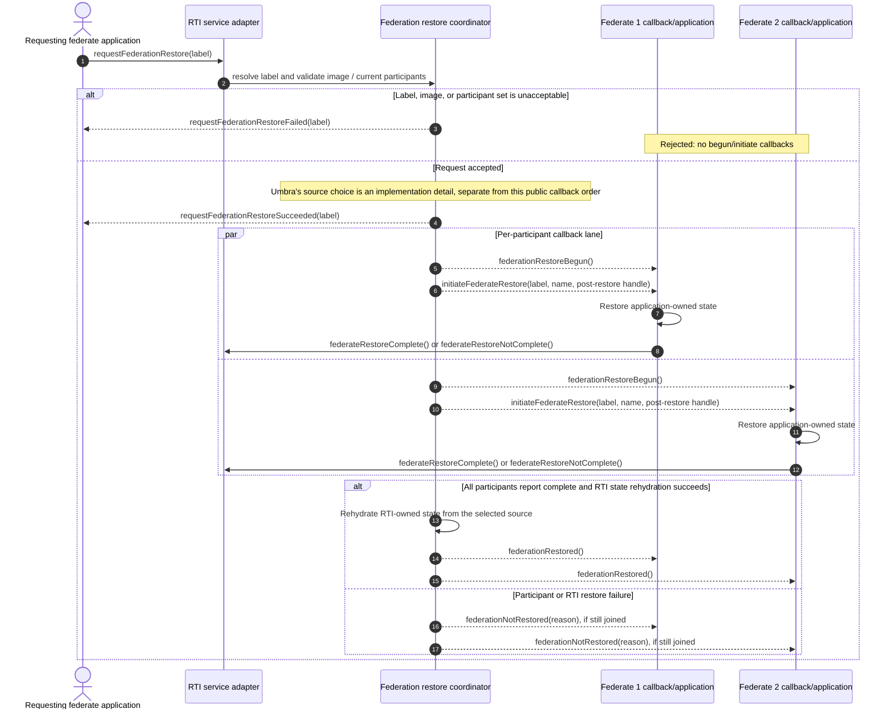

The two participant lanes show the per-federate callback progression. They do
not claim a global wall-clock interleaving between different callback queues.
In the current embedded registry, an accepted request queues the requester's
success notification and then a begun/initiate notification pair for each
joined member. The process-endpoint tests exercise the callback sequence under
`HLA_IMMEDIATE`; callback-model and dispatch behavior beyond those scenarios
must be checked separately. For the distinct implementation question of which
RTI state source is applied after that protocol, see the
[restore-source selection inset](#2025-umbra-restore-source-selection) below.

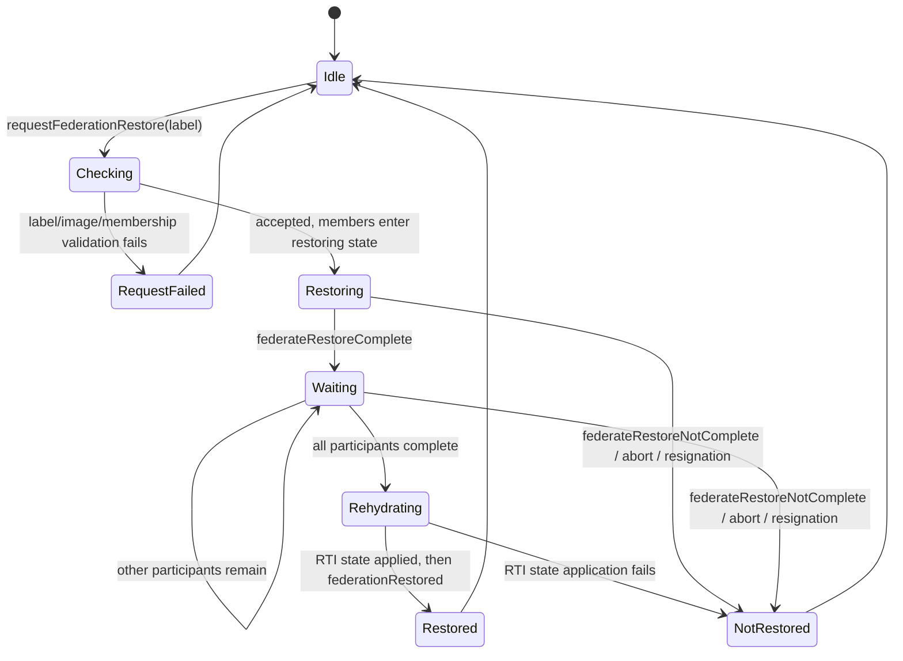

### Process endpoint: callback frames and the public restore call boundary

The preceding diagram is the federation protocol view. The configured process
endpoint adds a transport boundary around the standard Restore callbacks. Keep
two questions separate: whether the service pushes event frames or retains
notifications for polling, and whether the application uses `HLA_IMMEDIATE`
or `HLA_EVOKED`. The public cases below exercise selected combinations, not an
exhaustive transport-by-callback-model matrix. The [process endpoint guide](HLA-2025-PROCESS-ENDPOINT-REQUEST-AND-CALLBACK-FLOW-GUIDE.md#2-from-a-stream-frame-to-an-official-callback)
covers the generic transport boundary.

#### Pushed-event service mode with `HLA_IMMEDIATE`

In the pushed-event service mode used by this trace, the service sends
restore-notification frames before returning its correlated control response.
The client buffers pushed frames while awaiting the matching response, then
drains them; with `HLA_IMMEDIATE`, callback-bridge submission enters the
federate ambassador inline.

This trace is bounded to the one-member, pushed-event `HLA_IMMEDIATE` public
process-endpoint tests. Their server runs in a worker thread over loopback TCP;
“process endpoint” here does not mean an RTI process crash/restart test.

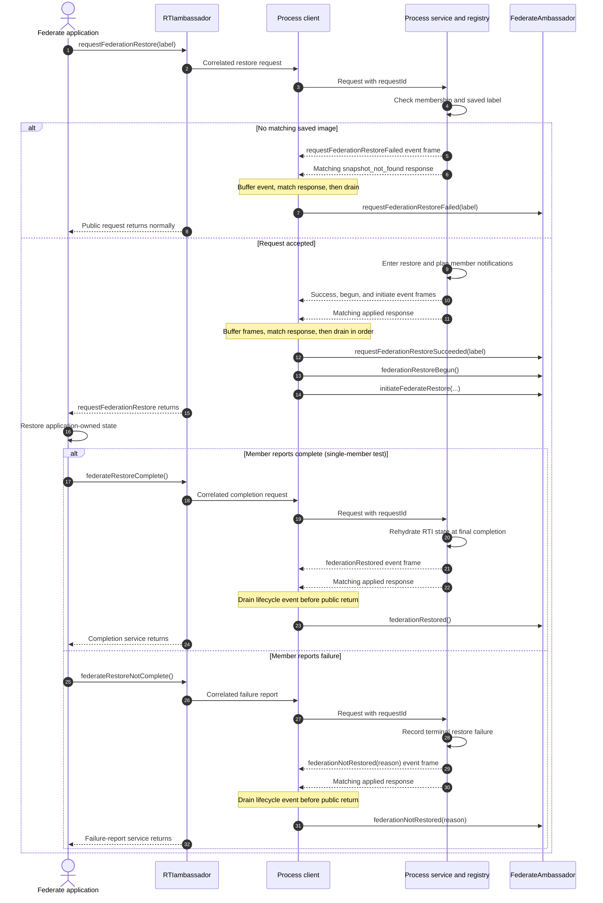

The early rejection is a normal void-service return accompanied by
`requestFederationRestoreFailed`; it does not enter the begun state. For an
accepted request, the correlated `applied` response is not the federation
outcome: the image is rehydrated only when the participant-completion barrier
is satisfied, and `federationRestored` or `federationNotRestored` reports that
later result. This one-member pushed-event trace does not establish callback
timing for polling mode, other transports, the embedded profile, or IEEE
1516.1-2010. Its immediate callback timing is not a claim about multi-member
restores; separate multi-member process evidence is listed below.

#### Polling service mode with `HLA_EVOKED`

The configured process endpoint also has direct public Restore tests using
`HLA_EVOKED` with `ProcessFederationServiceOptions{false}`. Here the service
keeps Restore notifications in the session queue. The public Restore service
returns before the federate ambassador observes them; a later
`evokeCallback(0.0)` polls the receive path and delivers the next callback.
In the one-member success case, explicit Evoke calls observe
`requestFederationRestoreSucceeded`, `federationRestoreBegun`, and
`initiateFederateRestore` in that order; `federateRestoreComplete` also returns
before a later Evoke delivers `federationRestored`.

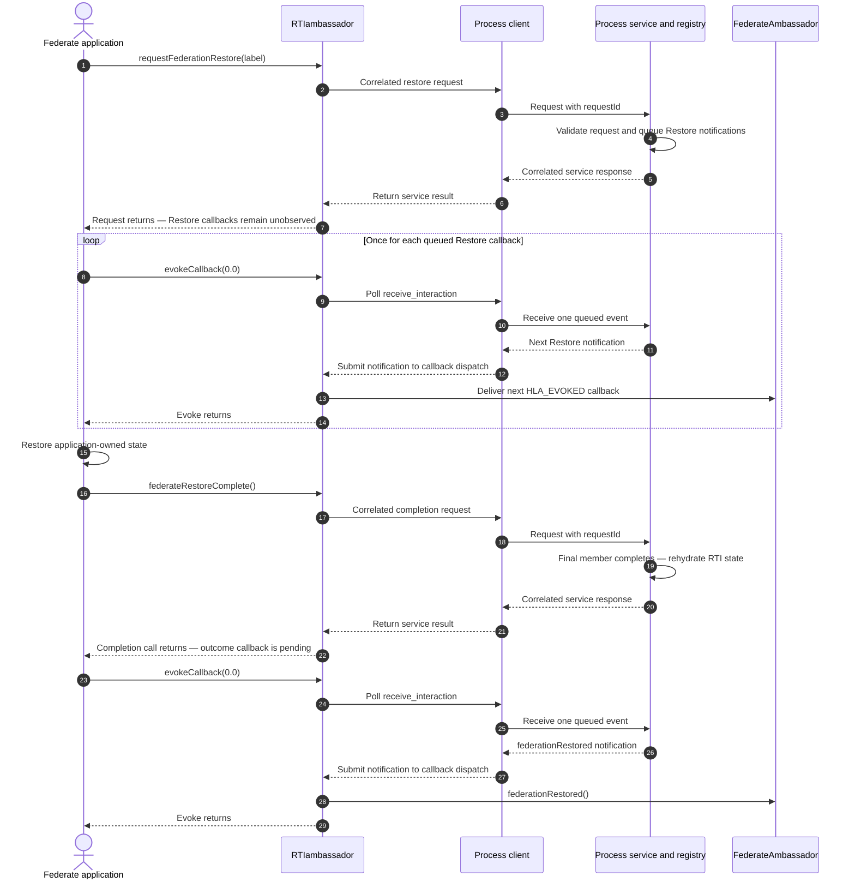

The polling trace is a separate one-member 2025 process case, also served by a
worker thread over loopback TCP; it is not an operating-system process restart.
The paired early-rejection case likewise returns from
`requestFederationRestore` with its failure callback still unobserved, then
delivers `requestFederationRestoreFailed` on explicit Evoke. A separate
two-member case queries each member's restore status and observes lifecycle
callbacks through Evoke; that is distinct evidence, not a widening of the
one-member sequence above. Finally, a different process test sets pushed-event
service mode and `HLA_EVOKED`: selected pushed frames enter the evoked callback
queue but remain uninvoked through service-level Save/Restore. This shows that
pushed frame receipt alone does not imply inline user callback execution; it
does not establish every transport/callback-model combination or general
callback ordering. None of these process tests establishes embedded parity or
2010 behavior.

#### Process adapter to saved Region state: source-derived path, not a process Region test

This map follows the configured 2025 process client/service into the shared
registry state-image machinery. It is an Umbra architecture trace, not an HLA
requirement and not evidence that a public process-endpoint call restores a
Region. The inspected process Save/Restore cases exercise lifecycle, status,
and callback transport but do not create or query Regions. A separate
file-backed registry test restores a Region into a second
`EmbeddedFederationRegistry` in the same test process; it does not traverse the
process client/service or restart the operating-system process.

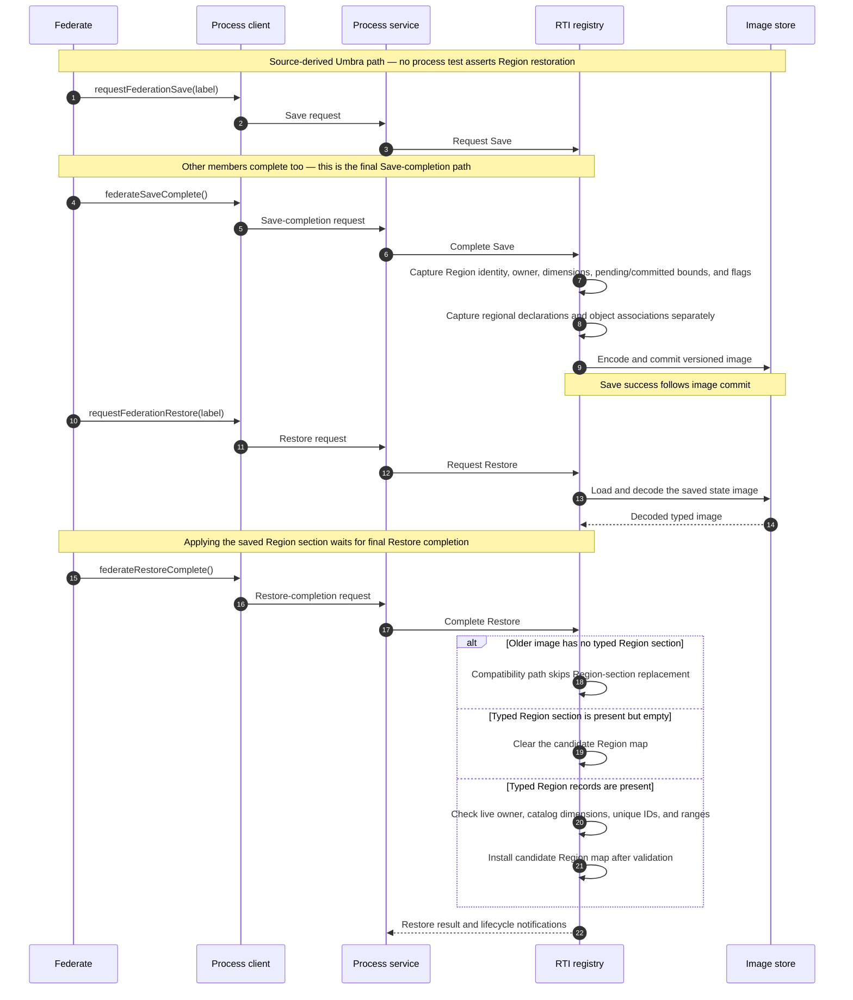

The process [Save client path](../../cpp/src/internal/federation/process_federation_client_federation_management.cpp#L164)
and [Restore client path](../../cpp/src/internal/federation/process_federation_client_federation_management.cpp#L268)
send control requests to the [Save handler](../../cpp/src/internal/federation/process_federation_service_save_restore.cpp#L10)
and [Restore handler](../../cpp/src/internal/federation/process_federation_service_save_restore.cpp#L183),
which delegate to the registry. The [save commit](../../cpp/src/internal/federation/federation_registry_save_control.cpp#L852)
encodes the captured image before exposing Save success; the [capture](../../cpp/src/internal/federation/federation_registry_state_image_capture.cpp#L311)
records each Region, and the [versioned codec](../../cpp/src/internal/federation/federation_state_image.cpp#L1921)
stores a typed Region section. On restore, the [decoder](../../cpp/src/internal/federation/federation_state_image_decode.cpp#L1918)
distinguishes a missing legacy section from a present empty one, and the
[registry restore helper](../../cpp/src/internal/federation/federation_registry_state_image_restore.cpp#L313),
called at the [final Restore-completion boundary](../../cpp/src/internal/federation/federation_registry_restore_control.cpp#L520),
rebuilds Regions against the restored catalog and member set. Regional
subscriptions, object update-region associations, and queued-message region
snapshots are separate image state; this map follows Region objects only.

The configured-process [Save](../../cpp/tests/ieee1516_2025_connection_federation_save_catch2.cpp#L457)
and [successful Restore lifecycle](../../cpp/tests/ieee1516_2025_connection_synchronization_restore_catch2.cpp#L772)
cases cited above cover process callbacks/status, not Region persistence. A
separate [Restore-status case](../../cpp/tests/ieee1516_2025_connection_process_federation_restore_status_immediate_catch2.cpp#L459)
also has no Region setup or query. The
direct [file-backed Region test](../../cpp/tests/ieee1516_2025_federation_registry_federation_owned_regions_filesystem_restart_catch2.cpp#L3)
checks handle, dimensions, and committed bounds across registry instances,
but its “restart” is construction of a second registry object in one test
process. Until a focused configured-process test creates, saves, mutates or
deletes, restores, and queries a Region, keep process-endpoint Region behavior
source-derived and unverified by that public boundary. Neither test family
establishes IEEE 1516.1-2010 behavior.

### Early rejection versus begun failure

| Observation | Request rejected before restore begins | Restore begins, then fails |
| --- | --- | --- |
| Typical current-profile trigger | Missing/corrupt/mismatched saved image or saved/current participant mismatch | A participant reports not complete, the request owner aborts, a participant resigns, or RTI rehydration fails |
| Request callback | `requestFederationRestoreFailed(label)` to the requester | Requester's earlier `requestFederationRestoreSucceeded(label)` remains true as a statement that the request was accepted |
| Federation callbacks | No `federationRestoreBegun`, `initiateFederateRestore`, or final `federationNotRestored` for this rejected request | Participants already entered the restore protocol; `federationNotRestored(reason)` communicates the terminal outcome |
| Current source evidence | Request validation emits a `request_failed` notification and returns before creating the restore operation | Completion/failure helper fans the failure reason out to the still-joined restore participants |

Do not tell an application that a successful restore-request callback means the
restore itself succeeded. It means only that the request was admitted; the
terminal federation callback is later.

A member departure during this protocol is a separate lifecycle edge. See the
[2025 lifecycle guide's connection-loss Save/Restore audit](HLA-2025-FEDERATION-AND-FEDERATE-LIFECYCLE-FLOW-GUIDE.md#active-save-and-restore-during-connection-loss)
for the current embedded/process notification-projection boundary; do not
read its source-derived connection-loss behavior as a portable transport-loss
rule.

### Read the worked cases as HLA questions, not one protocol

The following are independent 2025 embedded case studies, not stages of one
combined save/restore sequence. Read each by tracking which boundary it makes
visible; use the standard, not these traces, to answer the normative service
questions.

| HLA question | What these selected embedded cases show |
| --- | --- |
| What timestamped work is still pending at the selected save point? | [Timed save with later directed TSO work](#worked-case-a-timed-save-retains-later-directed-tso-work): work at time 8 remains pending across a save at time 6, then is observed after restore. This is not a universal cutoff rule. |
| Does a committed Region return if it was deleted after Save? | The [committed Region case](#worked-case-a-committed-region-returns-from-the-saved-image) restores the same handle, dimension set, and committed bounds in one embedded `HLA_IMMEDIATE` development-profile scenario. It does not establish process-endpoint, host-restart, pending-edit, or 2010 behavior. |
| Does federation-save completion mean every receiver observed queued work? | [Saved regional TSO interaction](#worked-case-a-saved-regional-tso-interaction-becomes-live-again): the receiver has not observed the interaction at save completion; in this trace it receives it after restore. |
| Can selected deferred ownership work be resumed? | The [ownership-persistence companion](HLA-2025-OWNERSHIP-PERSISTENCE-AND-RESIGNATION-FLOW-GUIDE.md) traces a pending release callback and a surviving Confirm Divestiture notification reconstructed for live recipients after fresh-registry restore. This is bounded embedded implementation evidence, not a general HLA persistence rule or process/restart guarantee. |
| Which saved retraction state and designator return with restored work? | The [regional interaction](#worked-case-a-saved-regional-tso-interaction-becomes-live-again) and [restored deletion](#worked-case-retracting-a-restored-deletion-after-one-recipient-receives-it) cases exercise the original designator after restore; they do not establish arbitrary image migration or restart portability. |
| Have all recipients observed the same portion of an operation? | In the [restored deletion retraction](#worked-case-retracting-a-restored-deletion-after-one-recipient-receives-it) case, A observes removal and then Request Retraction; B's pending removal is suppressed, and B gets neither callback. Both resolve the object afterward. This is not a general normative rule. |

The ownership row concerns work reconstructed from restore state. A separate
process HLA_EVOKED case follows discovery and ownership-assumption callbacks
already pushed to the live ambassador queue before Save; they remain
uninvoked through service-level Save/Restore and are observed later. See the
[ownership-persistence companion's callback-boundary comparison](HLA-2025-OWNERSHIP-PERSISTENCE-AND-RESIGNATION-FLOW-GUIDE.md#4-a-pushed-callback-queue-differs-from-restored-ownership-work).
These are different tests, not a general callback-order rule.

This question set is a reading aid, not an additional state machine. It extracts
the durable distinctions surfaced by the examples—checkpoint contents,
pending versus observed effects, restored control state, and recipient-specific
observation—without treating Umbra's queue or callback mechanics as HLA rules.

### Worked case: a committed Region returns from the saved image

This selected 2025 embedded `HLA_IMMEDIATE` case creates and commits an
unassociated Region, completes a one-member federation save, deletes the live
Region, then restores and queries the original handle. It is a bounded Umbra
case study, not a portable HLA persistence rule or proof of process/restart
behavior.
It isolates Region persistence; the [Save](#save-flow-request-participant-work-and-the-commit-barrier)
and [Restore](#restore-flow-admission-is-not-completion) sequences show the
broader callback protocol.

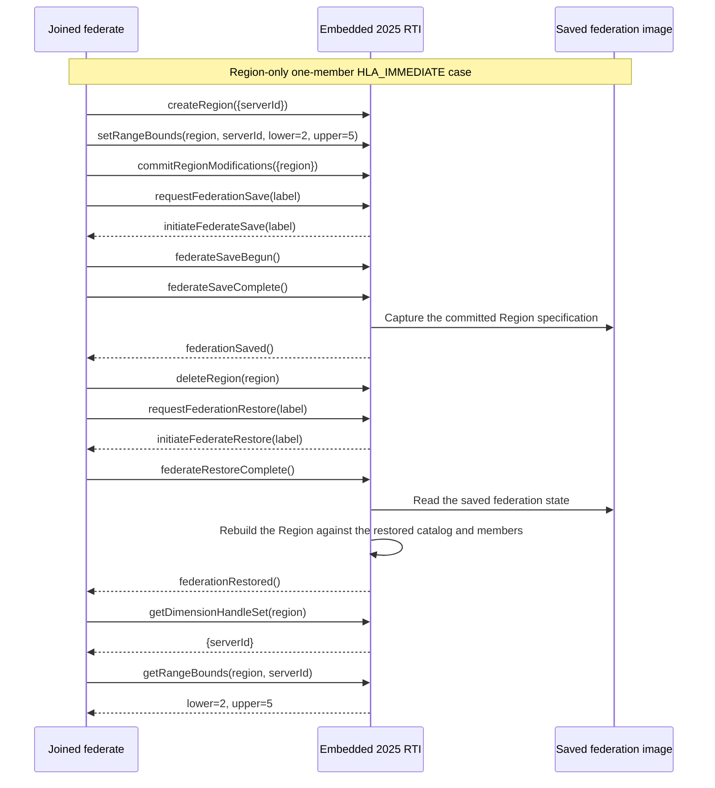

The [public API integration case](../../cpp/tests/ieee1516_2025_federation_management_save_restore_catch2.cpp#L421)
asserts that the original `RegionHandle` is usable after restore and that its
dimension set and committed lower/upper bounds `(2,5)` return after the live
Region was deleted. The same image also contains a separate announced-but-unachieved
synchronization point; its restore meaning is covered in the
[synchronization guide](HLA-2025-FEDERATION-SYNCHRONIZATION-FLOW-GUIDE.md#saverestore-preserves-an-in-flight-barrier),
not merged into the Region state machine here.

The embedded image [captures the Region handle, owner, dimensions, pending and
committed bounds, and state flags](../../cpp/src/internal/federation/federation_registry_state_image_capture.cpp#L308).
The [restore path](../../cpp/src/internal/federation/federation_registry_state_image_restore.cpp#L313)
requires the saved owner to remain joined and validates the saved dimensions
and bounds against the restored catalog. Those source details are broader than
the test: this case checks committed bounds, not pending edits, associations,
subscriptions, multiple owners, or invalid-image branches.

A live Region specification is also distinct from the source-region snapshot
carried by an outstanding timestamped interaction. The following
[regional-TSO case](#worked-case-a-saved-regional-tso-interaction-becomes-live-again)
traces that queued-message metadata and retraction state; it does not replace
this Region-object lifecycle example. Neither case establishes 2010 or
process-endpoint parity.

### Worked case: a saved regional TSO interaction becomes live again

This development-profile case connects three mechanisms that are easy to read
in isolation: an untimed save waits for a time-constrained member's advance
boundary, the RTI image captures a still-live regional TSO interaction, and
restore reestablishes the saved retraction state. The case uses two
`HLA_EVOKED` members. The publisher's region `[0,10]` overlaps the receiver's
`[5,15]`; it sends an explicit-source interaction at time 7. The receiver has
not received it when the save is taken.

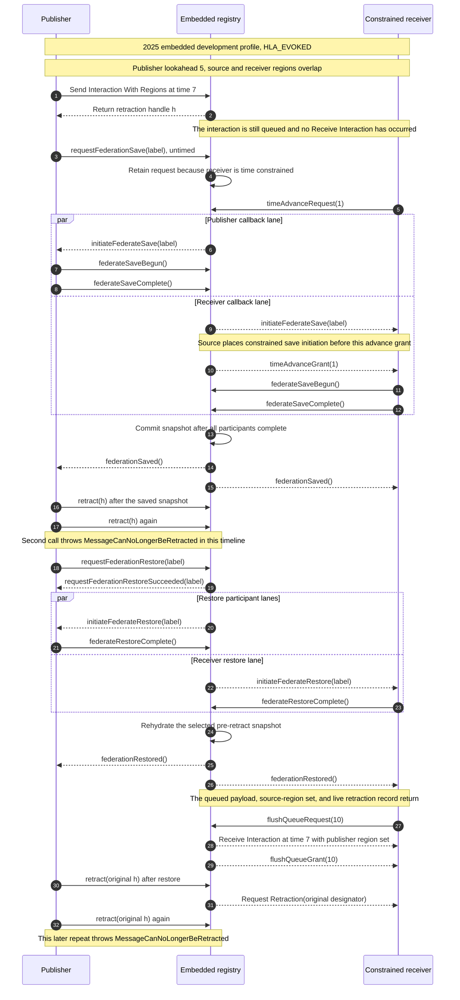

The key is snapshot timing: the successful first `Retract` above happens after
`federationSaved`, so it terminalizes the current execution, not the already
committed image. Restoring that earlier image makes the original designator
live again. The save/restore protocol callbacks are observed while the test
drains each `HLA_EVOKED` member with `evokeCallback()`. The later delivery is a
different implementation boundary: in this embedded path,
`flushQueueRequest(10)` flushes eligible receive callbacks and submits the
grant dispatch before returning; the test's following `evokeCallback(0.0)`
returns false. It observes the timestamp-7 interaction before
`flushQueueGrant(10)`. This is evidence for the selected implementation path,
not a general callback-model or normative portability claim. The callback
retains the publisher's source-region handle set because the receiver enabled
`Convey Region Designator Sets`.

The [embedded save-control source](../../cpp/src/internal/federation/federation_registry_save_control.cpp#L117)
retains an untimed request when a constrained member needs an advance boundary.
The [restore helper](../../cpp/src/internal/federation/federation_registry_restore_tso_payloads.cpp#L45)
reconstructs the saved interaction payload (timestamp, parameters, tag, and
region snapshots) and the separate Request Retraction record before replacing
the live maps. The test verifies this selected sequence, but it does not assert
an ordering vector for `initiateFederateSave` versus the grant; the source
comment supplies that boundary detail. This is not a general portability claim
or a normative standard interpretation: it covers this embedded
development-profile case, not process-endpoint restore, durable restart, or
the separate 2010 stream.

### Worked case: an update-region association and queued TSO survive fresh-registry restore

This separate 2025 public integration case follows two pieces of state across
the image boundary: a publisher's object-attribute update-region association,
and an already accepted timestamped update whose recipient-specific queue
entries are still pending. It is an Umbra implementation trace, not a general
claim that HLA requires queued DDM work to be re-evaluated in this way.

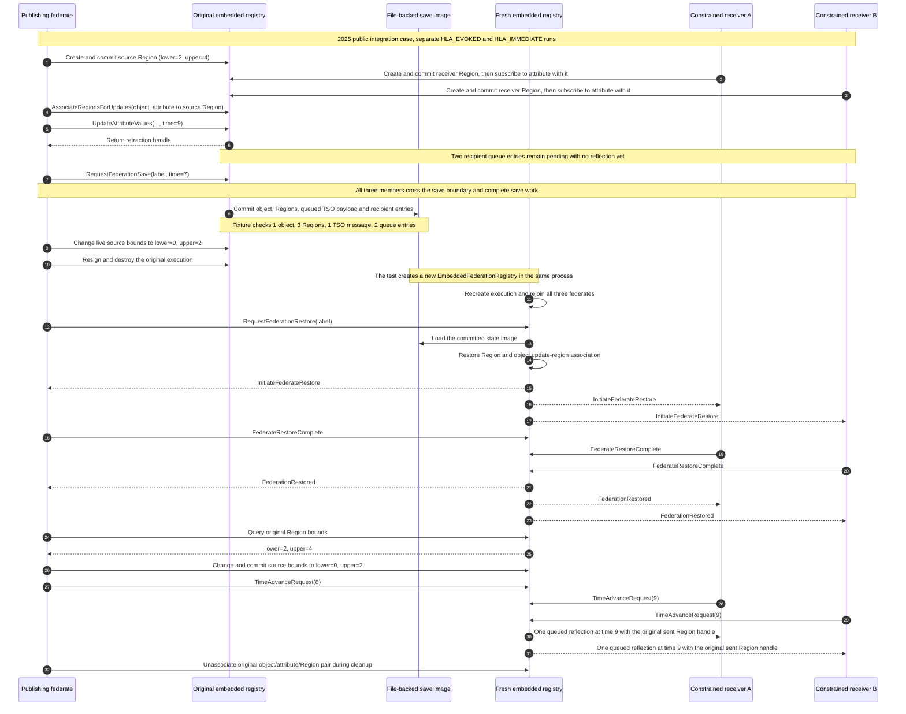

The [focused public test](../../cpp/tests/ieee1516_2025_public_regional_attribute_update_tso_restore_catch2.cpp#L6)
uses a file-backed save store and a new `EmbeddedFederationRegistry` instance.
It decodes an image with one object, three Regions, one timestamped attribute
update, two queue entries, and one source-region snapshot. After restoring,
the test queries the original source handle at `(2,4)`, changes its live bounds
to `(0,2)`, then observes one reflection at time 9 at each receiver; each
callback carries the original source Region handle. Teardown also unassociates
the original object/attribute/Region pair. The test does not directly assert
the serialized `updateRegionHandles` field or send a new update through the
restored association.

The source [captures per-attribute update-region handles](../../cpp/src/internal/federation/federation_registry_state_image_capture.cpp#L943)
and [reconstructs that association](../../cpp/src/internal/federation/federation_registry_restore_ownership_ledgers.cpp#L329);
the TSO restore path [rehydrates source-region snapshots](../../cpp/src/internal/federation/federation_registry_restore_tso_payloads.cpp#L474).
This test's “fresh registry” is not a new OS process or a configured process
endpoint. The separate [process-endpoint restore-status case](../../cpp/tests/ieee1516_2025_connection_process_federation_restore_status_immediate_catch2.cpp#L459)
checks restore callbacks and status through `ProcessFederationService`, but
does not set up or assert Region state. The inspected connection restore cases
therefore do not establish process-endpoint Region/association persistence or
host-restart behavior. Keep that profile boundary and the separate 2010 stream
explicit; ordinary process-endpoint DDM tests are not restore evidence.

### Worked case: a timed save retains later directed TSO work

This case shows the other side of the save-time boundary. A publisher sends a
timestamped directed interaction at time 8, then requests a timed save at time
6 while both members advance to 6. The save can commit with that later message
still pending; the receiver has not received it at the save boundary.

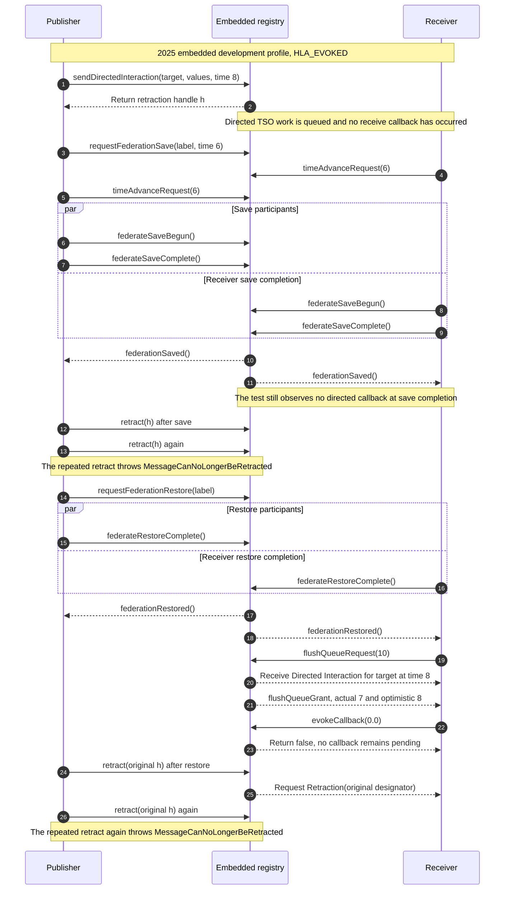

The distinction from the regional interaction example above is the logical
save cut: the registry's timed-save gate waits on queued or in-transit TSO
messages at or before the requested save time. Here the interaction at 8 is
later than the save at 6, and the focused test observes it still pending when
the save completes. After restoring the pre-retraction image, a flush request
for 10 delivers the interaction at time 8 before the grant, and the test's
subsequent `evokeCallback(0.0)` returns false. In this embedded path,
`FlushQueueRequest` calls the eligible receive-callback flush before submitting
the grant dispatch; the flush invokes its selected callback closures
synchronously. See the [service boundary](../../cpp/src/internal/runtime/umbra_rti_ambassador_time_advance_services.cpp#L773),
[receive flush](../../cpp/src/internal/runtime/umbra_rti_ambassador_asynchronous_delivery.cpp#L32),
and [grant dispatch loop](../../cpp/src/internal/runtime/umbra_rti_ambassador_time_advance_dispatch.cpp#L35).
This is implementation/test evidence, not a general normative callback-model
claim. The test separately asserts grant actual time 7 and optimistic time 8;
those fields are not collapsed into the request value. The
[time-management guide](HLA-2025-TIME-MANAGEMENT-GUIDE.md) explains the
callback-time FQR frontier in its own context.

This is one embedded `HLA_EVOKED` development-profile case, not a claim about
process endpoints, durable restart, standard portability, or the 2010 stream.


### Worked case: queued timestamped object deletion returns after fresh-registry restore

These public-API development-profile cases exercise `HLA_EVOKED` and
`HLA_IMMEDIATE`. The owner schedules object deletion at time 9 and requests a
timed save at 7. The image retains the still-live object together with its
pending deletion marker, message, recipient queue entries, and the object data
needed if the deletion is later retracted. The test tears down the source
registry, creates a fresh `EmbeddedFederationRegistry` over the same save
store, recreates the federation, and restores it. This is a fresh-registry
durable-image test inside one test process, not an operating-system process
restart.

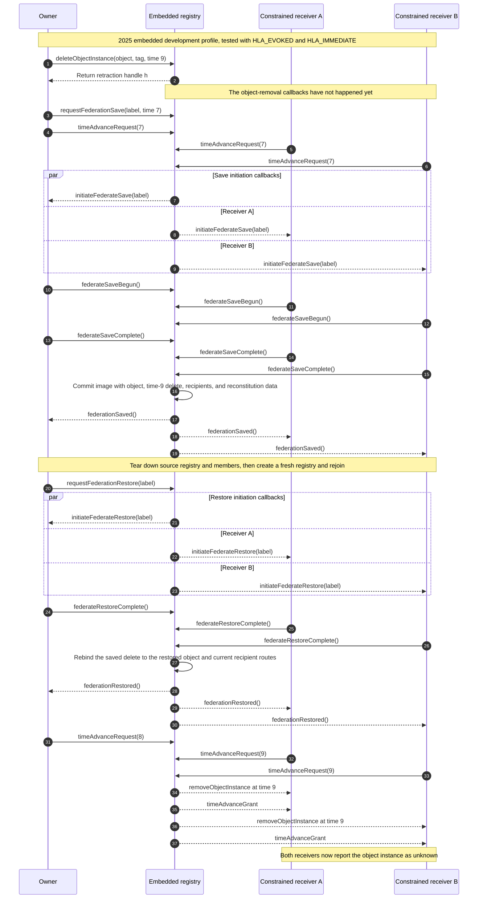

The figure compresses a callback-model-specific staging difference; it does
not assert one identical callback order for both runs. In the `HLA_EVOKED`
case, the owner's grant at time 7 is observed before the receivers issue their
advances. In the `HLA_IMMEDIATE` case, all three callback routes are disabled
while the members advance to 7, then re-enabled before the save callbacks are
drained. The common part of the trace is the saved time-9 deletion and its
post-restore delivery.

The focused case checks that each removal callback contains the original tag,
the restored producing federate, timestamp 9, timestamp order, and a valid
retraction designator. It observes `removeObjectInstance` before the grant for
each receiver in this scenario. This ordering is test evidence for these two
embedded callback-model runs, not a general callback-dispatch rule. See the
[queued-delete restore test](../../cpp/tests/ieee1516_2025_public_object_deletion_tso_restore_catch2.cpp#L7)
and the [delete payload restore/binding checks](../../cpp/src/internal/federation/federation_registry_restore_tso_payloads.cpp#L188).

### Worked case: retracting a restored deletion after one recipient receives it

A second fresh-registry test starts from a separate run of the same saved
time-9 deletion. After restore, receiver A flushes through time 9 and observes
the removal; receiver B has not yet received it. The owner then retracts the
original designator. The already-affected receiver gets `requestRetraction`,
while the still-pending recipient gets no such callback and never observes the
deletion. The test runs under both callback models.

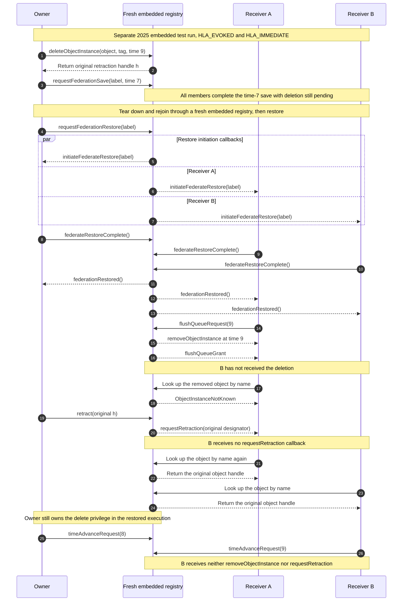

This trace makes the recipient boundary visible: retracting after A has received
the deletion restores A's object knowledge, while canceling the still-pending
delivery to B. It is not evidence for every callback policy, deployment path,
or portable process restart. The separate
[delivered-delete retraction test](../../cpp/tests/ieee1516_2025_public_object_deletion_retraction_restore_catch2.cpp#L7)
and [object lifecycle/retraction binding checks](../../cpp/src/internal/federation/federation_registry_restore_tso_payloads.cpp#L615)
are the evidence for this particular state transition.

## What the RTI image does—and does not—mean

The application save and the RTI state image are separate responsibilities.
The RTI image is not an automatic checkpoint of arbitrary application memory.

| State / artifact | Current Umbra handling | Reader's boundary |
| --- | --- | --- |
| Federate application state | Application code captures/restores it around `initiateFederateSave` / `initiateFederateRestore` | The RTI cannot reconstruct application-owned state unless the federate implements that work. |
| Process-local federation snapshot | The embedded registry retains a private snapshot keyed by save label | This is the richest restore source while that process-local snapshot remains available. |
| Durable RTI image | Versioned `FederationStateImage` is encoded and submitted to `FederationSaveCommitStore` before success notification | A successful storage call is required before Umbra reports federation save success. |
| Callback routes / closures | Kept as live runtime routes, not serialized into the durable state image | A process restart cannot revive a callback closure from the saved bytes. |
| Fresh-registry durable-image projection | The durable-image path validates federation, label, logical-time implementation, and member identity; it rehydrates supported route-free state and rebuilds selected work against current routes | Tested fresh-registry projections cover selected ledgers only; they do not establish OS-process restart or that every live callback-bearing operation is portable. |
| Temporal queues | Selected TSO payload, delivery-phase, and retraction records are represented in the image | Save/restore changes the future event queue; see the focused TSO-phase test and the time-management guide. |
| Other service-owned ledgers | Current code has typed rehydration helpers for regions, synchronization points, declarations, ownership, and other bounded state | Each ledger has its own supported-state predicates and focused tests; this table is not an exhaustive image schema. |

### 2025 Umbra restore-source selection

This implementation view is separate from the public callback sequence above.
The embedded registry selects a source when the request is admitted, then
applies it only after all participants report restore completion. Both source
paths require a matching durable commit; the retained in-process snapshot does
not bypass the commit check. The fresh-registry route is bounded to supported
route-free state and must not be read as an arbitrary process-restart recipe.

```mermaid
flowchart TD
  REQUEST["Restore request for a saved label"] --> CAPTURE["Record whether a retained process-local snapshot exists"]
  CAPTURE --> LOAD["Load and decode durable commit:<br/>federation, label, logical-time implementation, members"]
  LOAD --> COMMIT{"Durable commit and encoded image are valid?"}
  COMMIT -->|No| REJECT["Request is not admitted<br/>No restore-begun or initiate callbacks"]
  COMMIT -->|Yes| LOCAL{"Retained full process-local snapshot?"}
  LOCAL -->|Yes| VERIFY_LOCAL{"Committed image matches retained full snapshot?"}
  LOCAL -->|No| VERIFY_IMAGE{"Durable image fits bounded fresh-registry predicates?"}
  VERIFY_LOCAL -->|No| REJECT
  VERIFY_LOCAL -->|Yes| MEMBERS{"Saved member identity matches live membership<br/>and current callback routes are available?"}
  VERIFY_IMAGE -->|No| REJECT
  VERIFY_IMAGE -->|Yes| MEMBERS
  MEMBERS -->|No| REJECT
  MEMBERS -->|Yes| PROTOCOL["Public protocol begins:<br/>requester success, then per-member begun/initiate callbacks"]
  PROTOCOL --> COMPLETE{"All participants report restore completion?"}
  COMPLETE -->|Not yet| WAIT["Restore remains in progress<br/>Await remaining participants"]
  WAIT --> COMPLETE
  COMPLETE -->|All complete| SOURCE{"Source captured for this restore"}
  SOURCE -->|Retained snapshot| SNAPSHOT["Restore the complete process-local Federation snapshot"]
  SOURCE -->|No retained snapshot| IMAGE["Start from current live membership<br/>and apply the bounded route-free state image"]
  SNAPSHOT --> COMMON["Apply shared typed RTI-state restore helpers"]
  IMAGE --> COMMON
  COMMON --> DURABLE{"Using the durable-image path?"}
  DURABLE -->|Yes| REBUILD["Rebuild selected supported work against current routes"]
  DURABLE -->|No| RETAIN["Continue with runtime-bound records from the retained snapshot"]
  REBUILD --> RESTORED["RTI state applied; federationRestored()"]
  RETAIN --> RESTORED
  PROTOCOL -. "participant failure, abort, or resignation" .-> FAILED["federationNotRestored(reason)"]
  COMMON -. "RTI rehydration or work rebuild fails" .-> FAILED
```

The admission decision is source-backed in
[`requestFederationRestore`](../../cpp/src/internal/federation/federation_registry_restore_control.cpp#L48):
the registry records whether a retained snapshot exists, loads and validates
the durable image, and checks the saved/current member identity before queuing
the public callback protocol. At completion, a retained snapshot supplies the
full private federation state; without one, the registry starts from current
live membership and materializes the bounded image, then rebuilds selected
work against current callback routes
([completion and rehydration](../../cpp/src/internal/federation/federation_registry_restore_control.cpp#L477)).
The same-registry [saved object-management rollback case](../../cpp/tests/ieee1516_2025_federation_management_save_restore_catch2.cpp#L268)
exercises the retained-snapshot path. Fresh-registry evidence is narrower: the
[public TSO deletion restore](../../cpp/tests/ieee1516_2025_public_object_deletion_tso_restore_catch2.cpp#L7)
and [filesystem payload restore](../../cpp/tests/ieee1516_2025_federation_registry_timestamped_object_deletion_payload_filesystem_restart_catch2.cpp#L3)
create fresh registries within a test process and cover selected durable-image
ledgers, not an operating-system process restart. Neither path implies that
all callback-bearing work is durable or that the process endpoint follows the
same restoration profile.

### In-flight work has protocol-specific restore dispositions

The image layers above do not imply that every item described as “pending” is
stored in the same way. At the save boundary, distinguish a value-only
protocol record, a callback frame already admitted to a live queue, and an
effect already observed by the application. This index summarizes selected
2025 Umbra scenarios so readers can find the relevant state machine; it is
implementation/test evidence, not a normative persistence matrix.

| State at the save boundary | Selected observed disposition | Focused guide and boundary |
| --- | --- | --- |
| Provider request or response | A still-pending class request is restored with its request tag and rebound to the original provider route; its callback is issued once after `federationRestored`. This case does not change ownership, so it does not establish owner-change replay or retargeting. A delivered receive-order response is not replayed, while a queued timestamped response retains values, sent-region snapshot, and retraction state and remains subject to the recipient time gate. | [Attribute update request flow](HLA-2025-ATTRIBUTE-VALUE-UPDATE-REQUEST-FLOW-GUIDE.md#3-saverestore-depends-on-which-lifecycle-stage-was-reached): selected embedded fresh-registry tests, not every overload or profile. |
| Regional class-request route | An embedded public fresh-registry test restores the request's attribute-to-region mapping and tag, then observes one provider callback after `federationRestored` under both `HLA_EVOKED` and `HLA_IMMEDIATE`. A separate internal-registry case checks one-shot route consumption, stale-region suppression, and provider departure. | [Attribute update request flow](HLA-2025-ATTRIBUTE-VALUE-UPDATE-REQUEST-FLOW-GUIDE.md#3-saverestore-depends-on-which-lifecycle-stage-was-reached): public callback evidence is embedded-only and the fresh registry is created within one test process. Configured-process source routes Save/Restore through the same registry, but no process test observes this RAVU callback across restore. |
| Ownership protocol work | Supported typed ownership facts are validated against restored members and object attributes; selected pending work is reconstructed against live routes. Reconstructing a release request is not itself an ownership transfer. | [Ownership persistence and resignation](HLA-2025-OWNERSHIP-PERSISTENCE-AND-RESIGNATION-FLOW-GUIDE.md#1-a-pending-release-callback-across-save-and-restore): bounded fresh-registry evidence. |
| TSO delivery and retraction | Selected queued payload, recipient delivery-phase, and retraction records survive the tested save/restore cut. The save-time boundary and each recipient’s delivery stage affect what happens next; this is not evidence that every TSO operation or callback ledger is portable. | [Time management: timestamped message lifecycle and callback order](HLA-2025-TIME-MANAGEMENT-GUIDE.md#timestamped-message-lifecycle-and-callback-order) and [TSO retraction](HLA-2025-TSO-RETRACTION-FLOW-GUIDE.md): follow their service- and recipient-specific gates. |
| Callback already admitted to a live `HLA_EVOKED` queue | One selected process-endpoint scenario leaves callback frames queued through service-level save/restore and delivers them later. Those frames are live-runtime queue entries, not records in the durable RTI image; the case does not restart the RTI host process. | [Ownership callback boundary](HLA-2025-OWNERSHIP-PERSISTENCE-AND-RESIGNATION-FLOW-GUIDE.md#4-a-pushed-callback-queue-differs-from-restored-ownership-work): process-profile test evidence only. |

These examples do not establish one HLA-wide rule that in-flight work is
preserved, canceled, or replayed. In particular, restoring a selected ledger
against current routes and retaining a queue in a still-live process are
different mechanisms; neither implies arbitrary crash recovery. For regional
class-level Request Attribute Value Update, configured-process Save/Restore
uses the shared registry image for the pending request ledger, but its provider
notification is a separate live session event or pushed frame. The process
Restore-completion handler does not explicitly enqueue a new RAVU callback, and
no focused process test combines a pending regional request with Save/Restore.
Thus callback replay and exactly-once delivery remain unverified for that
profile. See the [RAVU guide](HLA-2025-ATTRIBUTE-VALUE-UPDATE-REQUEST-FLOW-GUIDE.md)
for the detailed registry/event distinction and evidence links.

### Restore is not an assumed crash-and-rejoin recipe

This guide starts from federates that are already joined to the current
execution. Umbra's current restore admission compares the saved member set with
the live member set and rejects a mismatch. Process-local restore can use the
full in-memory snapshot; the durable restart path instead validates the saved
image and admits only supported route-free state. The tests cited below do not
establish that an arbitrary crashed federate can reconnect under a new runtime
identity and rejoin a save. Treat that as an open recovery/deployment question,
not as a consequence of the diagrams.

## Implementation map

| Responsibility | Current source |
| --- | --- |
| Public save/restore services and embedded/process dispatch | [RTI ambassador save/restore services](../../cpp/src/internal/runtime/umbra_rti_ambassador_federation_save_restore.cpp) |
| Callback, report, and notification dispatch | [Save/restore notifications](../../cpp/src/internal/runtime/umbra_rti_ambassador_save_restore_notifications.cpp) |
| Process-boundary service forwarding | [Federation save/restore process service](../../cpp/src/internal/federation/process_federation_service_save_restore.cpp) |
| Process Restore notification polling | [`enqueueFederationRestoreNotifications`](../../cpp/src/internal/federation/process_federation_service_notifications.cpp#L390); [`handleReceiveInteraction`](../../cpp/src/internal/federation/process_federation_service_receive.cpp#L37); [`pumpProcessReceiveOrder`](../../cpp/src/internal/runtime/umbra_rti_ambassador_callback_control_services.cpp#L125) |
| Save participant ledger, time gates, image creation, abort and status | [Federation save control](../../cpp/src/internal/federation/federation_registry_save_control.cpp) |
| Restore admission, participant barrier, and rehydration | [Federation restore control](../../cpp/src/internal/federation/federation_registry_restore_control.cpp) |
| Saved live TSO Request Retraction ledger | [TSO payload restore](../../cpp/src/internal/federation/federation_registry_restore_tso_payloads.cpp#L45) |
| Saved TSO interaction payload | [TSO payload restore](../../cpp/src/internal/federation/federation_registry_restore_tso_payloads.cpp#L97) |
| Saved TSO attribute-update payload | [TSO payload restore](../../cpp/src/internal/federation/federation_registry_restore_tso_payloads.cpp#L360) |
| Saved TSO object-deletion payload and object-lifecycle binding | [TSO payload restore](../../cpp/src/internal/federation/federation_registry_restore_tso_payloads.cpp#L188) and [pending-deletion validation](../../cpp/src/internal/federation/federation_registry_restore_tso_payloads.cpp#L615) |
| Saved directed TSO interaction payload | [TSO payload restore](../../cpp/src/internal/federation/federation_registry_restore_tso_payloads.cpp#L503) |
| Commit abstraction | [Federation save commit store](../../cpp/src/internal/federation/federation_save_commit_store.cpp) and [store interface](../../cpp/src/internal/federation/federation_save_commit_store.hpp) |
| Encoded federation state image | [Federation state-image codec](../../cpp/src/internal/federation/federation_state_image.cpp) |

The public ambassador adapter has both embedded and process-endpoint branches.
Follow the corresponding branch and test family when making a behavior claim;
do not assume a result in one transport path automatically proves the other.

## Focused test evidence

| Scenario | Test evidence | What it demonstrates—and what it does not |
| --- | --- | --- |
| Save status query snapshots | [Embedded save-control integration](../../cpp/tests/ieee1516_2025_federation_save_control_catch2.cpp#L4) | Under `HLA_IMMEDIATE`, checks both members as `FEDERATE_INSTRUCTED_TO_SAVE`, then both as `FEDERATE_SAVING`, then both as `NO_SAVE_IN_PROGRESS`; not every status or transition. |
| Process Save callbacks under `HLA_EVOKED` | [Untimed process Save](../../cpp/tests/ieee1516_2025_connection_federation_save_catch2.cpp#L457) | Uses the process service's polling mode: initiation and completion callbacks remain pending after their inducing service calls and are delivered by explicit `evokeCallback`; not `HLA_IMMEDIATE` or pushed-event evidence. |
| Process Save terminal failure and status response under `HLA_IMMEDIATE` | [One-member failure/status](../../cpp/tests/ieee1516_2025_connection_process_federation_save_not_complete_status_terminal_immediate_catch2.cpp#L459); [multi-member terminal status](../../cpp/tests/ieee1516_2025_connection_process_federation_save_not_complete_status_terminal_multi_federate_catch2.cpp#L459) | The one-member pushed-event case observes initiation and `federationNotSaved(FEDERATE_REPORTED_FAILURE_DURING_SAVE)`, then queries `NO_SAVE_IN_PROGRESS`. The multi-member case queries from both members and checks both returned status pairs are terminal. Neither covers an active process Save-status snapshot or successful-commit evidence. |
| Restore status query snapshots | [Embedded save/restore integration](../../cpp/tests/ieee1516_2025_federation_management_save_restore_catch2.cpp#L268) | Under `HLA_IMMEDIATE`, checks two active descriptors and the queried member's `FEDERATE_RESTORING` status, then `NO_RESTORE_IN_PROGRESS` and an invalid post-restore handle after completion; not every descriptor value or callback profile. |
| Reserved object-name ownership survives a fresh-registry restore in the tested profile | [Two-federate public reservation-restore case](../../cpp/tests/ieee1516_2025_public_fresh_registry_object_name_reservations_restore_catch2.cpp#L128); [reservation lifecycle sequence](HLA-2025-OBJECT-INSTANCE-NAME-RESERVATION-FLOW-GUIDE.md#a-saved-reservation-remains-attached-to-its-federate-in-the-tested-profile) | The embedded `HLA_IMMEDIATE` case preserves the name with its original federate identity; a peer cannot release or reserve it until the owner releases it, after which the peer succeeds. The new registry is created within one test process, not an OS process restart. This is a bounded implementation/test observation, not a complete normative rule or process/2010 parity claim. |
| Timed save waits for constrained delivery and pending requests can be replaced | [Embedded timed federation save integration](../../cpp/tests/ieee1516_2025_federation_management_save_restore_catch2.cpp#L5) | Development-profile integration evidence for a timed save interaction with constrained time/TSO; not a general proof of all time policies. |
| Failed restore request, participant failure, abort, and resignation | [Embedded restore failure recovery](../../cpp/tests/ieee1516_2025_federation_management_save_restore_catch2.cpp#L365) | Shows missing-label failure callback, `FEDERATE_REPORTED_FAILURE_DURING_RESTORE`, `RESTORE_ABORTED`, and survivor notification after resignation. |
| RTI-owned synchronization-point and region state is reconstituted | [Synchronization/region restore](../../cpp/tests/ieee1516_2025_federation_management_save_restore_catch2.cpp#L421); [barrier achievement persistence and evidence boundary](HLA-2025-FEDERATION-SYNCHRONIZATION-FLOW-GUIDE.md#saverestore-preserves-an-in-flight-barrier) | The public-API case restores a single-member announced-but-unachieved point; it does not exercise a multi-member barrier with partial achievement. |
| RTI commit happens before success notification | [Save commit ordering](../../cpp/tests/ieee1516_2025_federation_registry_save_commit_ordering_catch2.cpp#L3) | Internal registry evidence that the store receives a versioned image, including a queued TSO record, before success is reported. |
| A saved live regional TSO interaction returns after restore | [Embedded live regional interaction restore](../../cpp/tests/restore_live_tso_regional_interaction_catch2.cpp#L176); [saved TSO rehydration](../../cpp/src/internal/federation/federation_registry_restore_tso_payloads.cpp#L45) | The `HLA_EVOKED` development-profile case checks post-save retraction, restore, FQR delivery at time 7 before grant 10 with the source region set, then Request Retraction from the original designator. It does not establish process, durable-restart, or 2010 parity. |
| A timed save retains later directed TSO work | [Embedded timed directed-restore case](../../cpp/tests/timed_restore_live_tso_directed_interaction_catch2.cpp#L165); [timed-save cutoff](../../cpp/src/internal/federation/federation_registry_save_control.cpp#L378); [worked trace above](#worked-case-a-timed-save-retains-later-directed-tso-work) | At save time 6, timestamp-8 directed work remains pending. After restore, the test observes delivery at time 8 before the FQ grant, then Request Retraction from the original handle. The embedded `FlushQueueRequest` path has dispatched both callbacks before the test's next `evokeCallback(0.0)`, which returns false; the grant reports actual 7 and optimistic 8. This is tested implementation behavior, not a general callback-model or normative rule. No process, durable-restart, or 2010 parity. |
| A saved explicit-source regional TSO attribute update returns after restore | [Embedded attribute-update restore case](../../cpp/tests/restore_live_tso_regional_attribute_update_catch2.cpp#L157); [attribute-update rehydration](../../cpp/src/internal/federation/federation_registry_restore_tso_payloads.cpp#L360) | This ordinary application-originated `updateAttributeValues` path restores the queued value, source region set, and retraction state. The callback precedes the FQ grant during the embedded flush path. It is a distinct payload-family check, not an RTI provider response; the lifecycle mirrors the interaction example, so it is indexed here without duplicating the full sequence. Embedded `HLA_EVOKED` development-profile evidence only; not process, durable-restart, or 2010 parity. |
| A queued timestamped object deletion returns through a fresh-registry restore | [Fresh-registry deletion restore](../../cpp/tests/ieee1516_2025_public_object_deletion_tso_restore_catch2.cpp#L7); [worked trace above](#worked-case-queued-timestamped-object-deletion-returns-after-fresh-registry-restore) | Under both callback models, the test saves a time-9 deletion at time 7, tears down the source registry, restores through a new embedded registry, then observes removal before each receiver's grant and checks the object is no longer known. Current `.build` CTest #210 passes outside the sandbox. Despite its process-restart tags, this is a fresh registry in one test process, not an OS process restart. Development-profile evidence only; no 2010 or process-endpoint parity. |
| A restored object deletion is retracted after delivery to only one recipient | [Fresh-registry delete retraction](../../cpp/tests/ieee1516_2025_public_object_deletion_retraction_restore_catch2.cpp#L7); [worked trace above](#worked-case-retracting-a-restored-deletion-after-one-recipient-receives-it) | Receiver A flushes and receives removal; the owner retracts the original designator; A receives `requestRetraction` and regains object lookup, while receiver B receives neither callback and retains lookup. Current `.build` CTest #216 passes both HLA_EVOKED and HLA_IMMEDIATE runs outside the sandbox. This is test-specific embedded behavior, not a general or 2010 callback claim. |
| Durable commit failure becomes a failed federation save | [Save commit failure](../../cpp/tests/ieee1516_2025_federation_registry_save_commit_failure_catch2.cpp#L3) | Injected internal storage failure yields an unsuccessful result and `RTI_UNABLE_TO_SAVE`; it is not a storage-engine crash-consistency test. |
| Internal restore ledger covers a timestamped object deletion across queued and in-transit recipients | [Filesystem payload restore case](../../cpp/tests/ieee1516_2025_federation_registry_timestamped_object_deletion_payload_filesystem_restart_catch2.cpp#L3) | Both current `.build` registrations (#588 and #1708) pass outside the sandbox. The sandboxed direct validator exposed the cause of earlier failures: `std::filesystem::canonical` returned “Access is denied” for the checked-in standard-MIM path. The standalone [FDD materializer test](../../cpp/tests/libxml2_fom_composer_catch2.cpp#L345) also passes outside the sandbox. These are internal registry and validation results, not evidence of OS-process restart or public process-endpoint parity. CTest numbering varies by build. |
| TSO queued, in-transit, and delivered phases are restored distinctly | [TSO queue phase restore](../../cpp/tests/ieee1516_2025_federation_registry_restore_tso_queue_phase_state_image_catch2.cpp#L3) | Internal state-image evidence for a bounded queue ledger; not proof that every TSO-related callback ledger is restartable. |
| Process-endpoint success callback path | [Restore success lifecycle under HLA_IMMEDIATE](../../cpp/tests/ieee1516_2025_connection_restore_success_lifecycle_immediate_catch2.cpp#L459) | In a one-member pushed-event scenario, observes restore success/begun/initiate before `requestFederationRestore` returns and `federationRestored` before `federateRestoreComplete` returns; not an HLA_EVOKED, multi-member, or every-transport proof. |
| Process-endpoint Restore callbacks under `HLA_EVOKED` polling | [Successful Restore lifecycle](../../cpp/tests/ieee1516_2025_connection_synchronization_restore_catch2.cpp#L772); [early request failure](../../cpp/tests/ieee1516_2025_connection_synchronization_restore_catch2.cpp#L663); [multi-member status and lifecycle](../../cpp/tests/ieee1516_2025_connection_synchronization_restore_catch2.cpp#L1641) | Configures polling (`ProcessFederationServiceOptions{false}`) and `HLA_EVOKED`: request/completion calls return with their callbacks unobserved, and explicit Evoke calls deliver queued callbacks. The separate two-member case observes per-member restore statuses and callbacks; no 2010 or embedded parity. |
| Pushed process events with an `HLA_EVOKED` callback model | [Queued ownership callback across Save/Restore](../../cpp/tests/ieee1516_2025_process_pushed_ownership_assumption_evoked_save_restore_catch2.cpp#L62) | Configures pushed event frames and `HLA_EVOKED`; selected discovery, ownership, and Restore callbacks remain uninvoked through service-level Save/Restore until explicit Evoke. This is one queue-preservation case, not a full transport/callback-model matrix or a general callback-order rule. |
| Process-endpoint restore status snapshot | [Restore status under HLA_IMMEDIATE](../../cpp/tests/ieee1516_2025_connection_process_federation_restore_status_immediate_catch2.cpp#L459) | Queries the single member as `FEDERATE_RESTORING` after request acceptance and then observes `federationRestored` after completion; not every status descriptor or callback profile. |
| Process-endpoint multi-member Restore status snapshots | [Multi-federate Restore status under HLA_IMMEDIATE](../../cpp/tests/ieee1516_2025_connection_process_federation_restore_status_multi_federate_immediate_catch2.cpp#L459) | Both querying members observe the two-member descriptor vector while both restore, while one waits and the other remains restoring, and after completion with `NO_RESTORE_IN_PROGRESS` and invalid post-restore handles. This is pushed `HLA_IMMEDIATE` evidence, not a full transport/callback-model matrix. |
| Process-endpoint early request failure | [Restore request failure under HLA_IMMEDIATE](../../cpp/tests/ieee1516_2025_connection_restore_request_failure_immediate_catch2.cpp#L459) | In the one-member pushed-event case, the public request returns normally with `requestFederationRestoreFailed` observed and no success/begun callbacks; not evidence for `HLA_EVOKED` or multi-member rejection timing. |
| Process-endpoint terminal restore failure | [Restore failure lifecycle under HLA_IMMEDIATE](../../cpp/tests/ieee1516_2025_connection_restore_failure_lifecycle_immediate_catch2.cpp#L459) | After accepted request callbacks, `federateRestoreNotComplete` returns with `federationNotRestored(FEDERATE_REPORTED_FAILURE_DURING_RESTORE)` observed; one-member test evidence only. |

**Focused rerun status (2026-10-10, current `.build`):** Public fresh-registry
cases #210 and #216 and internal filesystem registrations #588 and #1708 all
pass when run outside the sandbox (4/4 CTest registrations). The standalone
FDD materializer case #1627 also passes outside the sandbox. A sandboxed
validation attempt returned `source_unreadable` because
`std::filesystem::canonical` reported “Access is denied” on the checked-in
standard-MIM path; the source is readable outside that execution boundary.
Earlier sandboxed `Unknown exception` results at Federation Create and
`source_unreadable` results must therefore not be interpreted as behavioral
failures. The passing public tests cover a fresh registry inside one process;
they do not establish OS-process restart or process-endpoint behavior. Keep
the worked traces bounded to the embedded 2025 scenarios and their actual
callback-model coverage.

The internal `[unit]` registry cases above are explicitly implementation
evidence. Development-profile integration tests and process-endpoint tests
have their own narrower scopes. None of these tests establishes full 2025
conformance.

## What this guide does not claim

- It does not describe IEEE 1516.1-2010 or assert that 2010 save/restore
  behavior matches 2025.
- It does not specify how an application serializes its own memory, files,
  random-number generators, or external resources.
- It does not promise arbitrary process-crash recovery, identity remapping,
  membership changes during restore, cross-version image migration, or
  portability of callback-bearing operations across a restart.
- It does not restate the time-management grant algorithm, attribute-ownership
  transfer protocol, or DDM routing rules. Their state can be present in or
  affected by a save image, but their own guides remain authoritative for those
  topics.
- It does not treat a query-plan mapping, passing development test, or durable
  record as evidence of standard conformance.

## Next reading path

For a first pass, read the save and restore diagrams, then follow the source
map's registry entry points, and inspect existing focused scenarios from the
embedded integration, registry-unit, and process-endpoint evidence classes.
Use their recorded results; do not rerun tests as part of reading or
documentation work. Request fresh runtime verification only if a material
claim cannot be responsibly documented from current evidence. When
interpreting a wait at a timed save boundary, use the [time-management
guide](HLA-2025-TIME-MANAGEMENT-GUIDE.md). For the next topic in the broader
documentation series, see the
[flow-guide backlog](HLA-BEHAVIOR-FLOW-GUIDES.md).
