# IEEE 1516.1-2025 Federation Synchronization Points: Contributor Guide

An HLA synchronization point is a named coordination barrier for federates:
participants are selected and announced, each reports whether it achieved the
point, and completion is a separate federation-level outcome. It coordinates
federates; it does not advance logical time or create an application-wide atomic
transaction.

This guide uses that HLA-facing model to explain IEEE 1516.1-2025, then labels
Umbra's state transitions, callbacks, implementation-specific edges, and test
limits separately. It is not a substitute for the standard, a new source of
requirements, or a claim of conformance.

## Scope and authority

- **Standard boundary:** IEEE 1516.1-2025 only. The 2010 API/runtime is a
  separate compatibility stream and is not combined with this guide.
- **Implementation boundary:** synchronization-point behavior in Umbra's 2025
  embedded federation-management development profile, with selected tests for
  the configured process endpoint. Those are separate implementation paths;
  the tests do not establish full backend parity.
- **Normative authority:** the [official IEEE 1516.1-2025 Federate Interface
  Specification](https://standards.ieee.org/ieee/1516.1/6688/) defines the
  standard behavior. Source links below describe Umbra's current behavior;
  tests establish only their named scenarios. Neither code nor tests override
  the standard.
- **Traceability boundary:** this is explanatory Umbra documentation. It adds
  no Requirements Lab mappings or conformance evidence.

For adjacent but distinct protocols, see the [2025 federation lifecycle
guide](HLA-2025-FEDERATION-AND-FEDERATE-LIFECYCLE-FLOW-GUIDE.md), [callback and
service ordering guide](HLA-2025-CALLBACK-AND-SERVICE-ORDERING-FLOW-GUIDE.md),
[time-management guide](HLA-2025-TIME-MANAGEMENT-GUIDE.md), and [save/restore
guide](HLA-2025-FEDERATION-SAVE-RESTORE-FLOW-GUIDE.md).

## Keep synchronization, logical time, and membership distinct

The pinned API exposes three related but separate questions:

- **Synchronization:** `registerFederationSynchronizationPoint` and
  `synchronizationPointAchieved` report on a named barrier; the RTI later
  reports its federation-level result with `federationSynchronized`.
- **Logical time:** `timeAdvanceRequest` or `nextMessageRequest` concerns a
  time-management request, which may later produce `timeAdvanceGrant`. It is
  not barrier completion.
- **Membership:** `joinFederationExecution` and
  `resignFederationExecution` govern execution membership; neither is an
  achievement report for a synchronization label.

The API declares the synchronization and membership operations under
Federation Management Services and time requests under Time Management
Services ([`RTIambassador`](../../third_party/ieee1516.1-2025/include/RTI/RTIambassador.h#L212),
[time requests](../../third_party/ieee1516.1-2025/include/RTI/RTIambassador.h#L1226));
the synchronization callbacks [`announceSynchronizationPoint` and
`federationSynchronized`](../../third_party/ieee1516.1-2025/include/RTI/FederateAmbassador.h#L86)
are separate from [`timeAdvanceGrant`](../../third_party/ieee1516.1-2025/include/RTI/FederateAmbassador.h#L507).
A Join or Resign during a pending point is therefore a synchronization-rule
question; it is not itself an achievement. The late-join and resignation
effects below are labeled as standard-boundary questions or Umbra observations,
not generalized across editions.
For the protocol-by-protocol participant-set comparison, see the lifecycle
guide's [Join and active-protocol map](HLA-2025-FEDERATION-AND-FEDERATE-LIFECYCLE-FLOW-GUIDE.md#a-join-does-not-define-every-active-protocols-participant-set)
and the [Save/Restore Join boundary](HLA-2025-FEDERATION-SAVE-RESTORE-FLOW-GUIDE.md#join-crosses-a-separate-membership-admission-boundary).
The barrier-specific expansion behavior below is not a general membership or
Save/Restore rule.

The Federation MOM also exposes an observation path for this protocol, separate
from registration, achievement, and federation-level completion:
`HLArequestSynchronizationPoints` asks for the in-progress point list, while
`HLArequestSynchronizationPointStatus` asks for one point's federate/status
roster. The pinned MIM specifies one paired report for each request ([list
request](../../third_party/ieee1516.2-2025/resources/mim/HLAstandardMIM-2025.xml#L2559),
[status request](../../third_party/ieee1516.2-2025/resources/mim/HLAstandardMIM-2025.xml#L2569)).
In the reviewed embedded path, the [points-request handler](../../cpp/src/internal/runtime/umbra_rti_ambassador_interaction_send_services.cpp#L649)
and [status-request handler](../../cpp/src/internal/runtime/umbra_rti_ambassador_interaction_send_services.cpp#L681)
plan the paired reports. The [focused test](../../cpp/tests/ieee1516_2025_federation_mom_synchronization_reports_catch2.cpp#L158)
observes the roster changing only after a separate achievement; it does not
treat the query as a barrier transition. Configured-process query behavior
remains unverified: the source-level publication-check mismatch and conditional
error mapping are captured in the MOM guide's [configured-process evidence
boundary](HLA-2025-FEDERATION-MOM-FLOW-GUIDE.md#configured-process-request-route-evidence-boundary).
See also the combined [MOM query flow](HLA-2025-FEDERATION-MOM-FLOW-GUIDE.md#federation-synchronization-queries-active-point-list-and-roster-status)
and [cross-cutting state/query example](HLA-2025-CROSS-CUTTING-STATE-EVENT-OBSERVATION-GUIDE.md#keep-state-pending-work-and-observation-distinct).

## HLA vocabulary: registration, announcement, and completion differ

The 2025 API exposes a sequence of distinct operations and callbacks. Reading
their roles separately helps avoid treating a successful registration, a
participant's report, and federation-level completion as the same event:

| API surface | HLA-facing role | Do not conflate it with |
| --- | --- | --- |
| `registerFederationSynchronizationPoint(label, tag)` / `registerFederationSynchronizationPoint(label, tag, set)` (§4.14) | Request registration of a named point; the second overload supplies a synchronization set. | A registration result callback or a participant's announcement. |
| `synchronizationPointRegistrationSucceeded(label)` / `synchronizationPointRegistrationFailed(label, reason)` (§4.15) | Report the registration outcome. | The later result of the synchronization barrier. |
| `announceSynchronizationPoint(label, tag)` (§4.16) | Notify a participant of the point's label and tag. | That participant having achieved the point. |
| `synchronizationPointAchieved(label, successfully)` (§4.17) | Let a participant report its result for the point. | The federation-level completion notification. |
| `federationSynchronized(label, failedToSyncSet)` (§4.18) | Report the federation-level completion outcome and its failed-to-synchronize set. | A time-advance grant or a membership transition. |

These names and parameter roles are grounded in the pinned 2025
[`RTIambassador` declarations](../../third_party/ieee1516.1-2025/include/RTI/RTIambassador.h#L261)
and [`FederateAmbassador` callbacks](../../third_party/ieee1516.1-2025/include/RTI/FederateAmbassador.h#L72).
This is an API vocabulary map, not a substitute for the full §§4.14–4.18
service rules. It does not settle how the standard handles late join, resign,
an explicitly empty set, or exact callback ordering; the implementation
examples below keep those questions visibly bounded.

## HLA-level path: registration, reports, and federation outcome

This conceptual map connects the API roles without specifying how the RTI
selects or changes the participant set. A successful registration result,
participant announcements, individual achievement reports, and the final
federation-level result are separate events. The completion decision stands
for the applicable standard rules; this is not a prescribed total callback
order.

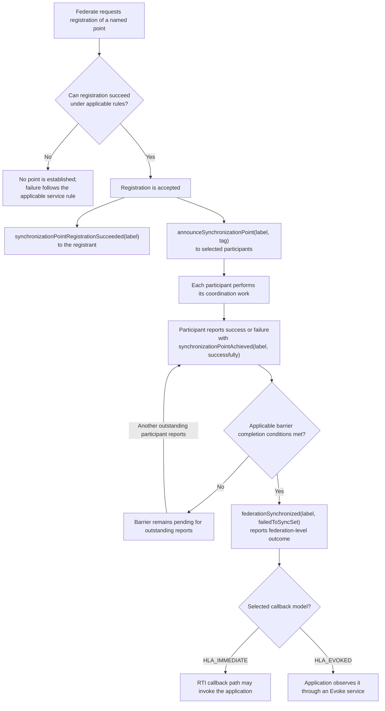

Successful registration is shown with two distinct notification effects: a
registration-result callback to the registrant and announcements to selected
participants. The fork intentionally does not order those callback paths.
Callback enablement, per-recipient dispatch, and exact observation timing are
also outside this HLA-level map; see
the [callback/service-ordering guide](HLA-2025-CALLBACK-AND-SERVICE-ORDERING-FLOW-GUIDE.md),
including its [process-endpoint synchronization trace](HLA-2025-CALLBACK-AND-SERVICE-ORDERING-FLOW-GUIDE.md#process-endpoint-service-responses-and-synchronization-events-are-separate)
for source-derived request/event ordering that is not an HLA ordering rule.
Participant-set construction, late join, resignation, and exact failure rules
remain service-specific questions; the embedded model below is evidence about
Umbra's 2025 profile, not a substitute for authorized standard text.

## The embedded 2025 state model

The HLA-level barrier description does not by itself specify every
implementation edge. In the embedded 2025 registry paths below, keep these
four sets and records distinct; this table is an implementation lens, not a
replacement for the standard's registration, resignation, or callback rules:

| State | Meaning |
| --- | --- |
| Synchronization set | Current participants whose achievement is required before the barrier completes. |
| Announced federates | Participants to whom the label has been announced; achievement is accepted only for an announced member. |
| Achieved federates | Participants that have reported, paired with their success/failure result. |
| Failed-to-synchronize set | The false results among the achieved participants when completion is formed; it is not the same thing as the participants who have not yet achieved. |

## Registration chooses the barrier participants

The API has an overload without a synchronization set and an overload with
one. Both initially create a barrier over the current joined members when the
requested set is empty. There is an implementation-specific distinction:
Umbra permits late-join expansion only when the set was **omitted**. Passing an
explicitly empty set snapshots the current members but does not opt into later
expansion. The direct test covers an explicit non-empty set and the omitted-set
overload; the explicitly empty-set distinction is currently source-derived and
does not have its own focused test.

Registration preflights label uniqueness, requested-member membership, and
callback routes before inserting the point or preparing its announcement
batch. A duplicate label or nonjoined requested member therefore returns a
failed registration result without replacing the pending point. Duplicate
label behavior has focused embedded and configured-process coverage; no
focused implementation test was found for a requested set containing a
nonjoined member. The embedded duplicate test goes further: after rejection,
the original omitted-set point still expands to a later joiner with its
original tag and completes normally.

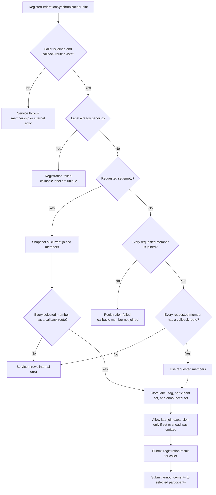

The ordering in the final two boxes is the embedded adapter's submission
ordering: it submits the registering federate's succeeded/failed callback
before it submits the announcement batch. Whether callbacks run immediately or
wait for an evoke boundary depends on the callback model; this diagram does not
claim that the application has already executed the callback when the service
returns. The cited scenarios exercise both callback models, but do not assert
the relative registration/announcement order. That order is source-derived.
Separate process-endpoint public cases pair [HLA_EVOKED with polling](../../cpp/tests/ieee1516_2025_connection_synchronization_failure_catch2.cpp#L457)
and [HLA_IMMEDIATE with pushed events](../../cpp/tests/ieee1516_2025_connection_synchronization_failure_catch2.cpp#L675),
but their explicit set contains only the receiver, not the registering sender.
They therefore do not establish the same-recipient ordering either; these
selected combinations are not process-profile parity evidence. See the callback guide's
[process synchronization response/event trace](HLA-2025-CALLBACK-AND-SERVICE-ORDERING-FLOW-GUIDE.md#process-endpoint-service-responses-and-synchronization-events-are-separate)
for that bounded distinction.
See the callback guide's [Federation Synchronized dispatch view](HLA-2025-CALLBACK-AND-SERVICE-ORDERING-FLOW-GUIDE.md#federation-synchronized-after-barrier-completion)
for the post-barrier route, service-report, queue, and callback-model boundary.

### Configured-process initial registration can fail after the point is committed

In the configured-process handler, the shared registry inserts a successful
point before announcement events are enqueued. If announcement enqueue then
fails, the handler returns an internal-error response; this path does not
remove the newly stored point. The client turns that non-OK response into an
`RTIinternalError`, so no normal registration result callback is dispatched.
A retry with the same label reaches the duplicate-label failure path.
Recipient effects depend on delivery mode: polling appends
events to each recipient queue during iteration, so an injected failure after
one enqueue can leave that event queued; pushed delivery stages events first,
and the injected failure returns before the staged batch is sent. A transport
send failure during the later push loop can still occur after earlier events
were sent. These are source-derived partial-commit consequences, not a
documented HLA transaction rule.

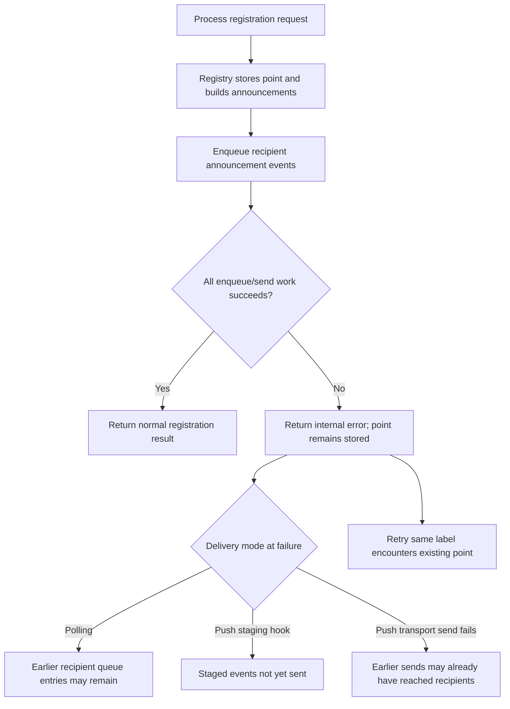

The existing failure-injection test is a different transaction: it fails a
late Join after expansion queued an announcement, then verifies Join cleanup
removes the joining member and a retry produces exactly one announcement
([rollback case](../../cpp/tests/ieee1516_2025_connection_process_mom_resign_removal_order_catch2.cpp#L428)).
It does not exercise initial registration failure after point insertion,
verify queue contents in that path, or test retrying the original registration.
No focused initial-registration enqueue-failure case was found.

## Late joiners change only an expandable barrier

The barrier's participant set is not always fixed at registration. After a
federate joins, Umbra checks every pending point. If expansion is enabled, the
new federate is added to both the synchronization set and announced set and is
sent that point's label and tag. It must then achieve the point too. An
explicit-set point, including one created through the explicit-empty overload,
does not expand.

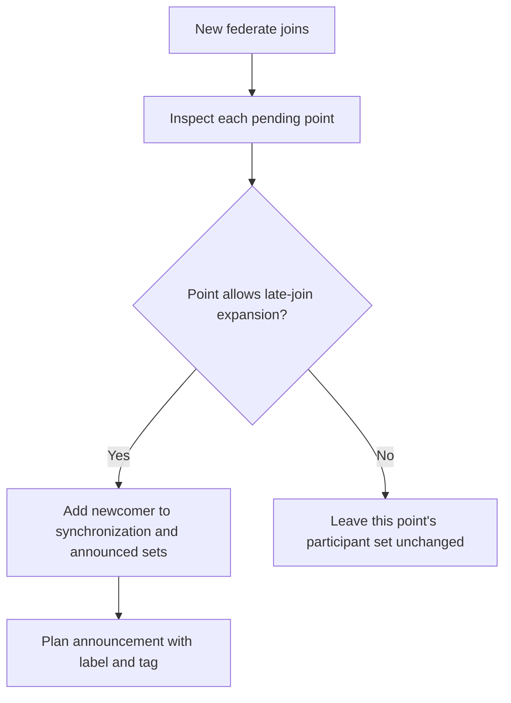

The point allows expansion only when registration used the overload without an
explicit set. The newcomer must then report too. Existing reports are retained,
so a join after partial reports grows the participant count while the point is
still pending. That ordering is source-derived: the focused
[late-join test](../../cpp/tests/ieee1516_2025_federation_registry_synchronization_point_late_join_explicit_set_catch2.cpp#L49)
joins before any achievement call and does not cover partial-results-before-join.

### A partial result survives an expanding join

This trace starts after an omitted-set point has been announced to A and B. A
reports `false` while B is still pending; a late C then joins before the point
completes. The registry adds C to the barrier without discarding A's result,
so B's later report is not enough: C must report as well. The final notification
plan still identifies A as failed.

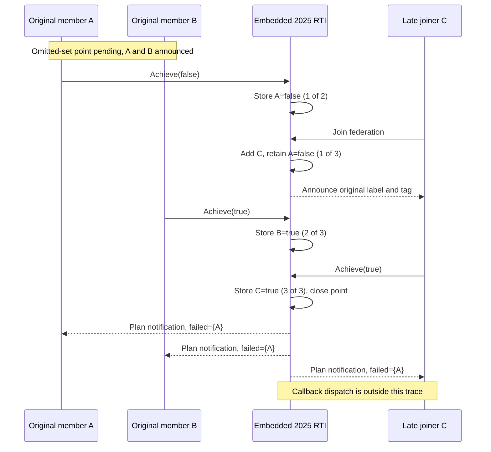

#### The barrier state after a partial report and expanding join

The sequence above shows who acts and when the newcomer is announced. This
state view instead tracks the two pieces of barrier state that determine
completion: the current participant set and the first result recorded for
each participant. It describes the embedded omitted-set path in Umbra; it is
not a separate HLA-mandated state machine.

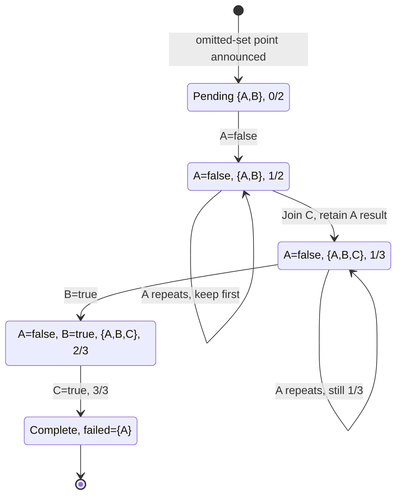

The point stores its synchronization set, announced-member set, achieved-
result map, and late-join-expansion flag
([state fields](../../cpp/src/internal/federation/federation_registry.hpp#L2343)).
The join hook adds the late member to the participant and announced sets
without clearing prior reports ([join expansion](../../cpp/src/internal/federation/federation_registry.cpp#L248)).
Achievement records a member's first result and compares the result-map size
with the current participant-set size before planning completion
([achievement fan-in](../../cpp/src/internal/federation/federation_registry.cpp#L307)).
The result slot is per participant, not per call: while the point remains
announced, a repeated achievement is accepted, but `emplace` keeps the first
boolean and the unchanged map size cannot satisfy a newly added participant.
For example, if A first reports `true` and later repeats with `false` before
the point closes, this implementation retains `true`; the later value does
not add a second result or place A in the failed set. This first-result-wins
detail is source-derived. The focused public scenarios report once per
participant, so they do not establish repeated-result behavior or its
normative interpretation.
The configured-process service calls this same registry operation and only
enqueues synchronization notifications when the returned plan contains them
([shared registry call](../../cpp/src/internal/federation/process_federation_service_request_handlers.cpp#L261),
[non-empty-plan gate](../../cpp/src/internal/federation/process_federation_service_request_handlers.cpp#L286)).
An `applied` result is the normal return path in both public adapters
([embedded mapping](../../cpp/src/internal/runtime/umbra_rti_ambassador_federation_lifecycle.cpp#L1401),
[process mapping](../../cpp/src/internal/runtime/umbra_rti_ambassador_federation_lifecycle.cpp#L1347)).
Stable-ID Restore reinstates the saved result map, and late Join expands the
participant set without clearing it, so the same per-member rule applies across
those transitions ([restored results](../../cpp/src/internal/federation/federation_registry_state_image_restore.cpp#L452),
[Join expansion](../../cpp/src/internal/federation/federation_registry.cpp#L248)).

The exact partial-result-before-join interleaving is **not covered** by the
cited tests: the direct [late-join test](../../cpp/tests/ieee1516_2025_federation_registry_synchronization_point_late_join_explicit_set_catch2.cpp#L49)
joins before any achievement, and the public HLA_EVOKED/HLA_IMMEDIATE
scenarios also join participants before reporting. The state diagram is
therefore a source-derived view, not a test-observed transition. It describes
notification planning, not when application callbacks execute; see the
callback guide for that boundary. The repeated-call loops in the state diagram
are also source-derived; no focused test repeats an achievement while the same
point remains pending. Two public Save/Restore cases do achieve the same label
again after Restore, but their saved point was unachieved: the live point is
completed after Save, Restore reinstates the empty result map, and the later
call is the first report in that restored point
([case 1](../../cpp/tests/ieee1516_2025_federation_management_save_restore_catch2.cpp#L616)
and [restored report](../../cpp/tests/ieee1516_2025_federation_management_save_restore_catch2.cpp#L626),
[case 2](../../cpp/tests/ieee1516_2025_federation_management_save_restore_catch2.cpp#L933)
and [restored report](../../cpp/tests/ieee1516_2025_federation_management_save_restore_catch2.cpp#L954)).
They do not test a repeated report against a saved non-empty result map.

### Resigning and rejoining under the same name does not carry the participant slot

Registration stores participant, announcement, and achievement state by
federate ID; the pending point does not use a name as its participant key
([registration state](../../cpp/src/internal/federation/federation_registry.cpp#L170),
[point fields](../../cpp/src/internal/federation/federation_registry.hpp#L2341)).
Resign removes the old ID from all three sets, then checks whether the
remaining point is complete
([departure cleanup](../../cpp/src/internal/federation/federation_registry_resign_lifecycle.cpp#L930)).
If the remaining participants have all reported, this transition closes the
point before any later Join can expand it. Otherwise, a same-name rejoin gets
a newly allocated ID; the registry counter advances rather than returning the
departed ID ([allocation](../../cpp/src/internal/federation/federation_registry_membership_lifecycle.cpp#L359),
[counter advancement](../../cpp/src/internal/federation/federation_registry_membership_lifecycle.cpp#L629)).

If the point is still pending and late-join expansion was enabled by using the
overload **without** an explicit set, the Join hook inserts the new ID into the
participant and announced sets. It does not copy the departed member's
achievement result, so the new membership must achieve independently
([expansion gate and insertion](../../cpp/src/internal/federation/federation_registry.cpp#L248),
[achievement membership gate](../../cpp/src/internal/federation/federation_registry.cpp#L288)).
For a point registered with an explicit set, the new ID is not inserted; the
old ID's removal may reduce or complete the barrier, but the same-name member
does not inherit the old slot. The registry rejects an achievement from an
ID absent from the current synchronization/announcement sets with
`synchronization_point_label_not_announced`. This is an implementation trace,
not a normative same-name rule.

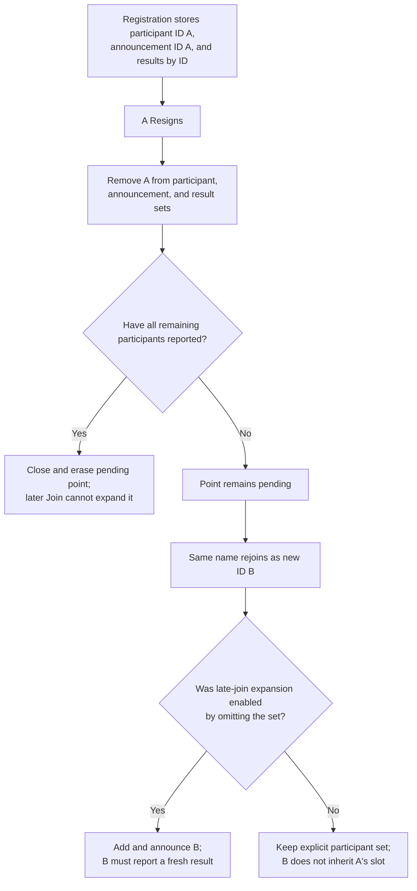

The focused [late-join registry test](../../cpp/tests/ieee1516_2025_federation_registry_synchronization_point_late_join_explicit_set_catch2.cpp#L3)
compares omitted-set expansion with an explicit set, but the new members have
different names and no participant first Resigns. The focused
[resignation service-report test](../../cpp/tests/service_report_file_federation_synchronized_resignation_catch2.cpp#L131)
checks one achieved member and one unachieved member leaving an explicit-set
point; it does not rejoin the departing name or cover late-join expansion.
No focused test combines a pending point, participant Resign, same-name
rejoin, and a new achievement. The combined flow is source-derived. The
configured-process Join/Resign adapters and their event delivery are separate
from this registry transition; the cited embedded tests do not establish
process callback or notification-order behavior.

### One Join can expand several pending points

At a successful 2025 Join boundary, the shared registry walks every currently
pending synchronization point. It skips points registered with an explicit
set; for each omitted-set point, it inserts the new federate ID into the
participant and announced sets and appends an announcement carrying that
point's own label and tag. The result is a per-Join batch, possibly empty or
containing announcements for several points. The registry mutation happens
while constructing that batch; adapters then submit or enqueue the resulting
announcements as part of their own Join path.

The configured-process Join path treats failure to enqueue the batch as a Join
failure and invokes membership rollback. Resign cleanup removes the new ID
from pending point state and can itself complete a barrier. This is an
implementation transaction boundary, not evidence that all generated
announcements are atomically delivered or that the standard prescribes these
internal steps. The embedded and process adapters must be read separately.

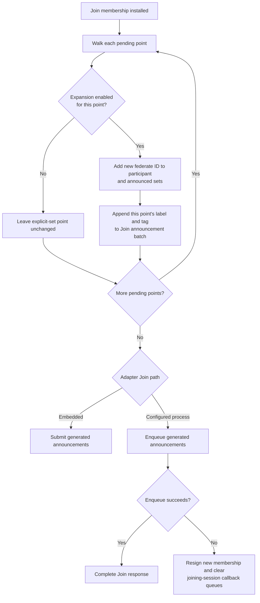

The [registry loop](../../cpp/src/internal/federation/federation_registry.cpp#L228)
constructs the per-point batch. The [embedded Join hook](../../cpp/src/internal/runtime/umbra_rti_ambassador_federation_lifecycle.cpp#L746)
submits it after membership installation; the [configured-process Join path](../../cpp/src/internal/federation/process_federation_service_lifecycle.cpp#L855)
enqueues it and rolls back on failure. Resign cleanup removes the ID from
each pending point ([cleanup loop](../../cpp/src/internal/federation/federation_registry_resign_lifecycle.cpp#L928));
process rollback also clears the joining session's queued synchronization
announcements ([session cleanup](../../cpp/src/internal/federation/process_federation_service_lifecycle.cpp#L98)).
The direct [registry test](../../cpp/tests/ieee1516_2025_federation_registry_synchronization_point_late_join_explicit_set_catch2.cpp#L3)
has two pending points but only one is expandable, so it expects exactly one
announcement. The [process rollback case](../../cpp/tests/ieee1516_2025_connection_process_mom_resign_removal_order_catch2.cpp#L293)
exercises one pending synchronization announcement, then verifies Join
cleanup and retry at [the assertions](../../cpp/tests/ieee1516_2025_connection_process_mom_resign_removal_order_catch2.cpp#L428).
No focused case makes one Join expand two or more pending points, or injects a
batch-enqueue failure after multiple point mutations. Those multi-point and
partial-batch outcomes remain source-derived; this is not cross-profile parity
evidence.

### The status roster follows the current participant set

The Federation MOM's status response is a query-time view of the point's
current synchronization set. In Umbra's 2025 embedded registry, the planner
iterates that set while holding the registry lock; for each current ID it
assigns `NoActivity` when no announcement is recorded, `MovingToSyncPoint`
when announced but not yet achieved, or `WaitingForRestOfFederation` after an
achievement report. A successful late-join expansion inserts the fresh ID in
both the participant and announced sets, so a subsequent query includes that
member as moving. Resign removes the departing ID from the participant,
announcement, and achievement state, so a later query omits that ID. If
Resign completes the barrier, the point is erased and a subsequent status
query for its label returns an empty roster. These are implementation
observations; the roster is not a history of former participants.

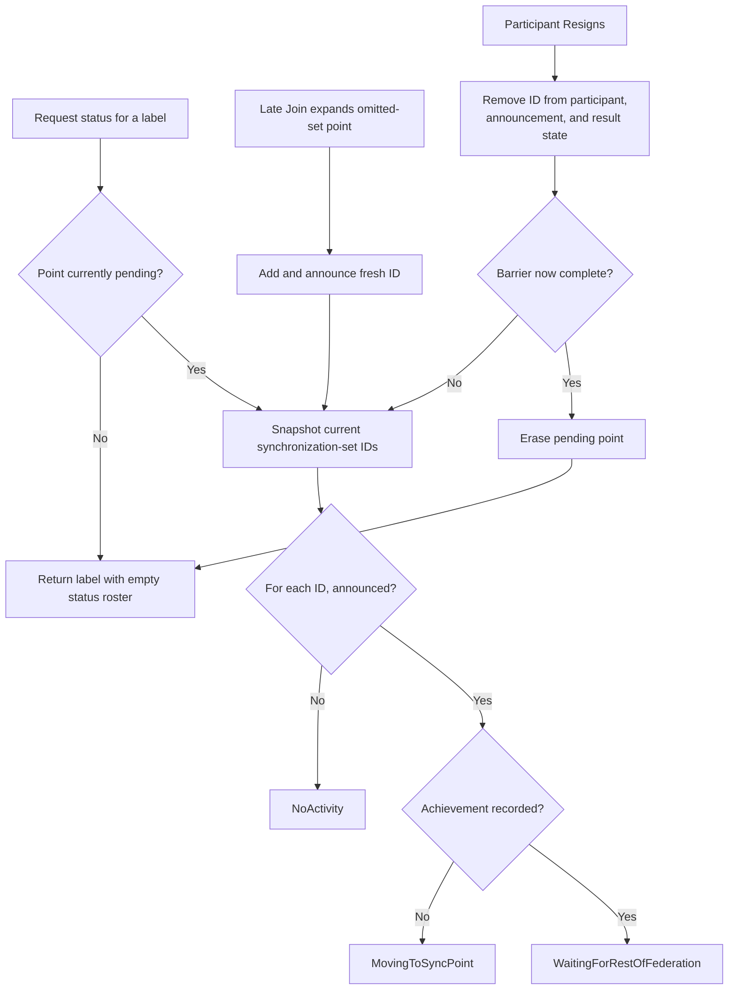

The [MOM status planner](../../cpp/src/internal/federation/federation_registry_mom_synchronization_reporting.cpp#L124)
reads the current set and maps each entry; [late-Join expansion](../../cpp/src/internal/federation/federation_registry.cpp#L248)
and [departure cleanup](../../cpp/src/internal/federation/federation_registry_resign_lifecycle.cpp#L928)
change that state. The focused [MOM query test](../../cpp/tests/ieee1516_2025_federation_mom_synchronization_reports_catch2.cpp#L150)
asserts the 2-to-3 status change after achievement, an empty response for an
unknown label, and an empty active-point list after completion. It does not
query status across late Join or Resign. The direct [late-Join test](../../cpp/tests/ieee1516_2025_federation_registry_synchronization_point_late_join_explicit_set_catch2.cpp#L49)
checks announcements and barrier completion, not the MOM roster; the focused
[Resign test](../../cpp/tests/service_report_file_federation_synchronized_resignation_catch2.cpp#L186)
checks completion/report order, not a status query. The combined transitions
in the chart are source-derived, and configured-process MOM query behavior
remains outside this evidence.

### Resign removes the departing member's result before forming the failed set

The embedded 2025 Resign transition first erases the departing federate ID
from the point's participant, announced, and achieved state. It then checks
whether every remaining participant has reported. If this removal completes
the barrier, the registry forms `failedToSyncSet` from the false results that
remain in the achievement map and prepares notifications only for the
remaining synchronization-set IDs. A departing member's prior `false` result
is therefore absent from that completion result. If another remaining member
is still outstanding, the point stays pending and can complete later. This
describes the current implementation transition; it does not characterize a
general standard rule for failed-set behavior on resignation.

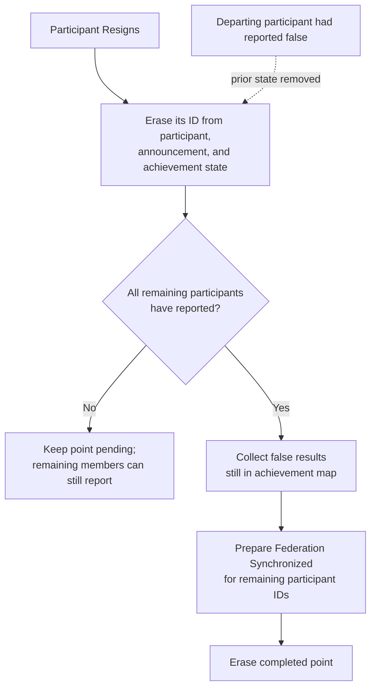

The [Resign cleanup](../../cpp/src/internal/federation/federation_registry_resign_lifecycle.cpp#L928)
erases the result before the [completion check and failed-set collection](../../cpp/src/internal/federation/federation_registry_resign_lifecycle.cpp#L934).
The focused [resignation completion case](../../cpp/tests/service_report_file_federation_synchronized_resignation_catch2.cpp#L186)
has the remaining member achieve successfully and the departing member leave
without reporting; it verifies an empty failed set and that the remaining
member's service report is written before callback observation. It does not
test departure after a `false` achievement, departure of the only remaining
unreported participant, or a still-pending point after resignation. Those
branches remain source-derived and no configured-process equivalent is
claimed.

### A completed label leaves the pending registry, but reuse is not test-established

Duplicate-label rejection applies while a point with that label is pending.
When the final participant reports, the embedded registry prepares the
federation-synchronized notifications and erases the pending point. A later
registration with the same label therefore no longer finds that earlier point
in the registry's pending-label map. This describes the current 2025 embedded
implementation only; it does not establish that reusing a completed label is
permitted or required by IEEE 1516.1-2025.

The focused duplicate-registration case proves rejection while the original
point is pending and that the rejected attempt leaves its tag, participant
expansion, and eventual completion intact. The ordinary two-member scenario
proves completion and then checks that another achievement for the removed
label raises `SynchronizationPointLabelNotAnnounced`; it does not attempt a
new registration using that label. No focused embedded or configured-process
test was found for same-label registration after completion. Do not infer
re-registration behavior or cross-profile parity from the registry erase.

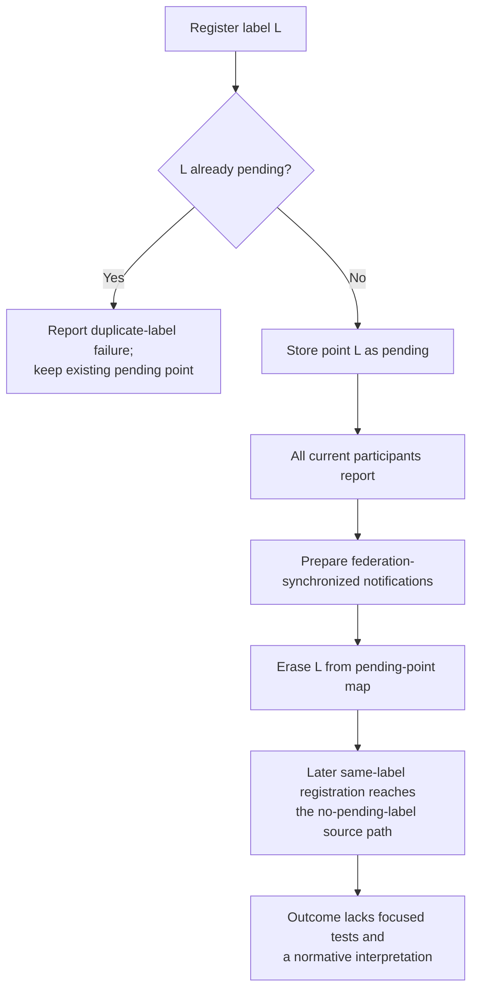

The relevant source is the [duplicate check and insertion](../../cpp/src/internal/federation/federation_registry.cpp#L161)
and [completion erase](../../cpp/src/internal/federation/federation_registry.cpp#L342).
The [pending duplicate test](../../cpp/tests/synchronization_point_catch2.cpp#L240)
does not re-register after completion; the [two-member completion case](../../cpp/tests/synchronization_point_catch2.cpp#L168)
checks only the subsequent achievement failure. The configured-process
duplicate cases are likewise pending-point cases. This Mermaid view is an
implementation trace with an explicit evidence gap, not a standard-state
machine.

### Each membership-loss event removes one ID across all pending points

The shared resignation cleanup receives one departing federate ID and scans
the federation's pending synchronization-point map. For each point, it removes
that ID and reevaluates the point independently. A single Resign or forced
connection-loss event can therefore close more than one point, producing one
notification plan per completed point for each remaining participant. A
completed point is erased before iteration continues or another member-loss
event is processed, so a later departure cannot complete that same pending
label again. Umbra does not process multiple departed IDs as one atomic
membership-loss batch in these paths; successive losses are separate registry
transitions against the updated state.

Forced connection loss enters this shared cleanup with the member's configured
automatic Resign action, then routes the resulting synchronization
notifications through the profile-specific adapter. The embedded ambassador
submits callback notifications after registry mutation; the configured-process
service enqueues federation-synchronized events. These are separate delivery
paths, not evidence of complete profile parity.

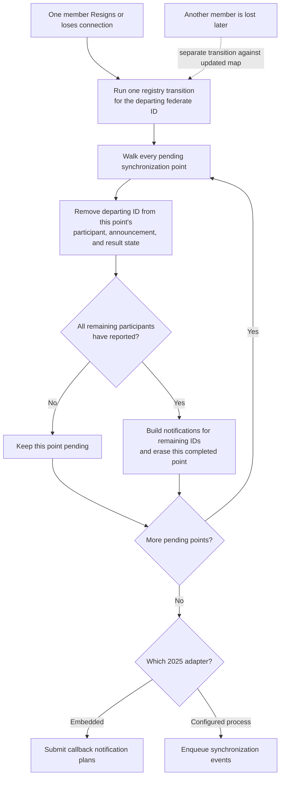

The [shared per-point resignation loop](../../cpp/src/internal/federation/federation_registry_resign_lifecycle.cpp#L928)
removes each completed point as it plans notifications. Embedded forced loss
uses [connectionLostWithFinalServiceReportReservation](../../cpp/src/internal/runtime/umbra_rti_ambassador_membership_loss.cpp#L281)
and later [submits synchronization notifications](https://github.com/sheepfling/umbra/blob/c9c5a9e410539b039cd8bba35b53d0ef2b24d180/cpp/src/internal/runtime/umbra_rti_ambassador_membership_loss.cpp#L421);
the process endpoint calls [registry connectionLost](../../cpp/src/internal/federation/process_federation_service_connection_loss.cpp#L170)
and [enqueues returned notifications](../../cpp/src/internal/federation/process_federation_service_connection_loss.cpp#L90).
The focused voluntary [Resign completion test](../../cpp/tests/service_report_file_federation_synchronized_resignation_catch2.cpp#L186)
covers one point and one departing member. No focused test was found for one
departure completing multiple pending points, sequential departures through
one active barrier, or forced connection loss during a pending barrier. The
multi-point and forced-loss chart branches are source-derived; no 2010 behavior
or adapter parity is implied.

## Achievement is a fan-in, not a per-caller completion

In the current registry implementation, an accepted
`synchronizationPointAchieved` records that caller's first result.
Until all current members have reported, there is no federation-synchronized
notification. When the last required result arrives, Umbra collects the
participants whose recorded result was false, prepares a notification for each
current participant in the barrier, and removes the pending point. A repeat
achievement does not replace a participant's first result or create another
result slot. Both adapters accept it while the point remains pending; the
configured-process handler creates no new synchronization event unless the
shared registry returns a completion plan. After removal, a further achievement
is rejected as an unannounced label. The common registry's first-result
insertion and the process adapter's completion-only enqueue gate show this
boundary ([first result](../../cpp/src/internal/federation/federation_registry.cpp#L304),
[process enqueue gate](../../cpp/src/internal/federation/process_federation_service_request_handlers.cpp#L286)).

The state view counts reports, not only successful achievements. A `false`
result still satisfies that participant's report slot; it is included in the
failed-to-synchronize set when the barrier closes, provided that participant
remains in the set at completion. Both a successful and failed first report
can leave other participants outstanding. In the inspected registry model,
the first report for a one-member set is also the final report and closes the
point. The source implements this count comparison directly; the focused public
scenario covers a two-member point whose second report is `false`, not a
one-member point or an early failed report followed by another participant's
later achievement.

#### An early false result does not close the barrier

This is a source-derived two-member ordering. If B reports `false` first, the
2025 embedded registry records that first result but leaves the point pending
while A remains outstanding. When A later reports `true`, the registry plans
completion for the current participants and includes B in
`failedToSyncSet`. The focused public test covers the same final set in the
opposite order—A succeeds before B reports `false`—so the early-failure order
below is not directly test-established. Callback entry remains a separate
adapter and callback-model boundary.

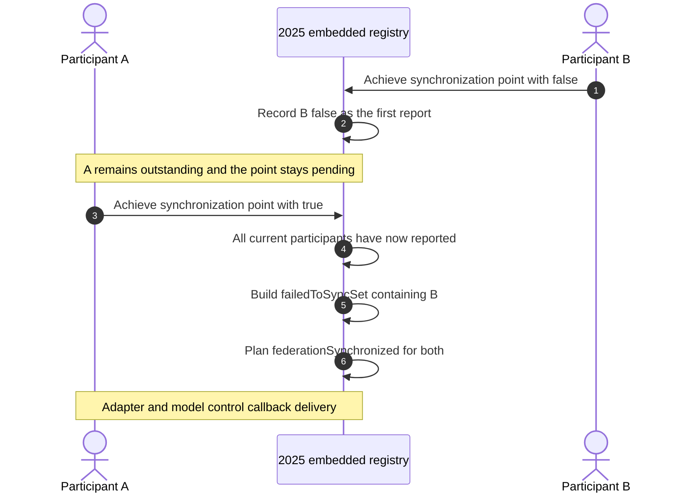

The source count check and notification construction are in the
[2025 registry achievement path](../../cpp/src/internal/federation/federation_registry.cpp#L307).
The focused [embedded scenario](../../cpp/tests/synchronization_point_catch2.cpp#L168)
asserts the same final failed set after a successful report followed by the
false report; it does not reverse that order. Its later repeated call is after
the point has completed and asserts `SynchronizationPointLabelNotAnnounced`
([post-completion check](../../cpp/tests/synchronization_point_catch2.cpp#L180)).
The configured-process success case reports once per participant
([case](../../cpp/tests/ieee1516_2025_connection_synchronization_restore_catch2.cpp#L636));
its failure case checks an out-of-set caller and one eligible `false` report
([case](../../cpp/tests/ieee1516_2025_connection_synchronization_failure_catch2.cpp#L647)).
Neither tests an accepted repeat while pending. The Save/Restore cases above
call Achieve after restoring an unachieved point, not after restoring a prior
result. No focused test checks a changed boolean on a repeated report, an
accepted repeat after late Join, or a repeated report against a restored
non-empty result map.

### A false result is not a failed service call

Keep three observations separate when reading §4.17:

| Boundary | Meaning in the selected embedded 2025 evidence |
| --- | --- |
| Service result | `synchronizationPointAchieved` returns `void`. The pinned API declares `SynchronizationPointLabelNotAnnounced`; the focused case sees it when it reports again after the point has completed and been removed. That is a synchronous typed exception, not a synchronization-result callback. |
| Participant report | `successfully=false` is accepted as the participant's result in the focused case; the call returns normally, and that federate is later included in `failedToSyncSet`. The Boolean argument is result data, not an exception indicator. |
| Federation outcome | `federationSynchronized` reports the aggregate result when the current barrier closes. In the embedded source, notification submission follows the accepted registry operation and lock release but remains inside the public service method. The paired HLA_EVOKED and HLA_IMMEDIATE tests demonstrate both dispatch models but do not assert callback order relative to a particular service return. |

The pinned [service signature and exception declaration](../../third_party/ieee1516.1-2025/include/RTI/RTIambassador.h#L280),
[false-result and failed-set assertions](../../cpp/tests/synchronization_point_catch2.cpp#L168),
[post-completion exception assertion](../../cpp/tests/synchronization_point_catch2.cpp#L179),
[embedded service boundary](../../cpp/src/internal/runtime/umbra_rti_ambassador_federation_lifecycle.cpp#L1314),
and [callback-model cases](../../cpp/tests/synchronization_point_catch2.cpp#L242)
support this bounded distinction. It is not process-profile parity evidence.

The configured process endpoint preserves the public `void` service and
callback distinction but adds a private correlated result for the adapter to
translate into status or a typed exception. The final
`federationSynchronized` notification is a separate recipient event. With
pushed events, the service sends that event before its correlated response;
the client buffers it while waiting, then unlocks and submits it before
returning the private result to the adapter. Thus an `HLA_IMMEDIATE` callback
may run before the public service returns, while `HLA_EVOKED` leaves the task
for a later evoke. With push disabled, the service retains the event for a
later `receive_interaction` request. Push/poll delivery and callback-model
selection are independent, but the selected process tests cover only
the [HLA_EVOKED/polling case](../../cpp/tests/ieee1516_2025_connection_synchronization_failure_catch2.cpp#L457)
and [HLA_IMMEDIATE/pushed case](../../cpp/tests/ieee1516_2025_connection_synchronization_failure_catch2.cpp#L679). See the
[source-derived process ordering trace](HLA-2025-CALLBACK-AND-SERVICE-ORDERING-FLOW-GUIDE.md#process-endpoint-service-responses-and-synchronization-events-are-separate)
for the exact boundaries and test limits; this is not an HLA callback-order
rule or embedded/process parity claim.

#### In the process push path, callback failure follows barrier closure

The configured-process push route has a narrow source-derived exception edge:
the server closes the barrier before delivering the final notification, while
the client may dispatch that notification before the public service reaches its
normal success-report step. This is implementation behavior, not a normative
callback-order or rollback rule:

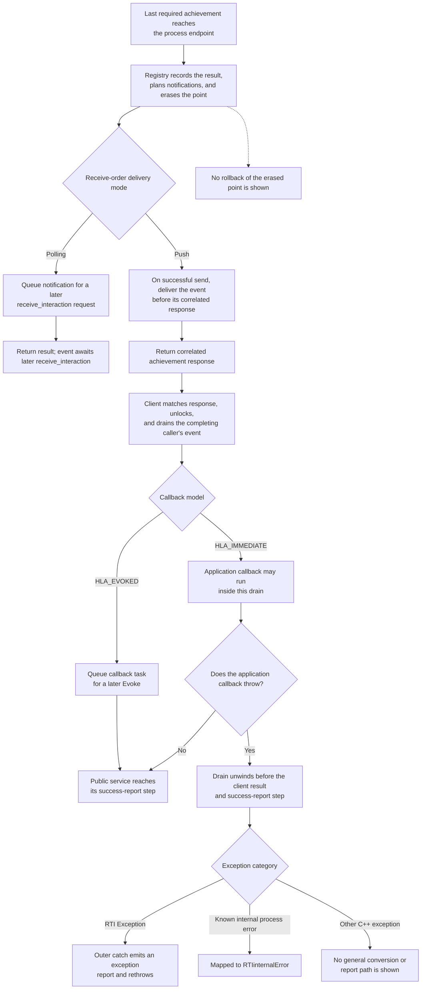

The server-side achievement handler asks the registry to close the point,
queues or sends the resulting per-recipient notifications, and only then
returns the correlated response ([handler](../../cpp/src/internal/federation/process_federation_service_request_handlers.cpp#L242),
[registry commit](../../cpp/src/internal/federation/federation_registry.cpp#L128),
[push/poll routing](../../cpp/src/internal/federation/process_federation_service_notifications.cpp#L360)).
On the pushed route, the completing caller's client matches that response,
unlocks the request exchange, and dispatches buffered events before returning
the result to the RTI adapter ([request dispatch](../../cpp/src/internal/federation/process_federation_client.cpp#L919),
[event submission](../../cpp/src/internal/federation/process_federation_client_callback_dispatch.cpp#L274),
[immediate callback submission](../../cpp/src/internal/callbacks/callback_dispatcher.cpp#L122),
[immediate drain and rethrow](../../cpp/src/internal/callbacks/callback_dispatcher.cpp#L311),
[callback invocation](../../cpp/src/internal/callbacks/callback_session.cpp#L46)).
The adapter appends its successful service report only after that client call
returns; it maps known process protocol/client/bridge errors to
`RTIinternalError`, while its outer exception-report path catches RTI
`Exception` objects ([adapter](../../cpp/src/internal/runtime/umbra_rti_ambassador_federation_lifecycle.cpp#L1276),
[known internal-error mapping](../../cpp/src/internal/runtime/umbra_rti_ambassador_federation_lifecycle.cpp#L1327),
[success-report step](../../cpp/src/internal/runtime/umbra_rti_ambassador_federation_lifecycle.cpp#L1314),
[outer RTI-exception catch](../../cpp/src/internal/runtime/umbra_rti_ambassador_federation_lifecycle.cpp#L1390)).
Thus a throwing `HLA_IMMEDIATE` callback can escape after the barrier has
already been erased and before the normal success-report step. The inspected
wrapper does not show a catch-all conversion or reporting rule for every C++
exception type. The focused process cases use a non-throwing recorder
([callback](../../cpp/tests/ieee1516_2025_connection_synchronization_failure_catch2.cpp#L160),
[polling case](../../cpp/tests/ieee1516_2025_connection_synchronization_failure_catch2.cpp#L457),
[pushed case](../../cpp/tests/ieee1516_2025_connection_synchronization_failure_catch2.cpp#L679));
they do not inject callback failure or assert post-error barrier state or
service-report contents. The HLA_EVOKED callback runs at a later Evoke and has
its own callback-exception boundary, outside this achievement-call trace.
Treat the exception path as source-only, not as HLA semantics.

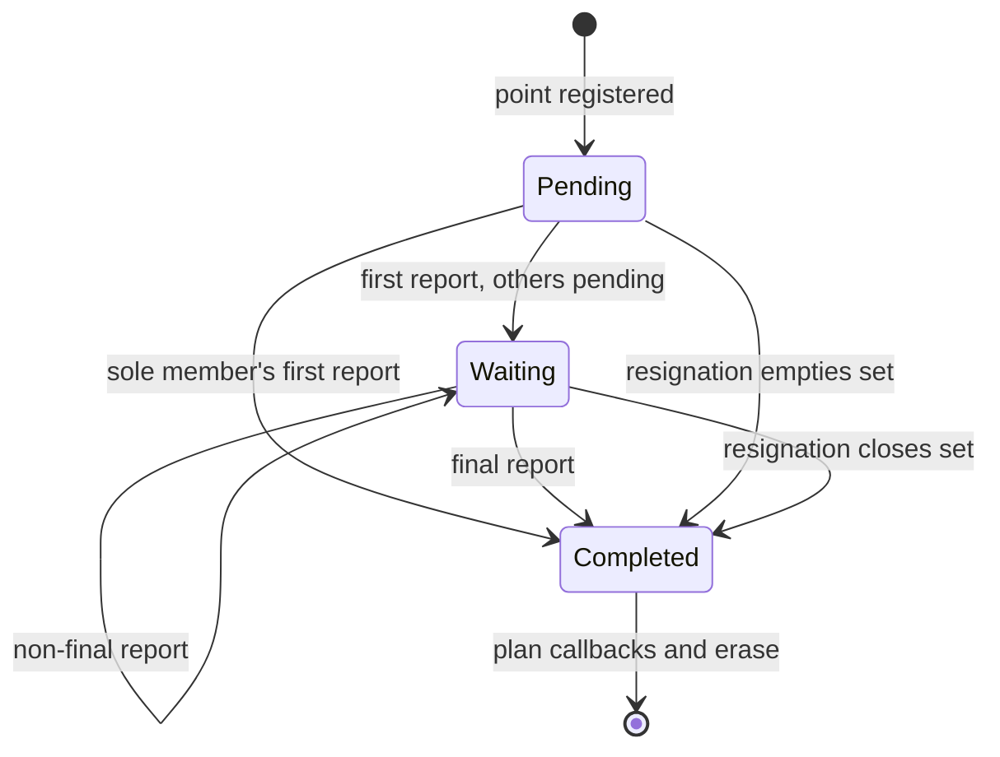

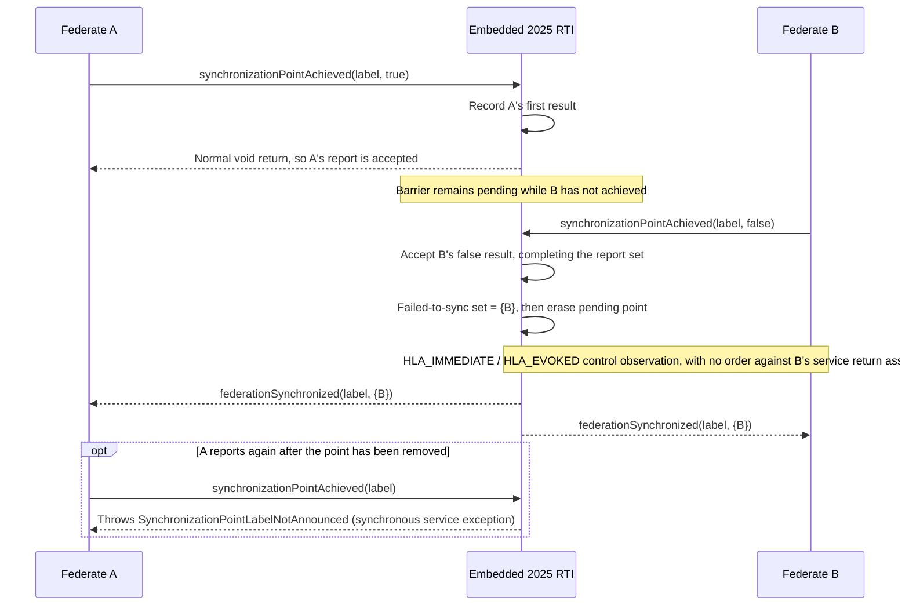

### Member departure can close a pending barrier

If a participant resigns before the barrier completes, resignation removes it
from the participant, announced, and achieved sets and re-evaluates completion.
It is not automatically reported as a failed achievement. For example, if A
has achieved and B resigns, A can receive `federationSynchronized` with an empty
failed-to-synchronize set. This is an Umbra behavior demonstrated by the focused HLA_EVOKED
[2025 embedded service-report case](../../cpp/tests/service_report_file_federation_synchronized_resignation_catch2.cpp#L186). The
[test source](../../cpp/tests/service_report_file_federation_synchronized_resignation_catch2.cpp#L30) uses `rti1516_2025`, and its Catch2 target is
declared in the [2025 Federation Management target list](../../cmake/ieee1516_2025_federation_management_catch2_targets.cmake#L368); consult
the standard before treating this as a normative interpretation.

Cleanup removes the departing participant's stored result before checking
the remaining set. Thus a departing participant's earlier `false` result is
also absent from the eventual failed set; the barrier closes only if every
remaining participant already has a result, and otherwise stays pending.
This is visible in source, but the focused resignation scenario covers only a
successful result from the remaining member and an unachieved departing
member. It does not test resignation after a recorded `false`, or a departure
that leaves other participants outstanding.

The registrant and the barrier participants are separate roles in this
implementation. Registration checks and uses the registrant's callback route,
then stores a point containing its synchronization, announcement, and
achievement sets; the stored point has no registrant ID
([registration path](../../cpp/src/internal/federation/federation_registry.cpp#L127),
[point state](../../cpp/src/internal/federation/federation_registry.hpp#L2341)).
The configured-process test registers from a sender while its explicit set
contains only the receiver: the sender gets the registration result, but only
the receiver is announced and can achieve; after the receiver completes, the
sender receives no `federationSynchronized` callback
([receiver-only set case](../../cpp/tests/ieee1516_2025_connection_synchronization_failure_catch2.cpp#L618)).
If that outside-set registrant later departs, the resignation cleanup's set
erasures do not remove a barrier participant or change the point's member
state, and completion planning selects recipients from the current
synchronization set. If the departing registrant is also in the set, ordinary
participant removal applies. This distinction is source-derived; the cited
process case does not test registrant departure while the point is pending,
and no normative departure rule is inferred here.

The focused configured-process receiver-only-set scenarios do resign the
outside-set sender, but only after the receiver has achieved and the point has
completed. They establish the role distinction and post-completion teardown,
not the pending-point resignation case. Source inspection shows why the latter
does not change barrier membership: the stored point contains no registrant
identity, and departure cleanup edits only its participant, announcement, and
achievement sets. No pending point is removed merely because its original
registrant leaves.

In Umbra's 2025 path, forced connection loss reaches this same member-removal
transition: the registry's `connectionLost` entry calls the shared resignation
logic, and the barrier cleanup does not branch on the forced-loss flag. It
removes the lost member from the synchronization, announced, and achieved
sets before checking completion. The lost member is not added to
`failedToSyncSet`; that set is built from remaining recorded `false` results.
If no participants remain, the point is erased with no callback recipient. If
all remaining participants have achieved, the point closes and notifications
are planned for the remaining members with usable routes; otherwise the point
stays pending. This is source-derived behavior, not a portable HLA transport-
loss rule.

##### Umbra 2025 forced-loss branch (source-derived)

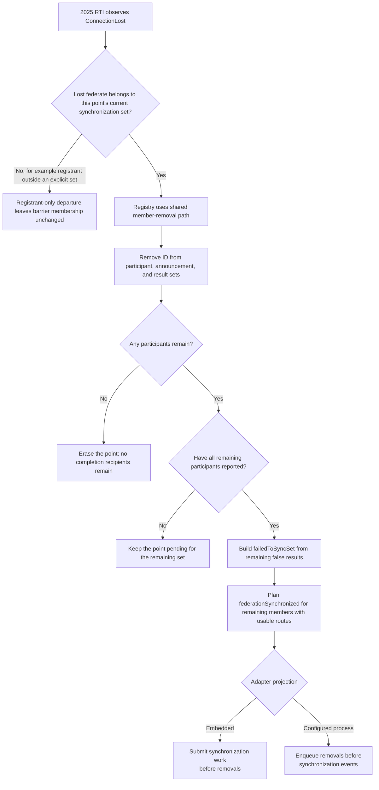

The chart isolates barrier completion from the automatic `ResignAction`,
which controls separate ownership and object cleanup. Its forced-loss and
adapter branches are source-derived, not portable HLA requirements.

The adapter branches expose one further source-only distinction: embedded
voluntary Resign and ConnectionLost submit the planned
`federationSynchronized` work before they queue object-removal work
([Resign](../../cpp/src/internal/runtime/umbra_rti_ambassador_federation_lifecycle.cpp#L1002),
[ConnectionLost](../../cpp/src/internal/runtime/umbra_rti_ambassador_membership_loss.cpp#L438)).
The configured-process Resign and ConnectionLost paths share a result
dispatcher that enqueues object removals before synchronization events
([removals](../../cpp/src/internal/federation/process_federation_service_connection_loss.cpp#L83),
[synchronization events](../../cpp/src/internal/federation/process_federation_service_connection_loss.cpp#L91),
[Resign caller](../../cpp/src/internal/federation/process_federation_service_request_handlers.cpp#L160)).
These are source call/enqueue orders; they do not guarantee recipient callback
entry order across callback models or event transport. The focused embedded
voluntary-resignation case proves barrier completion after one participant
leaves, but it has no object-removal callback to order against
([2025 embedded test](../../cpp/tests/service_report_file_federation_synchronized_resignation_catch2.cpp#L186)).
The configured-process synchronization cases instead complete through an
explicit achievement, and its late-Join rollback case exercises failure
cleanup after announcement queueing
([receiver-only barrier](../../cpp/tests/ieee1516_2025_connection_synchronization_failure_catch2.cpp#L618),
[late-Join rollback](../../cpp/tests/ieee1516_2025_connection_process_mom_resign_removal_order_catch2.cpp#L428)).
Neither tests public Resign removing an unachieved participant from a pending
barrier, so that process completion branch remains source-derived. This is a
separate gap from the forced-ConnectionLost test gap below.
No focused active-barrier ConnectionLost case asserts either adapter's
synchronization-versus-removal order.

The lost application does not invoke public `resignFederationExecution`; the
RTI-side loss path performs membership removal, while its automatic
ResignAction controls separate ownership and object cleanup. See the
[lifecycle guide's forced-loss map](HLA-2025-FEDERATION-AND-FEDERATE-LIFECYCLE-FLOW-GUIDE.md#connection-loss-forced-resignation-is-a-different-entry-path).

Both adapters project the registry's synchronization notifications: embedded
membership loss submits callback work, while the process connection-loss
dispatcher projects receive events by queueing them for polling or pushing
them to the session. No focused
connection-loss-during-active-synchronization test was found in the
loss-focused Catch2 sources or process connection-lifecycle TCK source. The
voluntary resignation test above is one embedded `HLA_EVOKED` scenario only;
it does not verify the forced-loss route or process callback/event delivery.

The process projection is specific to synchronization notifications. The
shared member-removal transition can also plan active Save/Restore failure
notifications, but the lifecycle guide's [active-operation departure
audit](HLA-2025-FEDERATION-AND-FEDERATE-LIFECYCLE-FLOW-GUIDE.md#active-federation-save-and-restore-during-member-exit)
records that the inspected process dispatcher does not project those events.
Do not infer identical process notification delivery from the shared registry
transition; neither protocol's connection-loss interaction has a focused
process runtime test.

That barrier question is distinct from the lifetime of a completion callback
already planned for a recipient that then leaves. The source-bounded 2025
embedded/process comparison and its test limits are documented in the
[callback recipient-departure section](HLA-2025-CALLBACK-AND-SERVICE-ORDERING-FLOW-GUIDE.md#recipient-departure-after-planning-but-before-observation).

## Save/restore preserves an in-flight barrier

The route-free state-image record keeps a pending point's label, user tag,
synchronization set, announced set, late-join-expansion flag, and each first
achievement result; callback routes are deliberately absent. [Capture](../../cpp/src/internal/federation/federation_registry_state_image_capture.cpp#L416)
copies those fields, [encoding](../../cpp/src/internal/federation/federation_state_image.cpp#L1897)
writes them, and [decode validation](../../cpp/src/internal/federation/federation_state_image_codec_support.hpp#L346)
requires ordered, unique IDs and containment between the participant,
announcement, and achievement sets. [Restore](../../cpp/src/internal/federation/federation_registry_state_image_restore.cpp#L412)
rebuilds the point, requires a non-empty participant set whose members remain
joined in both the saved and live federation state, and rebinds future
notifications through the live federation routes. The sequences below isolate
this barrier ledger from the federation-wide save/restore protocol and callback
gates in the [save/restore guide](HLA-2025-FEDERATION-SAVE-RESTORE-FLOW-GUIDE.md).

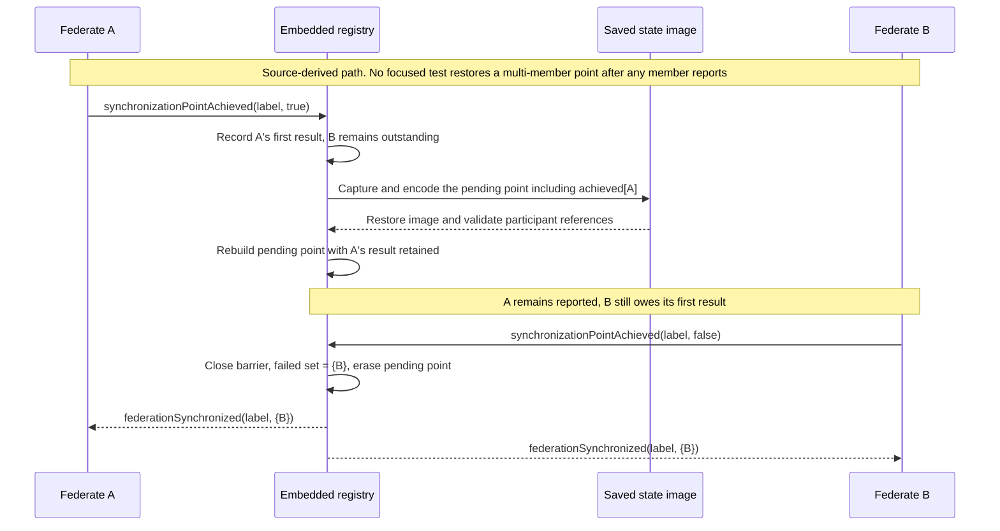

### Focused coverage: two unachieved explicit members across a fresh registry

The [public HLA_EVOKED case](../../cpp/tests/ieee1516_2025_restore_synchronization_point_rebinding_catch2.cpp#L11)
saves one explicit point for two announced members before either has achieved.
It then replaces the registry, rejoins the same member type under new IDs, and
restores the point. The following trace is the test's bounded scenario; the
fresh-registry identity-rebinding rules are Umbra implementation behavior.

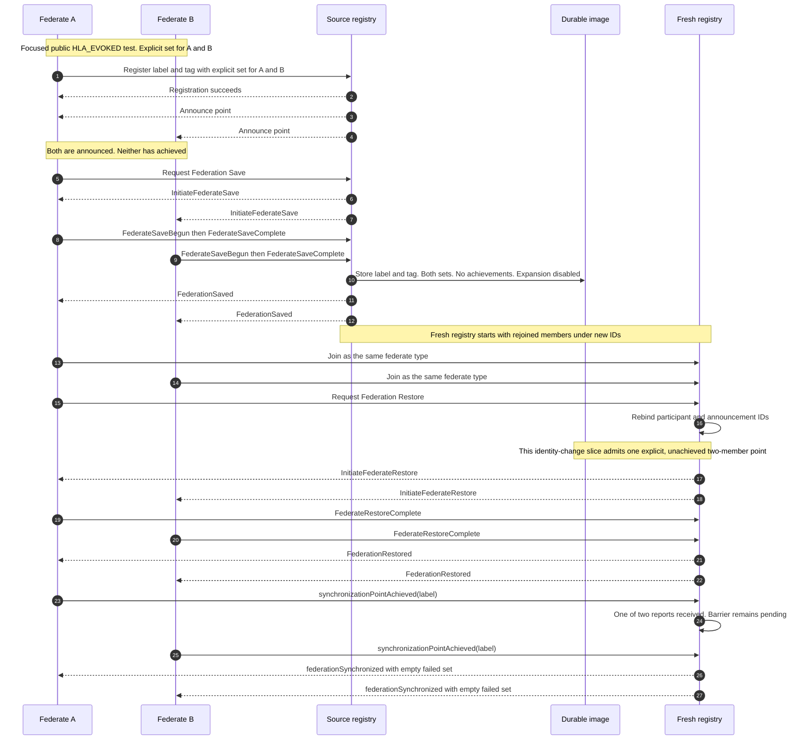

This test covers a multi-member point restored with no prior achievement
results. The saved image asserts `lateJoinExpansionAllowed=false`, both saved
IDs in the participant and announced sets, and an empty achievement map. After
restore, A's first report leaves the point pending; B's report completes it and
both members observe an empty failed set. The case does not test a late join
after restore or a previously recorded result.

For the fresh-registry durable-image path **when saved member identities
change**, the current rebind gate is narrower than the general state-image
format: it admits one standalone explicit point for exactly two federation
members, with both announced, late-join expansion disabled, and no achievement
entries. The [admission predicate](../../cpp/src/internal/federation/federation_registry_restore_control.cpp#L302)
and [rebindable-ledger check](../../cpp/src/internal/federation/federation_registry_restore_control.cpp#L636)
enforce that slice; the [rebind step](../../cpp/src/internal/federation/federation_registry_restore_control.cpp#L794)
rewrites the participant and announcement IDs. Since the predicate requires an
empty achievement map, it does not demonstrate rebinding a prior `true` or
`false` result. Do not generalize this identity-change case to every durable
restore or to configured-process behavior.

The evidence is narrower than the source path:

- The public-API `HLA_IMMEDIATE` and `HLA_EVOKED` restore cases each save a
  one-member, announced-but-unachieved point, complete the live point after the
  save, restore, and achieve the restored point. They do not include a second
  participant with a result already recorded at save time. Their test cases
  are [immediate](../../cpp/tests/ieee1516_2025_federation_management_save_restore_catch2.cpp#L574)
  and [evoked](../../cpp/tests/ieee1516_2025_federation_management_save_restore_catch2.cpp#L853).
- The [fresh-registry public case](../../cpp/tests/ieee1516_2025_restore_synchronization_point_rebinding_catch2.cpp#L117)
  covers two explicit, announced members with no achievements and changed IDs.
  It exercises that exact identity-rebind slice, not partial achievement
  persistence.
- The codec round-trip fixture checks that a recorded `false` achievement
  survives encode/decode. It does not exercise registry restore or barrier
  fan-in.
- The fresh-registry filesystem test restores a one-member,
  announced-but-unachieved point. It does not assert restoration of prior
  achievements.
- The configured-process service sends Save and Restore requests to the shared
  registry ([save handler](../../cpp/src/internal/federation/process_federation_service_save_restore.cpp#L184),
  [restore handler](../../cpp/src/internal/federation/process_federation_service_save_restore.cpp#L344)),
  but the focused process synchronization case covers registration and
  achievement without Save/Restore ([case](../../cpp/tests/ieee1516_2025_connection_synchronization_restore_catch2.cpp#L458)).
  No focused configured-process case was found that saves or restores a pending
  synchronization point.

Together these tests do not establish an end-to-end restore of a multi-member
barrier with one or more achievement results already recorded at save time.
Save/restore is not the same as completing or re-registering the point.

### Restore followed by late Join: announcement and completion handoff

Keep three transitions distinct. First, with stable member IDs, Restore keeps
the expansion flag and earlier achievement results. A later Join is admitted
through the shared pending-point helper: it adds the newcomer to the
participant and announcement sets while retaining earlier results. The new
participant therefore owes its own achievement report; the barrier completes
only after every current participant has reported. The existing
[partial-result late-Join trace](#a-partial-result-survives-an-expanding-join)
shows this fan-in for an ordinary, non-restored point. The Restore-to-Join
composition is source-derived; no focused case covers that full sequence.

Second, admission creates an announcement plan, while callback observation
happens through a profile-specific route. The embedded Join submits its plan
after the membership transition and releases its locks; the recipient
dispatcher then applies `HLA_IMMEDIATE` or `HLA_EVOKED` behavior
([Join hook](../../cpp/src/internal/runtime/umbra_rti_ambassador_federation_lifecycle.cpp#L746),
[announcement submission](../../cpp/src/internal/runtime/umbra_rti_ambassador_synchronization_notification_dispatch.cpp#L25)).
The configured-process Join uses the same registry helper and passes its plan
to the process announcement queue
([process Join](../../cpp/src/internal/federation/process_federation_service_lifecycle.cpp#L855),
[queue selection](../../cpp/src/internal/federation/process_federation_service_notifications.cpp#L286)).
With `pushReceiveOrderEvents` enabled, that queue sends an event frame; with it
disabled, the service retains the event for a later `receive_interaction`
poll. The client then submits the announcement callback through its bridge.
Push versus poll is a process transport choice, independent of the HLA
callback model. The [process callback guide](HLA-2025-PROCESS-ENDPOINT-REQUEST-AND-CALLBACK-FLOW-GUIDE.md#polling-family-priority-is-not-pushed-stream-fifo)
shows the event-family and callback handoff.

Third, when the newcomer reports, barrier completion creates a
`FederationSynchronized` notification plan for each current participant. Each
recipient reaches its callback through the corresponding embedded or process
route described in the [completion callback trace](HLA-2025-CALLBACK-AND-SERVICE-ORDERING-FLOW-GUIDE.md#federation-synchronized-after-barrier-completion).
That explains the source path, not a tested Restore-to-Join-to-completion
sequence or a normative callback timing/order rule.

#### Saved results determine the expanded barrier's failed set

This symbolic Umbra 2025 trace starts after successful stable-ID Restore. The
restored point has participants `P={A,B}`, an earlier result `R[A]=rA`, and
late-join expansion enabled. `rA`, `rB`, and `rC` each represent the first
boolean result for that member. Save/Restore callback choreography is omitted;
the trace focuses on how the restored result combines with a later Join.

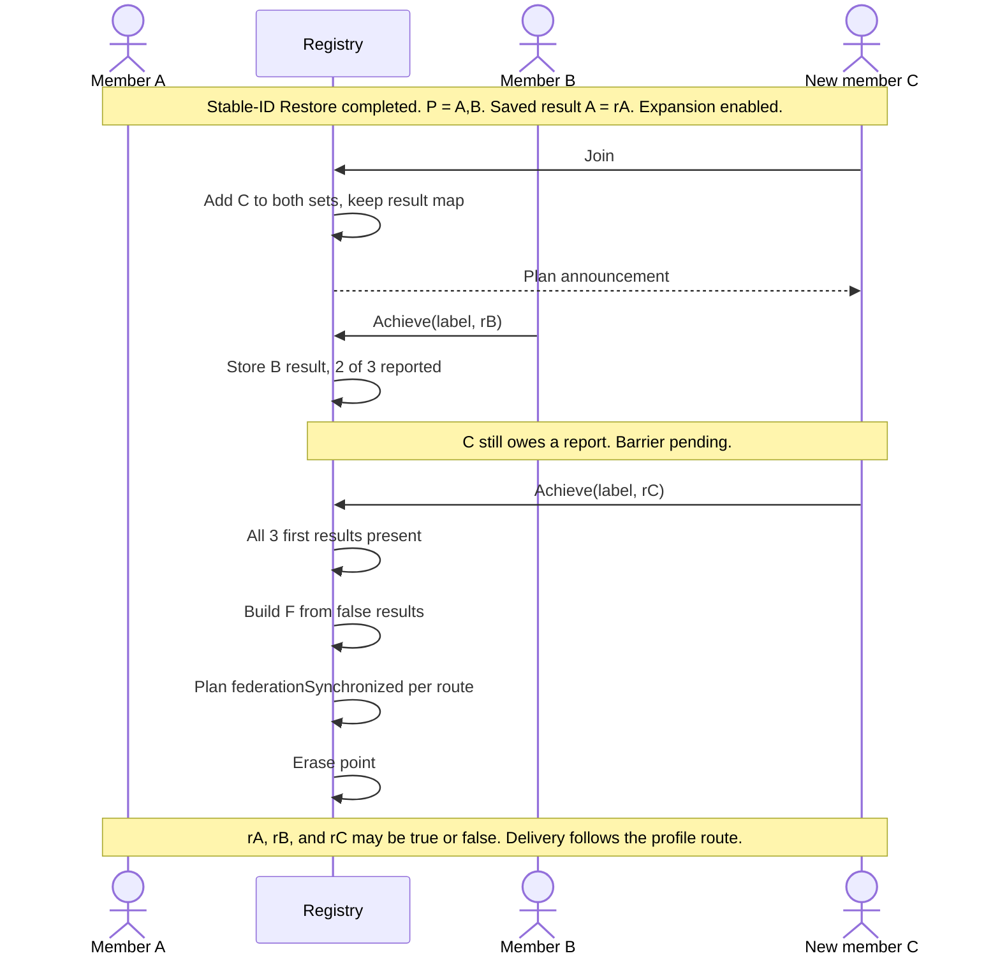

State-image capture copies the achieved-result map, serialization retains each
boolean, and stable-ID Restore validates that every result belongs to an
announced participant before restoring it
([capture](../../cpp/src/internal/federation/federation_registry_state_image_capture.cpp#L416),
[encoded result](../../cpp/src/internal/federation/federation_state_image.cpp#L1913),
[restore validation and copy](../../cpp/src/internal/federation/federation_registry_state_image_restore.cpp#L452)).
The Join helper adds C to the participant and announced sets without changing
the map. Achievement inserts only a member's first result, waits until all
current participants have result entries, then collects every `false` result
and prepares notifications for members with callback routes before erasing the
point ([Join expansion](../../cpp/src/internal/federation/federation_registry.cpp#L248),
[achievement and completion](../../cpp/src/internal/federation/federation_registry.cpp#L307)).
Thus a saved `true` is absent from the failed set, while a saved `false` remains
in it; B's and C's later results contribute by the same rule. The subsequent
embedded and configured-process delivery routes are described above.

The focused cases establish only separate pieces: the codec fixture round
trips a recorded `false` result but does not apply it to a live registry
([assertion](../../cpp/tests/ieee1516_2025_federation_state_image_codec_catch2.cpp#L415));
the public Restore case saves an unachieved one-member point
([case](../../cpp/tests/ieee1516_2025_federation_management_save_restore_catch2.cpp#L574));
the two-member changed-ID Restore case has an empty result map and expansion
disabled ([case](../../cpp/tests/ieee1516_2025_restore_synchronization_point_rebinding_catch2.cpp#L117));
and the ordinary late-Join scenario joins before anyone reports
([scenario](../../cpp/tests/synchronization_point_catch2.cpp#L183)). None
combines a saved partial result, stable-ID Restore, later expansion, and
completion. The diagram is therefore source-derived rather than
test-established.

The focused evidence has narrower boundaries. The embedded public
synchronization scenario exercises an ordinary omitted-set late Join under
both callback models, then continues through achievement; it does not Restore
first ([scenario](../../cpp/tests/synchronization_point_catch2.cpp#L109),
[evoked](../../cpp/tests/synchronization_point_catch2.cpp#L339),
[immediate](../../cpp/tests/synchronization_point_catch2.cpp#L350)). The
configured-process late-Join rollback/retry case uses the service option's
default `pushReceiveOrderEvents=false` and explicitly serves
`receive_interaction`; it verifies that a failed Join does not leak the
announcement and that retry yields one announcement
([default option](../../cpp/src/internal/federation/process_federation_service.hpp#L80),
[test service setup](../../cpp/tests/ieee1516_2025_connection_process_mom_resign_removal_order_catch2.cpp#L121),
[poll request handling](../../cpp/tests/ieee1516_2025_connection_process_mom_resign_removal_order_catch2.cpp#L215),
[retry assertions](../../cpp/tests/ieee1516_2025_connection_process_mom_resign_removal_order_catch2.cpp#L428)).
It does not test pushed late-Join delivery, prior achievement, or Restore.
Accordingly, the combined announcement and completion path remains a
source-based explanation rather than a cross-profile test result.

### Restored barrier followed by member departure

The generic state-image restore path reconstructs the participant set,
announcement set, late-join flag, and achievement map, after checking that the
saved participant IDs remain joined in both the staged and live federation.
When those IDs remain stable, a saved partial result can continue into the
restored barrier. A later Resign or ConnectionLost then enters the shared
member-departure cleanup described above: it removes that member from all
three sets and reevaluates the remaining participants
([restore applier](../../cpp/src/internal/federation/federation_registry_state_image_restore.cpp#L416),
[shared departure cleanup](../../cpp/src/internal/federation/federation_registry_resign_lifecycle.cpp#L928)).

Changed IDs take a narrower route. The current identity-rebind gate admits one
standalone explicit point for exactly two joined members, with both announced,
late-join expansion disabled, and no saved achievement results. It rewrites
the participant and announcement IDs; it does not rebind a non-empty result
map. Do not read the partial-progress sequence above as evidence that a
partially achieved point can be restored across changed member identities
([rebind gate](../../cpp/src/internal/federation/federation_registry_restore_control.cpp#L302),
[ID rewrite](../../cpp/src/internal/federation/federation_registry_restore_control.cpp#L794)).

For a stable-ID image, Restore also reconstructs the expansion flag and saved
achievement results ([flag](../../cpp/src/internal/federation/federation_registry_state_image_restore.cpp#L437),
[results](../../cpp/src/internal/federation/federation_registry_state_image_restore.cpp#L452)).
If expansion is enabled, a later Join reaches the pending-point hook from both
the embedded ambassador and configured-process service
([embedded Join](../../cpp/src/internal/runtime/umbra_rti_ambassador_federation_lifecycle.cpp#L745),
[process Join](../../cpp/src/internal/federation/process_federation_service_lifecycle.cpp#L855)).
The shared registry hook adds the newcomer to the participant and announcement
sets without clearing earlier results
([expansion helper](../../cpp/src/internal/federation/federation_registry.cpp#L248)).
The newcomer must then report before the barrier can close; the existing
[partial-result late-Join trace](#a-partial-result-survives-an-expanding-join)
shows that fan-in. This Restore-then-Join composition is source-derived: no
focused test saves a partially achieved expandable point, restores it, and then
joins another member. The changed-ID test cannot cover this continuation
because that gate requires expansion disabled and an empty result map.
The public one-member Restore case uses omitted-set registration and restores
an unachieved point without saved results; it achieves after Restore but does
not add a member afterward
([case](../../cpp/tests/ieee1516_2025_federation_management_save_restore_catch2.cpp#L574)).

```mermaid
flowchart TD
  accTitle: Stable-ID Restore, late Join, and member departure in Umbra 2025
  accDescr: Source-derived example: Restore keeps partial achievement results, a late Join expands the pending set, and departure removes that member and its result before completion is reconsidered. It shows embedded callback submission versus configured-process push or poll projection; no focused test covers the combined path.
  Image["Saved pending point:<br/>members A, B, D; A=false; B=true;<br/>D outstanding; expansion enabled"] --> Restore["Stable-ID Restore rebuilds<br/>members, results, and expansion"]
  Restore --> Join["Late Join C adds C to participant<br/>and announcement sets; keep A and B results"]
  Join --> Depart["A Resigns or has ConnectionLost"]
  Depart --> Remove["Remove A from participant,<br/>announcement, and result sets"]
  Remove --> Remaining["Current members: B, C, D;<br/>A's old false result is gone"]
  Remaining --> Reported{"Have B, C, and D<br/>all reported?"}
  Reported -->|No| Wait["Keep point pending;<br/>wait for outstanding first reports"]
  Wait --> Reported
  Reported -->|Yes| Failed["Build failed set from false results<br/>for remaining members only"]
  Failed --> Plans["Plan notifications for current members<br/>with usable callback routes"]
  Plans --> Erase["Erase pending point"]
  Erase --> Adapter{"Recipient adapter"}
  Adapter -->|Embedded| Embedded["Submit callback work"]
  Adapter -->|Configured process| Process["Push event or retain it for polling"]
```

The [fresh-registry public case](../../cpp/tests/ieee1516_2025_restore_synchronization_point_rebinding_catch2.cpp#L117)
tests changed IDs only for a two-member point with no prior results; both
members achieve after Restore, and their Resigns occur after the point has
completed ([post-completion teardown](../../cpp/tests/ieee1516_2025_restore_synchronization_point_rebinding_catch2.cpp#L209)).
The [filesystem Restore case](../../cpp/tests/ieee1516_2025_federation_registry_synchronization_point_filesystem_restart_catch2.cpp#L1)
keeps one member ID and saves no prior result. Neither combines a pending
restored point, a late Join, and participant departure. The embedded
[resignation completion case](../../cpp/tests/service_report_file_federation_synchronized_resignation_catch2.cpp#L186)
does show a member leaving an active two-member barrier, but it has no Restore,
late Join, or saved partial result. No focused active-barrier ConnectionLost
case was found. The configured-process synchronization case covers
registration and achievement separately
([case](../../cpp/tests/ieee1516_2025_connection_synchronization_restore_catch2.cpp#L458));
no focused process test saves or restores a pending point. The combined chart
is therefore source-derived, not a tested callback-order or normative
departure rule. Embedded delivery submits the planned callback work
([dispatch](../../cpp/src/internal/runtime/umbra_rti_ambassador_synchronization_notification_dispatch.cpp#L82));
configured-process delivery projects a notification into push or poll handling
([enqueue](../../cpp/src/internal/federation/process_federation_service_notifications.cpp#L358)).
The shared state transition is common, while these delivery paths and their
test evidence remain distinct. See the [federation Save/Restore view](HLA-2025-FEDERATION-SAVE-RESTORE-FLOW-GUIDE.md#restore-flow-admission-is-not-completion)
for the restore protocol boundary.

## Implementation and test evidence

| Concern | Umbra implementation | Focused evidence |
| --- | --- | --- |
| Public overloads, set-supplied distinction, callback routing | [2025 ambassador service](../../cpp/src/internal/runtime/umbra_rti_ambassador_federation_lifecycle.cpp#L1073) | [evoked embedded scenario](../../cpp/tests/synchronization_point_catch2.cpp#L242), [immediate embedded scenario](../../cpp/tests/synchronization_point_catch2.cpp#L253) |
| Participant selection, duplicate-label rejection, announcement, achievement fan-in | [embedded federation registry](../../cpp/src/internal/federation/federation_registry.cpp#L128), [late-join insertion](../../cpp/src/internal/federation/federation_registry.cpp#L248), [first-result insertion and current-set completion count](../../cpp/src/internal/federation/federation_registry.cpp#L304) | [late-join expansion and explicit-set boundary, before any achievement](../../cpp/tests/ieee1516_2025_federation_registry_synchronization_point_late_join_explicit_set_catch2.cpp#L49), [public API scenario](../../cpp/tests/synchronization_point_catch2.cpp#L113), which has achievements but no partial-result-before-late-Join interleaving |
| Registration rejection before point mutation | [registration preflight and insertion](../../cpp/src/internal/federation/federation_registry.cpp#L140) | The [embedded duplicate-label no-effect test](../../cpp/tests/synchronization_point_catch2.cpp#L240) confirms the original tag, late-Join expansion, and eventual completion survive rejection. Configured-process [HLA_EVOKED](../../cpp/tests/ieee1516_2025_connection_synchronization_failure_catch2.cpp#L457) and [HLA_IMMEDIATE](../../cpp/tests/ieee1516_2025_connection_synchronization_failure_catch2.cpp#L679) cases confirm duplicate failure and caller-not-in-set behavior. A nonjoined requested-set member has no focused implementation test. |
| Achievement is stored once per participant; first result wins; current-set result count closes the point | [achievement result insertion and set-size check](../../cpp/src/internal/federation/federation_registry.cpp#L304) | The [HLA_IMMEDIATE](../../cpp/tests/ieee1516_2025_federation_management_save_restore_catch2.cpp#L574) and [HLA_EVOKED](../../cpp/tests/ieee1516_2025_federation_management_save_restore_catch2.cpp#L853) one-member Save/Restore cases each achieve the restored point; the [two-member public case](../../cpp/tests/synchronization_point_catch2.cpp#L168) covers a false final result. These scenarios report once per participant; none repeats a participant with the opposite boolean before completion. |
| Registration result submitted before announcement batch | [callback submission adapter](../../cpp/src/internal/runtime/umbra_rti_ambassador.cpp#L1305) | The [HLA_EVOKED](../../cpp/tests/synchronization_point_catch2.cpp#L339) and [HLA_IMMEDIATE](../../cpp/tests/synchronization_point_catch2.cpp#L350) embedded scenarios demonstrate both callback models, but store registration and announcement reports separately and do not assert cross-callback order. The source submits registration result work before the announcement batch; that is Umbra call order, not a normative order claim. |
| Late-join hook and announcement submission | [join lifecycle hook](../../cpp/src/internal/runtime/umbra_rti_ambassador_federation_lifecycle.cpp#L713) | [late-join expansion test](../../cpp/tests/ieee1516_2025_federation_registry_synchronization_point_late_join_explicit_set_catch2.cpp#L49) |
| Process Join rollback after a late-join announcement is queued | [process Join's shared-registry expansion and queue submission](../../cpp/src/internal/federation/process_federation_service_lifecycle.cpp#L801), [announcement queue helper](../../cpp/src/internal/federation/process_federation_service_notifications.cpp#L285) | The [process MOM resign/removal-order case](../../cpp/tests/ieee1516_2025_connection_process_mom_resign_removal_order_catch2.cpp#L293) injects a Join failure after the announcement enters the joining session's queue; it asserts no leaked callback/reflection/announcement count, then a retry yields exactly one announcement ([failure and retry assertions](../../cpp/tests/ieee1516_2025_connection_process_mom_resign_removal_order_catch2.cpp#L428)). This process rollback case has no prior achievement report; it does not cover the partial-result-before-late-join interleaving or establish general HLA callback ordering/profile parity. |
| Partial achievement retained across omitted-set late-join expansion | [participant-set insertion](../../cpp/src/internal/federation/federation_registry.cpp#L250), [achievement result insertion and set-size check](../../cpp/src/internal/federation/federation_registry.cpp#L305), [configured-process Join expansion call](../../cpp/src/internal/federation/process_federation_service_lifecycle.cpp#L801) | The [direct late-join test](../../cpp/tests/ieee1516_2025_federation_registry_synchronization_point_late_join_explicit_set_catch2.cpp#L49) and [public late-join step](../../cpp/tests/synchronization_point_catch2.cpp#L199) followed by its [first achievement](../../cpp/tests/synchronization_point_catch2.cpp#L205) do not exercise an achievement before the late join. The [process late-Join rollback case](../../cpp/tests/ieee1516_2025_connection_process_mom_resign_removal_order_catch2.cpp#L428) also has no prior achievement. The partial-result-before-late-join sequence above is source-derived; neither profile has a focused test for this interleaving. |
| Resignation removes a member and its result, then can close the barrier | [resignation cleanup](../../cpp/src/internal/federation/federation_registry_resign_lifecycle.cpp#L928) | [2025 embedded resignation completion and report-order case](../../cpp/tests/service_report_file_federation_synchronized_resignation_catch2.cpp#L186) covers an achieved remaining member and an unachieved departing member; it does not cover a departing false result or a barrier that remains pending after departure. |
| Registrant outside an explicit pending set | [registration plan and stored point](../../cpp/src/internal/federation/federation_registry.cpp#L127), [point state](../../cpp/src/internal/federation/federation_registry.hpp#L2341), [resignation cleanup](../../cpp/src/internal/federation/federation_registry_resign_lifecycle.cpp#L928) | The [configured-process receiver-only set case](../../cpp/tests/ieee1516_2025_connection_synchronization_failure_catch2.cpp#L618) demonstrates separate registrant and participant roles. It does not test the registrant leaving while the point is pending; the no-membership-change path is source-derived. |
| Forced connection loss during a pending barrier | [registry forced-loss entry](../../cpp/src/internal/federation/federation_registry.cpp#L426), [shared participant-set cleanup](../../cpp/src/internal/federation/federation_registry_resign_lifecycle.cpp#L928), [embedded result extraction](../../cpp/src/internal/runtime/umbra_rti_ambassador_membership_loss.cpp#L237), [callback submission](../../cpp/src/internal/runtime/umbra_rti_ambassador_membership_loss.cpp#L438) and [callback projection](../../cpp/src/internal/runtime/umbra_rti_ambassador_synchronization_notification_dispatch.cpp#L82), [process connection-loss entry](../../cpp/src/internal/federation/process_federation_service_connection_loss.cpp#L170), [process enqueue call](../../cpp/src/internal/federation/process_federation_service_connection_loss.cpp#L91), [process event projection](../../cpp/src/internal/federation/process_federation_service_notifications.cpp#L358) | No focused loss-during-active-synchronization case was found in the loss-focused Catch2 files or process connection-lifecycle TCK source. The [voluntary embedded resignation case](../../cpp/tests/service_report_file_federation_synchronized_resignation_catch2.cpp#L186) verifies a two-member `HLA_EVOKED` scenario, not forced transport loss or process delivery. |
| Pending barrier image capture and restore | [capture](../../cpp/src/internal/federation/federation_registry_state_image_capture.cpp#L416), [encoding](../../cpp/src/internal/federation/federation_state_image.cpp#L1897), [decode checks](../../cpp/src/internal/federation/federation_state_image_codec_support.hpp#L346), [restore](../../cpp/src/internal/federation/federation_registry_state_image_restore.cpp#L412) | [HLA_IMMEDIATE one-member case](../../cpp/tests/ieee1516_2025_federation_management_save_restore_catch2.cpp#L574), [HLA_EVOKED one-member case](../../cpp/tests/ieee1516_2025_federation_management_save_restore_catch2.cpp#L853), [one-member registry restart](../../cpp/tests/ieee1516_2025_federation_registry_synchronization_point_filesystem_restart_catch2.cpp#L3), [recorded-false codec round trip](../../cpp/tests/ieee1516_2025_federation_state_image_codec_catch2.cpp#L406) |
| Changed-identity fresh-registry synchronization point | [admission predicate](../../cpp/src/internal/federation/federation_registry_restore_control.cpp#L302), [rebindable-ledger gate](../../cpp/src/internal/federation/federation_registry_restore_control.cpp#L636), [participant and announcement ID rewrite](../../cpp/src/internal/federation/federation_registry_restore_control.cpp#L794) | [two-member public HLA_EVOKED case](../../cpp/tests/ieee1516_2025_restore_synchronization_point_rebinding_catch2.cpp#L11) |
| Process registration result and recipient announcement | [service queues announcements before its response](../../cpp/src/internal/federation/process_federation_service_request_handlers.cpp#L229), [adapter dispatches the result](../../cpp/src/internal/runtime/umbra_rti_ambassador_federation_lifecycle.cpp#L1180) and later [drains pushed events](../../cpp/src/internal/runtime/umbra_rti_ambassador_federation_lifecycle.cpp#L1224) | The [HLA_EVOKED configured-process same-participant case](../../cpp/tests/ieee1516_2025_connection_synchronization_restore_catch2.cpp#L617) uses the omitted-set overload, so sender and receiver participate. It observes registration success after an Evoke while the sender's announcement is still absent, then observes that announcement after the next callback service. The paired [HLA_EVOKED receiver-only-set](../../cpp/tests/ieee1516_2025_connection_synchronization_failure_catch2.cpp#L457) and [HLA_IMMEDIATE pushed receiver-only-set](../../cpp/tests/ieee1516_2025_connection_synchronization_failure_catch2.cpp#L675) cases do not establish same-recipient order; no configured-process HLA_IMMEDIATE same-participant case was found. These are scoped Umbra observations, not a general callback-order rule. |
| Initial process registration announcement-enqueue failure | [registry commit before enqueue](../../cpp/src/internal/federation/process_federation_service_request_handlers.cpp#L201), [internal-error return](../../cpp/src/internal/federation/process_federation_service_request_handlers.cpp#L229), [client non-OK error conversion](../../cpp/src/internal/federation/process_federation_client_federation_management.cpp#L285), [poll queue and push staging](../../cpp/src/internal/federation/process_federation_service_notifications.cpp#L314) | No focused test injects enqueue failure during initial registration. The [Join rollback test](../../cpp/tests/ieee1516_2025_connection_process_mom_resign_removal_order_catch2.cpp#L428) covers late-Join cleanup only; it does not establish rollback for initial registration. |
| Process achievement result and federation outcome | [process achievement handler](../../cpp/src/internal/federation/process_federation_service_request_handlers.cpp#L242), [achievement adapter](../../cpp/src/internal/runtime/umbra_rti_ambassador_federation_lifecycle.cpp#L1314) | The same paired process cases verify a one-member `failedToSyncSet` after the receiver reports `false`, and `SynchronizationPointLabelNotAnnounced` when the out-of-set registrant tries to achieve. They do not test omitted-set late-join expansion or prove full embedded/process parity. |

These tests exercise named paths in Umbra's development profiles. In
particular, the focused late-join test exercises registry behavior directly;
the filesystem restart test exercises persistence; and the two-member rebind
test uses the public API with a fresh embedded registry. None is by itself
public-API conformance evidence for the standard's full Save/Restore rules.

## What this guide does not claim

- It does not merge or infer behavior for IEEE 1516.1-2010. That edition has a
  separate [bounded reference-RTI guide](HLA-2010-REFERENCE-RTI-FLOW-GUIDE.md).
- It does not assert that the source-derived explicitly empty set behavior is
  covered by a focused test.
- It does not establish an end-to-end save/restore test for a multi-member
  barrier with a partially completed achievement set. The focused two-member
  fresh-registry case saves with no achievements. It also lacks a focused test
  of a repeated achievement before barrier completion, a changed result on a
  repeat, a repeated report against a restored non-empty result map,
  partial-result-before-late-join expansion, or early-failure-then-later-
  achievement.
- It does not establish configured-process Save/Restore of a pending
  synchronization point, or that the process endpoint has every embedded
  behavior, ordering property, failure mode, or restart capability.
- It does not establish through focused tests that a repeated achievement with
  the opposite boolean preserves the first result, nor whether that
  implementation behavior is required by IEEE 1516.1-2025.
- It does not model every registration failure, transport race, callback queue
  policy, or save/restore failure path.
- It does not state exact normative clause text or replace checking the
  applicable clauses in the official standard.
- It does not add or revise Requirements Lab records.
