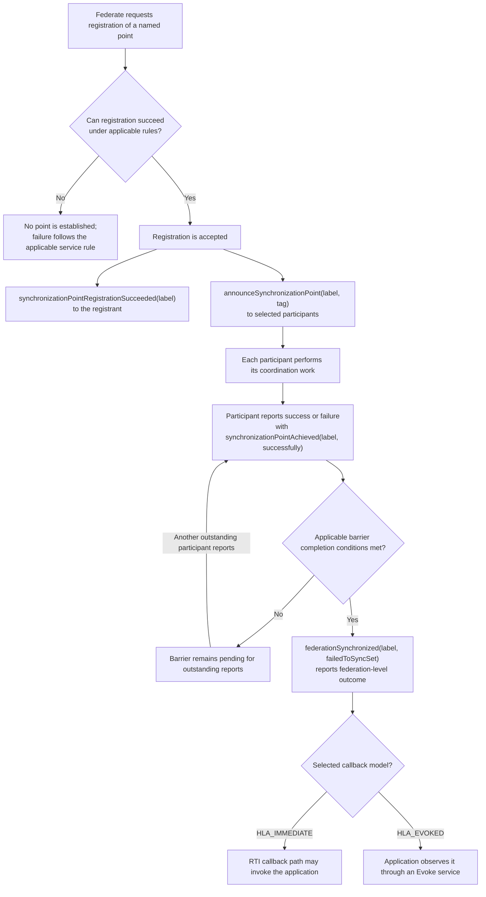
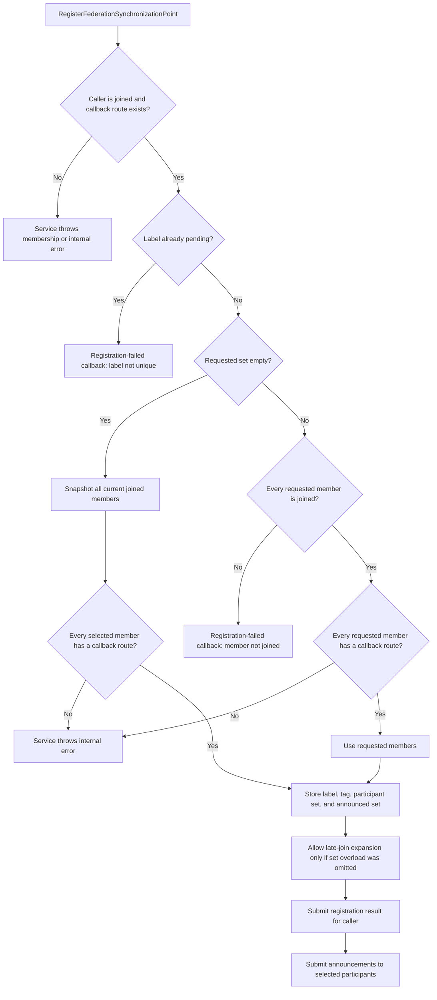
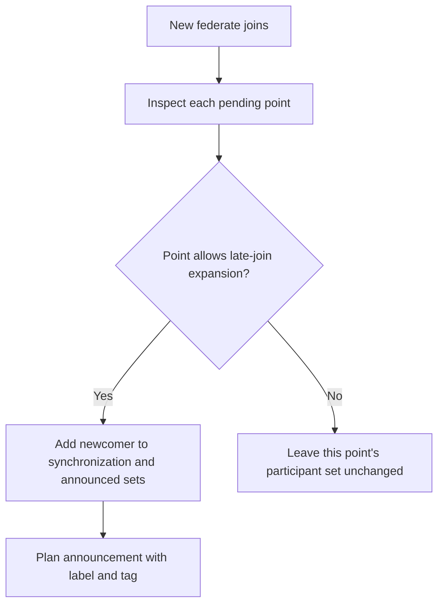
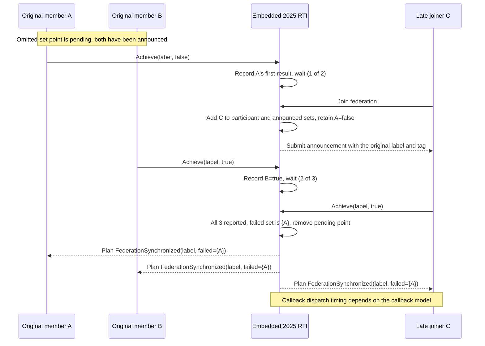
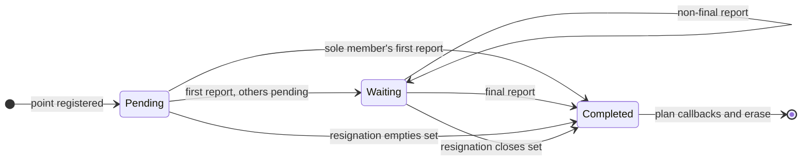
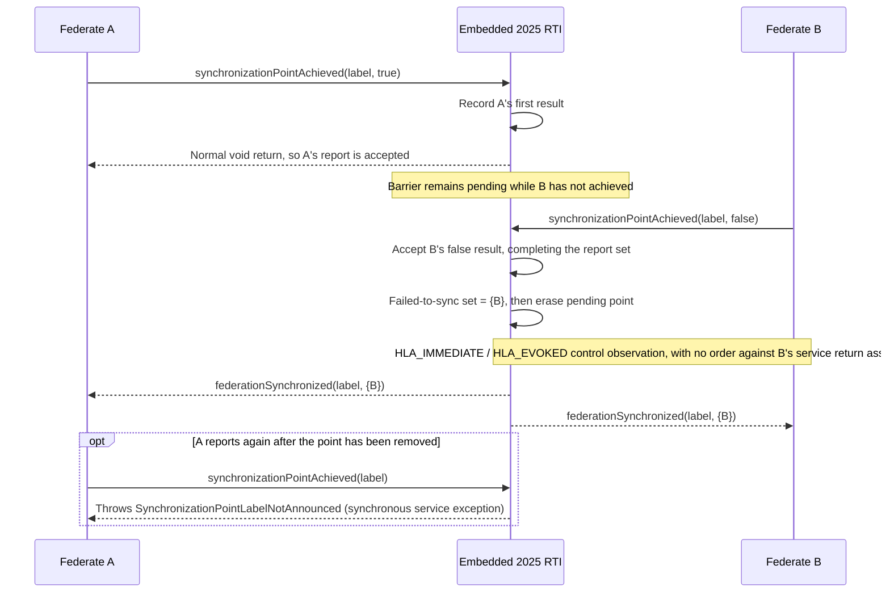
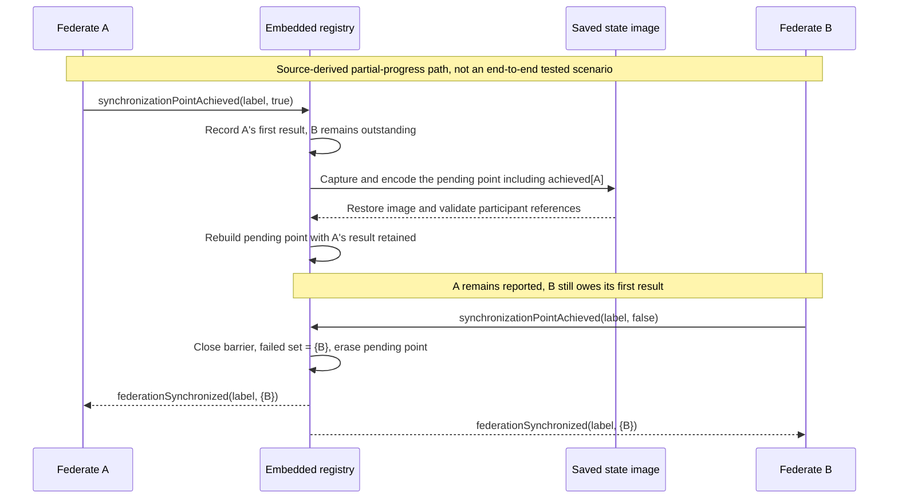

# IEEE 1516.1-2025 Federation Synchronization Points: Contributor Guide

An HLA synchronization point is a named coordination barrier for federates:
participants are selected and announced, each reports whether it achieved the
point, and completion is a separate federation-level outcome. It coordinates
federates; it does not advance logical time or create an application-wide atomic
transaction.

This guide uses that HLA-facing model to explain IEEE 1516.1-2025, then labels
Umbra's state transitions, callbacks, implementation-specific edges, and test
limits separately. It is not a substitute for the standard, a new source of
requirements, or a claim of conformance.

## Scope and authority

- **Standard boundary:** IEEE 1516.1-2025 only. The 2010 API/runtime is a
  separate compatibility stream and is not combined with this guide.
- **Implementation boundary:** synchronization-point behavior in Umbra's 2025
  embedded federation-management development profile, with selected tests for
  the configured process endpoint. Those are separate implementation paths;
  the tests do not establish full backend parity.
- **Normative authority:** the [official IEEE 1516.1-2025 Federate Interface
  Specification](https://standards.ieee.org/ieee/1516.1/6688/) defines the
  standard behavior. Source links below describe Umbra's current behavior;
  tests establish only their named scenarios. Neither code nor tests override
  the standard.
- **Traceability boundary:** this is explanatory Umbra documentation. It adds
  no Requirements Lab mappings or conformance evidence.

For adjacent but distinct protocols, see the [2025 federation lifecycle
guide](HLA-2025-FEDERATION-AND-FEDERATE-LIFECYCLE-FLOW-GUIDE.md), [callback and
service ordering guide](HLA-2025-CALLBACK-AND-SERVICE-ORDERING-FLOW-GUIDE.md),
[time-management guide](HLA-2025-TIME-MANAGEMENT-GUIDE.md), and [save/restore
guide](HLA-2025-FEDERATION-SAVE-RESTORE-FLOW-GUIDE.md).

## Keep synchronization, logical time, and membership distinct

The pinned API exposes three related but separate questions:

- **Synchronization:** `registerFederationSynchronizationPoint` and
  `synchronizationPointAchieved` report on a named barrier; the RTI later
  reports its federation-level result with `federationSynchronized`.
- **Logical time:** `timeAdvanceRequest` or `nextMessageRequest` concerns a
  time-management request, which may later produce `timeAdvanceGrant`. It is
  not barrier completion.
- **Membership:** `joinFederationExecution` and
  `resignFederationExecution` govern execution membership; neither is an
  achievement report for a synchronization label.

The API declares the synchronization and membership operations under
Federation Management Services and time requests under Time Management
Services ([`RTIambassador`](../../third_party/ieee1516.1-2025/include/RTI/RTIambassador.h#L212),
[time requests](../../third_party/ieee1516.1-2025/include/RTI/RTIambassador.h#L1226));
the synchronization callbacks [`announceSynchronizationPoint` and
`federationSynchronized`](../../third_party/ieee1516.1-2025/include/RTI/FederateAmbassador.h#L86)
are separate from [`timeAdvanceGrant`](../../third_party/ieee1516.1-2025/include/RTI/FederateAmbassador.h#L507).
A Join or Resign during a pending point is therefore a synchronization-rule
question; it is not itself an achievement. The late-join and resignation
effects below are labeled as standard-boundary questions or Umbra observations,
not generalized across editions.
For the protocol-by-protocol participant-set comparison, see the lifecycle
guide's [Join and active-protocol map](HLA-2025-FEDERATION-AND-FEDERATE-LIFECYCLE-FLOW-GUIDE.md#a-join-does-not-define-every-active-protocols-participant-set)
and the [Save/Restore Join boundary](HLA-2025-FEDERATION-SAVE-RESTORE-FLOW-GUIDE.md#join-crosses-a-separate-membership-admission-boundary).
The barrier-specific expansion behavior below is not a general membership or
Save/Restore rule.

## HLA vocabulary: registration, announcement, and completion differ

The 2025 API exposes a sequence of distinct operations and callbacks. Reading
their roles separately helps avoid treating a successful registration, a
participant's report, and federation-level completion as the same event:

| API surface | HLA-facing role | Do not conflate it with |
| --- | --- | --- |
| `registerFederationSynchronizationPoint(label, tag)` / `registerFederationSynchronizationPoint(label, tag, set)` (§4.14) | Request registration of a named point; the second overload supplies a synchronization set. | A registration result callback or a participant's announcement. |
| `synchronizationPointRegistrationSucceeded(label)` / `synchronizationPointRegistrationFailed(label, reason)` (§4.15) | Report the registration outcome. | The later result of the synchronization barrier. |
| `announceSynchronizationPoint(label, tag)` (§4.16) | Notify a participant of the point's label and tag. | That participant having achieved the point. |
| `synchronizationPointAchieved(label, successfully)` (§4.17) | Let a participant report its result for the point. | The federation-level completion notification. |
| `federationSynchronized(label, failedToSyncSet)` (§4.18) | Report the federation-level completion outcome and its failed-to-synchronize set. | A time-advance grant or a membership transition. |

These names and parameter roles are grounded in the pinned 2025
[`RTIambassador` declarations](../../third_party/ieee1516.1-2025/include/RTI/RTIambassador.h#L261)
and [`FederateAmbassador` callbacks](../../third_party/ieee1516.1-2025/include/RTI/FederateAmbassador.h#L72).
This is an API vocabulary map, not a substitute for the full §§4.14–4.18
service rules. It does not settle how the standard handles late join, resign,
an explicitly empty set, or exact callback ordering; the implementation
examples below keep those questions visibly bounded.

## HLA-level path: registration, reports, and federation outcome

This conceptual map connects the API roles without specifying how the RTI
selects or changes the participant set. A successful registration result,
participant announcements, individual achievement reports, and the final
federation-level result are separate events. The completion decision stands
for the applicable standard rules; this is not a prescribed total callback
order.

Successful registration is shown with two distinct notification effects: a
registration-result callback to the registrant and announcements to selected
participants. The fork intentionally does not order those callback paths.
Callback enablement, per-recipient dispatch, and exact observation timing are
also outside this HLA-level map; see
the [callback/service-ordering guide](HLA-2025-CALLBACK-AND-SERVICE-ORDERING-FLOW-GUIDE.md),
including its [process-endpoint synchronization trace](HLA-2025-CALLBACK-AND-SERVICE-ORDERING-FLOW-GUIDE.md#process-endpoint-service-responses-and-synchronization-events-are-separate)
for source-derived request/event ordering that is not an HLA ordering rule.
Participant-set construction, late join, resignation, and exact failure rules
remain service-specific questions; the embedded model below is evidence about
Umbra's 2025 profile, not a substitute for authorized standard text.

## The embedded 2025 state model

The HLA-level barrier description does not by itself specify every
implementation edge. In the embedded 2025 registry paths below, keep these
four sets and records distinct; this table is an implementation lens, not a
replacement for the standard's registration, resignation, or callback rules:

| State | Meaning |
| --- | --- |
| Synchronization set | Current participants whose achievement is required before the barrier completes. |
| Announced federates | Participants to whom the label has been announced; achievement is accepted only for an announced member. |
| Achieved federates | Participants that have reported, paired with their success/failure result. |
| Failed-to-synchronize set | The false results among the achieved participants when completion is formed; it is not the same thing as the participants who have not yet achieved. |

## Registration chooses the barrier participants

The API has an overload without a synchronization set and an overload with
one. Both initially create a barrier over the current joined members when the
requested set is empty. There is an implementation-specific distinction:
Umbra permits late-join expansion only when the set was **omitted**. Passing an
explicitly empty set snapshots the current members but does not opt into later
expansion. The direct test covers an explicit non-empty set and the omitted-set
overload; the explicitly empty-set distinction is currently source-derived and
does not have its own focused test.

The ordering in the final two boxes is the embedded adapter's submission
ordering: it submits the registering federate's succeeded/failed callback
before it submits the announcement batch. Whether callbacks run immediately or
wait for an evoke boundary depends on the callback model; this diagram does not
claim that the application has already executed the callback when the service
returns. The cited scenarios exercise both callback models, but do not assert
the relative registration/announcement order. That order is source-derived.
Separate process-endpoint public cases pair [HLA_EVOKED with polling](../../cpp/tests/ieee1516_2025_connection_synchronization_failure_catch2.cpp#L457)
and [HLA_IMMEDIATE with pushed events](../../cpp/tests/ieee1516_2025_connection_synchronization_failure_catch2.cpp#L674),
but their explicit set contains only the receiver, not the registering sender.
They therefore do not establish the same-recipient ordering either; these
selected combinations are not process-profile parity evidence. See the callback guide's
[process synchronization response/event trace](HLA-2025-CALLBACK-AND-SERVICE-ORDERING-FLOW-GUIDE.md#process-endpoint-service-responses-and-synchronization-events-are-separate)
for that bounded distinction.
See the callback guide's [Federation Synchronized dispatch view](HLA-2025-CALLBACK-AND-SERVICE-ORDERING-FLOW-GUIDE.md#federation-synchronized-after-barrier-completion)
for the post-barrier route, service-report, queue, and callback-model boundary.

## Late joiners change only an expandable barrier

The barrier's participant set is not always fixed at registration. After a
federate joins, Umbra checks every pending point. If expansion is enabled, the
new federate is added to both the synchronization set and announced set and is
sent that point's label and tag. It must then achieve the point too. An
explicit-set point, including one created through the explicit-empty overload,
does not expand.

The point allows expansion only when registration used the overload without an
explicit set. The newcomer must then report too. Existing reports are retained,
so a join after partial reports grows the participant count while the point is
still pending. That ordering is source-derived: the focused
[late-join test](../../cpp/tests/ieee1516_2025_federation_registry_synchronization_point_late_join_explicit_set_catch2.cpp#L16)
joins before any achievement call and does not cover partial-results-before-join.

### A partial result survives an expanding join

This trace starts after an omitted-set point has been announced to A and B. A
reports `false` while B is still pending; a late C then joins before the point
completes. The registry adds C to the barrier without discarding A's result,
so B's later report is not enough: C must report as well. The final notification
plan still identifies A as failed.

The registry source retains the achieved-result map when the join hook grows
the participant set, then compares the number of recorded results with that
new set size on each later achievement. The exact partial-result-before-join
interleaving is **not covered** by the cited tests: the direct late-join test
joins before any achievement, and the public HLA_EVOKED/HLA_IMMEDIATE
scenarios also join participants before reporting. This is a source-derived
state trace, not a test-observed transition. It describes notification
planning, not when application callbacks execute; see the callback guide for
the callback-model boundary.

## Achievement is a fan-in, not a per-caller completion

In the current registry implementation, an accepted
`synchronizationPointAchieved` records that caller's first result.
Until all current members have reported, there is no federation-synchronized
notification. When the last required result arrives, Umbra collects the
participants whose recorded result was false, prepares a notification for each
current participant in the barrier, and removes the pending point. A repeat
achievement does not replace a participant's first result or generate a second
completion. After removal, a further achievement is rejected as an unannounced
label.

The state view counts reports, not only successful achievements. A `false`
result still satisfies that participant's report slot; it is included in the
failed-to-synchronize set when the barrier closes, provided that participant
remains in the set at completion. Both a successful and failed first report
can leave other participants outstanding. In the inspected registry model,
the first report for a one-member set is also the final report and closes the
point. The source implements this count comparison directly; the focused public
scenario covers a two-member point whose second report is `false`, not a
one-member point or an early failed report followed by another participant's
later achievement.

### A false result is not a failed service call

Keep three observations separate when reading §4.17:

| Boundary | Meaning in the selected embedded 2025 evidence |
| --- | --- |
| Service result | `synchronizationPointAchieved` returns `void`. The pinned API declares `SynchronizationPointLabelNotAnnounced`; the focused case sees it when it reports again after the point has completed and been removed. That is a synchronous typed exception, not a synchronization-result callback. |
| Participant report | `successfully=false` is accepted as the participant's result in the focused case; the call returns normally, and that federate is later included in `failedToSyncSet`. The Boolean argument is result data, not an exception indicator. |
| Federation outcome | `federationSynchronized` reports the aggregate result when the current barrier closes. In the embedded source, notification submission follows the accepted registry operation and lock release but remains inside the public service method. The paired HLA_EVOKED and HLA_IMMEDIATE tests demonstrate both dispatch models but do not assert callback order relative to a particular service return. |

The pinned [service signature and exception declaration](../../third_party/ieee1516.1-2025/include/RTI/RTIambassador.h#L280),
[false-result and failed-set assertions](../../cpp/tests/synchronization_point_catch2.cpp#L168),
[post-completion exception assertion](../../cpp/tests/synchronization_point_catch2.cpp#L179),
[embedded service boundary](../../cpp/src/internal/runtime/umbra_rti_ambassador_federation_lifecycle.cpp#L1380),
and [callback-model cases](../../cpp/tests/synchronization_point_catch2.cpp#L242)
support this bounded distinction. It is not process-profile parity evidence.

The configured process endpoint preserves the public `void` service and
callback distinction but adds a private correlated result for the adapter to
translate into status or a typed exception. The final
`federationSynchronized` notification is a separate recipient event. With
pushed events, the service sends that event before its correlated response;
the client buffers it while waiting, then unlocks and submits it before
returning the private result to the adapter. Thus an `HLA_IMMEDIATE` callback
may run before the public service returns, while `HLA_EVOKED` leaves the task
for a later evoke. With push disabled, the service retains the event for a
later `receive_interaction` request. Push/poll delivery and callback-model
selection are independent, but the selected process tests cover only
the [HLA_EVOKED/polling case](../../cpp/tests/ieee1516_2025_connection_synchronization_failure_catch2.cpp#L457)
and [HLA_IMMEDIATE/pushed case](../../cpp/tests/ieee1516_2025_connection_synchronization_failure_catch2.cpp#L674). See the
[source-derived process ordering trace](HLA-2025-CALLBACK-AND-SERVICE-ORDERING-FLOW-GUIDE.md#process-endpoint-service-responses-and-synchronization-events-are-separate)
for the exact boundaries and test limits; this is not an HLA callback-order
rule or embedded/process parity claim.

### Member departure can close a pending barrier

If a participant resigns before the barrier completes, resignation removes it
from the participant, announced, and achieved sets and re-evaluates completion.
It is not automatically reported as a failed achievement. For example, if A
has achieved and B resigns, A can receive `federationSynchronized` with an empty
failed-to-synchronize set. This is an Umbra behavior demonstrated by a focused
HLA_EVOKED [service-report test](../../cpp/tests/service_report_file_federation_synchronized_resignation_catch2.cpp#L186);
consult the standard before treating it as a normative interpretation.

In Umbra's 2025 path, forced connection loss reaches this same member-removal
transition: the registry's `connectionLost` entry calls the shared resignation
logic, and the barrier cleanup does not branch on the forced-loss flag. It
removes the lost member from the synchronization, announced, and achieved
sets before checking completion. The lost member is not added to
`failedToSyncSet`; that set is built from remaining recorded `false` results.
If no participants remain, the point is erased with no callback recipient. If
all remaining participants have achieved, the point closes and notifications
are planned for the remaining members with usable routes; otherwise the point
stays pending. This source-derived 2025 behavior is not a portable transport-
loss rule or a 2010 claim.

The lost application does not invoke public `resignFederationExecution`; the
RTI-side loss path performs membership removal, while its automatic
ResignAction controls separate ownership and object cleanup. See the
[lifecycle guide's forced-loss map](HLA-2025-FEDERATION-AND-FEDERATE-LIFECYCLE-FLOW-GUIDE.md#connection-loss-forced-resignation-is-a-different-entry-path).

Both adapters project the registry's synchronization notifications: embedded
membership loss submits them to callback dispatch, while the process
connection-loss dispatcher enqueues corresponding events. No focused
connection-loss-during-active-synchronization test was found in the
loss-focused Catch2 sources or process connection-lifecycle TCK source. The
voluntary resignation test above is one embedded `HLA_EVOKED` scenario only;
it does not verify the forced-loss route or process callback/event delivery.

That barrier question is distinct from the lifetime of a completion callback
already planned for a recipient that then leaves. The source-bounded 2025
embedded/process comparison and its test limits are documented in the
[callback recipient-departure section](HLA-2025-CALLBACK-AND-SERVICE-ORDERING-FLOW-GUIDE.md#recipient-departure-after-planning-but-before-observation).

## Save/restore preserves an in-flight barrier

The state image records a pending point's label, user tag, synchronization set,
announced set, late-join-expansion flag, and each achievement result. Restore
rebuilds that pending state and checks that the set is non-empty, participants
are still joined, announcements belong to the set, and achievements belong to
the announced set without duplicates. The sequence below isolates this ledger
from the federation-wide save/restore protocol and callback gates in the
[save/restore guide](HLA-2025-FEDERATION-SAVE-RESTORE-FLOW-GUIDE.md).

The evidence is narrower than the source path:

- The public-API `HLA_IMMEDIATE` and `HLA_EVOKED` restore cases each save a
  one-member, announced-but-unachieved point, complete the live point after the
  save, restore, and achieve the restored point. They do not include a second
  participant with a result already recorded at save time.
- The codec round-trip fixture checks that a recorded `false` achievement
  survives encode/decode. It does not exercise registry restore or barrier
  fan-in.
- The fresh-registry filesystem test restores a one-member,
  announced-but-unachieved point. It does not assert restoration of prior
  achievements.

Together these tests do not establish an end-to-end restore of a multi-member
barrier with only some members already reported. Save/restore is not the same as
completing or re-registering the point.

## Implementation and test evidence

| Concern | Umbra implementation | Focused evidence |
| --- | --- | --- |
| Public overloads, set-supplied distinction, callback routing | [2025 ambassador service](../../cpp/src/internal/runtime/umbra_rti_ambassador_federation_lifecycle.cpp#L1073) | [evoked embedded scenario](../../cpp/tests/synchronization_point_catch2.cpp#L242), [immediate embedded scenario](../../cpp/tests/synchronization_point_catch2.cpp#L253) |
| Participant selection, duplicate-label rejection, announcement, achievement fan-in | [embedded federation registry](../../cpp/src/internal/federation/federation_registry.cpp#L111) | [late-join expansion and explicit-set boundary](../../cpp/tests/ieee1516_2025_federation_registry_synchronization_point_late_join_explicit_set_catch2.cpp#L16), [public API scenario](../../cpp/tests/synchronization_point_catch2.cpp#L113) |
| Achievement report count closes one-member sets on their first report | [achievement result insertion and set-size check](../../cpp/src/internal/federation/federation_registry.cpp#L291) | [two-member public case with a false final result](../../cpp/tests/synchronization_point_catch2.cpp#L168); no focused singleton achievement case was found in this bounded review |
| Registration result submitted before announcement batch | [callback submission adapter](../../cpp/src/internal/runtime/umbra_rti_ambassador.cpp#L1182) | [evoked](../../cpp/tests/synchronization_point_catch2.cpp#L242) and [immediate](../../cpp/tests/synchronization_point_catch2.cpp#L253) callback-model scenarios demonstrate dispatch, but do not assert relative callback order |
| Late-join hook and announcement submission | [join lifecycle hook](../../cpp/src/internal/runtime/umbra_rti_ambassador_federation_lifecycle.cpp#L740) | [late-join expansion test](../../cpp/tests/ieee1516_2025_federation_registry_synchronization_point_late_join_explicit_set_catch2.cpp#L16) |
| Partial achievement retained across omitted-set late-join expansion | [participant-set expansion](../../cpp/src/internal/federation/federation_registry.cpp#L233), [achievement fan-in](../../cpp/src/internal/federation/federation_registry.cpp#L262) | [direct late-join test](../../cpp/tests/ieee1516_2025_federation_registry_synchronization_point_late_join_explicit_set_catch2.cpp#L16) and [public callback-model scenarios](../../cpp/tests/synchronization_point_catch2.cpp#L113) do not exercise an achievement before the late join; the sequence above is source-derived |
| Resignation removes a member and can close the barrier | [resignation cleanup](../../cpp/src/internal/federation/federation_registry_resign_lifecycle.cpp#L918) | [resignation completion and callback/report ordering](../../cpp/tests/service_report_file_federation_synchronized_resignation_catch2.cpp#L186) |
| Forced connection loss during a pending barrier | [registry forced-loss entry](../../cpp/src/internal/federation/federation_registry.cpp#L424), [shared participant-set cleanup](../../cpp/src/internal/federation/federation_registry_resign_lifecycle.cpp#L918), [embedded result extraction](../../cpp/src/internal/runtime/umbra_rti_ambassador_membership_loss.cpp#L241) and [callback submission](../../cpp/src/internal/runtime/umbra_rti_ambassador_membership_loss.cpp#L421), [process connection-loss entry](../../cpp/src/internal/federation/process_federation_service_connection_loss.cpp#L164), [process event projection](../../cpp/src/internal/federation/process_federation_service_connection_loss.cpp#L84) | No focused loss-during-active-synchronization case was found in the loss-focused Catch2 files or process connection-lifecycle TCK source. The [voluntary embedded resignation case](../../cpp/tests/service_report_file_federation_synchronized_resignation_catch2.cpp#L186) verifies a two-member `HLA_EVOKED` scenario, not forced transport loss or process delivery. |
| Pending barrier state image | [capture](../../cpp/src/internal/federation/federation_registry_state_image_capture.cpp#L341), [state-image encoding](../../cpp/src/internal/federation/federation_state_image.cpp#L1897), [decode](../../cpp/src/internal/federation/federation_state_image_decode.cpp#L1872), [restore and validation](../../cpp/src/internal/federation/federation_registry_state_image_restore.cpp#L410) | [HLA_IMMEDIATE public save/restore](../../cpp/tests/ieee1516_2025_federation_management_save_restore_catch2.cpp#L422), [HLA_EVOKED public save/restore](../../cpp/tests/ieee1516_2025_federation_management_save_restore_catch2.cpp#L570), [fresh-registry filesystem restart](../../cpp/tests/ieee1516_2025_federation_registry_synchronization_point_filesystem_restart_catch2.cpp#L3), [codec round-trip assertions](../../cpp/tests/ieee1516_2025_federation_state_image_codec_catch2.cpp#L406) |
| Process registration result and recipient announcement | [process registration handler](../../cpp/src/internal/federation/process_federation_service_request_handlers.cpp#L179), [adapter result-to-callback branch](../../cpp/src/internal/runtime/umbra_rti_ambassador_federation_lifecycle.cpp#L1141) | Both the [HLA_EVOKED/polling case](../../cpp/tests/ieee1516_2025_connection_synchronization_failure_catch2.cpp#L457) and [HLA_IMMEDIATE/pushed case](../../cpp/tests/ieee1516_2025_connection_synchronization_failure_catch2.cpp#L674) use an explicit receiver-only set: the registrant observes registration success then duplicate-label `synchronizationPointRegistrationFailed`, and the receiver observes the announcement and tag. Because the registrant is outside the set, these cases do not establish same-recipient registration/announcement order. |
| Process achievement result and federation outcome | [process achievement handler](../../cpp/src/internal/federation/process_federation_service_request_handlers.cpp#L242), [achievement adapter](../../cpp/src/internal/runtime/umbra_rti_ambassador_federation_lifecycle.cpp#L1303) | The same paired process cases verify a one-member `failedToSyncSet` after the receiver reports `false`, and `SynchronizationPointLabelNotAnnounced` when the out-of-set registrant tries to achieve. They do not test omitted-set late-join expansion or prove full embedded/process parity. |

These tests exercise named paths in Umbra's development profiles. In
particular, the focused late-join test exercises registry behavior directly,
and the filesystem restart test exercises persistence. Neither is by itself
public-API conformance evidence.

## What this guide does not claim

- It does not merge or infer behavior for IEEE 1516.1-2010. That edition has a
  separate [bounded reference-RTI guide](HLA-2010-REFERENCE-RTI-FLOW-GUIDE.md).
- It does not assert that the source-derived explicitly empty set behavior is
  covered by a focused test.
- It does not establish an end-to-end save/restore test for a multi-member
  barrier with a partially completed achievement set, or a focused test of a
  repeated achievement before barrier completion or partial-result-before-
  late-join expansion. It also has no focused one-member completion test or
  early-failure-then-later-achievement test.
- It does not establish that the process endpoint has every embedded behavior,
  ordering property, failure mode, or restart capability.
- It does not model every registration failure, transport race, callback queue
  policy, or save/restore failure path.
- It does not state exact normative clause text or replace checking the
  applicable clauses in the official standard.
- It does not add or revise Requirements Lab records.
