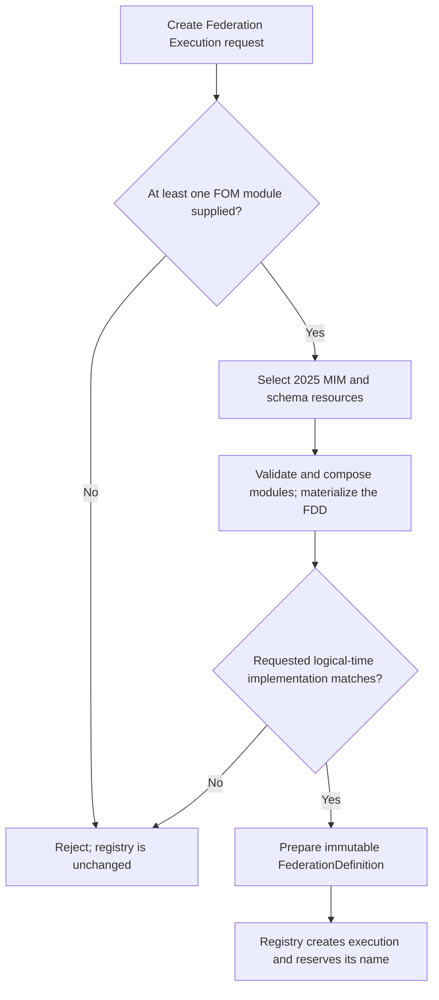
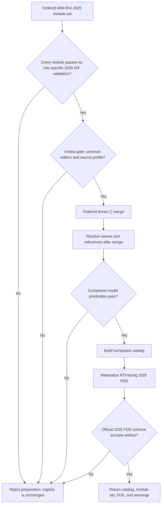
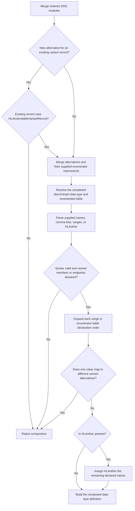
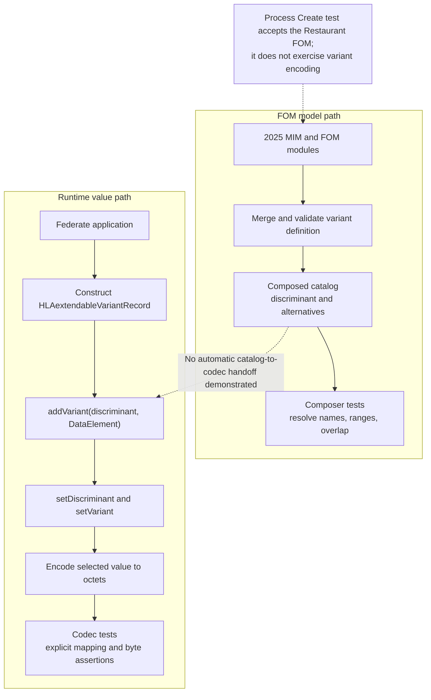
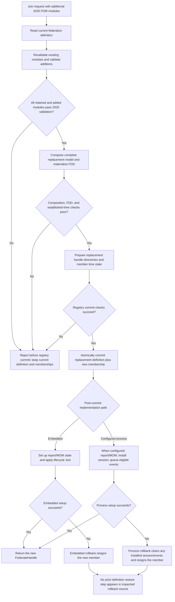
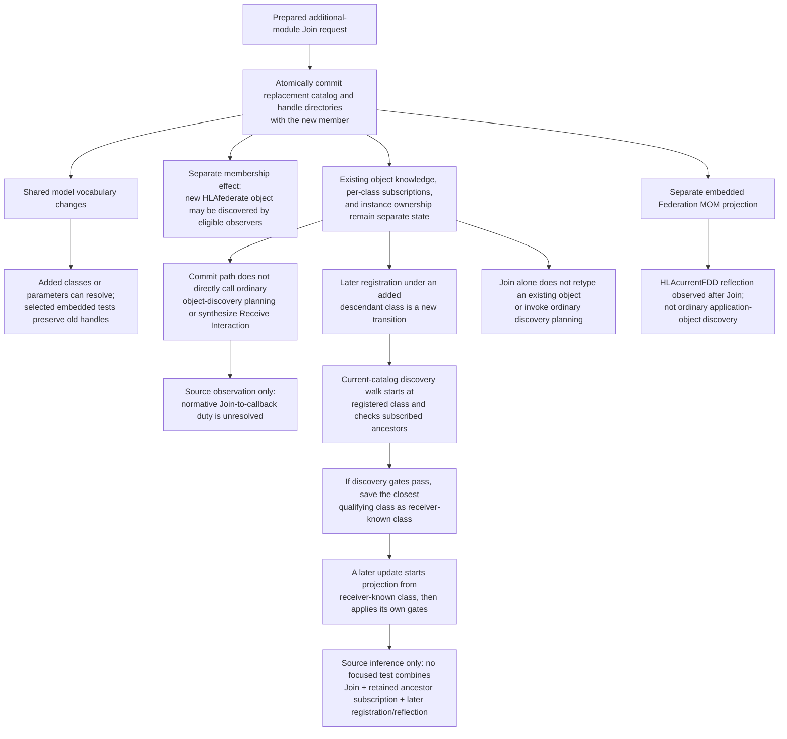
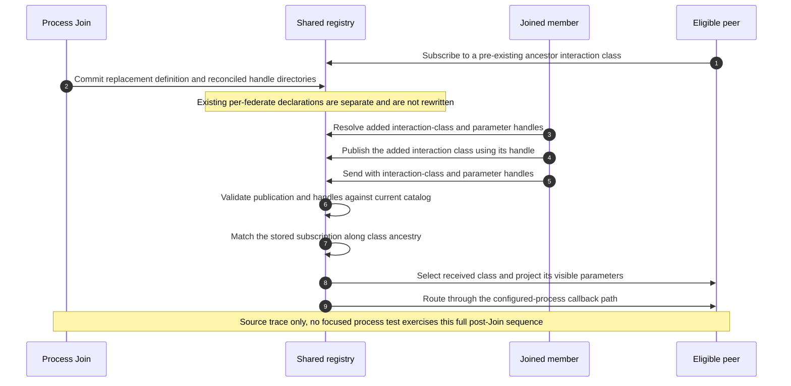
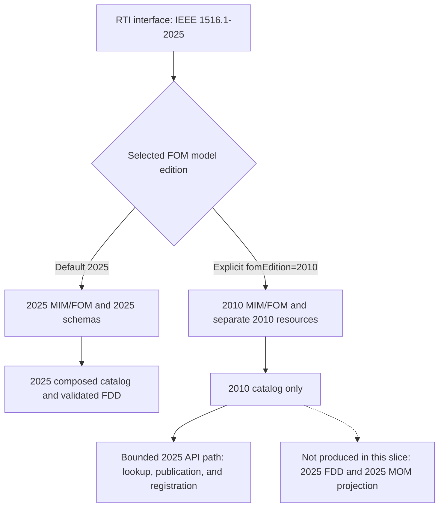

# IEEE 1516.1-2025 FOM Module Admission and Composition: Flow Guide

An HLA Federation Object Model supplies shared vocabulary for model-dependent
services. With modular object models, validity of each input, validity of the
composed set, and successful materialization for a particular RTI are distinct
questions; passing one does not establish the next. This guide explains those
model-admission distinctions first, then uses ordered-module Create/Join paths
in Umbra's selected IEEE 1516.1-2025 embedded profile as bounded examples—not
as the definition of HLA behavior or a conformance claim.

## Scope and authority

- **Edition boundary:** RTI services are from IEEE 1516.1-2025; model-module
  syntax and the DIF/FDD/OMT schemas are from the [official IEEE
  1516.2-2025 OMT specification](https://standards.ieee.org/ieee/1516.2/6689/).
  The [IEEE 1516.1-2025 Federate Interface
  Specification](https://standards.ieee.org/ieee/1516.1/6688/) is the authority
  for the public Create/Join services.
- **Implementation boundary:** this is the 2025 strict-source, embedded
  development profile. Process-endpoint evidence is not treated as proof of
  embedded-path equivalence.
- **Documentation boundary:** this guide explains current source and selected
  tests; it is not a new requirement mapping or conformance claim.

IEEE describes [1516.2-2025](https://standards.ieee.org/ieee/1516.2/6689/)
as specifying the format and syntax, but not the content, of HLA object models.
Schema validation therefore answers a structural question; it does not decide
whether a model's chosen semantics fit its federation's design.

The pinned schema files make the three structural roles precise:

| 1516.2-2025 schema | Role stated in the schema | How this guide uses it |
| --- | --- | --- |
| [DIF](../../third_party/ieee1516.2-2025/resources/schemas/IEEE1516-DIF-2025.xsd) | Data Interchange Format for exchanging possibly incomplete OMT files between tools. | Validate each supplied MIM/FOM/SOM module in this 2025 path; do not require cross-module references to resolve yet. |
| [FDD](../../third_party/ieee1516.2-2025/resources/schemas/IEEE1516-FDD-2025.xsd) | A relaxed OMT schema defining the minimum OMT information required by any RTI. | Validate the composed, RTI-facing artifact after merge and materialization. |
| [OMT](../../third_party/ieee1516.2-2025/resources/schemas/IEEE1516-OMT-2025.xsd) | Stricter than DIF and used to validate conformance with the OMT specification; the schema itself says that passing it does not guarantee full conformance. | Keep it separate from per-module DIF validation. It is not a shortcut for composition or evidence that all declared model behavior is implemented. |

These are different validation artifacts, not three interchangeable ways to
ask whether one XML file is “valid.” The repository's pinned upstream-file
inventory and attribution are recorded in the
[1516.2-2025 manifest](../../third_party/ieee1516.2-2025/manifest.json).

At the 1516.1-2025 API boundary, Create accepts one module designator or a
vector of module designators, while Join accepts an optional list of additional
module designators. Those signatures establish how model inputs enter the
services; they do not collapse input validation, complete-set composition,
and RTI-specific representation into one notion of validity. See the pinned
[Create overloads](../../third_party/ieee1516.1-2025/include/RTI/RTIambassador.h#L128)
and [Join overload](../../third_party/ieee1516.1-2025/include/RTI/RTIambassador.h#L212).

The existing [FOM validation design](../fom/FOM-VALIDATION-DESIGN.md#required-runtime-boundary)
documents the larger validator policy and its evidence. This guide supplies
the learner-facing sequence and calls out the create/join state boundary.

## Three different meanings of “valid”

Do not collapse these stages:

| Stage | Question answered | What it does not establish |
| --- | --- | --- |
| Per-module DIF validation | Is this supplied 2025 MIM/FOM/SOM document well-formed for its module role and valid against the selected 2025 DIF schema? | That its declarations are compatible with other modules or can form a valid FDD. |
| Complete-set composition/preflight | Can the ordered, same-edition module set be merged under the implemented Annex C rules, and do completed-model references resolve? | That the resulting FDD serialization is acceptable to the official FDD schema. |
| FDD materialization and validation | Can Umbra represent the merged 2025 model in its RTI-facing FDD artifact, and does that artifact validate against the selected 2025 FDD schema? | That every behavior described by every FOM is implemented by the RTI. |

Individual modules are intentionally allowed to leave some cross-module
key/keyref references unresolved. Complete-set resolution happens only after
composition; validating one extension in isolation must not manufacture rows
that belong to another module.

Composition supplies shared model vocabulary; it does not itself create a
federate's publication or subscription declarations, register an object
instance, or make that instance known to another federate. Those are later
runtime service transitions with their own eligibility and observation
rules. For that next boundary, continue to the cross-cutting
[model-vocabulary/runtime-state map](HLA-2025-CROSS-CUTTING-STATE-EVENT-OBSERVATION-GUIDE.md#a-federation-model-defines-vocabulary-services-create-live-state),
the 2025 [object registration and discovery flow](HLA-2025-OBJECT-AND-INTERACTION-INFORMATION-FLOW-GUIDE.md#object-path-declarations-registration-and-discovery),
and [interaction publication/subscription and delivery](HLA-2025-OBJECT-AND-INTERACTION-INFORMATION-FLOW-GUIDE.md#interaction-path-class-subscription-parameter-projection-callback).

Model admission also does not execute a federate's value encoder. Keep the
application-side C++ octet boundary separate: the 2025
[DataElement Encoding guide](HLA-2025-DATA-ELEMENT-ENCODING-FLOW-GUIDE.md#pick-the-representation-boundary-before-reasoning-about-bytes)
distinguishes encoded `DataElement` values from FOM/OMT model input and RTI
transport framing.

## Create: prepare the entire definition before reserving its name

In the embedded profile, creation is a prepare-then-commit transition. A
failed validation, composition, FDD, or time-selection step occurs before the
registry's create operation, so it must not reserve the federation name.

The model-preparation sub-flow is expanded in the composition diagram below.
This chart emphasizes the public Create transaction boundary: every rejection
occurs before the registry reserves the federation name.

If the standard MIM is omitted, the coordinator loads Umbra's selected 2025
standard MIM first. A supplied MIM designator is validated as the MIM input;
it is not an extra FOM. At least one FOM designator is required by this
development profile's Create path. The coordinator returns a prepared
definition without mutating the registry; the ambassador calls registry
`create` only after preparation succeeds.

The public designator and the canonical local file path have different jobs:
the designator is retained as the supplied module identity, while the
canonical path is used to open the source safely. The composer reloads and
revalidates its module descriptors at the composition boundary rather than
treating an earlier validation result as a permanent parsed document.

## Composition: merge first, resolve the completed model second

Every module must first pass its selected DIF validation. That is necessary,
but not sufficient: composition applies table-specific duplicate rules and
then resolves references against the **whole** merged model.

The diagram's MIM-first input describes the current Umbra preparation
sequence. It is not a normative claim about required module ordering; use the
applicable 1516.1/1516.2 composition clauses for that rule.

This is an Umbra compatibility checkpoint: the composer compares each module
with the first module's edition and source-compatibility profile before it
revalidates and merges that module. It is not an HLA rule that makes the 2010
and 2025 behavior streams interchangeable.

Consequences that are easy to miss:

- A reference in an earlier module may resolve to a declaration in a later
  module. The composer intentionally delays completed-model resolution until
  after the full MIM-first set has merged.
- “Merge” is not “concatenate” and is not universally “last definition wins.”
  Annex C defines different duplicate behavior by table. Equivalent class
  definitions may merge; incompatible definitions fail. The implemented
  Annex C.8 switch path retains the first module's setting and reports a
  warning for a conflicting later setting, so preserve module order.
- A DIF-valid extension can still make the merged set unrepresentable in the
  official FDD schema. FDD generation/validation is its own failure boundary,
  not a guarantee implied by per-module validation.
- Fixed module order is repeatable in the tested materializer. That is not a
  promise that arbitrary reorderings produce identical FDD bytes or equivalent
  first-setting outcomes.

For the 2025 schemas, use DIF on individual modules, FDD on Umbra's composed
artifact, and OMT only for the separate complete-model validation policy.
Never make a single module appear complete by inventing cross-module rows.

The composed model's object- and interaction-class parent chains feed
different runtime questions. The object-information guide's [cross-path class
ancestry map](HLA-2025-OBJECT-AND-INTERACTION-INFORMATION-FLOW-GUIDE.md#class-ancestry-has-different-jobs-in-different-paths)
compares those selected 2025 uses; class hierarchy does not imply one generic
nearest-ancestor callback rule.

## Variant-record alternatives resolve against the merged discriminant

The 2025 OMT schema represents a variant record with a discriminant data type
and alternatives that carry discriminant-enumerator expressions and payload
data types ([pinned OMT schema](../../third_party/ieee1516.2-2025/resources/schemas/IEEE1516-OMT-2025.xsd)).
Umbra's composer resolves those pieces after module merge, so an alternative
may depend on an enumerated data type declared elsewhere in the completed
module set. The following is the inspected 2025 composition path, not a
complete normative restatement of the OMT rules:

Several implementation details matter when reading this flow:

- Adding a new alternative to an already-declared record passes the composer
  gate only when the record's encoding is `HLAextendableVariantRecord`. When
  modules contribute enumerator expressions to the same alternative, the
  current merge path combines those expressions before completed-model
  validation ([extension gate](../../cpp/src/internal/fom/libxml2_fom_composer.cpp#L312),
  [alternative merge](../../cpp/src/internal/fom/libxml2_fom_composer.cpp#L900)).
- A supplied discriminant type must resolve to `enumeratedData`. Each supplied
  simple name and each range endpoint must be present in that table. The
  composer then expands a range across the table's declaration order and
  rejects a value assigned to different named alternatives
  ([type and membership checks](../../cpp/src/internal/fom/libxml2_fom_composer_validators.cpp#L584),
  [membership](../../cpp/src/internal/fom/libxml2_fom_composer_validators.cpp#L1724),
  [range expansion and assignment](../../cpp/src/internal/fom/libxml2_fom_composer_validators.cpp#L1791)).
- In this implementation, `HLAother` must be the complete enumerator field,
  may not be repeated, is rejected for an extendable variant record, and is
  assigned the enumerators not explicitly covered by named alternatives.
  Treat this as bounded source evidence, not as a new interpretation of the
  2025 standard.
- DIF can contain intentionally incomplete rows. If the discriminant member
  table is omitted or has no supplied enumerators, these membership and range
  checks do not manufacture a closed set; a supplied discriminant type still
  goes through the 2025 type-kind check.

The focused composer test source contains cases for malformed and omitted
expressions, unknown enumerators and range endpoints, a consumer declared
before its provider module, overlapping expanded assignments, and the
Restaurant `HLAother` example ([syntax and incomplete input](../../cpp/tests/libxml2_fom_composer_catch2.cpp#L1238),
[membership and cross-module resolution](../../cpp/tests/libxml2_fom_composer_catch2.cpp#L1296),
[declaration-order expansion and overlap](../../cpp/tests/libxml2_fom_composer_catch2.cpp#L1369)).
These are composer-level tests; they do not establish configured-process
Create/Join outcomes or normative conformance. The test cases were not rerun
for this documentation change.

The configured-process service does not implement a second FOM composer.
For an explicit Create request, `handleCreate` requires the configured
preparation callback, obtains its prepared `FederationDefinition`, then gives
that definition to the registry commit path; additional-module Join follows a
separate preparation callback and commit
([Create](../../cpp/src/internal/federation/process_federation_service_lifecycle.cpp#L219),
[Join](../../cpp/src/internal/federation/process_federation_service_lifecycle.cpp#L301)).
The public process fixture wires those callbacks to
`FederationManagementCoordinator::prepareCreate` and
`prepareAdditionalModules` ([Create callback](../../cpp/tests/process_federation_additional_fom_catch2.cpp#L255),
[Join callback](../../cpp/tests/process_federation_additional_fom_catch2.cpp#L268)).
This establishes where the shared composition rules enter the configured
route; it does not establish that the endpoint inspects or exposes a
variant-specific catalog result. These observations have different
evidentiary strength:

| Boundary | What the focused 2025 test observes | What it does not establish |
| --- | --- | --- |
| Composer: MIM + Restaurant FOM | Composition returns `valid`, a catalog, and a non-null `DrinkGarnish` data-type lookup ([composer case](../../cpp/tests/libxml2_fom_composer_catch2.cpp#L1291)). Separate synthetic cases exercise member resolution, range expansion, overlap rejection, and `HLAother`. | The Restaurant positive assertion does not inspect the resulting `DrinkGarnish` discriminant-to-alternative assignments or payload definition. These remain composer-level results, not process-service behavior. |
| Embedded public API Create | The 2025 API accepts a two-module extendable-variant record when the added named alternative is disjoint from the base range; it rejects an overlapping alternative with `InconsistentFOM`, then succeeds on a valid retry ([case](../../cpp/tests/fom_declaration_management_catch2.cpp#L200)). | It does not inspect the resulting FDD, establish the corresponding process path, or prove behavior beyond these tested inputs. |
| Configured-process Create | The public process case accepts `createFederationExecution` with the 2025 Restaurant FOM; its server-side checks also confirm failed Create leaves no definition and a later failed Join leaves the successfully created base module count unchanged ([successful Restaurant Create](../../cpp/tests/process_federation_additional_fom_catch2.cpp#L363), [registry-state checks](../../cpp/tests/process_federation_additional_fom_catch2.cpp#L305)). A second public case creates with an explicit MIM and checks that the committed definition contains one FOM module, one MIM module, and the selected logical-time implementation ([committed definition](../../cpp/tests/process_federation_additional_fom_catch2.cpp#L673), [client request](../../cpp/tests/process_federation_additional_fom_catch2.cpp#L720)). The Restaurant fixture contains `DrinkGarnish`, discriminated by `DrinkType` and encoded as `HLAextendableVariantRecord` ([declaration](../../third_party/ieee1516.2-2025/resources/examples/RestaurantFOMmodule-2025.xml#L1026), [encoding](../../third_party/ieee1516.2-2025/resources/examples/RestaurantFOMmodule-2025.xml#L1041)). | The process tests confirm accepted preparation/definition commit and module provenance, not the `DrinkGarnish` discriminant-to-alternative assignments. They do not exercise variant-specific process failures or range resolution. |
| Configured-process additional-module Join | The test rejects a missing module, accepts `reference-data-class-provider-fom.xml`, and resolves the added object-class handle/name ([successful Join and lookup](../../cpp/tests/process_federation_additional_fom_catch2.cpp#L378)). That extension contains an object-class declaration only ([fixture](../../cpp/tests/data/reference-data-class-provider-fom.xml#L5)). | It does not add or merge a variant-record alternative. The module is object-only, as also shown by the [post-Join interaction boundary](#interaction-catalog-growth-is-not-a-receive-interaction-callback). |

Keep these as separate claims: composer tests exercise variant merge and
resolution; configured-process Create tests accept and commit the prepared
Restaurant definition (including the explicit-MIM module boundary); the
configured-process Join test verifies an object-only extension. A bounded
process/connection-test search found no variant-record-specific assertion, so
these do not establish variant-specific configured-process behavior or
normative conformance.

### FOM variant definition and runtime encoding are separate paths

The composed FOM catalog describes the discriminant and its permitted
alternatives. A federate application separately constructs a runtime
`HLAextendableVariantRecord`, registers its discriminant-to-`DataElement` map
with `addVariant`, selects a value, and encodes it. The shared concepts help
the application keep those representations aligned, but the inspected
configured-process Create path does not demonstrate a catalog-to-codec
handoff.

The dotted connection marks an evidence boundary, not a required application
architecture. The composer case checks for a `DrinkGarnish` catalog entry
([test](../../cpp/tests/libxml2_fom_composer_catch2.cpp#L1291)); the focused
codec case constructs the `addVariant` map directly and asserts the encoded
bytes ([test](../../cpp/tests/ieee1516_2025_basic_data_elements_catch2.cpp#L994)).
The configured-process Restaurant Create case proves acceptance of that input
fixture only ([test](../../cpp/tests/process_federation_additional_fom_catch2.cpp#L363)).
This evidence set does not connect the catalog entry to the runtime
`DataElement`. For the full discriminant/alternative byte behavior, see the
data-element guide's [variant branch flow](HLA-2025-DATA-ELEMENT-ENCODING-FLOW-GUIDE.md#variants-are-discriminant-driven-branches).

The manual translation is easiest to see in the Restaurant example. Its FOM
declares `DrinkType` with representation `HLAinteger32BE` and assigns the
enumerators `Margarita = 1` and `DryMartini = 2`; `DrinkGarnish` associates
those names with `HasSaltRim` (`HLAboolean`) and `OliveCount` (`FruitCount`)
([enumerators](../../third_party/ieee1516.2-2025/resources/examples/RestaurantFOMmodule-2025.xml#L910),
[variant definition](../../third_party/ieee1516.2-2025/resources/examples/RestaurantFOMmodule-2025.xml#L1026),
[FruitCount representation](../../third_party/ieee1516.2-2025/resources/examples/RestaurantFOMmodule-2025.xml#L740)).
The catalog projection retains the discriminant type name and, per alternative,
the alternative name, enumerator-name strings, and payload data-type name
([projection type](../../cpp/src/internal/fom/fom_catalog.hpp#L101),
[projection builder](../../cpp/src/internal/fom/libxml2_fom_composer.cpp#L2104)).
The public codec API instead takes a typed discriminant prototype and
`DataElement` discriminant/value pairs through `addVariant`
([2025 API](../../third_party/ieee1516.1-2025/include/RTI/encoding/HLAextendableVariantRecord.h#L29),
[mapping operation](../../third_party/ieee1516.1-2025/include/RTI/encoding/HLAextendableVariantRecord.h#L93)).
An application therefore has to map the FOM names and values to compatible
runtime elements—for example, use `HLAinteger32BE` values corresponding to
1 and 2 as keys, with payload prototypes matching `HLAboolean` and
`FruitCount`. This is an illustrative application-side mapping, not a tested
catalog-to-codec conversion or a requirement that every application use this
particular construction.

## Join with additional FOM modules: replace definition and add member together

An ordinary Join without extra FOM modules uses the existing federation
definition. When additional modules are supplied, Umbra prepares a replacement
definition before committing the new membership. It revalidates the existing
modules as well as the added ones, composes the entire replacement set, and
keeps the federation's established logical-time implementation.

The registry commit is atomic with respect to its shared state: after preparing
the replacement directories, it commits the replacement definition and new
membership together. Before that commit, preparation and registry rejection
leave the prior shared definition in place. This is not an end-to-end
transaction for every later step in the public Join call. After the atomic
registry swap
([commit](../../cpp/src/internal/federation/federation_registry_membership_lifecycle.cpp#L596)),
the embedded ambassador establishes joined-federate report/MOM state and
advances its lifecycle; its inspected rollback resigns the new member
([embedded rollback path](../../cpp/src/internal/runtime/umbra_rti_ambassador_federation_lifecycle.cpp#L540)).
The configured-process service performs its own report/MOM setup when
configured, installs the session, and then queues joined-MOM discovery and
pending synchronization announcements
([process rollback and session cleanup](../../cpp/src/internal/federation/process_federation_service_lifecycle.cpp#L758),
[post-commit event setup](../../cpp/src/internal/federation/process_federation_service_lifecycle.cpp#L791)).
Its rollback resigns the member and clears installed session/event state as
needed. The inspected rollback paths contain no call that restores the prior
definition or handle directories; this is source evidence, not a tested
post-failure catalog observation.

The focused [embedded writer-failure case](../../cpp/tests/service_report_writer_failure_catch2.cpp#L92)
and [process setup-failure case](../../cpp/tests/process_federation_service_join_rollback_catch2.cpp#L39)
cover ordinary Join, not Join with replacement modules. The
[invalid-additional-FOM process case](../../cpp/tests/process_federation_additional_fom_catch2.cpp#L408)
covers rejection of the unavailable `missing-additional-fom.xml` path before
registry commit and a valid retry. It does not exercise a DIF-invalid module,
a semantic composition conflict, or failure after commit. None asserts the
catalog after a post-commit failure involving added modules. Treat persistence
on that failure path as a source observation, not an HLA rule or a tested
guarantee.

The focused private-process rejection case also reads the registry definition
after the invalid Join and asserts that its FOM module count is still the base
count; after a valid retry with the same requested federate name and type, it
asserts the count grew by one and the new class handle resolves
([unchanged definition](../../cpp/tests/process_federation_additional_fom_catch2.cpp#L488),
[valid retry](../../cpp/tests/process_federation_additional_fom_catch2.cpp#L499)).
This directly observes module-count preservation across that pre-commit failure,
not byte-for-byte FDD equality or every catalog entry. The test starts from a
newly created execution with no already-joined members; it does not compare a
populated membership set before and after rejection. Its successful retry with
the same requested federate name is a narrow recovery observation, not a
general membership-preservation assertion. Source shows that preparation
returns before the process handler calls the registry Join operation, and the
registry swaps the replacement definition only after its membership writes
succeed ([preparation result rejected before Join](../../cpp/src/internal/federation/process_federation_service_lifecycle.cpp#L311),
[registry Join call](../../cpp/src/internal/federation/process_federation_service_lifecycle.cpp#L611),
[registry commit point](../../cpp/src/internal/federation/federation_registry_membership_lifecycle.cpp#L596)).
That supports a source-level pre-commit boundary; the focused test does not
measure membership count or identity. In contrast, the
[embedded preparation-failure case](../../cpp/tests/ieee1516_2025_embedded_fom_preparation_atomicity_catch2.cpp#L28)
only verifies that a subsequent ordinary Join succeeds; it does not compare
the prior catalog or module count. Neither case exercises a failure after an
additional-module replacement definition has committed.

### Caller-visible preparation failures are phase-specific

The 2025 embedded adapter translates preparation results into public exception
types after module validation and composition. This mapping helps interpret
the generic rejection edges above; it is an observed implementation boundary,
not a claim that every RTI uses the same failure translation.

| Preparation outcome | Observed embedded 2025 exception |
| --- | --- |
| FOM source cannot be opened | `CouldNotOpenFOM` |
| FOM source is unreadable or cannot be parsed | `ErrorReadingFOM` |
| A supplied FOM fails the selected DIF validation | `InvalidFOM` |
| Modules conflict, the composed FDD is rejected, or the selected time representation is inconsistent | `InconsistentFOM` |
| Requested logical-time factory is unavailable | `CouldNotCreateLogicalTimeFactory` |
| Preparation fails for an unclassified backend reason | `RTIinternalError` |
| Selected/supplied MIM cannot be opened, read, or validated during Create | `CouldNotOpenMIM`, `ErrorReadingMIM`, or `InvalidMIM`; explicitly supplying the standard-MIM designator maps to `DesignatorIsHLAstandardMIM` |

These exception declarations are overload-specific; do not assume the public
Create/Join overloads expose identical failures. The following differences are
source/API observations for the embedded 2025 adapter, not normative HLA
outcomes:

| Pinned public overload | Inspected embedded preparation path | Difference to track |
| --- | --- | --- |
| Create with one FOM module | Delegates to vector Create, which loads the selected standard MIM. | The API lists MIM failures and `DesignatorIsHLAstandardMIM`; this embedded call has no supplied MIM designator, so the latter preparation status is not produced on this path. |
| Create with a vector of FOM modules | Also loads and validates the selected standard MIM, then uses the shared preparation translator. | The API list omits `CouldNotOpenMIM`, `ErrorReadingMIM`, and `InvalidMIM`, although the translator can emit them if loading that MIM fails. |
| Create with an explicit MIM | Validates the supplied MIM and uses the same logical-time selection path. | The API list includes MIM errors but omits `CouldNotCreateLogicalTimeFactory`, which the preparation translator can emit when the requested factory is unavailable. |
| Either Join overload with additional FOM modules | Revalidates all retained modules, including the existing MIM, then validates additions through the shared translator. | The API list includes FOM/time exceptions but no MIM-specific exceptions. An unreadable or invalid retained MIM can be classified and translated as an MIM failure. An ordinary Join with no additions does not enter this revalidation path. |

The pinned API declarations are [single-module Create](../../third_party/ieee1516.1-2025/include/RTI/RTIambassador.h#L128),
[vector Create](../../third_party/ieee1516.1-2025/include/RTI/RTIambassador.h#L145),
[Create with MIM](../../third_party/ieee1516.1-2025/include/RTI/RTIambassador.h#L165),
and [both Join overloads](../../third_party/ieee1516.1-2025/include/RTI/RTIambassador.h#L212).
The headers' provenance and byte identity with the canonical IEEE API archive
are recorded in the [pinned API manifest](../../third_party/ieee1516.1-2025/manifest.json);
the full prose standard is not vendored here.
The selected adapter paths are [Create delegation and preparation](../../cpp/src/internal/runtime/umbra_rti_ambassador_federation_lifecycle.cpp#L113),
[Create with MIM](../../cpp/src/internal/runtime/umbra_rti_ambassador_federation_lifecycle.cpp#L196),
[additional-module Join](../../cpp/src/internal/runtime/umbra_rti_ambassador_federation_lifecycle.cpp#L474),
[retained-module revalidation](../../cpp/src/internal/federation/federation_management_coordinator.cpp#L231),
and [status translation](../../cpp/src/internal/runtime/umbra_rti_ambassador_service_failure_translation.cpp#L1079).
The [focused coordinator case](../../cpp/tests/libxml2_fom_composer_catch2.cpp#L2265)
checks default-MIM retention, unavailable time selection, and rejection of the
standard-MIM designator, but no focused public-adapter case asserts these
overload differences or changes the retained MIM between Create and Join.
Keep these as implementation/API gaps for follow-up, not as HLA-wide behavior.

A successful registry commit reconciles existing class, attribute,
interaction, parameter, dimension, and transportation handle directories
before the replacement definition and membership become visible together.
The lookup consequence is separately tested: in the embedded 2025 profile, an
already-joined member resolves object and interaction classes contributed by
the successful Join, and each focused test checks that its earlier typed class
handle still compares equal in that same execution. The configured-process
additional-FOM test instead checks lookup by the joining client; it does not
test whether an already-connected process member sees the added class. These
are bounded Umbra observations, not cross-execution numeric-handle stability
or embedded/process parity. See the [name-and-handle guide's additional-module
Join example](HLA-2025-NAME-AND-HANDLE-RESOLUTION-FLOW-GUIDE.md#tested-example-additional-module-join-and-later-model-lookups),
including its API and evidence limits. The focused cases are the [object-class
lookup test](../../cpp/tests/object_class_lookup_catch2.cpp#L99),
[interaction-class lookup test](../../cpp/tests/interaction_class_lookup_catch2.cpp#L103),
and [configured-process additional-FOM test](../../cpp/tests/process_federation_additional_fom_catch2.cpp#L219).

### Catalog replacement does not itself discover ordinary application objects

The additional-module Join commit reconciles the replacement model's handle
directories and swaps them with the federation definition while adding the
new member ([registry commit](../../cpp/src/internal/federation/federation_registry_membership_lifecycle.cpp#L216)).
That commit path does not itself call the ordinary object-instance discovery
planner. In the inspected 2025 source, receiver-wide discovery replanning is
explicitly requested after object-class subscription changes in both the
embedded ambassador and configured process service
([embedded subscription](../../cpp/src/internal/runtime/umbra_rti_ambassador_object_class_subscription.cpp#L133),
[process subscription](../../cpp/src/internal/federation/process_federation_service_declarations.cpp#L234));
the planner separately skips instances that receiver already knows
([discovery planner](../../cpp/src/internal/federation/federation_registry_object_instance_discovery_planning.cpp#L83)).
So the source does not support drawing an immediate discovery callback from
the additional-FOM Join commit itself.

Keep that claim narrow: it does not mean a module-adding Join has no
observer-visible callback of any kind. The 2025 MIM marks the federation MOM
attribute `HLAcurrentFDD` conditional on successful Create/Join changes, and
one focused embedded test observes its updated value through
`reflectAttributeValues` after an additional-module Join ([MIM condition](../../third_party/ieee1516.2-2025/resources/mim/HLAstandardMIM-2025.xml#L743),
[test assertion](../../cpp/tests/federation_mom_current_fdd_catch2.cpp#L303)). This is a
reflection for the RTI-owned, execution-scoped Federation MOM object; it is not
discovery or a value callback for an arbitrary application object. The test is
embedded-profile evidence only. See the [Federation MOM guide's comparison of
the effective model and MOM projections](HLA-2025-FEDERATION-MOM-FLOW-GUIDE.md#the-effective-model-mom-projections-and-module-reports-are-different-views).

This is a bounded Umbra call-path observation, not a portable HLA rule. The
focused embedded lookup cases verify that an already-joined member can resolve
the extended object and interaction catalogs while its earlier handles still
compare equal. The configured-process case verifies lookup by the joining
client. None observes callbacks to a pre-existing subscriber for an
already-registered object after the model replacement. The inspected evidence
therefore leaves open how any newly applicable class/member relationship is
observed by existing subscribers; it does not establish that such a callback
is forbidden or required. Keep that question separate from the tested catalog
and handle behavior, and see the [object/interaction information guide's
receiver-specific discovery model](HLA-2025-OBJECT-AND-INTERACTION-INFORMATION-FLOW-GUIDE.md).

Do not read “catalog replacement does not discover an application object” as
“an additional-module Join has no observer effects.” Join also admits a member:
the embedded and configured-process runtime paths may plan discovery of that
member's distinct RTI-owned `HLAfederate` MOM object for eligible existing
subscribers ([embedded Join discovery](../../cpp/src/internal/runtime/umbra_rti_ambassador_federation_lifecycle.cpp#L707),
[process Join discovery](../../cpp/src/internal/federation/process_federation_service_lifecycle.cpp#L789)).
That is a membership effect, not discovery caused by a new application class.
Separately, the embedded additional-module test observes a changed
`HLAcurrentFDD` reflection after Join ([test](../../cpp/tests/federation_mom_current_fdd_catch2.cpp#L287)).
The reviewed configured-process Join path does not enqueue the federation-level
conditional update, despite the MIM condition; a later value request reads the
updated definition. No focused process observer test checks that automatic
reflection. See the [process Federation MOM boundary](HLA-2025-FEDERATION-MOM-FLOW-GUIDE.md#2025-process-profile-federation-mom-after-an-additional-module-join)
and the [membership/MOM lifecycle map](HLA-2025-FEDERATION-AND-FEDERATE-LIFECYCLE-FLOW-GUIDE.md#the-federation-and-member-mom-projections-follow-different-scopes)
for those separate paths. These source and test observations do not settle the
normative callback duty or imply embedded/process parity.

This consequence chart starts after validation and composition, at the prepared
Join's registry-commit boundary. The earlier [additional-module Join phase
diagram](#join-with-additional-fom-modules-replace-definition-and-add-member-together)
shows preparation, atomic model-and-membership commit, and the profile-specific
post-commit setup/rollback paths.

The lookup and MOM observations in this diagram are embedded-profile tests;
the configured-process test only verifies that its joining client can look up
an added object class. It does not establish process parity or callback
behavior after the catalog change.

#### Extension shapes in the inspected evidence

The successful additional-module lookup fixture contributes a new child class,
`HLAobjectRoot.UmbraReferenceFixtureClass`, under the existing root. The
embedded lookup case proves that an already-joined member can resolve that
class while its earlier Employee-class handle remains equal; it does not add
an attribute to an existing class or observe object callbacks
([fixture](../../cpp/tests/data/reference-data-class-provider-fom.xml#L9),
[test](../../cpp/tests/object_class_lookup_catch2.cpp#L99)).

The official Restaurant extension illustrates a broader shape: it adds the
`Organic` attribute under the existing `Food.Drink.Soda` class and adds
interaction parameters. But this exact module set is rejected during FDD
materialization by the focused atomicity case, so it is not evidence that those
member additions successfully commit in an additional-module Join
([extension](../../third_party/ieee1516.2-2025/resources/examples/RestaurantExtensionFOMmodule-2025.xml#L71),
[rejection case](../../cpp/tests/ieee1516_2025_embedded_fom_preparation_atomicity_catch2.cpp#L28)).
At the composer level, matching semantic children are recursively merged by
identity and unmatched children are appended, but the composed model still
has to pass later materialization and validation
([child identity](../../cpp/src/internal/fom/libxml2_fom_composer.cpp#L160),
[recursive merge](../../cpp/src/internal/fom/libxml2_fom_composer.cpp#L843)).
Structural merge capability alone therefore does not establish a successful
Join shape.

For a successful commit, the inspected registry path reconciles old and new
class/attribute handles, then installs the replacement definition; it does
not rewrite existing per-class subscription records or per-instance attribute
ownership records ([class handles](../../cpp/src/internal/handles/object_class_handle_directory.cpp#L10),
[attribute handles](../../cpp/src/internal/handles/attribute_handle_directory.cpp#L35),
[subscription state](../../cpp/src/internal/federation/federation_registry.hpp#L2323),
[instance ownership](../../cpp/src/internal/federation/federation_registry.hpp#L2419),
[Join commit](../../cpp/src/internal/federation/federation_registry_membership_lifecycle.cpp#L596)).
The discovery resolver consults the current catalog hierarchy together with
those explicit subscriptions and concrete instance-owned attributes
([resolver](../../cpp/src/internal/federation/federation_registry.cpp#L830)).
Thus a later declaration-triggered reevaluation uses the current model and
stored runtime state; adding a FOM definition alone does not create a
subscription, an instance-owned value, or an immediate discovery plan. The
observed call sites replan after subscription changes
([embedded](../../cpp/src/internal/runtime/umbra_rti_ambassador_object_class_subscription.cpp#L133),
[process](../../cpp/src/internal/federation/process_federation_service_declarations.cpp#L234)).
This describes the inspected 2025 implementation only. There is no successful
focused Join test here for adding an attribute to an already-defined class,
and no test of how pre-existing observers see such a change.

For objects and declarations around a model change, keep these consequences separate:

| Additional-module shape or later event | Existing-object consequence in the inspected 2025 path | Evidence limit |
| --- | --- | --- |
| Join adds a child class below an existing class. | Existing members can resolve the new class, but an object registered under the old class keeps its registered-class handle; the current resolver starts from that registered class and walks toward its ancestors, not down into newly added children. | The successful embedded fixture tests catalog lookup and stability of an older class handle, not a live object's discovery or retyping ([test](../../cpp/tests/object_class_lookup_catch2.cpp#L99), [instance class field](../../cpp/src/internal/federation/federation_registry.hpp#L2414), [resolver](../../cpp/src/internal/federation/federation_registry.cpp#L830)). |
| A module adds an attribute to an existing class. | Replacing the catalog does not itself add the new attribute to an instance's ownership record or to a member's subscription declarations. | The cited Restaurant extension is rejected during FDD materialization, before any Join commit; there is no successful focused add-attribute Join case ([rejection case](../../cpp/tests/ieee1516_2025_embedded_fom_preparation_atomicity_catch2.cpp#L28), [Join replacement](../../cpp/src/internal/federation/federation_registry_membership_lifecycle.cpp#L596), [instance owner record](../../cpp/src/internal/federation/federation_registry.hpp#L2419), [subscription declaration state](../../cpp/src/internal/federation/federation_registry.hpp#L2323)). |
| A member subscribes after the model change, but already knows the object. | This is a separate declaration transition: discovery replanning skips the receiver's known instance, and the ordinary current-value reflection question remains open. | The subscription guide documents the source path and the missing isolated value-only test; do not infer an immediate Join callback or a normative no-reflection rule ([known-object subscription boundary](HLA-2025-OBJECT-ATTRIBUTE-SUBSCRIPTION-STATE-FLOW-GUIDE.md)). |
| Later registration under an added descendant class with an earlier ancestor subscription. | Embedded source may use the retained ancestor declaration for discovery, save the closest qualifying class as receiver-known, then start later value projection from that class. | Cross-path source inference only. The focused Join and child/base-subscription tests cover separate pieces; no post-Join combined case, process-parity evidence, or normative callback conclusion. |

#### Later registration can use a retained ancestor declaration

During additional-module Join, the registry copies and reconciles its existing
handle directories against the replacement catalog, then swaps those prepared
directories with the new definition. Per-federate object-class declarations
remain in their separate class-keyed map. A later embedded
`RegisterObjectInstance` stores the selected registered-class handle and calls
the discovery planner. That planner resolves the registered class against the
current catalog, walks toward its ancestors, applies relevance, ownership,
region, and receiver-declaration gates, then records the closest qualifying
class as the receiver-known class. Later attribute-value planning starts from
that saved receiver-known class and applies its own delivery gates. See the
[Join reconciliation and commit](../../cpp/src/internal/federation/federation_registry_membership_lifecycle.cpp#L280),
[retained declaration map](../../cpp/src/internal/federation/federation_registry.hpp#L2584),
[registration-to-discovery path](../../cpp/src/internal/runtime/umbra_rti_ambassador_object_instance_region_registration.cpp#L386),
[current-catalog resolver](../../cpp/src/internal/federation/federation_registry.cpp#L830),
and [receiver-known-class value planner](../../cpp/src/internal/federation/federation_registry_attribute_update_recipients.cpp#L49).
The active discovery-relevance gate and this receiver's declaration match are
separate decisions: another joined member may establish active relevance while
the receiver is selected through its own declaration. The
[subscription ancestry crosswalk](HLA-2025-OBJECT-ATTRIBUTE-SUBSCRIPTION-STATE-FLOW-GUIDE.md#class-ancestry-affects-separate-decisions)
shows those roles separately.

This is an implementation path, not a promise that every such registration
discovers or delivers: the active-relevance, owned-attribute, regional, and
receiver-specific predicates still apply. The focused
[additional-module lookup test](../../cpp/tests/object_class_lookup_catch2.cpp#L99)
checks catalog visibility and an earlier handle; the focused
[base-subscription/child-object test](../../cpp/tests/subscribe_object_class_attributes_discovery_catch2.cpp#L297)
uses a class already present at Create. Neither combines retained subscription,
Join-added descendant, later registration, discovery, and follow-up reflection.
The configured-process [additional-FOM test](../../cpp/tests/process_federation_additional_fom_catch2.cpp#L219)
also stops at lookup.

These are bounded source and test observations, not a substitute for the
licensed standard text. They separate catalog visibility, instance class and
ownership, receiver object knowledge, and value reflection; none alone implies
the next transition. The pinned 2025 API headers identify Join as §4.11 and
Discover/Reflect as §§6.9/6.11 ([Join API](../../third_party/ieee1516.1-2025/include/RTI/RTIambassador.h#L212),
[object callbacks](../../third_party/ieee1516.1-2025/include/RTI/FederateAmbassador.h#L229));
their signatures and exception annotations do not include the full normative
transition text needed to decide whether a model-changing Join requires a
discovery or value-reflection callback. The complete 2025 standard text is not
in this checkout; IEEE's [standard entry](https://standards.ieee.org/ieee/1516.1/6688/)
lists subscription access.

#### Interaction catalog growth is not a Receive Interaction callback

The additional-module interaction lookup case adds
`HLAinteractionRoot.UmbraDirectedFixtureInteraction`; an already-joined member
can look up its class/name while its earlier `ServerAction.TakeOrder` handle
still compares equal. A separate parameter lookup case adds
`UmbraParameterFixtureBase` with an `Identifier` parameter and a child class;
the existing member resolves that inherited parameter through the child
after Join. Both cases exercise catalog/handle lookup only: neither declares
an interaction subscription nor sends an interaction
([class lookup](../../cpp/tests/interaction_class_lookup_catch2.cpp#L103),
[parameter lookup](../../cpp/tests/parameter_lookup_catch2.cpp#L119),
[parameter extension fixture](../../cpp/tests/data/parameter-handle-provider-fom.xml#L7)).
The class lookup fixture's name includes “Directed,” but that test does not
invoke Send Directed Interaction.

For contrast, the separate ordinary inherited-receipt test has the complete
base/middle/child hierarchy at Create. A subscriber first subscribes to the
base, the publisher sends the child, and the observed callback carries the
closest subscribed class; adding middle and then child subscriptions moves
that callback class closer and still yields one receipt
([receipt case](../../cpp/tests/inherited_interaction_receipt_catch2.cpp#L71)).
This verifies the selected 2025 hierarchy-routing scenario, not what happens
when the descendant was introduced by a later Join.
The ordinary interaction state machine and its separate
active-relevance/receiver-selection and parameter-projection decisions are
shown in the object/interaction guide's
[interaction path](HLA-2025-OBJECT-AND-INTERACTION-INFORMATION-FLOW-GUIDE.md#interaction-path-class-subscription-parameter-projection-callback)
and [class-promotion flow](HLA-2025-OBJECT-AND-INTERACTION-INFORMATION-FLOW-GUIDE.md#interaction-relevance-class-promotion-and-parameter-projection).
The receipt test sends an empty parameter map, so it establishes the selected
callback class, not parameter filtering. The separate
[registry projection case](../../cpp/tests/federation_registry_composed_fom_catch2.cpp#L1209)
checks parameter visibility across distinct receivers, not a post-Join send or
same-receiver class-promotion-plus-projection case.

In the inspected registry, ordinary interaction subscriptions are stored per
federate and interaction-class handle. A later ordinary send resolves the sent
class in the current catalog, walks its parent chain, and selects the closest
eligible stored subscription
([declaration state](../../cpp/src/internal/federation/federation_registry.hpp#L2252),
[send-time recipient selection](../../cpp/src/internal/federation/federation_registry.cpp#L1421),
[send planner](../../cpp/src/internal/federation/federation_registry_receive_order_interactions.cpp#L16)).
Therefore the source path can consider a pre-existing ancestor subscription
for a later send of a newly added descendant; this is an implementation
inference, not an exercised post-Join outcome. Updating the FOM catalog does
not itself synthesize an ordinary Receive Interaction for the new class. No
focused test combines an existing ancestor subscription, additional-module
Join, and a subsequent send of the added descendant. The configured-process
additional-FOM case checks object-class lookup only, not interaction send or
receive ([process case](../../cpp/tests/process_federation_additional_fom_catch2.cpp#L219)).
Keep this separate from [object-instance discovery](HLA-2025-OBJECT-AND-INTERACTION-INFORMATION-FLOW-GUIDE.md#object-path-declarations-registration-and-discovery)
and from [directed-interaction routing](HLA-2025-DIRECTED-INTERACTION-FLOW-GUIDE.md).

The process-profile source narrows that gap but does not close it. A
module-bearing process Join is accepted only when the service has an
`additionalFomPreparation` callback; otherwise `handleJoin` rejects it. The
configured-process test and process service probe install a
`FederationManagementCoordinator`-backed callback. The service serializes
preparation and registry commit, then passes the prepared replacement into
the registry Join. After membership writes succeed, the registry swaps the
replacement definition together with reconciled object, attribute, interaction,
parameter, dimension, and transportation handle directories. Existing
interaction-class and parameter identities are retained; new definitions get
directory entries. The per-federate interaction-declaration map is separate
and is not rewritten by that commit.

The later process service path uses those current directories: Get Parameter
Handle resolves the interaction handle to its class name and then resolves a
parameter through that class or an ancestor; subscription requests pass the
class handle into the stored per-federate declaration map. Send Interaction
calls the shared receive-order planner, which validates sender publication and
the sent class and parameter handles against the current catalog. Recipient
selection walks the sent class and its parent chain against stored
subscriptions, selects the closest eligible received class, and projects only
parameters defined for that class or an ancestor. This source path means a pre-existing ancestor
subscription can be considered for a later send of an added descendant; it is
not a tested post-Join delivery result.

Implementation evidence: [optional process preparation hook](../../cpp/src/internal/federation/process_federation_service.hpp#L31),
[serialized process Join preparation](../../cpp/src/internal/federation/process_federation_service_lifecycle.cpp#L257),
[directory reconciliation](../../cpp/src/internal/federation/federation_registry_membership_lifecycle.cpp#L298),
[atomic replacement with membership](../../cpp/src/internal/federation/federation_registry_membership_lifecycle.cpp#L600),
[parameter-handle reconciliation and inherited lookup](../../cpp/src/internal/handles/parameter_handle_directory.cpp#L11),
[process Get Parameter Handle](../../cpp/src/internal/federation/process_federation_service_handle_lookup.cpp#L135),
[process interaction publication](../../cpp/src/internal/federation/process_federation_service_request_handlers.cpp#L324),
[process interaction subscription](../../cpp/src/internal/federation/process_federation_service_request_handlers.cpp#L338),
[per-federate interaction declarations](../../cpp/src/internal/federation/federation_registry.hpp#L2250),
[process send planner call](../../cpp/src/internal/federation/process_federation_service_interaction_send.cpp#L389),
[recipient class selection and parameter projection](../../cpp/src/internal/federation/federation_registry.cpp#L1421),
and [parameter filtering for the received class](../../cpp/src/internal/federation/federation_registry.cpp#L1597).

The configured-process fixture's added module is object-only
([module](../../cpp/tests/data/reference-data-class-provider-fom.xml#L5)); its
public assertions resolve that new object class by handle and name. It does not
exercise interaction/parameter lookup, publication or subscription, send, or
receive after the module-bearing Join. Existing interaction and inherited
parameter lookup tests exercise lookup separately, not the configured-process
post-Join delivery sequence. Thus the process source path is not end-to-end
test evidence or process/embedded parity evidence.

For how FOM dimension declarations become class-available dimensions and then
application-chosen region scope, see the DDM guide's
[FOM-to-region bridge](HLA-2025-DATA-DISTRIBUTION-AND-REGIONS-FLOW-GUIDE.md#from-fom-dimensions-to-runtime-region-scope).
For one bounded example where dimensions along an object-class parent chain
are used by a child-class regional registration and subscription, see the
DDM guide's [inherited-dimensions case](HLA-2025-DATA-DISTRIBUTION-AND-REGIONS-FLOW-GUIDE.md#inherited-dimensions-in-a-child-class-regional-path).
That is source/test evidence, not a general normative inheritance ruling.
For the Join-specific distinction between current dimension-context admission,
retained region specifications, and later object overlap/delivery, see the
DDM guide's [additional-module Join trace](HLA-2025-DATA-DISTRIBUTION-AND-REGIONS-FLOW-GUIDE.md#2025-implementation-trace-class-availability-and-existing-regions)
and [post-admission delivery boundary](HLA-2025-DATA-DISTRIBUTION-AND-REGIONS-FLOW-GUIDE.md#dimension-context-admission-is-not-later-regional-delivery).
The corresponding interaction-class path is a separate source-only case:
available dimensions, exact-class regional declaration storage, and the
send-time parent walk are distinct steps, with no reviewed cross-class
regional test. The DDM guide's [interaction ancestry map](HLA-2025-DATA-DISTRIBUTION-AND-REGIONS-FLOW-GUIDE.md#interaction-class-ancestry-available-context-and-declaration-lookup)
now also traces how an additional-module Join leaves declaration keys intact
while later sends resolve against the current catalog
([Join-to-regional-interaction bridge](HLA-2025-DATA-DISTRIBUTION-AND-REGIONS-FLOW-GUIDE.md#additional-module-join-retained-regional-interaction-declarations)).
This embedded source trace does not establish process behavior or normative
callback delivery.

The effective model described here is separate from the RTI-owned Federation
MOM projection. For the distinction between the federation-wide conditional
module list and `HLAcurrentFDD`, the same-named per-member Join-input list, and
the separate module-content request/report interactions, see the [Federation
MOM guide](HLA-2025-FEDERATION-MOM-FLOW-GUIDE.md#the-effective-model-mom-projections-and-module-reports-are-different-views).

## Keep the 2010 model lane separate

This flow is **not** the IEEE 1516.2-2010 compatibility path and is not a
2010 RTI implementation guide. The current code rejects a mixed 2010/2025
module set. The opt-in 2010 model-compatibility milestone selects separate
2010 resources and is catalog-only; it does not manufacture a 2025 FDD or
claim a 2010 RTI API/conformance profile. See the edition-specific boundary
and limitations in the [FOM validation design](../fom/FOM-VALIDATION-DESIGN.md#L595).

Keep the model-edition choice separate from the RTI interface edition. In this
compatibility slice, `fomEdition=2010` selects a 2010 model catalog under the
2025 API; it does not switch the ambassador to IEEE 1516.1-2010 behavior.

The 2010 branch is deliberately narrow: the optional focused lane composes a
2010 catalog, while the selected embedded case uses the 2025 API for class and
attribute lookup, publication, and object registration without claiming
simulation. Mixed-edition composition is rejected. These are Umbra profile
boundaries, not equivalence between the 2010 and 2025 RTI streams; consult the
separate [2010 reference-RTI guide](HLA-2010-REFERENCE-RTI-FLOW-GUIDE.md) for
that implementation's own evidence and limits. See the [2010 catalog
composition case](../../cpp/tests/external_2010_fom_catch2.cpp#L109), [mixed
edition rejection case](../../cpp/tests/external_2010_fom_catch2.cpp#L155),
and [2025-API registration-only case](../../cpp/tests/external_2010_fom_catch2.cpp#L208).

## Implementation and focused evidence

| Boundary | Implementation | Focused evidence |
| --- | --- | --- |
| Per-module 2025 DIF validation | [LibXml2 module validator](../../cpp/src/internal/fom/libxml2_fom_validator.cpp#L7), [Create preparation](../../cpp/src/internal/federation/federation_management_coordinator.cpp#L151) | [valid official modules, missing/malformed/wrong-namespace/DTD cases](../../cpp/tests/libxml2_fom_validator_catch2.cpp#L41), [stricter OMT schema is not the per-module policy](../../cpp/tests/libxml2_fom_validator_catch2.cpp#L147) |
| Ordered merge, edition/profile gate, and complete-model reference resolution | [Composer compatibility check before revalidation/merge](../../cpp/src/internal/fom/libxml2_fom_composer.cpp#L2137) | [cross-module data-type and class references](../../cpp/tests/fom_composer_reference_resolution_catch2.cpp#L11), [mixed-edition rejection](../../cpp/tests/external_2010_fom_catch2.cpp#L155) |
| FDD serialization/schema boundary | [FDD materializer](../../cpp/src/internal/fom/libxml2_fom_composer.cpp#L1430) | [MIM plus supplied base FOM produces catalog and validated FDD](../../cpp/tests/libxml2_fom_composer_catch2.cpp#L345), [DIF-valid extension rejected at FDD boundary](../../cpp/tests/ieee1516_2025_embedded_fom_preparation_atomicity_catch2.cpp#L29) |
| Duplicate behavior and fixed-order repeatability | [Annex C merge implementation](../../cpp/src/internal/fom/libxml2_fom_composer.cpp#L843) | [first switch retained with warning](../../cpp/tests/libxml2_fom_composer_catch2.cpp#L885), [fixed-input repeatability](../../cpp/tests/libxml2_fom_composer_catch2.cpp#L837), [equivalent duplicate vs. conflict](../../cpp/tests/libxml2_fom_composer_catch2.cpp#L2131) |
| Create failure before federation-name reservation | [Prepare, then registry create](../../cpp/src/internal/runtime/umbra_rti_ambassador_federation_lifecycle.cpp#L201) | [failed Create leaves name available; valid Create then succeeds](../../cpp/tests/ieee1516_2025_embedded_fom_preparation_atomicity_catch2.cpp#L4) |
| Additional-module Join commit boundary | [Prepare replacement and commit definition with membership](../../cpp/src/internal/runtime/umbra_rti_ambassador_federation_lifecycle.cpp#L508), [atomic registry transition](../../cpp/src/internal/federation/federation_registry_membership_lifecycle.cpp#L216) | [failed embedded addition leaves the base federation joinable](../../cpp/tests/ieee1516_2025_embedded_fom_preparation_atomicity_catch2.cpp#L29), [private-process rejection preserves the base module count and permits a valid retry with the same requested federate name](../../cpp/tests/process_federation_additional_fom_catch2.cpp#L408), [registry replacement-definition contract](../../cpp/tests/federation_registry_foundation_catch2.cpp#L123) |
| Configured-process additional-module interaction boundary | [optional preparation and Join handler](../../cpp/src/internal/federation/process_federation_service_lifecycle.cpp#L257), [atomic catalog/directory replacement](../../cpp/src/internal/federation/federation_registry_membership_lifecycle.cpp#L298), [existing interaction-handle reconciliation](../../cpp/src/internal/handles/interaction_class_handle_directory.cpp#L10), [later shared send planner and current-catalog resolver](../../cpp/src/internal/federation/process_federation_service_interaction_send.cpp#L389) | [configured-process additional-FOM test](../../cpp/tests/process_federation_additional_fom_catch2.cpp#L219) uses an object-only module and checks object-class lookup; no focused interaction subscription/send/receive case after Join was identified |
| Post-commit Join setup rollback | [Embedded report/lifecycle setup and membership-only rollback](../../cpp/src/internal/runtime/umbra_rti_ambassador_federation_lifecycle.cpp#L540), [process post-commit session/discovery rollback](../../cpp/src/internal/federation/process_federation_service_lifecycle.cpp#L758), [registry swaps the replacement definition before returning](../../cpp/src/internal/federation/federation_registry_membership_lifecycle.cpp#L596) | [ordinary embedded-Join writer failure](../../cpp/tests/service_report_writer_failure_catch2.cpp#L92), [ordinary process-Join setup failures](../../cpp/tests/process_federation_service_join_rollback_catch2.cpp#L35), [additional-FOM process rejection before commit](../../cpp/tests/process_federation_additional_fom_catch2.cpp#L408); no focused case asserts replacement-catalog state after post-commit failure with added modules |

The linked tests prove only their named cases. They do not establish exhaustive
coverage of every Annex C table, every schema-valid FOM, process/embedded
equivalence, or general IEEE conformance.

## What this guide does not claim

- It does not describe the 2010 catalog compatibility path as a 2025 pipeline
  or infer a 2010 RTI implementation.
- It does not treat validation of every individual module as proof that the
  composite model is valid or representable as an FDD.
- It does not claim the current composer implements every 2025 OMT rule or
  that the resulting runtime implements every declared model feature.
- It does not expand or map the HLA Requirements Lab.
