# IEEE 1516.1-2025 Joined-Federate MOM Object: Lifecycle and State Flow Guide

This guide follows the RTI-owned `HLAmanager.HLAfederate` object from a
successful 2025 Join through discovery, current-value requests, save/restore
state changes, and resignation. The aim is to distinguish the RTI's private
snapshot from the public object-management callbacks used to expose it.

## Scope and authority

- **Edition boundary:** IEEE 1516.1-2025 behavior, with the 2025 standard MIM
  and its `HLAfederate` definitions. The [official Federate Interface
  Specification](https://standards.ieee.org/ieee/1516.1/6688/) is normative;
  the [IEEE 1516.2-2025 OMT specification](https://standards.ieee.org/ieee/1516.2/6689/)
  defines the model/schema context.
- **Implementation boundary:** the detailed lifecycle and state diagrams
  below follow the 2025 embedded federation-management development profile.
  A separate section records bounded 2025 process-endpoint source and public
  test evidence; neither profile is inferred from the other, and no general
  embedded/process parity is claimed. The 2010 compatibility boundary remains
  separate.
- **Topic boundary:** this guide follows the joined-federate object lifecycle,
  `HLAfederateState`, and the portable distinction between on-demand value
  requests and periodic refresh. It inventories the 21 `HLAfederate` attributes
  marked Periodic in the pinned 2025 MIM by measurement unit; it does not
  inventory every Static or Conditional statistic, every HLAfederation
  projection, or service/exception reporting interaction. The MIM also places
  a FOM-module request/report pair under each MOM root with the same short
  class names but different module scope; see the [federation-versus-member
  comparison](HLA-2025-FEDERATION-MOM-FLOW-GUIDE.md#the-same-short-fom-request-name-appears-under-two-mom-roots).

For its implementation context, see the broader
[MOM service-reporting design](MOM-SERVICE-REPORTING-DESIGN.md) and the
[federation lifecycle guide](HLA-2025-FEDERATION-AND-FEDERATE-LIFECYCLE-FLOW-GUIDE.md).

## Reader's model: membership is not observer knowledge

Start with the HLA roles before following the embedded registry trace. The
2025 MIM has a federation-scoped `HLAfederation` object and per-member
`HLAfederate` objects, while object-management discovery and reflection are
observations made by particular receiving federates. Keep the following
questions separate:

The pinned 2025 MIM makes the cardinality portable: the RTI publishes
`HLAmanager.HLAfederate` and registers one instance for each joined federate;
it separately registers one `HLAmanager.HLAfederation` instance per execution
([`HLAfederate` class semantics](../../third_party/ieee1516.2-2025/resources/mim/HLAstandardMIM-2025.xml#L52),
[`HLAfederation` class semantics](../../third_party/ieee1516.2-2025/resources/mim/HLAstandardMIM-2025.xml#L658)).
The same MIM defines explicit value requests and attribute update policies for
those objects; the later sections separate that contract from when an
observer's callback is actually invoked.

| HLA question | What to establish | Do not infer |
| --- | --- | --- |
| Who is a member? | Whether a federate has joined or resigned from this execution. | That every other federate has already observed a corresponding MOM object callback. |
| Which management object is in view? | Whether the data describes the execution (`HLAfederation`) or one joined member (`HLAfederate`). | That the federation-wide object has the same lifetime or audience as a member object. |
| Which receiver knows the object? | Whether that receiver's declarations make it eligible for discovery and the discovery was delivered. | That Join itself broadcasts an application callback or makes the object known to every participant. |
| How current is a value? | Whether the attribute is a Join-time value, a current-state projection, or an on-demand/periodic update. | That discovery alone makes every attribute present or current. |
| What does resignation change for an observer? | In the embedded path below, resignation plans removal of the member's visible MOM instance. | That observer-side removal is the membership transition itself, or that callback execution is synchronous with resign. |

This is a reading aid, not a complete restatement of the standard's MOM
update rules. Field semantics come from the 2025 MIM; observation still follows
the applicable object-management and callback rules. The later sections label
Umbra's snapshot, update, and callback mechanics separately.

For the paired execution-level and membership-level view, see the federation
guide's [one membership change, two MOM observation paths](HLA-2025-FEDERATION-MOM-FLOW-GUIDE.md#one-membership-change-two-mom-observation-paths).
For the separate execution-catalog and member-roster request snapshots, see
the Lifecycle guide's [catalog and roster state table](HLA-2025-FEDERATION-AND-FEDERATE-LIFECYCLE-FLOW-GUIDE.md#the-execution-catalog-and-member-roster-expose-different-state).

## Private snapshot versus public MOM object

Umbra keeps an RTI-owned joined-federate snapshot in the federation registry.
That snapshot is the source for public object discovery, initial reflections,
current-value requests, and selected conditional updates. It is not itself a
callback, and it is not registered by a federate through the public
`registerObjectInstance` service.

The 2025 Join path also establishes one federation-scoped `HLAfederation`
object, separately from each member's `HLAfederate` instance. The shared object
is not a substitute for the per-membership object described here.

## Join builds the object before making the member visible

The embedded 2025 join path first commits a provisional registry membership,
then establishes its RTI-owned MOM state and report-file lifetime. The
per-member object is prepared before the ambassador completes the visible Join
transition; discovery work is planned after that transition so existing
subscribers see a coherent joined lifetime.

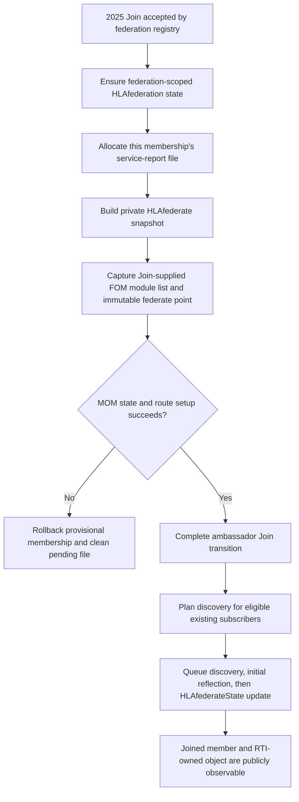

The HLAfederate instance is created only for the 2025 MOM projection when the
production Join path has a public report-file location. The test-only memory
report store intentionally does not invent such a public path. Setup failures
roll back the provisional member and clean its pending report file; the
federation-scoped MOM object has a different lifetime and must not be assumed
to be per-member cleanup.

## Subscription controls public discovery; Join is not a callback

A receiving federate sees the RTI-owned instance through the normal object
class subscription and discovery/reflection callback route. The RTI is the
producer, so the reflected `producingFederate` handle is invalid in the focused
tests. Callback execution still follows the receiver's callback model:
`HLA_EVOKED` work is delivered when the receiver evokes callbacks; the focused
scenario also exercises `HLA_IMMEDIATE`.

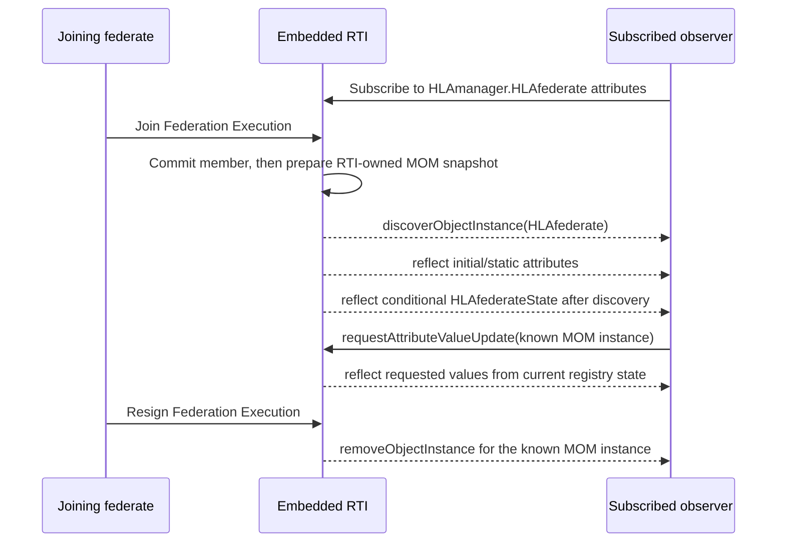

The standard object handle is usable through public object services after
discovery, including object-class/name lookup and attribute value requests.
This does not mean the instance is visible to every member: recipients still
depend on the applicable declarations and discovery projection. DDM-specific
scope behavior is documented separately in the
[DDM and regions guide](HLA-2025-DATA-DISTRIBUTION-AND-REGIONS-FLOW-GUIDE.md).

## Snapshot values and live state are different kinds of data

The initial per-Join values include the federate handle, name and type, host,
RTI version, the FOM designators supplied at **this member's Join**, and the
immutable service-report-file path. The Join-scoped module list is not the
federation's complete FOM list. The member-scoped
`HLArequestFOMmoduleData` uses an order number in this Join-supplied list; the
Federation MOM guide records the embedded list-to-report-content alignment
limit ([member index audit](HLA-2025-FEDERATION-MOM-FLOW-GUIDE.md#member-scoped-index-after-join-embedded-mapping-needs-a-focused-check)).
Switch changes do not replace the object's identity or its already selected
report-file path. The pinned MIM's Conditional `HLAreportServiceFile` trigger
and Umbra's Join-time snapshot path are compared in the
[report-file condition flow](HLA-2025-FEDERATION-MOM-FLOW-GUIDE.md#report-file-condition-and-join-time-value).
For the difference between
Create-time federation policy and per-member advisory seeding, see the
[federation MOM switch-lifecycle flow](HLA-2025-FEDERATION-MOM-FLOW-GUIDE.md#creation-time-federation-policy-versus-per-member-switch-seeding).

Other attributes are derived from the authoritative current federation/member
ledgers when a value is requested or an update is planned. `HLAfederateState`
is one example: Umbra derives it from save/restore operation status, not from
whether a particular callback has already been delivered.

In the current source, the 2025 state encodings used by the focused flow are:

| State | Encoded value | Source of the state |
| --- | ---: | --- |
| Active federate | `1` | No save or restore operation is active for this member. |
| Federate save in progress | `3` | The current save ledger records an in-progress status for this member. |
| Federate restore in progress | `5` | The current restore ledger records an in-progress status for this member. |

The state is conditional: it is absent from the initial static reflection in
the focused test, can be explicitly queried for its current value, and changes
at save/restore boundaries.

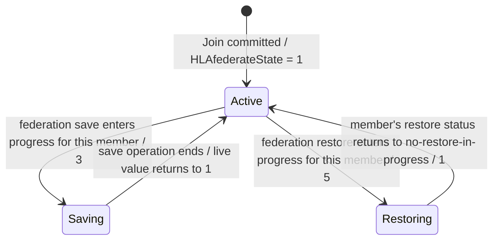

On a participant-reported failure, explicit abort, or image commit failure,
the registry clears the save operation, so the live `HLAfederateState` encoder
defaults to `1` ([failure reset](../../cpp/src/internal/federation/federation_registry_save_control.cpp#L1089),
[abort reset](../../cpp/src/internal/federation/federation_registry_save_control.cpp#L1123),
[live encoder](../../cpp/src/internal/federation/federation_registry_mom_object_state.cpp#L741)).
The conditional-update contract has a narrower named trigger:
it lists successful `Initiate Federate Save` and `Federation Saved` (along with
the listed Join/Restore events), but not `Federation Not Saved` or
`Abort Federation Save` ([2025 MIM row](../../third_party/ieee1516.2-2025/resources/mim/HLAstandardMIM-2025.xml#L203)).
The inspected embedded dispatcher queues the return-to-`1` attribute update
after `federationSaved`, while its unsuccessful branch invokes
`federationNotSaved` without queuing that state update
([success/failure notification branches](../../cpp/src/internal/runtime/umbra_rti_ambassador_save_restore_notifications.cpp#L173)).
Therefore the live encoder can return `1` while a subscriber retains its last
reflected `3`; that is an implementation inference, not a normative statement
about failed-save observations. An explicit current-value request uses the
live encoder, but no focused failure case asserts that request after failure
([state encoder](../../cpp/src/internal/federation/federation_registry_mom_object_state.cpp#L741),
[current-value route](../../cpp/src/internal/federation/federation_registry_attribute_value_update_requests.cpp#L360)).

The public conditional-state test covers the successful `3 → 1` transition
under both callback models. The embedded failure/abort test and configured-
process participant-failure test assert `federationNotSaved` outcomes, not
`HLAfederateState` reflections
([success case](../../cpp/tests/joined_federate_mom_federate_state_save_restore_catch2.cpp#L139),
[embedded failure and abort](../../cpp/tests/ieee1516_2025_federation_save_control_catch2.cpp#L72),
[configured-process failure](../../cpp/tests/ieee1516_2025_connection_process_federation_save_not_complete_catch2.cpp#L564)).
Keep this member-scoped operation state separate from Federation-scoped save
history and image contents; see the
[save-history MOM boundary](HLA-2025-FEDERATION-MOM-FLOW-GUIDE.md#save-history-mom-values-cross-the-image-boundary-at-different-times).

Treat this as the current implementation's state projection, not as a
replacement for the save/restore protocol's own callbacks and gates. In the
focused save/restore scenario, observers receive the conditional `3 → 1` and
`5 → 1` updates; the federate currently saving does not receive its own
save-state reflection. Initial/requested values and transition reflections are
separate observations of the same registry state.

## Restore source and MOM projection are separate

The restore source and the `HLAfederateState` value answer different
questions. A completed save retains both a process-local `Federation` copy and
a durable `FederationStateImage`. The process-local copy contains the RTI-owned
MOM object map. The durable image captures the ordinary federation
object-instance ledger and supported route-free state, but has no field for
that separate MOM map. On restore, Umbra either copies the retained map back,
or applies the bounded durable image to the current live registry; in the
second path, the current RTI-owned MOM map is not reconstructed from saved
bytes. The bounded image path requires current membership and callback routes,
so this is not evidence of a portable operating-system process restart.

In both paths, `HLAfederateState` is derived from the live restore-operation
ledger. The embedded test observes the conditional value `5` during Restore
and `1` after all participants complete, matching both reflections to the
`HLAfederate` instance handle discovered before Restore. It does not check for
a separate object removal/rediscovery event or observe
`HLAfederation` membership reflections across Restore; the configured-process
endpoint also has no direct `HLAfederateState` Save/Restore assertion.

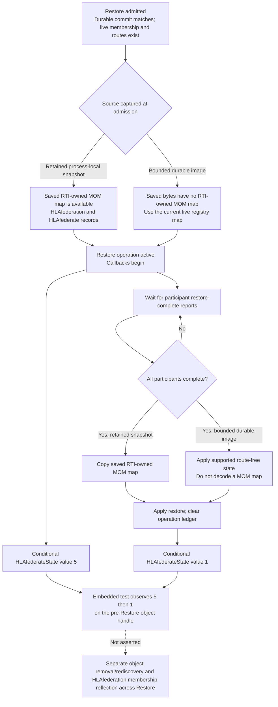

The source boundaries are visible in the [saved process-local copy](../../cpp/src/internal/federation/federation_registry_save_control.cpp#L1013), [durable image schema](../../cpp/src/internal/federation/federation_state_image.hpp#L802) and [ordinary object-instance capture](../../cpp/src/internal/federation/federation_registry_state_image_capture.cpp#L866), [restore-source selection](../../cpp/src/internal/federation/federation_registry_restore_control.cpp#L779), and [MOM-map assignment from the selected snapshot](../../cpp/src/internal/federation/federation_registry_state_image_restore.cpp#L964), and [live HLAfederateState derivation](../../cpp/src/internal/federation/federation_registry_mom_object_state.cpp#L741). The [embedded conditional-state case](../../cpp/tests/joined_federate_mom_federate_state_save_restore_catch2.cpp#L139) covers both callback models; its handle match applies to those reflections and does not establish whether Restore also emits removal or rediscovery callbacks. The broader admission/completion protocol and durable-image limits are described in the [Save/Restore guide](HLA-2025-FEDERATION-SAVE-RESTORE-FLOW-GUIDE.md#2025-umbra-restore-source-selection).

In the inspected embedded completion path, Restore applies its selected state
without calling the joined-MOM discovery/removal planners; Join has a separate
[MOM discovery planning call](../../cpp/src/internal/runtime/umbra_rti_ambassador_federation_lifecycle.cpp#L740).
This is source evidence only. The focused test matches state reflections to
the original object handle but does not assert the absence or ordering of
removal and rediscovery callbacks; see the [Restore state application path](../../cpp/src/internal/federation/federation_registry_restore_control.cpp#L1320).

### Failed or aborted Restore callbacks and the live state

Restore can end unsuccessfully when a member reports that it cannot complete,
when a member aborts the operation, or when a restore preparation/application
exception is caught while the registry still holds the active restore
operation. In these traced paths, the registry plans failed completion
notifications with the corresponding reason, then clears the operation. Since
the live `HLAfederateState` encoder reads that operation ledger, a subsequent
source-level value read returns to `ActiveFederate` (`1`). That live value
transition is separate from whether an observer receives a conditional
reflection.

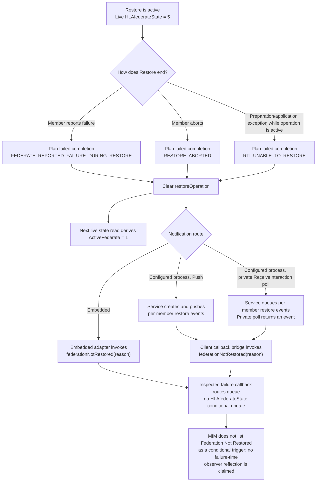

The terminal reason and ledger reset are source-traceable for
[member-reported failure](../../cpp/src/internal/federation/federation_registry_restore_control.cpp#L1758),
[explicit abort](../../cpp/src/internal/federation/federation_registry_restore_control.cpp#L1791),
and [pre-reset application catch](../../cpp/src/internal/federation/federation_registry_restore_control.cpp#L1676).
The shared planner creates completion notifications for current restore
participants with live callback routes
([notification construction](../../cpp/src/internal/federation/federation_registry.cpp#L521));
the live value comes from the [restore-ledger encoder](../../cpp/src/internal/federation/federation_registry_mom_object_state.cpp#L741).
In embedded mode, the failure branch invokes `federationNotRestored(reason)`
without queuing a conditional state update
([embedded notification adapter](../../cpp/src/internal/runtime/umbra_rti_ambassador_save_restore_notifications.cpp#L556)).
In configured-process mode, the service turns the notifications into per-member
events and either pushes them or queues them for the process endpoint's private
`ReceiveInteraction` poll
([restore-completion handler](../../cpp/src/internal/federation/process_federation_service_save_restore.cpp#L382),
[not-complete handler](../../cpp/src/internal/federation/process_federation_service_save_restore.cpp#L535),
[abort handler](../../cpp/src/internal/federation/process_federation_service_save_restore.cpp#L573),
[event routing](../../cpp/src/internal/federation/process_federation_service_notifications.cpp#L524),
[queued receive](../../cpp/src/internal/federation/process_federation_service_receive.cpp#L120));
the [callback bridge](../../cpp/src/internal/federation/process_federation_callback_bridge.cpp#L984)
invokes the failure callback. The inspected process event contains restore
notification data, not a `HLAfederateState` update.

The 2025 MIM's [conditional update condition](../../third_party/ieee1516.2-2025/resources/mim/HLAstandardMIM-2025.xml#L203)
names successful Restore milestones and does not name `Federation Not Restored`.
The configured-process [member-failure case](../../cpp/tests/ieee1516_2025_connection_restore_failure_lifecycle_immediate_catch2.cpp#L569)
and [explicit-abort case](../../cpp/tests/ieee1516_2025_connection_restore_abort_immediate_catch2.cpp#L568)
assert the `federationNotRestored` callback reason and callback order; they do
not request or assert a `HLAfederateState` value or reflection. This is an
implementation and test boundary, not a claim that failure-time updates are
forbidden or that an observer's cached value has a particular value.

The broad restore-application catch also spans callback-work rebinding after
`restoreFederationFromSnapshot` clears the operation. Its later route checks
throw if a restored callback requester has no live route; after that reset,
the shared failure-notification builder has no active operation to enumerate.
The inspected admission and state-replacement paths establish the expected
route invariant: Restore admission requires a route for every current member,
resignation clears an active Restore before removing that member's route, and
snapshot application preserves the live route maps. Durable identity rebinding
is restricted to bounded ledgers whose federate identities are mapped to live
members. I found no accepted state path that leaves one of these restored
callback requesters without a route. Treat the later checks as defensive
invariant guards; this review does not demonstrate a reachable missing-route
case. No focused test injects a route failure after state application, so the
public outcome of such an invariant break remains unestablished
([Restore admission](../../cpp/src/internal/federation/federation_registry_restore_control.cpp#L1111),
[identity-rebind admission](../../cpp/src/internal/federation/federation_registry_restore_control.cpp#L487),
[state application](../../cpp/src/internal/federation/federation_registry_restore_control.cpp#L1320),
[live route preservation](../../cpp/src/internal/federation/federation_registry_state_image_restore.cpp#L795),
[operation reset](../../cpp/src/internal/federation/federation_registry_state_image_restore.cpp#L1002),
[resignation ordering](../../cpp/src/internal/federation/federation_registry_resign_lifecycle.cpp#L452),
[post-apply route check](../../cpp/src/internal/federation/federation_registry_restore_control.cpp#L1372),
[application catch](../../cpp/src/internal/federation/federation_registry_restore_control.cpp#L1676),
[notification builder's active-operation guard](../../cpp/src/internal/federation/federation_registry.cpp#L525)).

## Explicit requests and periodic refresh are independent

The 2025 standard MIM describes two independent reasons for an
`HLAfederate` attribute value to be supplied. A Request Attribute Value Update
must be answered through the ordinary attribute-update mechanism regardless
of whether the requested attribute is Static, Periodic, or Conditional.
Separately, the RTI updates Dynamic attributes according to their declared
policy. For Periodic attributes, `HLAsetTiming` selects the wall-clock interval
for a specified joined federate: until set, or when set to zero, no periodic
updates are performed. `HLAsetTiming` is a predefined MOM interaction, not an
RTIambassador setter; the [2025 MIM defines it as Receive-order and reliable,
with `HLAreportPeriod` measured in seconds](../../third_party/ieee1516.2-2025/resources/mim/HLAstandardMIM-2025.xml#L928).
It controls the target membership's report cadence and does not turn an
explicit value request on or off. The period is the RTI's value-refresh
cadence, not a promise that an application callback executes at that exact
instant; the receiver observes each reflection through its normal
callback-dispatch boundary. For how `HLA_EVOKED` and `HLA_IMMEDIATE` affect
callback entry, see the [2025 Callback and Service Ordering guide](HLA-2025-CALLBACK-AND-SERVICE-ORDERING-FLOW-GUIDE.md#hlaevoked-the-application-owns-the-drain-point)
and its [`HLA_IMMEDIATE` section](HLA-2025-CALLBACK-AND-SERVICE-ORDERING-FLOW-GUIDE.md#hlaimmediate-callback-work-can-be-on-the-service-stack).

This `HLAsetTiming` period is a wall-clock MOM refresh cadence, not HLA logical
time or a time-advance request. The separate [2025 Time Management guide](HLA-2025-TIME-MANAGEMENT-GUIDE.md)
covers simulation-time grants and timestamp eligibility.

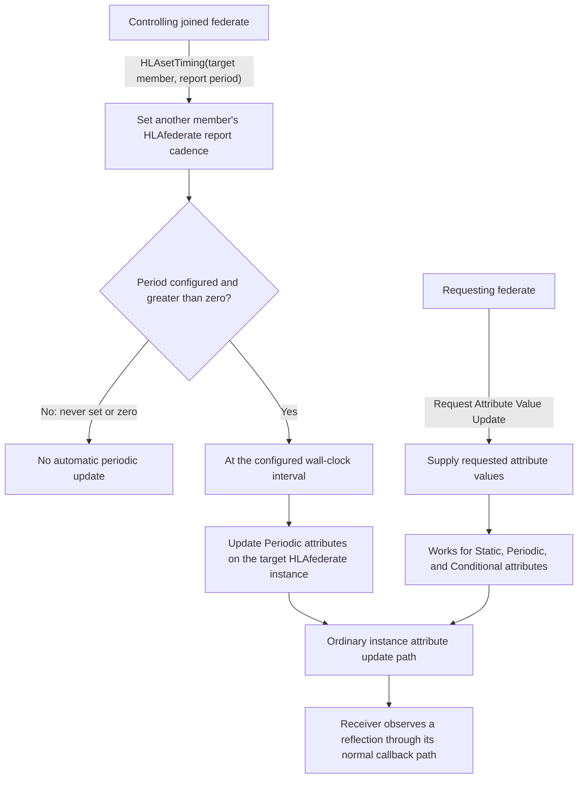

For accepted non-negative periods, zero means “stop periodic refresh” and a
positive value sets the interval. In the current embedded implementation, a
negative period is rejected rather than treated as zero; the handler also
requires both the sending and target federates to be joined
([source](../../cpp/src/internal/runtime/umbra_rti_ambassador_interaction_send_mom_controls.cpp#L468)).
That validation is an implementation observation, not an additional claim
about the MIM contract.

### Each joined target has an independent schedule

The target reference in `HLAsetTiming` is significant: setting one member's
report period does not establish one federation-wide clock. The embedded
multi-target case sets one target to one second and another to two seconds,
observes the first target's periodic reflection, then sets only that target to
zero. The second target still reports at its own later deadline.

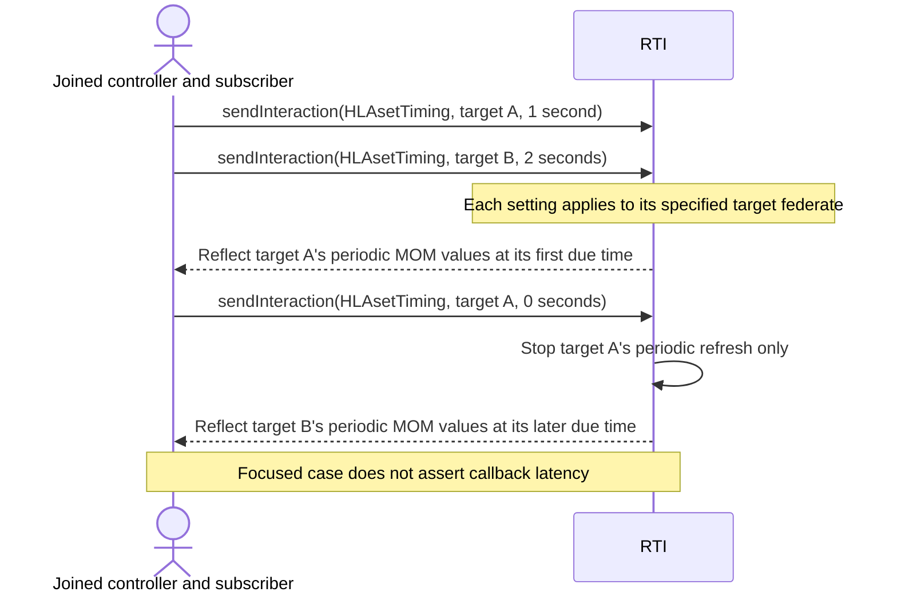

The [focused multi-target test](../../cpp/tests/ieee1516_2025_federation_mom_hla_set_timing_multi_target_catch2.cpp#L5)
exercises this sequence under both callback models. For `HLA_EVOKED`, it
explicitly pumps `evokeMultipleCallbacks`; for `HLA_IMMEDIATE`, the test
observes callbacks from the scheduler. This demonstrates independent target
state in the embedded development profile, not process-endpoint parity or a
real-time delivery guarantee.

The cadence describes *when* periodic values are refreshed, not a universal
meaning for the values. The pinned MIM defines 21 Periodic attributes on
`HLAfederate`; grouping them by unit helps avoid treating every number as the
same kind of counter:

| Measurement | Periodic `HLAfederate` attributes | How to read them |
| --- | --- | --- |
| Logical-time state | `HLAlogicalTime`, `HLAlookahead`, `HLAGALT`, `HLALITS` ([MIM](../../third_party/ieee1516.2-2025/resources/mim/HLAstandardMIM-2025.xml#L240)) | Time-management values, not elapsed wall-clock durations; `HLAlogicalTime` begins at the TRADT initial federation time. Lookahead is undefined when the member is not time-regulating; GALT and LITS are undefined when their respective values are undefined. |
| Queued-message gauges | `HLAROlength`, `HLATSOlength` ([MIM](../../third_party/ieee1516.2-2025/resources/mim/HLAstandardMIM-2025.xml#L296)) | Current counts of receive-order and timestamp-order messages queued for delivery to that joined federate, not counts of messages processed during the last reporting interval. |
| Service and reception totals | `HLAreflectionsReceived`, `HLAupdatesSent`, `HLAinteractionsReceived`, `HLAinteractionsSent`, `HLAdirectedInteractionsReceived`, `HLAdirectedInteractionsSent` ([MIM](../../third_party/ieee1516.2-2025/resources/mim/HLAstandardMIM-2025.xml#L320)) | Totals describe service invocations or interactions, not necessarily the number of individual attribute values. `HLAreflectionsReceived` is a Reflect Attribute Values invocation count; `HLAupdatesSent` is a successful Update Attribute Values invocation count. For the receiver-side per-class/per-transport reflection activity breakdown, see the [2025 reflection report flow](HLA-2025-MOM-OBJECT-AND-INTERACTION-REPORTS-FLOW-GUIDE.md#mom-reflection-reports-separate-callback-activity-from-distinct-objects); for updates, see the [2025 update-activity report flow](HLA-2025-MOM-OBJECT-AND-INTERACTION-REPORTS-FLOW-GUIDE.md#mom-update-activity-report-groups-counts-by-class-and-transportation). The embedded interaction-receipt ledger includes directed callbacks in `HLAinteractionsReceived` and tracks them separately as its `HLAdirectedInteractionsReceived` subset; see the [2025 interaction-receipt report flow](HLA-2025-MOM-OBJECT-AND-INTERACTION-REPORTS-FLOW-GUIDE.md#mom-interaction-receipt-report-groups-by-sent-class-and-transportation) for source and test limits. `HLAinteractionsSent` reflects related DDM usage; its separate class/transport breakdown and directed subset are shown in the [2025 interaction-send report flow](HLA-2025-MOM-OBJECT-AND-INTERACTION-REPORTS-FLOW-GUIDE.md#mom-interaction-send-reports-separate-total-sends-from-the-directed-subset). |
| Object-lifecycle service totals | `HLAobjectInstancesDeleted`, `HLAobjectInstancesRemoved`, `HLAobjectInstancesRegistered`, `HLAobjectInstancesDiscovered` ([MIM](../../third_party/ieee1516.2-2025/resources/mim/HLAstandardMIM-2025.xml#L444)) | Counts of the corresponding lifecycle-service invocations; the MIM specifies these totals since the federate joined. Discovery can count repeated discovery of one instance after Local Delete. |
| Object-instance measures | `HLAobjectInstancesThatCanBeDeleted`, `HLAobjectInstancesUpdated`, `HLAobjectInstancesReflected` ([MIM](../../third_party/ieee1516.2-2025/resources/mim/HLAstandardMIM-2025.xml#L402)) | The first is a current ownership-based count: instances whose privilege-to-delete attribute is owned by the joined federate. The other two count distinct instances for which the corresponding update or reflection service was invoked; they are not service-invocation totals. The reflection distinction and its separate per-class activity report are shown in the [2025 reflection report flow](HLA-2025-MOM-OBJECT-AND-INTERACTION-REPORTS-FLOW-GUIDE.md#mom-reflection-reports-separate-callback-activity-from-distinct-objects). |
| Time-in-state durations | `HLAtimeGrantedTime`, `HLAtimeAdvancingTime` ([MIM](../../third_party/ieee1516.2-2025/resources/mim/HLAstandardMIM-2025.xml#L503)) | Wall-clock duration spent in each state since that attribute's prior update. The initial duration is measured since Join; later values are not lifetime totals. |

Thus a periodic report is not automatically a delta, rolling window, or reset
of every statistic. The MIM's own units and update semantics decide whether a
value is a current gauge, a service total, an instance count, logical-time
state, or an interval duration.

The paired update-count scenario makes the MIM's service-versus-instance
distinction concrete: after two updates to the first object, the invocation
count is two while the instance count remains one; updating a second object
advances them to three and two respectively. It also explicitly requests
values before enabling periodic reporting, then observes a periodic report
after setting the target member's period. This is one embedded 2025 example,
not evidence of process-endpoint parity or a complete MOM implementation.

## Resignation removes visibility before forgetting the snapshot

On explicit resignation, Umbra does not send the joined-federate MOM instance through
the ordinary federate-created-object ownership/resign-action path. It plans
RTI-originated removal for surviving federates that knew the instance. If
removal callbacks are still pending, the private snapshot is retained until
those recipients cross the callback-time removal boundary; it is erased once
no known-recipient removal remains. This keeps callback data available without
keeping the departed membership active.

```mermaid
stateDiagram-v2
  [*] --> Visible: joined lifetime, eligible receivers may know instance
  Visible --> RemovalPending: represented federate resigns
  RemovalPending --> RemovalPending: deliver remove callback to one known survivor
  RemovalPending --> Forgotten: last pending recipient crosses removal boundary
  Visible --> Forgotten: resign with no known survivors
  Forgotten --> [*]
  note right of RemovalPending: Private snapshot retained for callback-time validation
```

At final-member Resign, this path has no surviving member to receive the
departing `HLAfederate` object's removal. The registry therefore has no pending
removal recipient and discards that member-scoped snapshot. This does not
destroy the separate execution-scoped `HLAfederation` record: the execution is
still present in its empty-member state until a successful Destroy. The
registry clears the departing member's MOM visibility before this cleanup
([Resign ledger](../../cpp/src/internal/federation/federation_registry_resign_lifecycle.cpp#L1031),
[empty-recipient erase](../../cpp/src/internal/federation/federation_registry_resign_lifecycle.cpp#L1067)).
See the Lifecycle guide's [captured empty-roster sequence](HLA-2025-FEDERATION-AND-FEDERATE-LIFECYCLE-FLOW-GUIDE.md#a-captured-empty-roster-callback-can-outlive-destroy),
which compares these MOM lifetimes with roster/catalog requests. The final-member
object-removal outcome is source-derived; the focused [public lifecycle case](https://github.com/sheepfling/umbra/blob/c9c5a9e410539b039cd8bba35b53d0ef2b24d180/cpp/tests/ieee1516_2025_joined_federate_mom_public_object_lifecycle_catch2.cpp#L296)
observes a surviving observer on a non-final resignation.

This chart is the explicit-Resign path. Forced `ConnectionLost` converges on
the same registry transition for this RTI-owned object: the member object still
leaves independently of `ResignAction`, and each surviving known observer with
a usable callback route is added to the pending-removal ledger. The private
snapshot remains while those planned removals are pending and is forgotten when
the last recipient crosses the callback-time removal boundary. There is an
important route difference: ordinary Resign validates survivor callback routes
before mutating the MOM ledger, while forced connection-loss cleanup may skip a
survivor whose callback route is unavailable. See the [registry's forced-loss
entry](../../cpp/src/internal/federation/federation_registry.cpp#L426), [shared
resignation validation](../../cpp/src/internal/federation/federation_registry_resign_lifecycle.cpp#L307),
and [joined-federate snapshot cleanup](../../cpp/src/internal/federation/federation_registry_resign_lifecycle.cpp#L1038).

The outer dispatch is separate from that shared plan. The embedded adapter
selects the local terminal callback according to cause and queues the planned
object removals ([registry call](../../cpp/src/internal/runtime/umbra_rti_ambassador_membership_loss.cpp#L240),
[removal queue](../../cpp/src/internal/runtime/umbra_rti_ambassador_membership_loss.cpp#L448),
[terminal callback](../../cpp/src/internal/runtime/umbra_rti_ambassador_membership_loss.cpp#L470));
the configured-process service obtains the registry's `resignObjectRemovals`
and sends them through its own removal queue ([process connection-loss dispatcher](../../cpp/src/internal/federation/process_federation_service_connection_loss.cpp#L83)).
For the source-order nuance across callback models and profiles, see the
[2025 callback/service-ordering discussion](HLA-2025-CALLBACK-AND-SERVICE-ORDERING-FLOW-GUIDE.md#connectionlost-and-survivor-remove-callbacks-are-separate-streams).
That trace does not establish a general ordering between the departing
ambassador's terminal notification and surviving observers' Remove callbacks.

### Forced loss can skip an observer whose callback route is unavailable

This route-availability branch is an implementation detail, not a portable
HLA rule. Ordinary Resign first validates every surviving known observer route;
if any route is unavailable, the registry rejects the transition before
mutating membership or the MOM removal ledger. Forced `ConnectionLost` uses the
same registry transition with a different failure policy: it skips the
unreachable observer and continues cleanup ([route preflight](../../cpp/src/internal/federation/federation_registry_resign_lifecycle.cpp#L307),
[forced-loss removal planning](../../cpp/src/internal/federation/federation_registry_resign_lifecycle.cpp#L1045)).

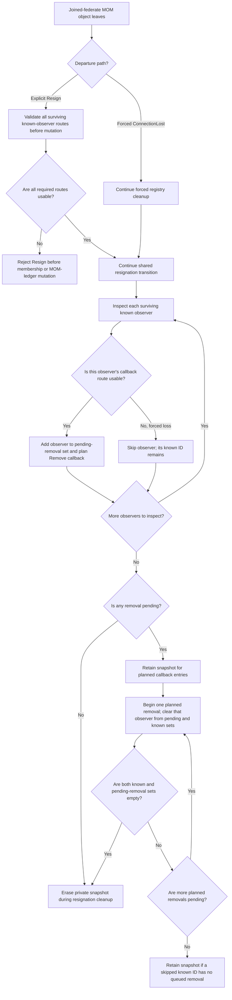

The chart separates an ordinary Resign preflight failure from the two forced-
loss outcomes. If forced cleanup cannot plan any removal, the registry erases
the private snapshot when its pending-removal set is empty, even if a skipped
known ID remains in the object being erased. If another observer has a planned
removal, the snapshot is retained; after those callback-entry transitions
([callback-time removal entry](../../cpp/src/internal/federation/federation_registry_object_instance_removal.cpp#L120)),
a skipped observer can remain in `knownFederateIds` with no pending removal
recorded for it. The bounded source trace found no retry for that skipped
observer, and no focused test exercises the missing-route branch or its
snapshot consequence. The embedded and configured-process public MOM removal
tests cover successful explicit Resign, not this forced-loss case. Do not
present these private-ledger outcomes as a standard requirement or tested
callback result.

The focused [embedded joined-federate MOM lifecycle case](https://github.com/sheepfling/umbra/blob/c9c5a9e410539b039cd8bba35b53d0ef2b24d180/cpp/tests/ieee1516_2025_joined_federate_mom_public_object_lifecycle_catch2.cpp#L287)
and [process resign/rejoin case](../../cpp/tests/ieee1516_2025_connection_process_mom_resign_removal_order_catch2.cpp#L39)
observe explicit Resign, not forced-loss removal of this public object. A
bounded search of the 2025 connection-loss test sources found no assertion for
`HLAfederate` object removal after `ConnectionLost`. Treat that path as
source-derived, not tested profile parity or a normative callback-order rule.

### A throwing Remove callback does not roll back the callback-time transition

The pinned API declares the receive-order `removeObjectInstance` callback may
throw `FederateInternalError` ([callback declaration](../../third_party/ieee1516.1-2025/include/RTI/FederateAmbassador.h#L316)).
In the embedded path, the registry's callback-time `beginJoinedFederateMomObjectRemoval`
removes that observer from the pending and known sets before user code runs; it
may erase the private object snapshot if no known or pending recipients remain
([begin](../../cpp/src/internal/federation/federation_registry_object_instance_removal.cpp#L120),
[callback invocation](../../cpp/src/internal/runtime/umbra_rti_ambassador_object_instance_lifecycle_callbacks.cpp#L1445)).
No source path restores the observer's known state after the callback throws.

The failure boundary depends on when delivery invokes the callback:

- If `HLA_IMMEDIATE` enters the callback inline during forced-loss submission
  and it throws through that call, the removal loop clears pending reservations
  for the current and remaining planned recipients, then rethrows. Cancellation
  erases pending IDs only; it does not restore known IDs or schedule a retry
  ([submission and cancellation](../../cpp/src/internal/runtime/umbra_rti_ambassador_object_instance_lifecycle_callbacks.cpp#L1482),
  [registry cancellation](../../cpp/src/internal/federation/federation_registry_object_instance_removal.cpp#L180)).
  Remaining observers can therefore stay in the snapshot's known set without
  a pending removal. This synchronous failure also unwinds before this handler
  reaches its later `HLAfederatesInFederation` update and local terminal-callback
  submission ([membership-loss queue order](../../cpp/src/internal/runtime/umbra_rti_ambassador_membership_loss.cpp#L448)).
- With `HLA_EVOKED`, or when immediate delivery is deferred, the producer has
  already finished submitting the removal tasks before the application invokes
  them. The dispatcher removes a task from its queue before invoking it and
  does not requeue the task that throws; other recipients' queued tasks remain
  independent ([evoked extraction](../../cpp/src/internal/callbacks/callback_dispatcher.cpp#L188),
  [callback invocation](https://github.com/sheepfling/umbra/blob/c9c5a9e410539b039cd8bba35b53d0ef2b24d180/cpp/src/internal/callbacks/callback_dispatcher.cpp#L296),
  [queue pop](../../cpp/src/internal/callbacks/callback_dispatcher.cpp#L324)).
- In the configured-process path, Push begins the registry removal before
  sending the event, while Pull begins it when the recipient's receive poll
  selects the event. The client callback bridge invokes the application only
  afterward. Push/Pull transport and the client's callback model are separate
  choices. The inspected path shows no callback-failure acknowledgement to
  the server and no registry rollback/retry ([Push begin](../../cpp/src/internal/federation/process_federation_service_object_instance_removal.cpp#L75),
  [Pull selection and begin](../../cpp/src/internal/federation/process_federation_service_receive.cpp#L149),
  [bridge forwarding](../../cpp/src/internal/federation/process_federation_callback_bridge.cpp#L2004),
  [application callback](../../cpp/src/internal/federation/process_federation_callback_bridge.cpp#L664)).

The embedded paths differ at dispatcher entry and at the point where a thrown
callback unwinds:

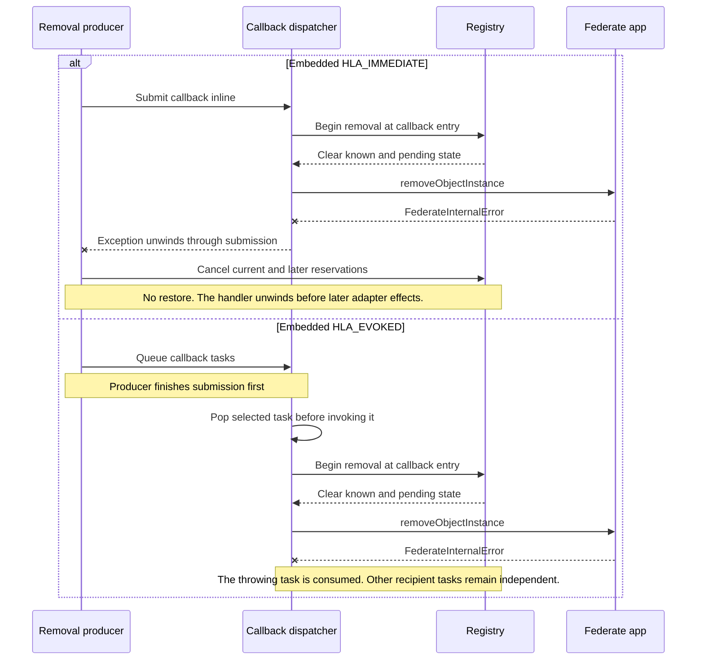

Configured-process Push and Pull have a separate server/client boundary:

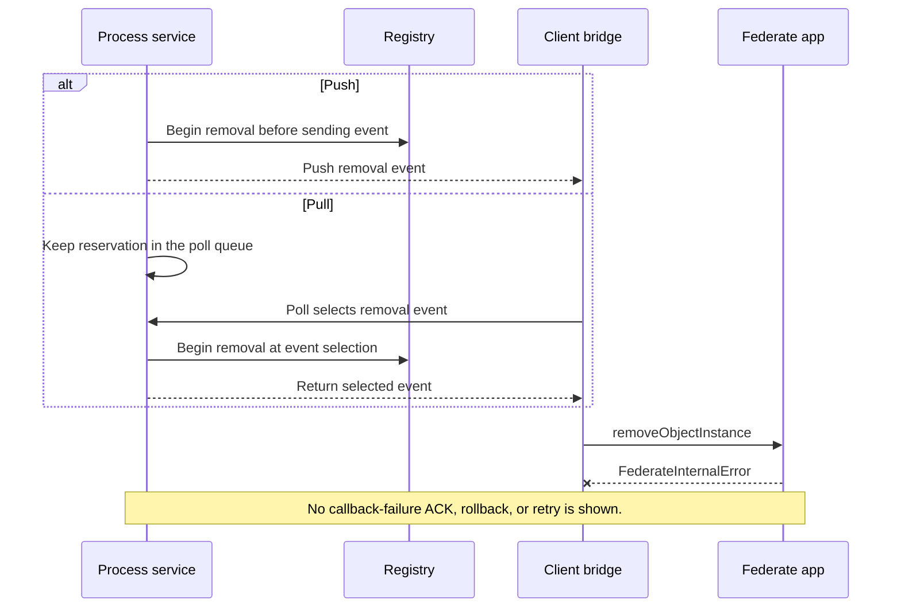

A bounded search found no focused test combining forced loss, RTI-owned
`HLAfederate` removal, and a throwing `Remove Object Instance` callback. The
focused [embedded removal case](https://github.com/sheepfling/umbra/blob/c9c5a9e410539b039cd8bba35b53d0ef2b24d180/cpp/tests/ieee1516_2025_joined_federate_mom_public_object_lifecycle_catch2.cpp#L296)
and [configured-process Resign/rejoin case](../../cpp/tests/ieee1516_2025_connection_process_mom_resign_removal_order_catch2.cpp#L333)
observe successful explicit Resign; the test support's optional removal hook
is not configured to throw. These are implementation observations, not a
claim about the standard's callback-failure policy or cross-profile recovery.

### Configured-process Push crosses the registry boundary before sending

Forced loss commits the departed member's registry transition and prepares
removal work for known survivors before the process service projects it onto
sessions ([registry removal plan](../../cpp/src/internal/federation/federation_registry_resign_lifecycle.cpp#L1038),
[connection-loss dispatcher](../../cpp/src/internal/federation/process_federation_service_connection_loss.cpp#L83)).
In Push mode, the projector resolves each recipient session, calls
`beginJoinedFederateMomObjectRemoval`, and stores that recipient's event in a
local vector. Only after this preparation loop has finished does a second loop
send the events ([Push preparation](../../cpp/src/internal/federation/process_federation_service_object_instance_removal.cpp#L23),
[send loop](../../cpp/src/internal/federation/process_federation_service_object_instance_removal.cpp#L139)).
The registry begin operation removes that receiver from both pending-removal and
known-observer state and may erase the private snapshot when the final known or
pending observer is gone ([begin transition](../../cpp/src/internal/federation/federation_registry_object_instance_removal.cpp#L137),
[possible snapshot erase](../../cpp/src/internal/federation/federation_registry_object_instance_removal.cpp#L147)).

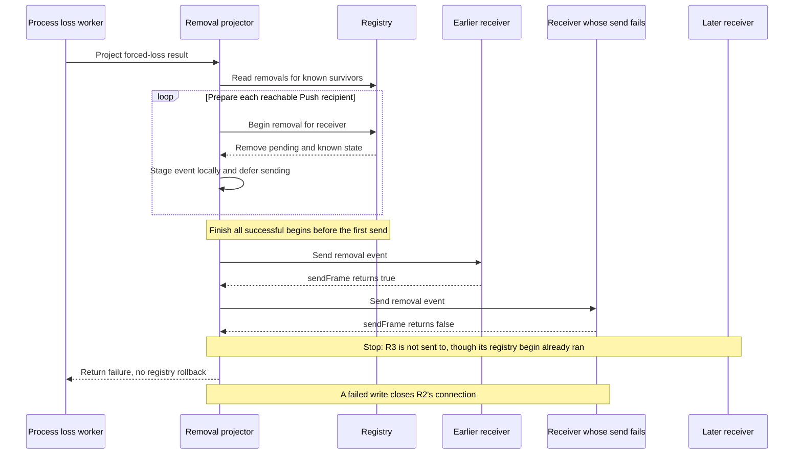

Therefore a failed Push send stops the remaining send loop, but it does not
restore the registry entries already advanced during preparation. A later
recipient can be absent from the private known set without its event having
been attempted, and the snapshot may already have been erased. If session
lookup fails before a recipient's begin, the implementation cancels that
recipient's pending reservation and continues; this is a different branch and
does not erase its known-observer entry ([missing-session branch](../../cpp/src/internal/federation/process_federation_service_object_instance_removal.cpp#L38)).
Pull mode instead leaves the reservation pending and queues an event for the
receiver's next poll ([Pull queue path](../../cpp/src/internal/federation/process_federation_service_object_instance_removal.cpp#L100)).

`sendFrame` returns false for a closed connection or a transport write failure;
on a write error it closes the connection ([transport send](../../cpp/src/internal/federation/process_transport.cpp#L170)).
The send result is not an application callback acknowledgment, so it does not
establish that the receiver processed—or did not process—the event. The
connection-loss dispatcher stops before its later synchronization-notification
and federate-lost report work when the removal projection fails
([early return](../../cpp/src/internal/federation/process_federation_service_connection_loss.cpp#L80)).
The host cleanup depends on how the connection ends. A normal receive-loop exit
marks the session inactive; the maintenance loop waits for
`RTI_TIMEOUT_PURGE`, removes the host record, then calls connection-loss
projection and detaches only if that call succeeds
(inactive worker[^worktree-source],
purge and cleanup[^worktree-source]).
The registry removes membership before the process service projects survivor
effects ([registry transition](../../cpp/src/internal/federation/process_federation_service_connection_loss.cpp#L182),
[projection result](../../cpp/src/internal/federation/process_federation_service_connection_loss.cpp#L186)).
If that projection fails, the purge path records the error and skips `Detach`,
so the service's session mapping can remain after registry membership is gone.
There is no retry on that path and no focused host test injects the projection
failure. Host shutdown has separate cleanup and detaches captured sessions even
after a recorded loss failure ([shutdown path](../../cpp/src/internal/federation/process_federation_service_host.cpp#L206)).

### Transport closure becomes eligible for process loss after host purge

The failed recipient's server-side connection is also used by its own host
worker. A transport write failure closes that connection
(socket-close branches[^worktree-source],
[failure-handler dispatch](https://github.com/sheepfling/umbra/blob/c9c5a9e410539b039cd8bba35b53d0ef2b24d180/cpp/src/internal/federation/process_transport.cpp#L293)).
The recipient worker then leaves its serving loop when receive returns false
and marks the session inactive; it does not immediately apply connection loss
(receive loop[^worktree-source],
inactive-session transition[^worktree-source],
[hosted session receive result](https://github.com/sheepfling/umbra/blob/c9c5a9e410539b039cd8bba35b53d0ef2b24d180/cpp/src/internal/federation/process_transport_session.cpp#L41)).
If the client does not resume before `RTI_TIMEOUT_PURGE`, maintenance removes
the host record and asks the process service to apply connection loss and then
detach the session (purge path[^worktree-source]).
The registry applies the transition only if the member is still present
([registry transition](../../cpp/src/internal/federation/federation_registry.cpp#L426)).
The earlier MOM begin transition changes this object's observer/snapshot
bookkeeping, not federation membership
([MOM observer transition](../../cpp/src/internal/federation/federation_registry_object_instance_removal.cpp#L120)).

So a failed Push send can make the recipient session eligible for a later,
timeout-driven process connection-loss pass, which may plan more removal work.
The host's purge removes its session record before applying that transition;
the focused host test verifies successful removal after the timeout, but does
not test a projection failure or a second pass. This is a possible implementation
cascade, not a normative delivery guarantee or proof that the application did
or did not process the first event. Independently, the receiver-side client
reader reports transport failure; when dispatched, the local RTI transitions
out of Joined and queues the federate's `connectionLost` callback
([client reader](../../cpp/src/internal/federation/process_federation_client.cpp#L961),
[outer service-boundary dispatch](../../cpp/src/internal/federation/process_federation_client.cpp#L646),
[failure dispatch](../../cpp/src/internal/federation/process_federation_client.cpp#L751),
[local membership-loss handling](../../cpp/src/internal/runtime/umbra_rti_ambassador_membership_loss.cpp#L104)).
That local callback path and the host worker's registry path are separate
consequences, not a callback acknowledgment for the Push event.

#### The recipient's host and local RTI react independently

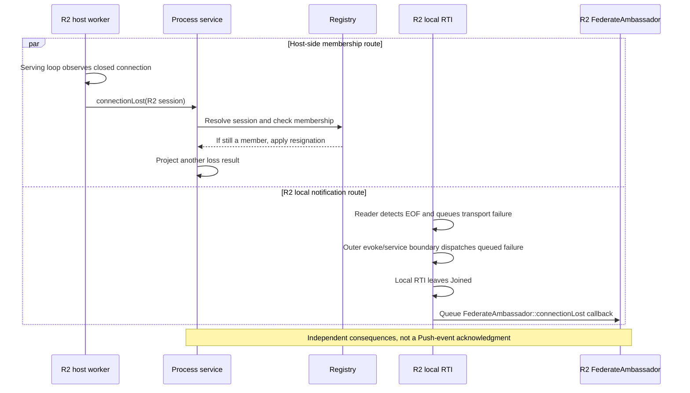

The host-side path is conditional on the recipient still being a member when
its worker handles the closed session. It is not ordered against local callback
dispatch, and neither branch establishes application-level receipt of the first
Push event. The nearby [process transport test](../../cpp/tests/process_transport_catch2.cpp#L47)
checks framed exchange. The [installable-process forced-loss probe](../../cpp/tests/process_federation_service_probe.cpp#L2811)
applies registry/service loss directly and then explicitly closes the receiver ([cleanup](../../cpp/tests/process_federation_service_probe.cpp#L2824));
it does not exercise this failed-send trigger. The
[automatic forced-resign test](../../cpp/tests/ieee1516_2025_connection_lost_automatic_no_action_forced_resign_catch2.cpp#L5)
uses embedded transport. I found no focused configured-process host test that
combines a failed survivor Push send with this recipient's subsequent
connection-loss worker path; this cascade remains source-derived.

No focused public test combines forced loss, Push delivery, and a failed
survivor event send. The successful [process Resign/rejoin case](../../cpp/tests/ieee1516_2025_connection_process_mom_resign_removal_order_catch2.cpp#L37)
does not cover this failure schedule. Treat the sequence as a source-derived
process observation, not a normative delivery/recovery rule or evidence of
embedded parity.

A later rejoin is a new membership and gets a distinct joined-federate object
instance. The focused integration case verifies public discovery/reflection,
request-time values, resignation removal, and fresh identity on a second
joined lifetime under both callback models. This identity boundary also
controls queued member-scoped FOM reports. The Federation MOM guide separates
the [reported target's Resign and rejoin](HLA-2025-FEDERATION-MOM-FLOW-GUIDE.md#member-fom-report-target-resigns-while-the-callback-waits)
from [the requester's later Resign](HLA-2025-FEDERATION-MOM-FLOW-GUIDE.md#requester-resign-after-an-accepted-member-report-request).

## Separate 2025 process-endpoint evidence

The configured process endpoint has its own Join and resignation path. Its
Join handler establishes the federation-scoped MOM record, creates this
membership's report-file and `HLAfederate` state, commits the session, and
then plans discovery for eligible subscribers
([process Join handler](../../cpp/src/internal/federation/process_federation_service_lifecycle.cpp#L257)).
The shared registry resignation path distinguishes the execution-scoped
`HLAfederation` record from the departing member's object: it retains the
former while planning removal of the latter for receivers that knew it
([resignation ledger](../../cpp/src/internal/federation/federation_registry_resign_lifecycle.cpp#L1038)).
These source paths are a separate process-profile trace, not an extension of
the embedded diagrams above.

Two focused public-endpoint cases provide bounded process observations:

- [Resign/rejoin removal ordering](../../cpp/tests/ieee1516_2025_connection_process_mom_resign_removal_order_catch2.cpp#L37)
  observes a fresh `HLAfederate` object identity after rejoin and asserts that
  the old object's removal callback precedes discovery of the new object,
  which precedes its reflection. This is the ordering exercised by that test,
  not a claim that the standard prescribes this callback sequence.
- [Joined-federate report-file lifecycle](../../cpp/tests/ieee1516_2025_connection_process_joined_federate_mom_report_file_catch2.cpp#L53)
  subscribes after the process MOM objects already exist, discovers two
  instances, and observes the subject's selected `HLAfederateName` and
  `HLAreportServiceFile` values. It then verifies that rejoin exposes a new
  object and a new report-file path while preserving the prior file. This is
  positive evidence for that process endpoint's RTI-owned MOM initial-value
  branch, not evidence about an ordinary registered object. A separate public
  process case now has test-source assertions for a newly discovered ordinary
  object and its selected stored value in both callback-model sections; see
  the [subscription-state comparison](HLA-2025-OBJECT-ATTRIBUTE-SUBSCRIPTION-STATE-FLOW-GUIDE.md#process-late-subscription-path-same-selectors-an-unresolved-initial-value-edge).
  That test was not run in this documentation review, and the exact licensed
  §5.8 rule remains unverified. The already-known-object/value-only question is
  distinct from both initial-discovery paths.
  The test's [discovery/reflection assertions](../../cpp/tests/ieee1516_2025_connection_process_joined_federate_mom_report_file_catch2.cpp#L359)
  show the MOM-instance observation specifically.

These cases do not directly observe process-endpoint discovery of the
`HLAfederation` object or its `HLAfederatesInFederation` reflection on Join
and Resign. The process Federation-MOM lifecycle therefore remains
source-observed in this review; the embedded membership-reflection test is
not substituted for process evidence. Neither case establishes full profile
parity, all callback configurations, or IEEE conformance.

### Save completion callbacks and member-state reflection

The configured-process Save route has a separate callback path:

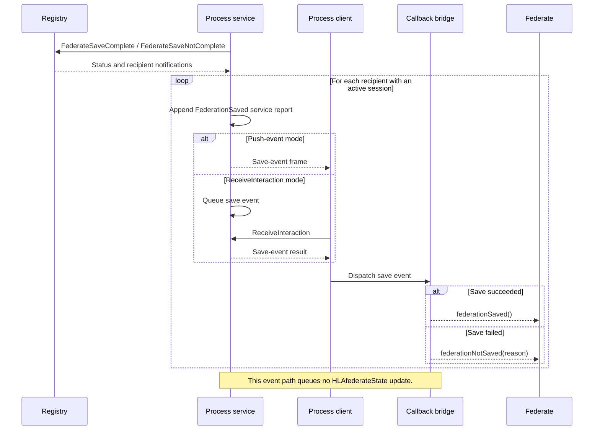

The process service applies the registry result, then turns each planned
completion notification into a recipient-specific event. A completed event
also appends a `FederationSaved` service-report record; that record is separate
from a MOM attribute reflection. Depending on the configured event mode, the
service sends a frame or stores the event for a later `ReceiveInteraction`.
The client dispatches that typed event through the callback bridge, whose
completion branch invokes `federationSaved()` or `federationNotSaved(reason)`
([service result and enqueue](../../cpp/src/internal/federation/process_federation_service_save_restore.cpp#L228),
[per-recipient event and report](../../cpp/src/internal/federation/process_federation_service_notifications.cpp#L425),
[queued receive](../../cpp/src/internal/federation/process_federation_service_receive.cpp#L117),
[client event buffer](../../cpp/src/internal/federation/process_federation_client.cpp#L702),
[callback bridge delivery](../../cpp/src/internal/federation/process_federation_callback_bridge.cpp#L881)).
The inspected process notification queue and callback bridge do not enqueue a
per-member `HLAfederateState` conditional attribute update. This differs from
the embedded success branch, which queues the state update after
`federationSaved()`; its failure branch calls `federationNotSaved()` without
that queue operation ([embedded dispatch](../../cpp/src/internal/runtime/umbra_rti_ambassador_save_restore_notifications.cpp#L168)).

The pinned MIM names successful Federation Saved as a conditional trigger, but
the process source trace and the focused process failure case do not establish
whether the configured endpoint produces the corresponding public MOM
reflection. That process test observes the `federationNotSaved` callback and
failure reason under `HLA_EVOKED`, not a `HLAfederateState` request or reflection
([MIM condition](../../third_party/ieee1516.2-2025/resources/mim/HLAstandardMIM-2025.xml#L203),
[process callback model](../../cpp/tests/ieee1516_2025_connection_process_federation_save_not_complete_catch2.cpp#L546),
[process failure assertions](../../cpp/tests/ieee1516_2025_connection_process_federation_save_not_complete_catch2.cpp#L554),
[embedded-only success reflection test](../../cpp/tests/joined_federate_mom_federate_state_save_restore_catch2.cpp#L139)).
Therefore process automatic reflection remains unverified for both successful
and unsuccessful Save completion. The source difference does not by itself
establish externally observable behavior or an IEEE conformance result. The
process Restore call/callback boundary is documented in the [Save/Restore
guide](HLA-2025-FEDERATION-SAVE-RESTORE-FLOW-GUIDE.md#process-endpoint-callback-frames-and-the-public-restore-call-boundary),
but it does not test this MOM attribute; shared registry derivation is not
process-endpoint behavioral evidence.

### Explicit value request after failed Save

The live value and automatic reflection are separate observations. A failed
participant Save clears the registry save operation, and the live encoder then
defaults `HLAfederateState` to `1`
([failure reset](../../cpp/src/internal/federation/federation_registry_save_control.cpp#L1089),
[state encoder](../../cpp/src/internal/federation/federation_registry_mom_object_state.cpp#L741)).
The configured-process public `requestAttributeValueUpdate` branch sends the
joined member, known MOM object, and validated attribute handles to the process
service. The service checks the session/member and asks the registry to plan
values for an RTI-owned joined-federate MOM object before it considers an
ordinary provider request
([public adapter](../../cpp/src/internal/runtime/umbra_rti_ambassador_request_attribute_value_updates.cpp#L23),
[process MOM request route](../../cpp/src/internal/federation/process_federation_service_attribute_update_requests.cpp#L35),
[registry plan](../../cpp/src/internal/federation/federation_registry_attribute_value_update_requests.cpp#L369)).
That process call uses the planner's default `requireActiveSubscription=false`,
while the registry still requires current membership and knowledge of the MOM
instance. This is source behavior, not a normative conclusion about direct
request entitlement
([planner default](../../cpp/src/internal/federation/federation_registry.hpp#L1333),
[membership check](../../cpp/src/internal/federation/federation_registry_attribute_value_update_requests.cpp#L390),
[known-instance check](../../cpp/src/internal/federation/federation_registry_attribute_value_update_requests.cpp#L397)).
For that RTI-owned object, the service packages the planned values into a
`ProcessFederationAttributeUpdateEvent`; its source comment explicitly says
these values do not induce a federate `provideAttributeValueUpdate` callback
([direct event construction](../../cpp/src/internal/federation/process_federation_service_attribute_update_requests.cpp#L52)).

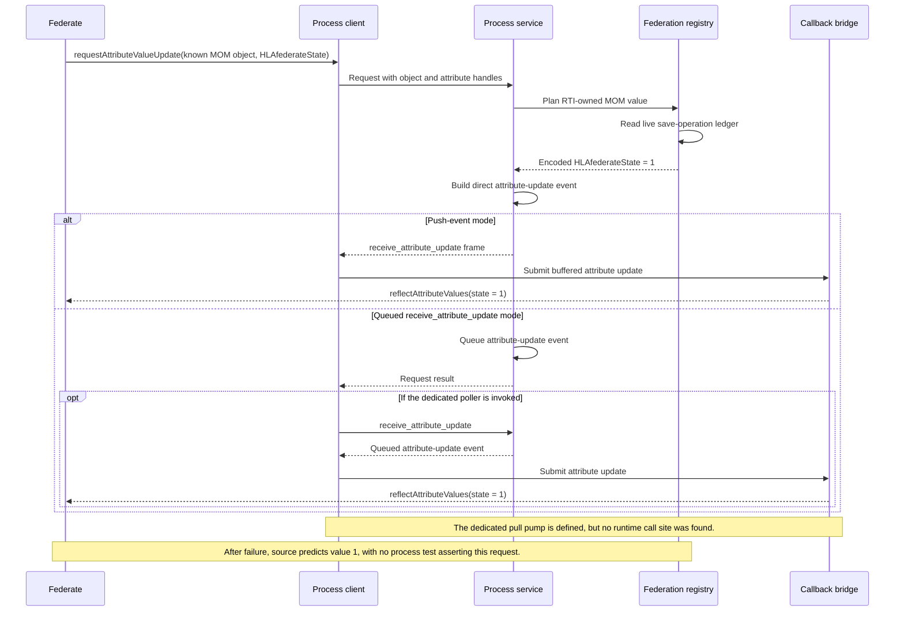

The Push branch is source-traceable: the process client buffers a pushed
attribute-update frame, and the callback bridge turns the RTI-owned event into
`reflectAttributeValues` with an invalid producing-federate handle
([client buffer](../../cpp/src/internal/federation/process_federation_client.cpp#L725),
[attribute callback](../../cpp/src/internal/federation/process_federation_callback_bridge.cpp#L248),
[RTI-owned producer mapping](../../cpp/src/internal/federation/process_federation_callback_bridge.cpp#L307)).
In the queued mode, the server stores the event and exposes a separate
`receive_attribute_update` operation. A client helper and ambassador pump are
defined, but a bounded source search found no runtime call site for that pump;
the public request branch instead drains pending provider-request callbacks
([queued response](../../cpp/src/internal/federation/process_federation_service_attribute_update_requests.cpp#L83),
[server dequeue](../../cpp/src/internal/federation/process_federation_service.cpp#L265),
[client poll helper](../../cpp/src/internal/federation/process_federation_client_value_services.cpp#L243),
[ambassador pump](../../cpp/src/internal/runtime/umbra_rti_ambassador.cpp#L2603),
[request-side provider callback drain](../../cpp/src/internal/runtime/umbra_rti_ambassador_request_attribute_value_updates.cpp#L66)).
The queued route therefore does not establish public callback delivery in the
inspected adapter. Neither route has a focused configured-process test that
requests `HLAfederateState` after failed Save. The embedded public test does
exercise request-time state values during its successful Save/Restore flow,
but it is not process-endpoint evidence or a failure-time request
([embedded request](../../cpp/tests/joined_federate_mom_federate_state_save_restore_catch2.cpp#L297)).
Keep a request-time value reflection distinct from the conditional transition
reflection, and keep the implementation trace distinct from the still-open
normative requester-entitlement question.

## Keep the 2010 path separate

The code explicitly skips synthesis of the 2025 RTI-owned MOM object when the
selected model edition is IEEE 1516.2-2010. The 2010 compatibility lane may
still have a service-report-file lifetime, but it does **not** acquire this
2025 `HLAfederate` projection by inference. This guide makes no claim about a
2010 RTI API or 2010 MOM-object parity; see the explicit boundary in the
[FOM validation design](../fom/FOM-VALIDATION-DESIGN.md#L595).

## Implementation and focused evidence

| Concern | Umbra implementation | Focused evidence |
| --- | --- | --- |
| Private per-Join snapshot and MIM initial values | [Registry object construction](../../cpp/src/internal/federation/federation_registry_mom_object_state.cpp#L187) | [Snapshot values and new identity after rejoin](../../cpp/tests/ieee1516_2025_joined_federate_mom_snapshot_foundation_catch2.cpp#L5) |
| Join-time setup, visibility, and callback scheduling | [Join lifecycle](../../cpp/src/internal/runtime/umbra_rti_ambassador_federation_lifecycle.cpp#L610), [discovery and conditional state queue](../../cpp/src/internal/runtime/umbra_rti_ambassador_federation_lifecycle.cpp#L737) | [Public discovery/reflection/request/removal scenario](https://github.com/sheepfling/umbra/blob/c9c5a9e410539b039cd8bba35b53d0ef2b24d180/cpp/tests/ieee1516_2025_joined_federate_mom_public_object_lifecycle_catch2.cpp#L5) |
| Join-scoped FOM module designators | [Snapshot descriptor](../../cpp/src/internal/federation/federation_registry_mom_object_state.cpp#L303) | [Additional-module Join snapshot](../../cpp/tests/ieee1516_2025_joined_federate_mom_fom_module_snapshot_integration_catch2.cpp#L5) |
| Dynamic current value and `HLAfederateState` encoding | [Value derivation from member operation ledgers](../../cpp/src/internal/federation/federation_registry_mom_object_state.cpp#L609), [attribute-value request route](../../cpp/src/internal/federation/federation_registry_attribute_value_update_requests.cpp#L360) | [Embedded-only Save/Restore conditional state transitions](../../cpp/tests/joined_federate_mom_federate_state_save_restore_catch2.cpp#L138) |
| Periodic cadence versus explicit request; statistic units | [Pinned 2025 MIM policy and statistic definitions](../../third_party/ieee1516.2-2025/resources/mim/HLAstandardMIM-2025.xml#L52), [`HLAsetTiming` interaction](../../third_party/ieee1516.2-2025/resources/mim/HLAstandardMIM-2025.xml#L928), [interaction decoding/validation](../../cpp/src/internal/runtime/umbra_rti_ambassador_interaction_send_mom_controls.cpp#L468), [per-target report-period state](../../cpp/src/internal/federation/federation_registry_control_state.cpp#L343), [counter derivation](../../cpp/src/internal/federation/federation_registry_mom_object_state.cpp#L833) | [Independent target intervals and zero disabling one target](../../cpp/tests/ieee1516_2025_federation_mom_hla_set_timing_multi_target_catch2.cpp#L5), [direct requests and paired invocation/distinct-object counts](../../cpp/tests/joined_federate_mom_updated_object_count_periodic_catch2.cpp#L109) |
| Pending removal and snapshot retention | [Resignation removal ledger](../../cpp/src/internal/federation/federation_registry_resign_lifecycle.cpp#L1038) | [Public object removal after resign](https://github.com/sheepfling/umbra/blob/c9c5a9e410539b039cd8bba35b53d0ef2b24d180/cpp/tests/ieee1516_2025_joined_federate_mom_public_object_lifecycle_catch2.cpp#L296) |
| Separate process-endpoint Join, removal order, and report-file lifetime | [Process Join handler](../../cpp/src/internal/federation/process_federation_service_lifecycle.cpp#L257), [shared resignation ledger](../../cpp/src/internal/federation/federation_registry_resign_lifecycle.cpp#L1038) | [Removal before rejoined-object discovery](../../cpp/tests/ieee1516_2025_connection_process_mom_resign_removal_order_catch2.cpp#L37), [new report-file path on rejoin](../../cpp/tests/ieee1516_2025_connection_process_joined_federate_mom_report_file_catch2.cpp#L53) |
| Edition guard against synthesizing the 2025 MOM object from a 2010 model | [Join's 2010 compatibility guard](../../cpp/src/internal/runtime/umbra_rti_ambassador_federation_lifecycle.cpp#L606) | The 2010 compatibility flow is intentionally outside this guide; the source guard is not evidence of 2010 API/MOM conformance. |

The embedded tests cover selected scenarios, not every MIM attribute or
counter, every subscription/DDM combination, or all save/restore interleavings.
The separate process cases above cover only their named joined-member object
and report-file observations; process `HLAfederation` callbacks and complete
IEEE conformance remain unestablished. They do not change the scope of the
embedded diagrams.

## What this guide does not claim

- It does not describe `HLAreportServiceInvocation`, `HLAreportException`, or
  `HLAreportMOMexception` routing.
- It does not enumerate or explain every periodic `HLAfederate` statistic, or
  model the full `HLAfederation` object.
- It does not claim the same RTI-owned MOM projection exists in the 2010 lane.
- It does not expand or map the HLA Requirements Lab.

[^worktree-source]: Source/test citations marked in this guide refer to current-worktree changes absent from the hosted base; those files are excluded from the documentation-only publication path set. The [hosted source-dependency audit](HLA-2025-HOSTED-SOURCE-DEPENDENCIES.json) records the exact paths, lines, and status.
