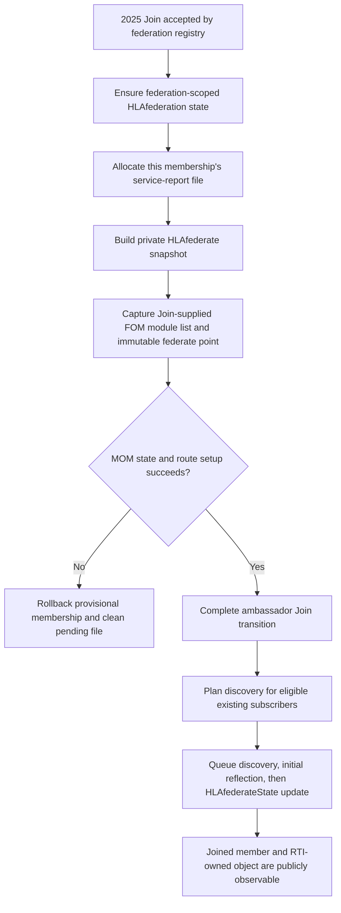
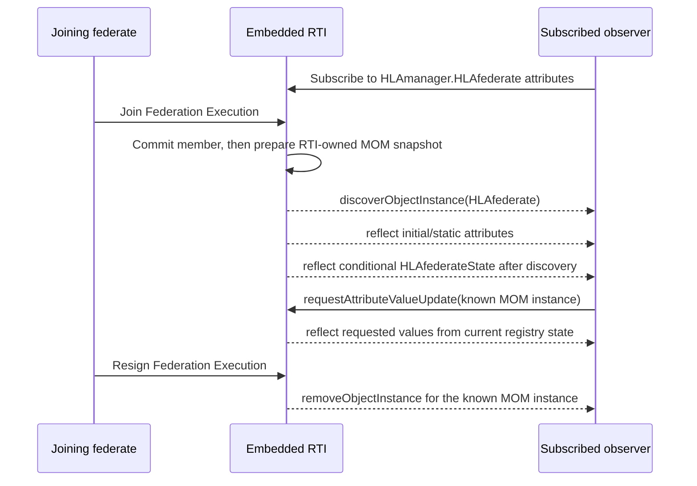
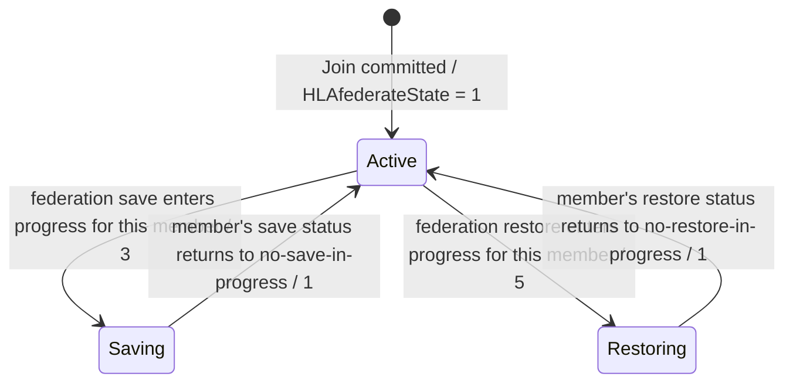
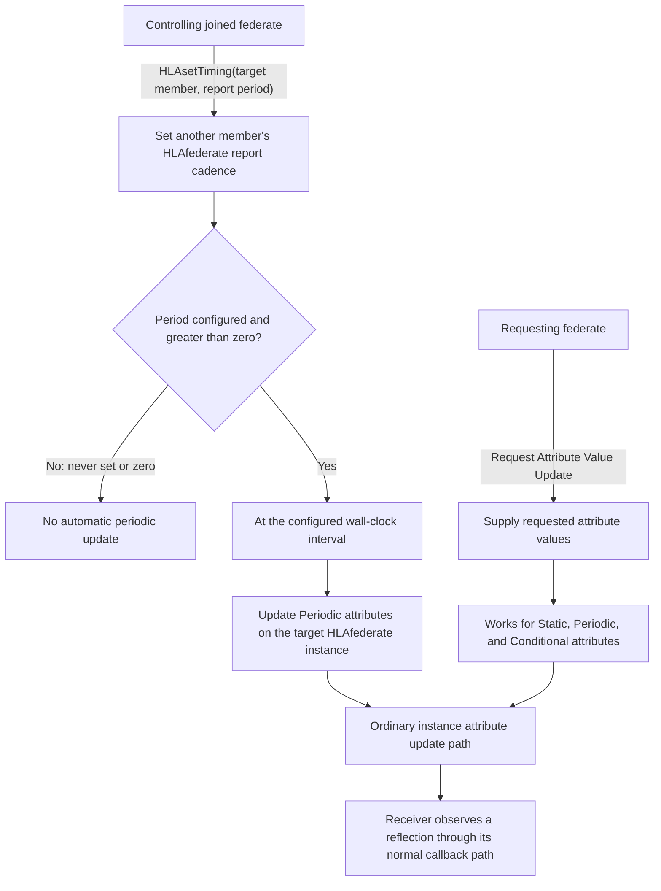
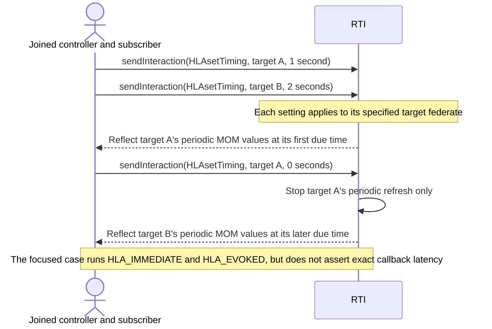
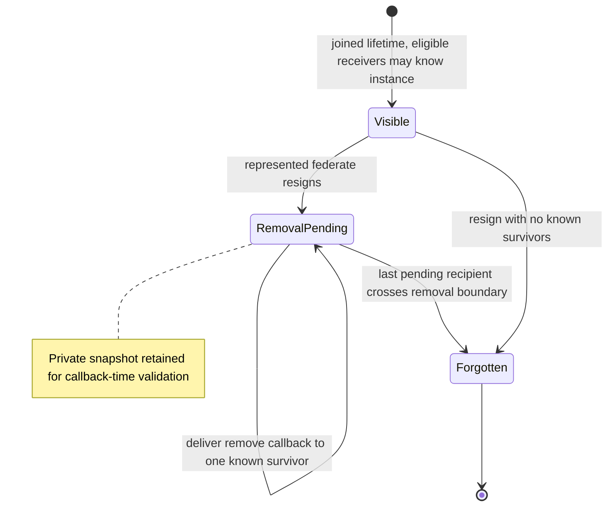

# IEEE 1516.1-2025 Joined-Federate MOM Object: Lifecycle and State Flow Guide

This guide follows the RTI-owned `HLAmanager.HLAfederate` object from a
successful 2025 Join through discovery, current-value requests, save/restore
state changes, and resignation. The aim is to distinguish the RTI's private
snapshot from the public object-management callbacks used to expose it.

## Scope and authority

- **Edition boundary:** IEEE 1516.1-2025 behavior, with the 2025 standard MIM
  and its `HLAfederate` definitions. The [official Federate Interface
  Specification](https://standards.ieee.org/ieee/1516.1/6688/) is normative;
  the [IEEE 1516.2-2025 OMT specification](https://standards.ieee.org/ieee/1516.2/6689/)
  defines the model/schema context.
- **Implementation boundary:** the detailed lifecycle and state diagrams
  below follow the 2025 embedded federation-management development profile.
  A separate section records bounded 2025 process-endpoint source and public
  test evidence; neither profile is inferred from the other, and no general
  embedded/process parity is claimed. The 2010 compatibility boundary remains
  separate.
- **Topic boundary:** this guide follows the joined-federate object lifecycle,
  `HLAfederateState`, and the portable distinction between on-demand value
  requests and periodic refresh. It inventories the 21 `HLAfederate` attributes
  marked Periodic in the pinned 2025 MIM by measurement unit; it does not
  inventory every Static or Conditional statistic, every HLAfederation
  projection, or service/exception reporting interaction. The MIM also places
  a FOM-module request/report pair under each MOM root with the same short
  class names but different module scope; see the [federation-versus-member
  comparison](HLA-2025-FEDERATION-MOM-FLOW-GUIDE.md#the-same-short-fom-request-name-appears-under-two-mom-roots).

For its implementation context, see the broader
[MOM service-reporting design](MOM-SERVICE-REPORTING-DESIGN.md) and the
[federation lifecycle guide](HLA-2025-FEDERATION-AND-FEDERATE-LIFECYCLE-FLOW-GUIDE.md).

## Reader's model: membership is not observer knowledge

Start with the HLA roles before following the embedded registry trace. The
2025 MIM has a federation-scoped `HLAfederation` object and per-member
`HLAfederate` objects, while object-management discovery and reflection are
observations made by particular receiving federates. Keep the following
questions separate:

The pinned 2025 MIM makes the cardinality portable: the RTI publishes
`HLAmanager.HLAfederate` and registers one instance for each joined federate;
it separately registers one `HLAmanager.HLAfederation` instance per execution
([`HLAfederate` class semantics](../../third_party/ieee1516.2-2025/resources/mim/HLAstandardMIM-2025.xml#L52),
[`HLAfederation` class semantics](../../third_party/ieee1516.2-2025/resources/mim/HLAstandardMIM-2025.xml#L658)).
The same MIM defines explicit value requests and attribute update policies for
those objects; the later sections separate that contract from when an
observer's callback is actually invoked.

| HLA question | What to establish | Do not infer |
| --- | --- | --- |
| Who is a member? | Whether a federate has joined or resigned from this execution. | That every other federate has already observed a corresponding MOM object callback. |
| Which management object is in view? | Whether the data describes the execution (`HLAfederation`) or one joined member (`HLAfederate`). | That the federation-wide object has the same lifetime or audience as a member object. |
| Which receiver knows the object? | Whether that receiver's declarations make it eligible for discovery and the discovery was delivered. | That Join itself broadcasts an application callback or makes the object known to every participant. |
| How current is a value? | Whether the attribute is a Join-time value, a current-state projection, or an on-demand/periodic update. | That discovery alone makes every attribute present or current. |
| What does resignation change for an observer? | In the embedded path below, resignation plans removal of the member's visible MOM instance. | That observer-side removal is the membership transition itself, or that callback execution is synchronous with resign. |

This is a reading aid, not a complete restatement of the standard's MOM
update rules. Field semantics come from the 2025 MIM; observation still follows
the applicable object-management and callback rules. The later sections label
Umbra's snapshot, update, and callback mechanics separately.

For the paired execution-level and membership-level view, see the federation
guide's [one membership change, two MOM observation paths](HLA-2025-FEDERATION-MOM-FLOW-GUIDE.md#one-membership-change-two-mom-observation-paths).

## Private snapshot versus public MOM object

Umbra keeps an RTI-owned joined-federate snapshot in the federation registry.
That snapshot is the source for public object discovery, initial reflections,
current-value requests, and selected conditional updates. It is not itself a
callback, and it is not registered by a federate through the public
`registerObjectInstance` service.

The 2025 Join path also establishes one federation-scoped `HLAfederation`
object, separately from each member's `HLAfederate` instance. The shared object
is not a substitute for the per-membership object described here.

## Join builds the object before making the member visible

The embedded 2025 join path first commits a provisional registry membership,
then establishes its RTI-owned MOM state and report-file lifetime. The
per-member object is prepared before the ambassador completes the visible Join
transition; discovery work is planned after that transition so existing
subscribers see a coherent joined lifetime.

The HLAfederate instance is created only for the 2025 MOM projection when the
production Join path has a public report-file location. The test-only memory
report store intentionally does not invent such a public path. Setup failures
roll back the provisional member and clean its pending report file; the
federation-scoped MOM object has a different lifetime and must not be assumed
to be per-member cleanup.

## Subscription controls public discovery; Join is not a callback

A receiving federate sees the RTI-owned instance through the normal object
class subscription and discovery/reflection callback route. The RTI is the
producer, so the reflected `producingFederate` handle is invalid in the focused
tests. Callback execution still follows the receiver's callback model:
`HLA_EVOKED` work is delivered when the receiver evokes callbacks; the focused
scenario also exercises `HLA_IMMEDIATE`.

The standard object handle is usable through public object services after
discovery, including object-class/name lookup and attribute value requests.
This does not mean the instance is visible to every member: recipients still
depend on the applicable declarations and discovery projection. DDM-specific
scope behavior is documented separately in the
[DDM and regions guide](HLA-2025-DATA-DISTRIBUTION-AND-REGIONS-FLOW-GUIDE.md).

## Snapshot values and live state are different kinds of data

The initial per-Join values include the federate handle, name and type, host,
RTI version, the FOM designators supplied at **this member's Join**, and the
immutable service-report-file path. The Join-scoped module list is not the
federation's complete FOM list. Switch changes do not replace the object's
identity or its already selected report-file path. For the difference between
Create-time federation policy and per-member advisory seeding, see the
[federation MOM switch-lifecycle flow](HLA-2025-FEDERATION-MOM-FLOW-GUIDE.md#creation-time-federation-policy-versus-per-member-switch-seeding).

Other attributes are derived from the authoritative current federation/member
ledgers when a value is requested or an update is planned. `HLAfederateState`
is one example: Umbra derives it from save/restore operation status, not from
whether a particular callback has already been delivered.

In the current source, the 2025 state encodings used by the focused flow are:

| State | Encoded value | Source of the state |
| --- | ---: | --- |
| Active federate | `1` | No save or restore operation is active for this member. |
| Federate save in progress | `3` | The current save ledger records an in-progress status for this member. |
| Federate restore in progress | `5` | The current restore ledger records an in-progress status for this member. |

The state is conditional: it is absent from the initial static reflection in
the focused test, can be explicitly queried for its current value, and changes
at save/restore boundaries.

Treat this as the current implementation's state projection, not as a
replacement for the save/restore protocol's own callbacks and gates. In the
focused save/restore scenario, observers receive the conditional `3 → 1` and
`5 → 1` updates; the federate currently saving does not receive its own
save-state reflection. Initial/requested values and transition reflections are
separate observations of the same registry state.

## Explicit requests and periodic refresh are independent

The 2025 standard MIM describes two independent reasons for an
`HLAfederate` attribute value to be supplied. A Request Attribute Value Update
must be answered through the ordinary attribute-update mechanism regardless
of whether the requested attribute is Static, Periodic, or Conditional.
Separately, the RTI updates Dynamic attributes according to their declared
policy. For Periodic attributes, `HLAsetTiming` selects the wall-clock interval
for a specified joined federate: until set, or when set to zero, no periodic
updates are performed. `HLAsetTiming` is a predefined MOM interaction, not an
RTIambassador setter; the [2025 MIM defines it as Receive-order and reliable,
with `HLAreportPeriod` measured in seconds](../../third_party/ieee1516.2-2025/resources/mim/HLAstandardMIM-2025.xml#L928).
It controls the target membership's report cadence and does not turn an
explicit value request on or off. The period is the RTI's value-refresh
cadence, not a promise that an application callback executes at that exact
instant; the receiver observes each reflection through its normal
callback-dispatch boundary.

For accepted non-negative periods, zero means “stop periodic refresh” and a
positive value sets the interval. In the current embedded implementation, a
negative period is rejected rather than treated as zero; the handler also
requires both the sending and target federates to be joined
([source](../../cpp/src/internal/runtime/umbra_rti_ambassador_interaction_send_mom_controls.cpp#L468)).
That validation is an implementation observation, not an additional claim
about the MIM contract.

### Each joined target has an independent schedule

The target reference in `HLAsetTiming` is significant: setting one member's
report period does not establish one federation-wide clock. The embedded
multi-target case sets one target to one second and another to two seconds,
observes the first target's periodic reflection, then sets only that target to
zero. The second target still reports at its own later deadline.

The [focused multi-target test](../../cpp/tests/ieee1516_2025_federation_mom_hla_set_timing_multi_target_catch2.cpp#L5)
exercises this sequence under both callback models. For `HLA_EVOKED`, it
explicitly pumps `evokeMultipleCallbacks`; for `HLA_IMMEDIATE`, the test
observes callbacks from the scheduler. This demonstrates independent target
state in the embedded development profile, not process-endpoint parity or a
real-time delivery guarantee.

The cadence describes *when* periodic values are refreshed, not a universal
meaning for the values. The pinned MIM defines 21 Periodic attributes on
`HLAfederate`; grouping them by unit helps avoid treating every number as the
same kind of counter:

| Measurement | Periodic `HLAfederate` attributes | How to read them |
| --- | --- | --- |
| Logical-time state | `HLAlogicalTime`, `HLAlookahead`, `HLAGALT`, `HLALITS` ([MIM](../../third_party/ieee1516.2-2025/resources/mim/HLAstandardMIM-2025.xml#L240)) | Time-management values, not elapsed wall-clock durations; `HLAlogicalTime` begins at the TRADT initial federation time. Lookahead is undefined when the member is not time-regulating; GALT and LITS are undefined when their respective values are undefined. |
| Queued-message gauges | `HLAROlength`, `HLATSOlength` ([MIM](../../third_party/ieee1516.2-2025/resources/mim/HLAstandardMIM-2025.xml#L296)) | Current counts of receive-order and timestamp-order messages queued for delivery to that joined federate, not counts of messages processed during the last reporting interval. |
| Service and reception totals | `HLAreflectionsReceived`, `HLAupdatesSent`, `HLAinteractionsReceived`, `HLAinteractionsSent`, `HLAdirectedInteractionsReceived`, `HLAdirectedInteractionsSent` ([MIM](../../third_party/ieee1516.2-2025/resources/mim/HLAstandardMIM-2025.xml#L320)) | Totals describe service invocations or interactions, not necessarily the number of individual attribute values. `HLAreflectionsReceived` is a Reflect Attribute Values invocation count; `HLAupdatesSent` is a successful Update Attribute Values invocation count. `HLAinteractionsSent` reflects related DDM usage. |
| Object-lifecycle service totals | `HLAobjectInstancesDeleted`, `HLAobjectInstancesRemoved`, `HLAobjectInstancesRegistered`, `HLAobjectInstancesDiscovered` ([MIM](../../third_party/ieee1516.2-2025/resources/mim/HLAstandardMIM-2025.xml#L444)) | Counts of the corresponding lifecycle-service invocations; the MIM specifies these totals since the federate joined. Discovery can count repeated discovery of one instance after Local Delete. |
| Object-instance measures | `HLAobjectInstancesThatCanBeDeleted`, `HLAobjectInstancesUpdated`, `HLAobjectInstancesReflected` ([MIM](../../third_party/ieee1516.2-2025/resources/mim/HLAstandardMIM-2025.xml#L402)) | The first is a current ownership-based count: instances whose privilege-to-delete attribute is owned by the joined federate. The other two count instances for which the corresponding update or reflection service was invoked; they are not service-invocation totals. |
| Time-in-state durations | `HLAtimeGrantedTime`, `HLAtimeAdvancingTime` ([MIM](../../third_party/ieee1516.2-2025/resources/mim/HLAstandardMIM-2025.xml#L503)) | Wall-clock duration spent in each state since that attribute's prior update. The initial duration is measured since Join; later values are not lifetime totals. |

Thus a periodic report is not automatically a delta, rolling window, or reset
of every statistic. The MIM's own units and update semantics decide whether a
value is a current gauge, a service total, an instance count, logical-time
state, or an interval duration.

The paired update-count scenario makes the MIM's service-versus-instance
distinction concrete: after two updates to the first object, the invocation
count is two while the instance count remains one; updating a second object
advances them to three and two respectively. It also explicitly requests
values before enabling periodic reporting, then observes a periodic report
after setting the target member's period. This is one embedded 2025 example,
not evidence of process-endpoint parity or a complete MOM implementation.

## Resignation removes visibility before forgetting the snapshot

On resignation, Umbra does not send the joined-federate MOM instance through
the ordinary federate-created-object ownership/resign-action path. It plans
RTI-originated removal for surviving federates that knew the instance. If
removal callbacks are still pending, the private snapshot is retained until
those recipients cross the callback-time removal boundary; it is erased once
no known-recipient removal remains. This keeps callback data available without
keeping the departed membership active.

A later rejoin is a new membership and gets a distinct joined-federate object
instance. The focused integration case verifies public discovery/reflection,
request-time values, resignation removal, and fresh identity on a second
joined lifetime under both callback models.

## Separate 2025 process-endpoint evidence

The configured process endpoint has its own Join and resignation path. Its
Join handler establishes the federation-scoped MOM record, creates this
membership's report-file and `HLAfederate` state, commits the session, and
then plans discovery for eligible subscribers
([process Join handler](../../cpp/src/internal/federation/process_federation_service_lifecycle.cpp#L257)).
The shared registry resignation path distinguishes the execution-scoped
`HLAfederation` record from the departing member's object: it retains the
former while planning removal of the latter for receivers that knew it
([resignation ledger](../../cpp/src/internal/federation/federation_registry_resign_lifecycle.cpp#L1023)).
These source paths are a separate process-profile trace, not an extension of
the embedded diagrams above.

Two focused public-endpoint cases provide bounded process observations:

- [Resign/rejoin removal ordering](../../cpp/tests/ieee1516_2025_connection_process_mom_resign_removal_order_catch2.cpp#L37)
  observes a fresh `HLAfederate` object identity after rejoin and asserts that
  the old object's removal callback precedes discovery of the new object,
  which precedes its reflection. This is the ordering exercised by that test,
  not a claim that the standard prescribes this callback sequence.
- [Joined-federate report-file lifecycle](../../cpp/tests/ieee1516_2025_connection_process_joined_federate_mom_report_file_catch2.cpp#L52)
  subscribes after the process MOM objects already exist, discovers two
  instances, and observes the subject's selected `HLAfederateName` and
  `HLAreportServiceFile` values. It then verifies that rejoin exposes a new
  object and a new report-file path while preserving the prior file. This is
  positive evidence for that process endpoint's RTI-owned MOM initial-value
  branch, not for late subscription to ordinary objects; that distinct
  boundary remains open in the [subscription-state
  guide](HLA-2025-OBJECT-ATTRIBUTE-SUBSCRIPTION-STATE-FLOW-GUIDE.md#process-late-subscription-path-same-selectors-an-unresolved-initial-value-edge).
  The test's [discovery/reflection assertions](../../cpp/tests/ieee1516_2025_connection_process_joined_federate_mom_report_file_catch2.cpp#L359)
  show the MOM-instance observation specifically.

These cases do not directly observe process-endpoint discovery of the
`HLAfederation` object or its `HLAfederatesInFederation` reflection on Join
and Resign. The process Federation-MOM lifecycle therefore remains
source-observed in this review; the embedded membership-reflection test is
not substituted for process evidence. Neither case establishes full profile
parity, all callback configurations, or IEEE conformance.

The process endpoint does not yet have direct test evidence for this
`HLAfederateState` Save/Restore projection: a bounded search of configured
`ieee1516_2025_connection_*.cpp` and `.hpp` tests found no direct query or
assertion of the field across those operations. The `3 → 1` and `5 → 1`
projections/reflections above are demonstrated by the embedded-only test. The
process Restore call/callback boundary is documented in the [Save/Restore
guide](HLA-2025-FEDERATION-SAVE-RESTORE-FLOW-GUIDE.md#process-endpoint-callback-frames-and-the-public-restore-call-boundary),
but that flow does not test this MOM attribute; shared registry derivation is
not process-endpoint behavioral evidence.

## Keep the 2010 path separate

The code explicitly skips synthesis of the 2025 RTI-owned MOM object when the
selected model edition is IEEE 1516.2-2010. The 2010 compatibility lane may
still have a service-report-file lifetime, but it does **not** acquire this
2025 `HLAfederate` projection by inference. This guide makes no claim about a
2010 RTI API or 2010 MOM-object parity; see the explicit boundary in the
[FOM validation design](../fom/FOM-VALIDATION-DESIGN.md#L595).

## Implementation and focused evidence

| Concern | Umbra implementation | Focused evidence |
| --- | --- | --- |
| Private per-Join snapshot and MIM initial values | [Registry object construction](../../cpp/src/internal/federation/federation_registry_mom_object_state.cpp#L187) | [Snapshot values and new identity after rejoin](../../cpp/tests/ieee1516_2025_joined_federate_mom_snapshot_foundation_catch2.cpp#L5) |
| Join-time setup, visibility, and callback scheduling | [Join lifecycle](../../cpp/src/internal/runtime/umbra_rti_ambassador_federation_lifecycle.cpp#L610), [discovery and conditional state queue](../../cpp/src/internal/runtime/umbra_rti_ambassador_federation_lifecycle.cpp#L737) | [Public discovery/reflection/request/removal scenario](../../cpp/tests/ieee1516_2025_joined_federate_mom_public_object_lifecycle_catch2.cpp#L4) |
| Join-scoped FOM module designators | [Snapshot descriptor](../../cpp/src/internal/federation/federation_registry_mom_object_state.cpp#L303) | [Additional-module Join snapshot](../../cpp/tests/ieee1516_2025_joined_federate_mom_fom_module_snapshot_integration_catch2.cpp#L5) |
| Dynamic current value and `HLAfederateState` encoding | [Value derivation from member operation ledgers](../../cpp/src/internal/federation/federation_registry_mom_object_state.cpp#L609), [attribute-value request route](../../cpp/src/internal/federation/federation_registry_attribute_value_update_requests.cpp#L360) | [Embedded-only Save/Restore conditional state transitions](../../cpp/tests/joined_federate_mom_federate_state_save_restore_catch2.cpp#L138) |
| Periodic cadence versus explicit request; statistic units | [Pinned 2025 MIM policy and statistic definitions](../../third_party/ieee1516.2-2025/resources/mim/HLAstandardMIM-2025.xml#L52), [`HLAsetTiming` interaction](../../third_party/ieee1516.2-2025/resources/mim/HLAstandardMIM-2025.xml#L928), [interaction decoding/validation](../../cpp/src/internal/runtime/umbra_rti_ambassador_interaction_send_mom_controls.cpp#L468), [per-target report-period state](../../cpp/src/internal/federation/federation_registry_control_state.cpp#L343), [counter derivation](../../cpp/src/internal/federation/federation_registry_mom_object_state.cpp#L833) | [Independent target intervals and zero disabling one target](../../cpp/tests/ieee1516_2025_federation_mom_hla_set_timing_multi_target_catch2.cpp#L5), [direct requests and paired invocation/distinct-object counts](../../cpp/tests/joined_federate_mom_updated_object_count_periodic_catch2.cpp#L109) |
| Pending removal and snapshot retention | [Resignation removal ledger](../../cpp/src/internal/federation/federation_registry_resign_lifecycle.cpp#L1021) | [Public object removal after resign](../../cpp/tests/ieee1516_2025_joined_federate_mom_public_object_lifecycle_catch2.cpp#L290) |
| Separate process-endpoint Join, removal order, and report-file lifetime | [Process Join handler](../../cpp/src/internal/federation/process_federation_service_lifecycle.cpp#L257), [shared resignation ledger](../../cpp/src/internal/federation/federation_registry_resign_lifecycle.cpp#L1023) | [Removal before rejoined-object discovery](../../cpp/tests/ieee1516_2025_connection_process_mom_resign_removal_order_catch2.cpp#L37), [new report-file path on rejoin](../../cpp/tests/ieee1516_2025_connection_process_joined_federate_mom_report_file_catch2.cpp#L52) |
| Edition guard against synthesizing the 2025 MOM object from a 2010 model | [Join's 2010 compatibility guard](../../cpp/src/internal/runtime/umbra_rti_ambassador_federation_lifecycle.cpp#L606) | The 2010 compatibility flow is intentionally outside this guide; the source guard is not evidence of 2010 API/MOM conformance. |

The embedded tests cover selected scenarios, not every MIM attribute or
counter, every subscription/DDM combination, or all save/restore interleavings.
The separate process cases above cover only their named joined-member object
and report-file observations; process `HLAfederation` callbacks and complete
IEEE conformance remain unestablished. They do not change the scope of the
embedded diagrams.

## What this guide does not claim

- It does not describe `HLAreportServiceInvocation`, `HLAreportException`, or
  `HLAreportMOMexception` routing.
- It does not enumerate or explain every periodic `HLAfederate` statistic, or
  model the full `HLAfederation` object.
- It does not claim the same RTI-owned MOM projection exists in the 2010 lane.
- It does not expand or map the HLA Requirements Lab.
