# IEEE 1516.1-2025 MOM Object and Interaction Reports

This guide collects 2025 MIM request/report interactions that expose a joined
federate's view of object instances and selected object/interaction activity
measures. The reports are RTI-originated interactions; they are not attribute
reflections of application objects. The report families also measure different
things: one selected joined federate's current object view, current ownership, distinct
instances, service activity, and interaction traffic.

| Reader question | Report family |
| --- | --- |
| Which joined federate knows the requested object, and which attributes does it own? | Object-instance information; the MIM's inherited `HLAfederate` parameter selects the target. The current embedded handler instead uses the request sender. |
| Which instances does the federate currently have delete privilege for, or has updated? | Current ownership and distinct-instance measures have separate state sources. |
| How much update/reflection activity occurred by class and transportation? | Service-activity reports count invocations by their report dimensions. |
| What interaction traffic was received or sent, including directed subsets? | Broad and directed reports have separate counters and grouping rules. |

## Scope and authority

- **Normative model:** IEEE 1516.1-2025 services and the 2025 MIM report
  definitions. The MIM describes the report contract; it does not prove
  implementation behavior. Each section links to the exact MIM rows it uses.
- **Implementation evidence:** the current embedded 2025 source path and the
  cited focused cases. The evidence table records where coverage is absent;
  these charts do not imply configured-process parity or full conformance.
- **Topic boundary:** the
  [Object and Interaction guide](HLA-2025-OBJECT-AND-INTERACTION-INFORMATION-FLOW-GUIDE.md)
  follows application-object declarations, updates, interactions, and removal.
  The [Joined-Federate MOM guide](HLA-2025-JOINED-FEDERATE-MOM-OBJECT-LIFECYCLE-FLOW-GUIDE.md)
  follows the per-member `HLAfederate` object's lifecycle and live values.
  The [Federation MOM guide](HLA-2025-FEDERATION-MOM-FLOW-GUIDE.md) follows
  the execution-scoped `HLAfederation` object and its reports. This guide
  focuses on the additional joined-federate queries and reports below.
- **Edition boundary:** all material here is for the IEEE 1516.1-2025 stream.

## MOM object-information report describes the selected federate's view

The 2025 MIM pairs the joined-federate request
`HLAmanager.HLAfederate.HLArequest.HLArequestObjectInstanceInformation` with
`HLAmanager.HLAfederate.HLAreport.HLAreportObjectInstanceInformation`. The
request inherits the `HLAfederate` parameter from its parent interaction class;
that handle selects the joined federate whose view is reported. The request
also names one object through `HLAobjectInstance`, typed as
`HLAobjectInstanceHandle`; the report's `HLAobjectInstance` is typed as
`HLAobjectInstanceReference`. The reliable, Receive-order report's
`HLAfederate` dimension identifies the selected target ([inherited target
parameter](../../third_party/ieee1516.2-2025/resources/mim/HLAstandardMIM-2025.xml#L914),
[request](../../third_party/ieee1516.2-2025/resources/mim/HLAstandardMIM-2025.xml#L1184),
[report and fields](../../third_party/ieee1516.2-2025/resources/mim/HLAstandardMIM-2025.xml#L1702)).

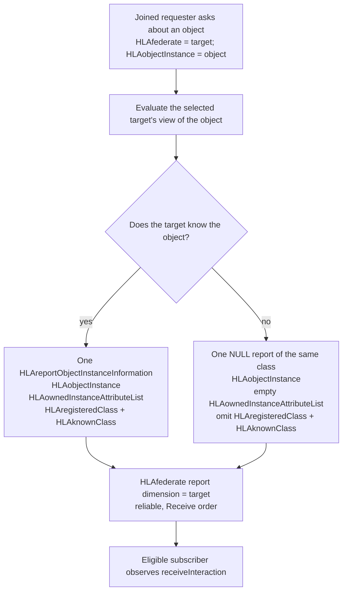

An empty `HLAownedInstanceAttributeList` does not by itself mean NULL. The
selected target can know an object and own none of its attributes: that report
still includes both class parameters. In the NULL form, the list parameter is
present but empty, while `HLAregisteredClass` and `HLAknownClass` are omitted.
The registered class and the class known by the target answer different
questions; the focused case includes both fields but uses equal class values,
so it does not exercise a case where they differ.

There is a wording conflict within the pinned MIM for the NULL list: the
report-level semantics call `HLAownedInstanceAttributeList` undefined, while
the parameter-level semantics require an empty list. Umbra's embedded encoder
includes the parameter in both shapes, and the focused case observes it present
and empty in the NULL response. Those are implementation/test observations;
this guide does not infer that the two MIM phrases are normatively equivalent
([report semantics](../../third_party/ieee1516.2-2025/resources/mim/HLAstandardMIM-2025.xml#L1709),
[parameter semantics](../../third_party/ieee1516.2-2025/resources/mim/HLAstandardMIM-2025.xml#L1723),
[encoder](../../cpp/src/internal/runtime/umbra_rti_ambassador_mom_object_instance_reports.cpp#L141),
[focused assertions](https://github.com/sheepfling/umbra/blob/c9c5a9e410539b039cd8bba35b53d0ef2b24d180/cpp/tests/joined_federate_mom_object_instance_information_report_catch2.cpp#L147)).

The [focused embedded case](https://github.com/sheepfling/umbra/blob/c9c5a9e410539b039cd8bba35b53d0ef2b24d180/cpp/tests/joined_federate_mom_object_instance_information_report_catch2.cpp#L147)
sends only `HLAobjectInstance`; it does not supply the inherited
`HLAfederate` target or test a target distinct from the requester. Under the
current embedded path, it shows three states for the implicit requester view:
a self-registered object whose report lists `Efficiency` and the implicitly
published `HLAprivilegeToDeleteObject`; an owner-registered object known by the
requester, with an empty owned-attribute list but both class fields; and that
same view after `localDeleteObjectInstance`, where the report has only the
object and empty-list parameters. The test checks that the request returns
before the report callback in its `HLA_EVOKED` case, then receives the
interaction after callback draining. This NULL response is about the
requester's knowledge in this test, not proof of federation-wide deletion;
see [local deletion's caller-only state change](HLA-2025-OBJECT-AND-INTERACTION-INFORMATION-FLOW-GUIDE.md#local-delete-forgets-one-federates-view-it-does-not-delete-the-instance).

The embedded [request handler](../../cpp/src/internal/runtime/umbra_rti_ambassador_interaction_send_services.cpp#L506)
decodes `HLAobjectInstance` but skips other valid parameters, including the
inherited `HLAfederate`; it calls the
[report planner](../../cpp/src/internal/federation/federation_registry_mom_object_instance_information_reporting.cpp#L29)
with the request sender's `producingFederateId`. The planner reads that
member's known-class and ownership state and uses the same member for the
`HLAfederate` dimension; the [report encoder](../../cpp/src/internal/runtime/umbra_rti_ambassador_mom_object_instance_reports.cpp#L163)
adds the two class parameters only for a known object. This is a source-visible
mismatch with the pinned MIM target parameter, not evidence that the MIM
request is requester-local. The focused case omits that parameter, so it does
not exercise the standard's distinct-target shape. No conformance conclusion
is made here.

The configured-process path has a source-visible gap. The pinned MIM marks the
request Subscribe, while the reviewed process Send Interaction handler sends
non-special classes to the [ordinary receive-order planner](../../cpp/src/internal/federation/process_federation_service_interaction_send.cpp#L546),
whose [admission path requires publication](../../cpp/src/internal/federation/federation_registry_receive_order_interactions.cpp#L50).
Source-derived inference: if this Subscribe-only request reaches that gate
without a publication entry, the generic planner returns
`interaction_class_not_published`; this is not a tested public-process result.
A bounded source/test search found no process-specific request/report handler
or configured-process test for this interaction. The generic route therefore
does not demonstrate the MIM-prescribed report, and the exact public exception
and embedded/process parity remain unverified.

## MOM delete-capability report is an aggregate snapshot

`HLArequestObjectInstancesThatCanBeDeleted` inherits the joined-federate
`HLAfederate` parameter from `HLAmanager.HLAfederate`; that parameter names the
joined federate being queried, which may differ from the requester. The 2025
MIM says the request results in one
`HLAreportObjectInstancesThatCanBeDeleted`. The report is reliable, Receive
order, and dimensioned by `HLAfederate`; its sole
`HLAobjectInstanceCounts` parameter is a list of `(registered object class,
count)` pairs, and the MIM requires an empty list for a NULL response
([inherited target parameter](../../third_party/ieee1516.2-2025/resources/mim/HLAstandardMIM-2025.xml#L914),
[request class](../../third_party/ieee1516.2-2025/resources/mim/HLAstandardMIM-2025.xml#L1092),
[report shape](../../third_party/ieee1516.2-2025/resources/mim/HLAstandardMIM-2025.xml#L1428)).

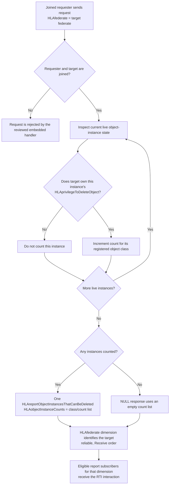

The embedded handler decodes the inherited `HLAfederate` target, requires both
the requesting and reported federates to be joined, and dispatches to the
report planner. The planner scans current object instances, excludes instances
whose deletion is already accepted, and counts an instance only when the
target federate owns its `HLAprivilegeToDeleteObject`; it groups by the
registered class, not the class known by a particular receiver. The routing
plan applies the target's `HLAfederate` dimension, while subscription matching
determines which federates receive the report
([embedded request handling](../../cpp/src/internal/runtime/umbra_rti_ambassador_interaction_send_services.cpp#L282),
[live-instance scan](../../cpp/src/internal/federation/federation_registry_mom_object_instances_that_can_be_deleted_reporting.cpp#L77),
[privilege-owner count predicate](../../cpp/src/internal/federation/federation_registry_mom_object_instances_that_can_be_deleted_reporting.cpp#L94),
[dimension routing](../../cpp/src/internal/federation/federation_registry_mom_object_instances_that_can_be_deleted_reporting.cpp#L108),
[report callback routing](../../cpp/src/internal/runtime/umbra_rti_ambassador_mom_object_instance_reports.cpp#L105)).

This is a point-in-time aggregate, not an object-handle list, a reservation,
or permission that remains valid for a later delete call. Delete authority is
the current ownership of the special attribute, and the delete service checks
object knowledge and that authority when the service is invoked; ownership or
object state can change after a report. The separate
[delete transition](HLA-2025-OBJECT-AND-INTERACTION-INFORMATION-FLOW-GUIDE.md#object-removal-delete-callback-and-per-receiver-cleanup)
and [authority-transfer sequence](HLA-2025-ATTRIBUTE-OWNERSHIP-FLOW-GUIDE.md#a-new-owner-can-gain-delete-authority-without-becoming-the-registrant)
show why the target federate is not necessarily the object's original
registrant. The focused embedded [live-count case](../../cpp/tests/joined_federate_mom_object_instances_that_can_be_deleted_report_catch2.cpp#L257)
requests counts for another joined federate, observes one count for each of
two registered classes, deletes one object, then observes only the remaining
class count. It does not exercise an empty/NULL count list, transferred delete
authority, or a configured-process report.

For the untested empty-list branch, the embedded handler passes the planned
count map through the object-class-count encoder and the shared report queue
attaches that encoded value as the report parameter; neither step has a
non-empty-count guard. So the reviewed source path appears to construct the
MIM's empty-list response when the plan is applied and has eligible recipients,
but the focused test does not observe that runtime result
([handler](../../cpp/src/internal/runtime/umbra_rti_ambassador_interaction_send_services.cpp#L288),
[encoder](../../cpp/src/internal/runtime/umbra_rti_ambassador_mom_activity_reports.cpp#L109),
[queue](../../cpp/src/internal/runtime/umbra_rti_ambassador_mom_object_instance_reports.cpp#L21)).
Treat this as source evidence, not a focused NULL-response test.

For the configured-process route, the reviewed Send Interaction handler has no
special case for this MOM request and falls through to the ordinary
receive-order planner, whose admission check requires the sender to publish
the interaction class. Since the pinned MIM marks this request Subscribe, that
route is a source-visible concern—not a tested public exception or a claim
about required standard behavior. The bounded search found no
configured-process request/report test for this interaction
([generic process route](../../cpp/src/internal/federation/process_federation_service_interaction_send.cpp#L546),
[publication admission](../../cpp/src/internal/federation/federation_registry_receive_order_interactions.cpp#L48)).

## MOM updated-instance report is a joined-lifetime ledger

`HLArequestObjectInstancesUpdated` uses the same inherited `HLAfederate`
target, reliable Receive-order request, and target-dimensioned report shape
as the delete-capability request. Its meaning is different: the 2025 MIM says
`HLAreportObjectInstancesUpdated` counts instances by registered class for
which the joined target has successfully invoked Update Attribute Values. It
is not a scan of currently live objects. The report carries one
`HLAobjectInstanceCounts` list, and the MIM describes one report interaction
([request](../../third_party/ieee1516.2-2025/resources/mim/HLAstandardMIM-2025.xml#L1102),
[report](../../third_party/ieee1516.2-2025/resources/mim/HLAstandardMIM-2025.xml#L1450)).

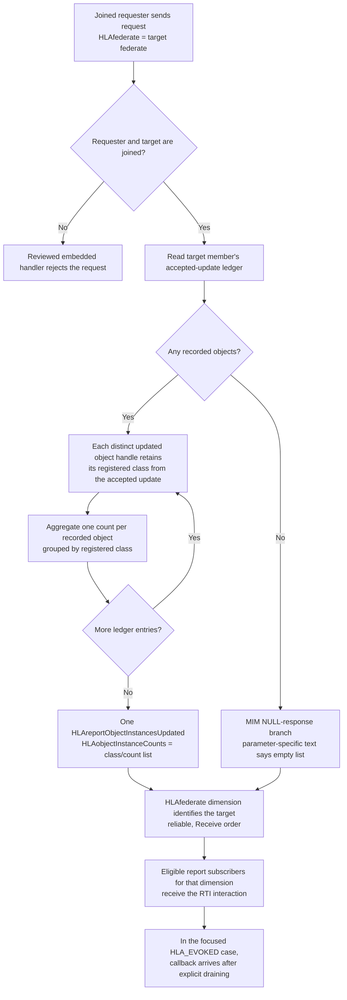

In the embedded registry, only a successfully accepted update reaches the
telemetry mutation: after update validation, the member's total
`HLAupdatesSent` count advances and the object handle enters a distinct-handle
set. The registered class is retained in a separate handle-to-class map for
the report. A second accepted update to the same object changes the service
total but not the distinct-object count or its class bucket. The report planner
iterates that member map, aggregates by saved registered class, and constructs
the report's `HLAfederate` dimension; it does not inspect the live object map
to decide report membership. The source explicitly keeps this as joined-member
history after object deletion, unlike the preceding delete-capability report's
current live ownership scan ([accepted update bookkeeping and retained history](../../cpp/src/internal/federation/federation_registry.cpp#L619),
[joined-member distinct-handle ledger](../../cpp/src/internal/federation/federation_registry_service_types.hpp#L197),
[registered-class ledger](../../cpp/src/internal/federation/federation_registry_service_types.hpp#L201),
[class-grouped report planner](../../cpp/src/internal/federation/federation_registry_mom_object_instances_updated_reporting.cpp#L73),
[target-dimension routing](../../cpp/src/internal/federation/federation_registry_mom_object_instances_updated_reporting.cpp#L85)).

This also separates three similarly named MOM measures. `HLAupdatesSent` is
the number of successful Update Attribute Values service invocations;
`HLAobjectInstancesUpdated` is the total number of distinct instances touched
by that joined federate; and this request/report adds the per-registered-class
breakdown of those distinct instances. The MIM defines the invocation total
and distinct-instance total separately ([`HLAupdatesSent`](../../third_party/ieee1516.2-2025/resources/mim/HLAstandardMIM-2025.xml#L335),
[`HLAobjectInstancesUpdated`](../../third_party/ieee1516.2-2025/resources/mim/HLAstandardMIM-2025.xml#L416)).
The existing [joined-federate MOM guide](HLA-2025-JOINED-FEDERATE-MOM-OBJECT-LIFECYCLE-FLOW-GUIDE.md)
explains the periodic scalar measures; this section follows the explicit
request and class-grouped response. It is not interchangeable with the
preceding live delete-authority count.

The focused embedded [class-grouping case](https://github.com/sheepfling/umbra/blob/c9c5a9e410539b039cd8bba35b53d0ef2b24d180/cpp/tests/joined_federate_mom_object_instances_updated_report_catch2.cpp#L139)
updates one Server object twice and one Soda object once, then observes one
count for each registered class after draining the requester's evoked callback
queue. The current worktree also runs this class-grouping scenario under
`HLA_IMMEDIATE`, where the RTI report is observed before `sendInteraction`
returns. Both callback models assert one Server and one Soda count
([callback-model branch](../../cpp/tests/joined_federate_mom_object_instances_updated_report_catch2.cpp#L218),
[class counts](../../cpp/tests/joined_federate_mom_object_instances_updated_report_catch2.cpp#L250),
current immediate case[^worktree-source]).
These current-only assertions describe the embedded test source and add no
normative rule; this documentation review did not run the test. The hosted
class-grouping case itself does not test a target with no updated instances,
update history after deletion, transport-specific empty results, or a
configured-process report. The worktree adds a separate `HLA_EVOKED`
NULL-response case for a distinct subject federate; it is absent from HEAD and hosted
(worktree-only case[^worktree-source]). The MIM's NULL wording itself needs care: its report-level semantics
mentions no updates "for a given transport type" and an "undefined value",
while the parameter-level semantics explicitly requires an empty list. The
report has no transport-type parameter, and Umbra's reviewed planner groups
only by registered class; this guide records the wording without resolving normative intent. The worktree-only case accepts either a zero-byte value or an encoded empty object-count array, but does not establish transport-specific results
([report NULL wording](../../third_party/ieee1516.2-2025/resources/mim/HLAstandardMIM-2025.xml#L1457),
[parameter NULL wording](../../third_party/ieee1516.2-2025/resources/mim/HLAstandardMIM-2025.xml#L1464)).

The configured-process Send Interaction route has no reviewed special handler
for this Subscribe-only request; the generic route proceeds to the ordinary
publication-gated planner. This is a source-level warning, not evidence of a
tested public exception or process/embedded parity. The bounded search found
no configured-process request/report test
([generic process route](../../cpp/src/internal/federation/process_federation_service_interaction_send.cpp#L546),
[publication admission](../../cpp/src/internal/federation/federation_registry_receive_order_interactions.cpp#L48)).

## MOM update-activity report groups counts by class and transportation

`HLArequestUpdatesSent` asks the RTI to report how many successful Update
Attribute Values invocations a joined target generated; the MIM scopes the
count from the beginning of the federation execution. Each
`HLAreportUpdatesSent` carries a transportation type and a list of
class/count records, with the target identified by the inherited
`HLAfederate` dimension. This is an activity count, not a distinct-object
count: updating one object twice contributes two updates to its class and
transport bucket ([request](../../third_party/ieee1516.2-2025/resources/mim/HLAstandardMIM-2025.xml#L1122),
[report and parameters](../../third_party/ieee1516.2-2025/resources/mim/HLAstandardMIM-2025.xml#L1498),
[inherited target parameter](../../third_party/ieee1516.2-2025/resources/mim/HLAstandardMIM-2025.xml#L914)).

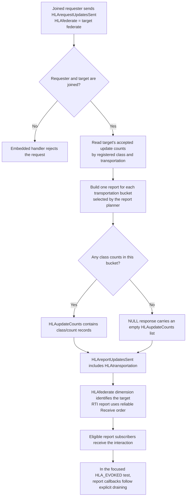

Keep the three update-related measures separate. `HLAupdatesSent` is the
joined federate's total number of successful Update Attribute Values service
invocations. `HLAobjectInstancesUpdated` counts [distinct object instances](../../third_party/ieee1516.2-2025/resources/mim/HLAstandardMIM-2025.xml#L416).
`HLAreportUpdatesSent` instead groups update invocations by registered object
class and transportation type. In the embedded registry, a successful update
increments the scalar invocation total once, and increments the per-class
count for each distinct transportation present in that update's planned
passels. Therefore, an update spanning attributes assigned different
transportation types can contribute to more than one transport bucket; that
is source-derived, and the focused test uses one transportation type per
invocation ([MIM scalar totals](../../third_party/ieee1516.2-2025/resources/mim/HLAstandardMIM-2025.xml#L335),
[accepted update accounting](../../cpp/src/internal/federation/federation_registry.cpp#L562),
[embedded acceptance boundary](../../cpp/src/internal/runtime/umbra_rti_ambassador_attribute_update_services.cpp#L317),
[configured-process counter input](../../cpp/src/internal/federation/process_federation_service_attribute_value_updates.cpp#L181)).

The MIM's report-level text says one interaction is sent per transportation
type used and describes `HLAupdateCounts` as undefined in a NULL response;
the parameter-level text instead requires an empty list when a given type
has no updates. Umbra's inspected planner initializes
both supported transportation buckets even when the target has no updates;
the focused test observes two empty reports for its idle target. The test
confirms that implementation result, but neither it nor this guide resolves
how the MIM's “type used” phrase relates to the per-type NULL requirement
([report-level NULL wording](../../third_party/ieee1516.2-2025/resources/mim/HLAstandardMIM-2025.xml#L1509),
[parameter-level empty-list rule](../../third_party/ieee1516.2-2025/resources/mim/HLAstandardMIM-2025.xml#L1521),
[planner buckets](../../cpp/src/internal/federation/federation_registry_mom_updates_sent_reporting.cpp#L77),
[focused empty-response assertions](../../cpp/tests/joined_federate_mom_updates_sent_catch2.cpp#L329)).

The focused embedded [class-and-transportation case](../../cpp/tests/joined_federate_mom_updates_sent_catch2.cpp#L145)
updates a Server instance twice using best effort and a Soda instance once
using reliable. It observes a count of two for Server/best effort and one for
Soda/reliable, then queries an idle joined target and verifies empty lists for
both reported transports. The requester sees no report before draining its
HLA_EVOKED queue. It does not exercise a single update call whose planned
passels use multiple transport types, nor a configured-process request/report
case.

The configured-process update service records accepted update counts in the
shared registry, but the bounded process-source review found no dedicated
`HLArequestUpdatesSent` handler or report encoder. The process Send Interaction
route follows its generic publication-planned path, while the pinned MIM marks
the request Subscribe. This is a source-visible profile gap, not a tested
public result or an embedded/process parity claim; no configured-process
report test was found ([generic process route](../../cpp/src/internal/federation/process_federation_service_interaction_send.cpp#L546),
[generic publication admission](../../cpp/src/internal/federation/federation_registry_receive_order_interactions.cpp#L48),
[embedded request handler](../../cpp/src/internal/runtime/umbra_rti_ambassador_interaction_send_services.cpp#L1462),
[embedded report encoder/queue](../../cpp/src/internal/runtime/umbra_rti_ambassador_mom_activity_reports.cpp#L182)).

## MOM reflection reports separate callback activity from distinct objects

The two receiver-side reflection reports branch from the same `Reflect
Attribute Values` callback path, but retain different facts. `HLArequestReflectionsReceived`
reports callback activity grouped by the reflected object's registered class
and the transportation type used for that receipt. `HLArequestObjectInstancesReflected`
reports distinct object handles grouped by registered class. Repeated
reflections of one object therefore increase the former's count each time but
do not add another distinct object to the latter. Both requests identify the
joined target through `HLAfederate`; the reports use that target's
`HLAfederate` dimension ([activity request/report](../../third_party/ieee1516.2-2025/resources/mim/HLAstandardMIM-2025.xml#L1153),
[distinct-instance request/report](../../third_party/ieee1516.2-2025/resources/mim/HLAstandardMIM-2025.xml#L1112),
[inherited target parameter](../../third_party/ieee1516.2-2025/resources/mim/HLAstandardMIM-2025.xml#L914)).

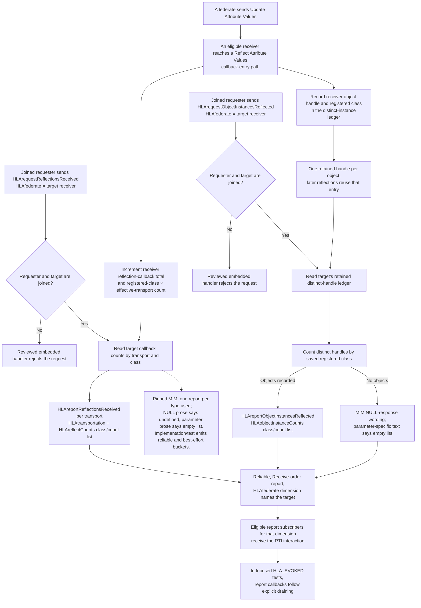

The activity report's count is not an attribute-value count and not a count of
distinct objects: it is grouped receiver callback activity. In the embedded
source, the receipt counter and class/transport bucket advance immediately
before calling the application's
`FederateAmbassador::reflectAttributeValues`; the distinct-object map is
updated at the same callback-entry boundary. The registered class is captured
there as well ([activity ledger update](../../cpp/src/internal/federation/federation_registry.cpp#L779),
[callback dispatch](../../cpp/src/internal/runtime/umbra_rti_ambassador.cpp#L1660),
[distinct-instance update](../../cpp/src/internal/federation/federation_registry.cpp#L648),
[timestamped callback path](../../cpp/src/internal/runtime/umbra_rti_ambassador_time_advance_dispatch.cpp#L466)).
These are implementation checkpoints, not claims that an application callback
returned successfully. The distinct-instance planner reads a retained member
map rather than enumerating only live objects, so deletion does not erase this
implementation's recorded history ([planner](../../cpp/src/internal/federation/federation_registry_mom_object_instances_reflected_reporting.cpp#L72));
the focused test does not cover post-deletion history.

The activity report's pinned MIM text says one report is sent for each
transportation type used and describes an undefined value when a type has no
reflections. Its `HLAreflectCounts` parameter semantics separately require an
empty list in a NULL response ([report semantics and parameter](../../third_party/ieee1516.2-2025/resources/mim/HLAstandardMIM-2025.xml#L1538)).
Umbra's embedded planner initializes reliable and best-effort buckets, and the
focused idle-target test observes two reports with empty lists. That evidence
does not resolve how the MIM's report-level wording relates to its
parameter-level empty-list requirement ([planner](../../cpp/src/internal/federation/federation_registry_mom_reflections_received_reporting.cpp#L77),
[focused activity case](../../cpp/tests/joined_federate_mom_reflections_received_catch2.cpp#L194)).

The test also confirms the query names the receiver whose callback ledger has
the counts—not the application sender—and observes two best-effort Server
reflections and one reliable Soda reflection. It checks that reports are not
observed until the requester's `HLA_EVOKED` queue is drained. The reflections-received test does not cover a target other than the requester, callback
exceptions, or a configured-process report path. Post-deletion distinct-instance history
remains untested. The hosted reflected-instance case covers repeated callbacks
and class grouping under `HLA_EVOKED`, but not an empty/NULL response
([hosted case](https://github.com/sheepfling/umbra/blob/c9c5a9e410539b039cd8bba35b53d0ef2b24d180/cpp/tests/joined_federate_mom_object_instances_reflected_report_catch2.cpp#L161)).
The current worktree adds an `HLA_IMMEDIATE` companion: its report is observed
before `sendInteraction` returns, while the evoked case observes no report
until the callback queue is drained. Both cases assert one Server and one Soda
instance in the class-grouped result
(callback-model assertions[^worktree-source],
class counts[^worktree-source]).
These current-only assertions describe the embedded test source and add no
normative rule; this documentation review did not run the test. The worktree
also adds a separate NULL-response case for a distinct subject federate; HEAD
and hosted do not yet contain it
(worktree-only case[^worktree-source]).

The configured-process Send Interaction review found no dedicated
`HLArequestReflectionsReceived` handler or focused request/report test; the
generic route and publication admission were inspected, but this is
source-visible evidence only. It establishes neither a public process result
nor embedded/process parity
([generic process route](../../cpp/src/internal/federation/process_federation_service_interaction_send.cpp#L546),
[publication admission](../../cpp/src/internal/federation/federation_registry_receive_order_interactions.cpp#L48)).

Keep the neighboring MOM measurements separate: `HLAreflectionsReceived` is
the scalar service-invocation total, `HLAobjectInstancesReflected` is the
distinct-instance total, `HLAreportReflectionsReceived` is the on-demand
per-class/per-transport activity breakdown, and
`HLAreportObjectInstancesReflected` is the on-demand distinct-instance
breakdown ([MIM service total](../../third_party/ieee1516.2-2025/resources/mim/HLAstandardMIM-2025.xml#L320),
[MIM distinct-instance value](../../third_party/ieee1516.2-2025/resources/mim/HLAstandardMIM-2025.xml#L430),
[joined-federate MOM guide](HLA-2025-JOINED-FEDERATE-MOM-OBJECT-LIFECYCLE-FLOW-GUIDE.md)).

### Activity-report history across target Resign and same-name rejoin

`HLAreportUpdatesSent` and `HLAreportReflectionsReceived` carry a target
member ID into their report plans and queued callbacks. Their planners copy
the target's class/transport counts when the request is handled; callback
invocation later rechecks that original target ID and the selected receiver
([update plan](../../cpp/src/internal/federation/federation_registry_mom_updates_sent_reporting.cpp#L29),
[reflection plan](../../cpp/src/internal/federation/federation_registry_mom_reflections_received_reporting.cpp#L28),
[shared activity callback](../../cpp/src/internal/runtime/umbra_rti_ambassador_mom_activity_reports.cpp#L20)).
After target Resign, a same-name rejoin has a new ID. It cannot make a queued
report for the old ID eligible again; pending delivery does not follow the
name.

The count storage differs from the live-ownership report and also has a
standard-scope question worth keeping visible:

| Report | Pinned 2025 MIM scope | Embedded storage observed in source |
| --- | --- | --- |
| `HLAreportUpdatesSent` | Reports updates sent by the joined federate “since the beginning of the federation execution” ([MIM](../../third_party/ieee1516.2-2025/resources/mim/HLAstandardMIM-2025.xml#L1508)). | Class/transport counts are stored on the `FederateMembership` record ([field](../../cpp/src/internal/federation/federation_registry_service_types.hpp#L195), [accepted update accounting](../../cpp/src/internal/federation/federation_registry.cpp#L677)) and read from the current target member ([planner](../../cpp/src/internal/federation/federation_registry_mom_updates_sent_reporting.cpp#L73)). |
| `HLAreportReflectionsReceived` | Reports reflections received by the joined federate “since the beginning of the federation execution” ([MIM](../../third_party/ieee1516.2-2025/resources/mim/HLAstandardMIM-2025.xml#L1548)). | Class/transport counts are recorded at the application reflection callback-entry boundary on the member record ([recording](../../cpp/src/internal/federation/federation_registry.cpp#L850), [field](../../cpp/src/internal/federation/federation_registry_service_types.hpp#L232)) and read from the current target member ([planner](../../cpp/src/internal/federation/federation_registry_mom_reflections_received_reporting.cpp#L77)). |

Resign erases the old `FederateMembership` and its activity counters; a later
Join inserts a new membership record under a new ID
([erase](../../cpp/src/internal/federation/federation_registry_resign_lifecycle.cpp#L1103),
[new record](../../cpp/src/internal/federation/federation_registry_membership_lifecycle.cpp#L531),
[ID allocation](../../cpp/src/internal/federation/federation_registry_membership_lifecycle.cpp#L359)).
The pinned MIM's “since the beginning” wording and the implementation's
per-membership storage are both explicit; the reviewed materials do not settle
whether a same-name rejoin is expected to continue the earlier report history.
This is a question for normative interpretation, not a conformance conclusion.
No focused test checks counter carry-over or reset across Resign/rejoin.

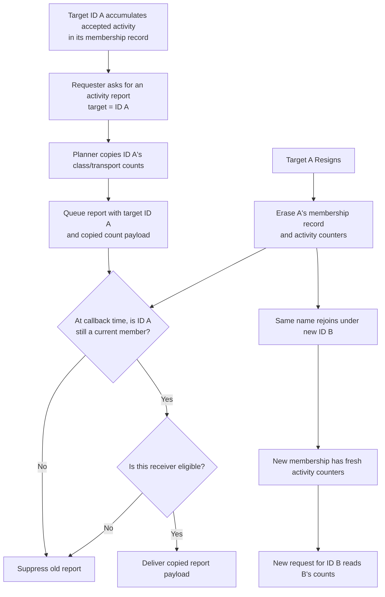

The focused update and reflection report tests verify current-member counts,
empty transport buckets, and selected requester/target shapes, but not
Resign/rejoin history or a pending report crossing that boundary
([updates](../../cpp/tests/joined_federate_mom_updates_sent_catch2.cpp#L145),
[reflections](../../cpp/tests/joined_federate_mom_reflections_received_catch2.cpp#L194)).
The configured-process request/report path remains the separate source gap
described in the [process boundary section](#configured-process-report-query-path-lacks-a-paired-planner);
this lifecycle explanation is for the embedded 2025 registry only.

## MOM interaction-receipt report groups by sent class and transportation

The 2025 MIM defines two distinct receiver-side report pairs. The broad
`HLArequestInteractionsReceived` / `HLAreportInteractionsReceived` pair reports
received interactions; the directed
`HLArequestDirectedInteractionsReceived` /
`HLAreportDirectedInteractionsReceived` pair reports only directed receives.
Both identify the target joined federate with `HLAfederate`, group by the
interaction's sent class and transportation, and use reliable, Receive-order
report interactions. These are not the sender's `HLAinteractionsSent` total
([broad request](../../third_party/ieee1516.2-2025/resources/mim/HLAstandardMIM-2025.xml#L1163),
[directed request](../../third_party/ieee1516.2-2025/resources/mim/HLAstandardMIM-2025.xml#L1173),
[broad report](../../third_party/ieee1516.2-2025/resources/mim/HLAstandardMIM-2025.xml#L1610),
[directed report](../../third_party/ieee1516.2-2025/resources/mim/HLAstandardMIM-2025.xml#L1671),
[inherited target parameter](../../third_party/ieee1516.2-2025/resources/mim/HLAstandardMIM-2025.xml#L914)).
This is a request-driven Federation MOM report, not the separate
`HLAreportServiceInvocation` event/file mechanism ([reporting distinction](HLA-2025-SERVICE-INVOCATION-REPORTING-FLOW-GUIDE.md#three-distinct-traces-call-outcome-invocation-report-requested-mom-report)).

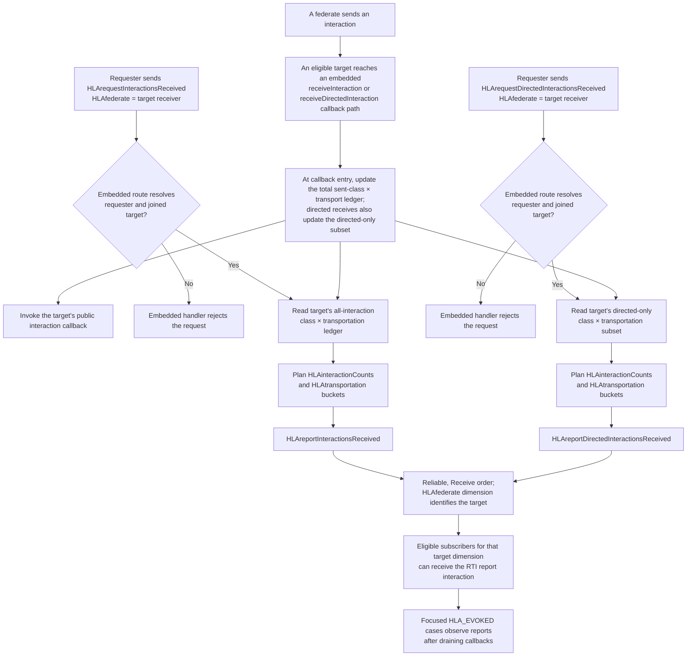

The embedded registry updates the receiver's total interaction count and its
sent-class/transport bucket at callback entry, immediately before invoking the
public callback. A directed receive updates that same total ledger and a
separate directed-only subset. The broad request plans from the total map; the
directed request plans from the subset. This is *sent* class, even where
ordinary class promotion could make the public callback's received class an
ancestor ([ordinary callback boundary](../../cpp/src/internal/runtime/umbra_rti_ambassador_interaction_callbacks.cpp#L128),
[timestamped callback boundary](../../cpp/src/internal/runtime/umbra_rti_ambassador_tso_receive_order_interaction.cpp#L161),
[directed callback boundary](../../cpp/src/internal/runtime/umbra_rti_ambassador_interaction_callbacks.cpp#L196),
[shared total and directed-subset update](../../cpp/src/internal/federation/federation_registry.cpp#L731),
[broad report planner](../../cpp/src/internal/federation/federation_registry_mom_interactions_received_reporting.cpp#L77),
[directed report planner](../../cpp/src/internal/federation/federation_registry_mom_directed_interactions_received_reporting.cpp#L28),
[directed request handler](../../cpp/src/internal/runtime/umbra_rti_ambassador_interaction_send_services.cpp#L2019),
[directed report queue](../../cpp/src/internal/runtime/umbra_rti_ambassador_mom_activity_reports.cpp#L258),
[scalar receive-count source](../../cpp/src/internal/federation/federation_registry_mom_object_state.cpp#L953)).

The focused embedded [broad-report case](../../cpp/tests/joined_federate_mom_interactions_received_catch2.cpp#L149)
uses ordinary `ServerAction.TakeOrder` receives over reliable and best effort,
and observes empty lists for an idle target. The separate focused embedded
[directed-report case](../../cpp/tests/joined_federate_mom_directed_interactions_received_catch2.cpp#L180)
first receives an ordinary `TakeOrder`, then a directed `TakeOrder` of the same
class. Its directed report contains one reliable count and an empty best-effort
list; the idle target gets empty lists for both standard buckets. This directly
shows that the ordinary receive is excluded from the directed subset. A second
[custom-transport case](../../cpp/tests/ieee1516_2025_custom_transportation_directed_interaction_integration_catch2.cpp#L4)
confirms a declared custom transportation and its directed class count appear
in the directed report. The focused cases use the embedded profile and
`HLA_EVOKED`; the request returns before the test drains callbacks. They do not
establish configured-process behavior or embedded/process parity.

The broad report's own focused case does not send a directed interaction.
Although the shared embedded ledger source shows directed callbacks enter its
total map, that broad-report inclusion remains source-derived rather than
directly exercised; ancestor-class promotion remains untested in these report
cases. The configured-process evidence gap also remains open.

For both report classes, the pinned MIM says one response is sent per
transportation type used and describes a NULL response's
`HLAinteractionCounts` as undefined, while the parameter semantics require an
empty list ([broad report wording](../../third_party/ieee1516.2-2025/resources/mim/HLAstandardMIM-2025.xml#L1618),
[directed report wording](../../third_party/ieee1516.2-2025/resources/mim/HLAstandardMIM-2025.xml#L1678),
[directed parameter wording](../../third_party/ieee1516.2-2025/resources/mim/HLAstandardMIM-2025.xml#L1693)).
The embedded tests observe empty lists, but do not resolve that MIM wording
difference. The directed-report semantics also name
`HLArequest.HLAreportDirectedInteractionsReceived` as the triggering request;
that apparent class-name typo is recorded as written, not silently corrected.

## MOM interaction-send reports separate total sends from the directed subset

The 2025 MIM defines a broad sender-side report pair,
`HLArequestInteractionsSent` / `HLAreportInteractionsSent`, and a separate
directed pair, `HLArequestDirectedInteractionsSent` /
`HLAreportDirectedInteractionsSent`. Each request names the joined federate to
report with `HLAfederate`; each report is scoped by an `HLAfederate` dimension
and carries `HLAtransportation` plus sent-class counts in
`HLAinteractionCounts`. Both request classes are Subscribe, reliable, and
Receive ordered; both report classes are Publish, reliable, and Receive ordered
([broad request](../../third_party/ieee1516.2-2025/resources/mim/HLAstandardMIM-2025.xml#L1132),
[directed request](../../third_party/ieee1516.2-2025/resources/mim/HLAstandardMIM-2025.xml#L1143),
[broad report](../../third_party/ieee1516.2-2025/resources/mim/HLAstandardMIM-2025.xml#L1578),
[directed report](../../third_party/ieee1516.2-2025/resources/mim/HLAstandardMIM-2025.xml#L1640),
[inherited target parameter](../../third_party/ieee1516.2-2025/resources/mim/HLAstandardMIM-2025.xml#L914)).

The broad report describes the joined federate's sends since the beginning of
the federation execution, grouped by *sent* class and transportation. Its MIM
text explicitly includes sends with region and says the counts reflect
related DDM usage. The directed pair reports directed sends separately. These
are requested class/transport activity reports, not the scalar
`HLAinteractionsSent` member field or the distinct `HLAreportServiceInvocation`
event/file mechanism ([reporting distinction](HLA-2025-SERVICE-INVOCATION-REPORTING-FLOW-GUIDE.md#three-distinct-traces-call-outcome-invocation-report-requested-mom-report)).

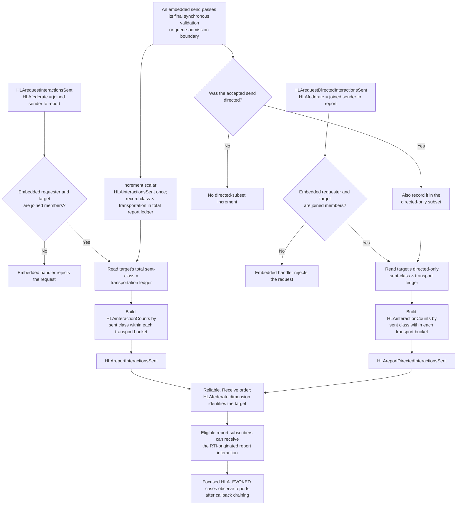

The embedded registry records a send only after the service has crossed its
final synchronous validation/queue-admission boundary. That sender ledger is
independent of receiver fan-out; a directed send increments the total ledger
and the directed-only subset. The focused broad-report case exercises two
transportations and a region-scoped send: it finds the regional
`MainCourseServed` count in the reliable bucket, consistent with the MIM's
explicit region inclusion. The directed-report case exercises two reliable
`TakeOrder` directed sends and finds a count of two in that class bucket. It
does not contrast an ordinary `TakeOrder` send against the directed report,
so exclusion of ordinary sends from that report is established by the separate
source ledgers, not that focused result ([accepted-send ledger](../../cpp/src/internal/federation/federation_registry.cpp#L679),
[broad planner](../../cpp/src/internal/federation/federation_registry_mom_interactions_sent_reporting.cpp#L27),
[directed planner](../../cpp/src/internal/federation/federation_registry_mom_directed_interactions_sent_reporting.cpp#L27),
[broad request handler](../../cpp/src/internal/runtime/umbra_rti_ambassador_interaction_send_services.cpp#L1690),
[directed request handler](../../cpp/src/internal/runtime/umbra_rti_ambassador_interaction_send_services.cpp#L1741),
[broad focused case](../../cpp/tests/joined_federate_mom_interactions_sent_catch2.cpp#L153),
[directed focused case](../../cpp/tests/ieee1516_2025_federation_mom_directed_interactions_sent_catch2.cpp#L4)).

The MIM says each report pair returns a response per transportation type used
and describes the report-level `HLAinteractionCounts` value in a NULL response
as undefined, while the parameter semantics require an empty list. The
embedded planners seed reliable and best-effort buckets; focused tests observe
both, including empty lists for an idle target ([broad NULL wording](../../third_party/ieee1516.2-2025/resources/mim/HLAstandardMIM-2025.xml#L1589),
[directed NULL wording](../../third_party/ieee1516.2-2025/resources/mim/HLAstandardMIM-2025.xml#L1651),
[directed parameter](../../third_party/ieee1516.2-2025/resources/mim/HLAstandardMIM-2025.xml#L1661),
[empty-bucket case](../../cpp/tests/mom_sender_count_reports_null_buckets_catch2.cpp#L116)).
The directed-report semantics also appear to name
`HLAreportDirectedInteractionsSent` as the request class; this apparent MIM
copy/paste error is recorded as written, not silently corrected. The cited
cases are embedded-profile tests; no configured-process report case or custom
transport report case was found in this bounded review.

One additional embedded-source ordering detail is not exercised by those
tests: the request handler snapshots the report plan first, then records the
accepted MOM request itself as a non-directed send before queueing the report.
Thus a self-querying total report is planned before its current request enters
the sender ledger, while a later total query can see previously accepted MOM
request sends. A directed request does not enter the directed-only subset.
Treat this as source-derived implementation behavior, not as a normative or
configured-process claim ([broad request/plan/record order](../../cpp/src/internal/runtime/umbra_rti_ambassador_interaction_send_services.cpp#L1690),
[directed request/plan/record order](../../cpp/src/internal/runtime/umbra_rti_ambassador_interaction_send_services.cpp#L1741)).

## Interaction activity reports across target Resign and same-name rejoin

The four sent/received report plans are scoped to a joined-member ID. `HLAfederate`
means the **sender** for the two sent-report pairs and the **receiver** for the
two received-report pairs. Each planner requires the requester and target to
be current members, reads the selected member record, and forms class/transport
counts for the report. The shared queue encodes those counts and captures the
original target ID for callback-time projection
([sent planner](../../cpp/src/internal/federation/federation_registry_mom_interactions_sent_reporting.cpp#L28),
[directed sent planner](../../cpp/src/internal/federation/federation_registry_mom_directed_interactions_sent_reporting.cpp#L28),
[received planner](../../cpp/src/internal/federation/federation_registry_mom_interactions_received_reporting.cpp#L28),
[directed received planner](../../cpp/src/internal/federation/federation_registry_mom_directed_interactions_received_reporting.cpp#L28),
[shared activity queue](../../cpp/src/internal/runtime/umbra_rti_ambassador_mom_activity_reports.cpp#L20)).

| Report target | Payload ledger read from the target membership | Directed variant |
| --- | --- | --- |
| Sender | `successfulInteractionCountsByClassAndTransportation`: accepted sends grouped by sent class and effective transportation. | `successfulDirectedInteractionCountsByClassAndTransportation` is the directed subset; directed sends also remain in the broad sent ledger ([accounting](../../cpp/src/internal/federation/federation_registry.cpp#L721), [membership fields](../../cpp/src/internal/federation/federation_registry_service_types.hpp#L252)). |
| Receiver | `successfulInteractionReceiptCountsByClassAndTransportation`: application Receive Interaction callback activity grouped by sent class and effective transportation. | `successfulDirectedInteractionReceiptCountsByClassAndTransportation` is the directed subset; directed receives also remain in the broad received ledger ([accounting](../../cpp/src/internal/federation/federation_registry.cpp#L773), [membership fields](../../cpp/src/internal/federation/federation_registry_service_types.hpp#L270)). |

All four corresponding MIM report descriptions use “since the beginning of the
federation execution” ([sent](../../third_party/ieee1516.2-2025/resources/mim/HLAstandardMIM-2025.xml#L1587),
[received](../../third_party/ieee1516.2-2025/resources/mim/HLAstandardMIM-2025.xml#L1619),
[directed sent](../../third_party/ieee1516.2-2025/resources/mim/HLAstandardMIM-2025.xml#L1648),
[directed received](../../third_party/ieee1516.2-2025/resources/mim/HLAstandardMIM-2025.xml#L1679)).
Umbra stores these counters on the current `FederateMembership`, and Resign
erases that membership; same-name rejoin creates a new member ID and new
counters ([membership fields](../../cpp/src/internal/federation/federation_registry_service_types.hpp#L245),
[Resign erase](../../cpp/src/internal/federation/federation_registry_resign_lifecycle.cpp#L1103),
[Join allocation](../../cpp/src/internal/federation/federation_registry_membership_lifecycle.cpp#L359)).
The source therefore treats sent and received report history as belonging to
the joined-member lifetime. The MIM wording and this rejoin boundary are both
recorded here without deciding whether the standard expects a same-name rejoin
to continue earlier history; no conformance conclusion is drawn.

At callback time, each report resolver checks current membership for the
original reported ID and the receiving ID. A same-name member with a different
ID cannot revive a queued report for the departed sender or receiver
([sent recheck](../../cpp/src/internal/federation/federation_registry_mom_interactions_sent_reporting.cpp#L139),
[directed sent recheck](../../cpp/src/internal/federation/federation_registry_mom_directed_interactions_sent_reporting.cpp#L138),
[received recheck](../../cpp/src/internal/federation/federation_registry_mom_interactions_received_reporting.cpp#L139),
[directed received recheck](../../cpp/src/internal/federation/federation_registry_mom_directed_interactions_received_reporting.cpp#L139)).
This is distinct from a new request for ID B, which reads B's current
membership counters. The focused tests exercise count values and some
requester/target differences, but none combines an accepted interaction report
with target Resign/rejoin or tests counter carry-over
([sent tests](../../cpp/tests/joined_federate_mom_interactions_sent_catch2.cpp#L153),
[received tests](../../cpp/tests/joined_federate_mom_interactions_received_catch2.cpp#L149),
[directed sent test](../../cpp/tests/ieee1516_2025_federation_mom_directed_interactions_sent_catch2.cpp#L4),
[directed received test](../../cpp/tests/joined_federate_mom_directed_interactions_received_catch2.cpp#L180)).

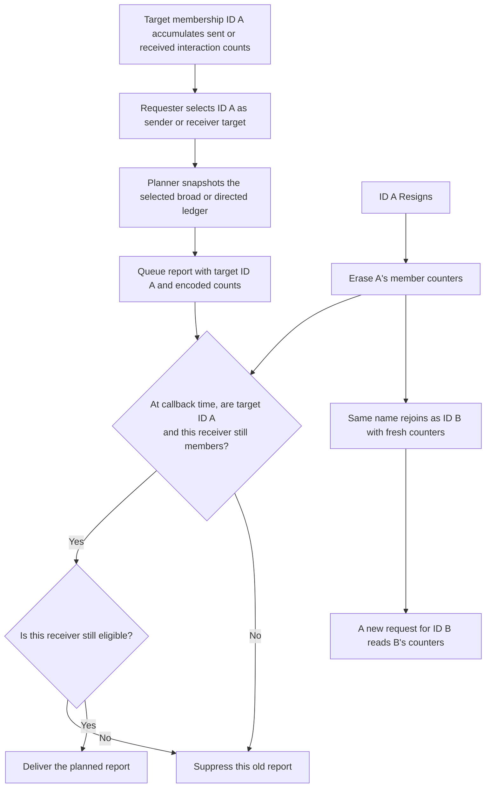

This flow is derived from the embedded 2025 registry and callback path. The
configured-process request path remains a separate evidence gap; no parity is
inferred.

## Configured-process report-query path lacks a paired planner

The 2025 MIM defines dedicated request/report interaction pairs for these joined-federate queries. In the configured-process Send Interaction handler, the reviewed explicit branches consume other MOM service commands; the joined-federate report queries fall through to the ordinary `planReceiveOrderInteraction` path. That planner checks whether the sender published the interaction class. If admitted, the inspected route builds an ordinary interaction recipient plan; it does not call a paired joined-federate report planner. A bounded source/test search found no focused configured-process report-query case. This exposes an important implementation evidence gap, not a prediction of the public result or a conformance conclusion ([generic process planner](../../cpp/src/internal/federation/process_federation_service_interaction_send.cpp#L546), [publication admission](../../cpp/src/internal/federation/federation_registry_receive_order_interactions.cpp#L48), [MIM request](../../third_party/ieee1516.2-2025/resources/mim/HLAstandardMIM-2025.xml#L1184), [paired report](../../third_party/ieee1516.2-2025/resources/mim/HLAstandardMIM-2025.xml#L1702)).

For the interaction-activity family specifically, the bounded review covered
`HLArequestInteractionsSent`, `HLArequestDirectedInteractionsSent`,
`HLArequestInteractionsReceived`, and
`HLArequestDirectedInteractionsReceived`. No request-specific branch or
`planMom...Interactions...Report` call for these families appears in the
configured-process handler; its generic path returns the generic rejected
transport response when `planReceiveOrderInteraction` is not applied. This is
the source-level result only and does not identify the public API exception.
The focused interaction-count tests cited in the evidence map are embedded
tests; the bounded search found no configured-process counterpart
([generic handler tail](../../cpp/src/internal/federation/process_federation_service_interaction_send.cpp#L546),
[publication gate](../../cpp/src/internal/federation/federation_registry_receive_order_interactions.cpp#L48),
[embedded broad sent](../../cpp/tests/joined_federate_mom_interactions_sent_catch2.cpp#L153),
[embedded broad received](../../cpp/tests/joined_federate_mom_interactions_received_catch2.cpp#L149),
[embedded directed sent](../../cpp/tests/ieee1516_2025_federation_mom_directed_interactions_sent_catch2.cpp#L4),
[embedded directed received](../../cpp/tests/joined_federate_mom_directed_interactions_received_catch2.cpp#L180)).

This chart concerns joined-federate report-query interactions only. Configured-process Service Invocation, Exception, and Federation MOM reporting use separate paths; see the [Service Invocation](HLA-2025-SERVICE-INVOCATION-REPORTING-FLOW-GUIDE.md), [Exception Reporting](HLA-2025-EXCEPTION-REPORTING-FLOW-GUIDE.md), and [Federation MOM](HLA-2025-FEDERATION-MOM-FLOW-GUIDE.md) guides.

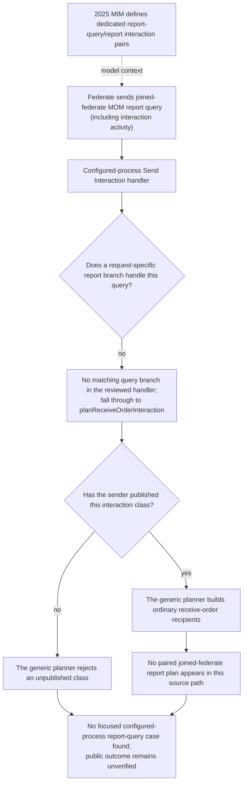

## Query sender, reported target, and report observer are separate roles

For the request/report families below, `HLAfederate` identifies whose ledger
or object view is queried; it does not identify who sent the request or which
federate receives the report callback. The embedded handlers generally decode
that target, pass it to the family planner, and dimension the response by the
same federate. The object-instance information handler is the exception
described above: it uses the sender's identity. Focused cases vary in whether
they actually distinguish the requester from the queried federate:

| 2025 report-query family | Embedded target path | Focused request target shape |
| --- | --- | --- |
| Object-instance information | Handler uses the request sender; it does not decode inherited `HLAfederate` ([handler](../../cpp/src/internal/runtime/umbra_rti_ambassador_interaction_send_services.cpp#L506)). | Test sends only `HLAobjectInstance`; inherited-target behavior is untested ([case](https://github.com/sheepfling/umbra/blob/c9c5a9e410539b039cd8bba35b53d0ef2b24d180/cpp/tests/joined_federate_mom_object_instance_information_report_catch2.cpp#L147)). |
| Updated, deletable, and reflected object-instance counts | Shared handler decodes `HLAfederate` and passes it to the selected report planner ([handler](../../cpp/src/internal/runtime/umbra_rti_ambassador_interaction_send_services.cpp#L349)). | The hosted class-grouping case queries a sender distinct from the requester ([hosted sender target](https://github.com/sheepfling/umbra/blob/c9c5a9e410539b039cd8bba35b53d0ef2b24d180/cpp/tests/joined_federate_mom_object_instances_updated_report_catch2.cpp#L225)); a worktree-only NULL test queries a distinct subject federate (worktree-only target[^worktree-source]); delete-capability queries the owner ([case](../../cpp/tests/joined_federate_mom_object_instances_that_can_be_deleted_report_catch2.cpp#L197)); the worktree-only reflected-instance NULL test names a distinct subject federate; that test is absent from HEAD and hosted (worktree-only case[^worktree-source]). |
| Reflections received and updates sent | Each handler decodes the target and passes it to its activity planner ([reflections](../../cpp/src/internal/runtime/umbra_rti_ambassador_interaction_send_services.cpp#L1497), [updates](../../cpp/src/internal/runtime/umbra_rti_ambassador_interaction_send_services.cpp#L1636)). | The reflections-received populated query names the requester/receiver ([case](../../cpp/tests/joined_federate_mom_reflections_received_catch2.cpp#L344)); updates-sent queries a distinct sender federate ([case](../../cpp/tests/joined_federate_mom_updates_sent_catch2.cpp#L252)). |
| Interactions received, including directed | Each handler decodes `HLAfederate` and plans against the selected receiver ([broad](../../cpp/src/internal/runtime/umbra_rti_ambassador_interaction_send_services.cpp#L2047), [directed](../../cpp/src/internal/runtime/umbra_rti_ambassador_interaction_send_services.cpp#L2187)). | Populated queries target the requester; distinct-target receipt-ledger behavior is not exercised by these focused cases ([broad](../../cpp/tests/joined_federate_mom_interactions_received_catch2.cpp#L256), [directed](../../cpp/tests/joined_federate_mom_directed_interactions_received_catch2.cpp#L318)). |
| Interactions sent, including directed | Each handler decodes `HLAfederate` and plans against the selected sender ([broad](../../cpp/src/internal/runtime/umbra_rti_ambassador_interaction_send_services.cpp#L1769), [directed](../../cpp/src/internal/runtime/umbra_rti_ambassador_interaction_send_services.cpp#L1908)). | Broad sent-count query targets a sender distinct from the requester ([case](../../cpp/tests/joined_federate_mom_interactions_sent_catch2.cpp#L270)); the directed sent-count case queries the same subject that sent the request ([case](../../cpp/tests/ieee1516_2025_federation_mom_directed_interactions_sent_catch2.cpp#L107)). |

This map is about target selection only. It does not assert report subscription
eligibility, callback ordering, or configured-process behavior; those remain
separate questions in the family sections and process-path review.

The embedded source carries the reported federate into a recipient-specific
`HLAfederate` endpoint region: for example, the object-information recipient
planner builds a point range from `reportedFederateId` and passes that region
override into `candidateReceiveOrderInteractionRecipient`
([endpoint region](../../cpp/src/internal/federation/federation_registry_mom_object_instance_information_reporting.cpp#L198),
[recipient selection](../../cpp/src/internal/federation/federation_registry.cpp#L1586)).
The activity-report callback path re-runs recipient projection with both the
reported and receiving federate IDs ([projection](../../cpp/src/internal/runtime/umbra_rti_ambassador_mom_activity_reports.cpp#L53)).
The focused cases subscribe to the report interaction class without a region
and inspect the report payload. Their `sentRegionsSupplied == false`
assertions describe the callback's sent-region argument; they do not inspect
the internal `HLAfederate` endpoint region ([example subscription and
assertion](../../cpp/tests/joined_federate_mom_updates_sent_catch2.cpp#L197),
[callback assertion](../../cpp/tests/joined_federate_mom_updates_sent_catch2.cpp#L267)).
Thus some distinct-target cases exercise which federate's ledger supplies the
payload, while the target-dimension recipient-filtering behavior remains
source-derived rather than directly asserted by those tests.

### Report target lifetime across Resign and same-name rejoin

These three `HLArequestObjectInstances...` paths bind a request to a current
member ID. Their planners check both requester and reported-target membership;
the request handler maps a missing requester or target to
`FederateNotExecutionMember`. Each report plan and queued callback keeps the
reported ID, while callback-time recipient projection rechecks that exact ID
and the selected receiver. A same-name rejoin receives a new member ID, so it
does not make an earlier report's target check succeed
([request handling](../../cpp/src/internal/runtime/umbra_rti_ambassador_interaction_send_services.cpp#L349),
[shared callback capture](../../cpp/src/internal/runtime/umbra_rti_ambassador_mom_object_instance_reports.cpp#L21),
[updated-report recheck](../../cpp/src/internal/federation/federation_registry_mom_object_instances_updated_reporting.cpp#L122),
[delete-capability recheck](../../cpp/src/internal/federation/federation_registry_mom_object_instances_that_can_be_deleted_reporting.cpp#L146),
[reflected-report recheck](../../cpp/src/internal/federation/federation_registry_mom_object_instances_reflected_reporting.cpp#L122),
[Resign erases the old member](../../cpp/src/internal/federation/federation_registry_resign_lifecycle.cpp#L1103),
[new member ID allocation](../../cpp/src/internal/federation/federation_registry_membership_lifecycle.cpp#L359)).

The state supplying the count differs by report:

| Report | Request-time payload source | What same-name rejoin changes |
| --- | --- | --- |
| `HLAreportObjectInstancesThatCanBeDeleted` | Current live object ownership of `HLAprivilegeToDeleteObject`; not a member history ledger ([planner](../../cpp/src/internal/federation/federation_registry_mom_object_instances_that_can_be_deleted_reporting.cpp#L77)). | The new ID is not the old privilege owner. The query reflects whatever live ownership the new ID has when its new request is planned. |
| `HLAreportObjectInstancesUpdated` | The target member's accepted-update ledger, retained for that joined-member lifetime even if an object is later removed ([record](../../cpp/src/internal/federation/federation_registry.cpp#L650), [planner](../../cpp/src/internal/federation/federation_registry_mom_object_instances_updated_reporting.cpp#L68)). | Resign erases the old membership record; a new membership starts with a distinct ledger. The old queued report still carries the old ID and already computed counts. |
| `HLAreportObjectInstancesReflected` | The target member's accepted-reflection ledger ([record](../../cpp/src/internal/federation/federation_registry.cpp#L700), [planner](../../cpp/src/internal/federation/federation_registry_mom_object_instances_reflected_reporting.cpp#L67)). | The old membership ledger is not rebound by name. A new request uses the new member record's reflection history. |

The RTI may retain the old `HLAfederate` MOM object while observers still
have pending Remove Object Instance callbacks
([resign removal ledger](../../cpp/src/internal/federation/federation_registry_resign_lifecycle.cpp#L1038)).
That retained object is a
removal-lifecycle snapshot; it does not retain the old member's update or
reflection ledger, authorize a new request for the departed ID, or substitute
the new ID in a callback. This distinction parallels the member FOM-module
report lifecycle, but the payload sources are different.

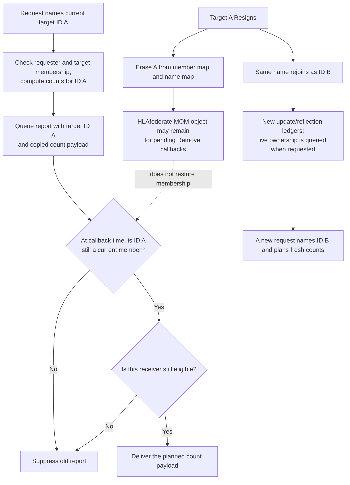

The focused updated, deletable, and reflected report cases exercise populated
or NULL count behavior and, in some cases, a target distinct from the
requester. They do not combine a queued count report with target Resign and
same-name rejoin, nor do they compare the old and new target's ledgers. The
diagram is an embedded-source lifecycle explanation; it makes no
configured-process parity claim. The process report-query route remains
separately undocumented by implementation tests in the [process boundary
section](#configured-process-report-query-path-lacks-a-paired-planner).

## Evidence map: implementation versus exercised scenarios

| Topic | Current implementation entry points | Focused test evidence |
| --- | --- | --- |
| Joined-federate MOM object-information report | [2025 MIM inherited target parameter](../../third_party/ieee1516.2-2025/resources/mim/HLAstandardMIM-2025.xml#L914), [request/report](../../third_party/ieee1516.2-2025/resources/mim/HLAstandardMIM-2025.xml#L1184), [embedded request handler](../../cpp/src/internal/runtime/umbra_rti_ambassador_interaction_send_services.cpp#L506), [per-federate report plan](../../cpp/src/internal/federation/federation_registry_mom_object_instance_information_reporting.cpp#L29), [known/NULL payload shape](../../cpp/src/internal/runtime/umbra_rti_ambassador_mom_object_instance_reports.cpp#L163) | [embedded known/NULL case](https://github.com/sheepfling/umbra/blob/c9c5a9e410539b039cd8bba35b53d0ef2b24d180/cpp/tests/joined_federate_mom_object_instance_information_report_catch2.cpp#L147) supplies only `HLAobjectInstance`; distinct-target and inherited-parameter behavior are untested. No configured-process report case was found in the bounded review. |
| Joined-federate MOM delete-capability counts | [2025 MIM request/report](../../third_party/ieee1516.2-2025/resources/mim/HLAstandardMIM-2025.xml#L1092), [embedded handler](../../cpp/src/internal/runtime/umbra_rti_ambassador_interaction_send_services.cpp#L282), [live privilege-owner count](../../cpp/src/internal/federation/federation_registry_mom_object_instances_that_can_be_deleted_reporting.cpp#L94), [target dimension](../../cpp/src/internal/federation/federation_registry_mom_object_instances_that_can_be_deleted_reporting.cpp#L108), [report fan-out](../../cpp/src/internal/runtime/umbra_rti_ambassador_mom_object_instance_reports.cpp#L105) | [embedded counts change after deletion](../../cpp/tests/joined_federate_mom_object_instances_that_can_be_deleted_report_catch2.cpp#L257); empty/NULL, transferred-owner, and configured-process cases were not found in the bounded review. |
| Joined-federate MOM updated-instance counts | [2025 MIM request/report and NULL wording](../../third_party/ieee1516.2-2025/resources/mim/HLAstandardMIM-2025.xml#L1102), [accepted-update lifetime ledger](../../cpp/src/internal/federation/federation_registry.cpp#L604), [class-grouped report planner](../../cpp/src/internal/federation/federation_registry_mom_object_instances_updated_reporting.cpp#L73), [report routing](../../cpp/src/internal/runtime/umbra_rti_ambassador_mom_object_instance_reports.cpp#L88) | [hosted repeated-update/class-grouping case](https://github.com/sheepfling/umbra/blob/c9c5a9e410539b039cd8bba35b53d0ef2b24d180/cpp/tests/joined_federate_mom_object_instances_updated_report_catch2.cpp#L139), current HLA_IMMEDIATE companion[^worktree-source], worktree-only distinct-target NULL-response case[^worktree-source]; transport-specific empty values and post-deletion history remain untested, and no configured-process report test was found in the bounded review. |
| Joined-federate MOM reflection activity counts | [2025 MIM request/report and transport/class parameters](../../third_party/ieee1516.2-2025/resources/mim/HLAstandardMIM-2025.xml#L1153), [callback-entry activity ledger](../../cpp/src/internal/federation/federation_registry.cpp#L779), [per-transport planner](../../cpp/src/internal/federation/federation_registry_mom_reflections_received_reporting.cpp#L77), [embedded request handler](../../cpp/src/internal/runtime/umbra_rti_ambassador_interaction_send_services.cpp#L1441) | [embedded repeated-reflection, transport-bucket, and empty-list case](../../cpp/tests/joined_federate_mom_reflections_received_catch2.cpp#L194); callback exceptions and configured-process reports are untested. |
| Joined-federate MOM reflected-instance counts | [2025 MIM request/report and NULL wording](../../third_party/ieee1516.2-2025/resources/mim/HLAstandardMIM-2025.xml#L1112), [receiver callback-entry ledger](../../cpp/src/internal/runtime/umbra_rti_ambassador_object_instance_lifecycle_callbacks.cpp#L824), [retained registered-class map](../../cpp/src/internal/federation/federation_registry.cpp#L672), [class-grouped report planner](../../cpp/src/internal/federation/federation_registry_mom_object_instances_reflected_reporting.cpp#L72) | [hosted repeated-reflection/class-grouping case](https://github.com/sheepfling/umbra/blob/c9c5a9e410539b039cd8bba35b53d0ef2b24d180/cpp/tests/joined_federate_mom_object_instances_reflected_report_catch2.cpp#L161), worktree-only distinct-target NULL case[^worktree-source]; post-deletion history remains untested, and no configured-process report case was found in the bounded review. |
| Joined-federate MOM update-activity counts | [2025 MIM request/report and transport/class parameters](../../third_party/ieee1516.2-2025/resources/mim/HLAstandardMIM-2025.xml#L1122), [accepted per-class/transport update ledger](../../cpp/src/internal/federation/federation_registry.cpp#L562), [report planner](../../cpp/src/internal/federation/federation_registry_mom_updates_sent_reporting.cpp#L29), [embedded handler and report queue](../../cpp/src/internal/runtime/umbra_rti_ambassador_interaction_send_services.cpp#L1462) | [embedded repeated-update, transport-bucket, and empty-list case](../../cpp/tests/joined_federate_mom_updates_sent_catch2.cpp#L145); mixed-transport single-call and configured-process request/report behavior are untested. |
| Joined-federate MOM interaction-receipt counts | [2025 broad MIM request/report pair](../../third_party/ieee1516.2-2025/resources/mim/HLAstandardMIM-2025.xml#L1163), [receiver callback-entry ledger](../../cpp/src/internal/federation/federation_registry.cpp#L731), [broad planner and route](../../cpp/src/internal/federation/federation_registry_mom_interactions_received_reporting.cpp#L77) | [embedded reliable/best-effort and empty-idle-target case](../../cpp/tests/joined_federate_mom_interactions_received_catch2.cpp#L149) uses ordinary receives only; directed inclusion in the broad report is source-derived, and ancestor-class promotion and configured-process report behavior remain untested. |
| Joined-federate MOM directed-interaction receipt counts | [2025 directed MIM request/report pair](../../third_party/ieee1516.2-2025/resources/mim/HLAstandardMIM-2025.xml#L1173), [directed-only ledger update](../../cpp/src/internal/federation/federation_registry.cpp#L752), [directed planner and request route](../../cpp/src/internal/federation/federation_registry_mom_directed_interactions_received_reporting.cpp#L28), [embedded request handler and queue](../../cpp/src/internal/runtime/umbra_rti_ambassador_interaction_send_services.cpp#L2019) | [same-class ordinary-versus-directed exclusion, reliable/best-effort buckets, and idle target](../../cpp/tests/joined_federate_mom_directed_interactions_received_catch2.cpp#L180); [declared custom-transport report bucket](../../cpp/tests/ieee1516_2025_custom_transportation_directed_interaction_integration_catch2.cpp#L4). No configured-process request/report case was found in the bounded review. |
| Joined-federate MOM interaction-send reports | [2025 broad and directed MIM request/report pairs](../../third_party/ieee1516.2-2025/resources/mim/HLAstandardMIM-2025.xml#L1132), [accepted total and directed-send ledgers](../../cpp/src/internal/federation/federation_registry.cpp#L696), [separate report planners](../../cpp/src/internal/federation/federation_registry_mom_interactions_sent_reporting.cpp#L27) and [directed planner](../../cpp/src/internal/federation/federation_registry_mom_directed_interactions_sent_reporting.cpp#L27), [embedded request routes](../../cpp/src/internal/runtime/umbra_rti_ambassador_interaction_send_services.cpp#L1602) | [broad reliable/best-effort and region-scoped counts](../../cpp/tests/joined_federate_mom_interactions_sent_catch2.cpp#L153), [two directed sends in the directed report](../../cpp/tests/ieee1516_2025_federation_mom_directed_interactions_sent_catch2.cpp#L4), [empty total and directed buckets](../../cpp/tests/mom_sender_count_reports_null_buckets_catch2.cpp#L116). Broad-report inclusion of directed sends and self-query counting order remain source-derived; no configured-process or custom-transport report case was found. |

## Known limits

- The pinned MIM has conflicting NULL wording for some report fields. The
  relevant sections record both statements and the implementation/test
  observation without declaring the MIM phrases equivalent.
- The directed-interaction report description appears to name a report
  interaction where its request interaction is expected. The guide preserves
  the pinned MIM wording and does not silently correct it.
- The selected public report tests are embedded-profile cases. No
  configured-process report case was found in this bounded review, so no
  process-parity claim is made.
- For object-information reports, the pinned MIM inherits `HLAfederate` as the
  request target, but the reviewed embedded handler ignores it and reports the
  sender's view. The focused case omits that parameter and tests only the
  current implicit-self path; no distinct-target result is established.
- The cited cases are focused implementation evidence, not a complete
  IEEE 1516.1-2025 conformance demonstration.

## Related guides

For application object state and ordinary object/interaction delivery, see the
[Object and Interaction guide](HLA-2025-OBJECT-AND-INTERACTION-INFORMATION-FLOW-GUIDE.md).
For Join, Restore, Resign, and the per-member `HLAfederate` object, see the
[Joined-Federate MOM guide](HLA-2025-JOINED-FEDERATE-MOM-OBJECT-LIFECYCLE-FLOW-GUIDE.md).
For the execution-level `HLAfederation` object, see the
[Federation MOM guide](HLA-2025-FEDERATION-MOM-FLOW-GUIDE.md).

[^worktree-source]: Source/test citations marked in this guide refer to current-worktree changes absent from the hosted base; those files are excluded from the documentation-only publication path set. The [hosted source-dependency audit](HLA-2025-HOSTED-SOURCE-DEPENDENCIES.json) records the exact paths, lines, and status.
