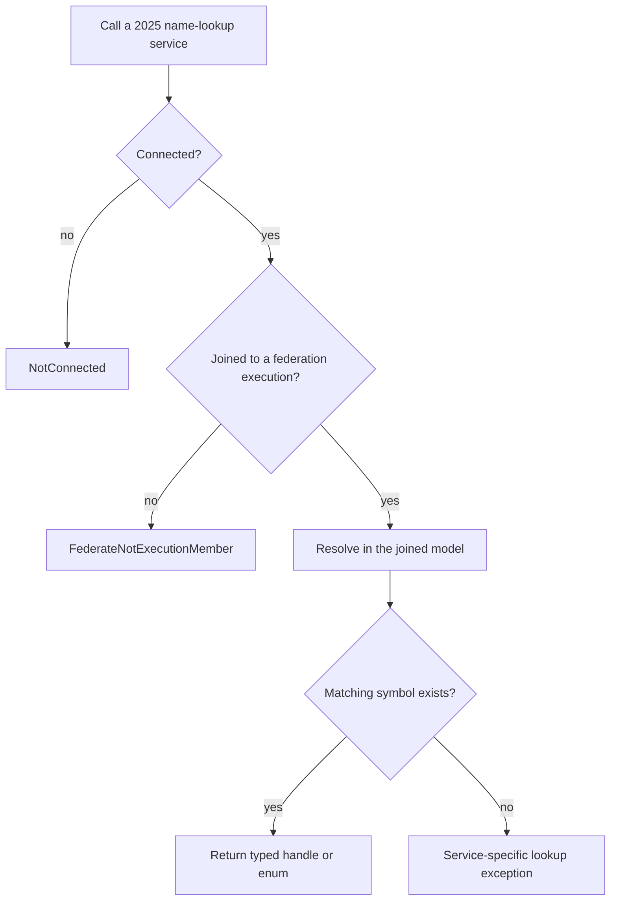
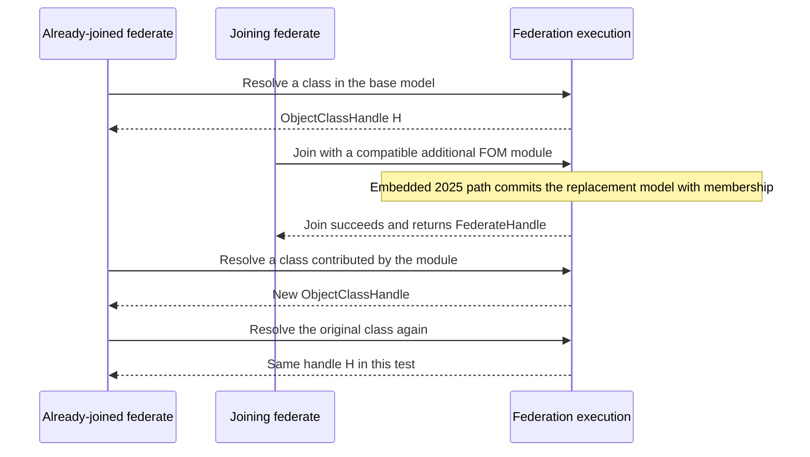
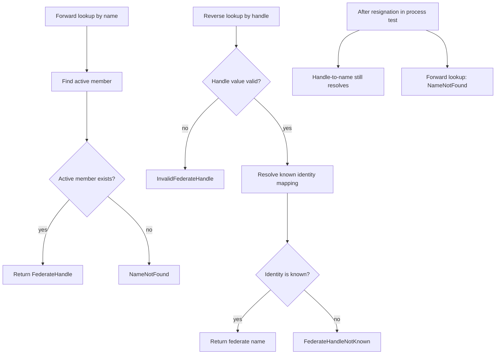
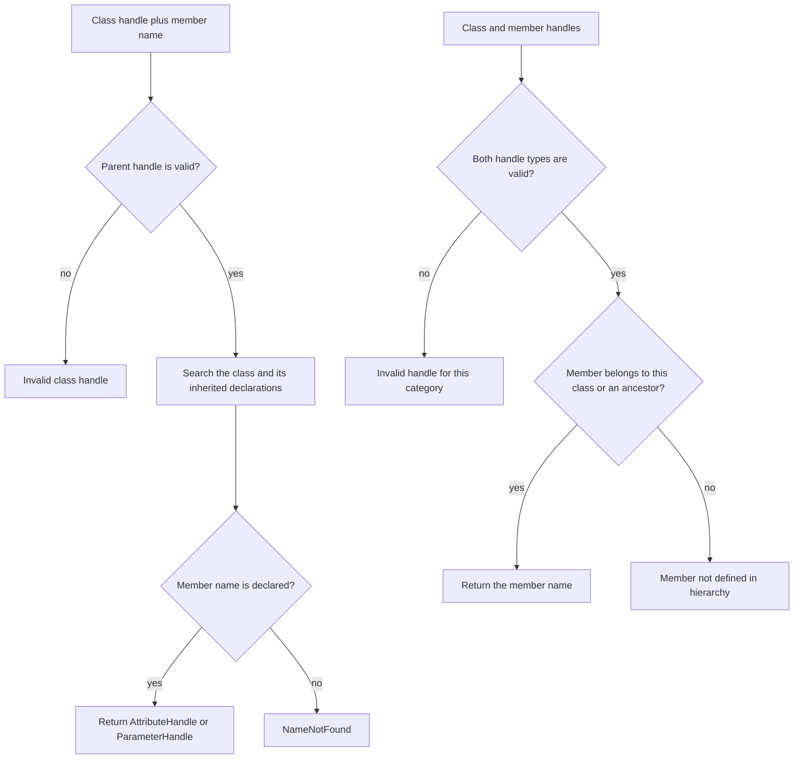
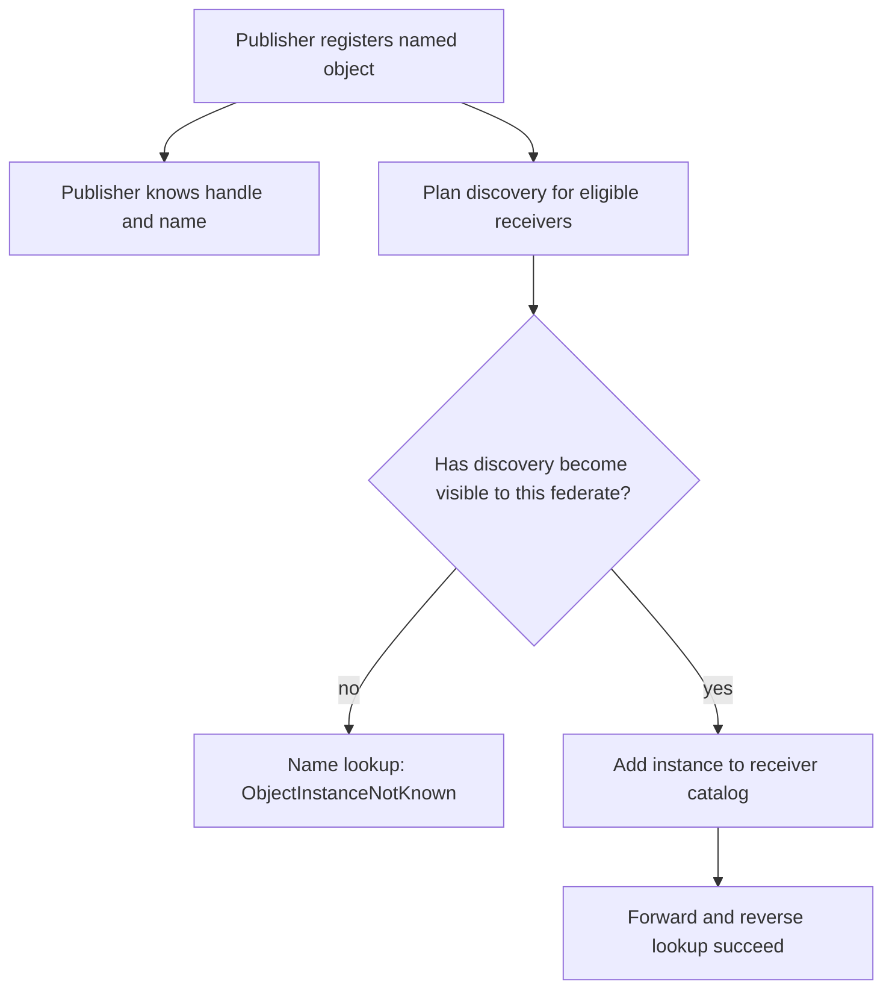
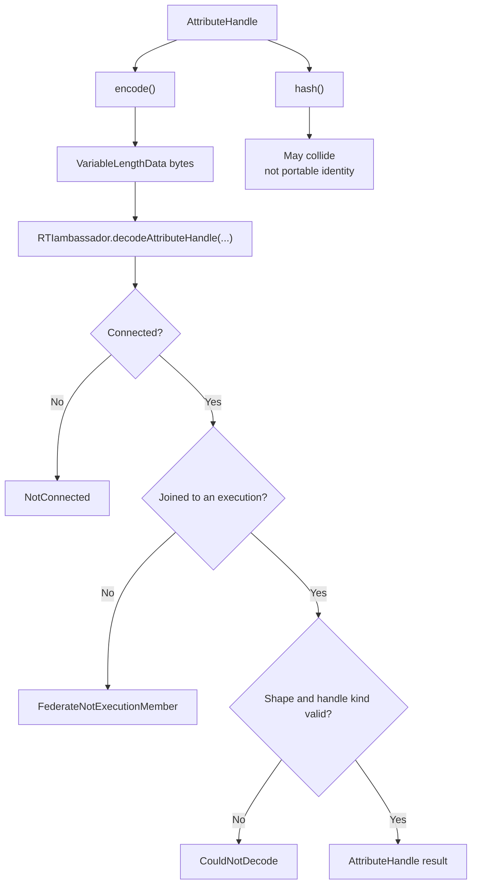
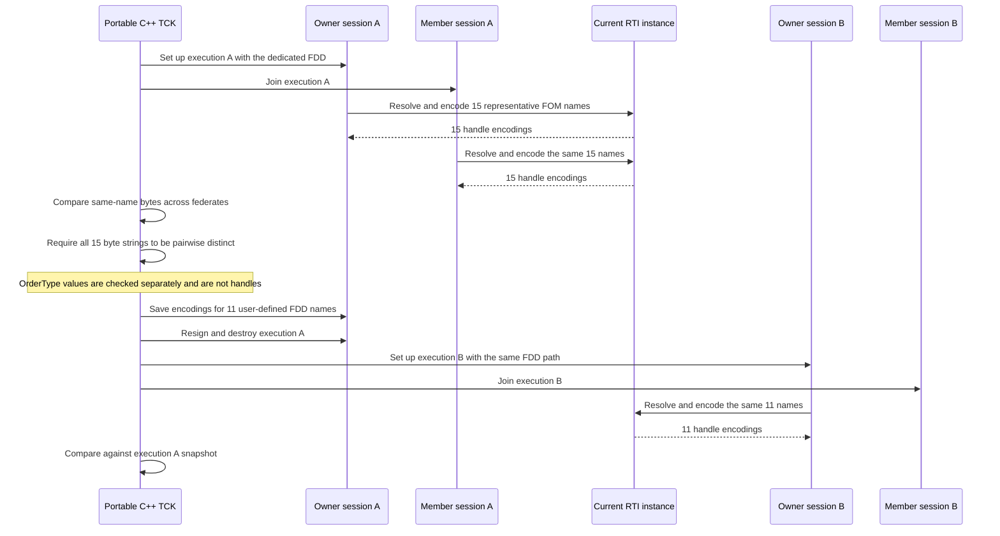
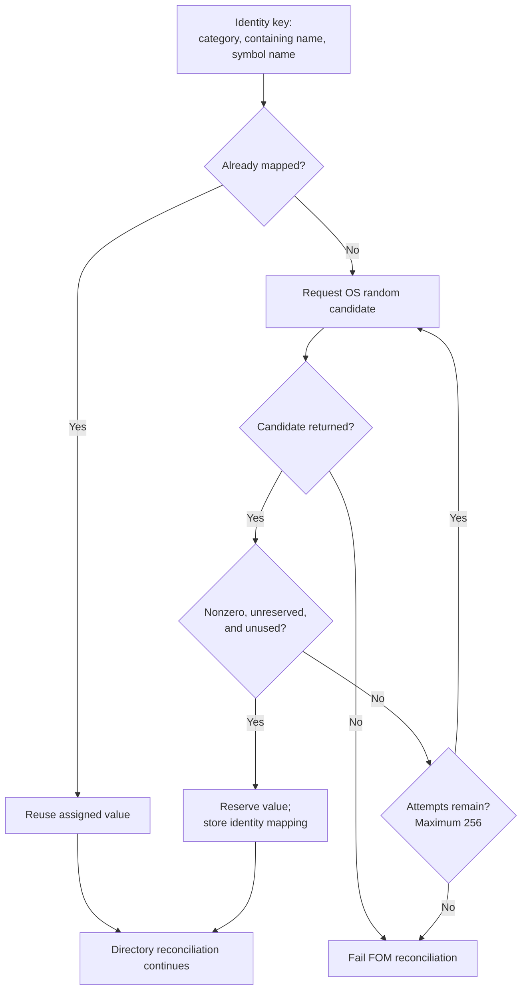
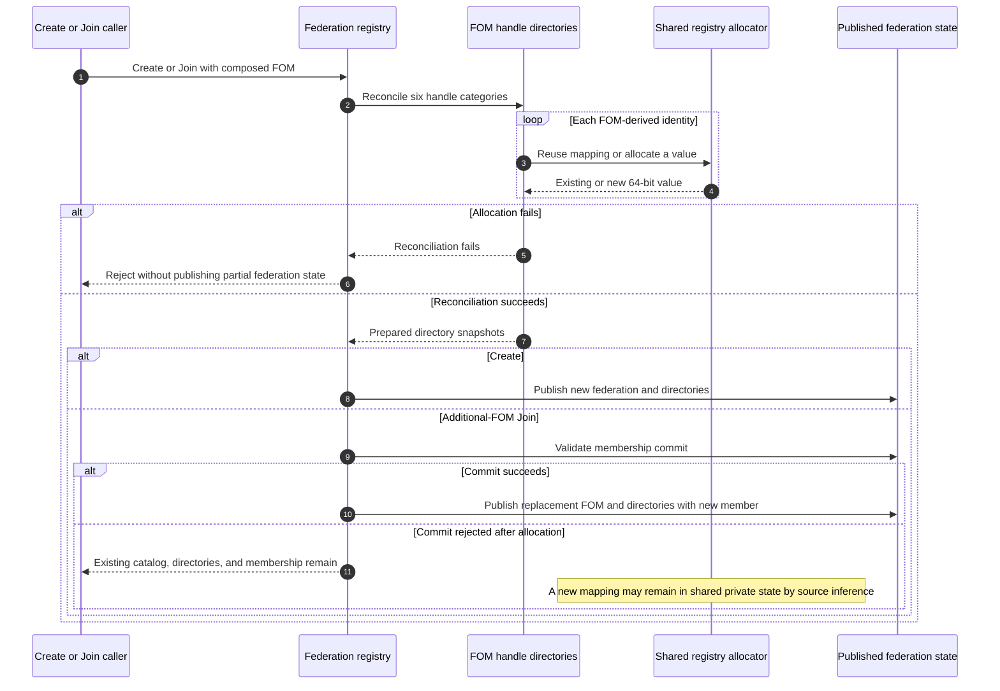
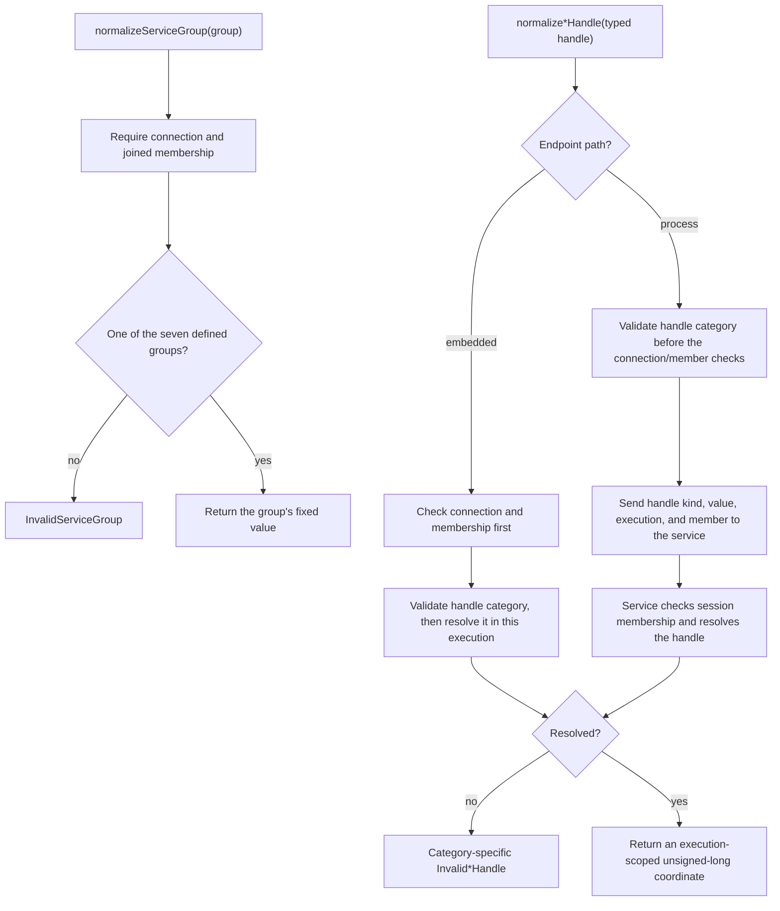

# HLA 1516.1-2025 Names and Handle Resolution

IEEE 1516.1-2025 resolves different names in different scopes: model symbols
in a joined execution's FOM, federate identities in the execution, and object
instances known to a particular federate. Its public handle categories are
distinct values, not interchangeable integers or universal name strings.
This guide explains those HLA identity and lifetime distinctions first, then
uses selected 2025 Umbra paths and tests as bounded examples. The 2010 API and
runtime remain separate, and no complete-conformance claim is made.

Keep the [2010 reference-RTI guide](HLA-2010-REFERENCE-RTI-FLOW-GUIDE.md)
separate. This document cites only the pinned IEEE 1516.1-2025 API and the
`rti1516_2025` implementation/tests; it makes no 2010 parity claim.

## The short mental model

There are three identity questions that can sound alike:

- “Is this declaration in the joined federation's composed FOM?” For example,
  resolving an object-class name or a dimension name.
- “Does this federate currently know this object instance?” An object-instance
  name is not just another declaration in the FOM; the per-federate known-object
  state matters.
- “Is this federate name active, or is this handle known?” The two federate
  lookup directions have distinct API exceptions and should not be assumed to
  have identical lifetime semantics.

The C++ API also makes symbol category part of the type: an
`ObjectClassHandle` is not an `InteractionClassHandle`, and an
`AttributeHandle` is not a `ParameterHandle`. Section 5 explains why handles,
hashes, encoded bytes, and normalized coordinates are different things.

## 1. Resolve a model symbol only in an execution context

The public name-lookup services are support services, but they are not
pre-join FOM inspection. Umbra first requires a live connection and membership
in a federation execution. It then asks the configured backend to resolve the
name against that execution's model catalog and returns the category-specific
handle.



In the embedded path, the ambassador checks its joined-member record and uses
the federation registry. With a configured process endpoint, it asks the
process client using the joined federation and federate identity instead of
consulting a potentially stale process-local catalog. Both paths are present
in source. The focused evidence below is split by backend: embedded tests cover
the broader hierarchy, dimension, and known-instance flows, while one
process-endpoint integration test covers object/interaction class
name-to-handle and handle-to-name lookups plus unknown reverse handles. This
does not establish parity for every lookup family.

### Existing members can look up symbols added by Join

The pinned [2025 Join API](../../third_party/ieee1516.1-2025/include/RTI/RTIambassador.h#L212)
accepts additional FOM modules, and model-name lookup is scoped to the joined
execution. The sequence below records the object-class lookup path from one
embedded 2025 test; the table after it summarizes other symbol categories with
their own focused tests. These are implementation/test observations, not a
universal rule for every RTI or the separate process profile. Together they
connect the model-composition boundary to an existing member's later lookup
view.



The [object-class test](../../cpp/tests/object_class_lookup_catch2.cpp#L99)
observes the pre-existing member resolving the new class after the other
federate's additional-module Join, while its previously resolved class handle
remains equal. A parallel [interaction-class test](../../cpp/tests/interaction_class_lookup_catch2.cpp#L103)
covers the same pattern. The tests compare typed-handle equality; they do not
establish cross-execution numeric identity or process-profile parity. The [FOM
composition guide](HLA-2025-FOM-MODULE-ADMISSION-AND-COMPOSITION-FLOW-GUIDE.md)
shows the embedded prepare/commit path and its failure boundary. No discovery
callback or instance visibility follows from this model-lookup observation.

The selected embedded tests cover five public lookup families across an
additional-module Join:

| Symbol family | Existing symbol retained | New symbol resolved after Join | Focused test |
| --- | --- | --- | --- |
| Object class | `Employee` keeps its handle. | The added object class resolves to a handle and back to its name. | [Object-class lookup](../../cpp/tests/object_class_lookup_catch2.cpp#L99) |
| Attribute | `Employee::Name` keeps its handle. | The extension's `Identifier` attribute resolves through its defining class and child class, and reverses to its name. | [Attribute lookup](../../cpp/tests/attribute_lookup_catch2.cpp#L116) |
| Interaction class | `ServerAction.TakeOrder` keeps its handle. | The added interaction class resolves to a handle and back to its name. | [Interaction-class lookup](../../cpp/tests/interaction_class_lookup_catch2.cpp#L103) |
| Parameter | `MainCourseServed::TemperatureOK` keeps its handle. | The extension's `Identifier` parameter resolves through its defining interaction and child, and reverses to its name. | [Parameter lookup](../../cpp/tests/parameter_lookup_catch2.cpp#L119) |
| Transportation type | The existing custom type keeps its handle for both the existing and new member. | A newly added type that sorts before the existing type gets a distinct handle and resolves in both members. | [Transportation handle stability](../../cpp/tests/custom_transportation_handle_stability_catch2.cpp#L44) |

These cases establish equality of previously issued typed handles within the
tested execution and resolution of the selected added symbols. They do not
establish numeric handle values or equality across executions. The transportation
case deliberately adds a type that sorts before an existing type, so the
existing handle remains stable despite catalog order. The registry also
reconciles dimension handles when it commits a replacement definition
([directory preparation and commit](../../cpp/src/internal/federation/federation_registry_membership_lifecycle.cpp#L328)),
but this review found no matching focused public test that adds a dimension and
resolves it after Join; that category is source evidence only. The
configured-process additional-FOM test verifies an added object-class lookup, not parity
for the embedded attribute, interaction-class, parameter, or transportation
cases, nor dimension lookup
([process case](../../cpp/tests/process_federation_additional_fom_catch2.cpp#L443)).
The FOM guide's [Join transaction and rollback boundary](HLA-2025-FOM-MODULE-ADMISSION-AND-COMPOSITION-FLOW-GUIDE.md#join-with-additional-fom-modules-replace-definition-and-add-member-together)
covers post-commit setup failures separately; these lookup tests do not inject
those failures.

## 2. Federate name and handle lookup have distinct lifetime paths

The 2025 API exposes `getFederateHandle(name)` and
`getFederateName(handle)` as separate support services. In Umbra, forward lookup
resolves an active member name; reverse lookup consults the federation's known
identity mapping. A focused configured-process-endpoint test observes that,
after a federate resigns, its handle still resolves to its name while its name
no longer resolves to an active handle. This is an implementation/test
observation for that process scenario, not a claim that every profile or
conforming RTI must retain the same post-resignation mapping.

A same-name rejoin is a new membership in the current Umbra registry: successful
Join allocates the next federate identity value, while the prior handle-to-name
entry remains in the execution's lifetime index. The implementation therefore
assigns a different handle value to the rejoining membership, even though both
handles can resolve to the same federate name. The focused [process identity
test](../../cpp/tests/ieee1516_2025_connection_federate_identity_lookup_catch2.cpp#L601)
checks lookup after Resign; the separate [process MOM
test](../../cpp/tests/ieee1516_2025_connection_process_mom_resign_removal_order_catch2.cpp#L333)
observes same-name rejoin and object-removal/discovery order, but neither directly
compares the old and new handles. Treat this as a source-derived Umbra behavior,
not a portable or normative rejoin guarantee ([Join allocation](../../cpp/src/internal/federation/federation_registry_membership_lifecycle.cpp#L347),
[identity retention](../../cpp/src/internal/federation/federation_registry.hpp#L2628),
[rejoin commit](../../cpp/src/internal/federation/federation_registry_membership_lifecycle.cpp#L612)).

That retained identity mapping belongs to the same execution before Destroy.
Destroy erases the execution-owned map; a later Create with the same name starts
with a new map. Do not treat handle values as globally unique across that
boundary: the [fresh-registry restore case](../../cpp/tests/ieee1516_2025_public_fresh_registry_object_name_reservations_restore_catch2.cpp#L77)
asserts that the first handle from the new registry equals the earlier execution's
first handle *before* Restore. It does not call `getFederateName` with a stale
handle in a newly created execution, so lookup behavior across that boundary is
not established. Only the separate Restore operation reloads the saved
federate-name index ([Destroy](../../cpp/src/internal/federation/federation_registry_membership_lifecycle.cpp#L158),
[restore installation](../../cpp/src/internal/federation/federation_registry_state_image_restore.cpp#L913));
see the [execution recreation flow](HLA-2025-FEDERATION-AND-FEDERATE-LIFECYCLE-FLOW-GUIDE.md#same-name-recreation-is-fresh-restore-must-be-explicit).
Federate and object-instance handles take different paths in one tested
embedded Restore: live federate identities change while saved object handles
remain usable. See [the identity comparison](HLA-2025-FEDERATION-SAVE-RESTORE-FLOW-GUIDE.md#federate-identity-and-object-instance-identity-rehydrate-differently).



The public API documents different exception sets for the two calls (10.2 and
10.3). The post-resignation branch above is deliberately marked as an observed
process-test result; do not generalize it to the embedded profile without
corresponding evidence.

## 3. Class-scoped names follow the declared hierarchy

An attribute name is looked up with an `ObjectClassHandle`; a parameter name is
looked up with an `InteractionClassHandle`. The parent handle is part of the
lookup key. A member inherited from an ancestor can be resolved through a child
class, and the same declared member handle is returned. Reverse lookup likewise
checks the supplied class/member pair; a valid member handle by itself is not
enough to establish that the member belongs to the requested class.



The official API lists the precise exception contract per operation. In
particular, `getAttributeName` and `getParameterName` distinguish an invalid
handle from a valid handle that is not defined for the supplied class. Do not
collapse these into a generic “lookup failed” rule.

This is a class-scoped **name-resolution** rule, not a promise that the
inherited member appears in every receiver callback. Discovery, attribute
projection, ordinary interaction promotion, and directed routing use class
ancestry differently in the selected 2025 paths; see the object-information
guide's [cross-path class ancestry map](HLA-2025-OBJECT-AND-INTERACTION-INFORMATION-FLOW-GUIDE.md#class-ancestry-has-different-jobs-in-different-paths).

## 4. Object-instance lookup is federate-local knowledge

An object class is a model declaration. An object instance is created at
runtime, and a receiver does not become able to resolve its name merely
because another federate registered it. The relevant boundary is that
federate's known-object state, which is updated along the discovery/callback
path.



Two similarly named support queries answer different questions:

| Query | Scope and key | Absence is reported as |
| --- | --- | --- |
| [`getObjectClassHandle(className)`](../../third_party/ieee1516.1-2025/include/RTI/RTIambassador.h#L1709) | Resolve a class declaration in the joined execution's FOM. | `NameNotFound` |
| [`getKnownObjectClassHandle(instance)`](../../third_party/ieee1516.1-2025/include/RTI/RTIambassador.h#L1729) | Return the class of an object instance in this federate's known-object view. | `ObjectInstanceNotKnown` |

The distinction is observable with evoked callbacks: in the focused embedded
registration/discovery test, a receiver cannot resolve the instance before its
discovery callback has been evoked; after discovery, it can resolve the name
and query the known class with `getKnownObjectClassHandle`. The test's
[registration/discovery assertions](../../cpp/tests/object_instance_registration_discovery_catch2.cpp#L181)
exercise this boundary. This guide does not restate the full publication,
subscription, relevance, or callback-order state machines; follow the
[object/interaction information guide](HLA-2025-OBJECT-AND-INTERACTION-INFORMATION-FLOW-GUIDE.md)
for those routing decisions. A reserved name is earlier state, not an instance
that receivers can resolve; the separate [name-reservation guide](HLA-2025-OBJECT-INSTANCE-NAME-RESERVATION-FLOW-GUIDE.md)
traces the owner's reservation through named registration and consumption,
then contrasts that owner path with a peer's later discovery-based knowledge
in its [two-view synthesis](HLA-2025-OBJECT-INSTANCE-NAME-RESERVATION-FLOW-GUIDE.md#owner-reservation-and-peer-visibility-advance-separately).
For when a registered spelling becomes reusable, use the reservation guide's
[global-purge discussion](HLA-2025-OBJECT-INSTANCE-NAME-RESERVATION-FLOW-GUIDE.md#4-reservation-ownership-and-lifetime),
which separates retraction expiry, producer time, and global object/name purge.
Its focused CTest run used a runtime older than the current registry sources;
the current-source execution result remains open.

The configured-process endpoint checks that each lookup request's federation
and federate identity match the active session and registry membership, then
uses the same member-keyed registry queries as the embedded adapter. The
process lookup test registers and looks up from one member and checks unknown
inputs under both callback models; it does not query a peer before or after
discovery. The query scope is shared, while the known-view commit point differs
by profile. See the [embedded lookup adapter](../../cpp/src/internal/runtime/umbra_rti_ambassador_object_instance_lookup.cpp#L72),
[process lookup service](../../cpp/src/internal/federation/process_federation_service_handle_lookup.cpp#L213),
[shared member-keyed registry query](../../cpp/src/internal/federation/federation_registry_object_instance_discovery_state.cpp#L153),
[process reverse lookup](../../cpp/src/internal/federation/process_federation_service_handle_lookup.cpp#L245),
[embedded discovery test](../../cpp/tests/object_instance_registration_discovery_catch2.cpp#L181),
and [configured-process lookup test](../../cpp/tests/ieee1516_2025_connection_object_instance_lookup_catch2.cpp#L459).

### Configured-process discovery commits known state before callback delivery

For a configured process, discovery planning first matches the receiving
federate to its live session. The service then calls
`beginObjectInstanceDiscovery`, which records that receiver's known-object
projection, before it queues or sends the discovery event. The client buffers
or submits that event to the callback bridge afterward. During a deferred
callback window, a separate lookup request can therefore query the already
committed member view. This is source-derived ordering; no process test asserts
the public lookup result before `discoverObjectInstance` is invoked. The
embedded path commits the known-object state inside the queued callback route,
immediately before invoking the callback, and its focused test covers lookup
before and after Evoke. Keep those profile observations separate. The
Save/Restore guide's [configured-process ordering chart](HLA-2025-FEDERATION-SAVE-RESTORE-FLOW-GUIDE.md#configured-process-lookup-state-precedes-deferred-restore-and-discovery-callbacks)
shows the discovery and Restore callback windows together. Sources:
[process discovery commit](../../cpp/src/internal/federation/process_federation_service_object_discovery.cpp#L54),
[event queue/send](../../cpp/src/internal/federation/process_federation_service_object_discovery.cpp#L183),
[client event buffering](../../cpp/src/internal/federation/process_federation_client.cpp#L741),
[callback bridge](../../cpp/src/internal/federation/process_federation_callback_bridge.cpp#L1912),
[embedded callback-time commit](../../cpp/src/internal/runtime/umbra_rti_ambassador_object_instance_lifecycle_callbacks.cpp#L274).

### Restore rebinds object identity but lookups remain member-local

The embedded fresh-registry Restore path reinstalls the saved object handle and
name, rebinds its saved member references, and restores the saved known-member
projection. In the focused one-object case that projection contains the
publisher: after `federationRestored`, both publisher lookup directions and
`getKnownObjectClassHandle` succeed. The receiver's later discovery callback
reports the same saved object identity with the publisher's current federate
handle; after that callback is drained, the receiver's forward lookup, reverse
lookup, and known-class query succeed as well. The test does not query the
receiver between `federationRestored` and the later subscription/discovery, so
it leaves that interval open. See the Save/Restore guide's [identity rebind
trace](HLA-2025-FEDERATION-SAVE-RESTORE-FLOW-GUIDE.md#federate-identity-and-object-instance-identity-rehydrate-differently)
and [configured-process ordering chart](HLA-2025-FEDERATION-SAVE-RESTORE-FLOW-GUIDE.md#configured-process-lookup-state-precedes-deferred-restore-and-discovery-callbacks).
The process sources place restored state before the deferred
`federationRestored` callback, but no public lookup result is asserted in that
gap. The embedded test's fresh registry is within one OS process; neither test
establishes name reuse or 2010 behavior.

**Normative timing boundary.** The pinned API headers label
[`getObjectInstanceHandle` (§10.7)](../../third_party/ieee1516.1-2025/include/RTI/RTIambassador.h#L1739),
[`getObjectInstanceName` (§10.8)](../../third_party/ieee1516.1-2025/include/RTI/RTIambassador.h#L1749),
[`discoverObjectInstance` (§6.9)](../../third_party/ieee1516.1-2025/include/RTI/FederateAmbassador.h#L229),
and [`federationRestored` (§4.32)](../../third_party/ieee1516.1-2025/include/RTI/FederateAmbassador.h#L155).
Those API declarations identify exceptions and callback signatures, but do not
specify when either lookup must begin succeeding relative to discovery or
Restore callbacks. The pinned tree is the official C++ API header import
([README](../../third_party/ieee1516.1-2025/README.md)); IEEE's
[1516.1-2025 product page](https://standards.ieee.org/ieee/1516.1/6688/)
lists purchase and subscription access to the standard. This guide therefore
records the ordering above as Umbra source behavior and leaves the normative
cross-service timing rule unresolved until the full authorized clauses can be
reviewed.

The 2025 [Federation MOM guide](HLA-2025-FEDERATION-MOM-FLOW-GUIDE.md) gives a
useful counterexample to conflating identities: its membership list carries
`FederateHandle` references to `HLAfederate` objects, while a receiver's
object-instance knowledge still follows the discovery path. The focused list
test decodes federate identities but does not test object-instance lookup from
those references.

## 5. Typed handle encoding is not numeric identity

The official [2025 `Handle.h`](../../third_party/ieee1516.1-2025/include/RTI/Handle.h#L27)
defines a separate public class for each handle kind. Treat these as opaque,
category-typed values, not arithmetic integers: the API supports comparison,
hashing, and encoding, but exposes no portable numeric identity or arithmetic
operation on a handle. A hash is only a container aid and may collide. Umbra's
internal conversion helpers preserve the category at the boundary while using
a private numeric value in the embedded registry. That representation is an
implementation detail, not a cross-execution identity contract.

Select the decoder for the handle category. The 2025 handle encoding carries a
category discriminator, and the selected RTIambassador decoder validates it
before constructing the requested C++ type. The encoding on a public handle is
separate from DataElement serialization, FOM XML materialization, and RTI
transport framing; none of those boundaries should be inferred from the
handle's private numeric representation. See the [Data Element encoding
guide](HLA-2025-DATA-ELEMENT-ENCODING-FLOW-GUIDE.md#pick-the-representation-boundary-before-reasoning-about-bytes)
for value-codec byte-order rules.



### Current Umbra 2025 byte layout (implementation evidence only)

The public API exposes handle `encode()` and typed RTIambassador decoder
services. It does not make Umbra's private numeric identity layout part of the
handle class declaration. In Umbra's current 2025 implementation, the separate
handle classes share an `HLAvariableArray` wrapper containing nine `HLAbyte`
elements: a stable handle-kind discriminator and the eight-octet identity. For
an embedded `ObjectClassHandle` identity of `0x0102030405060708`, the focused
byte-vector test observes:

```text
00 00 00 09 | 02 | 01 02 03 04 05 06 07 08
└─ count ───┘  │    └─ eight identity octets ─┘
  uint32 BE    kind      uint64 BE
```

| Bytes | Meaning in this Umbra 2025 implementation |
| --- | --- |
| `00 00 00 09` | `HLAinteger32BE` element count: nine `HLAbyte` values follow. |
| `02` | Stable Umbra discriminator for `ObjectClassHandle`. |
| `01 02 03 04 05 06 07 08` | Eight-octet identity, big endian in this implementation. |

The typed decoder accepts exactly thirteen octets and requires both the count
and handle-kind discriminator to match; malformed shape, count, or kind
produces `CouldNotDecode`. The buffer overload requires a non-null destination
with at least thirteen writable bytes. The explicit kind-code assignments are
intended to be shared by Umbra's future language bindings; cross-API
reconstitution has not yet been tested. These are source-observed Umbra 2025
rules, not a promise that another RTI or edition uses these exact identity
bytes. Keep them opaque and call the matching typed decoder. This is handle
encoding, not serialization of an object-instance name or its string value;
object-instance visibility remains a separate
[federate-local lookup boundary](#4-object-instance-lookup-is-federate-local-knowledge).

The pinned [2025 handle declaration](../../third_party/ieee1516.1-2025/include/RTI/Handle.h#L16)
provides the distinct classes and encoding operations. Umbra's [2025 typed
handle codec](../../cpp/src/internal/handles/handle_variable_array_encoding.hpp)
spells out the HLAvariableArray count, stable type code, and identity. The
[2025 handle definition](../../cpp/src/internal/handles/2025_handle_definition.hpp#L17)
uses it for the typed classes, while the [2010 handle codec](../../cpp/src/internal/handles/handle_variable_array_encoding_2010.hpp)
retains its independent legacy wire format. The exact `ObjectClassHandle` vector, output
buffer checks, and round trip are in its [focused test](../../cpp/tests/object_class_handle_catch2.cpp#L43);
the [public RTIambassador decode case](../../cpp/tests/ieee1516_2025_federation_management_catch2.cpp#L141)
round-trips eight handle categories after Join and checks connection and
membership preconditions. The current worktree's promoted cross-federate
handle-parameter TCK checks byte preservation, typed reconstitution, and
rejection by a different handle decoder. Its source,
`packages/hla-rti-cpp-tck/src/tck_handle_encoding_mim_types.cpp`, is not part
of the documentation-only candidate. A separate [MessageRetractionHandle vector and wrong-count
case](../../cpp/tests/message_retraction_handle_catch2.cpp#L19) checks another
typed handle and a malformed element count.

### FOM handle uniqueness and bounded repeatability

The portable 2025 C++ TCK checks encoded FOM handles separately from DDM
normalization results. In one execution, the owner and a second federate
resolve the same 15 representative names spanning object classes, attributes,
interaction classes, parameters, dimensions, and transportation types. The
case requires matching names to have equal encodings across the two federates
and all 15 encodings to be pairwise distinct. `Receive` and `TimeStamp` are
also checked as distinct `OrderType` enum values; they are not handle encodings.

After saving 11 user-defined FDD-name encodings, the test destroys that
execution, creates another with the same current RTI and FDD path, and compares
the same 11 names. The recorded EVOKED and IMMEDIATE runs pass. This is bounded
evidence for these names and this setup; it does not establish every FOM,
cross-process RTI restart persistence, independent-provider behavior, or
unpredictability. The scenario catalog maps the finite execution-wide
uniqueness witness to IEEE 1516.1-2025 §10.1.1, and same-FDD cross-execution
repeatability to §12.2. In the current worktree, the scenario source is
`packages/hla-rti-cpp-tck/src/tck_support_services_scenarios.cpp`, the fixture
is `packages/hla-rti-cpp-tck/fom/fom-handle-uniqueness-tck.xml`, and the
catalog entry is `cpp-tck.fom-handle-uniqueness`. These current-only source,
fixture, and catalog changes are not part of the documentation-only candidate.



### Current Umbra registry allocation for FOM-derived handles

The portable TCK sequence above describes public encoded-handle observations.
The current Umbra registry has a separate implementation detail behind those
values: one `FomHandleAllocator` state is shared by copies and by the FOM
handle directories for object classes, attributes, interaction classes,
parameters, dimensions, and transportation types. Each name is identified by
its category, containing name where applicable, and symbol name. A known key
reuses its assigned value; a new key requests a candidate from the operating
system random source. Zero and the two predefined transportation values are
reserved, and already-allocated candidates are retried up to 256 times. There
is no counter fallback: source failure or exhaustion fails reconciliation.





The current worktree's allocator identity lookup and candidate loop are in
`cpp/src/internal/handles/fom_handle_allocator.cpp`; [Create reconciliation](../../cpp/src/internal/federation/federation_registry_membership_lifecycle.cpp#L76)
and [additional-FOM Join preparation and commit](../../cpp/src/internal/federation/federation_registry_membership_lifecycle.cpp#L291)
are in the existing registry source.
The public 2025 API exposes typed handle classes and encode/decode surfaces;
this allocation policy is Umbra source behavior, not an API-visible numeric
format or a claim about another provider or an operating-system process
restart.

The current worktree's internal test source,
`cpp/tests/fom_handle_allocator_catch2.cpp`, uses an injected provider to check
allocator-copy reuse and reserved values. Its failure sections check that
Create publishes no federation after entropy failure, and that an additional-FOM
Join failure preserves the existing catalog and six existing handle-directory
results before a successful retry. The source is not part of the
documentation-only candidate. These tests are tagged internal-only with no
normative mapping; this documentation review did not run them.

The cited fixture checks the two predefined reserved values, allocation reuse,
and an injected entropy-source failure. It does not inject a zero candidate,
a sampled candidate that collides with another identity's allocated value, or
256 consecutive rejected candidates. Those rejection and retry-limit paths are
source-derived here, not independently demonstrated by the focused test.

One boundary is visible only in source: allocator copies share their private
map, so a new key successfully allocated before a later Join reconciliation
failure can remain cached even though the federation's published catalog and
directory snapshots stay unchanged. The failure test checks those published
snapshots, not the allocator's private map. This detail does not change the
public TCK's bounded 15-name uniqueness and 11-name repeatability evidence
above, and it must not be presented as a portable HLA rule.

### Normalization support services produce coordinates, not handles

The 2025 API lists `normalizeServiceGroup` and four typed-handle normalization
services in RTI Support (10.29–10.33). They return `unsigned long`; that result
is not another handle and is not the handle's private sequential value. The
Umbra registry describes normalized handle values as execution-scoped
coordinates for standard MIM dimensions, stable for the same designator
throughout an execution, including restore. Its source reserves the maximum
coordinate so a point range `[value, value + 1)` cannot overflow. This is
current Umbra behavior, not a claim that the private mixing algorithm is
standardized.

Keep the dimension category attached to each normalized value. The federate,
object-class, interaction-class, and object-instance operations are not one
global handle-number namespace just because they share the `unsigned long`
return type. Umbra feeds a category-specific discriminator into a shared mixing
helper, but does not reserve disjoint numeric ranges across categories. The
focused test checks point-range validity and agreement for the same typed
designator across ambassadors; it does not establish cross-category uniqueness.
Do not use cross-category numeric equality or inequality as a handle-identity
test.



The service-group result is its fixed enumerator value; it does not use the
execution-specific handle mapping. For handles, the embedded registry accepts
an active federate, a class present in the joined FOM catalog, or an object
instance in the execution's object/MOM-instance directories. In both endpoint
paths the process service ultimately asks that federation registry to resolve
the typed handle. A malformed process-side typed handle is rejected before
the local connection/member gate, while the embedded path checks that gate
first. Treat that error-precedence distinction as source-observed behavior;
the focused cases do not establish all combined-invalid-argument precedence.
Process transport/protocol failures become `RTIinternalError` rather than a
normalized coordinate.

Do not use the returned coordinate as a persistent identity across different
executions, or substitute it for public `encode()`/`decode...Handle()` data.
The embedded focused case observes repeatability and equality across two
joined ambassadors for the same execution-scoped designator; it does not test
cross-execution equality or prove a portable coordinate algorithm.

## Lookup categories and failure distinctions

| Symbol | Forward lookup | Reverse lookup | Important distinction |
| --- | --- | --- | --- |
| Object class | Name → `ObjectClassHandle` | Handle → name | Missing name is `NameNotFound`; an invalid/unknown handle is `InvalidObjectClassHandle`. |
| Attribute | Class + name → `AttributeHandle` | Class + handle → name | Inherited members resolve through child classes; a valid attribute outside the supplied class hierarchy is `AttributeNotDefined`. |
| Interaction class | Name → `InteractionClassHandle` | Handle → name | Separate type from object-class handles; lookup is in the joined execution's interaction catalog. |
| Parameter | Interaction class + name → `ParameterHandle` | Interaction class + handle → name | Inherited parameters resolve through child interaction classes; a valid unrelated handle is `InteractionParameterNotDefined`. |
| Dimension | Name → `DimensionHandle` | Handle → name / upper bound | Availability for a particular object or interaction class is a separate query; see the [FOM-to-region bridge](HLA-2025-DATA-DISTRIBUTION-AND-REGIONS-FLOW-GUIDE.md#from-fom-dimensions-to-runtime-region-scope). |
| Federate | Active name → `FederateHandle` | Known handle → name | The API documents distinct lookup exceptions; the cited process test observes reverse lookup surviving resignation while active-name lookup does not. |
| Transportation | Name → `TransportationTypeHandle` | Handle → name | Invalid names use `InvalidTransportationName`, not the generic `NameNotFound`. See the [order and transportation guide](HLA-2025-ORDER-AND-TRANSPORTATION-FLOW-GUIDE.md). |
| Order | Name → `OrderType` enum | Enum → name | This is an enum lookup, not a handle lookup; invalid values use order-specific exceptions. |
| Object instance | [`getObjectInstanceHandle(name)`](../../third_party/ieee1516.1-2025/include/RTI/RTIambassador.h#L1739): known name → `ObjectInstanceHandle` | [`getObjectInstanceName(handle)`](../../third_party/ieee1516.1-2025/include/RTI/RTIambassador.h#L1749): known handle → name | Both directions are scoped to the federate's known instances; unknown-to-this-federate uses `ObjectInstanceNotKnown`. |

### Lookup behavior at local-forget and receive-order-delete boundaries

Both name-to-handle and handle-to-name lookup follow the caller's known-object
entry, so the execution-wide name index can outlive a member's ability to
resolve that name.

- **Successful `localDeleteObjectInstance`:** the caller becomes unknown, so
  both lookup directions report `ObjectInstanceNotKnown`. The object, its
  federation-wide name entry, and other members' known entries remain; a later
  eligible discovery can restore the caller's lookups. The [local-forget
  flow](HLA-2025-OBJECT-AND-INTERACTION-INFORMATION-FLOW-GUIDE.md#local-delete-forgets-one-federates-view-it-does-not-delete-the-instance)
  documents that instance transition.
- **Accepted receive-order `deleteObjectInstance`:** the deleting member loses
  both lookup directions before the call returns. Each routed receiver remains
  able to resolve the instance until its own removal callback begins; the
  callback gate clears that receiver's known entry before invoking
  `removeObjectInstance`. The execution-wide object and name entry can remain
  until remaining known-object, pending-discovery, pending-removal, and
  timestamped deletion/removal state permits purge. See the
  [disappearance comparison](HLA-2025-OBJECT-AND-INTERACTION-INFORMATION-FLOW-GUIDE.md#diagnose-disappearance-by-asking-which-state-changed).

These lookup results follow the current embedded 2025 registry and ambassador
paths: both conversion methods query the member-keyed catalog, local forget
erases the caller's known-object and pending-discovery entries without clearing
other members' knowledge, and accepted deletion/removal clear entries at
separate gates. See [forward lookup](../../cpp/src/internal/runtime/umbra_rti_ambassador_object_instance_lookup.cpp#L16),
[reverse lookup](../../cpp/src/internal/runtime/umbra_rti_ambassador_object_instance_lookup.cpp#L105),
[local-forget commit](../../cpp/src/internal/federation/federation_registry_object_instance_deletion.cpp#L137),
[receive-order deletion](../../cpp/src/internal/federation/federation_registry_object_instance_deletion.cpp#L10),
[per-receiver removal gate](../../cpp/src/internal/federation/federation_registry_object_instance_removal.cpp#L50),
and the [object/name purge predicate](../../cpp/src/internal/federation/federation_registry.cpp#L1155).
The focused [local-forget case](../../cpp/tests/local_delete_object_instance_catch2.cpp#L110)
and [receive-order deletion case](../../cpp/tests/object_instance_deletion_catch2.cpp#L129)
assert `getKnownObjectClassHandle` at the relevant boundaries, not both
name/handle conversion methods. The configured-process [local-delete case](../../cpp/tests/ieee1516_2025_connection_local_delete_catch2.cpp#L457)
observes a successful call after discovery but does not query either direction
afterward. Treat the name/handle outcomes above as source-derived and keep
process callback-timing parity unverified.

### Timestamped deletion splits producer and receiver lookup boundaries

In the focused embedded 2025 trace, a pending timestamped Delete leaves the
receiver's `getObjectInstanceHandle(name)` usable. A legal Retract before the
receiver's removal gate leaves it usable as well. On a later Delete, the
receiver becomes unknown when its removal crosses the registry gate, while the
producer's `getObjectInstanceName(handle)` still succeeds until the producer
advances through the deletion time; after that advance, the producer is unknown
too. The [TSO deletion/retraction flow](HLA-2025-TSO-RETRACTION-FLOW-GUIDE.md#service-specific-effects-deletion-is-special)
shows the pre-gate cancellation and post-gate reconstitution paths, and the
[time-management lifecycle guide](HLA-2025-TIME-MANAGEMENT-GUIDE.md#timestamped-message-lifecycle-and-callback-order)
explains the grant and callback boundary.

The [focused embedded case](../../cpp/tests/ieee1516_2025_timestamped_delete_object_instance_retraction_catch2.cpp#L80)
checks receiver forward lookup after the pending Delete and its pre-gate
Retract, then checks receiver lookup failure while producer reverse lookup still
works and after the producer reaches its own time boundary. It does not check
every lookup direction for both participants, process-endpoint lookup parity,
or when the deleted name becomes reusable. A member's
`ObjectInstanceNotKnown` result is not proof that the federation-wide spelling
is free: the producer's local time boundary clears its known entry, and the
retraction cleanup can retain the pending deletion marker until that boundary;
the global purge predicate also waits for known-object, pending-discovery,
pending-removal, and timestamped-deletion state to clear. Name reservation
checks the execution-wide object/name map, so it can remain unavailable after
one member's lookup has begun to fail. This cleanup chain is source-derived;
the focused deletion/retraction case does not attempt to reserve the name at
each boundary. See the [producer time-boundary cleanup](../../cpp/src/internal/federation/federation_registry.cpp#L1280),
[TSO payload reclamation](../../cpp/src/internal/federation/federation_registry.cpp#L1372),
[global purge predicate](../../cpp/src/internal/federation/federation_registry.cpp#L1155),
and [name reservation lookup](../../cpp/src/internal/federation/federation_registry_object_instance_registration.cpp#L25).
The separate [name-reservation guide](HLA-2025-OBJECT-INSTANCE-NAME-RESERVATION-FLOW-GUIDE.md#4-reservation-ownership-and-lifetime)
explains the federation-wide reservation pool.

## What Umbra currently demonstrates

- Embedded FOM lookup returns stable object-class and interaction-class
  handles after a compatible additional FOM is joined; the tests also show the
  new declarations becoming resolvable. This evidence is for the embedded
  development profile, not a promise about numeric values across different
  federation executions.
- Embedded attribute and parameter lookup resolves inherited declarations
  through child classes and round-trips the same member name/handle pair.
- Dimension lookup resolves declared names, returns upper bounds, and exposes
  dimensions available to each class in its hierarchy. DDM behavior itself is
  covered by the separate regions guide.
- The registration/discovery test observes object-instance name lookup fail
  before discovery is delivered to a receiver and succeed after discovery.
- The configured process-endpoint identity test observes active-name lookup
  fail after resignation while reverse lookup by the former member's handle
  still returns its name. This is scoped to that tested process path.
- The API handle tests exercise value copying, hashing consistency, encoded
  round trips, malformed encodings, and undersized output buffers. The official
  header—not those tests—defines that hashes may collide.
- The embedded normalization case checks the seven-value service-group result,
  in-domain point coordinates, repeatability, and same-execution agreement
  across joined ambassadors. A configured-process case exercises typed
  normalization through the process service. These are 2025 implementation
  observations and do not establish cross-execution coordinate equality.

## Evidence and source map

Normative/API references:

- The pinned [IEEE 1516.1-2025 RTIambassador API](../../third_party/ieee1516.1-2025/include/RTI/RTIambassador.h#L1688)
  documents federate lookup in 10.2–10.3 and labels class, instance,
  attribute, interaction, order, transportation, and dimension lookup in its
  Section 10 support-service operations; handle decode
  operations are listed at [the decode services](../../third_party/ieee1516.1-2025/include/RTI/RTIambassador.h#L2313).
- The pinned [IEEE 1516.1-2025 handle definitions](../../third_party/ieee1516.1-2025/include/RTI/Handle.h#L14)
  document distinct handle classes, encoding, and the non-unique hash rule.
- The pinned [IEEE 1516.1-2025 normalization API declarations](../../third_party/ieee1516.1-2025/include/RTI/RTIambassador.h#L1984)
  list the five RTI Support operations at 10.29–10.33 and their declared
  exception categories; this header is not a substitute for the full standard
  clause text.

Umbra implementation paths:

- [Shared 2025 HLAvariableArray handle codec](../../cpp/src/internal/encoding/handle_variable_array.hpp#L15)
- [Shared typed 2025 handle implementation](../../cpp/src/internal/handles/2025_handle_definition.hpp#L17)
- [Public handle-decoder service preconditions](../../cpp/src/internal/runtime/umbra_rti_ambassador_public_handle_decoding.cpp#L16)

- [Object-class name/handle lookup](../../cpp/src/internal/runtime/umbra_rti_ambassador_object_class_lookup.cpp#L17)
- [Attribute name/handle lookup](../../cpp/src/internal/runtime/umbra_rti_ambassador_attribute_lookup.cpp#L19)
- [Interaction-class and parameter lookup](../../cpp/src/internal/runtime/umbra_rti_ambassador_interaction_class_lookup.cpp#L16)
- [Known object-instance lookup](../../cpp/src/internal/runtime/umbra_rti_ambassador_object_instance_lookup.cpp#L16)
- [Federate name/handle identity lookup](../../cpp/src/internal/runtime/umbra_rti_ambassador_federate_identity_lookup.cpp#L16)
- [2025 `normalizeServiceGroup` path](../../cpp/src/internal/runtime/umbra_rti_ambassador_handle_normalization.cpp#L22)
- [2025 typed-handle normalization paths and endpoint-specific ordering](../../cpp/src/internal/runtime/umbra_rti_ambassador_handle_normalization.cpp#L115)
- [Execution-scoped coordinate stability across restore](../../cpp/src/internal/federation/federation_registry.hpp#L780)
- [Execution-scoped normalized-value mapping and point-range bound](../../cpp/src/internal/federation/federation_registry_membership_lifecycle.cpp#L614)
- [Category-specific normalization inputs](../../cpp/src/internal/federation/federation_registry_constants.hpp#L26), [typed mapping calls](../../cpp/src/internal/federation/federation_registry_catalog_queries.cpp#L113), and [shared point-coordinate reducer](../../cpp/src/internal/federation/federation_registry_membership_lifecycle.cpp#L615)
- [Process service handle-normalization registry dispatch](../../cpp/src/internal/federation/process_federation_service_request_handlers.cpp#L86)
- [Dimension name lookup](../../cpp/src/internal/runtime/umbra_rti_ambassador_dimension_region_services.cpp#L238)
- [Typed internal ObjectClassHandle boundary](../../cpp/src/internal/handles/object_class_handle.hpp#L9)
- [Typed internal AttributeHandle boundary](../../cpp/src/internal/handles/attribute_handle.hpp#L9)

Focused test sources (these links identify test evidence; this documentation
change does not claim to have run the tests):

- [ObjectClassHandle exact encoded bytes and malformed-buffer tests](../../cpp/tests/object_class_handle_catch2.cpp#L43)
- [Public RTIambassador handle-decoder round trips and membership gates](../../cpp/tests/ieee1516_2025_federation_management_catch2.cpp#L141)
- [MessageRetractionHandle exact bytes and wrong-count rejection](../../cpp/tests/message_retraction_handle_catch2.cpp#L19)
- [Object-class lookup and compatible FOM extension](../../cpp/tests/object_class_lookup_catch2.cpp#L51)
- [Inherited attribute lookup and reverse-pair errors](../../cpp/tests/attribute_lookup_catch2.cpp#L51)
- [Interaction-class lookup and compatible FOM extension](../../cpp/tests/interaction_class_lookup_catch2.cpp#L51)
- [Inherited parameter lookup and reverse-pair errors](../../cpp/tests/parameter_lookup_catch2.cpp#L51)
- [Dimension lookup, hierarchy availability, and bounds](../../cpp/tests/dimension_lookup_catch2.cpp#L53)
- [Per-federate object-instance discovery and name lookup](../../cpp/tests/object_instance_registration_discovery_catch2.cpp#L78)
- [Configured process-endpoint object-instance lookup round trips and unknown-name/handle exceptions](../../cpp/tests/ieee1516_2025_connection_object_instance_lookup_catch2.cpp#L458)
- [Configured process-endpoint federate identity lookup and post-resignation observation](../../cpp/tests/ieee1516_2025_connection_federate_identity_lookup_catch2.cpp#L459)
- [Configured process-endpoint object/interaction class name-handle round trips](../../cpp/tests/ieee1516_2025_connection_reverse_fom_lookup_catch2.cpp#L459)
- [Transportation lookup](../../cpp/tests/transportation_type_lookup_catch2.cpp#L50) and [order enum lookup](../../cpp/tests/order_type_lookup_catch2.cpp#L49)
- [Public handle encoding round-trip and malformed-data tests](../../cpp/tests/object_class_handle_catch2.cpp#L43)
- Current-worktree-only evidence: the portable C++ TCK FOM-handle uniqueness scenario and its dedicated fixture. Their source files and catalog changes are not in this documentation-only candidate.
- [Embedded 2025 normalized DDM-coordinate behavior](../../cpp/tests/handle_normalization_catch2.cpp#L144): point-range
  validity and same-category agreement across ambassadors, without a cross-category uniqueness assertion
- [Configured-process 2025 handle-normalization path](../../cpp/tests/ieee1516_2025_connection_handle_normalization_catch2.cpp#L459)
- [Normalization service-report return arguments](../../cpp/tests/ieee1516_2025_support_handle_normalization_service_report_return_arguments_catch2.cpp#L5)

## Known gaps and boundaries

- The embedded tests cover the broader hierarchy, dimension, and known-instance
  cases. The configured process-endpoint object-instance lookup test checks an
  owner's forward/reverse round trip and the unknown-name/unknown-handle
  exceptions under both callback models; it does not test peer knowledge before
  or after discovery. Both source paths use the member-keyed registry lookup
  described above, but the selected tests do not establish process callback/
  discovery timing parity. They also do not establish parity for attributes,
  parameters, dimensions, or transportation. The post-resignation identity
  asymmetry is one focused process-test observation, not a general profile
  guarantee.
- The portable TCK finds repeatability for 11 user-defined FDD-derived names
  across two executions on the same current RTI and FDD path. This does not
  make numeric identity or its hash generally portable across other FDDs,
  RTI restarts, or implementations. Use public typed handle APIs and matching
  encode/decode operations.
- It does not model all publication, subscription, DDM, name-reservation,
  object-removal, or save/restore transitions; follow the linked topic guides.
- No 2010 behavior is inferred. Keep the reference-RTI profile in its separate
  guide and compare editions only with separate evidence.

All ten diagrams have local render coverage. The original seven were visually
reviewed in the VS Code Markdown Preview on 2026-10-11. The revised typed-handle
round-trip chart was rendered with Mermaid CLI 12.0.0 and screenshot-reviewed on
2026-11-03. The FOM-handle uniqueness sequence and the new allocator-value and
Create/Join diagrams were rendered with Mermaid CLI 12.0.0 and screenshot-
reviewed on 2026-11-06; both new allocator charts are readable and unclipped.
GitHub rendering remains pending after publication. Track that check in the
[behavior-flow guide backlog](HLA-BEHAVIOR-FLOW-GUIDES.md).
