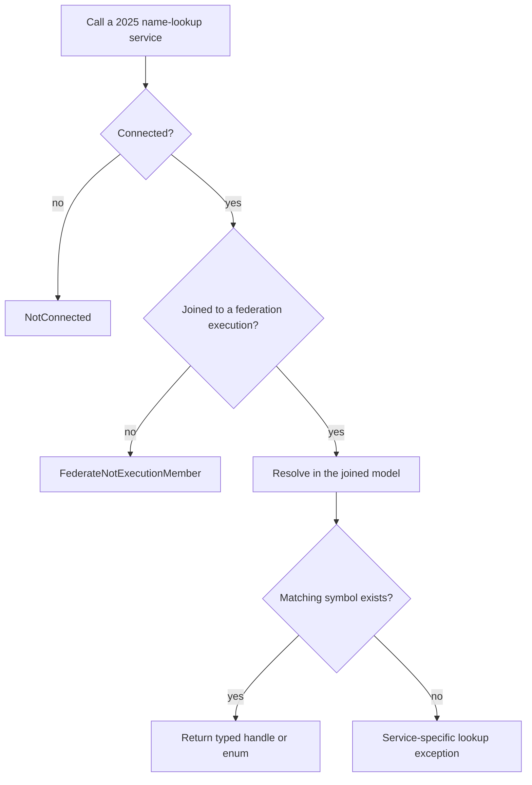
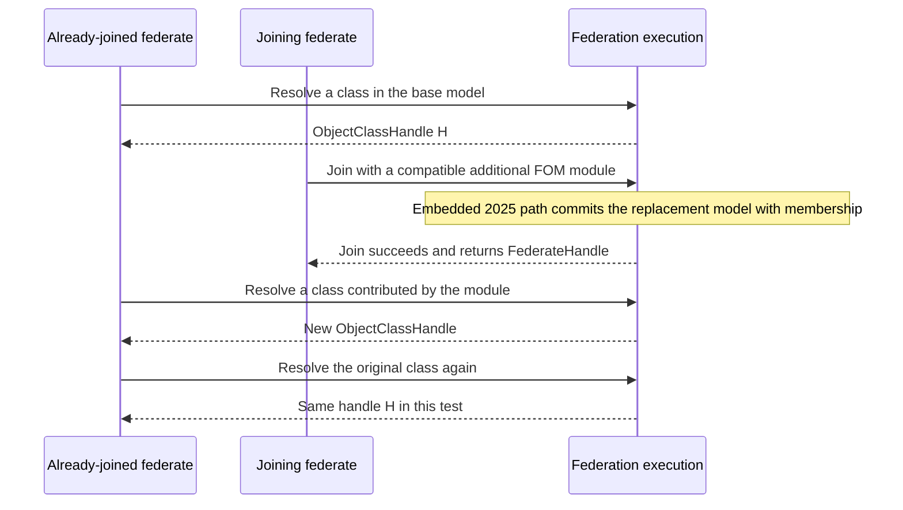
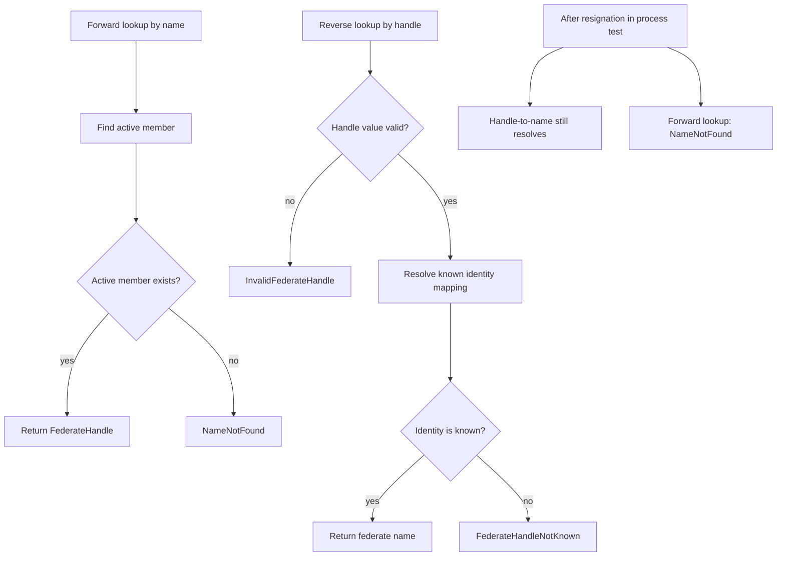
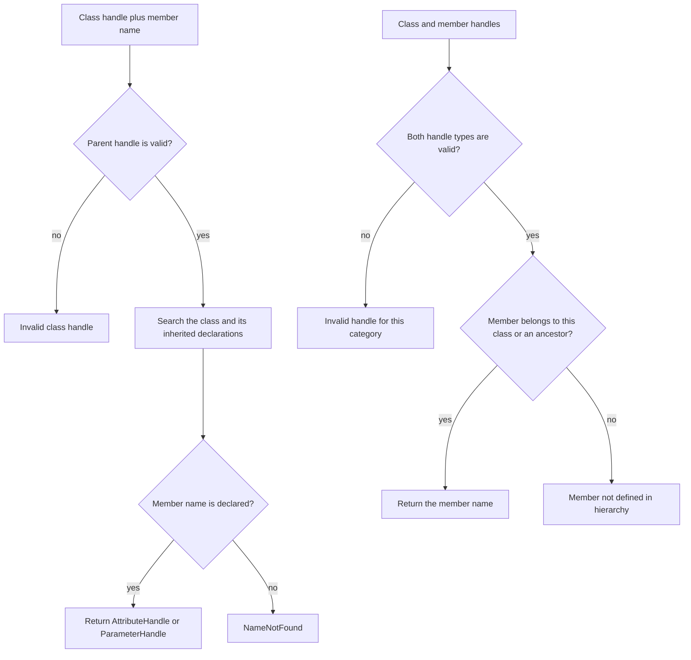
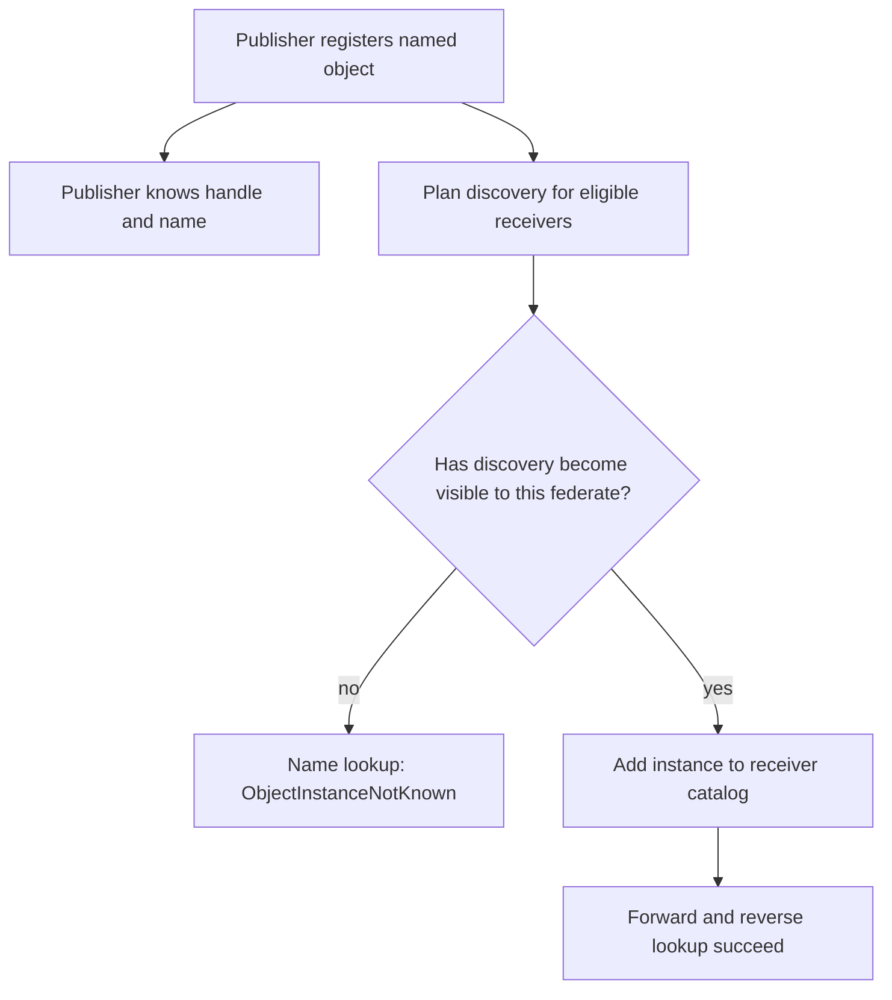
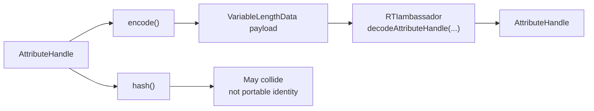
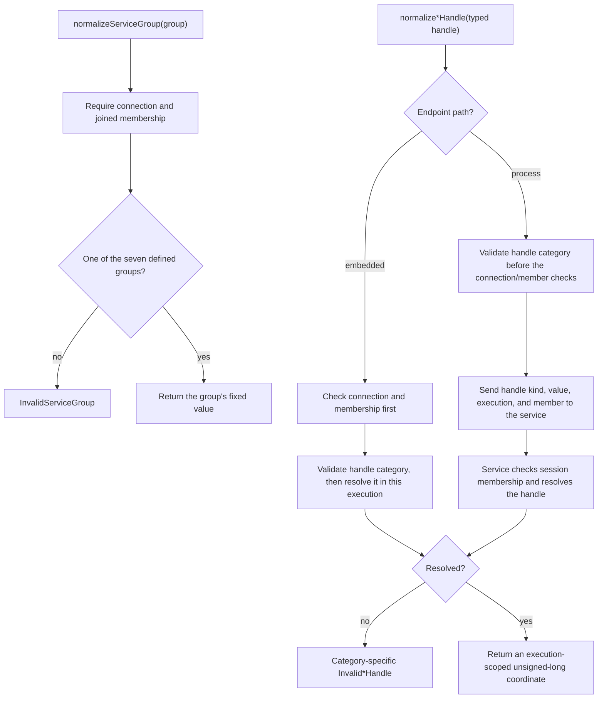

# HLA 1516.1-2025 Names and Handle Resolution

IEEE 1516.1-2025 resolves different names in different scopes: model symbols
in a joined execution's FOM, federate identities in the execution, and object
instances known to a particular federate. Its public handle categories are
distinct values, not interchangeable integers or universal name strings.
This guide explains those HLA identity and lifetime distinctions first, then
uses selected 2025 Umbra paths and tests as bounded examples. The 2010 API and
runtime remain separate, and no complete-conformance claim is made.

Keep the [2010 reference-RTI guide](HLA-2010-REFERENCE-RTI-FLOW-GUIDE.md)
separate. This document cites only the pinned IEEE 1516.1-2025 API and the
`rti1516_2025` implementation/tests; it makes no 2010 parity claim.

## The short mental model

There are three identity questions that can sound alike:

- “Is this declaration in the joined federation's composed FOM?” For example,
  resolving an object-class name or a dimension name.
- “Does this federate currently know this object instance?” An object-instance
  name is not just another declaration in the FOM; the per-federate known-object
  state matters.
- “Is this federate name active, or is this handle known?” The two federate
  lookup directions have distinct API exceptions and should not be assumed to
  have identical lifetime semantics.

The C++ API also makes symbol category part of the type: an
`ObjectClassHandle` is not an `InteractionClassHandle`, and an
`AttributeHandle` is not a `ParameterHandle`. Section 5 explains why handles,
hashes, encoded bytes, and normalized coordinates are different things.

## 1. Resolve a model symbol only in an execution context

The public name-lookup services are support services, but they are not
pre-join FOM inspection. Umbra first requires a live connection and membership
in a federation execution. It then asks the configured backend to resolve the
name against that execution's model catalog and returns the category-specific
handle.

In the embedded path, the ambassador checks its joined-member record and uses
the federation registry. With a configured process endpoint, it asks the
process client using the joined federation and federate identity instead of
consulting a potentially stale process-local catalog. Both paths are present
in source. The focused evidence below is split by backend: embedded tests cover
the broader hierarchy, dimension, and known-instance flows, while one
process-endpoint integration test covers object/interaction class
name-to-handle and handle-to-name lookups plus unknown reverse handles. This
does not establish parity for every lookup family.

### Tested example: additional-module Join and later model lookups

The pinned [2025 Join API](../../third_party/ieee1516.1-2025/include/RTI/RTIambassador.h#L212)
accepts additional FOM modules, and model-name lookup is scoped to the joined
execution. The sequence below is narrower: it records one embedded 2025 test
observation, not a universal rule for every RTI or the separate process
profile. It connects the model-composition boundary to the existing member's
later lookup view.

The [object-class test](../../cpp/tests/object_class_lookup_catch2.cpp#L99)
observes the pre-existing member resolving the new class after the other
federate's additional-module Join, while its previously resolved class handle
remains equal. A parallel [interaction-class test](../../cpp/tests/interaction_class_lookup_catch2.cpp#L103)
covers the same pattern. The tests compare typed-handle equality; they do not
establish cross-execution numeric identity or process-profile parity. The [FOM
composition guide](HLA-2025-FOM-MODULE-ADMISSION-AND-COMPOSITION-FLOW-GUIDE.md)
shows the embedded prepare/commit path and its failure boundary. No discovery
callback or instance visibility follows from this model-lookup observation.

## 2. Federate name and handle lookup have distinct lifetime paths

The 2025 API exposes `getFederateHandle(name)` and
`getFederateName(handle)` as separate support services. In Umbra, forward lookup
resolves an active member name; reverse lookup consults the federation's known
identity mapping. A focused configured-process-endpoint test observes that,
after a federate resigns, its handle still resolves to its name while its name
no longer resolves to an active handle. This is an implementation/test
observation for that process scenario, not a claim that every profile or
conforming RTI must retain the same post-resignation mapping.

The public API documents different exception sets for the two calls (10.2 and
10.3). The post-resignation branch above is deliberately marked as an observed
process-test result; do not generalize it to the embedded profile without
corresponding evidence.

## 3. Class-scoped names follow the declared hierarchy

An attribute name is looked up with an `ObjectClassHandle`; a parameter name is
looked up with an `InteractionClassHandle`. The parent handle is part of the
lookup key. A member inherited from an ancestor can be resolved through a child
class, and the same declared member handle is returned. Reverse lookup likewise
checks the supplied class/member pair; a valid member handle by itself is not
enough to establish that the member belongs to the requested class.

The official API lists the precise exception contract per operation. In
particular, `getAttributeName` and `getParameterName` distinguish an invalid
handle from a valid handle that is not defined for the supplied class. Do not
collapse these into a generic “lookup failed” rule.

This is a class-scoped **name-resolution** rule, not a promise that the
inherited member appears in every receiver callback. Discovery, attribute
projection, ordinary interaction promotion, and directed routing use class
ancestry differently in the selected 2025 paths; see the object-information
guide's [cross-path class ancestry map](HLA-2025-OBJECT-AND-INTERACTION-INFORMATION-FLOW-GUIDE.md#class-ancestry-has-different-jobs-in-different-paths).

## 4. Object-instance lookup is federate-local knowledge

An object class is a model declaration. An object instance is created at
runtime, and a receiver does not become able to resolve its name merely
because another federate registered it. The relevant boundary is that
federate's known-object state, which is updated along the discovery/callback
path.

Two similarly named support queries answer different questions:

| Query | Scope and key | Absence is reported as |
| --- | --- | --- |
| [`getObjectClassHandle(className)`](../../third_party/ieee1516.1-2025/include/RTI/RTIambassador.h#L1709) | Resolve a class declaration in the joined execution's FOM. | `NameNotFound` |
| [`getKnownObjectClassHandle(instance)`](../../third_party/ieee1516.1-2025/include/RTI/RTIambassador.h#L1729) | Return the class of an object instance in this federate's known-object view. | `ObjectInstanceNotKnown` |

The distinction is observable with evoked callbacks: in the focused embedded
registration/discovery test, a receiver cannot resolve the instance before its
discovery callback has been evoked; after discovery, it can resolve the name
and query the known class with `getKnownObjectClassHandle`. The test's
[registration/discovery assertions](../../cpp/tests/object_instance_registration_discovery_catch2.cpp#L181)
exercise this boundary. This guide does not restate the full publication,
subscription, relevance, or callback-order state machines; follow the
[object/interaction information guide](HLA-2025-OBJECT-AND-INTERACTION-INFORMATION-FLOW-GUIDE.md)
for those routing decisions. A reserved name is earlier state, not an instance
that receivers can resolve; the separate [name-reservation guide](HLA-2025-OBJECT-INSTANCE-NAME-RESERVATION-FLOW-GUIDE.md)
traces the owner's reservation through named registration and consumption,
then contrasts that owner path with a peer's later discovery-based knowledge
in its [two-view synthesis](HLA-2025-OBJECT-INSTANCE-NAME-RESERVATION-FLOW-GUIDE.md#owner-reservation-and-peer-visibility-advance-separately).

The 2025 [Federation MOM guide](HLA-2025-FEDERATION-MOM-FLOW-GUIDE.md) gives a
useful counterexample to conflating identities: its membership list carries
`FederateHandle` references to `HLAfederate` objects, while a receiver's
object-instance knowledge still follows the discovery path. The focused list
test decodes federate identities but does not test object-instance lookup from
those references.

## 5. Typed handle encoding is not numeric identity

The official [2025 `Handle.h`](../../third_party/ieee1516.1-2025/include/RTI/Handle.h#L27)
defines a separate public class for each handle kind. Treat these as opaque,
category-typed values, not arithmetic integers: the API supports comparison,
hashing, and encoding, but exposes no portable numeric identity or arithmetic
operation on a handle. A hash is only a container aid and may collide. Umbra's
internal conversion helpers preserve the category at the boundary while using
a private numeric value in the embedded registry. That representation is an
implementation detail, not a cross-execution identity contract.

Match the decoder to the handle category. The encoding on the public handle is
separate from DataElement serialization, FOM XML materialization, and RTI
transport framing; none of those boundaries should be inferred from the
handle's private numeric representation.

### Normalization support services produce coordinates, not handles

The 2025 API lists `normalizeServiceGroup` and four typed-handle normalization
services in RTI Support (10.29–10.33). They return `unsigned long`; that result
is not another handle and is not the handle's private sequential value. The
Umbra registry describes normalized handle values as execution-scoped
coordinates for standard MIM dimensions, stable for the same designator
throughout an execution, including restore. Its source reserves the maximum
coordinate so a point range `[value, value + 1)` cannot overflow. This is
current Umbra behavior, not a claim that the private mixing algorithm is
standardized.

The service-group result is its fixed enumerator value; it does not use the
execution-specific handle mapping. For handles, the embedded registry accepts
an active federate, a class present in the joined FOM catalog, or an object
instance in the execution's object/MOM-instance directories. In both endpoint
paths the process service ultimately asks that federation registry to resolve
the typed handle. A malformed process-side typed handle is rejected before
the local connection/member gate, while the embedded path checks that gate
first. Treat that error-precedence distinction as source-observed behavior;
the focused cases do not establish all combined-invalid-argument precedence.
Process transport/protocol failures become `RTIinternalError` rather than a
normalized coordinate.

Do not use the returned coordinate as a persistent identity across different
executions, or substitute it for public `encode()`/`decode...Handle()` data.
The embedded focused case observes repeatability and equality across two
joined ambassadors for the same execution-scoped designator; it does not test
cross-execution equality or prove a portable coordinate algorithm.

## Lookup categories and failure distinctions

| Symbol | Forward lookup | Reverse lookup | Important distinction |
| --- | --- | --- | --- |
| Object class | Name → `ObjectClassHandle` | Handle → name | Missing name is `NameNotFound`; an invalid/unknown handle is `InvalidObjectClassHandle`. |
| Attribute | Class + name → `AttributeHandle` | Class + handle → name | Inherited members resolve through child classes; a valid attribute outside the supplied class hierarchy is `AttributeNotDefined`. |
| Interaction class | Name → `InteractionClassHandle` | Handle → name | Separate type from object-class handles; lookup is in the joined execution's interaction catalog. |
| Parameter | Interaction class + name → `ParameterHandle` | Interaction class + handle → name | Inherited parameters resolve through child interaction classes; a valid unrelated handle is `InteractionParameterNotDefined`. |
| Dimension | Name → `DimensionHandle` | Handle → name / upper bound | Availability for a particular object or interaction class is a separate query; see the [FOM-to-region bridge](HLA-2025-DATA-DISTRIBUTION-AND-REGIONS-FLOW-GUIDE.md#from-fom-dimensions-to-runtime-region-scope). |
| Federate | Active name → `FederateHandle` | Known handle → name | The API documents distinct lookup exceptions; the cited process test observes reverse lookup surviving resignation while active-name lookup does not. |
| Transportation | Name → `TransportationTypeHandle` | Handle → name | Invalid names use `InvalidTransportationName`, not the generic `NameNotFound`. See the [order and transportation guide](HLA-2025-ORDER-AND-TRANSPORTATION-FLOW-GUIDE.md). |
| Order | Name → `OrderType` enum | Enum → name | This is an enum lookup, not a handle lookup; invalid values use order-specific exceptions. |
| Object instance | [`getObjectInstanceHandle(name)`](../../third_party/ieee1516.1-2025/include/RTI/RTIambassador.h#L1739): known name → `ObjectInstanceHandle` | [`getObjectInstanceName(handle)`](../../third_party/ieee1516.1-2025/include/RTI/RTIambassador.h#L1749): known handle → name | Both directions are scoped to the federate's known instances; unknown-to-this-federate uses `ObjectInstanceNotKnown`. |

## What Umbra currently demonstrates

- Embedded FOM lookup returns stable object-class and interaction-class
  handles after a compatible additional FOM is joined; the tests also show the
  new declarations becoming resolvable. This evidence is for the embedded
  development profile, not a promise about numeric values across different
  federation executions.
- Embedded attribute and parameter lookup resolves inherited declarations
  through child classes and round-trips the same member name/handle pair.
- Dimension lookup resolves declared names, returns upper bounds, and exposes
  dimensions available to each class in its hierarchy. DDM behavior itself is
  covered by the separate regions guide.
- The registration/discovery test observes object-instance name lookup fail
  before discovery is delivered to a receiver and succeed after discovery.
- The configured process-endpoint identity test observes active-name lookup
  fail after resignation while reverse lookup by the former member's handle
  still returns its name. This is scoped to that tested process path.
- The API handle tests exercise value copying, hashing consistency, encoded
  round trips, malformed encodings, and undersized output buffers. The official
  header—not those tests—defines that hashes may collide.
- The embedded normalization case checks the seven-value service-group result,
  in-domain point coordinates, repeatability, and same-execution agreement
  across joined ambassadors. A configured-process case exercises typed
  normalization through the process service. These are 2025 implementation
  observations and do not establish cross-execution coordinate equality.

## Evidence and source map

Normative/API references:

- The pinned [IEEE 1516.1-2025 RTIambassador API](../../third_party/ieee1516.1-2025/include/RTI/RTIambassador.h#L1688)
  documents federate lookup in 10.2–10.3 and labels class, instance,
  attribute, interaction, order, transportation, and dimension lookup in its
  Section 10 support-service operations; handle decode
  operations are listed at [the decode services](../../third_party/ieee1516.1-2025/include/RTI/RTIambassador.h#L2313).
- The pinned [IEEE 1516.1-2025 handle definitions](../../third_party/ieee1516.1-2025/include/RTI/Handle.h#L14)
  document distinct handle classes, encoding, and the non-unique hash rule.
- The pinned [IEEE 1516.1-2025 normalization API declarations](../../third_party/ieee1516.1-2025/include/RTI/RTIambassador.h#L1984)
  list the five RTI Support operations at 10.29–10.33 and their declared
  exception categories; this header is not a substitute for the full standard
  clause text.

Umbra implementation paths:

- [Object-class name/handle lookup](../../cpp/src/internal/runtime/umbra_rti_ambassador_object_class_lookup.cpp#L17)
- [Attribute name/handle lookup](../../cpp/src/internal/runtime/umbra_rti_ambassador_attribute_lookup.cpp#L19)
- [Interaction-class and parameter lookup](../../cpp/src/internal/runtime/umbra_rti_ambassador_interaction_class_lookup.cpp#L16)
- [Known object-instance lookup](../../cpp/src/internal/runtime/umbra_rti_ambassador_object_instance_lookup.cpp#L16)
- [Federate name/handle identity lookup](../../cpp/src/internal/runtime/umbra_rti_ambassador_federate_identity_lookup.cpp#L16)
- [2025 `normalizeServiceGroup` path](../../cpp/src/internal/runtime/umbra_rti_ambassador_handle_normalization.cpp#L22)
- [2025 typed-handle normalization paths and endpoint-specific ordering](../../cpp/src/internal/runtime/umbra_rti_ambassador_handle_normalization.cpp#L115)
- [Execution-scoped coordinate stability across restore](../../cpp/src/internal/federation/federation_registry.hpp#L780)
- [Execution-scoped normalized-value mapping and point-range bound](../../cpp/src/internal/federation/federation_registry_membership_lifecycle.cpp#L614)
- [Process service handle-normalization registry dispatch](../../cpp/src/internal/federation/process_federation_service_request_handlers.cpp#L86)
- [Dimension name lookup](../../cpp/src/internal/runtime/umbra_rti_ambassador_dimension_region_services.cpp#L238)
- [Typed internal ObjectClassHandle boundary](../../cpp/src/internal/handles/object_class_handle.hpp#L9)
- [Typed internal AttributeHandle boundary](../../cpp/src/internal/handles/attribute_handle.hpp#L9)

Focused test sources (these links identify test evidence; this documentation
change does not claim to have run the tests):

- [Object-class lookup and compatible FOM extension](../../cpp/tests/object_class_lookup_catch2.cpp#L51)
- [Inherited attribute lookup and reverse-pair errors](../../cpp/tests/attribute_lookup_catch2.cpp#L51)
- [Interaction-class lookup and compatible FOM extension](../../cpp/tests/interaction_class_lookup_catch2.cpp#L51)
- [Inherited parameter lookup and reverse-pair errors](../../cpp/tests/parameter_lookup_catch2.cpp#L51)
- [Dimension lookup, hierarchy availability, and bounds](../../cpp/tests/dimension_lookup_catch2.cpp#L53)
- [Per-federate object-instance discovery and name lookup](../../cpp/tests/object_instance_registration_discovery_catch2.cpp#L78)
- [Configured process-endpoint object-instance lookup round trips and unknown-name/handle exceptions](../../cpp/tests/ieee1516_2025_connection_object_instance_lookup_catch2.cpp#L458)
- [Configured process-endpoint federate identity lookup and post-resignation observation](../../cpp/tests/ieee1516_2025_connection_federate_identity_lookup_catch2.cpp#L459)
- [Configured process-endpoint object/interaction class name-handle round trips](../../cpp/tests/ieee1516_2025_connection_reverse_fom_lookup_catch2.cpp#L459)
- [Transportation lookup](../../cpp/tests/transportation_type_lookup_catch2.cpp#L50) and [order enum lookup](../../cpp/tests/order_type_lookup_catch2.cpp#L49)
- [Public handle encoding round-trip and malformed-data tests](../../cpp/tests/object_class_handle_catch2.cpp#L43)
- [Embedded 2025 normalized DDM-coordinate behavior](../../cpp/tests/handle_normalization_catch2.cpp#L60)
- [Configured-process 2025 handle-normalization path](../../cpp/tests/ieee1516_2025_connection_handle_normalization_catch2.cpp#L459)
- [Normalization service-report return arguments](../../cpp/tests/ieee1516_2025_support_handle_normalization_service_report_return_arguments_catch2.cpp#L5)

## Known gaps and boundaries

- The embedded tests cover the broader hierarchy, dimension, and known-instance
  cases. The configured process-endpoint object-instance lookup test checks an
  owner's forward/reverse round trip and the unknown-name/unknown-handle
  exceptions under both callback models; it does not test peer knowledge before
  or after discovery. Thus it does not establish full process/embedded parity
  for federate-local object-instance visibility, nor parity for attributes,
  parameters, dimensions, or transportation. The post-resignation identity
  asymmetry is one focused process-test observation, not a general profile
  guarantee.
- This guide does not claim that a numeric handle or its hash is meaningful
  across executions, process restarts, or implementations. Use the public
  typed handle APIs and matching encode/decode operations.
- It does not model all publication, subscription, DDM, name-reservation,
  object-removal, or save/restore transitions; follow the linked topic guides.
- No 2010 behavior is inferred. Keep the reference-RTI profile in its separate
  guide and compare editions only with separate evidence.

All seven Mermaid diagrams were rendered and visually reviewed in the local
VS Code Markdown Preview on 2026-10-11. The parallel class-lookup and
normalization views remain readable at preview width, and the taller lookup
flows remain readable while scrolling. This is local-render evidence only;
GitHub rendering remains pending after publication. Track that remaining check
in the [behavior-flow guide backlog](HLA-BEHAVIOR-FLOW-GUIDES.md).
