# IEEE 1516.1-2025 Object and Interaction Information Flow

IEEE 1516.1-2025 distinguishes updates to attributes of registered object
instances from interaction messages sent with class parameters. Understanding
either path requires separate questions about producer authority, recipient
interest and eligibility, and application observation; object delivery also
depends on the receiver's instance knowledge. Publication, ownership, DDM,
time, and callback rules apply at different boundaries, not as one universal
gate. This guide explains that HLA model first and uses selected Umbra 2025
paths and tests as bounded examples—not as the definition of HLA behavior or a
claim of complete support or conformance.

## Scope and authority

- **Edition boundary:** IEEE 1516.1-2025 only. The 2010 API/runtime and its
  tests are a separate compatibility stream; this guide neither describes nor
  compares them.
- **Implementation boundary:** the current embedded federation-management
  development profile and selected 2025 process-endpoint integration cases.
  These are evidence for specific paths, not every transport or deployment.
- **Normative authority:** the [official IEEE 1516.1-2025 Federate Interface
  Specification](https://standards.ieee.org/ieee/1516.1/6688/). Check exact
  service and callback clauses there before turning this guide into a
  requirement or a conformance claim. The guide intentionally avoids inventing
  clause mappings.
- **Evidence rule:** source links describe current implementation decisions;
  test links show only the scenario each test exercises. Internal tests are
  implementation evidence, not public conformance evidence.

For the state machines that constrain delivery, see the [2025 time-management
guide](HLA-2025-TIME-MANAGEMENT-GUIDE.md), [DDM and regions
guide](HLA-2025-DATA-DISTRIBUTION-AND-REGIONS-FLOW-GUIDE.md), and [attribute
ownership guide](HLA-2025-ATTRIBUTE-OWNERSHIP-FLOW-GUIDE.md). This guide marks
their boundaries instead of folding their rules into one oversized diagram.

## Start with five distinct questions

“Can this value get to that federate?” is not one yes/no state. Work through
these independently, and apply only the questions relevant to the service:

1. **Is the producer's required declaration present?** Publication is the
   sender-side declaration for the relevant object attribute or interaction
   class. A directed send instead uses its object-class/interaction-class
   declaration pair; it is not ordinary interaction publication.
2. **If this is an object-attribute update, does the sender own each instance
   attribute?** Publication and per-instance ownership are distinct. This
   ownership question does not apply to an interaction send.
3. **Which receivers qualify under this service's rules?** Ordinary
   subscriptions and class matching, directed target selectors, and DDM are
   distinct service-specific ways to determine candidate receivers; they are
   not one interchangeable subscription test.
4. **Which participants must know an object instance?** Object services track
   instance knowledge per federate: producer knowledge is not receiver
   discovery. A directed send requires the sender and an eligible receiver to
   know its target. An ordinary interaction has no object-instance knowledge.
5. **When can the application observe the event?** A planned or accepted
   service, queued RTI work, callback dispatch, and callback-visible application
   state are distinct boundaries. Callback model and time management affect
   when the final observation can occur.

Message order, transportation, and timestamp eligibility are additional
service properties, not substitutes for these questions. The cross-cutting
[delivery and observation checklist](HLA-2025-CROSS-CUTTING-STATE-EVENT-OBSERVATION-GUIDE.md#keep-delivery-and-observation-questions-separate)
and the topic guides below trace those boundaries without imposing one fixed
delivery sequence.

For a cross-service checklist that separates state changes, pending effects,
caller outcomes, reports, and application observation, see the
[cross-cutting state/event/observation guide](HLA-2025-CROSS-CUTTING-STATE-EVENT-OBSERVATION-GUIDE.md).
For the callback-model gates that control when application code runs, see the
[callback and service-ordering guide](HLA-2025-CALLBACK-AND-SERVICE-ORDERING-FLOW-GUIDE.md).
Those companions keep their own service and implementation-profile limits;
this overview does not treat any single delivery path as universal.

## Encoded values enter services as handle-keyed octets

For an application using the standard 2025 `DataElement` API, the FOM member's
declared data type guides the application's choice of a compatible element
format; the type name itself is not carried in the service map.
`DataElement::encode()` produces `VariableLengthData`, as declared by the
[pinned 2025 `DataElement` interface](../../third_party/ieee1516.1-2025/include/RTI/encoding/DataElement.h#L33).
The RTI service API then carries those values in a map keyed by typed attribute
or parameter handles. The outer identity differs too: object update names an
`ObjectInstanceHandle`, while ordinary `sendInteraction` names an
`InteractionClassHandle` and has no object target. This connects the
value-format layer to the service layer without turning either the FOM data
type or the encoded bytes into a routing identity.

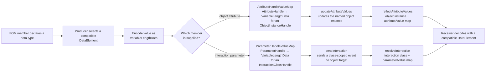

The public [value-map typedefs](../../third_party/ieee1516.1-2025/include/RTI/Typedefs.h#L35)
pair each typed handle with `VariableLengthData`. The [object update
signature](../../third_party/ieee1516.1-2025/include/RTI/RTIambassador.h#L727)
and [interaction send signature](../../third_party/ieee1516.1-2025/include/RTI/RTIambassador.h#L761),
along with the [reflection callback](../../third_party/ieee1516.1-2025/include/RTI/FederateAmbassador.h#L238)
and [interaction callback](../../third_party/ieee1516.1-2025/include/RTI/FederateAmbassador.h#L264),
carry the corresponding maps. A key identifies the typed API member; it is
separate from the value's `DataElement` encoding and from the handle's own
resolution/identity path (see the [typed-handle guide](HLA-2025-NAME-AND-HANDLE-RESOLUTION-FLOW-GUIDE.md#5-typed-handle-encoding-is-not-numeric-identity)).
The contrasting outer identities are part of these service and callback
signatures; the ordinary interaction path has no object-instance discovery or
attribute-ownership gate. Directed interaction is deliberately separate: it
adds a target object while retaining an interaction callback and its own
selector rules (see the [directed-interaction guide](HLA-2025-DIRECTED-INTERACTION-FLOW-GUIDE.md)).
The map is a C++ API container, not a prescribed single serialized payload,
and `userSuppliedTag` is a separate argument, not a value-map entry. This flow
stops at the public API/callback boundary: it does not specify private Umbra
process framing. Element-specific byte order and composite rules, and the
separate process-frame boundary, stay in the [DataElement guide](HLA-2025-DATA-ELEMENT-ENCODING-FLOW-GUIDE.md#pick-the-representation-boundary-before-reasoning-about-bytes);
publication, ownership, recipient eligibility, and observation stay in the
service flows below and their linked guides.

The evidence is layered, not one end-to-end proof: the [basic-element unit
case](../../cpp/tests/ieee1516_2025_basic_data_elements_catch2.cpp#L86) checks
encoded bytes and decode behavior; the [embedded interaction callback
case](../../cpp/tests/receive_order_interaction_catch2.cpp#L97) observes its
parameter handle/value map and separate tag in `receiveInteraction`; and the
[configured-process attribute-reflection case](../../cpp/tests/ieee1516_2025_connection_update_attribute_values_reflect_catch2.cpp#L457)
checks attribute-map bytes and tag at the callback. The [process Send
Interaction case](../../cpp/tests/ieee1516_2025_connection_send_interaction_catch2.cpp#L457)
instead checks the pulled event's parameter envelope, not a public callback.
These different scenario/profile layers do not prove every data type or
end-to-end embedded/process parity.

### Callback payload references: decode now or copy to retain

The 2025 [`reflectAttributeValues`](../../third_party/ieee1516.1-2025/include/RTI/FederateAmbassador.h#L238)
and [`receiveInteraction`](../../third_party/ieee1516.1-2025/include/RTI/FederateAmbassador.h#L264)
callbacks receive their handle/value maps and user tag through `const&`
parameters. The pinned [`VariableLengthData` copy constructor](../../third_party/ieee1516.1-2025/include/RTI/VariableLengthData.h#L38)
allows an application-owned value, while its [`data()` lifetime note](../../third_party/ieee1516.1-2025/include/RTI/VariableLengthData.h#L50)
warns that a pointer must not be expected to remain valid past the value
object's lifetime or its next data replacement. A safe federate-side rule is
therefore to decode through
the callback arguments while the callback is active, or copy the needed map,
tag, or octets into application-owned storage before returning. Do not retain
a pointer, reference, `span`, or `string_view` into callback-owned data for
later use. This is a C++ lifetime rule derived from the 2025 API surface, not
a claim about Umbra's private wire format or the 2010 callback implementation.

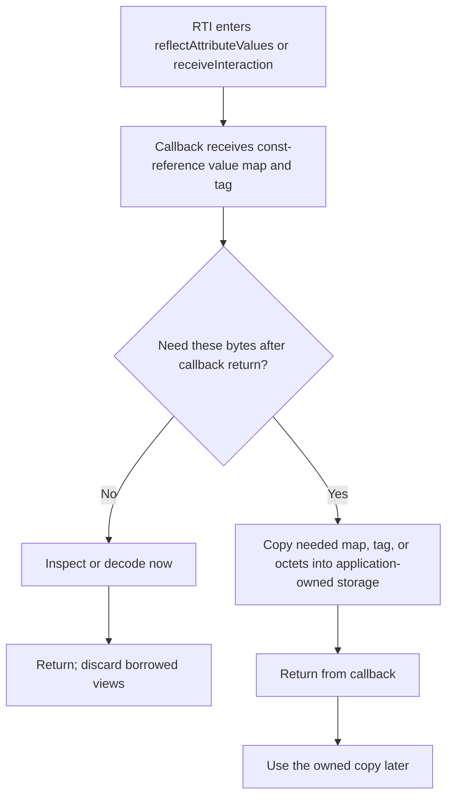

The API's copyable `VariableLengthData` value is one option; copying only the
required bytes is another. A view such as `std::span` is useful for immediate
decoding, but it does not extend the lifetime of the underlying bytes. The
[DataElement guide](HLA-2025-DATA-ELEMENT-ENCODING-FLOW-GUIDE.md) covers how to
decode those octets; this section covers when the receiver must own them.

The focused embedded [receive-order interaction case](../../cpp/tests/receive_order_interaction_catch2.cpp#L53)
copies the parameter map and tag inside `receiveInteraction`, then checks the
saved values after callback draining ([assertions](../../cpp/tests/receive_order_interaction_catch2.cpp#L232)).
That demonstrates a safe test pattern, not a test of every RTI's callback
storage lifetime or a claim about process-profile implementation behavior.

An interaction is not an object update: it has no object-instance knowledge
or attribute ownership transition. Both may share subscription, region, and
time-management machinery, but keep their lifecycle diagrams separate.

For the RTI-initiated notifications those declaration changes can produce, see
the focused [2025 relevance-advisory guide](HLA-2025-RELEVANCE-ADVISORY-FLOW-GUIDE.md).
Directed interactions use a different recipient rule because a send names a
target object instance and receivers can subscribe universally or by owning a
target attribute; see the focused [2025 directed-interaction
guide](HLA-2025-DIRECTED-INTERACTION-FLOW-GUIDE.md).

### Same payload family, different routing question

Use this orientation map to choose the right detailed flow. It summarizes the
current 2025 API and reviewed implementation paths; the two guides below keep
their separate state machines and evidence boundaries.

| Routing question | Ordinary `sendInteraction` | Directed `sendDirectedInteraction` |
| --- | --- | --- |
| What does the send identify? | Interaction class, parameters, and tag; no object instance. | Interaction class plus target object, parameters, and tag; target is context, not recipient list. |
| What does the producer publish? | The interaction class. | An object-class / interaction-class pair for the target class; producer must know the target. |
| How does a receiver qualify? | Active non-sender subscription establishes relevance; receiver needs its own active/passive class match, plus overlap for regional forms. | Receiver must know target and match a directed pair; selector is universal or by-ownership. No ordinary global relevance pass. |
| What context reaches the callback? | `receiveInteraction` with visible parameters, but no target handle. | `receiveDirectedInteraction` includes target handle; still an interaction callback, not an attribute reflection. |
| Which interaction class and parameters reach the callback? | The reviewed ordinary receive-order resolver can promote to the closest eligible subscribed class and project parameters through that class; see the [class-ancestry map](#class-ancestry-has-different-jobs-in-different-paths). | The current directed receive-order candidate retains the sent interaction class. Target-object ancestry selects declaration and receiver policy, not a promoted callback class; parameters are validated against the sent class's namespace. See the directed guide's [parameter test](HLA-2025-DIRECTED-INTERACTION-FLOW-GUIDE.md#what-the-surveyed-tests-demonstrate) and [source map](HLA-2025-DIRECTED-INTERACTION-FLOW-GUIDE.md#source-map-and-known-limits). |

In particular, ordinary `active` and directed `universally` are not synonyms:
the first participates in class-level relevance, while the second selects a
directed receiver predicate for a known target. The target's owner need not be
the directed sender, and the sender is not a receiving candidate. See the
ordinary [interaction relevance/projection flow](#interaction-relevance-class-promotion-and-parameter-projection)
and [directed declaration/selector flow](HLA-2025-DIRECTED-INTERACTION-FLOW-GUIDE.md#the-declaration-matrix-and-receiver-selector)
for the full transitions, focused test evidence, and implementation limits.
Both remain interaction services: target object context does not make a
directed send an attribute update or transfer ownership. Callback-model and
timestamped-delivery gates are separate concerns covered by the callback and
time-management guides.

### Class ancestry has different jobs in different paths

The composed FOM carries separate object-class and interaction-class parent
chains. The [FOM composition guide](HLA-2025-FOM-MODULE-ADMISSION-AND-COMPOSITION-FLOW-GUIDE.md#composition-merge-first-resolve-the-completed-model-second)
covers module merging. This map compares selected current 2025 lookup paths:
most are traced through the embedded runtime, while the directed branch is
also traced through the process endpoint to its shared registry planner.
Delivery fences remain profile-specific. These are source-observed behaviors,
not a complete normative inheritance rule; check the licensed IEEE text for
exact requirements.

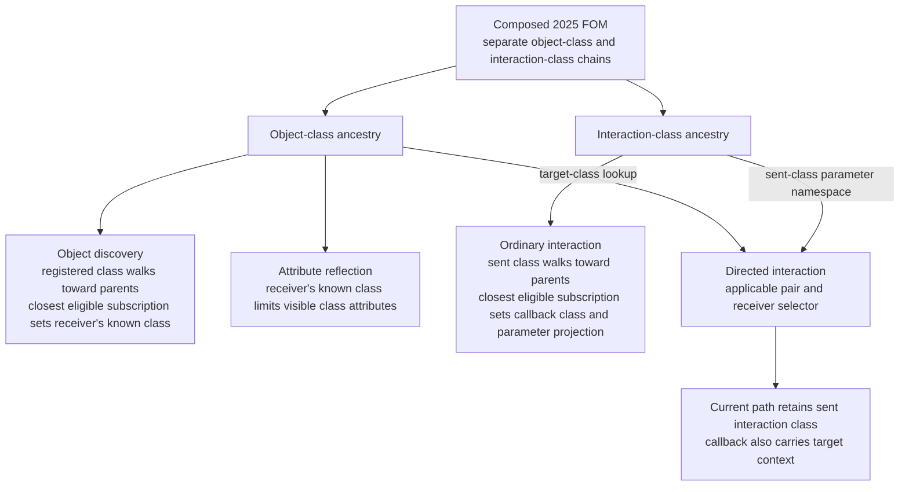

This is not one reusable “nearest ancestor” rule. Discovery changes which
object class the receiver knows; attribute reflection uses that per-receiver
class to filter values. Ordinary interaction matching can promote the received
interaction class and then project parameters for it. Directed routing uses
the target object's class ancestry for declaration and selector lookup; the
sent interaction class still supplies the parameter namespace, but the current
candidate path keeps that sent class in its callback rather than promoting it.

Evidence and limits for these branches:

- The composer records parent names separately for object and interaction
  classes ([object classes](../../cpp/src/internal/fom/libxml2_fom_composer.cpp#L1848),
  [interaction classes](../../cpp/src/internal/fom/libxml2_fom_composer.cpp#L1914)).
- Object discovery's closest-class selection is in the [registry resolver](../../cpp/src/internal/federation/federation_registry.cpp#L830);
  the [focused discovery case](../../cpp/tests/subscribe_object_class_attributes_discovery_catch2.cpp#L297)
  registers a child-class object while subscribing at the base class, then
  observes the base class as known and only its base attribute in the initial
  reflection (test assertions at lines 391–395). This is focused embedded
  behavior, not a normative inheritance statement. Attribute filtering through
  each receiver's known class is in the [update recipient planner](../../cpp/src/internal/federation/federation_registry_attribute_update_recipients.cpp#L49)
  and the [embedded projection scenario](../../cpp/tests/ieee1516_2025_receive_order_attribute_update_passel_lifecycle_catch2.cpp#L5).
- Regional object DDM adds a separate source-level ancestry path: available
  dimensions include parent associations, regional subscriptions remain keyed
  by exact class and attribute, and discovery walks from the registered class
  toward parents before later reflection uses the receiver's known class. The
  [DDM guide's object ancestry map](HLA-2025-DATA-DISTRIBUTION-AND-REGIONS-FLOW-GUIDE.md#object-class-ancestry-regional-discovery-and-value-projection)
  marks the parent/child regional consequence as source-only because reviewed
  regional tests register and subscribe at the same class; this is not a
  normative or 2010 inheritance claim.
- Ordinary interaction promotion and parameter visibility are in the [recipient resolver](../../cpp/src/internal/federation/federation_registry.cpp#L1421)
  and the [registry planning case](../../cpp/tests/federation_registry_composed_fom_catch2.cpp#L1209).
  The internal case checks exact-class delivery plus promotion to two ancestors;
  parameters declared only on the sent child class are absent from both
  promoted projections (assertions at lines 1353–1376). This is registry-unit
  evidence, not public conformance evidence.
- The separate interaction-class × regional-DDM path distinguishes parent-chain
  dimension availability from exact-class declaration storage and the later
  sent-class-to-parent recipient walk; the [DDM guide's interaction ancestry
  map](HLA-2025-DATA-DISTRIBUTION-AND-REGIONS-FLOW-GUIDE.md#interaction-class-ancestry-available-context-and-declaration-lookup)
  labels this as embedded-source behavior because the reviewed tests do not
  combine parent and child classes across those regional services.
- Directed target validity and pair/selector ancestry are visible in the [shared registry directed resolver](../../cpp/src/internal/federation/federation_registry_directed_interactions.cpp#L15),
  its [pair lookup](../../cpp/src/internal/federation/federation_registry_directed_interactions.cpp#L48),
  and [selector lookup](../../cpp/src/internal/federation/federation_registry_directed_interactions.cpp#L97);
  the same candidate keeps the sent interaction class at [callback projection](../../cpp/src/internal/federation/federation_registry_directed_interactions.cpp#L245).
  The [embedded known-target case](../../cpp/tests/directed_interaction_known_target_catch2.cpp#L121)
  declares and subscribes at the target's exact class and confirms the callback
  retains the sent interaction class; it does not exercise ancestor-class
  declarations or selectors.
  The [2025 process send handler](../../cpp/src/internal/federation/process_federation_service_interaction_send.cpp#L657)
  calls that same registry planner, so these source-level target-class ancestry
  lookups also underlie the surveyed process route. The [process multi-recipient
  case](../../cpp/tests/ieee1516_2025_connection_directed_interaction_multi_recipient_catch2.cpp#L457)
  uses exact-class declarations; it does not test ancestor lookup. Process
  event delivery and its distinct callback boundary are detailed in the
  [directed-interaction guide](HLA-2025-DIRECTED-INTERACTION-FLOW-GUIDE.md#2025-receive-order-delivery-has-a-profile-boundary).
  The [known-target integration case](../../cpp/tests/directed_interaction_known_target_catch2.cpp#L121)
  exercises target-aware routing, but a bounded search found no focused case
  where a declaration on an ancestor object class is applied to a child target.
  Treat that particular inheritance consequence as source-only; no 2010
  equivalence or normative inheritance interpretation is asserted.

Dimension availability is a separate inheritance question from declaration
lookup. The DDM guide's [child-class regional case](HLA-2025-DATA-DISTRIBUTION-AND-REGIONS-FLOW-GUIDE.md#inherited-dimensions-in-a-child-class-regional-path)
shows one embedded object path where dimensions associated along the class
parent chain are used by a regional registration and subscription on the
child class; it does not claim the subscription declaration itself is
inherited.

## Object path: declarations, registration, and discovery

The object publisher declares which class attributes it may publish. A
different federate subscribes to attributes of an object class. Registration
creates an instance and initializes the producer's own knowledge; the RTI then
plans discovery for other eligible federates. A later callback-visible
discoverObjectInstance is the receiver's introduction to that instance.

The lifetime of an already-queued discovery callback when its recipient
resigns is a separate callback-dispatch question. See the source-bounded
[2025 process discovery boundary](HLA-2025-CALLBACK-AND-SERVICE-ORDERING-FLOW-GUIDE.md#object-instance-discovery-event-specific-staleness-boundary);
it does not change the object-knowledge model here or establish a portable
post-Resign callback rule.

When registration supplies an explicit name, see the focused [2025
object-instance name reservation guide](HLA-2025-OBJECT-INSTANCE-NAME-RESERVATION-FLOW-GUIDE.md)
for the prior reservation callback, ownership, and consumption-at-commit
transitions. The overview below intentionally leaves those details out.

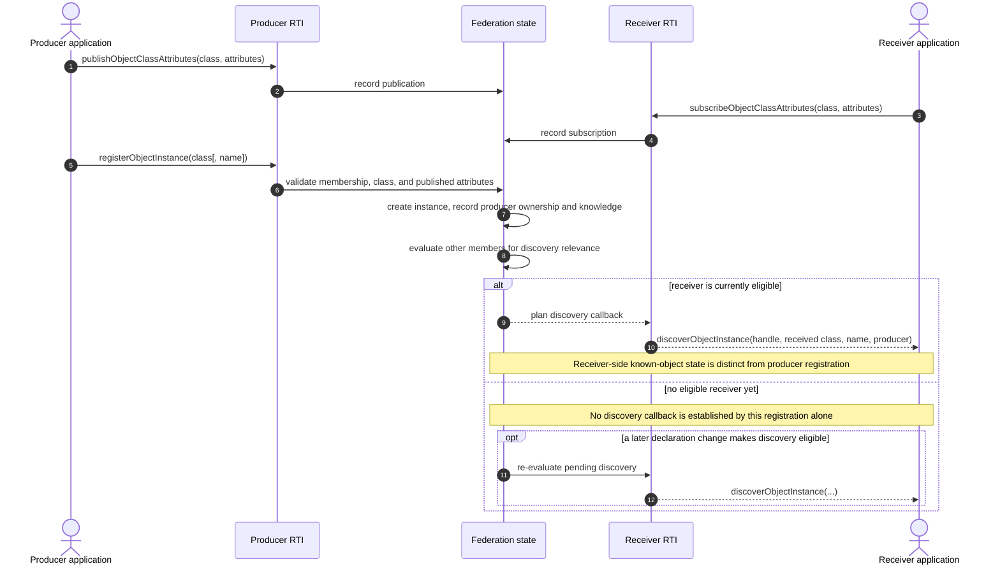

### Reading the object diagram correctly

- Publication is not a broadcast and does not itself create an instance.
- Subscription is not discovery. Discovery concerns a registered instance
  and is tracked per receiver.
- A registered object is initially known to its producer. The current
  discovery resolver excludes the producer from an induced discovery callback
  and derives the receiver's exposed class from the registered class and
  matching declarations.
- In the current implementation, discovery planning checks active
  registration relevance separately from the receiving federate's own
  subscription match. A passive subscription does not establish relevance by
  itself, although it can receive discovery made relevant by another active
  declaration. Treat this as a source-backed implementation nuance, not a
  substitute for checking the standard's exact rule.
- Current source records pending discovery separately from known-object state.
  The discovery transition rechecks eligibility and records the receiver's
  known class as callback dispatch begins. Do not collapse “planned” and
  “already known” into the same state.
- The internal commit point is profile-specific in the selected 2025 source:
  embedded discovery begins the known-object transition when the callback task
  runs, before calling `discoverObjectInstance`; the process service begins the
  registry transition before exposing its event to the transport, with the
  client callback bridge later. See the [subscription-state guide](HLA-2025-OBJECT-ATTRIBUTE-SUBSCRIPTION-STATE-FLOW-GUIDE.md)
  and [process callback guide](HLA-2025-PROCESS-ENDPOINT-REQUEST-AND-CALLBACK-FLOW-GUIDE.md).
  The focused public process case asserts eventual discovery under both
  callback models, not use of receiver-known state before callback delivery.
  This source comparison is neither a portable HLA ordering rule nor a parity
  claim.
- For the embedded 2025 callback boundary, the RTI commits receiver-known
  state and releases the federation-state lock before entering
  `discoverObjectInstance`; the source explicitly says matching support
  services are safe to call reentrantly from that callback
  ([discovery transition](../../cpp/src/internal/runtime/umbra_rti_ambassador_object_instance_lifecycle_callbacks.cpp#L266)).
  For example, `getKnownObjectClassHandle` reads the committed entry, and the
  pinned API exposes it as a public support service (§10.6)
  ([API declaration](../../third_party/ieee1516.1-2025/include/RTI/RTIambassador.h#L1729),
  [implementation](../../cpp/src/internal/runtime/umbra_rti_ambassador.cpp#L2676)).
  The focused [ownership-query case](../../cpp/tests/attribute_ownership_query_catch2.cpp#L312)
  calls it only after discovery has been evoked and recorded; no reviewed
  focused test calls it from inside `discoverObjectInstance`. Treat
  reentrant usability as source-supported Umbra behavior, not independently
  test-verified or a normative callback-reentry conclusion: the pinned API
  header contains signatures and clause labels, not the applicable prose.
- The cross-path [class ancestry map](#class-ancestry-has-different-jobs-in-different-paths)
  gives selected hierarchy effects, but does not expand the full object-class
  declaration lattice or every discovery interaction with active/passive
  declarations. See the DDM guide for region-bound behavior.

### Object-class attribute availability is not declaration inheritance

Keep three questions separate: which attributes are available on an FOM class;
which class was named by a publication or subscription; and which subscribed
class the receiver is told it knows. The pinned 2025 API gives both publication
and subscription an explicit object-class handle and attribute set (§5.2 and
§5.8), but its headers provide API shape and clause labels rather than the
standard's normative prose. In the reviewed 2025 embedded source, declaration
state is keyed by the class handle supplied to the service, registration checks
publication for the registered class, and attribute validity is resolved
against the supplied class (including attributes available through its FOM
ancestry).

The focused active integration case makes the distinction concrete: the
publisher declares both a base-class attribute and a child-class attribute at
the child class, then registers a child instance. A receiver subscribing at
the base class is discovered as knowing the base class and sees only the base
attribute; trying to subscribe to the child-only attribute at the base class
is rejected. This is an Umbra 2025 embedded observation, not a complete
normative inheritance rule. It does not cover passive relevance, regional
matching, every overlapping declaration arrangement, or process callback
delivery. The separate [subscription-state guide](HLA-2025-OBJECT-ATTRIBUTE-SUBSCRIPTION-STATE-FLOW-GUIDE.md)
covers the active/passive distinction; no 2010 equivalence is inferred.

Evidence: the official 2025 [publication](../../third_party/ieee1516.1-2025/include/RTI/RTIambassador.h#L429)
and [subscription](../../third_party/ieee1516.1-2025/include/RTI/RTIambassador.h#L535) signatures;
per-class [publication](../../cpp/src/internal/federation/federation_registry_object_attribute_declarations.cpp#L209)
and [subscription](../../cpp/src/internal/federation/federation_registry_object_attribute_declarations.cpp#L350)
storage and [registration lookup](../../cpp/src/internal/federation/federation_registry_object_instance_registration.cpp#L216);
[class-relative attribute validation](../../cpp/src/internal/federation/federation_registry_catalog_queries.cpp#L687);
the discovery [relevance pass](../../cpp/src/internal/federation/federation_registry.cpp#L864)
and [nearest-class search](../../cpp/src/internal/federation/federation_registry.cpp#L979);
and the [focused base/child integration case](../../cpp/tests/subscribe_object_class_attributes_discovery_catch2.cpp#L297).

### First reflection after discovery: order and evidence boundary

Specifically in the 2025 process pull/`receive_interaction` path, the selector
chooses pending discovery before the attribute-reflection event slot for a
newly registered object, while retaining separate priorities for other event
families. This is not a global callback order or a rule for the pushed stream.
The source comment says this selection matches the official callback ordering
([selector](../../cpp/src/internal/federation/process_federation_service_receive.cpp#L73)).
That is concrete process implementation evidence and an explicit source
interpretation of the standard. The pinned [FederateAmbassador interface](../../third_party/ieee1516.1-2025/include/RTI/FederateAmbassador.h#L229)
labels `discoverObjectInstance` as §6.9 and `reflectAttributeValues` as §6.11,
but supplies declarations, not the normative clause text for independently
checking the ordering statement. The official downloadable API archive also
contains only API sources rather than the standard clauses; see the
[normative source-access audit](HLA-BEHAVIOR-FLOW-GUIDES.md#normative-source-access--2026-10-09).

The focused [public process update case](../../cpp/tests/ieee1516_2025_connection_update_attribute_values_reflect_catch2.cpp#L457)
registers an object, sends a distinct `Update Attribute Values` call, and
checks that both callbacks occurred ([explicit update](../../cpp/tests/ieee1516_2025_connection_update_attribute_values_reflect_catch2.cpp#L801),
[final assertions](../../cpp/tests/ieee1516_2025_connection_update_attribute_values_reflect_catch2.cpp#L815)).
It demonstrates a later publisher update reaching a receiver that also learns
the object; it is not evidence that process discovery itself triggers an
ordinary current-value snapshot. In the inspected [process discovery enqueue
path](../../cpp/src/internal/federation/process_federation_service_object_discovery.cpp#L95),
a follow-up initial-value event is constructed only for RTI-owned MOM objects.
The focused [late-subscription evidence map](HLA-2025-OBJECT-ATTRIBUTE-SUBSCRIPTION-STATE-FLOW-GUIDE.md#late-subscription-can-mean-two-different-receiver-states)
records this process boundary alongside the embedded initial-reflection path
and its test gap; the exact 2025 §5.8 rule remains unverified, so this is not a
normative conclusion.

The selected embedded 2025 path has a distinct ordinary-object initial-state
step: it enters `discoverObjectInstance`, then plans and invokes a reflection
for currently eligible subscribed values ([discovery callback](../../cpp/src/internal/runtime/umbra_rti_ambassador_object_instance_lifecycle_callbacks.cpp#L322),
[initial-reflection plan](../../cpp/src/internal/runtime/umbra_rti_ambassador_object_instance_lifecycle_callbacks.cpp#L384)).
The focused [late-subscription test](../../cpp/tests/subscribe_object_class_attributes_discovery_catch2.cpp#L180)
stores publisher values before the receiver subscribes, then observes one
discovery and one subscribed-value reflection. Its separate callback
collections prove occurrence and value, not relative callback order. Keep this
embedded observation separate from the process MOM-only initial-value event;
the focused subscription guide gives the detailed receiver-state comparison.
Neither selected source/test evidence nor the process ordering comment
independently verifies the exact normative §5.8/§6.9/§6.11 rules.

For a visual comparison of the embedded initial-value path and the process
MOM-only initial-value branch, see the subscription-state guide's
[late-subscription profile chart](HLA-2025-OBJECT-ATTRIBUTE-SUBSCRIPTION-STATE-FLOW-GUIDE.md#process-late-subscription-path-same-selectors-an-unresolved-initial-value-edge).
That companion chart does not establish the normative sequence or ordinary
process initial-value behavior.

To distinguish stored-value reflection from discovery-triggered provider
solicitation and a federate-issued request, see the Auto Provide guide's
[neighboring-path comparison](HLA-2025-AUTO-PROVIDE-FLOW-GUIDE.md#keep-these-neighboring-paths-distinct).
That guide scopes verified discovery-triggered planning to the embedded
profile and explicitly leaves process-profile Auto Provide unverified.

Callback-model timing is a separate question from this discovery/value
sequence. The focused late-subscription case connects both ambassadors with
`HLA_EVOKED` and calls its `drainCallbacks` helper only after
`subscribeObjectClassAttributes` returns ([case](../../cpp/tests/subscribe_object_class_attributes_discovery_catch2.cpp#L180));
it does not include an `HLA_IMMEDIATE` variant or assert relative callback
order. The [callback guide](HLA-2025-CALLBACK-AND-SERVICE-ORDERING-FLOW-GUIDE.md)
explains the general model distinction. In the selected Umbra implementation,
an immediate submission may drain on the submitting thread, while a submission
from another thread can queue behind an already-running immediate drainer
([dispatcher](../../cpp/src/internal/callbacks/callback_dispatcher.cpp#L122)).
That source detail and the HLA_EVOKED-only test do not establish a
service-specific before-return guarantee for every Subscribe Object Class
Attributes call.

The process update test's recorder stores separate booleans rather than an
ordered callback trace, so it does not independently assert
discovery-before-reflection. Keep the synthetic subscription chart's callback
placement as scenario chronology; do not use it, or either profile's internal
state-commit point, as the normative source for a general callback-order rule.
The exact 2025 §6.9/§6.11 clause wording remains an open source check rather
than a claim this guide has independently verified.

Discovery can also trigger the separate RTI-driven Auto Provide path: current
owners may be solicited for the newly known receiver's in-scope attributes.
That callback has an empty tag in the current automatic path, does not itself
deliver values, and is distinct from the explicit request flow below. See the
[2025 Auto Provide guide](HLA-2025-AUTO-PROVIDE-FLOW-GUIDE.md) for switch,
regional, fan-out, and stale-work details.

## Publication withdrawal is also an ownership boundary

Publication is a member's declaration of which object-class attributes it may
update; it is not ownership of every matching instance attribute. The 2025 API
offers both selected-attribute withdrawal and a whole-class form. In the
current embedded profile, the whole-class form removes the publication set for
that exact class. A publication recorded for an inherited attribute at a
different class remains until that class's declaration is withdrawn; the
focused class-hierarchy case demonstrates this distinction.

For object attributes, successful unpublication has a second consequence in
the embedded registry: the unpublishing member loses ownership of its matching
instance attributes on objects registered at that class or below it. Before
changing declarations, the registry checks whether any removed publication is
still required by a pending ownership acquisition. The implementation comment
maps this guard and the ownership-removal rule to IEEE 1516.1-2025 §5.3.3; the
normative text remains authoritative for exact interpretation.

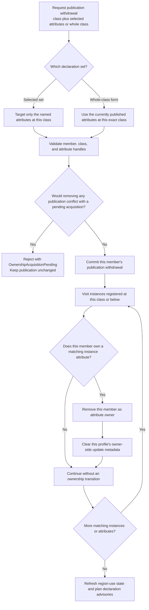

The preflight rejection happens before the declaration set changes, so a
pending-acquisition conflict does not partially withdraw a multi-attribute
request in this implementation. The focused test exercises a pending
acquisition and observes `OwnershipAcquisitionPending`; the broader declaration
case exercises whole-class withdrawal at a subclass while a separate
superclass publication remains, then withdraws the superclass publication.
The registry source also removes the unpublishing member's owner record across
matching instances and clears its update-region association plus transportation
and order metadata. Those cleanup postconditions are source-derived here: the
cited tests do not assert each one. Although the process adapter forwards these
services, this evidence does not establish process/embedded parity or 2010
behavior. Declaration advisories are planned from the resulting state and keep
their own callback-delivery boundary; see the
[relevance-advisory guide](HLA-2025-RELEVANCE-ADVISORY-FLOW-GUIDE.md).

## Attribute path: request is not the value response

An attribute-value request asks the current provider to supply values; it does
not return the bytes as the request service's result. The provider receives a
provideAttributeValueUpdate callback carrying the requested object,
attributes, and request tag. The provider then chooses whether and when to call
updateAttributeValues. That later update has its own bytes and tag and may
produce a reflectAttributeValues callback for eligible subscribers.

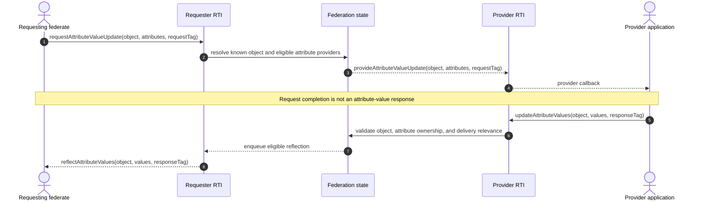

The diagram is the ordinary object-instance request/update path. Class-level
expansion, regional filtering, provider fan-out, and request/response restore
cut points have their own [2025 attribute-value update request guide](HLA-2025-ATTRIBUTE-VALUE-UPDATE-REQUEST-FLOW-GUIDE.md).
The active/passive, additive declaration state behind object-attribute
subscriptions is covered in the
[2025 object-attribute subscription guide](HLA-2025-OBJECT-ATTRIBUTE-SUBSCRIPTION-STATE-FLOW-GUIDE.md).
Per-attribute update-rate admission is covered separately in the
[2025 update-rate guide](HLA-2025-ATTRIBUTE-UPDATE-RATE-ADMISSION-FLOW-GUIDE.md).
In particular:

- The request tag is echoed on the provider callback; it is not automatically
  reused as the later update's tag. The provider supplies that update tag.
- The request can lead to a reflection only if a provider actually sends an
  update and the update is eligible for delivery. The callback is not a return
  value from requestAttributeValueUpdate.
- Object knowledge, attribute ownership, subscription matching, and DDM are
  separate gates. Ownership changes are described in the ownership guide;
  regional relevance is described in the DDM guide.
- Object-attribute declarations also compose per selected attribute: active
  and passive entries can coexist without making every attribute eligible.
  See the [subscription-state guide](HLA-2025-OBJECT-ATTRIBUTE-SUBSCRIPTION-STATE-FLOW-GUIDE.md)
  for the declaration mutation boundary.
- Overlapping class subscriptions should be reasoned about as one receiver's
  matching state, not as a promise to invoke application code once per
  declaration. The linked process test observes one reflection for its
  overlapping-subscription scenario; broader combinations need their own
  evidence.
- A queued reflection is not necessarily callback-visible immediately.
  Callback execution policy and service re-entry belong to the
  [2025 callback/service-ordering guide](HLA-2025-CALLBACK-AND-SERVICE-ORDERING-FLOW-GUIDE.md);
  TSO eligibility and timestamp ordering belong to the
  [2025 time-management guide](HLA-2025-TIME-MANAGEMENT-GUIDE.md).

### Embedded receive-order update: projection, passels, and callback boundary

These diagrams describe the ordinary **2025 embedded, no-time** update path.
They begin when a provider calls `updateAttributeValues`; the request above
only solicits a future provider callback. They do not describe the timestamped
overload or the process endpoint. The three views follow actual responsibility
boundaries: caller-owned input validation, receiver-specific route planning,
and callback-time delivery.

#### 1. Validate and snapshot the sender's update

The submitted set is checked against the sender's registered object class,
ownership, and delivery metadata before caller buffers are copied. The adapter
then makes durable copies and plans again, so the state used for recipient
selection is current after the copy boundary.

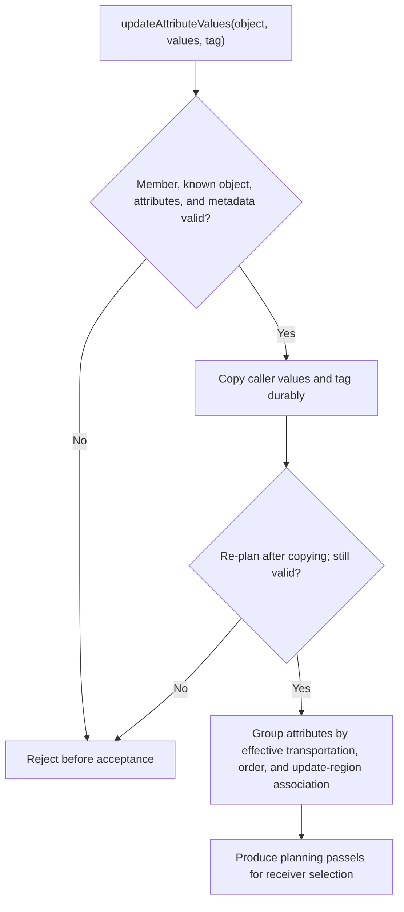

The plan rejects a repeated or undefined attribute and an attribute not owned
by the sender. It also resolves each attribute's effective order,
transportation, and region association. The passels are the unit carried into
recipient selection; the timestamped overload has a different subsequent
queue/grant path.

#### 2. Project each passel for each receiver

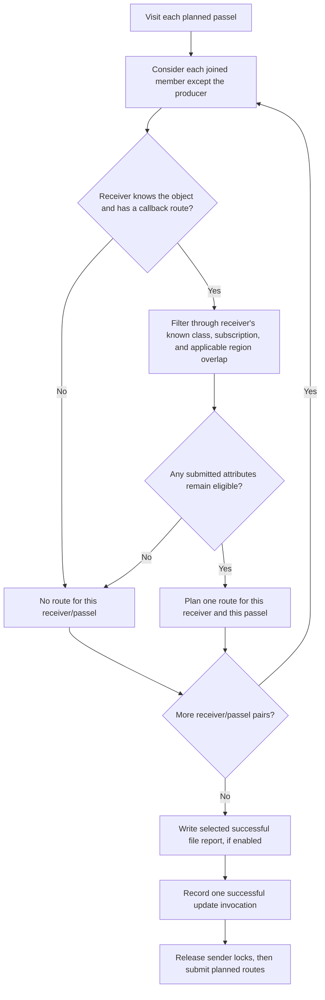

The registry validates sent attributes against the registered class, then
projects separately for each receiver using that receiver's known class. Thus
a receiver that knows only a superclass does not receive an attribute
introduced below that class, even when the sender submitted it. Subscription
relevance and region overlap remain separate per-attribute gates; their full
rules are in the [DDM guide](HLA-2025-DATA-DISTRIBUTION-AND-REGIONS-FLOW-GUIDE.md).
The successful service report, when selected, precedes one successful-update
counter increment for the API invocation, not one per receiver. These source
ordering details are distinct from the focused test assertions below.

#### 3. Dispatch and recheck at the callback boundary

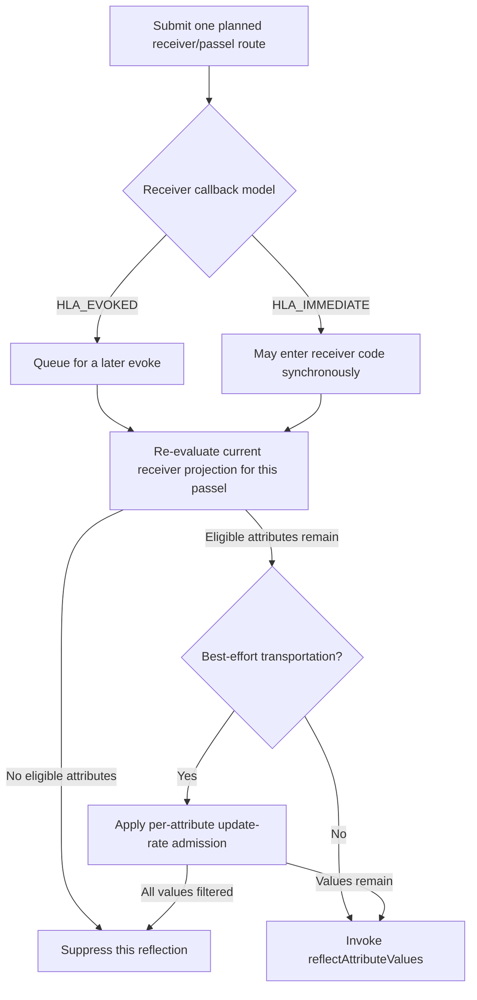

At callback entry the ordinary path recomputes eligibility for the submitted
passel only. A later unsubscribe can therefore suppress queued work, and a
best-effort rate gate can further remove values. The [DSE guide](HLA-2025-DELAY-SUBSCRIPTION-EVALUATION-FLOW-GUIDE.md)
owns the broader route-only candidate and late-subscription rules; the
[time-management guide](HLA-2025-TIME-MANAGEMENT-GUIDE.md) owns timestamped
updates and grant delivery. Region-descriptor conveyance is controlled
separately and remains in the DDM guide.

The focused embedded test exercises the user-visible distinctions: an exact
receiver gets the child attribute, a receiver that knows only the superclass
gets only the base attributes, reliable and best-effort values arrive in two
separate reflections, an `HLA_IMMEDIATE` receiver sees both before the service
returns, and a queued receiver that unsubscribes before `evokeMultipleCallbacks`
gets neither. It also checks rejection for an unknown object, an undefined
attribute, and an attribute the sender does not own. The test establishes those
scenarios; copy/re-plan ordering, the once-per-invocation counter, and lock
release before fan-out are source-derived details, not assertions in that test.
This is selected embedded 2025 evidence, not process parity or a complete
normative matrix.

## Interaction path: class subscription, parameter projection, callback

An interaction send carries an interaction class, parameter/value pairs, and a
user tag; it does not name an object instance. The runtime validates the
sender's publication and resolves eligible receiving members from interaction
subscriptions. The callback carries the values that are visible through the
receiver's matched class plus the user tag. The sender does not receive its
own induced receiveInteraction callback in the current joined-federate path.

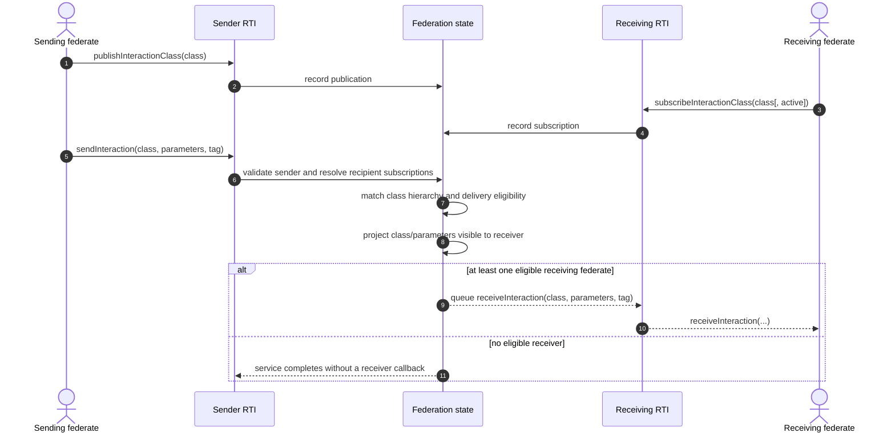

The current resolver walks the sent class and its superclasses, returning the
closest eligible subscribed class for a recipient and projecting parameters
visible through that class. Its source also separates federation-wide active
subscription relevance from a recipient's own matching subscription. These
are important implementation details, but the process-endpoint integration
case linked below exercises a simpler ordinary send; do not mistake that test
for proof of every hierarchy, passive-subscription, parameter, or region
combination.

### Interaction relevance, class promotion, and parameter projection

The registry makes two related but distinct decisions for an ordinary
receive-order interaction. First it determines whether an active subscription
from a non-sending member makes the sent class relevant. Then it evaluates
each other joined member's own subscription and any required region overlap.
A passive subscription does not create relevance by itself, but it can receive
an already-relevant interaction. If a receiver matches a superclass rather
than the sent class, that closest matching class determines both the callback
class and which sent parameters are visible.

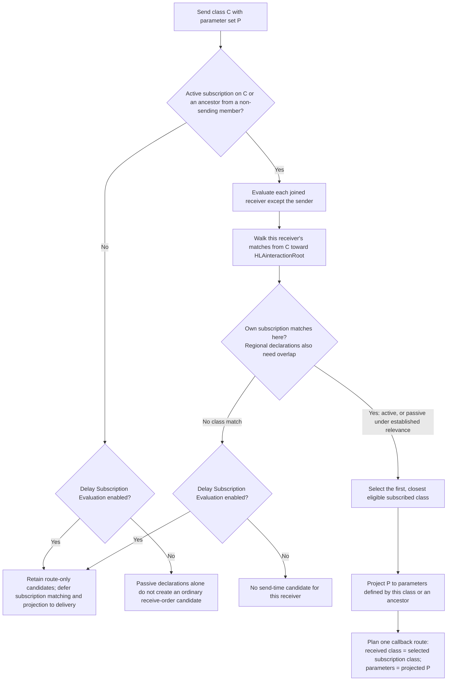

The first relevance check is federation-wide and excludes the sending
federate. The second is recipient-specific: a passive recipient still needs a
matching declaration and, for a regional declaration, an overlapping region.
The parent walk selects the first eligible subscription and returns one plan
for that recipient; projection then drops sent parameters that are not defined
by the selected class or its ancestors. A route-only DSE candidate has no
received class or parameter projection yet; the [DSE guide](HLA-2025-DELAY-SUBSCRIPTION-EVALUATION-FLOW-GUIDE.md)
covers that later re-evaluation boundary.

The registry promotion test makes the projection concrete for a send of
`MainCourseServed` with three parameters:

| Receiver's subscription | Planned callback class | Parameters in this FOM's plan |
| --- | --- | --- |
| `MainCourseServed` | `MainCourseServed` | All three sent parameters |
| `FoodServed` superclass | `FoodServed` | None; those three parameters are introduced below this class |
| `CustomerTransactions` ancestor | `CustomerTransactions` | None; those three parameters are introduced below this class |

The registry promotion test excludes an unrelated class and a receiver
without a callback route, and verifies parameter projection. Its subscriptions
are on separate receiver members, so it does not test nearest-class choice for
one receiver with declarations at multiple levels. A separate public embedded
receipt test now covers that question directly: with only the base subscribed,
the callback reports the base; with base and middle subscribed, it reports the
middle; with the sent child subscribed too, it reports the child. Each send
produces exactly one callback, whose received-class handle equals the selected
candidate ([test](../../cpp/tests/inherited_interaction_receipt_catch2.cpp#L71)).
That test sends an empty parameter map, so it does not test parameter
projection through an inherited match. The registry projection test and the
public receipt test are complementary evidence, not one end-to-end test of
both behaviors. This remains embedded 2025 development-profile evidence; it
does not establish the normative hierarchy rule, process parity, or passive,
regional, and DSE combinations.

A separate embedded regional-transition test is written to exercise the
passive/relevance split: an active receiver makes the interaction relevant for
an overlapping passive receiver; removing the sole active declaration
suppresses both deliveries while the passive declaration remains; activating
that declaration restores delivery. The last recorded local run failed during
federation creation before those transition assertions, so this remains
source-/test-intent evidence rather than runtime-verified behavior.

The pinned 2025 API exposes `bool active = true` on ordinary Subscribe
Interaction ([§5.10](../../third_party/ieee1516.1-2025/include/RTI/RTIambassador.h#L577))
and regional Subscribe Interaction With Regions
([§9.10](../../third_party/ieee1516.1-2025/include/RTI/RTIambassador.h#L1595)).
Those signatures establish the control surface, not the full
relevance/delivery semantics. The public process declaration test asserts that
`true`, `false`, and unsubscribe are reflected in registry state
([test](../../cpp/tests/ieee1516_2025_connection_interaction_declaration_catch2.cpp#L590)),
but sends no interaction and therefore does not verify process-profile
delivery. Keep the detailed rule above implementation-scoped until the full
normative clauses are checked; do not infer process/embedded or 2010 parity.

### Regional active/passive transition and the empty-set no-op

This sequence isolates the two gates behind regional interaction delivery:
an active declaration anywhere among eligible non-senders establishes class
relevance, while each recipient still needs its own matching subscription and
overlapping region. The API flag is `active`; `false` makes the retained
regional pair passive. The empty-set call below is valid after the ordinary
membership/class checks, but has no effect on that pair.

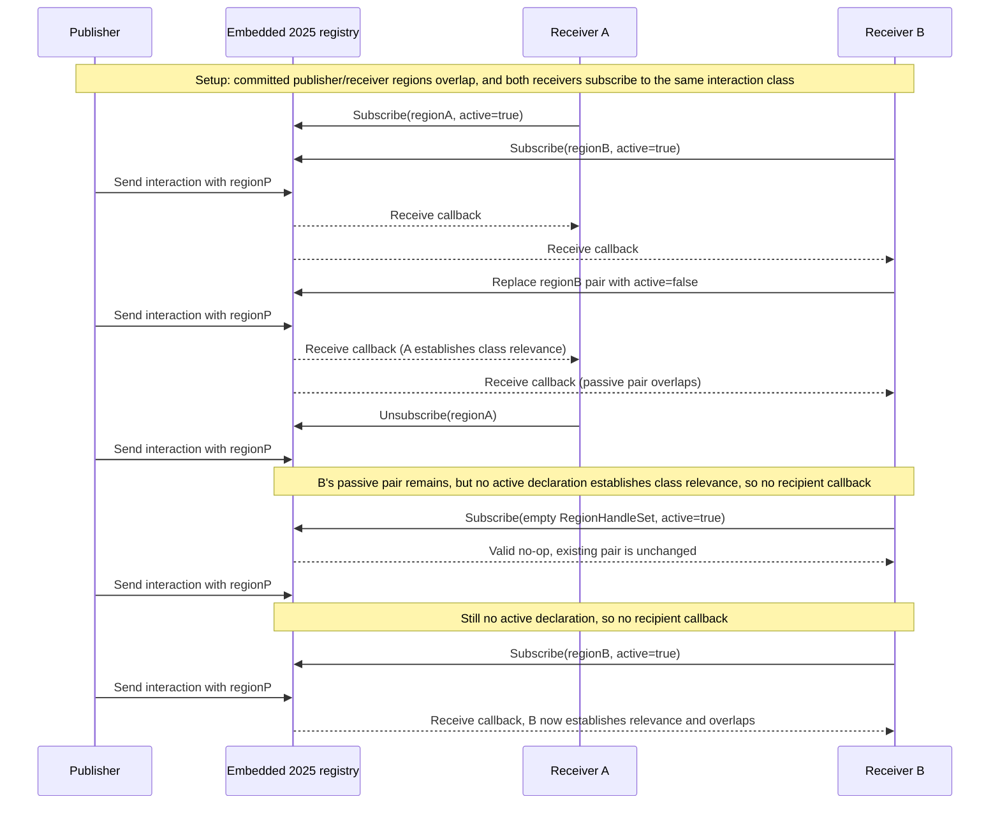

The focused development-profile test encodes these transitions, but the
current local run threw `Unknown exception` while creating the federation
(test line 121), before reaching any transition assertion. Treat this as a
source/test-shaped embedded 2025 explanation, not a passing runtime observation,
a callback-order guarantee, or evidence of process-endpoint/2010 parity.

### Embedded accepted-send boundary and recipient fan-out

This is the current **2025 embedded implementation** for the ordinary
receive-order overload, not a normative callback-order guarantee and not a
claim that the process endpoint has identical sequencing. It separates one
accepted `sendInteraction` invocation from the zero or more application
callbacks that may follow it.

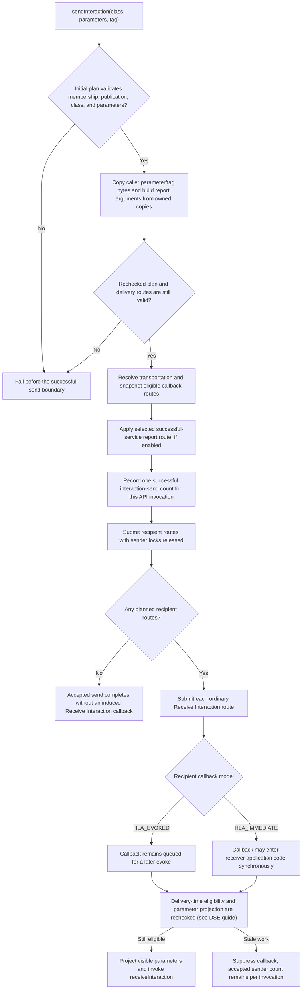

Read the report, counter, and callback stages as separate boundaries. The
selected report may be a `HLAreportServiceInvocation` interaction or a file
record; the [service-reporting guide](HLA-2025-SERVICE-INVOCATION-REPORTING-FLOW-GUIDE.md)
owns its routing and switch rules. In the embedded source, selected report
handling precedes `recordSuccessfulInteractionSend`, which increments once per
accepted invocation rather than once per recipient. A `HLA_IMMEDIATE` service-
report observer may therefore run during that earlier report stage; the
ordinary application Receive Interaction routes are submitted afterward. The
send path releases its sender locks before submitting those routes, since an
immediate recipient callback can synchronously re-enter user code.

With no planned recipients, the source still reaches the report and
per-invocation counter boundary, then has no application route to submit. That
zero-recipient counter detail and the immediate re-entry allowance are
source-derived; the focused tests below do not inspect the counter from inside
a callback or exercise a deliberate re-entrant send. The file-report test
does establish that the successful type-2 service record is present before an
`HLA_EVOKED` receiver enters its separately queued application callback. A
separate immediate-observer test sees the service report while that ordinary
receiver callback is still queued. Receiver-side re-evaluation and stale-work
suppression belong to the [DSE guide](HLA-2025-DELAY-SUBSCRIPTION-EVALUATION-FLOW-GUIDE.md),
not to a second copy of its state machine here.

The `HLA_IMMEDIATE`/`HLA_EVOKED` fork names the callback dispatch model; it
does not bypass the separate receive-order temporal-admission or
callbacks-enabled gates. In this embedded path, either gate can defer
application entry after the sender's accepted-send boundary. See the
[cross-cutting temporal-admission and callback-entry map](HLA-2025-CROSS-CUTTING-STATE-EVENT-OBSERVATION-GUIDE.md#temporal-admission-does-not-imply-callback-entry)
for that distinct boundary.

**Boundary with other guides:** a timestamped send enters the time-management
queue and has grant/retraction/ordering constraints; a regional send adds
source-region and overlap checks. Follow the [time guide](HLA-2025-TIME-MANAGEMENT-GUIDE.md)
and [DDM guide](HLA-2025-DATA-DISTRIBUTION-AND-REGIONS-FLOW-GUIDE.md) for those
branches rather than adding them to this ordinary receive-order picture.

### Embedded ordinary interaction unpublication and already-accepted work

This is a **2025 embedded source observation**, not a normative rule for every
RTI or a process-endpoint parity claim. It answers a narrow but important
question: does withdrawing an interaction publication itself fence an ordinary
receive-order callback that the RTI has already accepted and queued?

**Portable reading rule:** keep two questions separate: does the changed
declaration allow a *new* service invocation, and what happens to work that was
already accepted? Withdrawal is not automatically cancellation. The answer for
pending work is service-specific, so the directed and ordinary examples below
must not be merged into one rule.

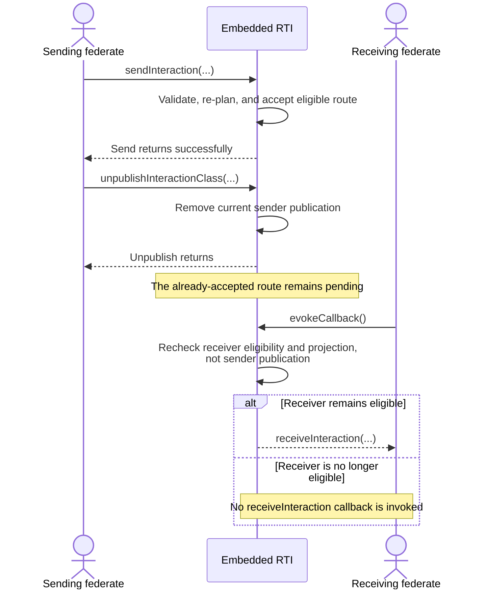

In the reviewed embedded path, publication is checked while planning the send
and again before its accepted boundary. Unpublishing removes the current
declaration, but does not remove that already-submitted ordinary callback route.
At callback dispatch, the registry re-evaluates the receiver's eligibility and
parameter projection; that predicate does not consult the sender's current
publication set. Therefore, in this path, sender unpublication alone does not
invalidate an already-accepted ordinary route. A receiver that has resigned,
unsubscribed, or otherwise become ineligible can still cause the callback to be
suppressed.

This send → unpublish → evoke ordering was not found as a focused ordinary
interaction test. Treat the behavior above as source-derived until a focused
case exercises it, and do not promote it to an IEEE requirement without checking
the normative service and callback clauses. The [directed-interaction
guide](HLA-2025-DIRECTED-INTERACTION-FLOW-GUIDE.md#receive-order-send-validate-fan-out-then-dispatch)
shows a distinct embedded path whose queued callback *does* recheck the
sender's directed publication pair; its tested invalidation behavior must not
be copied onto ordinary interactions.

### Process ordinary interactions snapshot the promoted callback view

This companion is a **2025 process-endpoint source observation** for the
ordinary, non-TSO receive-order path. Both profiles call the same registry
planner, which walks from the sent interaction class toward its parents and
selects the closest eligible subscription class. The difference is when that
class and its visible parameter set are fixed for delivery:

- In the embedded path, the queued callback closure asks the registry for a
  fresh recipient projection immediately before the callback. A current
  subscription can therefore select a different superclass projection, or no
  longer produce a callback.
- In the process path, the send handler puts the received interaction-class
  handle and projected parameter handles into a `ProcessFederationInteractionEvent`.
  If delayed subscription evaluation left a route-only candidate without a
  received class, the handler resolves it before creating the event. The later
  pull receive handler dequeues the stored event, and the callback bridge uses
  that event's class and parameter handles without querying the registry again.

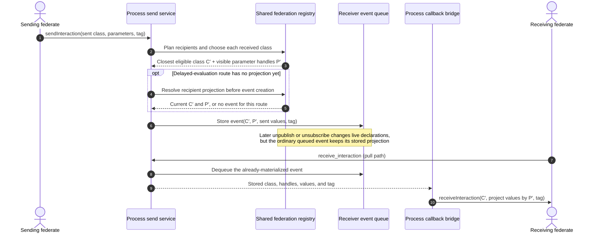

For the inspected pull path, ordinary publish/unpublish and
subscribe/unsubscribe requests update registry declarations but do not rewrite
the already-materialized interaction event. The receive handler dequeues that
event as stored, and the bridge forwards its stored class/parameter projection.
Thus this source path does not apply the embedded callback-time eligibility
fence: a declaration change after event creation does not itself revise the
event's promoted class or parameter set. This is a source-derived process
observation, not a normative rule or a focused test result. The process public
Send Interaction case uses a raw process receiver to pull and inspect one
exact-class event's parameter handle/value and tag; it does not exercise class
promotion or a declaration change between send and receive. A separate
configured-process multi-recipient test does assert actual `receiveInteraction`
callbacks under both callback models, but its subscriptions also name the sent
class exactly. Thus process callback delivery is tested for that exact-class
scenario, while ancestor-subscription promotion and post-send declaration
changes remain untested in the configured-process profile. Timestamped
interaction delivery and retraction are separate paths.

For the distinct question of whether a prior ancestor subscription can match
a descendant introduced by an additional-module Join, see the [FOM guide's
interaction-catalog growth boundary](HLA-2025-FOM-MODULE-ADMISSION-AND-COMPOSITION-FLOW-GUIDE.md#interaction-catalog-growth-is-not-a-receive-interaction-callback).

Evidence: process planning and event materialization
([send planner](../../cpp/src/internal/federation/process_federation_service_interaction_send.cpp#L389),
[route-only resolution and event construction](../../cpp/src/internal/federation/process_federation_service_interaction_send.cpp#L514),
[unpublish handler](../../cpp/src/internal/federation/process_federation_service_request_handlers.cpp#L370),
[unsubscribe handler](../../cpp/src/internal/federation/process_federation_service_request_handlers.cpp#L384)),
[pull dequeue](../../cpp/src/internal/federation/process_federation_service_receive.cpp#L70),
[callback bridge](../../cpp/src/internal/federation/process_federation_callback_bridge.cpp#L214),
and the [process public-send case](../../cpp/tests/ieee1516_2025_connection_send_interaction_catch2.cpp#L457).
The shared class/parameter projection is implemented by the [registry recipient
resolver](../../cpp/src/internal/federation/federation_registry.cpp#L1421); the
embedded delivery-time call is in the [callback closure](../../cpp/src/internal/runtime/umbra_rti_ambassador_interaction_callbacks.cpp#L77).

### Timestamped interactions resolve the receiver projection later

Do not carry the ordinary process event's send-time projection into the TSO
path. Both inspected 2025 TSO paths retain the sent interaction and resolve a
receiver-specific class/parameter projection later, but at different points
relative to callback entry. This comparison describes current Umbra source;
it is not a normative HLA rule or a claim about the separate 2010 stream. This
section covers ordinary timestamped Send Interaction; timestamped Send
Directed Interaction has a separate target selector and its own
[guide](HLA-2025-DIRECTED-INTERACTION-FLOW-GUIDE.md#timestamped-send-is-the-same-routing-question-at-a-different-time-boundary).

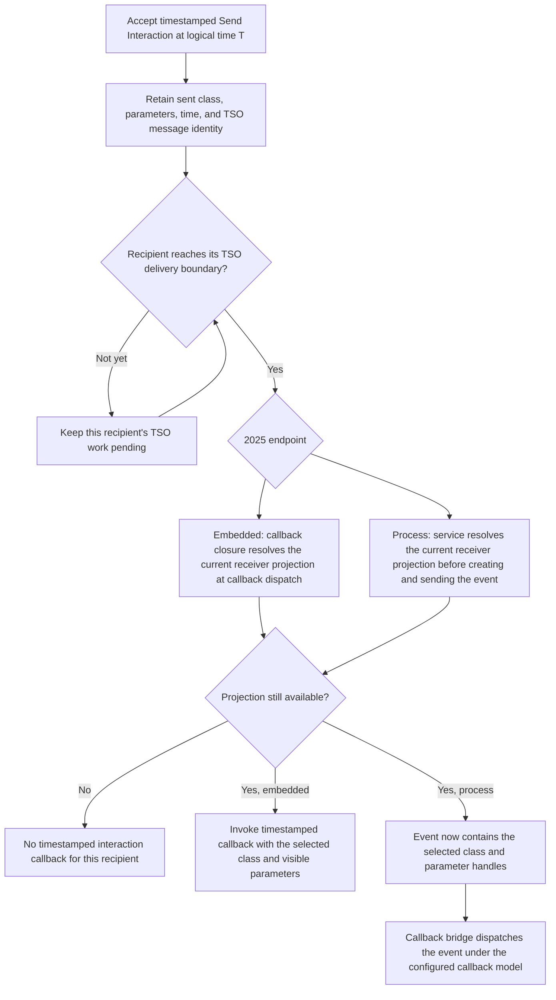

The embedded callback closure queries the registry while dispatching the
callback. The process service instead computes the projection before it sends
the event frame; that event carries the selected class and parameter handles,
and the later callback bridge does not query the subscription again. Thus a
declaration change before those respective projection points may affect the
selected path, while a change after process event materialization does not
rewrite that event. This timing difference is source-derived; no focused
process case was identified that mutates an ordinary interaction subscription
between TSO send and event creation.

For a tested embedded regional example, the [DDM guide's subscription
replacement flow](HLA-2025-DATA-DISTRIBUTION-AND-REGIONS-FLOW-GUIDE.md#a-replacement-regional-interaction-subscription-does-not-retarget-queued-tso-work)
shows the send-time source-region snapshot checked against the receiver's
current subscription at TSO callback dispatch. That case does not establish
process parity or the behavior of every nonregional declaration change. The
[process multiple-message case](../../cpp/tests/ieee1516_2025_connection_process_tso_interaction_multiple_message_ordering_catch2.cpp#L456)
checks two same-time interactions in FIFO callback order before one grant, but
does not mutate subscription state. See the [time-management guide](HLA-2025-TIME-MANAGEMENT-GUIDE.md#timestamped-message-lifecycle-and-callback-order)
for the separate temporal gate and [TSO retraction guide](HLA-2025-TSO-RETRACTION-FLOW-GUIDE.md)
for per-recipient Retract/Request Retraction outcomes. The [process endpoint
guide](HLA-2025-PROCESS-ENDPOINT-REQUEST-AND-CALLBACK-FLOW-GUIDE.md#3-a-timestamped-process-delivery-stays-in-transit-through-callback-completion)
traces the later event-frame and acknowledgement boundary.

## Object removal: delete, callback, and per-receiver cleanup

Keep the API roles distinct before tracing state changes:
[`RTIambassador::deleteObjectInstance` (§6.16)](../../third_party/ieee1516.1-2025/include/RTI/RTIambassador.h#L823)
is the application's delete request;
[`FederateAmbassador::removeObjectInstance` (§6.17)](../../third_party/ieee1516.1-2025/include/RTI/FederateAmbassador.h#L314)
is the RTI's receiver-side callback; and
[`RTIambassador::localDeleteObjectInstance` (§6.18)](../../third_party/ieee1516.1-2025/include/RTI/RTIambassador.h#L853)
is a separate local service. The callback is not an application delete
request, and local delete is not an alias for federation-wide delete. These
clause labels establish the API roles; the detailed state transitions below
are bounded to current Umbra source and focused-test evidence.

### A publication epoch can separate delete privilege across object registrations

`HLAprivilegeToDeleteObject` is a special object-instance attribute, not a
class-wide delete switch. The 2025 standard MIM declares it on
`HLAobjectRoot` as `Static`; Umbra's 2025 publication-snapshot code cites
§5.1.2 for its implicit publication epoch. The unpublish path also applies
the corresponding instance-ownership loss (its source comment cites
§5.3.3(f)). The focused embedded scenario makes the cohort effect visible:
publishing `Efficiency` initially gives object A the implicitly published
delete privilege; explicitly unpublishing that special attribute removes
A's privilege. Republishing establishes a later registration epoch, so
object B receives the privilege but A is not retroactively changed.

When the owner then resigns with `DELETE_OBJECTS_THEN_DIVEST`, the test
observes B removed while A remains and its still-owned `Efficiency` attribute
is offered to the peer. The peer's assumption callback precedes B's removal
callback in this `HLA_EVOKED` embedded case only; that cross-service callback
order is not asserted as a general HLA or process-profile guarantee.

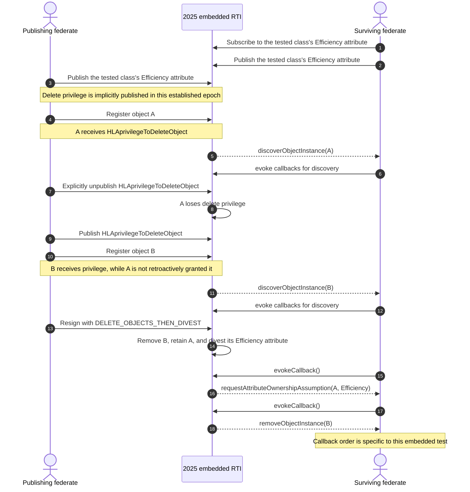

Evidence: the pinned [2025 MIM declaration](../../third_party/ieee1516.2-2025/resources/mim/HLAstandardMIM-2025.xml#L33) and
[implicit-publication projection](../../cpp/src/internal/federation/federation_registry_catalog_queries.cpp#L1007), plus the
[§5.3.3(f) unpublish-loss path](../../cpp/src/internal/federation/federation_registry_object_attribute_declarations.cpp#L53) and
[publication-epoch flag](../../cpp/src/internal/federation/federation_registry_object_attribute_declarations.cpp#L126).
The pinned 2025 [`publishObjectClassAttributes`](../../third_party/ieee1516.1-2025/include/RTI/RTIambassador.h#L429),
[`unpublishObjectClassAttributes`](../../third_party/ieee1516.1-2025/include/RTI/RTIambassador.h#L457), and
[`DELETE_OBJECTS_THEN_DIVEST` ResignAction](../../third_party/ieee1516.1-2025/include/RTI/Enums.h#L34)
declarations name the public transitions.
The [31-assertion embedded `DELETE_OBJECTS_THEN_DIVEST` scenario](../../cpp/tests/ieee1516_2025_embedded_resign_action_delete_then_divest_catch2.cpp#L4)
verifies this result. Its test-plan row maps the voluntary ResignAction
behavior to §4.12; it does not establish the full §5.1.2 publication
predicate or process parity.

Object deletion is not the inverse of registration at one instant. In the
current receive-order path, the registry validates that the deleting federate
knows the instance and holds HLAprivilegeToDeleteObject, plans removal for
other federates that know it, and immediately stops treating the deleting
federate as a known recipient. At the accepted-delete boundary it also
invalidates pending discovery, attribute-value-update, and ownership work for
the deleted object.
A receiver's queued removal is only a reservation: at a backend-specific gate,
the registry rechecks that the reservation, membership, and known-object state
are still valid. If they are, it commits that receiver's transition to unknown
before `removeObjectInstance` begins; stale work is suppressed instead of
manufacturing a callback. This is current 2025 implementation behavior for the
receive-order path, not by itself a normative ordering claim for every RTI.

The embedded ownership-ledger cleanup is a separate implementation concern.
For its callback gates, per-operation test coverage, and source-only edges, see
the [accepted-delete ownership flow](HLA-2025-ATTRIBUTE-OWNERSHIP-FLOW-GUIDE.md#accepted-object-deletion-invalidates-pending-ownership-work).
That flow does not establish a general callback order or process-profile
parity.

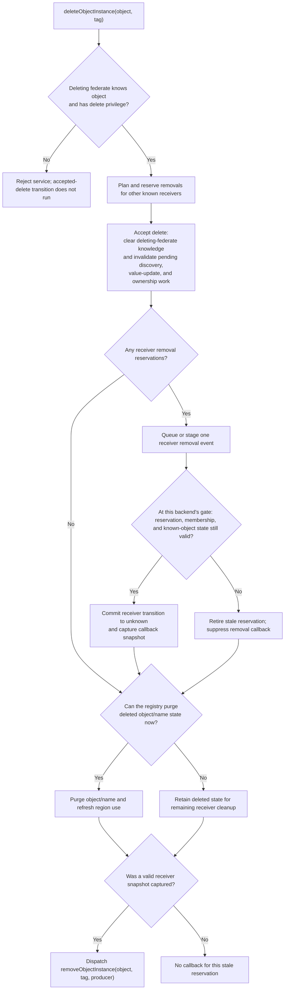

Read the receiver portion once per planned recipient; recipients cross this
gate independently, with no global “all removals before any callback” barrier.

The commit gate differs by delivery path. In the embedded path it runs when
the queued callback closure starts. In process pull mode (the default), it runs
when the receiver drains the event, before the response is bridged to the
callback. Optional process push mode runs it before pushing the event. In all
three source paths, the callback is downstream of the receiver-state commit;
the process-push statement is source-observed here, not covered by the focused
process deletion test cited below.

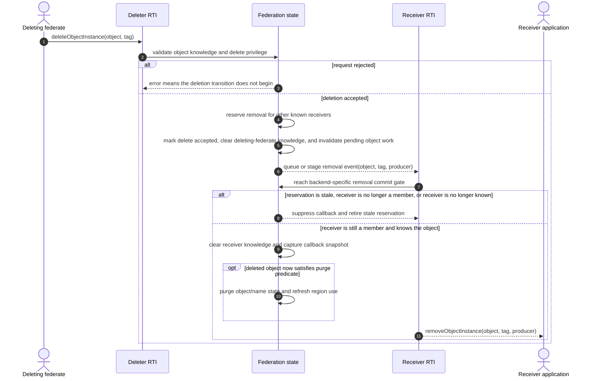

The deletion planner reserves other known recipients before committing the
accepted deletion. That reservation is not proof that a callback will still be
valid later: a receiver can resign or otherwise lose the relevant state before
its gate. The registry's removal snapshot lets the callback carry the producer
identity even when the final receiver transition makes the deleted registry
entry eligible for immediate purge.

| 2025 delivery path | Removal commit point | What the cited test establishes |
| --- | --- | --- |
| Embedded callback queue | Callback closure revalidates and commits before service-report routing and the user callback. | The focused ownership-query case observes `ObjectInstanceNotKnown` before callback dispatch and then one recorded `removeObjectInstance` callback. It does not assert every pending-work ledger is cleared. |
| Process pull (default) | Receive polling revalidates and commits before returning the removal event to the callback bridge. | The process deletion case observes the callback's object, producer, and tag payload using default `ProcessFederationServiceOptions`. |
| Process push (optional) | The service revalidates and commits before pushing the event to the session. | The linked process deletion test does not enable push mode; this row is source evidence only. |

Resignation can enter the same object-removal machinery, but its selected
ResignAction also interacts with ownership and other member-owned state. One
focused 2025 scenario shows NO_ACTION rejected while the resigning federate
still owns attributes; DELETE_OBJECTS then causes a peer removal callback.
That is a scenario-specific observation, not a full resign-action matrix. The
separate [federation/federate lifecycle guide](HLA-2025-FEDERATION-AND-FEDERATE-LIFECYCLE-FLOW-GUIDE.md#resignaction-effects-in-the-current-implementation)
owns the complete resign, connection-loss, and final-member behavior.

#### Producer `DELETE_OBJECTS` in the 2025 process profile

Keep the two roles separate: the departing producer invokes
[`RTIambassador::resignFederationExecution` (§4.12)](../../third_party/ieee1516.1-2025/include/RTI/RTIambassador.h#L250);
a surviving member may later observe
[`FederateAmbassador::removeObjectInstance` (§6.17)](../../third_party/ieee1516.1-2025/include/RTI/FederateAmbassador.h#L314).
The process path below is Umbra 2025 source behavior, not a normative callback
ordering rule or evidence of 2010/embedded parity.

For each eligible object selected by this ResignAction, the registry first
preflights routes for other current members whose known-object map contains the
object. A voluntary resignation with a missing required route is rejected
before those object mutations. On success, the registry reserves one removal
per such receiver, removes the departing producer's own known-object entry,
and returns the recipient plans. The process service then enqueues ordinary
receive-order removals with an empty tag. The survivor, not the departing
producer, crosses its own known-object removal gate:

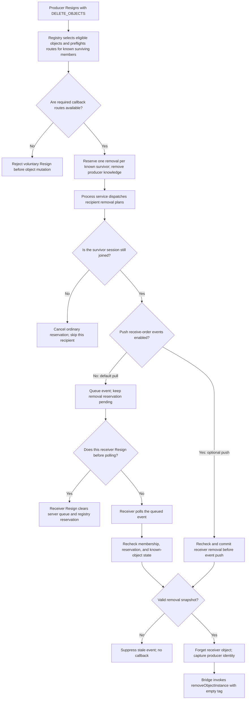

The Resign handler calls the registry, dispatches the returned plans, then
finishes grant reevaluation and clears the departing producer's session before
returning success. In default pull mode, the server-side event queue and the
registry reservation are not the callback itself: the survivor's receive poll
calls `beginObjectInstanceRemoval`, which rechecks membership, reservation,
and known-object state, commits that receiver's transition to unknown, and
captures the producer identity for callback construction. Optional push mode
crosses that same registry gate before the service sends the event. Because a
survivor can poll while the producer's Resign request is completing, do not
infer a general ordering between the producer's successful return and the
survivor's callback from the service call structure alone.

If the *receiver* successfully Resigns before consuming a producer's event,
that is a second membership transition, not a reversal of the producer's
ResignAction. Pull-queued work can still be discarded at the process service;
already-pushed work has crossed into client-owned buffering and callback
dispatch. The next subsection traces those two boundaries separately. No
focused process test located here settles the already-pushed-after-Resign race.

| Evidence slice | What it establishes | Limit |
| --- | --- | --- |
| Portable C++ TCK [`scenarioResignDeleteObjectLookupBoundaryPortable`](../../packages/hla-rti-cpp-tck/src/portable_tck.cpp#L4556) | Its scenario discovers an object, has its producer Resign with `DELETE_OBJECTS`, waits for the survivor's empty-tag removal callback, then expects name, handle, and known-class lookups to report `ObjectInstanceNotKnown`. | Adapter-agnostic test source; it does not establish that Umbra's process endpoint ran or passed this scenario, and this docs pass did not run it. |
| Umbra 2025 process path: [Resign planning](../../cpp/src/internal/federation/federation_registry_resign_lifecycle.cpp#L283), [request dispatch](../../cpp/src/internal/federation/process_federation_service_request_handlers.cpp#L153), [recipient enqueue](../../cpp/src/internal/federation/process_federation_service_connection_loss.cpp#L66), [pull commit gate](../../cpp/src/internal/federation/process_federation_service_receive.cpp#L91), and [callback bridge](../../cpp/src/internal/federation/process_federation_callback_bridge.cpp#L633). | The source implements the per-recipient reservation, profile-specific commit gate, and `removeObjectInstance` projection shown above. The [receiver cleanup](../../cpp/src/internal/federation/process_federation_service_lifecycle.cpp#L56) clears events still queued in that session. | Source-derived; the push-mode resignation path and an already-pushed callback racing receiver Resign are not established by a focused process test. |
| Focused process deletion test [`deleteObjectInstance`](../../cpp/tests/ieee1516_2025_connection_delete_object_instance_catch2.cpp#L771) | Checks the receiver callback's object, producer, and user tag for an explicit delete using default process options. | The later producer `DELETE_OBJECTS` call is cleanup after those assertions, not evidence for a resignation-originated callback. |

No claim is made here that the voluntary process `DELETE_OBJECTS` path has a
focused Umbra Catch2 assertion, or that embedded/2010 callback timing matches
this source trace. The complete action and ownership preconditions remain in
the lifecycle guide. The producer-removal chart is pending Mermaid syntax/render
and visual review; GitHub rendering remains unverified.

#### Cross-object `DELETE_OBJECTS_THEN_DIVEST`: removal and ownership callbacks

The 2025 registry handles eligible delete-privileged objects first, then
divests remaining owned attributes. Its divestiture pass skips instances
already marked `deleteAccepted`. A single resignation can therefore produce
two different effects for one surviving member: `removeObjectInstance` for a
known object that is deleted, and `requestAttributeOwnershipAssumption` for a
preflighted recipient of an attribute on a different, retained object. The
attribute owner change is committed in registry state; the callback queues are
separate projections of that transition.

```mermaid
flowchart TD
  Action["Producer Resigns with DELETE_OBJECTS_THEN_DIVEST"] --> Delete["First pass: handle eligible delete-privileged objects"]
  Delete --> Removed["Reserve a removal for each current member that knows a deleted object"]
  Delete --> Retained["Second pass: inspect owned attributes on non-deleted objects"]
  Retained --> Offered{"Was a recipient selected for a released attribute?"}
  Offered -->|Yes| Assumption["Plan requestAttributeOwnershipAssumption on the retained object"]
  Offered -->|No| ReleaseOnly["Release attribute without this recipient callback"]
  Removed --> Work["Return separate removal and ownership-assumption work lists"]
  Assumption --> Work
  ReleaseOnly --> Work
  Work --> Path{"Which 2025 path is being described?"}
  Path -->|Embedded HLA_EVOKED evidence| Embedded["Observed order: assumption, then removal"]
  Path -->|Process default pull| Pull["Receive selector checks removal queue before assumption-event queue"]
  Pull --> PullOrder["Source-derived relative order: removal before assumption when both wait"]
  Path -->|Process push enabled| Push["Service sends assumption frame before removal frame"]
  Push --> PushLimit["Frame submission order only; callback order is untested"]
```

Do not turn those adapter paths into one cross-service HLA ordering rule. The
focused embedded HLA_EVOKED test asserts `assumption` then `remove`. In the
process service, `dispatchConnectionLossResult` queues ownership-assumption
work before object removals. But with default pull, those work items occupy
different queues, and the receive selector reaches the removal branch before
the ownership-acquisition event branch; when both are pending, the removal
result is selected first (subject to earlier event families in that poll).
With optional push enabled, source submits the assumption event frame before
the removal frame, but there is no focused process test asserting the
application callback order. Neither process ordering is claimed as normative.

| Evidence slice | What it establishes | Limit |
| --- | --- | --- |
| Registry action passes: [delete planning](../../cpp/src/internal/federation/federation_registry_resign_lifecycle.cpp#L566), [divestiture skips deleted instances](../../cpp/src/internal/federation/federation_registry_resign_lifecycle.cpp#L635), and [assumption work planning](../../cpp/src/internal/federation/federation_registry_resign_lifecycle.cpp#L708). | Deleted-object removals and retained-object ownership-assumption plans are separate result work. | Source behavior; recipient selection is conditional on the preflighted offered-attribute set. |
| Focused [embedded scenario](../../cpp/tests/ieee1516_2025_embedded_resign_action_delete_then_divest_catch2.cpp#L62). | One peer knows both objects; the test observes an assumption callback for `Efficiency` on the retained object, a removal for the other object, and exact callback order `assumption`, `remove`. | One embedded HLA_EVOKED fixture, not a standard-wide cross-service order or process evidence. |
| Process [result dispatch](../../cpp/src/internal/federation/process_federation_service_connection_loss.cpp#L50), [default-pull selector](../../cpp/src/internal/federation/process_federation_service_receive.cpp#L86), and [assumption-event selector](../../cpp/src/internal/federation/process_federation_service_receive.cpp#L348). | Assumption work is dispatched before removals, but default pull prioritizes the removal queue over the later ownership-assumption event queue. The optional push path sends the assumption frame before sending removal frames. | Source-derived only; no focused process voluntary `DELETE_OBJECTS_THEN_DIVEST` test asserts callback order. |
| Portable C++ TCK [cross-object scenario](../../packages/hla-rti-cpp-tck/src/portable_tck.cpp#L4709). | Distinguishes a deleted object from a retained object, checks survivor removal metadata and known-object lookup, then checks later If-Available acquisition on the retained object. | It does not assert `requestAttributeOwnershipAssumption` or its order relative to removal; it is adapter-agnostic, not proof of Umbra process behavior. |

The focused voluntary callback-order assertion is embedded. The scoped test
scan found forced connection-loss automatic-directive cases, but those are a
different transition and do not establish voluntary process ordering. This
chart is pending Mermaid syntax/render and visual review; GitHub rendering
remains unverified. For the action table and ownership preconditions, see the
[federation lifecycle guide](HLA-2025-FEDERATION-AND-FEDERATE-LIFECYCLE-FLOW-GUIDE.md).

#### Receiver Resign while assumption and removal callbacks are pending

In the cross-object case above, one producer Resign can leave a surviving
receiver with two distinct effects pending: an ownership-assumption callback
for a retained object and a removal callback for a different, deleted object.
If that receiver then successfully Resigns before consuming them, the process
path's result depends on how far each event has travelled. The chart is a
2025 process source trace—not a normative callback-cancellation or ordering
rule. It focuses on the object/ownership-specific server queues and transport
boundary; the general process callback-queue behavior after Resign is mapped
in the [callback and service-ordering guide](HLA-2025-CALLBACK-AND-SERVICE-ORDERING-FLOW-GUIDE.md#process-profile-resign-and-queued-callback-work).

```mermaid
flowchart TD
  Planned["Producer Resign planned assumption and removal work for this receiver"] --> Receiver["Receiver successfully Resigns before observing both effects"]
  Receiver --> Boundary{"Where has each event reached?"}
  Boundary -->|Still queued for pull| Registry["Registry removes this recipient's assumption marker and removal reservation"]
  Registry --> ServerCleanup["Service filters ownership-acquisition events for the departed ID, then clears this session's removal and ownership-acquisition queues"]
  ServerCleanup --> PullEnd["Server-held pull work is discarded before the Resign response"]
  Boundary -->|Push frame already sent| ClientQueue["Frame may be buffered in the process client's pending-event deque"]
  ClientQueue --> Response["Resign request reads through its matching response"]
  Response --> Bridge["Client submits buffered event to the callback bridge"]
  Bridge --> CallbackGuide["Callback-model and queued-task outcomes: see the callback guide; this race is untested"]
  Boundary -->|Task already submitted to dispatcher| CallbackGuide
  Boundary -->|Callback already entered| Observed["Application observation already happened; Resign cannot undo it"]
```

For pull, registry cleanup removes the departing federate's pending
ownership-assumption callback marker and each object's pending-removal
reservation. The service filters queued ownership-acquisition events that
name the departed federate, then clears the joined session's
`attributeOwnershipAcquisitionEvents` and `objectInstanceRemovalEvents` before
sending the successful Resign response. These are the two server-held queues
in this scenario; a later pull in that ended membership cannot retrieve them.

Push has crossed a different boundary: the process client buffers unsolicited
frames read while waiting for the matching Resign response, then dispatches
those buffered events to the callback bridge. Server cleanup cannot recall a
frame already sent or undo an observation whose callback has entered. Whether
an event runs inline, remains queued for `evokeCallback`, or was already in the
shared dispatcher is covered by the linked callback guide; this combined
ownership/removal race is not established by a focused test. The nearest
process test consumes the assumption callback before Resign.

| Evidence slice | What it establishes | Limit |
| --- | --- | --- |
| Registry and server cleanup: [assumption-ledger invalidation](../../cpp/src/internal/federation/federation_registry_resign_lifecycle.cpp#L533), [removal-reservation invalidation](../../cpp/src/internal/federation/federation_registry_resign_lifecycle.cpp#L763), [departed-ID ownership-queue filter](../../cpp/src/internal/federation/process_federation_service_connection_loss.cpp#L25), [session queue clear](../../cpp/src/internal/federation/process_federation_service_lifecycle.cpp#L28), and [Resign request order](../../cpp/src/internal/federation/process_federation_service_request_handlers.cpp#L136). | Shows that registry invalidation and process session cleanup occur before a successful process Resign response. | Server-side source evidence; no focused test asserts both queued effects are absent after receiver Resign. |
| Push path: [assumption frame send](../../cpp/src/internal/federation/process_federation_service_attribute_ownership_delivery.cpp#L206), [removal frame send](../../cpp/src/internal/federation/process_federation_service_object_instance_removal.cpp#L73), [Resign client request](../../cpp/src/internal/federation/process_federation_client_federation_management.cpp#L89), [client buffering and request response boundary](../../cpp/src/internal/federation/process_federation_client.cpp#L430), [post-response dispatch](../../cpp/src/internal/federation/process_federation_client.cpp#L551), and [callback-bridge submission](../../cpp/src/internal/federation/process_federation_client_callback_dispatch.cpp#L265). | Shows where pushed events cross from server delivery into the client callback path. The separate [callback guide](HLA-2025-CALLBACK-AND-SERVICE-ORDERING-FLOW-GUIDE.md#process-profile-resign-and-queued-callback-work) covers dispatcher state after Resign. | Source-derived path only; no test fixes the pushed-frame-versus-receiver-Resign race or proves a post-Resign application callback. |
| Nearest focused process case: [unconsumed pushed ownership-assumption test](../../cpp/tests/ieee1516_2025_process_unconsumed_pushed_ownership_assumption_evoked_catch2.cpp#L305). | Exercises pushed ownership assumption under `HLA_EVOKED`, then Resigns the candidate. | The test consumes the assumption callback before Resign; it is not evidence for pending callback cleanup. No focused process receiver-Resign case was found for this combined assumption/removal scenario. |

This receiver-side cleanup is separate from the producer's action and from the
embedded HLA_EVOKED `assumption`-then-`remove` assertion above. Keep the
process pull result (server queue discarded) distinct from the push result
(client-buffered work may already be submitted to callback dispatch); do not
infer one profile's callback order or post-Resign behavior from the other.
This chart has no fresh Mermaid syntax verdict, render, visual review, or
GitHub presentation check.

Timestamped deletion is not the receive-order path above. Its sender-side
acceptance and each receiver's removal callback cross separate time and
object-knowledge boundaries.

### Timestamped deletion: each receiver reaches its own removal boundary

The pinned API names the timestamped `deleteObjectInstance` overload in §6.16
and gives it a `MessageRetractionHandle` result. The §6.17 removal callback
carries logical time, sent and received order, and an optional retraction
handle. Those signatures establish the operation and observation surfaces;
the detailed path below is current 2025 embedded behavior grounded in the
linked source and selected tests, not a complete normative service rule.
The portable API mental model is simply that the producer's timestamped delete
request and a receiver's timed removal callback are separate observations;
acceptance of the former does not mean the latter has already run.

```mermaid
sequenceDiagram
  autonumber
  actor Producer as Deleting federate
  participant RTI as 2025 embedded RTI
  participant State as Federation state
  actor RO as Known receiver without time constraint
  actor TC as Known time-constrained receiver

  Producer->>RTI: deleteObjectInstance(object, tag, T)
  RTI->>State: Validate object knowledge and HLAprivilegeToDeleteObject
  alt Request rejected
    State-->>RTI: No accepted-delete transition
    RTI-->>Producer: Typed service error
  else Request accepted
    RTI->>State: Retain pending delete,<br/>recipient ledger, invocation snapshot
    RTI-->>Producer: Optional MessageRetractionHandle
    alt At least one planned receiver
      par This receiver has no queued TSO copy
        State-->>RO: removeObjectInstance(object, tag,<br/>producer, T, received=RECEIVE)
        Note over State,RO: Clear receiver knowledge<br/>before its callback
      and This receiver has a queued TSO copy
        State->>State: Hold this recipient entry at T
        TC->>RTI: Reach the selected advance boundary
        State-->>TC: removeObjectInstance(object, tag,<br/>producer, T, timestamp order)
        Note over State,TC: Clear receiver knowledge<br/>before its callback
      end
      Note over State: First valid removal callback commits deletion<br/>and invalidates pending object work
    else No other federate knows the object
      State->>State: Accept deletion without a removal callback
      Note over State: Clear producer knowledge;<br/>retain object/name while designator is retractable
    end
  end
```

The per-recipient split is important. In the inspected embedded adapter, a
public retraction handle is produced only when the producer is time-regulating
and the deletion's effective order is `TIMESTAMP`. For that route, each
eligible known time-constrained recipient gets a queued TSO entry; other
planned recipients take a receive-order callback path. A timestamped callback can therefore have
`sentOrderType=TIMESTAMP` and `receivedOrderType=RECEIVE`. The sender's service
return is not proof that any receiver has run `removeObjectInstance`.
In the embedded no-fanout case, when no other federate knows the object, the
registry accepts deletion without a removal callback and clears the producer's
known-object entry while retaining the object/name and retraction record until
the designator's time bound. This is source-only evidence from the
[enqueue path](../../cpp/src/internal/federation/federation_registry_time_tso_enqueue.cpp#L859);
no focused test isolates this empty-recipient edge.

At a valid removal callback-entry gate, the registry commits that receiver's
transition to unknown before invoking user code. The first such entry commits
the execution-wide deletion, makes the producer unknown, and invalidates
pending discovery, update, and ownership work; other receivers cross their own
known-to-unknown gates independently. The embedded registry retains the
invocation snapshot while a returned designator remains retractable. This
commit/retention model is source-derived and should not be read as a universal
ordering claim. See the separate [TSO retraction flow](HLA-2025-TSO-RETRACTION-FLOW-GUIDE.md#service-specific-effects-deletion-is-special)
for the service-specific restoration branch.

One focused embedded test uses the same deletion at time 7 with three advance
requests. Its asserted callback order is:

| Receiver request in the focused case | Observed callbacks at the time-7 boundary |
| --- | --- |
| `flushQueueRequest(10)` | `removeObjectInstance`, then `flushQueueGrant` |
| `timeAdvanceRequestAvailable(7)` | `timeAdvanceGrant`, then `removeObjectInstance` |
| `nextMessageRequestAvailable(10)` | `removeObjectInstance`, then `timeAdvanceGrant` |

These are results from the [selected FQR/TARA/NMRA test](../../cpp/tests/ieee1516_2025_timestamped_delete_object_instance_fqr_tara_nmra_grants_catch2.cpp#L5), not a claim of one global callback order across advance services or profiles. The test's TARA case explicitly sits at its equal-time boundary; use the [time-management guide](HLA-2025-TIME-MANAGEMENT-GUIDE.md#boundary-comparison-matrix) for the broader grant rules.

The embedded retraction tests cover both sides of callback admission. If the
producer retracts before any removal callback starts, the source clears the
pending-delete markers without restoring the invocation snapshot; intervening
instance changes therefore are not overwritten by that path
([source](../../cpp/src/internal/federation/federation_registry_tso_delivery.cpp#L286)).
The focused pre-delivery case asserts cancellation and that the receiver still
knows the object, but does not stage an intervening mutation. If one receiver's
removal has already begun while another copy is pending, Retract restores the
invocation-time object/name/ownership snapshot before queuing
`requestRetraction` for the receiver that saw removal; the still-pending
receiver gets neither stale removal nor retraction callback
([source](../../cpp/src/internal/federation/federation_registry_tso_delivery.cpp#L239)). The
[focused mixed-recipient case](../../cpp/tests/timestamped_object_deletion_retraction_catch2.cpp#L148)
asserts that sequence and restored ownership; the
[pre-delivery case](../../cpp/tests/ieee1516_2025_timestamped_delete_object_instance_retraction_catch2.cpp#L5)
asserts cancellation before callback admission. This deletion-specific undo is
not a generic interpretation of Retract for other timestamped services.

Process-endpoint evidence is narrower: the
[configured-process test](../../cpp/tests/ieee1516_2025_connection_timestamped_delete_object_instance_catch2.cpp#L457)
checks removal payload, callback models, sender regulation, receiver
constraint, and receive-order preference. It does not exercise Retract after
removal or the invocation-snapshot restoration path. Do not infer process
parity for those embedded retraction details or any 2010 behavior.

### Local delete forgets one federate's view; it does not delete the instance

`localDeleteObjectInstance` is a different transition from
`deleteObjectInstance`. In the current 2025 registry implementation, a
successful local delete erases only the caller's known-object and pending
discovery entries. It leaves the execution-wide instance, its other members'
knowledge, and its attribute-owner map intact. It does not plan a peer
`removeObjectInstance` callback. This is source-observed behavior, not a claim
about every RTI or a substitute for the exact text of service 6.18.

The operation has ownership guards before that local-forget transition: the
caller is rejected if an ownership acquisition/cancellation/divestiture path
is still pending for it, or if it still owns any attributes of the instance.
Those guards prevent forgetting an instance while the registry still has
caller-specific ownership work or ownership to account for.

```mermaid
flowchart TD
  Call["localDeleteObjectInstance(object)"] --> Member{"Caller connected,<br/>joined, and still a member?"}
  Member -->|No| RejectMember["Reject; no knowledge transition"]
  Member -->|Yes| Known{"Object is known to caller?"}
  Known -->|No| RejectKnown["ObjectInstanceNotKnown;<br/>no knowledge transition"]
  Known -->|Yes| Pending{"Caller has pending<br/>ownership work for object?"}
  Pending -->|Yes| RejectPending["OwnershipAcquisitionPending;<br/>no knowledge transition"]
  Pending -->|No| Owns{"Caller still owns<br/>any object attributes?"}
  Owns -->|Yes| RejectOwns["FederateOwnsAttributes;<br/>no knowledge transition"]
  Owns -->|No| Forget["Erase caller's known-object entry<br/>and pending-discovery entry"]
  Forget --> Preserve["Keep federation-wide instance,<br/>other members' knowledge,<br/>and attribute owners unchanged"]
  Preserve --> Later{"A later eligible subscription<br/>causes discovery reevaluation?"}
  Later -->|Yes| Rediscover["Caller can become known again<br/>through a fresh discovery"]
  Later -->|No| StillUnknown["Caller remains unaware;<br/>no peer removal callback was planned"]
```

The embedded scenario exercises both rejection guards, observes
`ObjectInstanceNotKnown` from the caller's next known-object query after
success, then subscribes again and observes a fresh discovery. The original
owner subsequently updates the still-existing instance and the rediscovered
federate receives the reflection. A selected process-endpoint case exercises
successful local deletion, but it does not establish full process/embedded
parity for every rejection or rediscovery branch. Timestamped removal and
queued timestamped work remain separate: in the
[focused embedded recipient-isolation case](../../cpp/tests/local_delete_timestamped_object_removal_catch2.cpp#L141),
local deletion suppresses only that receiver's queued removal while another
known receiver still gets the timestamped callback before its grant. See the [time-management guide's
TSO lifecycle](HLA-2025-TIME-MANAGEMENT-GUIDE.md#timestamped-message-lifecycle-and-callback-order)
and the [TSO retraction flow's delete-specific branch](HLA-2025-TSO-RETRACTION-FLOW-GUIDE.md#service-specific-effects-deletion-is-special);
neither is the local-forget transition.

### Diagnose disappearance by asking which state changed

The phrase “the object disappeared” can refer to the execution-wide object,
one participant's known-object view, or application observation of a removal.
The following is a comparison of the current 2025 implementation paths, not a
replacement for the separate service flows or the standard's action rules.

| Trigger | Execution-wide object state | One participant's known-object state | Callback meaning |
| --- | --- | --- | --- |
| Accepted `deleteObjectInstance` | Delete-accepted; registry state may outlive acceptance until receiver cleanup finishes. | Deleter becomes unknown at acceptance; each other receiver changes independently at its removal gate. | A valid receiver gets `removeObjectInstance` after its own state is cleared; stale work is suppressed. |
| `localDeleteObjectInstance` | Remains live; other members' knowledge and owners are unchanged. | Only the caller forgets; later discovery can make it known again. | No peer `removeObjectInstance` callback is planned. |
| Voluntary resign with an action that deletes an eligible object | Selected objects are marked delete-accepted; membership removal is a separate effect. | Leaver state/routes end; surviving members clean up independently. | A surviving known receiver can observe `removeObjectInstance`. |
| Connection-loss resignation | Forced path applies the member's automatic directive plus safety and TSO rules. | The lost member is removed; survivor effects depend on action and timing. | Not every loss removes every object or produces the same callback. |

Focused scenarios ground these rows without claiming complete service coverage:
the [embedded delete ordering check](../../cpp/tests/ieee1516_2025_attribute_ownership_check_catch2.cpp#L75)
and [process removal-payload case](../../cpp/tests/ieee1516_2025_connection_delete_object_instance_catch2.cpp#L779),
the [local-delete and rediscovery case](../../cpp/tests/local_delete_object_instance_catch2.cpp#L110),
the [voluntary `DELETE_OBJECTS` case](../../cpp/tests/ieee1516_2025_embedded_resign_action_delete_objects_catch2.cpp#L4),
and the selected [automatic-delete-on-loss case](../../cpp/tests/ieee1516_2025_connection_lost_automatic_delete_resign_directive_catch2.cpp#L5).
See the [lifecycle guide's forced-resignation flow](HLA-2025-FEDERATION-AND-FEDERATE-LIFECYCLE-FLOW-GUIDE.md#connection-loss-forced-resignation-is-a-different-entry-path)
for the directive and forced-cleanup boundaries.

`removeObjectInstance` is the receiver-side observation of a removal transition,
not the request that caused it: direct deletion and resignation cleanup can both
lead to that callback. For each receiver, the current implementation clears
known-object state before entering the callback and suppresses the callback if
the reservation is stale. Conversely, local deletion is a caller-only
forgetting operation and does not manufacture that peer notification.

One important edge stays in the lifecycle guide: the current embedded
implementation performs a delete-object pass when the final joined member
resigns, even with `NO_ACTION`, but that does not destroy the federation
execution; explicit Destroy is separate. The focused [final-member scenario](../../cpp/tests/ieee1516_2025_embedded_resign_action_final_federate_catch2.cpp#L4)
checks that the execution can be joined again after the object cleanup. This is
implementation evidence, not a complete normative `ResignAction` rule.

## Evidence map: implementation versus exercised scenarios

| Topic | Current implementation entry points | Focused test evidence |
| --- | --- | --- |
| Object declarations and discovery | [publication adapter](../../cpp/src/internal/runtime/umbra_rti_ambassador_object_class_publication.cpp#L19), [subscription adapter](../../cpp/src/internal/runtime/umbra_rti_ambassador_object_class_subscription.cpp#L19), [registration](../../cpp/src/internal/federation/federation_registry_object_instance_registration.cpp#L196), [discovery planning](../../cpp/src/internal/federation/federation_registry_object_instance_discovery_planning.cpp), [discovery state transition](../../cpp/src/internal/federation/federation_registry_object_instance_discovery_state.cpp#L15), [discovery eligibility](../../cpp/src/internal/federation/federation_registry.cpp#L830) | [process-endpoint object discovery](../../cpp/tests/ieee1516_2025_connection_object_discovery_catch2.cpp#L457) |
| Object-class publication withdrawal and ownership effects | [Pinned 2025 API §5.3](../../third_party/ieee1516.1-2025/include/RTI/RTIambassador.h#L443), [embedded service adapter](../../cpp/src/internal/runtime/umbra_rti_ambassador_object_class_publication.cpp#L149), [registry pending-acquisition guard and owner transition](../../cpp/src/internal/federation/federation_registry_object_attribute_declarations.cpp#L45) | [Subclass versus superclass whole-class withdrawal](../../cpp/tests/fom_declaration_management_catch2.cpp#L266), [pending acquisition rejects withdrawal](../../cpp/tests/ieee1516_2025_unpublish_object_class_attributes_ownership_pending_service_report_catch2.cpp#L71). Neither case asserts every owner-metadata cleanup postcondition. |
| Callback value-map and tag retention | [2025 reflection/interaction callback signatures](../../third_party/ieee1516.1-2025/include/RTI/FederateAmbassador.h#L238), [VariableLengthData copy constructor](../../third_party/ieee1516.1-2025/include/RTI/VariableLengthData.h#L38), [data-pointer lifetime note](../../third_party/ieee1516.1-2025/include/RTI/VariableLengthData.h#L50) | The [embedded receive-order interaction case](../../cpp/tests/receive_order_interaction_catch2.cpp#L53) copies the const-reference map and tag during the callback and checks saved bytes after draining; this demonstrates a safe use pattern, not a cross-profile lifetime guarantee. |
| Attribute update request and reflection | [update adapter](../../cpp/src/internal/runtime/umbra_rti_ambassador_attribute_update_services.cpp#L61), [provider selection](../../cpp/src/internal/federation/federation_registry_attribute_value_update_requests.cpp#L547), [callback bridge](../../cpp/src/internal/federation/process_federation_callback_bridge.cpp#L396) | [request → provide callback → provider update → reflection](../../cpp/tests/ieee1516_2025_connection_request_attribute_value_update_catch2.cpp#L470), [one reflection for overlapping subscriptions](../../cpp/tests/ieee1516_2025_connection_update_attribute_values_reflect_catch2.cpp#L457) |
| Embedded receive-order update validation, projection, and passels | [preflight, durable copy, re-plan, report/counter boundary, unlocked fan-out](../../cpp/src/internal/runtime/umbra_rti_ambassador_attribute_update_services.cpp#L206), [passel planning](../../cpp/src/internal/federation/federation_registry_attribute_value_update_requests.cpp#L93), [receiver-known-class projection](../../cpp/src/internal/federation/federation_registry_attribute_update_recipients.cpp#L16), [callback-time recheck](../../cpp/src/internal/runtime/umbra_rti_ambassador_object_instance_lifecycle_callbacks.cpp#L734) | [embedded passel/projection/callback-lifecycle case](../../cpp/tests/ieee1516_2025_receive_order_attribute_update_passel_lifecycle_catch2.cpp#L5) |
| Receive-order interactions | [ordinary subscription API §5.10](../../third_party/ieee1516.1-2025/include/RTI/RTIambassador.h#L577), [regional subscription API §9.10](../../third_party/ieee1516.1-2025/include/RTI/RTIambassador.h#L1595), [interaction subscriptions](../../cpp/src/internal/runtime/umbra_rti_ambassador_interaction_subscription_services.cpp), [regional pair mutation and empty-set no-op](../../cpp/src/internal/federation/federation_registry_directed_interactions.cpp#L593), [global relevance and recipient overlap](../../cpp/src/internal/federation/federation_registry.cpp#L1463), [send plan](../../cpp/src/internal/federation/federation_registry_receive_order_interactions.cpp#L16), [class matching and projection](../../cpp/src/internal/federation/federation_registry.cpp#L1421), [send adapter](../../cpp/src/internal/runtime/umbra_rti_ambassador_interaction_send_services.cpp), [interaction callbacks](../../cpp/src/internal/runtime/umbra_rti_ambassador_interaction_callbacks.cpp) | [embedded same-receiver inherited receipt and callback-class identity](../../cpp/tests/inherited_interaction_receipt_catch2.cpp#L71), [process active/passive declaration-state test (no send)](../../cpp/tests/ieee1516_2025_connection_interaction_declaration_catch2.cpp#L590), [process-endpoint Send Interaction](../../cpp/tests/ieee1516_2025_connection_send_interaction_catch2.cpp#L457), [regional interaction routing](../../cpp/tests/ieee1516_2025_default_region_interaction_routing_catch2.cpp#L4), [regional active/passive transition and empty-set no-op (last recorded run failed before assertions)](../../cpp/tests/passive_regional_interaction_transition_catch2.cpp#L93), [passive-only ordinary/regional suppression](../../cpp/tests/ieee1516_2025_passive_interaction_subscription_catch2.cpp#L5), [separate-receiver class promotion and parameter projection plan](../../cpp/tests/federation_registry_composed_fom_catch2.cpp#L1209) | The receipt test covers one embedded receiver's selected class, exactly one callback, and matching received-class identity with empty parameter maps; it does not test inherited parameter projection. The separate registry test covers projection, not same-receiver nearest-class choice. Process delivery remains exact-class evidence only, and the multi-recipient regional transition remains unverified at runtime. |
| Ordinary interaction publication withdrawal after send acceptance | [ordinary declaration removal](../../cpp/src/internal/federation/federation_registry_directed_interactions.cpp#L262), [send-time publication check and recipient planning](../../cpp/src/internal/federation/federation_registry_receive_order_interactions.cpp#L16), [callback-time receiver projection](../../cpp/src/internal/runtime/umbra_rti_ambassador_interaction_callbacks.cpp#L77), [recipient predicate](../../cpp/src/internal/federation/federation_registry.cpp#L1421) | No focused send → unpublish → evoke case was found in the reviewed suite. The [interaction-relevance advisory case](../../cpp/tests/declaration_relevance_advisory_catch2.cpp#L91) exercises declaration/advisory transitions, not accepted-message delivery after withdrawal. This conclusion is source-only and embedded-profile scoped. |
| Embedded accepted-send/report/counter boundary | [owned input snapshot, re-plan, report, counter, and unlocked fan-out](../../cpp/src/internal/runtime/umbra_rti_ambassador_interaction_send_services.cpp#L2293), [selected report interaction/file route](../../cpp/src/internal/runtime/umbra_rti_ambassador_service_report_writers.cpp#L131), [delivery-time recipient projection](../../cpp/src/internal/runtime/umbra_rti_ambassador_interaction_callbacks.cpp#L57) | [successful file record before evoked app callback](../../cpp/tests/ieee1516_2025_send_interaction_service_report_file_catch2.cpp#L96), [immediate report observer while receiver callback stays queued](../../cpp/tests/ieee1516_2025_service_report_receive_order_send_interaction_catch2.cpp#L94); the [counter restore test](../../cpp/tests/ieee1516_2025_federation_registry_interaction_send_counters_restore_catch2.cpp#L17) covers persistence/restore, not public-send ordering |
| Delete and resignation effects | [delete planning and pending-work invalidation](../../cpp/src/internal/federation/federation_registry_object_instance_deletion.cpp#L15), [receiver removal commit](../../cpp/src/internal/federation/federation_registry_object_instance_removal.cpp#L48), [embedded callback gate](../../cpp/src/internal/runtime/umbra_rti_ambassador_object_instance_lifecycle_callbacks.cpp#L1331), [process push/pull planning](../../cpp/src/internal/federation/process_federation_service_object_instance_removal.cpp#L12), [process pull commit gate](../../cpp/src/internal/federation/process_federation_service_receive.cpp#L86), [process callback bridge](../../cpp/src/internal/federation/process_federation_callback_bridge.cpp#L650), [resign lifecycle](../../cpp/src/internal/federation/federation_registry_resign_lifecycle.cpp#L80) | [embedded unknown-before-callback query](../../cpp/tests/ieee1516_2025_attribute_ownership_check_catch2.cpp#L75), [process-endpoint delete callback payload](../../cpp/tests/ieee1516_2025_connection_delete_object_instance_catch2.cpp#L779), [DELETE_OBJECTS resign scenario](../../cpp/tests/ieee1516_2025_embedded_resign_action_delete_objects_catch2.cpp#L4) |
| Process ordinary interaction projection boundary | [shared send planner](../../cpp/src/internal/federation/process_federation_service_interaction_send.cpp#L389), [send-time event projection](../../cpp/src/internal/federation/process_federation_service_interaction_send.cpp#L514), [unpublish](../../cpp/src/internal/federation/process_federation_service_request_handlers.cpp#L370), [unsubscribe](../../cpp/src/internal/federation/process_federation_service_request_handlers.cpp#L384), [pull dequeue](../../cpp/src/internal/federation/process_federation_service_receive.cpp#L70), [callback bridge](../../cpp/src/internal/federation/process_federation_callback_bridge.cpp#L214) | [public process send case](../../cpp/tests/ieee1516_2025_connection_send_interaction_catch2.cpp#L457) inspects an exact-class pulled event's parameter handle/value and tag without asserting a receiver callback; the [configured-process multi-recipient case](../../cpp/tests/ieee1516_2025_connection_multi_recipient_interaction_ordering_catch2.cpp#L459) asserts exact-class callbacks and FIFO tags under both callback models. Neither tests ancestor-subscription promotion or post-send declaration changes. |
| Timestamped interaction projection point by 2025 profile | [embedded callback-time projection](../../cpp/src/internal/runtime/umbra_rti_ambassador_tso_receive_order_interaction.cpp#L117), [process event-time projection](../../cpp/src/internal/federation/process_federation_service_tso_delivery.cpp#L209), [process event before matching grant](../../cpp/src/internal/federation/process_federation_service_lifecycle.cpp#L376) | [embedded regional subscription replacement](../../cpp/tests/ieee1516_2025_timestamped_regional_interaction_subscription_replacement_catch2.cpp#L91) covers one delivery-time change; [process same-time FIFO before one grant](../../cpp/tests/ieee1516_2025_connection_process_tso_interaction_multiple_message_ordering_catch2.cpp#L456) does not change declarations. No focused process subscription-mutation case was identified in this bounded review. |
| Federate-local object deletion | [6.18 API entry and declared exceptions](../../third_party/ieee1516.1-2025/include/RTI/RTIambassador.h#L863), [runtime adapter](../../cpp/src/internal/runtime/umbra_rti_ambassador_object_deletion_services.cpp#L431), [registry local-forget transition](../../cpp/src/internal/federation/federation_registry_object_instance_deletion.cpp#L136), [process service forwarding](../../cpp/src/internal/federation/process_federation_service_object_instance_deletion.cpp#L8) | [embedded state-preservation, rejection, and rediscovery scenario](../../cpp/tests/local_delete_object_instance_catch2.cpp#L110), [selected process-endpoint success path](../../cpp/tests/ieee1516_2025_connection_local_delete_catch2.cpp#L457) |
| Timestamped object deletion and recipient time gates | [pinned timestamped Delete API](../../third_party/ieee1516.1-2025/include/RTI/RTIambassador.h#L847), [embedded admission and recipient routing](../../cpp/src/internal/runtime/umbra_rti_ambassador_object_deletion_services.cpp#L147), [per-recipient TSO ledger/snapshot](../../cpp/src/internal/federation/federation_registry_time_tso_enqueue.cpp#L680), [callback-entry removal commit](../../cpp/src/internal/federation/federation_registry_tso_delivery.cpp#L595) | [embedded delivered-delete retraction](../../cpp/tests/timestamped_object_deletion_retraction_catch2.cpp#L148), [FQR/TARA/NMRA boundary split](../../cpp/tests/ieee1516_2025_timestamped_delete_object_instance_fqr_tara_nmra_grants_catch2.cpp#L5), [recipient-local forget](../../cpp/tests/local_delete_timestamped_object_removal_catch2.cpp#L141), [process callback metadata](../../cpp/tests/ieee1516_2025_connection_timestamped_delete_object_instance_catch2.cpp#L457). Retraction restoration remains embedded-only in the cited evidence. |

## Deliberate limits and next evidence

This guide does not model the full object-class or interaction-class
declaration lattice, every active/passive transition (the interaction diagram
covers only selected ordinary and regional cases), automatic versus
explicit regions, ownership negotiation, complete update-rate cadence/admission,
timestamped reflection/interaction routing, the full timestamped
deletion/retraction and resign-action matrices, callback re-entry, or
save/restore interlocks. Use the linked focused guides for neighboring state
machines; do not infer untested profile or edition parity from the selected
deletion scenarios.

The interaction guide now separates global active relevance, recipient-level
active/passive matching, class promotion, parameter projection, and accepted
send from callback fan-out. The guide now also separates ordinary receive-order
attribute validation, passel grouping, receiver-known-class projection, and
callback-time re-evaluation. The companion [attribute update-rate admission
guide](HLA-2025-ATTRIBUTE-UPDATE-RATE-ADMISSION-FLOW-GUIDE.md) follows active
ordinary/regional rate resolution and per-attribute callback-time filtering,
while keeping TSO grant eligibility separate. Keep timestamped delivery, DDM
overlap, and DSE candidate retention in their existing guides. Keep 2010 in its
separate guide and do not edit the HLA Requirements Lab as part of this Umbra
documentation phase.
