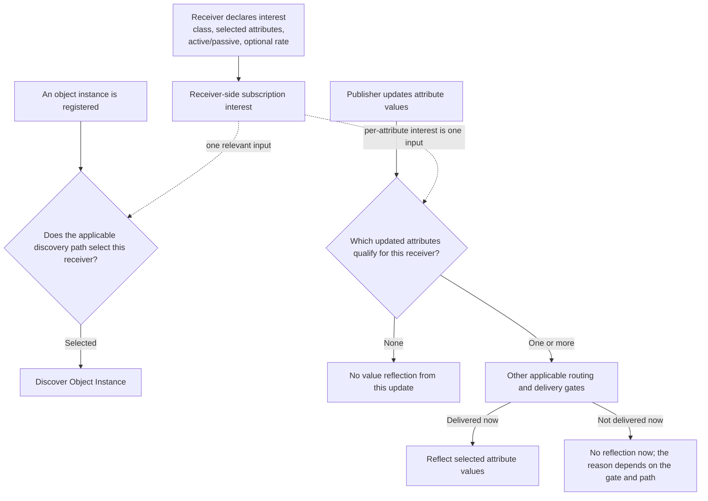
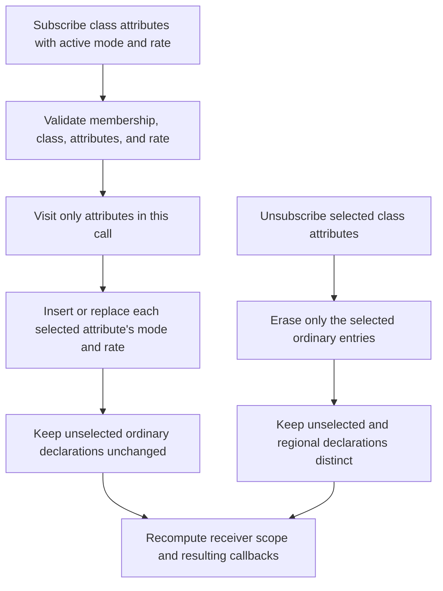
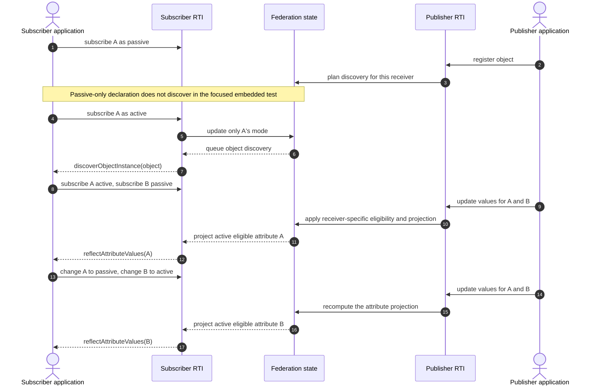
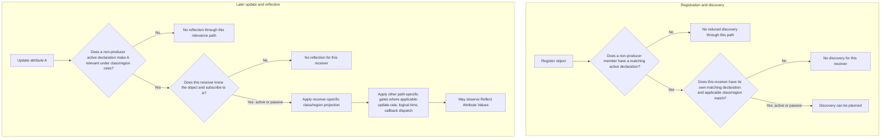
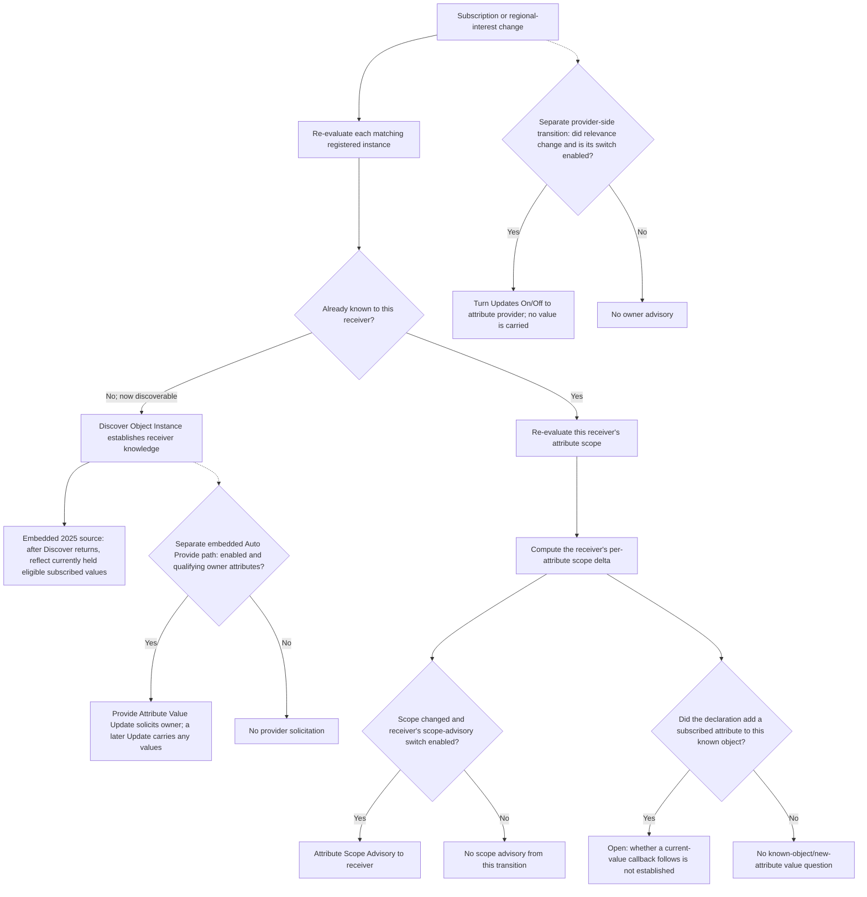
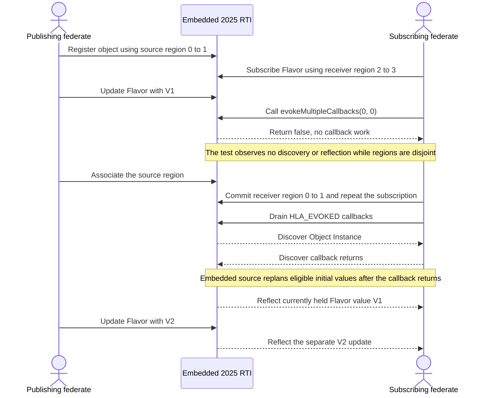
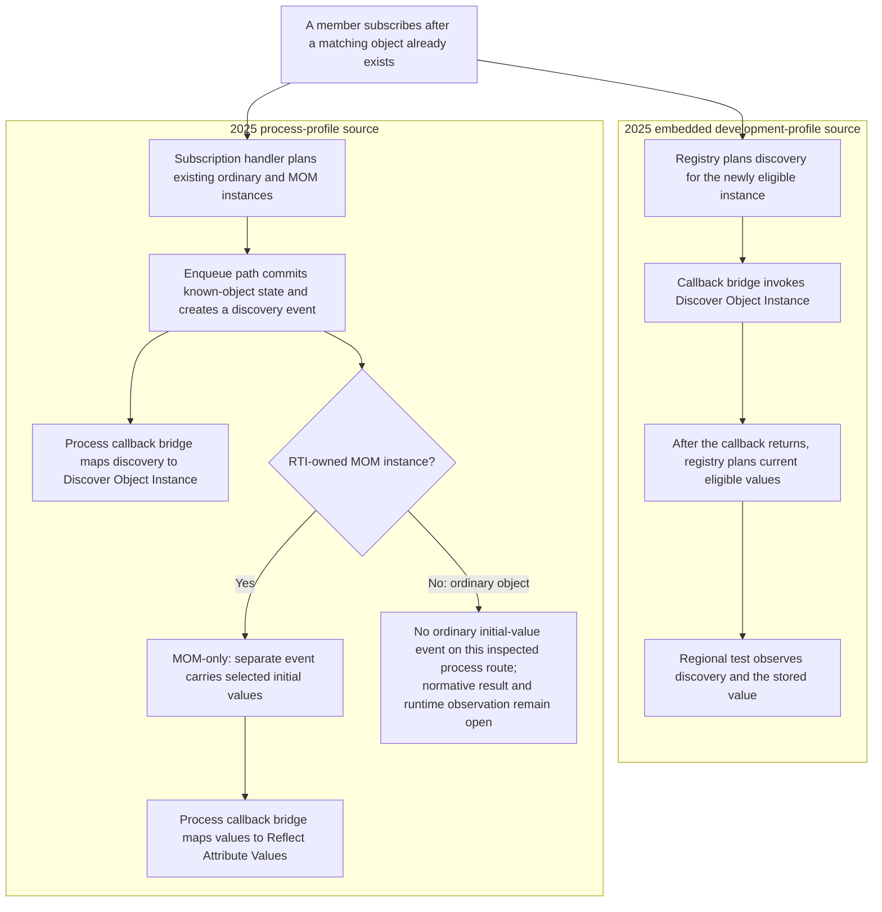
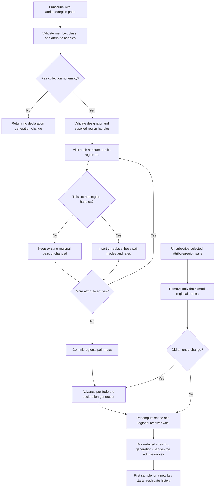

# HLA 1516.1-2025 object-attribute subscription state guide

In HLA, a subscription expresses receiver interest; it does not create a
publisher, object instance, or attribute value, and it does not promise that
every update becomes visible. The 1516.1-2025 API makes the declaration's scope
explicit: an object class, a selected attribute set, an active/passive choice,
and an optional update-rate designator
([`subscribeObjectClassAttributes`](../../third_party/ieee1516.1-2025/include/RTI/RTIambassador.h#L535)).
To reason about the result, keep three things separate: the receiver's declared
interest, whether an object becomes known to that receiver, and which values
from a later update are actually reflected.

## Reader's model: interest is an input to separate outcomes

This concept map names the HLA-facing questions without claiming a complete
decision algorithm or callback ordering. The linked guides below explain the
separate routing, rate, advisory, and callback gates.

Discovery and value reflection are different observations: learning that an
object exists does not, by itself, make every attribute eligible for reflection.
Conversely, this map does not define the discovery or delivery predicates; the
implementation evidence and unresolved boundaries are stated separately below.

The [2025 Object and Interaction Information Flow guide](HLA-2025-OBJECT-AND-INTERACTION-INFORMATION-FLOW-GUIDE.md)
provides the end-to-end map from publication through receiver eligibility and
object knowledge to callback observation. This guide zooms into the receiver's
subscription declaration state. It is deliberately narrower than the adjacent
[DDM/regions](HLA-2025-DATA-DISTRIBUTION-AND-REGIONS-FLOW-GUIDE.md),
[relevance-advisory](HLA-2025-RELEVANCE-ADVISORY-FLOW-GUIDE.md),
[attribute-scope](HLA-2025-ATTRIBUTE-SCOPE-ADVISORY-FLOW-GUIDE.md), and
[update-rate](HLA-2025-ATTRIBUTE-UPDATE-RATE-ADMISSION-FLOW-GUIDE.md) guides:
it traces object-class attribute subscription declarations, not the full
recipient-routing or advisory state machines. Its core declaration-state
diagrams use focused embedded 2025 tests and source; process source and
observations are separately labeled below. It makes no process/embedded parity
claim and does not describe or infer 2010 behavior.

## 1. Ordinary declarations accumulate and change per selected attribute

`subscribeObjectClassAttributes` names a class, an attribute set, an `active`
flag, and an optional update-rate designator. In the embedded registry, each
selected attribute is inserted or replaced in that class's declaration map;
attributes omitted from the call remain as they were. Re-declaring one
attribute does not implicitly erase another. `unsubscribeObjectClassAttributes`
removes the selected ordinary entries; it is a different mutation from a
regional unsubscribe.

The public API calls the mode `active`; the 2025 service-report argument is an
optional *passive* indicator, so the embedded implementation reports the
inverse of the API boolean. Do not read the same boolean spelling into both
surfaces. The internal registry also uses an absent mode to represent the
ordinary unsubscribe mutation; that is not a third public subscription mode.

After a successful change, Umbra replans object scope and may enqueue discovery,
scope-change, or relevance callbacks. The declaration mutation and any later
callback are separate boundaries: callbacks are queued after the registry
transaction, and the details of callback delivery belong to the linked
[callback/service-ordering guide](HLA-2025-CALLBACK-AND-SERVICE-ORDERING-FLOW-GUIDE.md).

## 2. Discovery and value delivery are separate active-subscription gates

Passive declarations are retained state, but the focused embedded tests show
that a passive-only object-attribute subscription does not arrange instance
discovery or ordinary/regional value delivery. An active matching declaration
can make the object known; that does not make every declared attribute active.
For each update, attribute projection still includes only the receiver's
eligible attributes.

This sequence combines transitions from the two focused subscription tests;
it is a teaching view, not a claim that one test executes this exact combined
transcript. Its vertical placement of discovery before later reflection is
scenario chronology, not by itself proof of a general callback-order rule.
See the [object-flow ordering audit](HLA-2025-OBJECT-AND-INTERACTION-INFORMATION-FLOW-GUIDE.md#first-reflection-after-discovery-order-and-evidence-boundary)
for the process-source interpretation, the public test's assertion boundary,
and the missing normative clause text in the pinned interface header.

The focused additive-subscription case observes all three important outcomes:

- Adding passive B leaves active A declared; discovery still occurs through A,
  while a later update containing A and B reflects A only.
- Changing A to passive and B to active changes only those selected entries;
  the later reflection contains B only.
- Making A active again preserves B, and the following reflection contains
  both attributes.

The passive-only case separately exercises object registration followed by a
passive-to-active transition. The object becomes known after the active
subscription, while a passive attribute update is not reflected. “Object is
known” and “this attribute is currently eligible for value delivery” are
different pieces of receiver state; becoming known does not itself activate
every attribute.

### Passive is not a hard delivery veto

That focused case has one publisher and one subscriber, so it tests a
passive-only federation: no other member establishes active relevance. It
does not establish that a passive receiver can never be discovered or receive
values. In the shared 2025 `EmbeddedFederationRegistry` source, discovery and
per-attribute reflection first consider whether a matching active declaration
among non-producer members makes the object or attribute relevant; the
recipient is then checked against its own matching declaration. A passive
recipient may therefore qualify when a different member establishes active
relevance, while its own class and applicable region match still have to pass.
The 2025 process service also holds this registry type, so its subscription,
registration, and update handlers reach the same selection logic. This is
source-derived, not a normative claim or a result asserted by the cited
passive-only test.

The source points are the [discovery relevance resolver](../../cpp/src/internal/federation/federation_registry.cpp#L869)
and the [attribute-update recipient planner](../../cpp/src/internal/federation/federation_registry_attribute_update_recipients.cpp#L76).
The [focused passive-subscription test](../../cpp/tests/passive_object_attribute_subscription_catch2.cpp#L120)
does establish passive-only suppression and the same subscriber's later
passive-to-active transition, but it does not test a separate active member
making a passive receiver eligible. The process-service call path is described
below; the three-role end-to-end result remains untested there, and no 2010
behavior is inferred.

### The process endpoint reuses selection logic, not the delivery route

The 2025 process endpoint does not define a second passive-subscription
selector. Its service stores an `EmbeddedFederationRegistry` reference and
delegates the relevant operations to it:

- Subscription changes go through `setObjectClassAttributeSubscriptionWithScopeChanges`
  and, for a subscribe, the existing-object discovery planner.
- Registration goes through `registerObjectInstance` and the same per-instance
  discovery planner.
- Attribute updates go through `planReceiveOrderAttributeUpdate`; the process
  service then creates recipient events and queues or sends them over process
  sessions. The client-side callback bridge is a separate delivery boundary.

This establishes reuse of the same registry selection source at those process
service call sites, not general embedded/process parity. The public
[timestamped process attribute-retraction test](../../cpp/tests/ieee1516_2025_connection_process_tso_attribute_retraction_fanout_catch2.cpp#L928)
does traverse active subscription, registration, and timestamped reflection
through a configured TCP endpoint, but it does not exercise a passive receiver
or isolate the shared passive-relevance branch. For framing and callback
dispatch after an event has been selected, see the [process-endpoint request
and callback guide](HLA-2025-PROCESS-ENDPOINT-REQUEST-AND-CALLBACK-FLOW-GUIDE.md).

A separate public [receive-order process case](../../cpp/tests/ieee1516_2025_connection_update_attribute_values_reflect_catch2.cpp#L457)
subscribes to the same inherited `Name` attribute through both a parent and a
child object class, sends one untimestamped update, and [observes exactly one
`reflectAttributeValues` callback](../../cpp/tests/ieee1516_2025_connection_update_attribute_values_reflect_catch2.cpp#L817)
under both HLA_EVOKED and HLA_IMMEDIATE. The test also observes a private
service [`recipientCount` of one](../../cpp/tests/ieee1516_2025_connection_update_attribute_values_reflect_catch2.cpp#L873);
the public untimed Update Attribute Values API itself returns `void`. In this fixture,
HLA_IMMEDIATE is paired with pushed process events and HLA_EVOKED with polling,
so this is not evidence that callback model generally dictates transport mode.
It covers active overlapping subscriptions only: it does not establish the
passive three-role branch, delayed subscription evaluation, regional process
projection, or embedded/process parity. The process guide's
[receive-order update trace](HLA-2025-PROCESS-ENDPOINT-REQUEST-AND-CALLBACK-FLOW-GUIDE.md#process-mapping-receive-order-object-attribute-update)
keeps this delivery mechanism separate from the HLA eligibility model.

These are selected observations, not a complete standards or profile matrix.
Class inheritance, publication matches, region overlap, update-rate admission,
late-subscription evaluation, and callback-time rechecks are covered in the
specialized linked guides rather than inferred from this sequence. In
particular, the [Delay Subscription Evaluation guide](HLA-2025-DELAY-SUBSCRIPTION-EVALUATION-FLOW-GUIDE.md)
explains that evaluation timing is separate from the per-attribute
subscription declaration state described here.

### One interest change can produce distinct observable effects

A subscription is not merely a gate on the publisher's *next* update. When an
interest declaration changes, matching registered instances may be evaluated
again. Keep the resulting observations separate:

- If the receiver did not know a now-discoverable instance, `Discover Object
  Instance` establishes its object identity and known class. This can happen
  for an instance that was registered earlier.
- Values already held for the receiver's subscribed attributes may then be
  reflected as the initial state for that newly known object. That reflection
  is not itself a new publisher `Update Attribute Values` invocation. The
  embedded 2025 callback path explicitly performs this after the discovery
  callback returns; its source cites §5.8 for the initial values.
- If the instance was already known, a subscription/region change can instead
  change attribute scope, which is a receiver-facing scope advisory rather
  than another discovery.
- Separately, a change in whether an attribute is relevant can produce an
  owner-facing `Turn Updates On/Off` advisory when that provider's advisory
  switch allows it. This reports relevance; it carries no attribute value and
  goes to a different federate from the subscription receiver.
- In the embedded 2025 path, discovery may also trigger Auto Provide: the RTI
  asks current owners to provide values, but the callback is not the values.
  A provider must make a separate update for data to be delivered. This is
  distinct from both the direct initial reflection and the owner-facing
  relevance advisory. The [Auto Provide guide's neighboring-path table](HLA-2025-AUTO-PROVIDE-FLOW-GUIDE.md#keep-these-neighboring-paths-distinct)
  compares these with explicit Request Attribute Value Update.

### “Late subscription” can mean two different receiver states

The important boundary is not just whether the object was registered before
the subscription. Ask whether this receiver already knows the object:

| Receiver state | Current-value boundary in the bounded 2025 evidence |
| --- | --- |
| Existing object, not yet known to this receiver; subscription makes it discoverable. | The embedded focused test observes discovery and a reflection of the selected stored value. The test stores those reports separately, so relative order comes from the source path, not its assertion ([test](../../cpp/tests/subscribe_object_class_attributes_discovery_catch2.cpp#L180), [callback path](../../cpp/src/internal/runtime/umbra_rti_ambassador_object_instance_lifecycle_callbacks.cpp#L384)). |
| Receiver already knows the object and adds another attribute. | The discovery planner skips known instances and ordinary initial-value planning is discovery-scoped ([planner](../../cpp/src/internal/federation/federation_registry_object_instance_discovery_planning.cpp#L83)). In the process route, an already-known instance does not produce a new discovery; the discovery enqueue path constructs a separate initial-value event only for RTI-owned MOM objects ([process enqueue](../../cpp/src/internal/federation/process_federation_service_object_discovery.cpp#L95)). The surveyed tests do not settle whether an ordinary current value is reflected solely because this new attribute was subscribed. |
| Federate separately invokes Request Attribute Value Update. | This is a distinct provider solicitation: any value requires a later provider update. RTI-owned joined-federate MOM requests have a separate direct-reflection exception; see the [neighboring-path comparison](HLA-2025-AUTO-PROVIDE-FLOW-GUIDE.md#keep-these-neighboring-paths-distinct). |

The source trace for the already-known row is more specific than the test
result. Subscription mutation returns scope-change and relevance-advisory
plans, not current-value recipients ([registry mutation](../../cpp/src/internal/federation/federation_registry_object_attribute_declarations.cpp#L261)).
Replanning discovery skips an instance already present in the receiver's
known-object map ([planner](../../cpp/src/internal/federation/federation_registry_object_instance_discovery_planning.cpp#L83)).
The embedded ordinary initial-value planner is called from the post-discovery
callback path, after `Discover Object Instance` has entered application code
([callback path](../../cpp/src/internal/runtime/umbra_rti_ambassador_object_instance_lifecycle_callbacks.cpp#L375)).
The process subscription handler also replans discovery; its separate initial
attribute-update event is constructed only for an RTI-owned MOM object
([handler](../../cpp/src/internal/federation/process_federation_service_declarations.cpp#L176),
[MOM branch](../../cpp/src/internal/federation/process_federation_service_object_discovery.cpp#L94)).
Thus no ordinary subscription-time snapshot path is visible for an already-
known object in the inspected Umbra source. This is not a normative conclusion:
no focused test isolates whether a value-only callback should occur, and the
licensed §5.8 text remains unreviewed.

The nearest embedded additive/mode test
([case](../../cpp/tests/passive_object_attribute_subscription_catch2.cpp#L355))
declares both attributes before object registration. Its later active/passive
mode changes are followed by explicit publisher updates before reflection is
asserted; it does not isolate whether changing a subscription by itself
reflects an already-held value for an already-known object.

### A subscription can be late relative to two different events

The receiver-state distinction above is separate from whether a publisher has
already sent an update. A discovery-time initial reflection may carry a value
previously set by `Update Attribute Values`; it is still an initial-state
reflection for a newly known object, not a replay of that publisher invocation.
Contrast it with an earlier update whose recipient decision is still pending:

| | Existing object becomes newly discoverable | A prior send is pending later eligibility evaluation |
| --- | --- | --- |
| What is late? | The receiver's interest declaration follows object registration, and the receiver did not previously know that object. | The publisher's update precedes its delivery-time eligibility decision; HLA-level DSE defers that decision. Umbra represents this with a retained candidate. |
| What may be observed? | Discovery followed by initial reflection of currently held, eligible subscribed values in the embedded 2025 source/test path; the licensed §5.8 interpretation remains open. | Delivery of that already-issued update if it passes the later eligibility check; a TSO callback also has its time-delivery boundary. |
| What this does not mean | It is not a callback replay of a past `Update Attribute Values` call, though the current value may have come from one. | It is not a general snapshot of current state caused by every new subscription. |

See the [Delay Subscription Evaluation guide](HLA-2025-DELAY-SUBSCRIPTION-EVALUATION-FLOW-GUIDE.md)
for the HLA-level deferred-eligibility distinction and Umbra's bounded
route-only candidate mechanism. The already-known-object/new-attribute case in
the row above remains unresolved for ordinary current-value reflection; DSE
evidence does not answer it because it concerns a previously sent update, not
a discovery-time state snapshot.

For an already-known object, keep receiver scope advice, provider relevance
advice, and a possible current-value reflection as separate effects. The
inspected 2025 registry returns scope-change and owner-facing relevance plans,
not current-value recipients. In particular, a scope advisory is not a
value callback, and it does not decide the unresolved question of whether
adding a subscribed attribute to a known object yields its current value. The
diagram therefore evaluates the receiver-advisory gate and the new-attribute
value question independently.

The closest embedded additive-subscription test changes per-attribute modes
after discovery and checks the projection of a later publisher update; it does
not isolate a value-only callback between the subscription and that update
([focused case](../../cpp/tests/passive_object_attribute_subscription_catch2.cpp#L355)).
The process advisory test likewise subscribes after discovery and observes an
owner relevance advisory, but does not assert subscriber value reflection
([focused case](../../cpp/tests/process_federation_service_attribute_relevance_advisory_catch2.cpp#L78)).
Keep both as bounded evidence, not proof that either endpoint must or must not
send a current value. RTI-owned MOM initial values remain a separate special
path and must not be used to fill in the ordinary-object answer.

The diagram is an HLA mental model for the distinct state and recipient
boundaries. It is not a total callback-order guarantee across federates. The
initial-value ordering shown in the callout is observed in Umbra's embedded
2025 source; the process-profile path is called out below rather than assumed
to be equivalent. Verify the exact normative wording and ordering against an
authorized copy of IEEE 1516.1-2025 §5.8 before treating the source comment as
a conformance conclusion; the [official IEEE listing](https://standards.ieee.org/ieee/1516.1/6688/)
does not expose the licensed clause text.

The embedded regional-routing test demonstrates the distinction between a
stored value and a later update: an already-registered object becomes
discoverable after regional relevance is established, the latest
accepted value is reflected with discovery, and a subsequent publisher update
is a separate reflection ([focused test](../../cpp/tests/regional_object_attribute_routing_catch2.cpp#L198)).
The ordinary-subscription advisory test likewise registers first and subscribes
later, then checks the provider's advisory separately ([focused test](../../cpp/tests/attribute_relevance_advisory_catch2.cpp#L335)).
These are embedded 2025 examples; neither establishes process-profile behavior
or the full normative callback ordering.

#### Embedded trace: late regional relevance exposes the stored value

This focused scenario makes the timing concrete. A publisher registers an
object with a source region, while the subscriber's regional declaration is
disjoint. The publisher accepts value V1 while the object is not discoverable
to that receiver. When committed region bounds later overlap, the receiver
learns the object and the embedded callback path reflects the then-current V1;
a subsequent publisher update to V2 is a separate reflection.

The [focused regional-routing test](../../cpp/tests/regional_object_attribute_routing_catch2.cpp#L263)
asserts the disjoint no-callback case, one discovery, one reflection containing
V1, and a separate later reflection containing V2. The [embedded callback
bridge](../../cpp/src/internal/runtime/umbra_rti_ambassador_object_instance_lifecycle_callbacks.cpp#L325)
invokes `Discover Object Instance` before asking the registry to plan initial
reflections after that callback returns. The test stores discovery and
reflection reports separately, so the relative ordering in the diagram is
source-observed, not a callback-order assertion made by that test. This is an
embedded 2025 trace, not a normative rule or process-profile result.

#### Process late-subscription path: same selectors, an unresolved initial-value edge

The 2025 process subscription handler asks the shared registry to plan
discoveries for already-registered instances, then routes discovery, scope,
and provider-advisory work through process sessions. Its ordinary discovery
enqueue path establishes registry-known state before exposing the discovery
event and plans initial owner advisories. The callback bridge's discovery
delivery itself invokes `Discover Object Instance`; the bounded source scan
found the ordinary initial-reflection planner called only from the embedded
callback path. The process enqueue code has a separate initial-value branch
for RTI-owned MOM objects, which does not settle ordinary object behavior.
There is bounded positive evidence for that special branch: the configured
process [joined-federate MOM report-file case](../../cpp/tests/ieee1516_2025_connection_process_joined_federate_mom_report_file_catch2.cpp#L359)
subscribes after the MOM objects exist, discovers two instances, and observes
selected attribute reflections; the subject's reflection contains its
federate name and report-file path. That MOM-specific result must not be
generalized to an ordinary registered object; see the [joined-federate MOM
guide's process evidence](HLA-2025-JOINED-FEDERATE-MOM-OBJECT-LIFECYCLE-FLOW-GUIDE.md#separate-2025-process-endpoint-evidence).

That is an implementation-source difference to investigate, not a finding of
nonconformance. The private process advisory test subscribes a second
attribute after the receiver already knows the object and checks the owner's
advisory; it does not test late discovery or initial values. The public process
regional-advisory test subscribes before registration. Thus the source and
tests available in this survey do not establish the process endpoint's
ordinary late-subscription initial-reflection result. Resolve it against the
licensed §5.8 text and a focused process observation before drawing a
parity or conformance conclusion. Push sends and pull queues also serve
different sessions, so handler enqueue order is not a global callback order.

For a reader, keep two effects distinct: becoming aware of an existing
object, and receiving its already-stored attribute values. The following is
only a source/profile comparison. The embedded implementation cites §5.8 in a
source comment, but this diagram does not independently verify that licensed
text or establish what the process profile is required to do.

The process lane separates the registry's known-object transition from the
application-facing discovery callback. The subscription handler sends
ordinary and MOM discoveries through the same enqueue path, but that path
constructs a separate initial attribute-update event only when the discovered
object is RTI-owned MOM ([MOM-only branch](../../cpp/src/internal/federation/process_federation_service_object_discovery.cpp#L94)).
Thus the inspected process route has no ordinary-object initial-value event;
this is source evidence about Umbra's route, not a statement of what HLA
requires. The public process discovery test subscribes before registration and
asserts discovery under both callback models, with no reflection observer
([test](../../cpp/tests/ieee1516_2025_connection_object_discovery_catch2.cpp#L458)).
The process MOM test observes the separate values path but does not assert
callback order ([MOM test](../../cpp/tests/ieee1516_2025_connection_process_joined_federate_mom_report_file_catch2.cpp#L359)).
The private ordinary post-registration subscription test checks an owner
advisory, not subscriber value reflection
([advisory test](../../cpp/tests/process_federation_service_attribute_relevance_advisory_catch2.cpp#L78)).
Licensed §5.8 text remains unreviewed, so the ordinary result is still a
source/test/normative question—not a conformance finding or a profile-parity
conclusion.

The embedded-to-process comparison is not a global callback-order claim: the
process push and pull paths use different session mechanisms. Sources and
bounded test evidence: [embedded discovery callback](../../cpp/src/internal/runtime/umbra_rti_ambassador_object_instance_lifecycle_callbacks.cpp#L325),
[embedded current-value planning](../../cpp/src/internal/runtime/umbra_rti_ambassador_object_instance_lifecycle_callbacks.cpp#L375),
[initial-reflection planner](../../cpp/src/internal/federation/federation_registry_object_instance_discovery_planning.cpp#L154),
[regional stored-value observation](../../cpp/tests/regional_object_attribute_routing_catch2.cpp#L668),
[process subscription handler](../../cpp/src/internal/federation/process_federation_service_declarations.cpp#L176),
[process discovery enqueue](../../cpp/src/internal/federation/process_federation_service_object_discovery.cpp#L11),
[MOM-only initial-value branch](../../cpp/src/internal/federation/process_federation_service_object_discovery.cpp#L95),
[process client discovery dispatch](../../cpp/src/internal/federation/process_federation_client_callback_dispatch.cpp#L84),
[process discovery callback mapping](../../cpp/src/internal/federation/process_federation_callback_bridge.cpp#L610),
[process client value dispatch](../../cpp/src/internal/federation/process_federation_client_callback_dispatch.cpp#L23),
[process attribute-value callback mapping](../../cpp/src/internal/federation/process_federation_callback_bridge.cpp#L261),
[joined-federate MOM observation](../../cpp/tests/ieee1516_2025_connection_process_joined_federate_mom_report_file_catch2.cpp#L359).

## 3. Regional declarations are separate per-attribute region entries

`subscribeObjectClassAttributesWithRegions` addresses attribute/region-set
pairs. The embedded registry records active/passive mode and update-rate
designator for each supplied attribute/region entry. Regional declarations are
stored separately from ordinary declarations; keep the two unsubscribe forms
and their region lifetimes distinct.

The passive/regional test verifies that a passive overlapping pair does not
discover or reflect for the tested object. Replacing that pair as active makes
the object discoverable and permits an overlapping update. It also submits
attribute entries with empty region sets and different active/rate arguments;
the retained pair's queried rate and active delivery remain unchanged in that
case. For the overlap calculation and region resource lifecycle, use the
[DDM/regions guide](HLA-2025-DATA-DISTRIBUTION-AND-REGIONS-FLOW-GUIDE.md).

### A source/test boundary around the empty-region case

For a nonempty attribute/region-pair map whose region sets contain no handles,
the registry leaves the regional pairs unchanged but still advances the
receiver's `subscriptionGeneration`; a fully empty pair map returns before
that update. Regional unsubscribe differs: its generation changes only when
at least one stored pair is actually removed. The generation is stored with
the receiver's declaration set, copied into each recipient projection, and
included in the update-rate admission key. The gate admits the first
observation for a new key, and its deterministic unit test verifies fresh
history for the same receiver/object/attribute identity under a changed
generation. The combined
source and unit-test chain therefore implies that this empty-region call can
start fresh admission history for that receiver's active attribute streams,
despite adding no regional pair. The public passive-subscription test checks
the retained mode, rate, and later delivery, but does not seed a prior rate
window and assert its reset across this exact call. So this is a source/test-
derived implementation inference, not a normative conclusion or an end-to-end
observation. The test source itself comments that §9.8.4 makes the empty-region
call a no-op ([test-author interpretation](../../cpp/tests/passive_object_attribute_subscription_catch2.cpp#L253));
that comment records the test author's reading, not an independent verification
of the normative clause. The local checkout does not contain the full licensed standard;
the [official IEEE listing](https://standards.ieee.org/ieee/1516.1/6688/)
indicates access via subscription. Keep the conformance question open until an
authorized copy of the precise regional-subscription rule is reviewed. See the
[update-rate admission guide](HLA-2025-ATTRIBUTE-UPDATE-RATE-ADMISSION-FLOW-GUIDE.md)
for the separate rate gate.

## Evidence map

| Boundary | Source or focused test | What it supports |
| --- | --- | --- |
| 2025 public ordinary subscribe/unsubscribe | [RTIambassador.h:535](../../third_party/ieee1516.1-2025/include/RTI/RTIambassador.h#L535), [RTIambassador.h:563](../../third_party/ieee1516.1-2025/include/RTI/RTIambassador.h#L563) | Selected attribute set, active flag, update-rate designator, and separate unsubscribe service |
| 2025 public regional subscribe/unsubscribe | [RTIambassador.h:1559](../../third_party/ieee1516.1-2025/include/RTI/RTIambassador.h#L1559), [RTIambassador.h:1578](../../third_party/ieee1516.1-2025/include/RTI/RTIambassador.h#L1578) | Attribute/region pairs and the distinct regional unsubscribe form |
| Embedded ordinary declaration update | [Ambassador entry point:19](../../cpp/src/internal/runtime/umbra_rti_ambassador_object_class_subscription.cpp#L19), [registry per-attribute upsert:261](../../cpp/src/internal/federation/federation_registry_object_attribute_declarations.cpp#L261), [selected attribute writes:359](../../cpp/src/internal/federation/federation_registry_object_attribute_declarations.cpp#L359) | Validation, per-attribute mode/rate replacement, and scope recalculation |
| Embedded regional mutation | [Ambassador entry point:463](../../cpp/src/internal/runtime/umbra_rti_ambassador_object_class_subscription.cpp#L463), [registry regional update:422](../../cpp/src/internal/federation/federation_registry_object_attribute_declarations.cpp#L422), [regional pair removal:582](../../cpp/src/internal/federation/federation_registry_object_attribute_declarations.cpp#L582) | Separate regional map, region validation, per-pair changes, and regional removal |
| Passive versus active delivery/discovery | [Discovery resolver](../../cpp/src/internal/federation/federation_registry.cpp#L869), [attribute-update recipient planner](../../cpp/src/internal/federation/federation_registry_attribute_update_recipients.cpp#L76), [passive object subscription test](../../cpp/tests/passive_object_attribute_subscription_catch2.cpp#L120) | Source permits a matching passive receiver after non-producer active relevance; the focused embedded test covers passive-only suppression and passive-to-active transition, not a separate active establisher plus passive receiver |
| Process-service selection and event boundary | [Process service registry reference](../../cpp/src/internal/federation/process_federation_service.hpp#L681), [subscription handler](../../cpp/src/internal/federation/process_federation_service_declarations.cpp#L176), [registration handler](../../cpp/src/internal/federation/process_federation_service_request_handlers.cpp#L502), [receive-order update planner call](../../cpp/src/internal/federation/process_federation_service_attribute_value_updates.cpp#L44), [process endpoint guide](HLA-2025-PROCESS-ENDPOINT-REQUEST-AND-CALLBACK-FLOW-GUIDE.md) | Process handlers call the same registry selection methods, then use process-session event delivery; the cited process test exercises active, timestamped traffic, not the passive three-role branch |
| Receive-order process reflection with overlapping classes | [Shared recipient/passel planner call](../../cpp/src/internal/federation/process_federation_service_attribute_value_updates.cpp#L44), [push event emission](../../cpp/src/internal/federation/process_federation_service_attribute_value_updates.cpp#L304), [private result](../../cpp/src/internal/federation/process_federation_service_attribute_value_updates.cpp#L325), [public process test](../../cpp/tests/ieee1516_2025_connection_update_attribute_values_reflect_catch2.cpp#L457) | One untimestamped update is observed once despite parent-plus-child active declarations, under both callback-model sections. The fixture pairs HLA_IMMEDIATE with push and HLA_EVOKED with polling; it does not establish passive three-role, DSE, regional, or embedded/process parity |
| Late discovery, initial values, and separate observer effects | [Embedded callback path](../../cpp/src/internal/runtime/umbra_rti_ambassador_object_instance_lifecycle_callbacks.cpp#L266), [initial reflection planner](../../cpp/src/internal/federation/federation_registry_object_instance_discovery_planning.cpp#L154), [regional discovery/reflection test](../../cpp/tests/regional_object_attribute_routing_catch2.cpp#L198), [owner advisory test](../../cpp/tests/attribute_relevance_advisory_catch2.cpp#L335), [Auto Provide neighboring-path comparison](HLA-2025-AUTO-PROVIDE-FLOW-GUIDE.md#keep-these-neighboring-paths-distinct) | Embedded 2025 source/test evidence separates discovery, direct initial current-value reflection, provider-facing relevance advice, and the distinct provider solicitation; it is not normative verification or process parity |
| Process late-subscription evidence boundary | [Process subscription handler](../../cpp/src/internal/federation/process_federation_service_declarations.cpp#L176), [process discovery enqueue](../../cpp/src/internal/federation/process_federation_service_object_discovery.cpp#L11), [discovery callback mapping](../../cpp/src/internal/federation/process_federation_callback_bridge.cpp#L610), [attribute-value callback mapping](../../cpp/src/internal/federation/process_federation_callback_bridge.cpp#L261), [public process discovery test](../../cpp/tests/ieee1516_2025_connection_object_discovery_catch2.cpp#L458), [joined-federate MOM initial-value case](../../cpp/tests/ieee1516_2025_connection_process_joined_federate_mom_report_file_catch2.cpp#L359), [private process advisory test](../../cpp/tests/process_federation_service_attribute_relevance_advisory_catch2.cpp#L78) | The process enqueue path constructs a separate initial-value event only for RTI-owned MOM objects. The public ordinary discovery test subscribes before registration and asserts discovery only; the MOM test covers its separate path without callback-order assertions. No focused process test establishes ordinary late-subscription values, and licensed §5.8 remains unreviewed. This is an open source/test/normative question, not a conformance finding |
| Additive per-attribute mode changes | [Additive subscription test:355](../../cpp/tests/passive_object_attribute_subscription_catch2.cpp#L355) | Adding B preserves A; per-attribute active/passive replacement changes projection without discarding other entries |
| Empty regional set and rate-generation caveat | [Focused regional assertions:244](../../cpp/tests/passive_object_attribute_subscription_catch2.cpp#L244), [test-author §9.8.4 comment:253](../../cpp/tests/passive_object_attribute_subscription_catch2.cpp#L253), [per-federate generation:2335](../../cpp/src/internal/federation/federation_registry.hpp#L2335), [generation update:524](../../cpp/src/internal/federation/federation_registry_object_attribute_declarations.cpp#L524), [generation in admission key:96](../../cpp/src/internal/runtime/umbra_rti_ambassador.cpp#L96), [first-use gate:19](../../cpp/src/internal/time/update_rate_gate.cpp#L19), [generation-key unit case:40](../../cpp/tests/ieee1516_2025_update_rate_gate_unit_catch2.cpp#L40) | Test source attributes the empty-region expectation to §9.8.4; this is not an independent normative check. The unit case verifies fresh history for a changed generation key; no public integration test isolates the empty-region call's effect |

The ordinary and regional declaration diagrams and their focused tests are
2025 embedded-development-profile evidence. The late-subscription model keeps
the HLA-facing consequences legible while separately recording that the
inspected process discovery route creates initial values only for RTI-owned
MOM objects. Ordinary process value behavior and the normative §5.8 rule
remain open. This is not a broad process parity claim, a conformance finding,
or 2010 behavior. For service-report projection, see [service invocation
reporting](HLA-2025-SERVICE-INVOCATION-REPORTING-FLOW-GUIDE.md); for class-level
declaration callbacks, see [relevance advisories](HLA-2025-RELEVANCE-ADVISORY-FLOW-GUIDE.md).

