# HLA 1516.1-2025 object-attribute subscription state guide

In HLA, a subscription expresses receiver interest; it does not create a
publisher, object instance, or attribute value, and it does not promise that
every update becomes visible. The 1516.1-2025 API makes the declaration's scope
explicit: an object class, a selected attribute set, an active/passive choice,
and an optional update-rate designator
([`subscribeObjectClassAttributes`](../../third_party/ieee1516.1-2025/include/RTI/RTIambassador.h#L535)).
To reason about the result, keep three things separate: the receiver's declared
interest, whether an object becomes known to that receiver, and which values
from a later update are actually reflected.

## Reader's model: interest is an input to separate outcomes

This concept map names the HLA-facing questions without claiming a complete
decision algorithm or callback ordering. The linked guides below explain the
separate routing, rate, advisory, and callback gates.

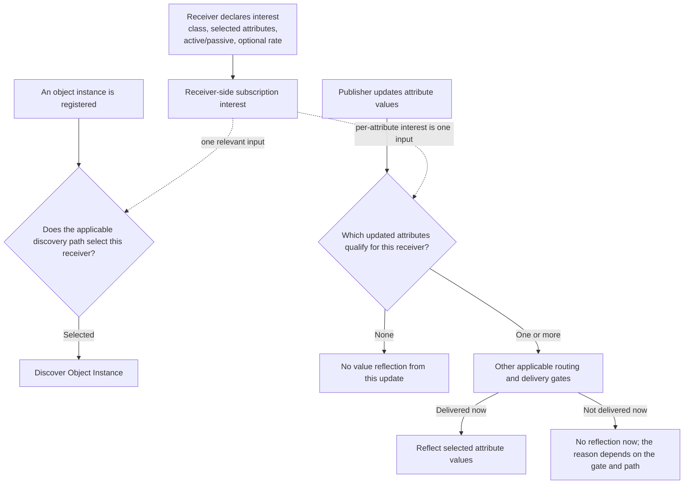

Discovery and value reflection are different observations: learning that an
object exists does not, by itself, make every attribute eligible for reflection.
Conversely, this map does not define the discovery or delivery predicates; the
implementation evidence and unresolved boundaries are stated separately below.

The [2025 Object and Interaction Information Flow guide](HLA-2025-OBJECT-AND-INTERACTION-INFORMATION-FLOW-GUIDE.md)
provides the end-to-end map from publication through receiver eligibility and
object knowledge to callback observation. This guide zooms into the receiver's
subscription declaration state. It is deliberately narrower than the adjacent
[DDM/regions](HLA-2025-DATA-DISTRIBUTION-AND-REGIONS-FLOW-GUIDE.md),
[relevance-advisory](HLA-2025-RELEVANCE-ADVISORY-FLOW-GUIDE.md),
[attribute-scope](HLA-2025-ATTRIBUTE-SCOPE-ADVISORY-FLOW-GUIDE.md), and
[update-rate](HLA-2025-ATTRIBUTE-UPDATE-RATE-ADMISSION-FLOW-GUIDE.md) guides:
it traces object-class attribute subscription declarations, not the full
recipient-routing or advisory state machines. Its core declaration-state
diagrams use focused embedded 2025 tests and source; process source and
observations are separately labeled below. It makes no process/embedded parity
claim and does not describe or infer 2010 behavior.

## 1. Ordinary declarations accumulate and change per selected attribute

`subscribeObjectClassAttributes` names a class, an attribute set, an `active`
flag, and an optional update-rate designator. In the embedded registry, each
selected attribute is inserted or replaced in that class's declaration map;
attributes omitted from the call remain as they were. Re-declaring one
attribute does not implicitly erase another. `unsubscribeObjectClassAttributes`
removes the selected ordinary entries; it is a different mutation from a
regional unsubscribe.

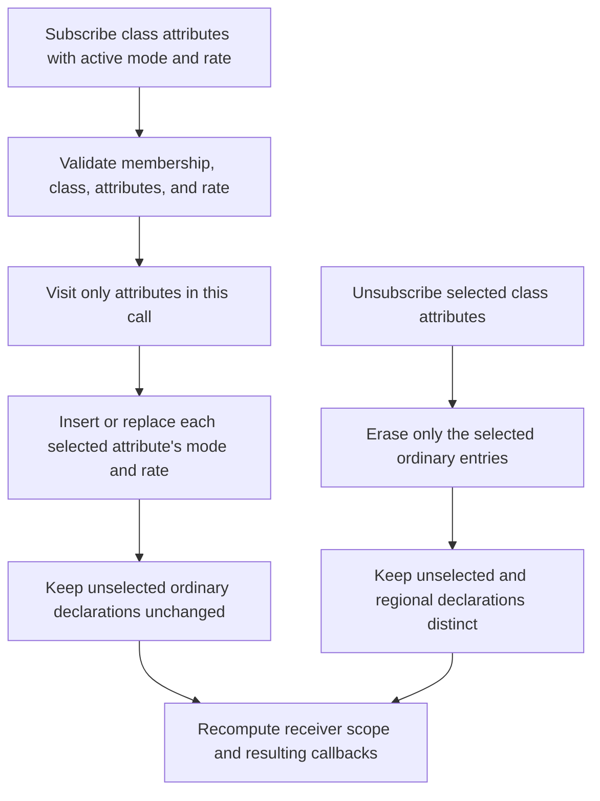

The public API calls the mode `active`; the 2025 service-report argument is an
optional *passive* indicator, so the embedded implementation reports the
inverse of the API boolean. Do not read the same boolean spelling into both
surfaces. The internal registry also uses an absent mode to represent the
ordinary unsubscribe mutation; that is not a third public subscription mode.

After a successful change, Umbra replans object scope and may enqueue discovery,
scope-change, or relevance callbacks. The declaration mutation and any later
callback are separate boundaries: callbacks are queued after the registry
transaction, and the details of callback delivery belong to the linked
[callback/service-ordering guide](HLA-2025-CALLBACK-AND-SERVICE-ORDERING-FLOW-GUIDE.md).
In the embedded rate path, a declaration-generation change also selects a new
per-subscription admission-history key; the
[update-rate guide](HLA-2025-ATTRIBUTE-UPDATE-RATE-ADMISSION-FLOW-GUIDE.md#subscription-mutations-can-start-a-new-rate-history-epoch)
traces which mutation paths advance it. When DSE retains an update candidate,
its delivery-time projection uses the current declaration state and generation;
see the [DSE boundary explanation](HLA-2025-DELAY-SUBSCRIPTION-EVALUATION-FLOW-GUIDE.md#a-retained-candidate-uses-the-current-subscription-generation-at-delivery).

### A selected unsubscribe changes later values on existing instances

The 2025 public C++ TCK exercises one subscriber removing `Value` while keeping
`Name`. Both attributes had already been reflected for two discovered objects.
After the call, updates containing both attributes reflect only `Name` to that
subscriber; an independent subscriber still receives both. A `Value`-only
update produces no reflection for the subscriber that removed it, while the
other subscriber still receives the value.

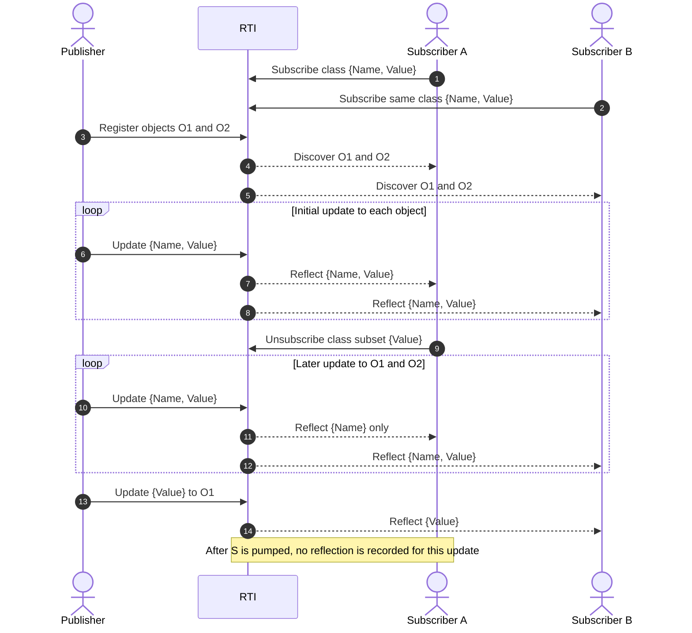

This is a public value-delivery observation, not a direct query of internal
scope state. The case does not assert an `attributesOutOfScope` advisory or
describe the effect on an instance registered after the unsubscribe. Its
recorded installed-package run passed under `HLA_EVOKED` and `HLA_IMMEDIATE`;
that is Umbra adapter evidence, not independent-provider conformance. The
existing TCK mapping ([scenario catalog](../../compliance/catalogs/cpp-tck-scenario-catalog.json#L20580))
points to IEEE 1516.1-2025 §5.9, p. 98, lines 11, 17, and 32; the licensed
clause text was not independently reviewed here.

### Whole-class and selected-subset unsubscribe have different observed effects

These are separate public TCK fixtures, not two branches run against one shared
federation. Both begin with an active subscription to `Name` and `Value`. The
selected-subset case preserves `Name` delivery for the caller and leaves the
peer's full subscription intact. The whole-class case observes no later
reflection for an already-known object and no discovery callback for an object
registered after the call. Neither outcome can be inferred by passing an empty
set to the selected-subset service; that input remains a separate unresolved
profile seam below.

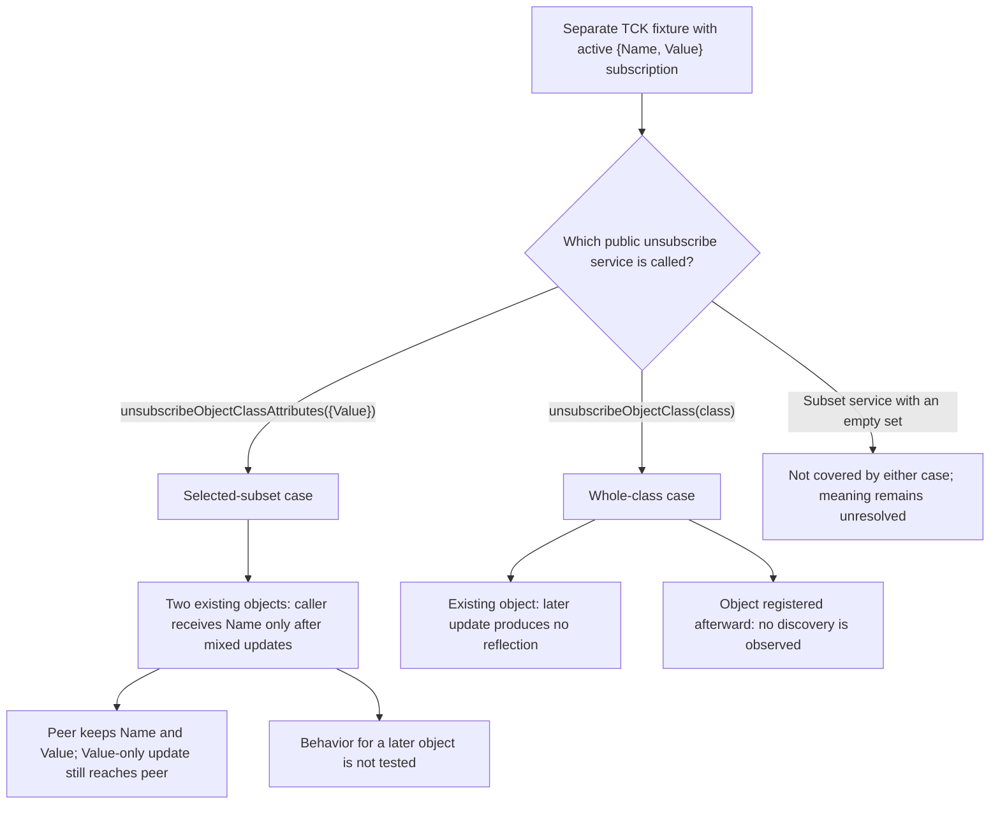

The whole-class case first verifies both attributes arrive, then calls
`unsubscribeObjectClass`, registers another object, and checks that no discovery
was recorded for it. A later update to the original object produces no
reflection. Its recorded installed-package result also passed under
`HLA_EVOKED` and `HLA_IMMEDIATE`; these are Umbra adapter observations, not
independent-provider conformance. Neither the whole-class nor subset case
asserts an `attributesOutOfScope` advisory.

### Empty-set subset unsubscribe is an unresolved profile seam

The pinned API has a separate whole-class `unsubscribeObjectClass` service and
the subset-oriented `unsubscribeObjectClassAttributes` service. Do not assume
from those signatures alone that an empty set passed to the subset service
means “unsubscribe everything.” In the current 2025 source, the embedded and
process routes interpret that input differently:

| Route | Empty set with an existing class declaration | Evidence boundary |
| --- | --- | --- |
| Embedded | The ambassador forwards the supplied set unchanged; the registry's selected-attribute erase loop removes nothing. The registry still advances the receiver-wide subscription generation for an existing class declaration. | [Embedded service entry](../../cpp/src/internal/runtime/umbra_rti_ambassador_object_class_subscription.cpp#L331), [registry mutation](../../cpp/src/internal/federation/federation_registry_object_attribute_declarations.cpp#L302). This describes current source behavior, not the intended API meaning. |
| Process | The client transmits the empty vector unchanged; the process service expands it to the class's currently stored ordinary `subscribedAttributes` before calling the registry. That expansion does not enumerate the separate regional entries. | [Process client forwarding](../../cpp/src/internal/federation/process_federation_client_declaration_services.cpp#L461), [service-side expansion](../../cpp/src/internal/federation/process_federation_service_declarations.cpp#L200). This is a process-route behavior, not proof of embedded/process parity or a normative rule. |

The bounded test scan found empty-set unsubscribe calls only in invalid-handle
cases; it found no focused public case that starts with valid ordinary
subscriptions and compares the resulting declaration state across both
profiles. The pinned header documents the two service signatures but does not
settle the empty-set meaning ([whole-class overload](../../third_party/ieee1516.1-2025/include/RTI/RTIambassador.h#L550),
[subset overload](../../third_party/ieee1516.1-2025/include/RTI/RTIambassador.h#L563)).
Treat this as an open source/test/API question. Do not rely on an empty subset
as either a no-op or a whole-class unsubscribe until the applicable normative
text and a focused valid-state observation are reviewed.

## 2. Discovery and value delivery are separate active-subscription gates

Passive declarations are retained state, but the focused embedded tests show
that a passive-only object-attribute subscription does not arrange instance
discovery or ordinary/regional value delivery. An active matching declaration
can make the object known; that does not make every declared attribute active.
For each update, attribute projection still includes only the receiver's
eligible attributes.

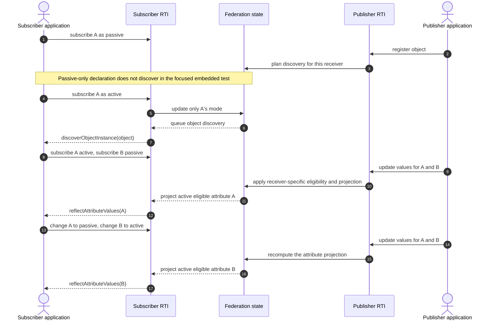

This sequence combines transitions from the two focused subscription tests;
it is a teaching view, not a claim that one test executes this exact combined
transcript. Its vertical placement of discovery before later reflection is
scenario chronology, not by itself proof of a general callback-order rule.
See the [object-flow ordering audit](HLA-2025-OBJECT-AND-INTERACTION-INFORMATION-FLOW-GUIDE.md#first-reflection-after-discovery-order-and-evidence-boundary)
for the process-source interpretation, the public test's assertion boundary,
and the missing normative clause text in the pinned interface header.

The focused additive-subscription case observes all three important outcomes:

- Adding passive B leaves active A declared; discovery still occurs through A,
  while a later update containing A and B reflects A only.
- Changing A to passive and B to active changes only those selected entries;
  the later reflection contains B only.
- Making A active again preserves B, and the following reflection contains
  both attributes.

The passive-only case separately exercises object registration followed by a
passive-to-active transition. The object becomes known after the active
subscription, while a passive attribute update is not reflected. “Object is
known” and “this attribute is currently eligible for value delivery” are
different pieces of receiver state; becoming known does not itself activate
every attribute.

### Passive is not a hard delivery veto

That focused case has one publisher and one subscriber, so it tests a
passive-only federation: no other member establishes active relevance. It
does not establish that a passive receiver can never be discovered or receive
values. In the shared 2025 `EmbeddedFederationRegistry` source, discovery and
per-attribute reflection first consider whether a matching active declaration
among non-producer members makes the object or attribute relevant; the
recipient is then checked against its own matching declaration. A passive
recipient may therefore qualify when a different member establishes active
relevance, while its own class and applicable region match still have to pass.

For discovery, the implementation keeps the active-relevance result as one
boolean while scanning non-producer declarations across the registered class
hierarchy and discoverable instance attributes, then performs the receiver's
own declaration lookup separately ([active scan](../../cpp/src/internal/federation/federation_registry.cpp#L915),
[receiver selection](../../cpp/src/internal/federation/federation_registry.cpp#L1037)).
The gate retains no attribute or class identity, so the second scan does not
pair the active-establisher entry with the passive receiver's entry. For
example, a publisher can register an object with attributes A and B; member X's
active declaration for A can establish discovery relevance, while member Y's
passive declaration for B can separately satisfy Y's receiver check, assuming
each side's class and region conditions match. This does not activate B for
value delivery: the update planner recomputes active relevance for each
updated attribute, so Y's passive B declaration alone cannot receive a B
reflection when no active B declaration exists. This source-derived example
is not an HLA rule or a result asserted by the cited passive-only test; that
test has one publisher and one subscriber
([test setup](../../cpp/tests/passive_object_attribute_subscription_catch2.cpp#L120)).
Keep the discovery establisher separate from the later value-relevance
witness. If a distinct member Z has active B and its class and region match the
update, that declaration can establish relevance for a later B update; the
planner then checks Y's own passive B declaration and region separately. X's
active A does not establish B's update. The per-attribute scan and receiver
gate are separate
([active relevance](../../cpp/src/internal/federation/federation_registry_attribute_update_recipients.cpp#L153),
[receiver gate](../../cpp/src/internal/federation/federation_registry_attribute_update_recipients.cpp#L326)).
This P/X/Y/Z sequence remains source-derived; no focused test asserts it.
The two discovery passes also walk class ancestry independently. The active
scan can establish relevance at one class depth, while the receiver scan can
select a different closest class through its own declaration; the active
member's class does not choose the receiver's reported class. The public C++
TCK's [per-federate class-view scenario](https://github.com/sheepfling/umbra/blob/c9c5a9e410539b039cd8bba35b53d0ef2b24d180/packages/hla-rti-cpp-tck/src/tck_object_registration_discovery_scenarios.cpp#L784)
asserts base and derived subscribers receive their respective class views for
one registered derived object and that each `getKnownObjectClassHandle`
matches ([assertions](https://github.com/sheepfling/umbra/blob/c9c5a9e410539b039cd8bba35b53d0ef2b24d180/packages/hla-rti-cpp-tck/src/tck_object_registration_discovery_scenarios.cpp#L883)).
Both subscriptions are active in that scenario, so it does not test a passive
receiver whose active establisher matches at another class depth. That mixed
cross-member, cross-depth result remains source-derived and untested.
The receiver-local `Attributes In/Out Of Scope` planner is a separate active-only
check with its own callback boundary; see the
[Attribute Scope guide](HLA-2025-ATTRIBUTE-SCOPE-ADVISORY-FLOW-GUIDE.md#scope-is-a-receiver-local-predicate).

The 2025 process service also holds this registry type. Its subscription
handler delegates the declaration change and existing-object discovery plan
to the registry ([subscription route](../../cpp/src/internal/federation/process_federation_service_declarations.cpp#L214));
registration delegates instance creation and per-instance discovery to the
same registry ([registration route](../../cpp/src/internal/federation/process_federation_service_request_handlers.cpp#L486)).
This establishes shared selection logic, not a process three-role result.

There is a focused public process object-subscription test, but its fixture
joins one member and exercises active Subscribe, passive Subscribe, and
Unsubscribe while checking that member's stored declaration
([test](../../cpp/tests/ieee1516_2025_connection_public_object_subscription_catch2.cpp#L458)).
It does not register an ordinary object or introduce a separate active
establisher. It therefore covers process request/declaration routing, not the
cross-member discovery branch described above. No focused process test
establishes a separate active member making a passive receiver discoverable.
Candidate eligibility is not the discovery commit. Embedded source rechecks it
when the callback task begins; configured-process source rechecks it while
staging the discovery event, before making that event available to the client.
The [object-flow discovery notes](HLA-2025-OBJECT-AND-INTERACTION-INFORMATION-FLOW-GUIDE.md#reading-the-object-diagram-correctly)
compare those profile-specific boundaries. Neither profile has a focused test
for this three-role cross-attribute outcome.
For a side-by-side 2025 comparison, see the Object/Interaction guide's
[service-specific passive relevance gates](HLA-2025-OBJECT-AND-INTERACTION-INFORMATION-FLOW-GUIDE.md#why-passive-declarations-use-service-specific-relevance-gates).

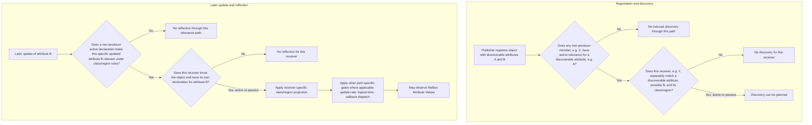

In the distinct three-role example, the publisher, active establisher X, and
passive-only receiver Y are separate joined federates. X's active match opens
the discovery path; Y's own class, attribute, and region match is a separate
receiver gate. On a later update to B, active relevance is checked again for
B itself: X's active match for A does not by itself make a later update to B relevant.

The source points are the [discovery active-relevance scan](../../cpp/src/internal/federation/federation_registry.cpp#L915),
[receiver selection](../../cpp/src/internal/federation/federation_registry.cpp#L1037),
and the [attribute-update recipient planner](../../cpp/src/internal/federation/federation_registry_attribute_update_recipients.cpp#L153).
The [focused passive-subscription test](../../cpp/tests/passive_object_attribute_subscription_catch2.cpp#L120)
does establish passive-only suppression and the same subscriber's later
passive-to-active transition, but it does not test a separate active member
making a passive receiver eligible. The process-service call path is described
below; the three-role end-to-end result remains untested there.

### The process endpoint reuses selection logic, not the delivery route

The 2025 process endpoint does not define a second passive-subscription
selector. Its service stores an `EmbeddedFederationRegistry` reference and
delegates the relevant operations to it:

- Subscription changes go through `setObjectClassAttributeSubscriptionWithScopeChanges`
  and, for a subscribe, the existing-object discovery planner.
- Registration goes through `registerObjectInstance` and the same per-instance
  discovery planner.
- Attribute updates go through `planReceiveOrderAttributeUpdate`; the process
  service then creates recipient events and queues or sends them over process
  sessions. The client-side callback bridge is a separate delivery boundary.

This establishes reuse of the same registry selection source at those process
service call sites, not general embedded/process parity. The public
[timestamped process attribute-retraction test](../../cpp/tests/ieee1516_2025_connection_process_tso_attribute_retraction_fanout_catch2.cpp#L928)
does traverse active subscription, registration, and timestamped reflection
through a configured TCP endpoint, but it does not exercise a passive receiver
or isolate the shared passive-relevance branch. For framing and callback
dispatch after an event has been selected, see the [process-endpoint request
and callback guide](HLA-2025-PROCESS-ENDPOINT-REQUEST-AND-CALLBACK-FLOW-GUIDE.md).

A separate public [receive-order process case](../../cpp/tests/ieee1516_2025_connection_update_attribute_values_reflect_catch2.cpp#L457)
subscribes to the same inherited `Name` attribute through both a parent and a
child object class, sends one untimestamped update, and [observes exactly one
`reflectAttributeValues` callback](../../cpp/tests/ieee1516_2025_connection_update_attribute_values_reflect_catch2.cpp#L817)
under both HLA_EVOKED and HLA_IMMEDIATE. The test also observes a private
service [`recipientCount` of one](../../cpp/tests/ieee1516_2025_connection_update_attribute_values_reflect_catch2.cpp#L873);
the public untimed Update Attribute Values API itself returns `void`. In this fixture,
HLA_IMMEDIATE is paired with pushed process events and HLA_EVOKED with polling,
so this is not evidence that callback model generally dictates transport mode.
It covers active overlapping subscriptions only: it does not establish the
passive three-role branch, delayed subscription evaluation, regional process
projection, or embedded/process parity. The process guide's
[receive-order update trace](HLA-2025-PROCESS-ENDPOINT-REQUEST-AND-CALLBACK-FLOW-GUIDE.md#process-mapping-receive-order-object-attribute-update)
keeps this delivery mechanism separate from the HLA eligibility model.

These are selected observations, not a complete standards or profile matrix.
The [Delay Subscription Evaluation guide](HLA-2025-DELAY-SUBSCRIPTION-EVALUATION-FLOW-GUIDE.md)
keeps evaluation timing separate from per-attribute declaration state. Class
ancestry is also not one universal “inherit the subscription” operation:
relevance, discovery, later value projection, and regional matching consult
the class chain at different stages.

### Class ancestry affects separate decisions

In the current embedded 2025 source, declarations remain keyed by the class
and attribute supplied to the service; ancestry walks inspect those entries at
different points instead of copying each declaration into descendant entries.
The table is an implementation reading aid, not a complete normative rule.

| Path | What class ancestry changes | Evidence boundary |
| --- | --- | --- |
| Class-level declaration relevance | An active match at a published class or applicable ancestor can change the publisher-facing class relevance signal. This decision does not require a particular object instance or regional overlap. | The [relevance guide](HLA-2025-RELEVANCE-ADVISORY-FLOW-GUIDE.md#class-level-declaration-relevance) separates this signal from per-instance relevance and delivery; it does not prove that a value will be delivered. |
| Discovery and receiver-known class | After a joined non-producer's active subscription establishes relevance for a discoverable instance attribute under the applicable region predicate, the embedded resolver walks from the object's registered class toward its parents for each receiver. The closest qualifying receiver declaration selects the class the receiver learns; a parent-known object does not expose child-only attributes. A passive receiver can qualify at this recipient stage, but cannot establish the active gate itself. | The [resolver](../../cpp/src/internal/federation/federation_registry.cpp#L830) and [focused child-object/base-subscription case](../../cpp/tests/subscribe_object_class_attributes_discovery_catch2.cpp#L297) support this embedded path. That case uses an active receiver; the separate-active-establisher/passive-receiver combination is not covered. The [object-flow ancestry map](HLA-2025-OBJECT-AND-INTERACTION-INFORMATION-FLOW-GUIDE.md#class-ancestry-has-different-jobs-in-different-paths) gives the wider context. |
| Later value projection | The embedded planner starts with this receiver's saved known class, then applies attribute visibility, subscription/relevance, and any regional overlap to the update. An eligible passive receiver still depends on active relevance being established elsewhere. | See the [recipient planner](../../cpp/src/internal/federation/federation_registry_attribute_update_recipients.cpp#L121) and the [process parent/child overlap case](../../cpp/tests/ieee1516_2025_connection_update_attribute_values_reflect_catch2.cpp#L457): it observes one callback for overlapping active declarations on the same inherited attribute. It does not cover passive or regional cross-class delivery, nor establish process/embedded parity. |
| Regional declaration lookup | Regional pairs are stored under the exact class/attribute key, while the embedded discovery path walks the registered class and its parents and checks entries along that walk. A parent-keyed regional declaration can therefore be considered for a child object in this source path; the declaration is not copied into the child entry. | The [DDM ancestry guide](HLA-2025-DATA-DISTRIBUTION-AND-REGIONS-FLOW-GUIDE.md#object-class-ancestry-regional-discovery-and-value-projection) marks this cross-class result source-only: reviewed regional tests register and subscribe at the same class. No process or 2010 result is established. |

### A later specific subscription does not promote the discovered class

Once this receiver has discovered an object at a base class, adding a
subscription at a more-specific class does not replace that discovery or the
receiver's `getKnownObjectClassHandle` result. The C++ TCK catalog maps this
behavior to IEEE 1516.1-2025 §5.1.3 ([scenario mapping](../../compliance/catalogs/cpp-tck-scenario-catalog.json)).

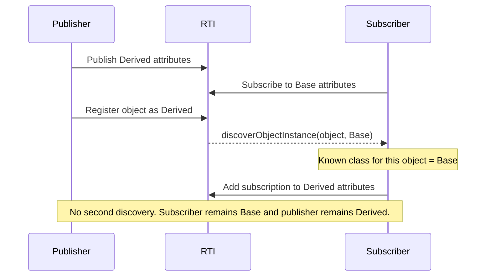

The [TCK scenario](https://github.com/sheepfling/umbra/blob/c9c5a9e410539b039cd8bba35b53d0ef2b24d180/packages/hla-rti-cpp-tck/src/tck_object_registration_discovery_scenarios.cpp#L910)
asserts that discovery remains exactly once, the subscriber's discovery and
known-class lookup remain at the base class, and the publisher's lookup remains
at the derived class. The two ambassadors' handles are not compared with one
another; the scenario correlates them through the common object name. The
embedded [discovery planner](../../cpp/src/internal/federation/federation_registry_object_instance_discovery_planning.cpp#L105)
skips already-known receivers, and the [discovery-state commit](../../cpp/src/internal/federation/federation_registry_object_instance_discovery_state.cpp#L35)
also rejects a receiver that already has a known class.

This is class-view stability and duplicate-discovery behavior. It does not
resolve whether adding a subscription alone reflects a stored value; see the
[late-subscription boundary](#a-subscription-can-be-late-relative-to-two-different-events).
The catalog marks the scenario adapter-required. This review inspected its
source but did not execute it, so it establishes no configured-process runtime
result or embedded/process parity claim.

A subscription change may consequently lead to different callbacks depending
on whether this receiver knew the object already: discovery and embedded
initial-value work for a newly known object; scope advice for an already-known
receiver; and a separate owner-facing relevance advisory. The existing
[interest-change map](#one-interest-change-can-produce-distinct-observable-effects)
shows those lanes without claiming a total callback order. The [relevance
guide](HLA-2025-RELEVANCE-ADVISORY-FLOW-GUIDE.md) and [callback guide](HLA-2025-CALLBACK-AND-SERVICE-ORDERING-FLOW-GUIDE.md)
own their separate trigger and delivery details.

### One interest change can produce distinct observable effects

A subscription is not merely a gate on the publisher's *next* update. When an
interest declaration changes, matching registered instances may be evaluated
again. Keep the resulting observations separate:

- If the receiver did not know a now-discoverable instance, `Discover Object
  Instance` establishes its object identity and known class. This can happen
  for an instance that was registered earlier.
- Values already held for the receiver's subscribed attributes may then be
  reflected as the initial state for that newly known object. That reflection
  is not itself a new publisher `Update Attribute Values` invocation. The
  embedded 2025 callback path explicitly performs this after the discovery
  callback returns; its source cites §5.8 for the initial values.
- If the instance was already known, a subscription/region change can instead
  change attribute scope, which is a receiver-facing scope advisory rather
  than another discovery.
- Separately, a change in whether an attribute is relevant can produce an
  owner-facing `Turn Updates On/Off` advisory when that provider's advisory
  switch allows it. This reports relevance; it carries no attribute value and
  goes to a different federate from the subscription receiver.
- In the embedded 2025 path, discovery may also trigger Auto Provide: the RTI
  asks current owners to provide values, but the callback is not the values.
  A provider must make a separate update for data to be delivered. This is
  distinct from both the direct initial reflection and the owner-facing
  relevance advisory. The [Auto Provide guide's neighboring-path table](HLA-2025-AUTO-PROVIDE-FLOW-GUIDE.md#keep-these-neighboring-paths-distinct)
  compares these with explicit Request Attribute Value Update.

### “Late subscription” can mean two different receiver states

The important boundary is not just whether the object was registered before
the subscription. Ask whether this receiver already knows the object:

The following map compares the 2025 Umbra source and focused-test paths. It is
not a normative resolution of IEEE 1516.1-2025 §5.8; the already-known-object
value effect remains open below.

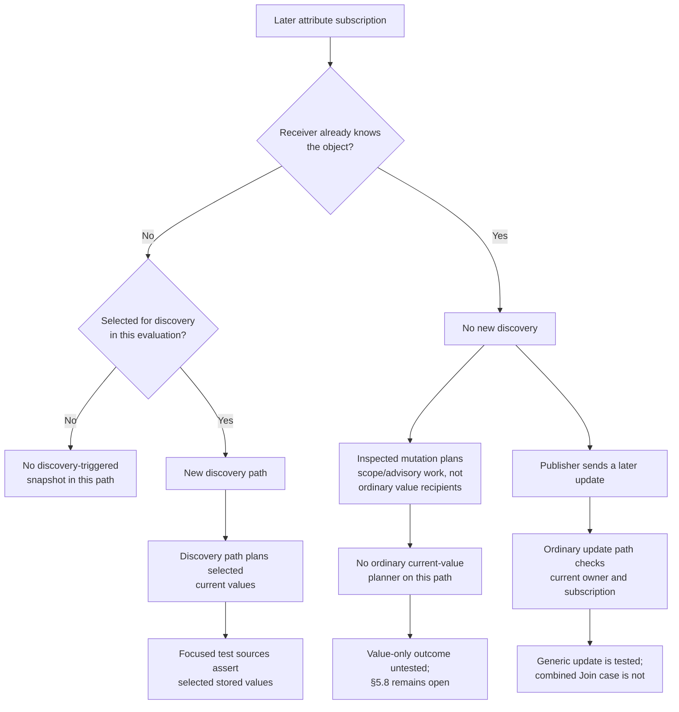

The embedded source enters `discoverObjectInstance` before planning initial
reflections after that callback returns. The configured-process service accepts
the discovery and stages a separate initial-value event. Focused test sources
assert selected stored values under both callback models; the polling transcript
is case-specific, and this documentation pass did not run the tests. The chart
does not promise one callback order for every profile or callback model.

| Receiver state | Current-value boundary in the bounded 2025 evidence |
| --- | --- |
| Existing object, not yet known to this receiver; subscription makes it discoverable. | Embedded and configured-process paths both have focused test sources that observe discovery plus a reflection of selected stored values. The process case subscribes after registration/update, selects only `Name`, and asserts its stored bytes under both callback-model sections ([test case](../../cpp/tests/ieee1516_2025_connection_public_object_subscription_catch2.cpp#L652), [assertions](../../cpp/tests/ieee1516_2025_connection_public_object_subscription_catch2.cpp#L952)). The cited source and test were inspected only; this documentation pass did not build or run the test, so it makes no passing-result claim. Neither test independently verifies the licensed §5.8 rule or a universal callback-order guarantee. |
| Receiver already knows the object and adds another attribute. | The discovery planner skips known instances and ordinary initial-value planning is discovery-scoped ([planner](../../cpp/src/internal/federation/federation_registry_object_instance_discovery_planning.cpp#L105)). The process initial-reflection planner is reached from the discovery enqueue path, not from a value-only subscription mutation ([process enqueue](../../cpp/src/internal/federation/process_federation_service_object_discovery.cpp#L90)). A public process test adds `PayRate` after discovery and observes the provider-facing relevance advisory, but has no subscriber reflection callback or value update ([late subscription](../../cpp/tests/ieee1516_2025_connection_attribute_relevance_advisory_catch2.cpp#L819), [owner advisory](../../cpp/tests/ieee1516_2025_connection_attribute_relevance_advisory_catch2.cpp#L830)). Whether that subscription alone reflects a value already held remains untested and normatively unresolved. A later update is a separate path: the ordinary update planner checks current ownership, class visibility, and subscription ([recipient planner](../../cpp/src/internal/federation/federation_registry_attribute_update_recipients.cpp#L121)); a public process test observes ordinary update reflection under both callback-model sections, but does not combine it with Join-added attributes or prior-known receiver state ([test](../../cpp/tests/ieee1516_2025_connection_update_attribute_values_reflect_catch2.cpp#L817), [assertions](../../cpp/tests/ieee1516_2025_connection_update_attribute_values_reflect_catch2.cpp#L821)). |
| Federate separately invokes Request Attribute Value Update. | This is a distinct provider solicitation: any value requires a later provider update. RTI-owned joined-federate MOM requests have a separate direct-reflection exception; see the [Federation MOM request path](HLA-2025-FEDERATION-MOM-FLOW-GUIDE.md#explicit-mom-requests-return-current-values-through-a-separate-path) and the [neighboring-path comparison](HLA-2025-AUTO-PROVIDE-FLOW-GUIDE.md#keep-these-neighboring-paths-distinct). |

For the explicit request lifecycle and its limits, see the [2025 Attribute
Value Update Request guide](HLA-2025-ATTRIBUTE-VALUE-UPDATE-REQUEST-FLOW-GUIDE.md).

The second row is specifically a subscription-declaration change. An
additional-module Join changes the shared model catalog while admitting a
member; do not use the `PayRate` advisory case as evidence for that Join path,
or use added-class lookup as evidence of a value-only reflection. The separate
[FOM catalog-replacement review](HLA-2025-FOM-MODULE-ADMISSION-AND-COMPOSITION-FLOW-GUIDE.md#catalog-replacement-does-not-itself-discover-ordinary-application-objects)
and [object-discovery boundary](HLA-2025-OBJECT-AND-INTERACTION-INFORMATION-FLOW-GUIDE.md#object-path-declarations-registration-and-discovery)
track the model-change path and its evidence limits.

The source trace for the already-known row is more specific than the test
result. Subscription mutation returns scope-change and relevance-advisory
plans, not current-value recipients ([registry mutation](../../cpp/src/internal/federation/federation_registry_object_attribute_declarations.cpp#L261)).
Replanning discovery skips an instance already present in the receiver's
known-object map ([planner](../../cpp/src/internal/federation/federation_registry_object_instance_discovery_planning.cpp#L105)).
The embedded ordinary initial-value planner is called from the post-discovery
callback path, after `Discover Object Instance` has entered application code
([callback path](../../cpp/src/internal/runtime/umbra_rti_ambassador_object_instance_lifecycle_callbacks.cpp#L400)).
The process subscription handler also replans discovery. The current process
enqueue path plans ordinary initial values only for a newly accepted discovery;
the known-object filter suppresses that path when a receiver merely adds an
attribute ([handler](../../cpp/src/internal/federation/process_federation_service_declarations.cpp#L176),
[discovery planner](../../cpp/src/internal/federation/process_federation_service_object_discovery.cpp#L90)).
If the new owner sends a separate Update Attribute Values after the receiver
has subscribed, that update is evaluated through the normal recipient path,
which looks up the receiver's known class and checks declarations for the sent
attribute ([embedded recipient planner](../../cpp/src/internal/federation/federation_registry_attribute_update_recipients.cpp#L121),
[public process reflection case](../../cpp/tests/ieee1516_2025_connection_update_attribute_values_reflect_catch2.cpp#L817)).
This supports the source-level distinction between a later update and a
current-value snapshot caused by subscription. The focused reflection test
subscribes before registration and does not exercise the Join-added/prior-known
combination. No combined callback outcome or normative §5.8 conclusion follows.
Thus no ordinary snapshot path is visible for an already-known object in the
inspected Umbra source. The focused `PayRate` advisory test observes the owner
notification, not a value-only reflection. This is not a normative conclusion:
the checked workspace contains pinned 2025 API headers but no full standard
text. IEEE's [official 1516.1-2025 listing](https://standards.ieee.org/ieee/1516.1/6688/)
offers purchase or subscription access; its [Standards Reading Room](https://standards.ieee.org/access-standards/)
offers free read access to selected standards, but public pages do not confirm
whether 1516.1-2025 is included. The §5.8 text remains
unreviewed, and no focused test isolates a value-only reflection for an
already-known object.

The nearest embedded additive/mode test
([case](../../cpp/tests/passive_object_attribute_subscription_catch2.cpp#L355))
declares both attributes before object registration. Its later active/passive
mode changes are followed by explicit publisher updates before reflection is
asserted; it does not isolate whether changing a subscription by itself
reflects an already-held value for an already-known object.

### A subscription can be late relative to two different events

The receiver-state distinction above is separate from whether a publisher has
already sent an update. A discovery-time initial reflection may carry a value
previously set by `Update Attribute Values`; it is still an initial-state
reflection for a newly known object, not a replay of that publisher invocation.
Contrast it with an earlier update whose recipient decision is still pending:

| | Existing object becomes newly discoverable | A prior send is pending later eligibility evaluation |
| --- | --- | --- |
| What is late? | The receiver's interest declaration follows object registration, and the receiver did not previously know that object. | The publisher's update precedes its delivery-time eligibility decision; HLA-level DSE defers that decision. Umbra represents this with a retained candidate. |
| What may be observed? | Discovery followed by initial reflection of currently held, eligible subscribed values in the embedded 2025 source/test path; the licensed §5.8 interpretation remains open. | Delivery of that already-issued update if it passes the later eligibility check; a TSO callback also has its time-delivery boundary. |
| What this does not mean | It is not a callback replay of a past `Update Attribute Values` call, though the current value may have come from one. | It is not a general snapshot of current state caused by every new subscription. |

See the [Delay Subscription Evaluation guide](HLA-2025-DELAY-SUBSCRIPTION-EVALUATION-FLOW-GUIDE.md)
for the HLA-level deferred-eligibility distinction and Umbra's bounded
route-only candidate mechanism. The already-known-object/new-attribute case in
the row above remains unresolved for ordinary current-value reflection; DSE
evidence does not answer it because it concerns a previously sent update, not
a discovery-time state snapshot.

For an already-known object, keep receiver scope advice, provider relevance
advice, and a possible current-value reflection as separate effects. The
inspected 2025 registry returns scope-change and owner-facing relevance plans,
not current-value recipients. In particular, a scope advisory is not a
value callback, and it does not decide the unresolved question of whether
adding a subscribed attribute to a known object yields its current value. The
diagram therefore evaluates the receiver-advisory gate and the new-attribute
value question independently.

The closest embedded additive-subscription test changes per-attribute modes
after discovery and checks the projection of a later publisher update; it does
not isolate a value-only callback between the subscription and that update
([focused case](../../cpp/tests/passive_object_attribute_subscription_catch2.cpp#L355)).
The process advisory test likewise subscribes after discovery and observes an
owner relevance advisory, but does not assert subscriber value reflection
([focused case](../../cpp/tests/process_federation_service_attribute_relevance_advisory_catch2.cpp#L78)).
Keep both as bounded evidence, not proof that either endpoint must or must not
send a current value. RTI-owned MOM initial values remain a separate special
path and must not be used to fill in the ordinary-object answer.

The chart is an HLA mental model for the distinct state and recipient
boundaries, not a total callback-order guarantee across federates. The process
profile path is described separately below.

#### Embedded discovery reentrancy precedes initial-value planning

This is an embedded 2025 source checkpoint, not a total callback-order
guarantee across federates. The process-profile path is described separately
below rather than assumed equivalent. Verify the exact normative wording and
ordering against an authorized copy of IEEE 1516.1-2025 §5.8 before treating
the source comment as a conformance conclusion; the [official IEEE
listing](https://standards.ieee.org/ieee/1516.1/6688/) does not expose the
licensed clause text.

The pinned 2025 [`FederateAmbassador` API](../../third_party/ieee1516.1-2025/include/RTI/FederateAmbassador.h#L229)
declares `discoverObjectInstance` under §6.9 and `reflectAttributeValues`
under §6.11 ([untimed](../../third_party/ieee1516.1-2025/include/RTI/FederateAmbassador.h#L238),
[timestamped](../../third_party/ieee1516.1-2025/include/RTI/FederateAmbassador.h#L249)).
These separate callback signatures identify the API boundary; they do not
establish a normative relative order between the callbacks.

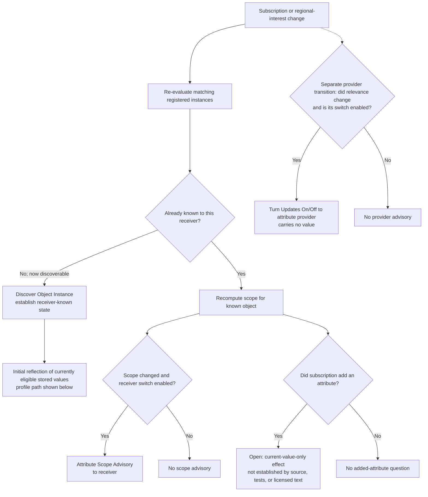

The embedded callback commits receiver-known state before calling
`discoverObjectInstance`; only after that callback returns does it call the
initial-reflection planner. The source comment explicitly names reentrant
unsubscribe, resignation, and region change as reasons to plan afterward. The
planner rechecks current membership/object state and passes currently stored
attribute handles through the receive-order recipient selector, so this is a
source-derived stale-work fence—not a tested callback-order or process-parity
claim. See the [callback boundary](../../cpp/src/internal/runtime/umbra_rti_ambassador_object_instance_lifecycle_callbacks.cpp#L323),
[planning checkpoint](../../cpp/src/internal/runtime/umbra_rti_ambassador_object_instance_lifecycle_callbacks.cpp#L400),
[initial-value planner](../../cpp/src/internal/federation/federation_registry_object_instance_discovery_planning.cpp#L153),
and [recipient selector](../../cpp/src/internal/federation/federation_registry_attribute_update_recipients.cpp#L15).
The cited [embedded stored-value case](../../cpp/tests/regional_object_attribute_routing_catch2.cpp#L198)
and [process late-subscription case](../../cpp/tests/ieee1516_2025_connection_public_object_subscription_catch2.cpp#L652)
do not re-enter RTI services from the discovery callback to test this fence.

The embedded regional-routing test demonstrates the distinction between a
stored value and a later update: an already-registered object becomes
discoverable after regional relevance is established, the latest
accepted value is reflected with discovery, and a subsequent publisher update
is a separate reflection ([focused test](../../cpp/tests/regional_object_attribute_routing_catch2.cpp#L198)).
The ordinary-subscription advisory test likewise registers first and subscribes
later, then checks the provider's advisory separately ([focused test](../../cpp/tests/attribute_relevance_advisory_catch2.cpp#L335)).
These are embedded 2025 examples; neither establishes process-profile behavior
or the full normative callback ordering.

#### Embedded trace: late regional relevance exposes the stored value

This focused scenario makes the timing concrete. A publisher registers an
object with a source region, while the subscriber's regional declaration is
disjoint. The publisher accepts value V1 while the object is not discoverable
to that receiver. When committed region bounds later overlap, the receiver
learns the object and the embedded callback path reflects the then-current V1;
a subsequent publisher update to V2 is a separate reflection.

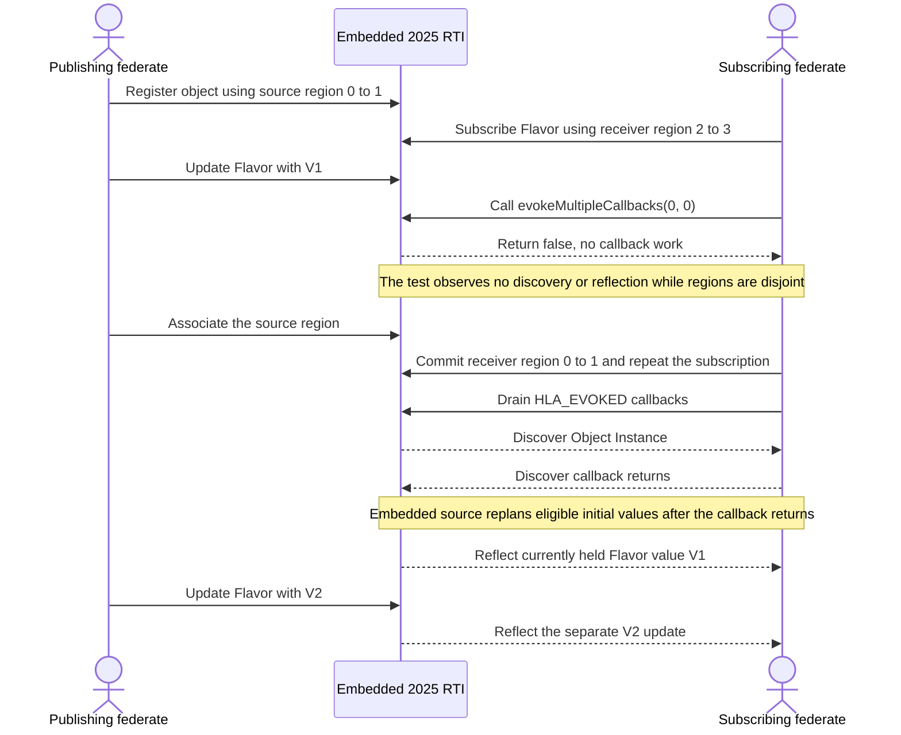

The [focused regional-routing test](../../cpp/tests/regional_object_attribute_routing_catch2.cpp#L263)
asserts the disjoint no-callback case, one discovery, one reflection containing
V1, and a separate later reflection containing V2. The [embedded callback
bridge](../../cpp/src/internal/runtime/umbra_rti_ambassador_object_instance_lifecycle_callbacks.cpp#L325)
invokes `Discover Object Instance` before asking the registry to plan initial
reflections after that callback returns. The test stores discovery and
reflection reports separately, so the relative ordering in the diagram is
source-observed, not a callback-order assertion made by that test. This is an
embedded 2025 trace, not a normative rule or process-profile result.

#### Process late-subscription path: same selectors, an unresolved initial-value edge

The 2025 process subscription handler asks the shared registry to plan
discoveries for already-registered instances, then routes discovery, scope,
and provider-advisory work through process sessions. For a newly discovered
ordinary object, the current process enqueue path commits receiver-known state,
plans selected initial values from the registry, and stages separate discovery
and attribute-update events ([subscription handler](../../cpp/src/internal/federation/process_federation_service_declarations.cpp#L176),
[discovery/value planning](../../cpp/src/internal/federation/process_federation_service_object_discovery.cpp#L90)).
The RTI-owned MOM path remains distinct: it derives values from the joined-
federate snapshot and uses an invalid producer handle. Do not infer that the
ordinary and MOM sources are identical merely because both reach
`reflectAttributeValues`.

The public configured-process case
[`RTIambassador reflects stored subscribed values for an object discovered by a configured-process subscription`](../../cpp/tests/ieee1516_2025_connection_public_object_subscription_catch2.cpp#L652)
sets `Name` and `Efficiency` before the receiver subscribes to `Name`. Its test
source asserts one discovery and one reflection for the same object, the
sender's producer handle, valid transportation, exactly the selected `Name`
attribute, and its stored bytes; `Efficiency` is absent ([assertions](../../cpp/tests/ieee1516_2025_connection_public_object_subscription_catch2.cpp#L952)).
The fixture has `HLA_EVOKED` and `HLA_IMMEDIATE` sections. In this test only,
the server pairs Evoked with polling and Immediate with pushed events; the
polling section receives discovery and initial reflection as separate
receive-order responses ([fixture option](../../cpp/tests/ieee1516_2025_connection_public_object_subscription_catch2.cpp#L726),
[poll receives](../../cpp/tests/ieee1516_2025_connection_public_object_subscription_catch2.cpp#L812)).
The polling harness requests discovery first and initial reflection second
([ordered requests](../../cpp/tests/ieee1516_2025_connection_public_object_subscription_catch2.cpp#L817)).
That is a case-specific `HLA_EVOKED` transcript. The `HLA_IMMEDIATE` branch
uses pushed events and checks final callback counts and values without keeping
a callback-order log; the chart's process ordering label also reflects source
staging, not a general callback guarantee.
The test source is not a passing result: this documentation review did not run
it. The cited source and test describe implementation and test shape, not a
passing configured-process result. The licensed §5.8 text also remains
unavailable here, so this is not a normative or conformance conclusion.

Polling appends a discovery event and then each nonempty ordinary initial-
value event to the receiving session's separate queues. Push stages discovery
frames separately from value frames and sends the discovery batch first
([poll queueing](../../cpp/src/internal/federation/process_federation_service_object_discovery.cpp#L190),
[push discovery send](../../cpp/src/internal/federation/process_federation_service_object_discovery.cpp#L213),
[push value send](../../cpp/src/internal/federation/process_federation_service_object_discovery.cpp#L226)).
Those are source-order boundaries for this enqueue operation, not a universal
callback-order guarantee across recipients, sessions, or callback models.

For an already-known object, the distinction remains open: after discovery,
the receiver can subscribe to `PayRate` ([public subscription call](../../cpp/tests/ieee1516_2025_connection_attribute_relevance_advisory_catch2.cpp#L819))
and the provider observes `Turn Updates On` ([assertion](../../cpp/tests/ieee1516_2025_connection_attribute_relevance_advisory_catch2.cpp#L830)),
but that test has no subscriber reflection callback and sends no update. The
private process fixture establishes the same narrower advisory path. The
current source does not re-enter the discovery-scoped initial planner for a
known object when only its subscription changes; whether a value-only callback
is required remains untested here. The licensed §5.8 text is not included in
the API-header import; the [official IEEE listing](https://standards.ieee.org/ieee/1516.1/6688/)
offers purchase/subscription access, while the [Standards Reading Room](https://standards.ieee.org/access-standards/)
offers free read access to selected standards. The public pages do not identify
whether 1516.1-2025 is included. Push sends and pull queues
also use different session mechanisms, so handler enqueue order is not a
global callback order.

For a reader, first ask whether the receiver already knows the object. Becoming
aware of an existing object and adding an attribute to an already-known object
are different transitions. The following chart compares only the newly-known
ordinary-object path; the prior chart keeps the known-object/value-only question
open. The embedded implementation cites §5.8 in a source comment, but this
diagram does not independently verify that licensed text or establish what the
process profile is required to do.

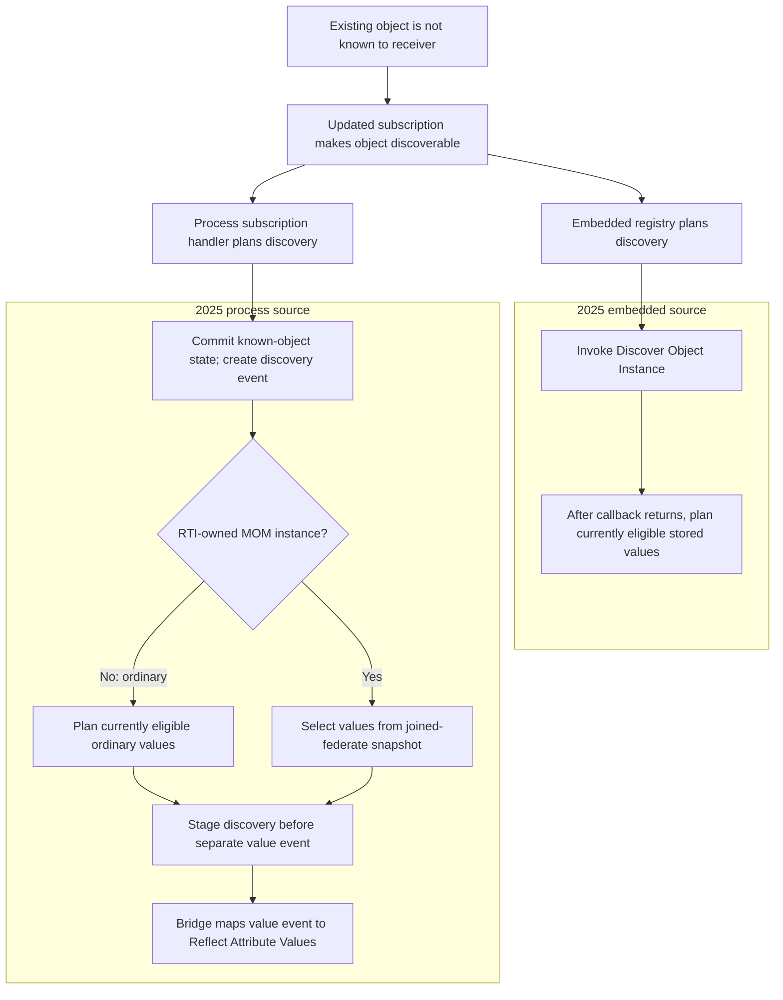

The process lane separates registry planning from application callback
observation. The ordinary branch obtains current eligible values from the
shared object-instance registry after discovery state is committed; the MOM
branch obtains selected values from its joined-federate snapshot. Both become
separate process value events. The focused ordinary process test source
asserts discovery and selected stored-value reflection in both callback-model
sections, but this documentation pass did not run it. Its HLA_EVOKED fixture
uses polling and expects separate discovery/value receives; its HLA_IMMEDIATE
fixture enables pushed events. This is a case-specific source/test boundary,
not a normative callback-order rule or process/embedded parity claim. The MOM
test independently covers its special value path ([MOM test](../../cpp/tests/ieee1516_2025_connection_process_joined_federate_mom_report_file_catch2.cpp#L328));
see the [MOM event-staging note](HLA-2025-FEDERATION-MOM-FLOW-GUIDE.md#2025-process-profile-federation-mom-after-an-additional-module-join)
for that branch's pull-queue versus push-batch distinction.
The private ordinary post-registration subscription fixture first polls the
object's discovery, then subscribes to `PayRate`; its assertion is the
provider's relevance advisory, not a receiver `Reflect Attribute Values`
callback ([discovery](../../cpp/tests/process_federation_service_attribute_relevance_advisory_catch2.cpp#L356),
[subscription](../../cpp/tests/process_federation_service_attribute_relevance_advisory_catch2.cpp#L386),
[owner advisory](../../cpp/tests/process_federation_service_attribute_relevance_advisory_catch2.cpp#L413)).
It uses the private process service protocol, so it is not public-adapter
evidence for ordinary value reflection. Licensed §5.8 text remains unreviewed;
the ordinary result is still a source/test/normative question—not a
conformance finding or a profile-parity conclusion.

The embedded-to-process comparison is not a global callback-order claim: the
process push and pull paths use different session mechanisms. Sources and
bounded test evidence: [embedded discovery callback](../../cpp/src/internal/runtime/umbra_rti_ambassador_object_instance_lifecycle_callbacks.cpp#L325),
[embedded current-value planning](../../cpp/src/internal/runtime/umbra_rti_ambassador_object_instance_lifecycle_callbacks.cpp#L400),
[initial-reflection planner](../../cpp/src/internal/federation/federation_registry_object_instance_discovery_planning.cpp#L154),
[regional stored-value observation](../../cpp/tests/regional_object_attribute_routing_catch2.cpp#L668),
[process subscription handler](../../cpp/src/internal/federation/process_federation_service_declarations.cpp#L176),
[process discovery enqueue and ordinary/MOM initial-value planning](../../cpp/src/internal/federation/process_federation_service_object_discovery.cpp#L11),
[ordinary process late-subscription case](../../cpp/tests/ieee1516_2025_connection_public_object_subscription_catch2.cpp#L652),
[process client discovery dispatch](../../cpp/src/internal/federation/process_federation_client_callback_dispatch.cpp#L84),
[process discovery callback mapping](../../cpp/src/internal/federation/process_federation_callback_bridge.cpp#L622),
[process client value dispatch](../../cpp/src/internal/federation/process_federation_client_callback_dispatch.cpp#L23),
[process attribute-value callback mapping](../../cpp/src/internal/federation/process_federation_callback_bridge.cpp#L362),
[joined-federate MOM observation](../../cpp/tests/ieee1516_2025_connection_process_joined_federate_mom_report_file_catch2.cpp#L359).

## 3. Regional declarations are separate per-attribute region entries

`subscribeObjectClassAttributesWithRegions` addresses attribute/region-set
pairs. The embedded registry records active/passive mode and update-rate
designator for each supplied attribute/region entry. Regional declarations are
stored separately from ordinary declarations; keep the two unsubscribe forms
and their region lifetimes distinct.

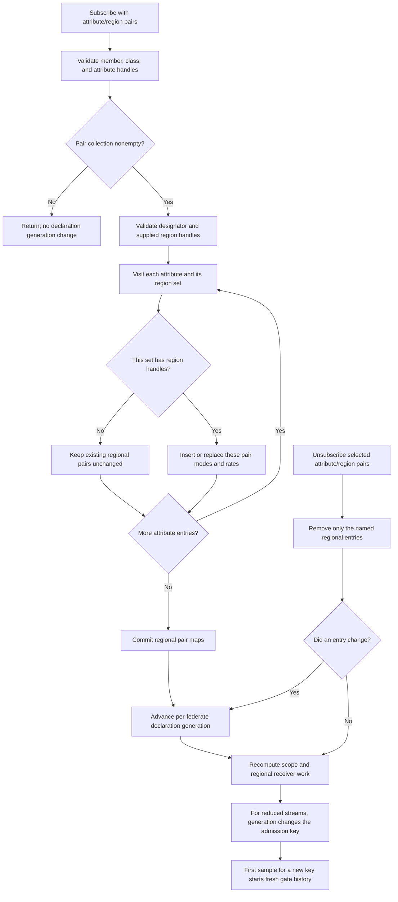

The passive/regional test verifies that a passive overlapping pair does not
discover or reflect for the tested object. Replacing that pair as active makes
the object discoverable and permits an overlapping update. It also submits
attribute entries with empty region sets and different active/rate arguments;
the retained pair's queried rate and active delivery remain unchanged in that
case. For the overlap calculation and region resource lifecycle, use the
[DDM/regions guide](HLA-2025-DATA-DISTRIBUTION-AND-REGIONS-FLOW-GUIDE.md).

### A source/test boundary around the empty-region case

For a nonempty attribute/region-pair map whose region sets contain no handles,
the registry leaves the regional pairs unchanged but still advances the
receiver's `subscriptionGeneration`; a fully empty pair map returns before
that update. Regional unsubscribe differs: its generation changes only when
at least one stored pair is actually removed. The generation is stored with
the receiver's declaration set, copied into each recipient projection, and
included in the update-rate admission key. The gate admits the first
observation for a new key, and its deterministic unit test verifies fresh
history for the same receiver/object/attribute identity under a changed
generation. The combined
source and unit-test chain therefore implies that this empty-region call can
start fresh admission history for that receiver's active attribute streams,
despite adding no regional pair. The public passive-subscription test checks
the retained mode, rate, and later delivery, but does not seed a prior rate
window and assert its reset across this exact call. So this is a source/test-
derived implementation inference, not a normative conclusion or an end-to-end
observation. The test source itself comments that §9.8.4 makes the empty-region
call a no-op ([test-author interpretation](../../cpp/tests/passive_object_attribute_subscription_catch2.cpp#L253));
that comment records the test author's reading, not an independent verification
of the normative clause. The local checkout does not contain the full licensed standard;
the [official IEEE listing](https://standards.ieee.org/ieee/1516.1/6688/)
offers purchase or subscription access, while the [Standards Reading Room](https://standards.ieee.org/access-standards/)
offers free read access to selected standards. Its public pages do not confirm
whether 1516.1-2025 is included. Keep the conformance question open until an
authorized copy of the precise regional-subscription rule is reviewed. See the
[update-rate admission guide](HLA-2025-ATTRIBUTE-UPDATE-RATE-ADMISSION-FLOW-GUIDE.md#subscription-mutations-can-start-a-new-rate-history-epoch)
for the separate rate gate and the
[DSE guide](HLA-2025-DELAY-SUBSCRIPTION-EVALUATION-FLOW-GUIDE.md#a-retained-candidate-uses-the-current-subscription-generation-at-delivery)
for how retained candidates are reprojected at delivery.

## Evidence map

| Boundary | Source or focused test | What it supports |
| --- | --- | --- |
| 2025 public ordinary subscribe/unsubscribe | [RTIambassador.h:535](../../third_party/ieee1516.1-2025/include/RTI/RTIambassador.h#L535), [RTIambassador.h:563](../../third_party/ieee1516.1-2025/include/RTI/RTIambassador.h#L563) | Selected attribute set, active flag, update-rate designator, and separate unsubscribe service |
| Selective unsubscribe across existing instances | [Public subset API](../../third_party/ieee1516.1-2025/include/RTI/RTIambassador.h#L563), [portable C++ TCK scenario](../../packages/hla-rti-cpp-tck/src/tck_selective_attribute_unsubscription.cpp#L9), [unsubscribe call](../../packages/hla-rti-cpp-tck/src/tck_selective_attribute_unsubscription.cpp#L164), remaining-attribute projection[^worktree-source], peer Value reflection[^worktree-source], no caller reflection[^worktree-source] | Two discovered instances initially deliver both attributes to two federates. After one removes `Value`, it receives only `Name` on later mixed updates; `Value`-only updates are absent there and still reach the other subscriber. The recorded installed-package case passed under both callback models. No scope-advisory assertion, future-instance case, or independent-provider result is claimed |
| Whole-class unsubscribe outcome | [Public whole-class API](../../third_party/ieee1516.1-2025/include/RTI/RTIambassador.h#L550), [portable C++ TCK scenario](../../packages/hla-rti-cpp-tck/src/tck_whole_class_attribute_unsubscription.cpp#L9), [whole-class call](../../packages/hla-rti-cpp-tck/src/tck_whole_class_attribute_unsubscription.cpp#L82), [later-object discovery check](../../packages/hla-rti-cpp-tck/src/tck_whole_class_attribute_unsubscription.cpp#L93), [existing-object update check](../../packages/hla-rti-cpp-tck/src/tck_whole_class_attribute_unsubscription.cpp#L88), [TCK mapping](../../compliance/catalogs/cpp-tck-scenario-catalog.json#L20651) | After the positive delivery control, the whole-class case observes no discovery for a later registration and no reflection for an update to the prior object. The recorded installed-package case passed under both callback models. It does not establish the meaning of an empty subset or independent-provider conformance |
| 2025 public regional subscribe/unsubscribe | [RTIambassador.h:1559](../../third_party/ieee1516.1-2025/include/RTI/RTIambassador.h#L1559), [RTIambassador.h:1578](../../third_party/ieee1516.1-2025/include/RTI/RTIambassador.h#L1578) | Attribute/region pairs and the distinct regional unsubscribe form |
| Embedded ordinary declaration update | [Ambassador entry point:19](../../cpp/src/internal/runtime/umbra_rti_ambassador_object_class_subscription.cpp#L19), [registry per-attribute upsert:261](../../cpp/src/internal/federation/federation_registry_object_attribute_declarations.cpp#L261), [selected attribute writes:359](../../cpp/src/internal/federation/federation_registry_object_attribute_declarations.cpp#L359) | Validation, per-attribute mode/rate replacement, and scope recalculation |
| Empty-set subset unsubscribe source seam | [Whole-class API](../../third_party/ieee1516.1-2025/include/RTI/RTIambassador.h#L550), [subset API](../../third_party/ieee1516.1-2025/include/RTI/RTIambassador.h#L563), [embedded registry erase](../../cpp/src/internal/federation/federation_registry_object_attribute_declarations.cpp#L302), [process client forwarding](../../cpp/src/internal/federation/process_federation_client_declaration_services.cpp#L461), [process expansion](../../cpp/src/internal/federation/process_federation_service_declarations.cpp#L200) | Current-source difference only: embedded removes no selected ordinary entries; process expands to ordinary entries and leaves regional entries separate. No valid-state public test or API comment establishes the intended empty-set meaning |
| Embedded regional mutation | [Ambassador entry point:463](../../cpp/src/internal/runtime/umbra_rti_ambassador_object_class_subscription.cpp#L463), [registry regional update:422](../../cpp/src/internal/federation/federation_registry_object_attribute_declarations.cpp#L422), [regional pair removal:582](../../cpp/src/internal/federation/federation_registry_object_attribute_declarations.cpp#L582) | Separate regional map, region validation, per-pair changes, and regional removal |
| Passive versus active delivery/discovery | [Discovery active-relevance scan](../../cpp/src/internal/federation/federation_registry.cpp#L915), [receiver class selection](../../cpp/src/internal/federation/federation_registry.cpp#L1022), [attribute-update recipient planner](../../cpp/src/internal/federation/federation_registry_attribute_update_recipients.cpp#L153), [passive object subscription test](../../cpp/tests/passive_object_attribute_subscription_catch2.cpp#L120), [per-federate class-view TCK assertions](https://github.com/sheepfling/umbra/blob/c9c5a9e410539b039cd8bba35b53d0ef2b24d180/packages/hla-rti-cpp-tck/src/tck_object_registration_discovery_scenarios.cpp#L883) | Source permits a matching passive receiver after non-producer active relevance; discovery's active establisher and receiver need not match the same attribute or class depth, and the receiver scan selects its own closest matching class. The TCK class-view case asserts base/derived recipient views with active declarations; it does not test the mixed passive cross-depth result. The focused embedded passive test covers passive-only suppression and passive-to-active transition, not a separate active establisher plus passive receiver |
| Process-service selection and event boundary | [Process service registry reference](../../cpp/src/internal/federation/process_federation_service.hpp#L681), [subscription handler](../../cpp/src/internal/federation/process_federation_service_declarations.cpp#L176), [registration handler](../../cpp/src/internal/federation/process_federation_service_request_handlers.cpp#L502), [receive-order update planner call](../../cpp/src/internal/federation/process_federation_service_attribute_value_updates.cpp#L44), [process endpoint guide](HLA-2025-PROCESS-ENDPOINT-REQUEST-AND-CALLBACK-FLOW-GUIDE.md) | Process handlers call the same registry selection methods, then use process-session event delivery; the cited process test exercises active, timestamped traffic, not the passive three-role branch |
| Receive-order process reflection with overlapping classes | [Shared recipient/passel planner call](../../cpp/src/internal/federation/process_federation_service_attribute_value_updates.cpp#L44), [push event emission](../../cpp/src/internal/federation/process_federation_service_attribute_value_updates.cpp#L304), [private result](../../cpp/src/internal/federation/process_federation_service_attribute_value_updates.cpp#L325), [public process test](../../cpp/tests/ieee1516_2025_connection_update_attribute_values_reflect_catch2.cpp#L457) | One untimestamped update is observed once despite parent-plus-child active declarations, under both callback-model sections. The fixture pairs HLA_IMMEDIATE with push and HLA_EVOKED with polling; it does not establish passive three-role, DSE, regional, or embedded/process parity |
| Late discovery, initial values, and separate observer effects | [Embedded callback path](../../cpp/src/internal/runtime/umbra_rti_ambassador_object_instance_lifecycle_callbacks.cpp#L266), [initial reflection planner](../../cpp/src/internal/federation/federation_registry_object_instance_discovery_planning.cpp#L154), [regional discovery/reflection test](../../cpp/tests/regional_object_attribute_routing_catch2.cpp#L198), [owner advisory test](../../cpp/tests/attribute_relevance_advisory_catch2.cpp#L335), [Auto Provide neighboring-path comparison](HLA-2025-AUTO-PROVIDE-FLOW-GUIDE.md#keep-these-neighboring-paths-distinct) | Embedded 2025 source/test evidence separates discovery, direct initial current-value reflection, provider-facing relevance advice, and the distinct provider solicitation; it is not normative verification or process parity |
| Process late-subscription evidence boundary | [Process subscription handler](../../cpp/src/internal/federation/process_federation_service_declarations.cpp#L176), [ordinary/MOM discovery enqueue](../../cpp/src/internal/federation/process_federation_service_object_discovery.cpp#L11), [ordinary initial-value planner](../../cpp/src/internal/federation/process_federation_service_object_discovery.cpp#L90), [discovery callback mapping](../../cpp/src/internal/federation/process_federation_callback_bridge.cpp#L622), [attribute-value callback mapping](../../cpp/src/internal/federation/process_federation_callback_bridge.cpp#L362), [public ordinary late-subscription test source](../../cpp/tests/ieee1516_2025_connection_public_object_subscription_catch2.cpp#L652), [selected-value assertions](../../cpp/tests/ieee1516_2025_connection_public_object_subscription_catch2.cpp#L952), [public post-discovery `PayRate` advisory](../../cpp/tests/ieee1516_2025_connection_attribute_relevance_advisory_catch2.cpp#L819), [joined-federate MOM initial-value case](../../cpp/tests/ieee1516_2025_connection_process_joined_federate_mom_report_file_catch2.cpp#L359), [private process advisory test](../../cpp/tests/process_federation_service_attribute_relevance_advisory_catch2.cpp#L78) | Current source plans selected ordinary initial values for a newly accepted discovery, and the public test source asserts selected stored-value reflection under both callback-model sections; the source and test are clean in the current worktree but were not built or run in this docs pass. The `PayRate` test for an already-known object still checks only provider advisory, so value-only behavior after adding an attribute remains unresolved. The MOM test covers its separate snapshot path. Licensed §5.8 remains unreviewed; no conformance or broad profile-parity finding is claimed |
| Additive per-attribute mode changes | [Additive subscription test:355](../../cpp/tests/passive_object_attribute_subscription_catch2.cpp#L355) | Adding B preserves A; per-attribute active/passive replacement changes projection without discarding other entries |
| Empty regional set and rate-generation caveat | [Focused regional assertions:244](../../cpp/tests/passive_object_attribute_subscription_catch2.cpp#L244), [test-author §9.8.4 comment:253](../../cpp/tests/passive_object_attribute_subscription_catch2.cpp#L253), [per-federate generation:2406](../../cpp/src/internal/federation/federation_registry.hpp#L2406), [generation update:524](../../cpp/src/internal/federation/federation_registry_object_attribute_declarations.cpp#L524), [generation in admission key:96](../../cpp/src/internal/runtime/umbra_rti_ambassador.cpp#L97), [first-use gate:19](../../cpp/src/internal/time/update_rate_gate.cpp#L19), [generation-key unit case:40](../../cpp/tests/ieee1516_2025_update_rate_gate_unit_catch2.cpp#L40), [regional unsubscribe/resubscribe rate case:319](../../cpp/tests/regional_best_effort_attribute_rate_catch2.cpp#L319) | Test source attributes the empty-region expectation to §9.8.4; this is not an independent normative check. The regional rate case directly observes fresh admission after regional unsubscribe/resubscribe, while the unit case verifies a changed generation key. No public integration test isolates the empty-region call's effect or combines DSE with rate-history admission |

The ordinary and regional declaration diagrams and their focused tests are
2025 source/test evidence. The late-subscription model distinguishes the
embedded post-discovery callback planner, the process service-stage ordinary
initial-value planner, and the RTI-owned MOM snapshot branch. The new process
test source asserts the ordinary selected-value case but this documentation
pass did not execute it; the already-known-object/value-only case and normative
§5.8 rule remain unresolved. This is not a broad process parity claim, a
conformance finding, or 2010 behavior. For service-report projection, see [service invocation
reporting](HLA-2025-SERVICE-INVOCATION-REPORTING-FLOW-GUIDE.md); for class-level
declaration callbacks, see [relevance advisories](HLA-2025-RELEVANCE-ADVISORY-FLOW-GUIDE.md).

[^worktree-source]: Source/test citations marked in this guide refer to current-worktree changes absent from the hosted base; those files are excluded from the documentation-only publication path set. The [hosted source-dependency audit](HLA-2025-HOSTED-SOURCE-DEPENDENCIES.json) records the exact paths, lines, and status.
