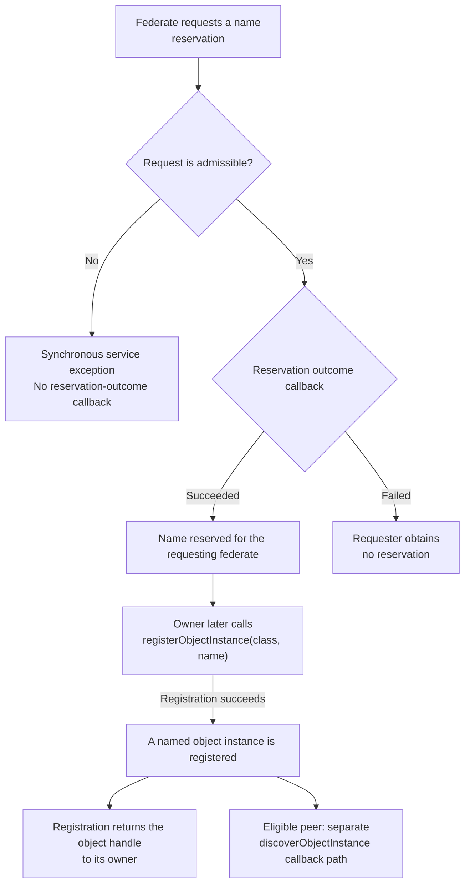
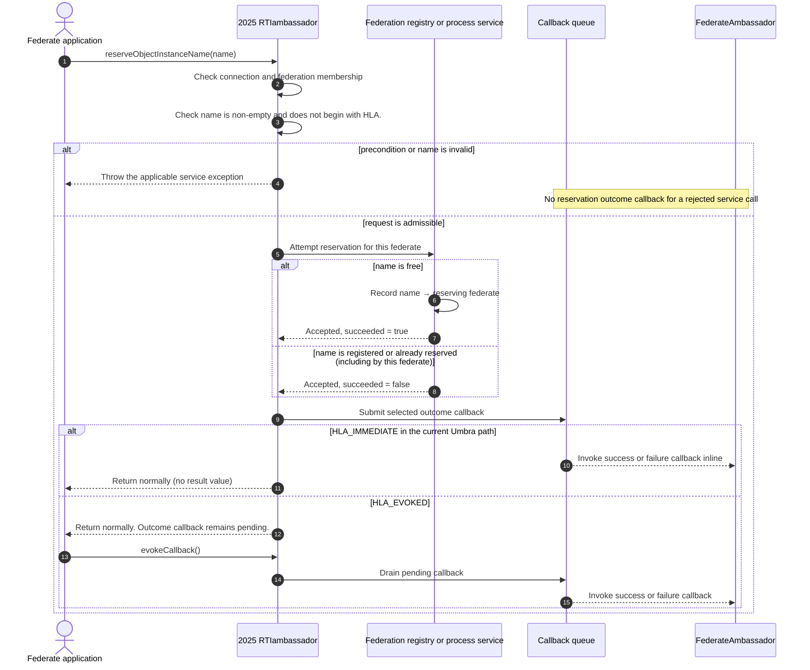
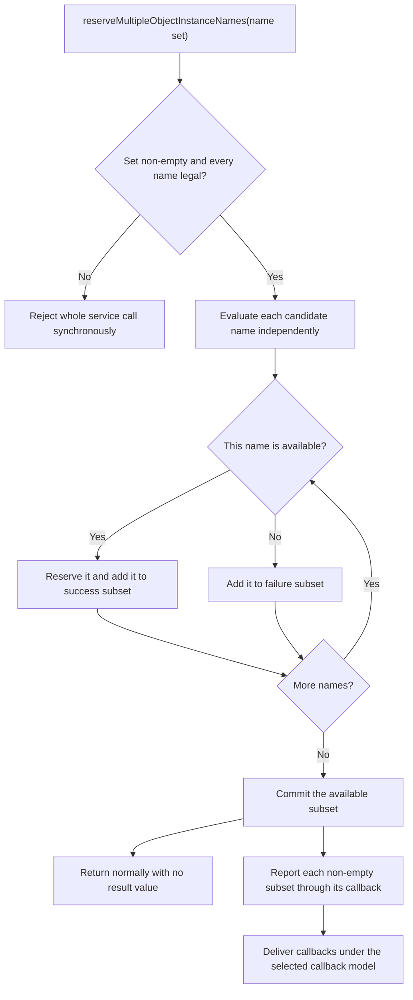
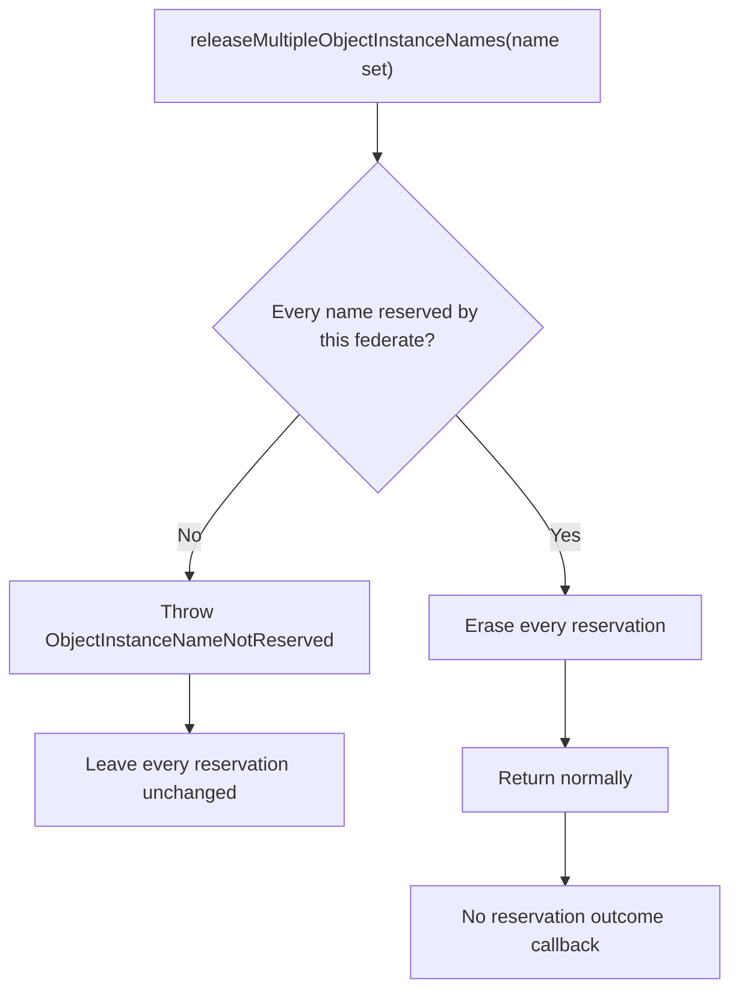
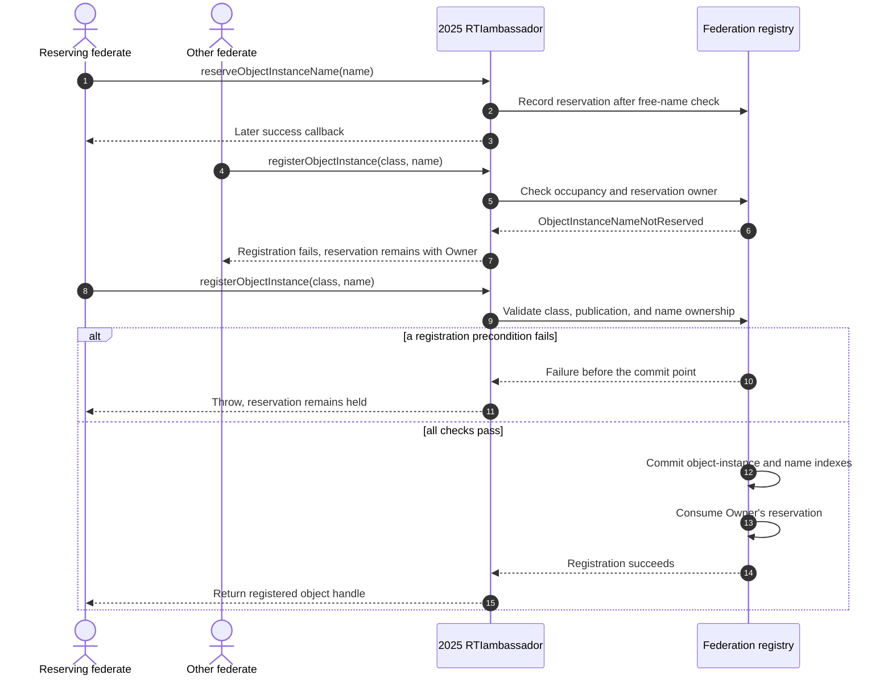
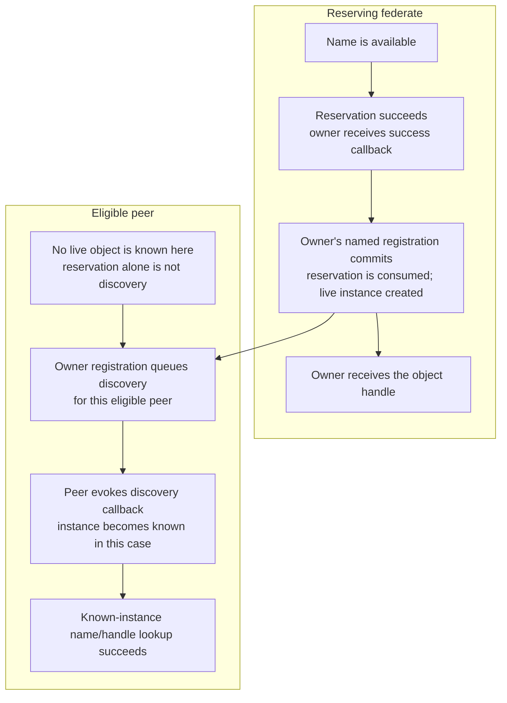
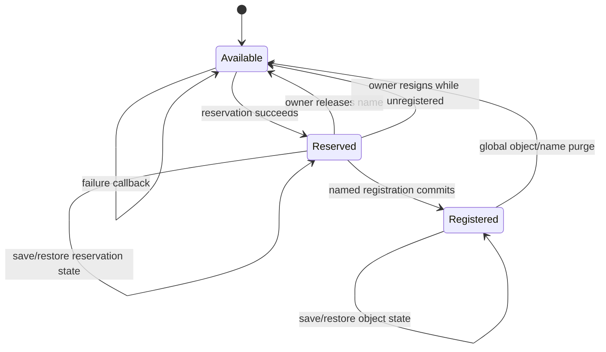

# IEEE 1516.1-2025 Object-Instance Name Reservation Flow

This guide follows an object-instance name from reservation through either
release or named registration. The reservation service is void: synchronous
exceptions reject an inadmissible request, while an admissible attempt reports
availability through a callback. A normal return alone does not mean the name
was acquired.

**Edition:** IEEE 1516.1-2025 API/runtime behavior only. This guide does not
describe the 2010 reference-RTI implementation or infer parity between the
editions.

**Implementation profile:** current Umbra embedded and selected process-
endpoint paths. Source and tests are evidence for those paths and scenarios,
not a claim of complete support or conformance. Umbra's source annotates the
reservation services with 2025 clause pointers; verify exact normative wording
against the [official IEEE 1516.1-2025 edition page](https://standards.ieee.org/ieee/1516.1/6688/)
and its licensed standard text before using this guide as a requirements source.

## The short version

- A joined federate requests a name; the service call returns no reservation
  result value. Availability is reported through a success or failure
  callback.
- Empty names and names beginning with `HLA.` are rejected at the service
  boundary. Membership and other service preconditions are also synchronous.
- A single-name collision is reported through the reservation-failure
  callback, not thrown as an `ObjectInstanceNameInUse` exception.
- Bulk reservation is **partial-success**: available names can be reserved
  even when other names in the same set are unavailable. Success and failure
  callbacks each report their own subset.
- Bulk release is **all-or-nothing**: if any requested name is not reserved by
  the caller, no name in the set is released.
- A reservation belongs to the federate that obtained it. Named registration
  consumes it only at registration commit; an earlier failed registration
  attempt leaves it available to its owner.

## HLA-level lifecycle in one view

At the API boundary, reservation, successful registration, and peer discovery
are separate events. This portable view leaves out RTI storage and callback
queue architecture. The reservation service returns no result value; a normal
return alone does not establish success. The outcome callback follows the
federate's callback delivery model, and the diagram does not prescribe its
position relative to the service call's return.

The pinned 2025 interface supplies the `void` reservation service and separate
success/failure callbacks; named registration returns an object-instance
handle, and `discoverObjectInstance` is a distinct callback. The chart presents
those API-level boundaries rather than a complete registration, eligibility,
or visibility specification; use the focused sections below for current Umbra
observations and their limits.

### Pinned 2025 API landmarks

The pinned interface makes the public service/result boundary easy to locate.
These links anchor signatures, return types, and callback names; they are
navigation aids, not substitutes for the full licensed clause text.

| HLA surface | Pinned 2025 interface | What the signature helps distinguish |
| --- | --- | --- |
| Single-name reservation | [`reserveObjectInstanceName` (§6.2)](../../third_party/ieee1516.1-2025/include/RTI/RTIambassador.h#L647); [single-name outcome callbacks (§6.3)](../../third_party/ieee1516.1-2025/include/RTI/FederateAmbassador.h#L204) | The service returns `void`; success or failure has a separate callback surface. |
| Bulk reservation | [`reserveMultipleObjectInstanceNames` (§6.5)](../../third_party/ieee1516.1-2025/include/RTI/RTIambassador.h#L672); [subset callbacks (§6.6)](../../third_party/ieee1516.1-2025/include/RTI/FederateAmbassador.h#L216) | The service returns `void`; success and failure subsets use separate callbacks. |
| Release | [`releaseObjectInstanceName` (§6.4)](../../third_party/ieee1516.1-2025/include/RTI/RTIambassador.h#L659); [`releaseMultipleObjectInstanceNames` (§6.7)](../../third_party/ieee1516.1-2025/include/RTI/RTIambassador.h#L684) | Both are `void` services whose admission failures are synchronous exceptions. |
| Registration and peer visibility | [Named `registerObjectInstance` (§6.8)](../../third_party/ieee1516.1-2025/include/RTI/RTIambassador.h#L712); [`discoverObjectInstance` callback (§6.9)](../../third_party/ieee1516.1-2025/include/RTI/FederateAmbassador.h#L229) | The owner's registration returns a handle; peer discovery is a separate callback path. |

## 1. Single-name reservation: synchronous admission, callback outcome

The API call checks that the caller is connected and joined, then submits the
candidate name. In the embedded path, the registry records the reservation
outcome before the ambassador submits the callback task. A name conflict still
produces an applied service result; its `succeeded` bit selects the callback.
The delivery point depends on the configured callback model.

The sequence below is an Umbra implementation trace, not a required HLA RTI
architecture.

The callbacks shown are alternatives, not both outcomes for one single-name
request. Application code must not treat a normal return as proof the name was
reserved. This callback-model branch is current Umbra behavior, not a
universal HLA scheduling rule: the immediate dispatcher can invoke user code
inline before the reservation method returns, while evoked delivery waits for
an explicit evoke call. The cited process integration case exercises both
callback models, but does not directly assert the immediate callback's exact
return-boundary timing; that detail is source-derived. In the embedded
implementation, a successful service report occurs after releasing the
registry lock and before the reservation callback is submitted. The process
endpoint owns its service-report boundary separately; do not assume the same
report-file ordering from the embedded sequence.

## 2. Bulk operations: partial reservation versus atomic release

The HLA-facing question is whether “multiple” names form one all-or-nothing
operation. In the selected 2025 behavior, bulk reserve produces per-name
success and failure subsets, while bulk release first requires the caller to
own every requested reservation. Do not infer that the two services commit
alike.

The complete set is checked for basic validity before any per-name availability
result is produced. Once that gate passes, conflicts are per-name results: the
available subset is committed, and the failed subset is reported separately.
This is the service-outcome model shown above; it does not prescribe an RTI's
internal locking or storage strategy.

The release rule means a set containing one valid reservation and one missing
or peer-owned name releases neither. An empty release set is accepted by the
current implementation and focused test; an empty *reservation* set is
rejected with `NameSetWasEmpty`.

## 3. From a reservation to a registered object

Reservation is not registration. It is the federate-specific right to attempt
registration with that spelling. The object class and publication checks still
apply, and another federate cannot use the reservation.

Umbra checks whether the name is already in use and whether the registering
federate owns its reservation. It inserts the object into both registry indexes
before removing the reservation; if index insertion or reservation consumption
fails, it rolls back partial registration state. Unnamed registration uses an
RTI-generated name and skips occupied names and names held in the reservation
table.

The reservation-success callback confirms the reserving federate's claim; it
is not an object-discovery callback. Registration consumes that reservation,
but the receiving federate's ability to resolve the object name is a separate,
federate-local knowledge transition. In the focused named-registration case,
the peer's discovery callback is still queued until it evokes callbacks. A
separate [known-instance lookup test](../../cpp/tests/object_instance_registration_discovery_catch2.cpp#L78)
shows that name lookup fails before discovery is delivered and succeeds after.
Those are related observations from two tests, not one combined end-to-end
assertion. See the [Names and Handle guide](HLA-2025-NAME-AND-HANDLE-RESOLUTION-FLOW-GUIDE.md)
for that lookup boundary.

### Owner reservation and peer visibility advance separately

Keep name authority separate from instance knowledge: a successful reservation
lets its owner attempt named registration, but it is not itself an object
registration or a peer-discovery event. In the focused 2025 embedded
`HLA_EVOKED` observations, the owner's reservation/registration path and an
eligible peer's known-object path advance at different events. This is a
teaching synthesis of two focused observations, not a single tested
end-to-end trace:

The [named-registration case](../../cpp/tests/object_instance_named_registration_catch2.cpp#L93)
checks the owner's reservation callback and immediate handle lookup, then the
peer's queued discovery and later callback. The separate
[known-instance case](../../cpp/tests/object_instance_registration_discovery_catch2.cpp#L78)
checks that the peer's lookup fails while discovery is queued and succeeds
after callback delivery. Together they illustrate the distinct transitions;
neither test alone asserts the entire chart.

## 4. Reservation ownership and lifetime

An unconsumed reservation may be relinquished explicitly. Resignation also
returns that federate's unregistered names to the federation-wide available
pool. Save/restore evidence shows the reservation table is restored with the
federation state; this is distinct from registering an object, which moves the
name into the live-object index.

The final `Registered → Available` edge is the global object/name-purge
endpoint, not a receiver merely forgetting its copy. In the current embedded
2025 implementation, `localDeleteObjectInstance` removes only the caller's
known-object and pending-discovery entries; the shared instance and its name
remain in use. The [local-delete registry transition](../../cpp/src/internal/federation/federation_registry_object_instance_deletion.cpp#L214)
leaves the federation-wide name index alone. Its [focused case](../../cpp/tests/local_delete_object_instance_catch2.cpp#L110)
shows that the object remains live and can be rediscovered, but uses unnamed
registration, so retention of a particular named instance's spelling is
source-derived rather than directly tested. For global deletion, the registry
purges the object/name entry only when its purge predicate permits it ([delete
path](../../cpp/src/internal/federation/federation_registry_object_instance_deletion.cpp#L125),
[receiver cleanup](../../cpp/src/internal/federation/federation_registry_object_instance_removal.cpp#L112));
this state sketch is not a deletion timeline.

Timestamped deletion adds a distinct time/retraction branch: the current 2025
registry [retains backing object/name state while the retraction designator
remains execution-owned](../../cpp/src/internal/federation/federation_registry_tso_delivery.cpp#L672)
and its [delivered-deletion path reconstitutes invocation-time state before
Request Retraction](../../cpp/src/internal/federation/federation_registry_tso_delivery.cpp#L236).
See the [TSO deletion retraction
flow](HLA-2025-TSO-RETRACTION-FLOW-GUIDE.md#service-specific-effects-deletion-is-special).
These are source-observed edges, not a universal HLA timing guarantee or proof
that a name is reusable at a particular callback boundary.

The focused [timestamped-delete test](../../cpp/tests/ieee1516_2025_timestamped_delete_object_instance_retraction_catch2.cpp#L5)
observes that receiver-side name lookup still resolves the object while the
delete is pending and after a pre-delivery retraction, then becomes unknown
after a later deletion is delivered. It does not assert post-purge
re-reservation or the delivered-deletion restoration branch.

See the [object-removal and
local-delete flows](HLA-2025-OBJECT-AND-INTERACTION-INFORMATION-FLOW-GUIDE.md#object-removal-delete-callback-and-per-receiver-cleanup)
and [local-delete explanation](HLA-2025-OBJECT-AND-INTERACTION-INFORMATION-FLOW-GUIDE.md#local-delete-forgets-one-federates-view-it-does-not-delete-the-instance),
plus the [federation/federate lifecycle guide](HLA-2025-FEDERATION-AND-FEDERATE-LIFECYCLE-FLOW-GUIDE.md),
for those adjacent concerns. The restore edge is backed by the focused restore
and filesystem-restart tests linked below, not a claim about every persistence
backend or deployment.

## Embedded and process-endpoint notes

Both paths expose the same 2025 API names and typed callbacks, but the
implementation route differs:

- The **embedded** route invokes the in-process registry, emits the applicable
  successful service report outside the registry lock, and then queues the
  per-name callback. The single-name source calls out this ordering explicitly.
  For bulk reserve, this backend updates the available subset under one
  registry lock and rolls back newly inserted reservations if an exception
  interrupts insertion. That mechanism prevents observers from seeing an
  intermediate subset; it is Umbra's embedded transaction strategy, not an
  HLA-mandated lock or architecture.
- The **process-endpoint** route sends the service to the process client, then
  queues the returned outcome on the local callback session. The service
  process owns its reporting boundary; do not project embedded file-report
  ordering onto it.
- The focused process test exercises reserve/release/named registration under
  the configured endpoint and callback models. It does not establish identical
  internal timing or report-file ordering across both paths.

## Edition boundary: a 2010 FOM is not a 2010 RTI flow

The repository has a test named “The 2025 API registers objects from an IEEE
1516-2010 model without simulation.” It configures the **2025
`RTIambassador`** with `fomEdition=2010`, then reserves and registers a name.
That is evidence about using a 2010 model as input to the 2025 API/runtime. It
is not evidence for the separate 2010 reference-RTI implementation or for
behavioral parity. The [2010 reference-RTI guide](HLA-2010-REFERENCE-RTI-FLOW-GUIDE.md)
remains a separate profile and does not currently document this reservation
state machine.

## Source and focused test map

| Claim / path | Implementation or test evidence |
| --- | --- |
| Single-name reserve and release; embedded/process routes and callback handoff | [`umbra_rti_ambassador_object_instance_name_reservation.cpp`](../../cpp/src/internal/runtime/umbra_rti_ambassador_object_instance_name_reservation.cpp#L14) |
| Bulk per-name reservation results and all-or-nothing release validation | [`umbra_rti_ambassador_multiple_object_instance_name_reservation.cpp`](../../cpp/src/internal/runtime/umbra_rti_ambassador_multiple_object_instance_name_reservation.cpp#L15), [`federation_registry_object_instance_registration.cpp`](../../cpp/src/internal/federation/federation_registry_object_instance_registration.cpp#L15) |
| Callback-model delivery point in the current Umbra path | [Federate callback route and inline-dispatch note](../../cpp/src/internal/runtime/umbra_rti_ambassador.cpp#L952), [dispatcher submit/drain](../../cpp/src/internal/callbacks/callback_dispatcher.cpp#L122), [process callback-model scenario](../../cpp/tests/ieee1516_2025_connection_named_object_registration_catch2.cpp#L762) |
| Reservation ownership, generated-name avoidance, and consumption after registration commit | [`federation_registry_object_instance_registration.cpp`](../../cpp/src/internal/federation/federation_registry_object_instance_registration.cpp#L276) |
| Embedded validation, HLA_EVOKED queued outcomes, partial bulk reserve, atomic bulk release, generated-name skip, resignation | [`object_instance_name_reservation_catch2.cpp`](../../cpp/tests/object_instance_name_reservation_catch2.cpp#L95) |
| Failed named registration keeps reservation; named and regional registration | [`object_instance_named_registration_catch2.cpp`](../../cpp/tests/object_instance_named_registration_catch2.cpp#L93) |
| Process-endpoint reservation/release and named registration under HLA_EVOKED and HLA_IMMEDIATE | [`ieee1516_2025_connection_named_object_registration_catch2.cpp`](../../cpp/tests/ieee1516_2025_connection_named_object_registration_catch2.cpp#L457) |
| Restore and filesystem-restart persistence | [`restore test`](../../cpp/tests/ieee1516_2025_federation_registry_object_name_reservation_restore_catch2.cpp#L3), [`filesystem-restart test`](../../cpp/tests/ieee1516_2025_federation_registry_object_name_reservation_filesystem_restart_catch2.cpp#L3) |
| 2025 API operating on 2010 FOM input (not a 2010 RTI claim) | [`external_2010_fom_catch2.cpp`](../../cpp/tests/external_2010_fom_catch2.cpp#L208) |

Focused tests show representative current paths only. They do not replace the
licensed standard, demonstrate every callback scheduling interleaving, or
establish full implementation/conformance coverage.
