# IEEE 1516.1-2025 Order and Transportation Flow Guide

This guide explains two sender-controlled delivery properties that are easy to
conflate: **order** answers whether information is delivered receive-order or
timestamp-order; **transportation type** selects the federation-declared
transportation category associated with that information. They are reported
separately and follow different change lifecycles in Umbra.

**Edition:** IEEE 1516.1-2025 only. This guide does not describe the separate
2010 API/runtime or infer compatibility between editions.

**Implementation profile:** current 2025 embedded behavior plus selected
process-endpoint control/query cases. Focused tests establish only the paths
and combinations they exercise, not full conformance or physical network QoS.
The official [IEEE 1516.1-2025 edition page](https://standards.ieee.org/ieee/1516.1/6688/)
is the normative starting point. Clause numbers below are navigation pointers
transcribed from Umbra source comments; check exact wording in the licensed
standard before deriving requirements.

## First separate the two questions

- **Order** (`RECEIVE` or `TIMESTAMP`; see the
  [pinned 2025 enum](../../third_party/ieee1516.1-2025/include/RTI/Enums.h#L28))
  answers whether delivery follows receive-order or timestamp-order.
  Sent/received callbacks report the order; timestamp-ordered callbacks also
  carry logical time and may carry a retraction handle.
- **Transportation type** selects a FOM-declared category for an attribute or
  interaction. The standard names are `HLAreliable` and `HLAbestEffort`;
  FOMs may define additional categories. A federation-scoped
  `TransportationTypeHandle` identifies the selected category. Reflection
  and interaction callbacks carry that handle, and query services report it
  through callbacks.

The [pinned 2025 standard MIM](../../third_party/ieee1516.2-2025/resources/mim/HLAstandardMIM-2025.xml#L2751)
describes `HLAreliable` as reliable delivery and `HLAbestEffort` as best-effort
delivery, using TCP/IP and UDP as analogies. Those names describe HLA
transportation categories; they do not establish which network protocol an
RTI uses or measured delivery behavior in a particular deployment.

Neither value substitutes for the other. A `TIMESTAMP` order selection does not
say which transportation type is selected; a custom transportation handle
does not say when a time-constrained receiver may observe the event. DDM still
decides which receivers are relevant, and time management still gates TSO
delivery. See the separate [time-management](HLA-2025-TIME-MANAGEMENT-GUIDE.md)
and [DDM/regions](HLA-2025-DATA-DISTRIBUTION-AND-REGIONS-FLOW-GUIDE.md)
guides for those state machines.

Update-rate admission is another separate mechanism. In Umbra's observed 2025
embedded attribute path, the per-attribute gate filters best-effort values,
while reliable values bypass that reduction. The gate describes value
admission only: it does not define HLA transportation semantics or a network
protocol, schedule suppressed values for later delivery, or promise a callback
cadence. This is implementation evidence, not a universal RTI rule. See the
[2025 attribute update-rate guide](HLA-2025-ATTRIBUTE-UPDATE-RATE-ADMISSION-FLOW-GUIDE.md)
for its inputs, clock, and test limits.

Callback observation is a separate boundary after the service-specific rules
make an effect due for a federate (and any TSO time gate permits it).
`HLA_IMMEDIATE` allows the RTI to enter the callback while the inducing
service is executing; under `HLA_EVOKED`, the application dispatches callbacks
through an evoke service. Callback model does not select the recipient or
replace either the event's order or transportation type. See the separate
[callback and service-ordering guide](HLA-2025-CALLBACK-AND-SERVICE-ORDERING-FLOW-GUIDE.md)
for callback entry and ordering boundaries.
For a timestamped attribute-update call that splits one receiver's attributes
between RECEIVE and TIMESTAMP delivery paths, see the [time-management
mixed-order walkthrough](HLA-2025-TIME-MANAGEMENT-GUIDE.md#one-timestamped-invocation-can-split-by-attribute-order).

## A delivery map: keep the questions separate

“Timestamped” can refer to the service overload that accepts a logical-time
argument, the sender's effective order designation, or a receiver's
timestamp-order delivery. Do not treat those as interchangeable. Recipient
eligibility, transportation category, time-management eligibility, and
application callback observation are separate questions too.

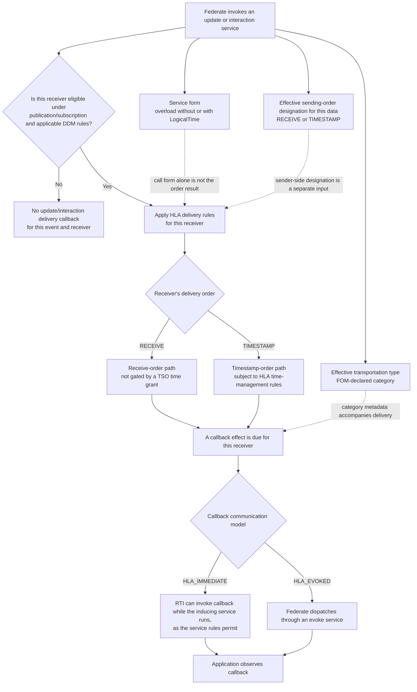

Read the dashed links as relationships between questions, not as a complete
execution schedule or a normative decision table. The pinned 2025 callback API
has ordinary and time-bearing overloads: the latter exposes `LogicalTime`,
`sentOrderType`, `receivedOrderType`, and an optional retraction handle; both
forms carry the transportation type ([attribute callback overloads](../../third_party/ieee1516.1-2025/include/RTI/FederateAmbassador.h#L238),
[interaction callback overloads](../../third_party/ieee1516.1-2025/include/RTI/FederateAmbassador.h#L264)). Those distinct fields do not, by themselves,
establish every normative condition that maps a sender's order to a receiver's
delivery path.

The existing embedded order-control case makes the distinction concrete: after
changing the interaction's effective order to `RECEIVE`, it invokes the
timestamped `sendInteraction` overload with a logical-time argument and
observes `RECEIVE` for both order fields plus an invalid retraction handle
([case](../../cpp/tests/order_type_control_catch2.cpp#L386)). This is a bounded
implementation observation, not the full standard rule. The exact
sender-to-receiver mapping remains subject to the licensed IEEE text; the
separate [time-management guide](HLA-2025-TIME-MANAGEMENT-GUIDE.md) explains
the TSO gate once a delivery is timestamp-ordered.

### One sent TSO interaction can have different received orders

The two callback fields matter even when there is only one send. In a focused
embedded `HLA_EVOKED` scenario, a time-regulating sender sends an interaction
whose effective order is `TIMESTAMP` to two eligible receivers. The
non-time-constrained receiver observes it as receive-order; the time-constrained
receiver observes it as timestamp-order after advancing to the message time.
Both reports preserve `sentOrderType == TIMESTAMP`, and both contain a valid
retraction designator for the accepted send. The [shared delivery assertions](../../cpp/tests/ieee1516_2025_sent_tso_per_recipient_order_conversion_catch2.cpp#L218)
check payload, tag, transportation, producer, logical time, sent order, and
retraction validity; the [recipient-specific assertions](../../cpp/tests/ieee1516_2025_sent_tso_per_recipient_order_conversion_catch2.cpp#L240)
check `RECEIVE` versus `TIMESTAMP` received order. The test also checks the
constrained receiver's [interaction-before-grant callback order](../../cpp/tests/ieee1516_2025_sent_tso_per_recipient_order_conversion_catch2.cpp#L215).

The sequence includes this test's `HLA_EVOKED` polling so the callback arrows
are not mistaken for asynchronous delivery: the unconstrained receiver polls
after the send; the constrained receiver polls before its time advance and has
no interaction callback yet, then requests time 6 and polls for the TSO
interaction and grant. The test also requests sender time 2 before observing
the constrained delivery. That is the test's schedule, not a replacement for
the general grant-eligibility explanation in the [time-management guide](HLA-2025-TIME-MANAGEMENT-GUIDE.md).

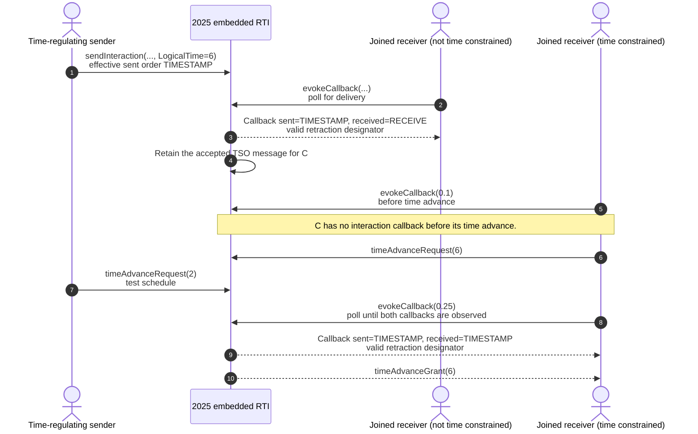

This is the bounded observation in the
[per-recipient conversion test](../../cpp/tests/ieee1516_2025_sent_tso_per_recipient_order_conversion_catch2.cpp#L125),
not a complete order-conversion table or an independent normative interpretation. Its source comment maps the expected
case to §8.1.4 Table 3; the licensed standard text is still needed to verify that normative mapping. The embedded sender
path separates time-constrained recipients from the receive-order callback route
([recipient split and TSO admission](../../cpp/src/internal/runtime/umbra_rti_ambassador_timestamped_interaction_send.cpp#L322),
[receive-order callback fields](../../cpp/src/internal/runtime/umbra_rti_ambassador_timestamped_interaction_send.cpp#L436)).
It is one `HLA_EVOKED` scenario; do not generalize it to every sender/receiver role combination, process endpoint, or
the separate 2010 stream.

## Who controls what, and when does it take effect?

Umbra exposes class/default settings and more specific settings. They are
scoped to the declaring federate's publication or object instance; changing
one sender's setting is not a federation-wide change to all senders of that
class.

| Control | Scope and service | Current Umbra commit point | Evidence-backed effect |
| --- | --- | --- | --- |
| Default attribute order | Attribute set on an object class via `changeDefaultAttributeOrderType` | Synchronous service update | Captured by later object registrations; existing instances retain their captured value. |
| Instance attribute order | Owned attributes on a known object via `changeAttributeOrderType` | Synchronous service update | Changes future updates for only that object/attribute set. |
| Published interaction order | An interaction class via `changeInteractionOrderType` | Synchronous service update | Changes future sends for that publisher/class. |
| Default attribute transportation | Attribute set on an object class via `changeDefaultAttributeTransportationType` | Synchronous service update | Later registered instances use the new default; existing instances are not rewritten. |
| Instance attribute transportation | Owned attributes on a known object via `requestAttributeTransportationTypeChange` | RTI dispatch revalidates and commits before `confirmAttributeTransportationTypeChange` | The request stays pending until its confirmation work runs; the public callback reports the committed setting. |
| Published interaction transportation | A published interaction class via `requestInteractionTransportationTypeChange` | RTI dispatch revalidates and commits before `confirmInteractionTransportationTypeChange` | The request stays pending until its confirmation work runs; future sends use the committed setting. |

The **default** and **instance** rows are different state locations and have
different lifetimes. For order, both class-default and instance changes apply
synchronously in the current profile. For transportation, the class-default
setter is synchronous, while instance/class overrides use a request-and-confirm
path.

### Disable Time Regulation is a separate input to future Send Interaction classification

An interaction's effective preferred order and its producer's live time role
are separate inputs to TSO admission. In both current 2025 Send Interaction
paths, a supplied timestamp enters the TSO queue only when the producer is
time regulating and the effective preferred order is `TIMESTAMP`
([embedded path](../../cpp/src/internal/runtime/umbra_rti_ambassador_timestamped_interaction_send.cpp#L322),
[process path](../../cpp/src/internal/federation/process_federation_service_interaction_send.cpp#L561)).
After Disable Time Regulation, a later timestamped Send Interaction therefore
uses receive-order metadata even if its preferred order remains `TIMESTAMP`.

The focused [embedded 2025 case](../../cpp/tests/ieee1516_2025_time_role_enable_callback_gating_catch2.cpp#L179)
asserts `RECEIVE` for both sent and received order fields. It explicitly does
not establish the normative callback method shape. The process service has the
same source predicate, but this review found no focused public process test for
this exact post-disable send. This condition affects future sends; it does not
rewrite the metadata or retraction lifecycle of a TSO message accepted earlier.
See the [TSO retraction guide's disable/re-enable case](HLA-2025-TSO-RETRACTION-FLOW-GUIDE.md#disable-time-regulation-temporarily-blocks-retract-while-the-designator-remains-live)
for the producer's existing-message timeline.

### A setting change does not rewrite an accepted TSO message (Umbra source observation)

The setting used for a send and an accepted message waiting for a recipient's
time gate are separate state. In the embedded 2025 path, each send plan resolves
the current effective order and transportation. A timestamped message then
retains the per-send values needed for its later callback. A setting change
updates what a subsequent send plan reads; the delayed callback for an already
accepted TSO message is reconstructed from that message's retained data.

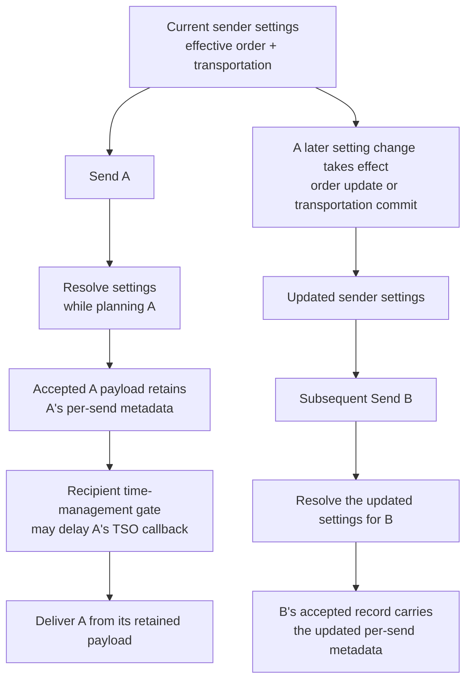

This is an embedded-source observation, not a separate normative claim. The
interaction plan resolves effective values while planning a send
([interaction plan](../../cpp/src/internal/federation/federation_registry_receive_order_interactions.cpp#L65));
the attribute update plan resolves effective transportation and order for each
attribute ([attribute plan](../../cpp/src/internal/federation/federation_registry_attribute_value_update_requests.cpp#L174)).
The retained timestamped interaction message and attribute passel carry those
values ([message](../../cpp/src/internal/federation/federation_registry_tso_types.hpp#L14),
[attribute passel](../../cpp/src/internal/federation/federation_registry_tso_types.hpp#L45)),
and grant-boundary delivery reads them back when reconstructing callback
metadata ([interaction](../../cpp/src/internal/runtime/umbra_rti_ambassador_time_advance_dispatch.cpp#L341),
[attribute](../../cpp/src/internal/runtime/umbra_rti_ambassador_time_advance_dispatch.cpp#L427)).
The focused [order-control case](../../cpp/tests/order_type_control_catch2.cpp#L374)
changes order before a later send; the focused [timestamped custom-transport
case](../../cpp/tests/custom_transportation_timestamped_delivery_catch2.cpp#L284)
checks callback metadata after grant. Neither case changes a setting between
accepting a TSO message and its recipient's grant, so that interleaving is
source-derived here rather than directly asserted by a focused test. The
recipient's `receivedOrderType` remains a separate, recipient-specific result
as described above.

## 1. Attribute order: defaults are captured; instance changes are local

The class default is prospective. Once an object instance exists, change its
order directly if that instance needs a different setting.

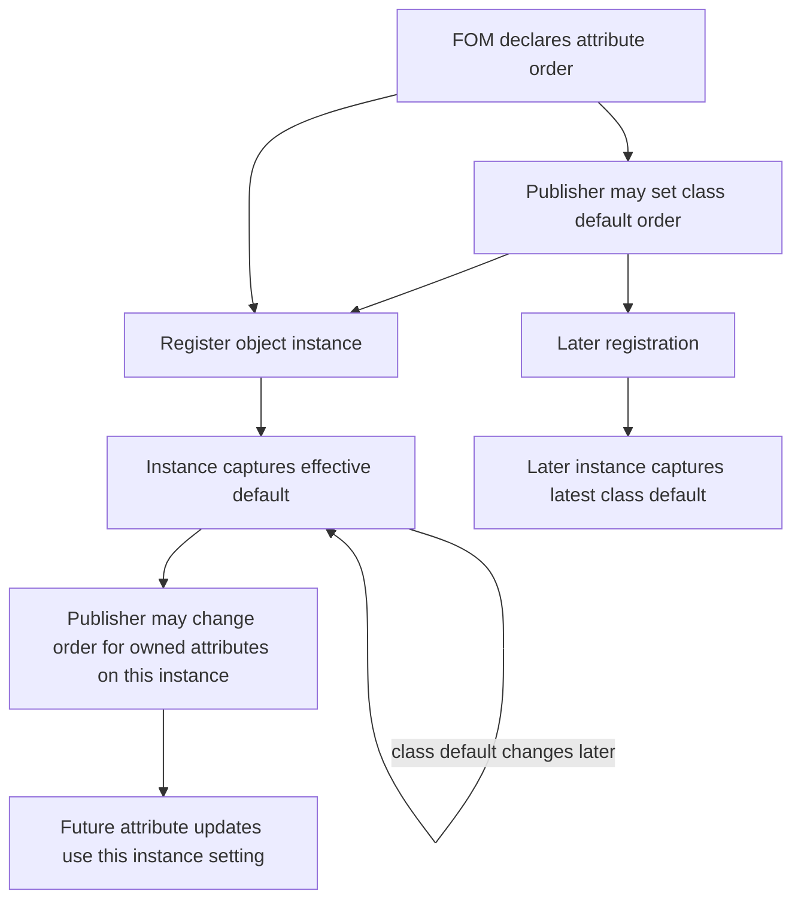

The self-loop emphasizes the non-retroactive edge: changing a class default
does not rewrite an already registered object's order while its ownership
remains unchanged. In the focused test, an FOM-default timestamp-ordered
object, a later receive-order default, and a per-instance timestamp override
produce different results even though the publisher invokes the timestamped
update service for each object.

### Attribute ownership can reseed sender settings (Umbra source observation)

The new owner can change which class defaults apply to later sends, while
instance-level order and transportation values have separate storage and
transfer behavior. These are selected embedded 2025 implementation paths, not
a normative rule for ownership transfer.

| Ownership path | Per-instance order | Per-instance transportation |
| --- | --- | --- |
| Acquisition of an unowned attribute | Store the acquirer's resolved default; erase the order entry if none resolves. | Store the acquirer's default when resolved. |
| Confirm Divestiture | Store the new owner's resolved default; erase the order entry if none resolves. | Store the new owner's default when resolved. |
| Divestiture If Wanted | Erase the former entry; store the new owner's default if resolved. | Leave the map untouched. |
| Unconditional divestiture | Clear the entry while unowned. | Clear the entry while unowned. |

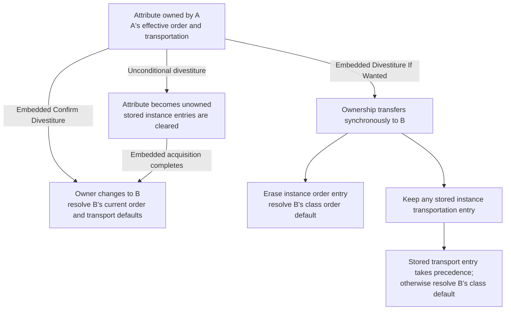

The selected [acquisition](../../cpp/src/internal/federation/federation_registry_attribute_ownership_acquisition.cpp#L545)
and [Confirm Divestiture](../../cpp/src/internal/federation/federation_registry_negotiated_attribute_ownership_divestiture.cpp#L471)
paths assign resolved defaults to the corresponding instance maps;
[unconditional divestiture](../../cpp/src/internal/federation/federation_registry_attribute_ownership_assumptions.cpp#L205)
clears both maps. Divestiture If Wanted instead [erases and reseeds order](../../cpp/src/internal/federation/federation_registry_attribute_ownership_divestiture_if_wanted.cpp#L294)
but does not touch the transportation map in that transfer block. When no
instance order entry exists, the [effective order resolver](../../cpp/src/internal/federation/federation_registry_catalog_queries.cpp#L856)
consults the current owner's defaults. The [effective transportation resolver](../../cpp/src/internal/federation/federation_registry_catalog_queries.cpp#L969)
checks the instance map before the new owner's class default. Thus a stored
per-instance transportation value can survive this route in the inspected
source; no focused test queries transportation after a successful Divestiture
If Wanted transfer, so its externally observed result remains unverified.

The focused [order-control case](../../cpp/tests/order_type_control_catch2.cpp#L400)
does verify one later-send result: the FOM gives the former owner a `TimeStamp`
default, the acquirer sets its class default to `RECEIVE`, the former owner
unconditionally divests, and the acquirer obtains ownership through
If-Available acquisition. A subsequent timestamped update is reported with
both `sentOrderType` and `receivedOrderType` equal to `RECEIVE` ([assertions](../../cpp/tests/order_type_control_catch2.cpp#L527)).
This observes the effective order on a later send; it is not a direct query of
the object's order setting. The focused [Divestiture If Wanted case](../../cpp/tests/attribute_ownership_divestiture_if_wanted_pending_catch2.cpp#L255)
checks transfer and callbacks but does not query transportation afterward.

The focused [TSO ownership-transfer case](../../cpp/tests/timestamped_attribute_update_ownership_transfer_catch2.cpp#L191)
delivers A's already accepted update to B with its original timestamp-order
metadata; it does not test a new send from B or query B's current settings. For
that separate event-lifetime timeline, see the [TSO retraction guide's
ownership boundary](HLA-2025-TSO-RETRACTION-FLOW-GUIDE.md#ownership-changes-and-an-accepted-tso-update-are-separate-timelines).
For the public ownership-service flows, see the
[2025 attribute-ownership guide](HLA-2025-ATTRIBUTE-OWNERSHIP-FLOW-GUIDE.md);
this source note complements, rather than replaces, that HLA-facing guide.

## 2. Transportation change requests have a pending lifecycle

For the 2025 embedded path, admission records a pending request; Umbra applies
the selected transportation while processing its confirmation work. That
work rechecks the live target and requester eligibility, commits the change,
and only then invokes the public confirmation callback. Attribute requests
are scoped to an object and set of owned attributes; interaction requests
are scoped to a published interaction class.

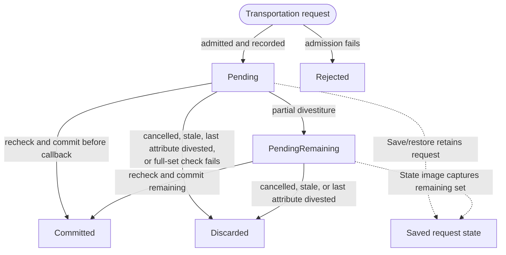

For an attribute request, Umbra rejects a new request if one of its attributes
is already participating in a pending transportation change. For an
interaction class, a second request while a change is pending is rejected.
The RTI's registry rechecks membership and the relevant live eligibility before
commit: attribute ownership for each requested attribute, or publication of
the interaction class. If the request is cancelled or no longer eligible,
Umbra drops it without delivering a confirmation; ownership changes can also
clear an attribute's current override, so this path does not promise the old
effective value remains in force. In the embedded source, unconditional
divestiture also removes each divested attribute from every pending
transportation-change request. If that empties a request, the registry erases
it; when its already-queued confirmation work later starts, the request lookup
finds nothing and returns without a public confirmation. If only part of a
multi-attribute request is divested, its remaining attributes stay in the
request and are rechecked and committed through the ordinary pending-work path.
Ownership-transfer routes have different pending-request effects:

| Transfer route before confirmation work runs | Pending transportation request | Later confirmation work |
| --- | --- | --- |
| Unconditional divestiture | Removes the transferred attribute from each request. A multi-attribute request can remain with its still-owned members. | Commits the remaining set if its owner checks still pass; if the request became empty, no delivery is returned and no confirmation callback runs. |
| Confirm Divestiture | Leaves the request's original attribute set intact. | Removes the request from pending state, then checks every requested attribute. If any now has another owner, the whole request returns no delivery; still-owned members are not partially committed. |
| Divestiture If Wanted | Leaves the request's original attribute set intact. | Uses the same later full-set ownership check; a transferred member makes the entire request return no delivery. |

This is a source-derived embedded behavior, not a rule about normative HLA
service ordering. Unconditional divestiture contains explicit per-attribute
cleanup ([cleanup](../../cpp/src/internal/federation/federation_registry_attribute_ownership_assumptions.cpp#L202));
Confirm Divestiture and Divestiture If Wanted transfer ownership without that
pending-transportation cleanup ([Confirm Divestiture](../../cpp/src/internal/federation/federation_registry_negotiated_attribute_ownership_divestiture.cpp#L467),
[Divestiture If Wanted](../../cpp/src/internal/federation/federation_registry_attribute_ownership_divestiture_if_wanted.cpp#L284)).
When confirmation work begins, the registry removes the pending request and
checks every requested attribute before writing overrides
([owner recheck](../../cpp/src/internal/federation/federation_registry_transportation_order_services.cpp#L78),
[commit after validation](../../cpp/src/internal/federation/federation_registry_transportation_order_services.cpp#L85)).
No focused 2025 test combines a still-pending transportation request with
Confirm Divestiture or Divestiture If Wanted. The existing
[Divestiture If Wanted case](../../cpp/tests/attribute_ownership_divestiture_if_wanted_pending_catch2.cpp#L137)
tests ownership transfer separately. The embedded
[transportation-control case](../../cpp/tests/custom_transportation_type_control_catch2.cpp#L264)
and configured-process
[change/query case](../../cpp/tests/ieee1516_2025_connection_catch2.cpp#L727)
exercise transportation requests and queries without this transfer interleaving.
After the partial unconditional-divestiture route above, if a later state
image captures the still-pending request, it copies the request's current
attribute set, so the saved record contains only attributes that remain
pending ([capture](../../cpp/src/internal/federation/federation_registry_state_image_capture.cpp#L1110)).
Restore reconstructs that set only after checking that its attributes are known
and still owned by the requester
([restore validation](../../cpp/src/internal/federation/federation_registry_restore_ownership_ledgers.cpp#L832)).
This partial-divestiture-to-save/restore path is source-derived; no focused test
exercises the combined sequence.
This is a source-observed interaction between two services, not a statement of
the IEEE rule for their ordering. The paths are visible in [unconditional
divestiture cleanup](../../cpp/src/internal/federation/federation_registry_attribute_ownership_assumptions.cpp#L202),
[pending-request dispatch lookup](../../cpp/src/internal/federation/federation_registry_transportation_order_services.cpp#L66),
and the [queued callback's no-delivery return](../../cpp/src/internal/runtime/umbra_rti_ambassador.cpp#L1432).

The selected embedded `HLA_EVOKED` path makes the two outcomes easier to
separate. This is an implementation walkthrough, not a normative ordering or
callback guarantee. Assume the owner requests a transportation change for
attributes A and B, then unconditionally divests A before evoking the queued
confirmation task:

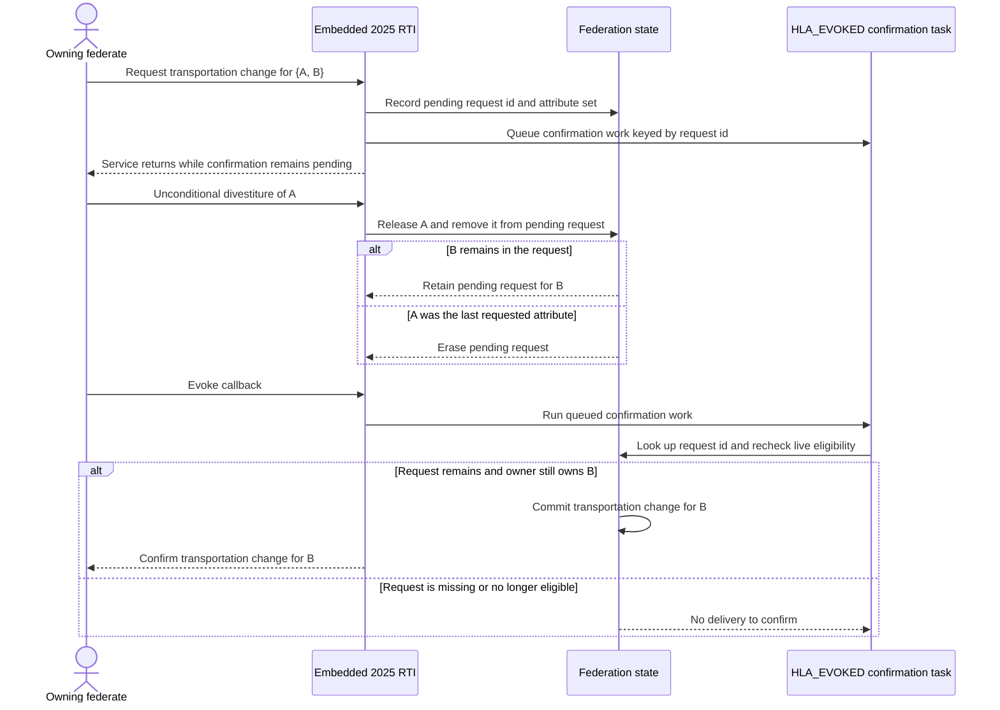

The request planner stores a request ID with its attribute set
([pending record](../../cpp/src/internal/federation/federation_registry_attribute_transportation_type_change_planning.cpp#L75)),
and the ambassador queues confirmation work by that ID
([queue point](../../cpp/src/internal/runtime/umbra_rti_ambassador_order_transportation_services.cpp#L546)).
Unconditional divestiture removes each released attribute and erases the
pending record if its set becomes empty
([cleanup](../../cpp/src/internal/federation/federation_registry_attribute_ownership_assumptions.cpp#L202)).
When the task begins, the registry removes and revalidates the remaining
request; the queued ambassador closure returns without a confirmation if
there is no delivery
([begin and revalidation](../../cpp/src/internal/federation/federation_registry_transportation_order_services.cpp#L54),
[no-delivery return](../../cpp/src/internal/runtime/umbra_rti_ambassador.cpp#L1432)).
This sequence shows the embedded source path only. The existing `HLA_IMMEDIATE`
path may process confirmation inline, so this post-return interleaving is not
implied for that callback model.

In the embedded implementation, the registry writes the selected value while
processing confirmation work, immediately before invoking the public callback
([attribute commit](../../cpp/src/internal/federation/federation_registry_transportation_order_services.cpp#L86),
[attribute callback](../../cpp/src/internal/runtime/umbra_rti_ambassador.cpp#L1439),
[interaction commit](../../cpp/src/internal/federation/federation_registry_transportation_order_services.cpp#L492),
[interaction callback](../../cpp/src/internal/runtime/umbra_rti_ambassador.cpp#L1504)).
The confirmation callback remains the federate-visible boundary; this
internal write ordering does not establish an earlier portable or normative
effective time. Under `HLA_EVOKED`, the work waits for callback dispatch; under
`HLA_IMMEDIATE`, it can run inline while the request service is still active,
so the pending interval need not be visible after the service returns.
The focused [attribute restore case](../../cpp/tests/ieee1516_2025_public_pending_attribute_transportation_type_change_restore_catch2.cpp#L249)
checks the restored confirmation for the object, attribute set, and selected
transportation type; its [query call](../../cpp/tests/ieee1516_2025_public_pending_attribute_transportation_type_change_restore_catch2.cpp#L255)
and [result assertion](../../cpp/tests/ieee1516_2025_public_pending_attribute_transportation_type_change_restore_catch2.cpp#L264)
check the effective setting afterward. The [interaction restore case](../../cpp/tests/ieee1516_2025_public_pending_interaction_transportation_type_change_restore_catch2.cpp#L333)
checks the restored interaction and attribute confirmations, then its
[query call](../../cpp/tests/ieee1516_2025_public_pending_interaction_transportation_type_change_restore_catch2.cpp#L358)
and [result assertion](../../cpp/tests/ieee1516_2025_public_pending_interaction_transportation_type_change_restore_catch2.cpp#L367)
check the effective setting. These cases exercise pending-state restoration
under both callback models; they do not claim every process restart, persistence
backend, or callback-scheduling interleaving is covered. The [save/restore interlock case](../../cpp/tests/ieee1516_2025_representative_save_restore_interlock_catch2.cpp#L130)
also invokes both transportation-change and unconditional-divestiture services,
but only verifies that each is rejected while save or restore is in progress
([transportation request](../../cpp/tests/ieee1516_2025_representative_save_restore_interlock_catch2.cpp#L130),
[divestiture](../../cpp/tests/ieee1516_2025_representative_save_restore_interlock_catch2.cpp#L160));
it does not exercise divestiture while a transportation change is pending.
The custom [transportation-control test](../../cpp/tests/custom_transportation_type_control_catch2.cpp#L216)
drains confirmation for `firstObject` before unconditionally divesting a
different `unownedFallbackObject` ([divestiture](../../cpp/tests/custom_transportation_type_control_catch2.cpp#L259)).
It also does not cover the interleaving. The pending-request/divestiture
interaction above is therefore source-only; no focused 2025 test asserts its
partial-set or no-confirmation outcome.

### Configured-process requests add a push/poll checkpoint

The configured-process service has two event-delivery paths. With pushed
receive-order events enabled, the service handler begins and commits the
registry request before it sends the confirmation event. With pushed events
disabled, it queues an event containing the request ID and returns while the
registry request is still pending; a later receive poll consumes the request
through the same registry revalidation used by the embedded path. That leaves
an application-visible interval where ownership services can alter the
pending set before the poll:

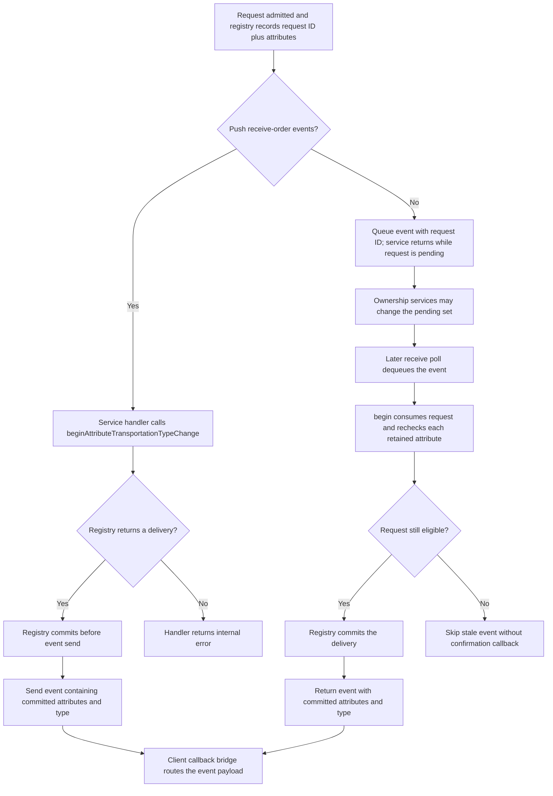

The transfer outcomes in the table above therefore apply to the configured
process poll path when a transfer happens before the receive poll: unconditional
divestiture can leave a smaller request to commit, while Confirm Divestiture
or Divestiture If Wanted can make the whole-set owner check fail. If the
request was erased or fails revalidation, the poll skips its queued event. In
the pushed path, a successful handler has already consumed and committed the
request before sending its event; if `begin` returns no delivery during a
concurrent change between planning and begin, the handler returns an internal
error. These are source observations, not HLA ordering guarantees.

The split is in the [service handler's push branch](../../cpp/src/internal/federation/process_federation_service_transportation.cpp#L93)
and [per-session event queue](../../cpp/src/internal/federation/process_federation_service_transportation.cpp#L137);
[later receive polling](../../cpp/src/internal/federation/process_federation_service_receive.cpp#L257)
calls the same [registry begin method](../../cpp/src/internal/federation/federation_registry_transportation_order_services.cpp#L53).
The poll is initiated through [callback control](../../cpp/src/internal/runtime/umbra_rti_ambassador_callback_control_services.cpp#L274).
Pushed events are dispatched by the ambassador after the request response
([dispatch point](../../cpp/src/internal/runtime/umbra_rti_ambassador_order_transportation_services.cpp#L487));
the [callback bridge](../../cpp/src/internal/federation/process_federation_callback_bridge.cpp#L737)
reports the committed event payload.

The configured-process [transportation case](../../cpp/tests/ieee1516_2025_connection_catch2.cpp#L727)
checks a normal request, confirmation, and later query. It sets
`pushReceiveOrderEvents` to false for its `HLA_EVOKED` section and true for
`HLA_IMMEDIATE` ([server option](../../cpp/tests/ieee1516_2025_connection_catch2.cpp#L753),
[callback-model sections](../../cpp/tests/ieee1516_2025_connection_catch2.cpp#L906));
that is the test's configuration, not a required mapping between callback
models and service modes. It does not interleave ownership transfer with a
pending request or test both service modes under each callback model.

### Interaction requests recheck the publisher's live declaration

Interaction transportation requests are admitted while the requesting
federate has an ordinary publication or an active directed publication for
the class. The pending type is stored in that federate's interaction
declaration record. Confirmation consumes the pending entry and checks the
publication that exists at that moment. Publication can disappear while the
request waits, and whether a later republish can restore the pending path
depends on whether unpublishing erased the whole declaration record:

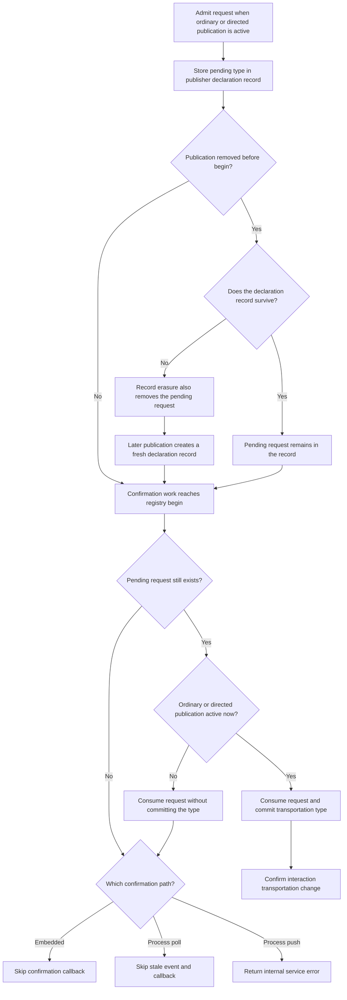

If other declarations keep the publisher's record alive, an unpublish leaves
the pending type in place. Re-publishing the class, or retaining another
directed publication for that class, before confirmation lets the current-state
check pass. If unpublishing removes the federate's last declaration, Umbra
erases the whole declaration record; the pending entry disappears with it, so
a later publish creates no confirmation for the old request. If the record
survives but no ordinary or directed publication is active when confirmation
starts, the registry consumes the request and returns no delivery. These are
source-derived registry outcomes, not HLA publication-order rules. A missing
delivery has a path-specific result: embedded callback work returns without a
confirmation callback; configured-process push returns an internal service
error; and receive polling skips the stale queued event. The push and poll
paths share the same registry publication check.

The behavior follows from [request admission](../../cpp/src/internal/federation/federation_registry_transportation_order_services.cpp#L355),
[ordinary unpublish and declaration-record cleanup](../../cpp/src/internal/federation/federation_registry_directed_interactions.cpp#L262),
[directed unpublish cleanup](../../cpp/src/internal/federation/federation_registry_directed_interactions.cpp#L363),
and [confirmation-time lookup and publication check](../../cpp/src/internal/federation/federation_registry_transportation_order_services.cpp#L471).
The [embedded callback task](../../cpp/src/internal/runtime/umbra_rti_ambassador.cpp#L1488)
skips invocation on no delivery. The process [push handler](../../cpp/src/internal/federation/process_federation_service_transportation.cpp#L243)
and [receive poll](../../cpp/src/internal/federation/process_federation_service_receive.cpp#L83)
use that same registry method but expose the path-specific outcomes described above.

The callback model is a separate, later boundary. In the embedded path, the
registry revalidation and commit run inside the queued confirmation task,
before Umbra calls `confirmInteractionTransportationTypeChange`. With
callbacks enabled, `HLA_EVOKED` leaves that task for an Evoke service;
`HLA_IMMEDIATE` may run it synchronously before the request service returns.
Disabled callbacks can defer queued work in either model. In the process path,
push versus poll determines when the registry begins the change; the callback
model controls entry into user code after the event reaches client dispatch.
See the callback guide's [dispatcher model](HLA-2025-CALLBACK-AND-SERVICE-ORDERING-FLOW-GUIDE.md#callback-task-dispatch),
[receive-poll path](HLA-2025-CALLBACK-AND-SERVICE-ORDERING-FLOW-GUIDE.md#a-process-receive-poll-can-admit-a-task-while-callbacks-are-disabled),
and [request-backed push path](HLA-2025-CALLBACK-AND-SERVICE-ORDERING-FLOW-GUIDE.md#request-backed-api-drains-a-pushed-event).

The configured-process [transportation test](../../cpp/tests/ieee1516_2025_connection_interaction_transportation_catch2.cpp#L95)
checks a normal published request and confirmation; the separate [declaration test](../../cpp/tests/ieee1516_2025_connection_interaction_declaration_catch2.cpp#L586)
unpublishes after exercising publication and subscription changes. No focused
2025 test combines an outstanding interaction transportation request with
publication loss or regain, so those publication-loss/regain branches remain
source-only.
The interaction test constructs `ProcessFederationServiceOptions{}` and runs
both callback models; the option's default is `pushReceiveOrderEvents=false`
([test setup](../../cpp/tests/ieee1516_2025_connection_interaction_transportation_catch2.cpp#L119),
[HLA_EVOKED section](../../cpp/tests/ieee1516_2025_connection_interaction_transportation_catch2.cpp#L272),
[HLA_IMMEDIATE section](../../cpp/tests/ieee1516_2025_connection_interaction_transportation_catch2.cpp#L275),
[option](../../cpp/src/internal/federation/process_federation_service.hpp#L79)).
It therefore covers its polling service path under both callback models, not
the push/poll cross-product.

## 3. Delivery carries both properties; routing and time stay separate

The selected order and transportation become visible at the receiver, but
they do not replace recipient-selection or grant rules.

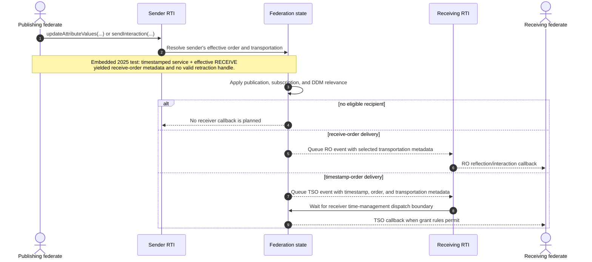

The callback arrows mark an eligible callback effect, not necessarily the
instant when application code enters the callback. `HLA_IMMEDIATE` and
`HLA_EVOKED` govern that separate observation boundary; they do not alter the
delivery-order branch or transportation metadata.

In callback observations, `sentOrderType` and `receivedOrderType` describe
order; the separate transportation handle describes the selected category.
Tests include ordinary and timestamped updates/interactions with a FOM-defined
custom transportation and observe that handle on the receiving callback.
Regional and directed variants exist in focused tests too, but this diagram
leaves their recipient-selection details to the DDM guide.

One subtle result in the order-control test is that a timestamped send/update
overload does not by itself prove the delivered event is TSO. The publisher's
current order setting matters: the test changes an interaction to `RECEIVE`,
supplies a logical-time argument, and observes receive-order values with no
valid retraction handle. This is a focused embedded 2025 observation, not an
independent normative ruling. Read both callback order fields and
time-management state; do not infer the result from the service overload alone.

## 4. Queries report the effective setting through callbacks

These query services are callback-oriented too: the API call is `void`; the
report arrives through the federate ambassador.

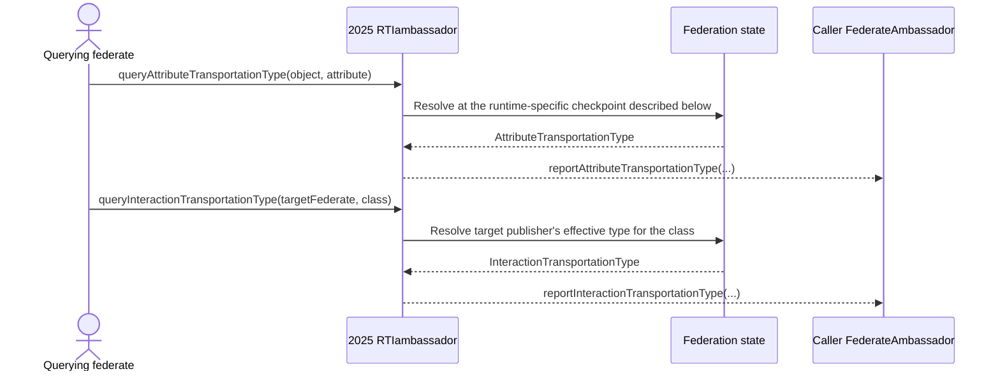

The pinned 2025 API pairs
[`queryAttributeTransportationType`](../../third_party/ieee1516.1-2025/include/RTI/RTIambassador.h#L940)
with the [`reportAttributeTransportationType` callback](../../third_party/ieee1516.1-2025/include/RTI/FederateAmbassador.h#L388).
It has no corresponding query for an object's effective order:
[`getOrderType(name)`](../../third_party/ieee1516.1-2025/include/RTI/RTIambassador.h#L1851)
maps an order name to its enum value. The order-transfer case above therefore
observes order through metadata on a later update reflection, while this query
diagram applies only to transportation.

For an attribute query, the report value's sampling point depends on the
runtime path. These are Umbra implementation details; they do not change the
public asynchronous query/report API or establish a normative timing rule.

| Runtime path | When the value is sampled for the report | What a state change between query invocation and report work can affect |
| --- | --- | --- |
| Embedded federation | The query call validates the request and obtains an initial plan, but the queued report closure retains the callback route, requester, object, and attribute rather than the planned transportation name. The task resolves the effective setting again when it runs. | A committed change before the report task runs can affect the reported value. If the object/attribute is no longer reportable, the task returns without a report callback. |
| Configured process, pushed events | The service handler resolves the setting and puts that name in the event before sending it. The callback bridge reports the event payload. | Later registry changes do not rewrite the already-sent event's value. |
| Configured process, polled events | The service handler queues an event; when receive polling selects it, the service resolves the effective setting again and replaces the queued name before returning the event. The callback bridge reports that projected payload. | A committed change before the receive poll can affect the reported value; if the query is no longer valid the event is skipped. Changes after event projection do not rewrite the payload. |

The embedded checkpoints are visible in the [query service](../../cpp/src/internal/runtime/umbra_rti_ambassador_order_transportation_services.cpp#L705),
[queued report task](../../cpp/src/internal/runtime/umbra_rti_ambassador.cpp#L1449),
and [registry re-resolution](../../cpp/src/internal/federation/federation_registry_transportation_order_services.cpp#L338).
The configured-process checkpoints are visible in the [query event handler](../../cpp/src/internal/federation/process_federation_service_transportation.cpp#L164),
[pushed-event send](../../cpp/src/internal/federation/process_federation_service_transportation.cpp#L179),
[polled-event projection](../../cpp/src/internal/federation/process_federation_service_receive.cpp#L285),
and [callback bridge](../../cpp/src/internal/federation/process_federation_callback_bridge.cpp#L788).
The focused embedded [query report case](../../cpp/tests/ieee1516_2025_query_attribute_transportation_type_service_report_file_catch2.cpp#L72)
checks that the public report arrives after callback work is evoked, but does
not change ownership or transportation between query invocation and report
delivery. The configured-process [attribute change/query case](../../cpp/tests/ieee1516_2025_connection_catch2.cpp#L727)
checks the ordinary request, confirmation, and query round trip under both
callback models, with the query after confirmation rather than interleaved
with a state change. No focused 2025 test covers either report-sampling race
or a query racing an ownership transfer that invalidates a pending
transportation change.

The interaction query's federate designator separates the query subject from
the callback recipient. The process request carries requesting and queried
federate IDs independently ([client request](../../cpp/src/internal/federation/process_federation_client_declaration_services.cpp#L204)).
In the embedded registry, resolution starts with the composed class
transportation, looks up the queried federate's declarations, and applies that
federate's override only when it is currently publishing the class through an
ordinary or directed publication; the report route is selected for the
requesting federate ([default value](../../cpp/src/internal/federation/federation_registry_transportation_order_services.cpp#L529),
[queried declarations](../../cpp/src/internal/federation/federation_registry_transportation_order_services.cpp#L542),
[publication gate](../../cpp/src/internal/federation/federation_registry_transportation_order_services.cpp#L543),
[requester's callback route](../../cpp/src/internal/federation/federation_registry_transportation_order_services.cpp#L563)).
This is a source observation, not an independent normative interpretation.

The interaction query also has a path-specific sample point. The call validates
an initial plan, but the reported value is either retained from that plan or
resolved again when callback work is projected:

| Runtime path | When the reported type is sampled | Effect of publication changes before that point |
| --- | --- | --- |
| Embedded federation | The queued callback task reruns the query plan when it executes. | Publication and committed override state at callback time determine the report. |
| Configured process, pushed events | The service handler puts the planned type in the event before sending it. | Later publication changes do not rewrite the event payload. |
| Configured process, polled events | The receive poll reruns the query plan and replaces the queued event's type. | Publication and committed override state at poll time determine the report. |

The query starts with the composed class transportation and applies the
queried federate's committed override only while that federate currently has
ordinary or directed publication for the class. It does not read the pending
transportation-change entry. Thus, if publication disappears before an
embedded callback or process poll, the query can report the composed type;
republishing before that sample can make a retained committed override visible
again. If unpublishing erased the declaration record, the override and pending
request are both gone. These are source-derived timing and state observations,
not HLA query-order rules.

The checkpoints are visible in the embedded [query entrypoint](../../cpp/src/internal/runtime/umbra_rti_ambassador_interaction_transportation_type_query.cpp#L114)
and [callback task](../../cpp/src/internal/runtime/umbra_rti_ambassador.cpp#L1513),
the process [query handler](../../cpp/src/internal/federation/process_federation_service_transportation.cpp#L331),
and [receive-poll projection](../../cpp/src/internal/federation/process_federation_service_receive.cpp#L274).
The current-publication gate and override selection are in the [registry query plan](../../cpp/src/internal/federation/federation_registry_transportation_order_services.cpp#L529).

The configured-process test exercises the change and query under both
`HLA_EVOKED` and `HLA_IMMEDIATE` ([test](../../cpp/tests/ieee1516_2025_connection_interaction_transportation_catch2.cpp#L95),
[evoked](../../cpp/tests/ieee1516_2025_connection_interaction_transportation_catch2.cpp#L272),
[immediate](../../cpp/tests/ieee1516_2025_connection_interaction_transportation_catch2.cpp#L275)),
but queries the calling federate's own handle
([self-target selection](../../cpp/tests/ieee1516_2025_connection_interaction_transportation_catch2.cpp#L216),
[query call](../../cpp/tests/ieee1516_2025_connection_interaction_transportation_catch2.cpp#L226),
[queried-target assertion](../../cpp/tests/ieee1516_2025_connection_interaction_transportation_catch2.cpp#L231),
[reported-value assertion](../../cpp/tests/ieee1516_2025_connection_interaction_transportation_catch2.cpp#L233)).
It verifies that self-query round trip; it does not test querying another
publisher or querying after the target stops publishing. Those cross-federate
and publication-change outcomes remain source-only here. The embedded custom
transport test does query a different publisher after a committed change
([peer query](../../cpp/tests/ieee1516_2025_custom_transportation_type_controls_catch2.cpp#L154));
it does not interleave publication changes with report work. No focused 2025
test covers an interaction query's embedded callback-time or configured-process
poll-time sampling race.

## Reading the implementation evidence

The source comments associate these controls and queries with standard
navigation points: §§6.25, 6.27–6.28, 6.30, and 6.32 for transportation
services; §§8.24–8.26 for order controls. The [official 2025 standard page](https://standards.ieee.org/ieee/1516.1/6688/)
is the authority for interpreting those sections.

| Topic | Umbra implementation | Focused evidence |
| --- | --- | --- |
| Attribute order and class defaults | [Registry controls](../../cpp/src/internal/federation/federation_registry_transportation_order_services.cpp#L11); [ambassador controls](../../cpp/src/internal/runtime/umbra_rti_ambassador_order_transportation_services.cpp#L52) | [Order-control scenario](../../cpp/tests/order_type_control_catch2.cpp#L170) |
| Attribute transportation default, pending request, and query | [Request planning](../../cpp/src/internal/federation/federation_registry_attribute_transportation_type_change_planning.cpp#L10); [effective-value resolution](../../cpp/src/internal/federation/federation_registry_catalog_queries.cpp#L932); [ambassador services](../../cpp/src/internal/runtime/umbra_rti_ambassador_order_transportation_services.cpp#L415) | [Embedded default/instance control](../../cpp/tests/custom_transportation_type_control_catch2.cpp#L102); [FOM-defined controls](../../cpp/tests/ieee1516_2025_custom_transportation_type_controls_catch2.cpp#L3) |
| Interaction transportation request/query | [Change](../../cpp/src/internal/runtime/umbra_rti_ambassador_interaction_transportation_type_change.cpp#L21); [query](../../cpp/src/internal/runtime/umbra_rti_ambassador_interaction_transportation_type_query.cpp#L20); [effective value](../../cpp/src/internal/federation/federation_registry_catalog_queries.cpp#L955) | [Configured process endpoint, both callback models](../../cpp/tests/ieee1516_2025_connection_interaction_transportation_catch2.cpp#L76) |
| Transportation metadata on outgoing delivery | [Interaction planning](../../cpp/src/internal/federation/federation_registry_receive_order_interactions.cpp#L65); [attribute update planning](../../cpp/src/internal/federation/federation_registry_attribute_value_update_requests.cpp#L174) | [Ordinary custom transport](../../cpp/tests/custom_transportation_delivery_catch2.cpp#L142); [timestamped custom transport](../../cpp/tests/custom_transportation_timestamped_delivery_catch2.cpp#L185); [regional/directed variants](../../cpp/tests/custom_transportation_timestamped_regional_attribute_delivery_catch2.cpp#L163), [directed interaction](../../cpp/tests/custom_transportation_timestamped_directed_delivery_catch2.cpp#L262) |
| Per-recipient order conversion for one sent TSO interaction | [Sender recipient split and RECEIVE callback fields](../../cpp/src/internal/runtime/umbra_rti_ambassador_timestamped_interaction_send.cpp#L322); [TSO message admission](../../cpp/src/internal/federation/federation_registry_time_tso_enqueue.cpp#L290) | [Constrained and unconstrained receivers report different `receivedOrderType` values for the same sent order](../../cpp/tests/ieee1516_2025_sent_tso_per_recipient_order_conversion_catch2.cpp#L125) |
| Pending transportation changes through restore | [Saved pending state](../../cpp/src/internal/federation/federation_registry_state_image_capture.cpp) | [Attribute restore](../../cpp/tests/ieee1516_2025_public_pending_attribute_transportation_type_change_restore_catch2.cpp#L6); [interaction restore](../../cpp/tests/ieee1516_2025_public_pending_interaction_transportation_type_change_restore_catch2.cpp#L6) |

These links show representative implementation and test paths, not exhaustive
coverage of the standard's service matrix. The [separate 2010 reference-RTI guide](HLA-2010-REFERENCE-RTI-FLOW-GUIDE.md)
retains its own implementation boundary; nothing in this 2025 guide is
evidence for that stream.

## Known limits and the next boundary

- Transportation tests prove catalog resolution, state selection, and callback
  metadata for named scenarios. They do not measure wire-level reliability,
  latency, or delivery guarantees of every transportation category or
  deployment.
- The cross-product of attribute versus interaction, default versus override,
  RO versus TSO, regional versus nonregional, embedded versus process, and
  save/restore timing is not exhaustively tested.
- Order values outside `RECEIVE` and `TIMESTAMP` are rejected by the current
  profile; this describes Umbra behavior, not an independent standards ruling.
- This guide does not absorb DDM recipient selection, time-advance eligibility,
  message retraction, or 2010 behavior. Follow the linked guides for those
  boundaries.

The adjacent [declaration and attribute relevance guide](HLA-2025-RELEVANCE-ADVISORY-FLOW-GUIDE.md)
and [attribute scope guide](HLA-2025-ATTRIBUTE-SCOPE-ADVISORY-FLOW-GUIDE.md)
already distinguish publisher-facing class relevance, owner-facing
per-object-attribute relevance, and receiver-local scope. Keep those advisory
lifecycles separate from order and transportation; neither delivery property
implies an advisory. For the portable timing gate, continue to the
[time-management guide](HLA-2025-TIME-MANAGEMENT-GUIDE.md); for receiver
selection, use the [DDM/regions guide](HLA-2025-DATA-DISTRIBUTION-AND-REGIONS-FLOW-GUIDE.md);
for callback observation, use the [callback/service-ordering guide](HLA-2025-CALLBACK-AND-SERVICE-ORDERING-FLOW-GUIDE.md).
The exact normative mapping between sender designation and receiver order
still needs authorized 1516.1-2025 clause text; callback fields and a focused
implementation case do not settle it. This 2025 guide is not evidence for the
separate 2010 stream. Follow the [current documentation handoff](../planning/ROADMAP-INDEX.json)
for the next cross-guide review rather than relying on an older topic pointer.
