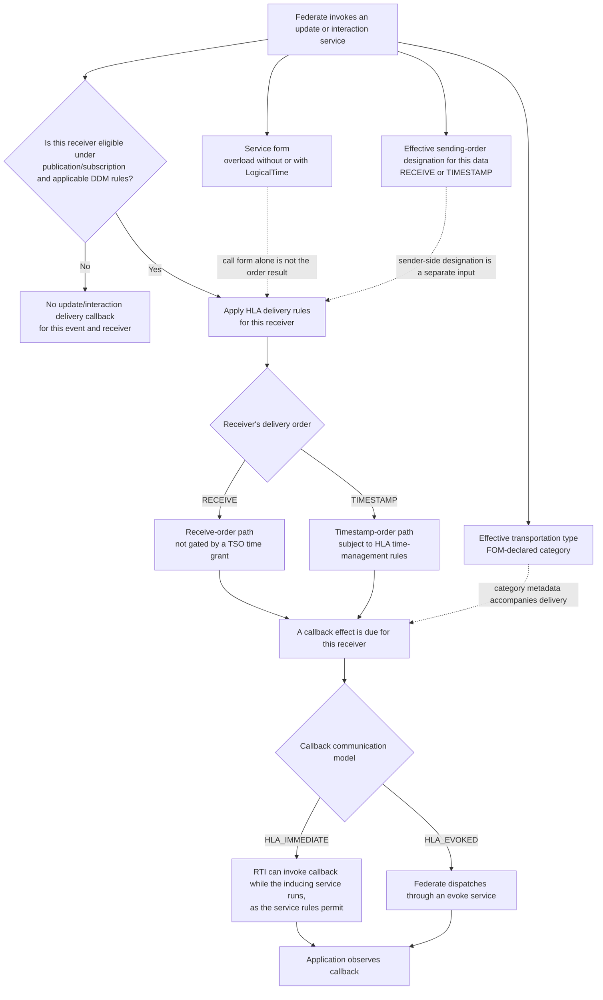
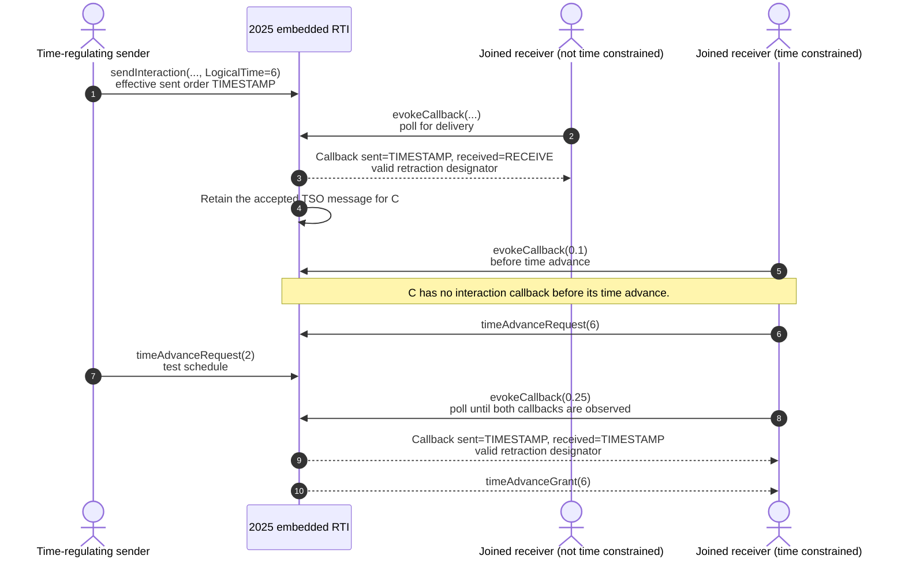
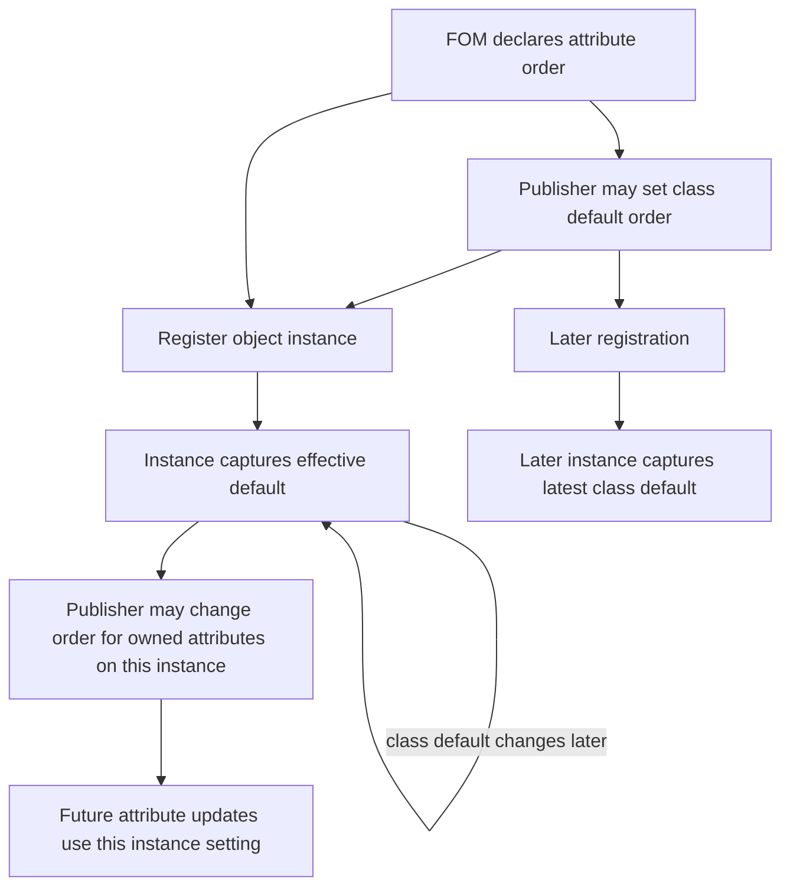
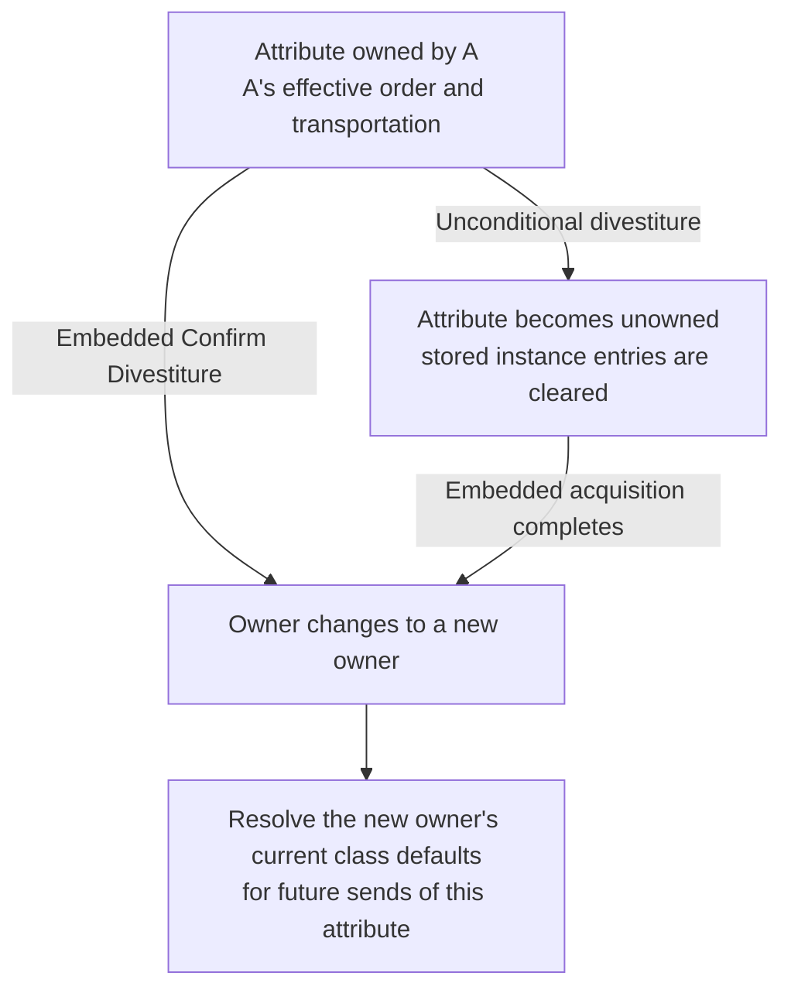
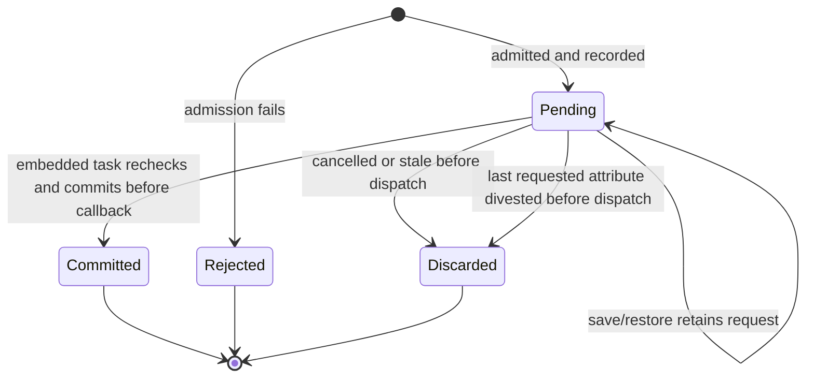
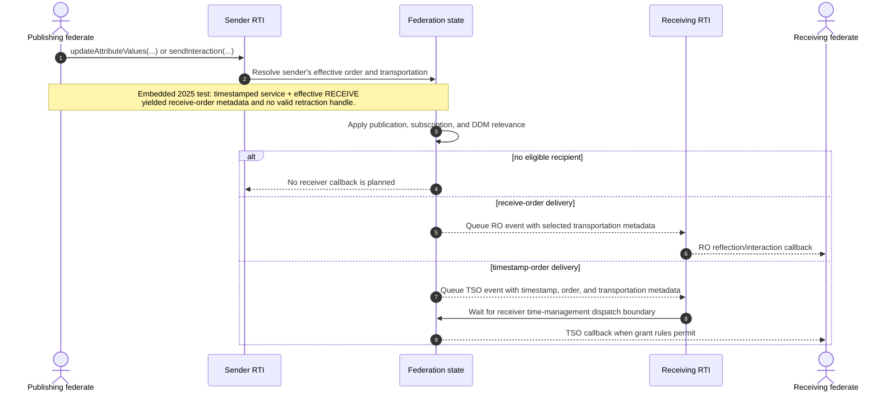
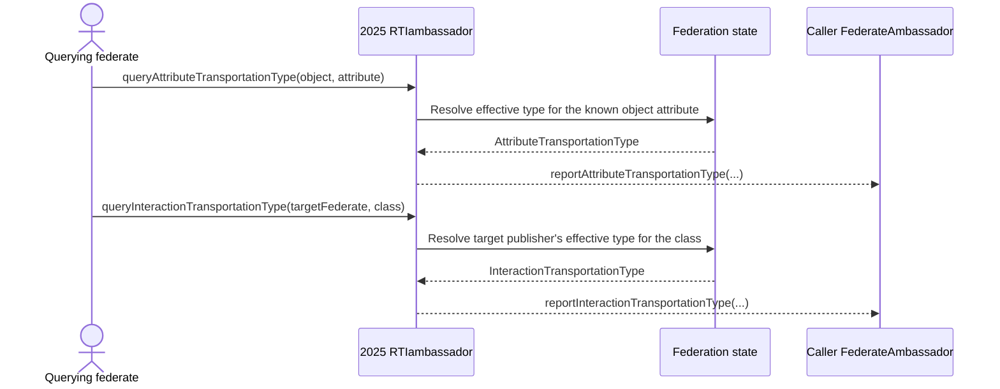

# IEEE 1516.1-2025 Order and Transportation Flow Guide

This guide explains two sender-controlled delivery properties that are easy to
conflate: **order** answers whether information is delivered receive-order or
timestamp-order; **transportation type** selects the federation-declared
transportation category associated with that information. They are reported
separately and follow different change lifecycles in Umbra.

**Edition:** IEEE 1516.1-2025 only. This guide does not describe the separate
2010 API/runtime or infer compatibility between editions.

**Implementation profile:** current 2025 embedded behavior plus selected
process-endpoint control/query cases. Focused tests establish only the paths
and combinations they exercise, not full conformance or physical network QoS.
The official [IEEE 1516.1-2025 edition page](https://standards.ieee.org/ieee/1516.1/6688/)
is the normative starting point. Clause numbers below are navigation pointers
transcribed from Umbra source comments; check exact wording in the licensed
standard before deriving requirements.

## First separate the two questions

- **Order** (`RECEIVE` or `TIMESTAMP`; see the
  [pinned 2025 enum](../../third_party/ieee1516.1-2025/include/RTI/Enums.h#L28))
  answers whether delivery follows receive-order or timestamp-order.
  Sent/received callbacks report the order; timestamp-ordered callbacks also
  carry logical time and may carry a retraction handle.
- **Transportation type** selects a FOM-declared category for an attribute or
  interaction. The standard names are `HLAreliable` and `HLAbestEffort`;
  FOMs may define additional categories. A federation-scoped
  `TransportationTypeHandle` identifies the selected category. Reflection
  and interaction callbacks carry that handle, and query services report it
  through callbacks.

The [pinned 2025 standard MIM](../../third_party/ieee1516.2-2025/resources/mim/HLAstandardMIM-2025.xml#L2751)
describes `HLAreliable` as reliable delivery and `HLAbestEffort` as best-effort
delivery, using TCP/IP and UDP as analogies. Those names describe HLA
transportation categories; they do not establish which network protocol an
RTI uses or measured delivery behavior in a particular deployment.

Neither value substitutes for the other. A `TIMESTAMP` order selection does not
say which transportation type is selected; a custom transportation handle
does not say when a time-constrained receiver may observe the event. DDM still
decides which receivers are relevant, and time management still gates TSO
delivery. See the separate [time-management](HLA-2025-TIME-MANAGEMENT-GUIDE.md)
and [DDM/regions](HLA-2025-DATA-DISTRIBUTION-AND-REGIONS-FLOW-GUIDE.md)
guides for those state machines.

Callback observation is a separate boundary after the service-specific rules
make an effect due for a federate (and any TSO time gate permits it).
`HLA_IMMEDIATE` allows the RTI to enter the callback while the inducing
service is executing; under `HLA_EVOKED`, the application dispatches callbacks
through an evoke service. Callback model does not select the recipient or
replace either the event's order or transportation type. See the separate
[callback and service-ordering guide](HLA-2025-CALLBACK-AND-SERVICE-ORDERING-FLOW-GUIDE.md)
for callback entry and ordering boundaries.

## A delivery map: keep the questions separate

“Timestamped” can refer to the service overload that accepts a logical-time
argument, the sender's effective order designation, or a receiver's
timestamp-order delivery. Do not treat those as interchangeable. Recipient
eligibility, transportation category, time-management eligibility, and
application callback observation are separate questions too.

Read the dashed links as relationships between questions, not as a complete
execution schedule or a normative decision table. The pinned 2025 callback API
has ordinary and time-bearing overloads: the latter exposes `LogicalTime`,
`sentOrderType`, `receivedOrderType`, and an optional retraction handle; both
forms carry the transportation type ([attribute callback overloads](../../third_party/ieee1516.1-2025/include/RTI/FederateAmbassador.h#L238),
[interaction callback overloads](../../third_party/ieee1516.1-2025/include/RTI/FederateAmbassador.h#L264)). Those distinct fields do not, by themselves,
establish every normative condition that maps a sender's order to a receiver's
delivery path.

The existing embedded order-control case makes the distinction concrete: after
changing the interaction's effective order to `RECEIVE`, it invokes the
timestamped `sendInteraction` overload with a logical-time argument and
observes `RECEIVE` for both order fields plus an invalid retraction handle
([case](../../cpp/tests/order_type_control_catch2.cpp#L301)). This is a bounded
implementation observation, not the full standard rule. The exact
sender-to-receiver mapping remains subject to the licensed IEEE text; the
separate [time-management guide](HLA-2025-TIME-MANAGEMENT-GUIDE.md) explains
the TSO gate once a delivery is timestamp-ordered.

### One sent TSO interaction can have different received orders

The two callback fields matter even when there is only one send. In a focused
embedded `HLA_EVOKED` scenario, a time-regulating sender sends an interaction
whose effective order is `TIMESTAMP` to two eligible receivers. The
non-time-constrained receiver observes it as receive-order; the time-constrained
receiver observes it as timestamp-order after advancing to the message time.
Both reports preserve `sentOrderType == TIMESTAMP`, and both contain a valid
retraction designator for the accepted send. The [shared delivery assertions](../../cpp/tests/ieee1516_2025_sent_tso_per_recipient_order_conversion_catch2.cpp#L218)
check payload, tag, transportation, producer, logical time, sent order, and
retraction validity; the [recipient-specific assertions](../../cpp/tests/ieee1516_2025_sent_tso_per_recipient_order_conversion_catch2.cpp#L240)
check `RECEIVE` versus `TIMESTAMP` received order. The test also checks the
constrained receiver's [interaction-before-grant callback order](../../cpp/tests/ieee1516_2025_sent_tso_per_recipient_order_conversion_catch2.cpp#L215).

The sequence includes this test's `HLA_EVOKED` polling so the callback arrows
are not mistaken for asynchronous delivery: the unconstrained receiver polls
after the send; the constrained receiver polls before its time advance and has
no interaction callback yet, then requests time 6 and polls for the TSO
interaction and grant. The test also requests sender time 2 before observing
the constrained delivery. That is the test's schedule, not a replacement for
the general grant-eligibility explanation in the [time-management guide](HLA-2025-TIME-MANAGEMENT-GUIDE.md).

This is the bounded observation in the
[per-recipient conversion test](../../cpp/tests/ieee1516_2025_sent_tso_per_recipient_order_conversion_catch2.cpp#L125),
not a complete order-conversion table or an independent normative interpretation. Its source comment maps the expected
case to §8.1.4 Table 3; the licensed standard text is still needed to verify that normative mapping. The embedded sender
path separates time-constrained recipients from the receive-order callback route
([recipient split and TSO admission](../../cpp/src/internal/runtime/umbra_rti_ambassador_timestamped_interaction_send.cpp#L288),
[receive-order callback fields](../../cpp/src/internal/runtime/umbra_rti_ambassador_timestamped_interaction_send.cpp#L396)).
It is one `HLA_EVOKED` scenario; do not generalize it to every sender/receiver role combination, process endpoint, or
the separate 2010 stream.

## Who controls what, and when does it take effect?

Umbra exposes class/default settings and more specific settings. They are
scoped to the declaring federate's publication or object instance; changing
one sender's setting is not a federation-wide change to all senders of that
class.

| Control | Scope and service | Current Umbra commit point | Evidence-backed effect |
| --- | --- | --- | --- |
| Default attribute order | Attribute set on an object class via `changeDefaultAttributeOrderType` | Synchronous service update | Captured by later object registrations; existing instances retain their captured value. |
| Instance attribute order | Owned attributes on a known object via `changeAttributeOrderType` | Synchronous service update | Changes future updates for only that object/attribute set. |
| Published interaction order | An interaction class via `changeInteractionOrderType` | Synchronous service update | Changes future sends for that publisher/class. |
| Default attribute transportation | Attribute set on an object class via `changeDefaultAttributeTransportationType` | Synchronous service update | Later registered instances use the new default; existing instances are not rewritten. |
| Instance attribute transportation | Owned attributes on a known object via `requestAttributeTransportationTypeChange` | RTI dispatch revalidates and commits before `confirmAttributeTransportationTypeChange` | The request stays pending until its confirmation work runs; the public callback reports the committed setting. |
| Published interaction transportation | A published interaction class via `requestInteractionTransportationTypeChange` | RTI dispatch revalidates and commits before `confirmInteractionTransportationTypeChange` | The request stays pending until its confirmation work runs; future sends use the committed setting. |

The **default** and **instance** rows are different state locations and have
different lifetimes. For order, both class-default and instance changes apply
synchronously in the current profile. For transportation, the class-default
setter is synchronous, while instance/class overrides use a request-and-confirm
path.

## 1. Attribute order: defaults are captured; instance changes are local

The class default is prospective. Once an object instance exists, change its
order directly if that instance needs a different setting.

The self-loop emphasizes the non-retroactive edge: changing a class default
does not rewrite an already registered object's order while its ownership
remains unchanged. In the focused test, an FOM-default timestamp-ordered
object, a later receive-order default, and a per-instance timestamp override
produce different results even though the publisher invokes the timestamped
update service for each object.

### Attribute ownership can reseed sender settings (Umbra source observation)

An attribute's sender changes when ownership changes, so the existing owner's
per-instance order and transportation entries are not necessarily carried
forward. In the inspected embedded 2025 acquisition-of-an-unowned-attribute
and Confirm Divestiture paths, Umbra resolves the new owner's current class
defaults and writes those values into the instance state; order falls back to
the new owner's default when there is no explicit instance entry.
Unconditional divestiture clears the stored per-instance order and
transportation entries while the attribute is unowned. This describes selected
Umbra paths, not a claim about the normative transfer rule or the separate
2010 stream.

The selected [acquisition](../../cpp/src/internal/federation/federation_registry_attribute_ownership_acquisition.cpp#L354)
and [Confirm Divestiture](../../cpp/src/internal/federation/federation_registry_negotiated_attribute_ownership_divestiture.cpp#L471)
paths seed settings from the new owner; [unconditional divestiture](../../cpp/src/internal/federation/federation_registry_attribute_ownership_assumptions.cpp#L205)
clears them, and the [effective order](../../cpp/src/internal/federation/federation_registry_catalog_queries.cpp#L842)
and [transportation](../../cpp/src/internal/federation/federation_registry_catalog_queries.cpp#L932)
resolvers fall back to defaults associated with the current owner. The focused
order and transportation cases reviewed here do not combine a successful
ownership transfer with an assertion of the new owner's effective values.
The focused [TSO ownership-transfer case](../../cpp/tests/timestamped_attribute_update_ownership_transfer_catch2.cpp#L191)
delivers A's already accepted update to B with its original timestamp-order
metadata; it does not test a new send from B or query B's current settings. For
that separate event-lifetime timeline, see the [TSO retraction guide's
ownership boundary](HLA-2025-TSO-RETRACTION-FLOW-GUIDE.md#ownership-changes-and-an-accepted-tso-update-are-separate-timelines).
For the public ownership-service flows, see the
[2025 attribute-ownership guide](HLA-2025-ATTRIBUTE-OWNERSHIP-FLOW-GUIDE.md);
this source note complements, rather than replaces, that HLA-facing guide.

## 2. Transportation change requests have a pending lifecycle

For the 2025 embedded path, admission records a pending request; Umbra applies
the selected transportation while processing its confirmation work. That
work rechecks the live target and requester eligibility, commits the change,
and only then invokes the public confirmation callback. Attribute requests
are scoped to an object and set of owned attributes; interaction requests
are scoped to a published interaction class.

For an attribute request, Umbra rejects a new request if one of its attributes
is already participating in a pending transportation change. For an
interaction class, a second request while a change is pending is rejected.
The RTI's registry rechecks membership and the relevant live eligibility before
commit: attribute ownership for each requested attribute, or publication of
the interaction class. If the request is cancelled or no longer eligible,
Umbra drops it without delivering a confirmation; ownership changes can also
clear an attribute's current override, so this path does not promise the old
effective value remains in force. In the embedded source, unconditional
divestiture also removes each divested attribute from every pending
transportation-change request. If that empties a request, the registry erases
it; when its already-queued confirmation work later starts, the request lookup
finds nothing and returns without a public confirmation. If only part of a
multi-attribute request is divested, its remaining attributes stay in the
request and are rechecked and committed through the ordinary pending-work path.
This is a source-observed interaction between two services, not a statement of
the IEEE rule for their ordering. The paths are visible in [unconditional
divestiture cleanup](../../cpp/src/internal/federation/federation_registry_attribute_ownership_assumptions.cpp#L202),
[pending-request dispatch lookup](../../cpp/src/internal/federation/federation_registry_transportation_order_services.cpp#L64),
and the [queued callback's no-delivery return](../../cpp/src/internal/runtime/umbra_rti_ambassador.cpp#L1390).

In the embedded implementation, the registry writes the selected value while
processing confirmation work, immediately before invoking the public callback
([attribute commit](../../cpp/src/internal/federation/federation_registry_transportation_order_services.cpp#L52),
[interaction commit](../../cpp/src/internal/federation/federation_registry_transportation_order_services.cpp#L412),
[callback route](../../cpp/src/internal/runtime/umbra_rti_ambassador.cpp#L1362)).
The confirmation callback remains the federate-visible boundary; this
internal write ordering does not establish an earlier portable or normative
effective time. Under `HLA_EVOKED`, the work waits for callback dispatch; under
`HLA_IMMEDIATE`, it can run inline while the request service is still active,
so the pending interval need not be visible after the service returns.
The focused [attribute restore case](../../cpp/tests/ieee1516_2025_public_pending_attribute_transportation_type_change_restore_catch2.cpp#L249)
checks the restored confirmation for the object, attribute set, and selected
transportation type; its [query call](../../cpp/tests/ieee1516_2025_public_pending_attribute_transportation_type_change_restore_catch2.cpp#L255)
and [result assertion](../../cpp/tests/ieee1516_2025_public_pending_attribute_transportation_type_change_restore_catch2.cpp#L264)
check the effective setting afterward. The [interaction restore case](../../cpp/tests/ieee1516_2025_public_pending_interaction_transportation_type_change_restore_catch2.cpp#L333)
checks the restored interaction and attribute confirmations, then its
[query call](../../cpp/tests/ieee1516_2025_public_pending_interaction_transportation_type_change_restore_catch2.cpp#L358)
and [result assertion](../../cpp/tests/ieee1516_2025_public_pending_interaction_transportation_type_change_restore_catch2.cpp#L367)
check the effective setting. These cases exercise pending-state restoration
under both callback models; they do not claim every process restart, persistence
backend, or callback-scheduling interleaving is covered. The [save/restore interlock case](../../cpp/tests/ieee1516_2025_representative_save_restore_interlock_catch2.cpp#L130)
also invokes both transportation-change and unconditional-divestiture services,
but only verifies that each is rejected while save or restore is in progress
([transportation request](../../cpp/tests/ieee1516_2025_representative_save_restore_interlock_catch2.cpp#L130),
[divestiture](../../cpp/tests/ieee1516_2025_representative_save_restore_interlock_catch2.cpp#L160));
it does not exercise divestiture while a transportation change is pending.
The divestiture interleaving above is therefore source-only, with no focused
2025 test asserting its callback outcome.

## 3. Delivery carries both properties; routing and time stay separate

The selected order and transportation become visible at the receiver, but
they do not replace recipient-selection or grant rules.

The callback arrows mark an eligible callback effect, not necessarily the
instant when application code enters the callback. `HLA_IMMEDIATE` and
`HLA_EVOKED` govern that separate observation boundary; they do not alter the
delivery-order branch or transportation metadata.

In callback observations, `sentOrderType` and `receivedOrderType` describe
order; the separate transportation handle describes the selected category.
Tests include ordinary and timestamped updates/interactions with a FOM-defined
custom transportation and observe that handle on the receiving callback.
Regional and directed variants exist in focused tests too, but this diagram
leaves their recipient-selection details to the DDM guide.

One subtle result in the order-control test is that a timestamped send/update
overload does not by itself prove the delivered event is TSO. The publisher's
current order setting matters: the test changes an interaction to `RECEIVE`,
supplies a logical-time argument, and observes receive-order values with no
valid retraction handle. This is a focused embedded 2025 observation, not an
independent normative ruling. Read both callback order fields and
time-management state; do not infer the result from the service overload alone.

## 4. Queries report the effective setting through callbacks

These query services are callback-oriented too: the API call is `void`; the
report arrives through the federate ambassador.

The interaction query's federate designator separates the query subject from
the callback recipient. The process request carries requesting and queried
federate IDs independently ([client request](../../cpp/src/internal/federation/process_federation_client_declaration_services.cpp#L203)).
In the embedded registry, resolution starts with the composed class
transportation, looks up the queried federate's declarations, and applies that
federate's override only when it is currently publishing the class through an
ordinary or directed publication; the report route is selected for the
requesting federate ([default value](../../cpp/src/internal/federation/federation_registry_transportation_order_services.cpp#L496),
[queried declarations](../../cpp/src/internal/federation/federation_registry_transportation_order_services.cpp#L497),
[publication gate](../../cpp/src/internal/federation/federation_registry_transportation_order_services.cpp#L511),
[requester's callback route](../../cpp/src/internal/federation/federation_registry_transportation_order_services.cpp#L518)).
This is a source observation, not an independent normative interpretation.

The configured-process test exercises the change and query under both
`HLA_EVOKED` and `HLA_IMMEDIATE` ([evoked](../../cpp/tests/ieee1516_2025_connection_interaction_transportation_catch2.cpp#L258),
[immediate](../../cpp/tests/ieee1516_2025_connection_interaction_transportation_catch2.cpp#L261)),
but queries the calling federate's own handle
([self-target selection](../../cpp/tests/ieee1516_2025_connection_interaction_transportation_catch2.cpp#L211),
[query call](../../cpp/tests/ieee1516_2025_connection_interaction_transportation_catch2.cpp#L221),
[queried-target assertion](../../cpp/tests/ieee1516_2025_connection_interaction_transportation_catch2.cpp#L226),
[reported-value assertion](../../cpp/tests/ieee1516_2025_connection_interaction_transportation_catch2.cpp#L228)).
It verifies that self-query round trip; it does not test querying another
publisher or querying after the target stops publishing. Those cross-federate
and publication-change outcomes remain source-only here.

## Reading the implementation evidence

The source comments associate these controls and queries with standard
navigation points: §§6.25, 6.27–6.28, 6.30, and 6.32 for transportation
services; §§8.24–8.26 for order controls. The [official 2025 standard page](https://standards.ieee.org/ieee/1516.1/6688/)
is the authority for interpreting those sections.

| Topic | Umbra implementation | Focused evidence |
| --- | --- | --- |
| Attribute order and class defaults | [Registry controls](../../cpp/src/internal/federation/federation_registry_transportation_order_services.cpp#L10); [ambassador controls](../../cpp/src/internal/runtime/umbra_rti_ambassador_order_transportation_services.cpp#L52) | [Order-control scenario](../../cpp/tests/order_type_control_catch2.cpp#L168) |
| Attribute transportation default, pending request, and query | [Request planning](../../cpp/src/internal/federation/federation_registry_attribute_transportation_type_change_planning.cpp#L10); [effective-value resolution](../../cpp/src/internal/federation/federation_registry_catalog_queries.cpp#L932); [ambassador services](../../cpp/src/internal/runtime/umbra_rti_ambassador_order_transportation_services.cpp#L415) | [Embedded default/instance control](../../cpp/tests/custom_transportation_type_control_catch2.cpp#L102); [FOM-defined controls](../../cpp/tests/ieee1516_2025_custom_transportation_type_controls_catch2.cpp#L3) |
| Interaction transportation request/query | [Change](../../cpp/src/internal/runtime/umbra_rti_ambassador_interaction_transportation_type_change.cpp#L21); [query](../../cpp/src/internal/runtime/umbra_rti_ambassador_interaction_transportation_type_query.cpp#L20); [effective value](../../cpp/src/internal/federation/federation_registry_catalog_queries.cpp#L955) | [Configured process endpoint, both callback models](../../cpp/tests/ieee1516_2025_connection_interaction_transportation_catch2.cpp#L76) |
| Transportation metadata on outgoing delivery | [Interaction planning](../../cpp/src/internal/federation/federation_registry.cpp#L1832); [attribute update planning](../../cpp/src/internal/federation/federation_registry_attribute_value_update_requests.cpp#L152) | [Ordinary custom transport](../../cpp/tests/custom_transportation_delivery_catch2.cpp#L142); [timestamped custom transport](../../cpp/tests/custom_transportation_timestamped_delivery_catch2.cpp#L185); [regional/directed variants](../../cpp/tests/custom_transportation_timestamped_regional_attribute_delivery_catch2.cpp#L163), [directed interaction](../../cpp/tests/custom_transportation_timestamped_directed_delivery_catch2.cpp#L143) |
| Per-recipient order conversion for one sent TSO interaction | [Sender recipient split and RECEIVE callback fields](../../cpp/src/internal/runtime/umbra_rti_ambassador_timestamped_interaction_send.cpp#L288); [TSO message admission](../../cpp/src/internal/federation/federation_registry_time_tso_enqueue.cpp#L289) | [Constrained and unconstrained receivers report different `receivedOrderType` values for the same sent order](../../cpp/tests/ieee1516_2025_sent_tso_per_recipient_order_conversion_catch2.cpp#L125) |
| Pending transportation changes through restore | [Saved pending state](../../cpp/src/internal/federation/federation_registry_state_image_capture.cpp) | [Attribute restore](../../cpp/tests/ieee1516_2025_public_pending_attribute_transportation_type_change_restore_catch2.cpp#L6); [interaction restore](../../cpp/tests/ieee1516_2025_public_pending_interaction_transportation_type_change_restore_catch2.cpp#L6) |

These links show representative implementation and test paths, not exhaustive
coverage of the standard's service matrix. The [separate 2010 reference-RTI guide](HLA-2010-REFERENCE-RTI-FLOW-GUIDE.md)
retains its own implementation boundary; nothing in this 2025 guide is
evidence for that stream.

## Known limits and the next boundary

- Transportation tests prove catalog resolution, state selection, and callback
  metadata for named scenarios. They do not measure wire-level reliability,
  latency, or delivery guarantees of every transportation category or
  deployment.
- The cross-product of attribute versus interaction, default versus override,
  RO versus TSO, regional versus nonregional, embedded versus process, and
  save/restore timing is not exhaustively tested.
- Order values outside `RECEIVE` and `TIMESTAMP` are rejected by the current
  profile; this describes Umbra behavior, not an independent standards ruling.
- This guide does not absorb DDM recipient selection, time-advance eligibility,
  message retraction, or 2010 behavior. Follow the linked guides for those
  boundaries.

The adjacent [declaration and attribute relevance guide](HLA-2025-RELEVANCE-ADVISORY-FLOW-GUIDE.md)
and [attribute scope guide](HLA-2025-ATTRIBUTE-SCOPE-ADVISORY-FLOW-GUIDE.md)
already distinguish publisher-facing class relevance, owner-facing
per-object-attribute relevance, and receiver-local scope. Keep those advisory
lifecycles separate from order and transportation; neither delivery property
implies an advisory. For the portable timing gate, continue to the
[time-management guide](HLA-2025-TIME-MANAGEMENT-GUIDE.md); for receiver
selection, use the [DDM/regions guide](HLA-2025-DATA-DISTRIBUTION-AND-REGIONS-FLOW-GUIDE.md);
for callback observation, use the [callback/service-ordering guide](HLA-2025-CALLBACK-AND-SERVICE-ORDERING-FLOW-GUIDE.md).
The exact normative mapping between sender designation and receiver order
still needs authorized 1516.1-2025 clause text; callback fields and a focused
implementation case do not settle it. This 2025 guide is not evidence for the
separate 2010 stream. Follow the [current documentation handoff](../planning/ROADMAP-INDEX.json)
for the next cross-guide review rather than relying on an older topic pointer.
