# IEEE 1516.1-2025 Process Endpoint: Request and Callback Flow

This guide explains how 2025 RTI service requests cross Umbra's private process
endpoint and how receive-order interactions and attribute updates reach a
recipient's callback boundary. It is an implementation walkthrough, not a
normative description of the IEEE wire protocol: the transport messages and
request identities below are Umbra-private.

The main request/response and event-demultiplexing trace follows
`Send Interaction`; a companion section follows receive-order
`Update Attribute Values` through the service plan and compares its public
failure boundary. The guide does not attempt to describe every callback family,
the full HLA interaction state machine, or logical-time admission. Read the
[callback/service-ordering
guide](HLA-2025-CALLBACK-AND-SERVICE-ORDERING-FLOW-GUIDE.md) for the broader
callback dispatcher, and the [object and interaction information flow
guide](HLA-2025-OBJECT-AND-INTERACTION-INFORMATION-FLOW-GUIDE.md) for portable
HLA routing, receiver eligibility, and per-federate object knowledge. Read
[time-management](HLA-2025-TIME-MANAGEMENT-GUIDE.md) and [TSO
retraction](HLA-2025-TSO-RETRACTION-FLOW-GUIDE.md) for logical-time and
retraction behavior.

## Keep the boundaries straight

- **Edition:** IEEE 1516.1-2025 process endpoint only. The 2010 reference RTI
  has its own implementation and separate documentation; none of its behavior
  is inferred here.
- **Profiles:** a process endpoint is a client/server boundary. Some focused
  tests run the service in a server thread with an embedded registry; a
  separate test launches service, sender, and receiver processes. Those test
  arrangements are evidence about their respective paths, not proof that all
  deployment profiles are equivalent.
- **Two delivery modes:** the private service option defaults to retaining
  receive-order events in per-session queues. When pushed receive-order events
  are enabled, the service writes an unsolicited event frame to the recipient's
  session. The client can still issue an explicit `receive_interaction`
  request; pushed events are not a background callback thread.
- **Two callback models:** submitting an event to the callback bridge invokes
  user code inline in `HLA_IMMEDIATE`; in `HLA_EVOKED`, the event is queued for
  `evokeOne`/`evokeMultiple`. This is distinct from whether the process service
  pushed or queued the event.
- **Different values live at different boundaries:** the public
  `MessageRetractionHandle` designates a retractable HLA message;
  `LogicalTime` places that message on the HLA timeline. In this process
  profile, private `messageId` carries the corresponding TSO/retraction work,
  while private `requestId` correlates one service request with its response.
  These values have different jobs and must not be compared or substituted.

### HLA message designator is not transport correlation

The public API gives the federate an opaque `MessageRetractionHandle` when a
timestamped service returns one, and `Retract` accepts that handle. The
process endpoint does not put that public C++ handle on the wire: this profile
converts it to a private message identity. A process `requestId` answers a
different question— which response belongs to this service exchange. Neither
private identifier is part of the HLA contract.

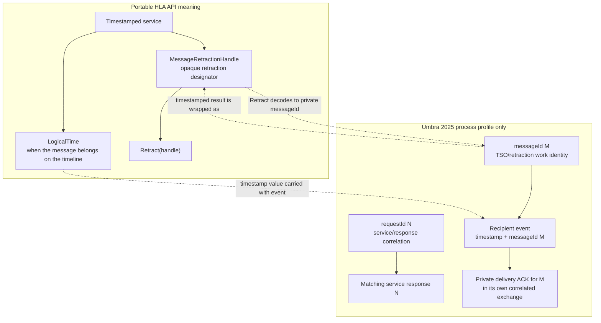

Only the left-hand API concepts are portable HLA vocabulary. The right-hand
IDs, framing, and conversion are this process implementation's choices, not
an HLA wire format or a requirement on another RTI. The pinned
[receive-order `sendInteraction` overload](../../third_party/ieee1516.1-2025/include/RTI/RTIambassador.h#L761),
[timestamped overload](../../third_party/ieee1516.1-2025/include/RTI/RTIambassador.h#L778),
and [`retract`](../../third_party/ieee1516.1-2025/include/RTI/RTIambassador.h#L1382)
declarations and the [private handle conversion boundary](../../cpp/src/internal/handles/message_retraction_handle.hpp#L10)
show the two sides without making the process IDs public API.

## 1. Sender-side service outcome and receiver-side observation

Begin with the public HLA effects, then read the process endpoint as one
implementation mapping. A successful producer service call and a receiving
federate's callback are separate observations; neither the private recipient
count nor process request identity is part of the public HLA result.

### HLA mental model: untimed update and reflection

This deliberately small 2025 API-level sequence leaves recipient eligibility
to the subscription, object-knowledge, and regional rules in their respective
guides. It is not a guarantee that every update reaches every receiver, nor
does it order the receiver callback against the producer's return.

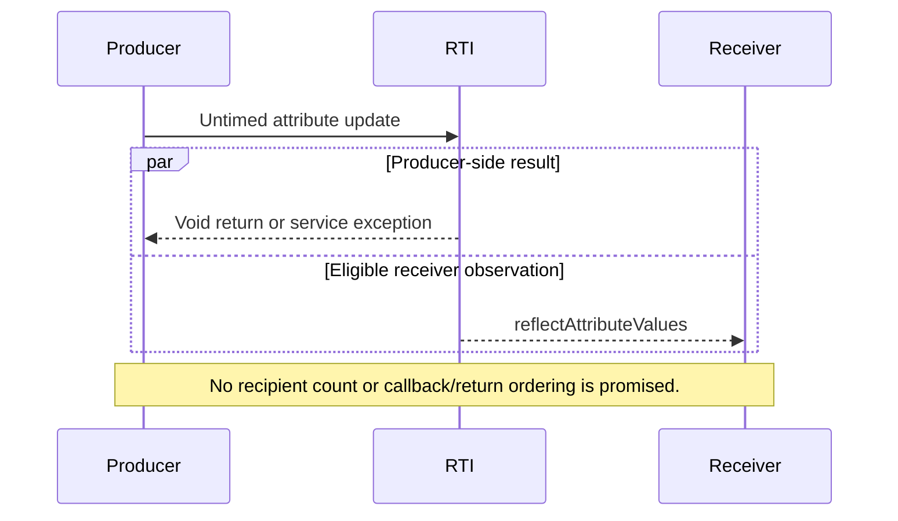

The pinned 2025 API declares the untimed [`updateAttributeValues` service](../../third_party/ieee1516.1-2025/include/RTI/RTIambassador.h#L727) as `void` and [`reflectAttributeValues`](../../third_party/ieee1516.1-2025/include/RTI/FederateAmbassador.h#L238) as a receiver callback. The [subscription-state guide](HLA-2025-OBJECT-ATTRIBUTE-SUBSCRIPTION-STATE-FLOW-GUIDE.md) and [DDM guide](HLA-2025-DATA-DISTRIBUTION-AND-REGIONS-FLOW-GUIDE.md) cover the eligibility inputs. Callback scheduling is a separate axis; the implementation mapping below and section 2 show where this process profile makes that distinction visible.

### Process mapping: an interaction request and its recipient stream

The sender's synchronous request and each recipient event travel on different
process sessions. In push mode, the service sends each recipient event before
returning the sender's private service response. The event is not part of that
response and does not use its request ID. The transport choice is a separate
boundary from callback scheduling: after the receiver client consumes an
event, the callback bridge either invokes it inline or waits for an evoke
operation. The branches below explain those two boundaries; they are not a
claim that every private transport-option and callback-model pairing is
implemented or tested. This example is specifically the receive-order
`sendInteraction` overload; it is not a portable HLA wire protocol.

Read the sender transaction and recipient delivery as independent traces; they
do not define a general order between the public send result and the receiver
callback.

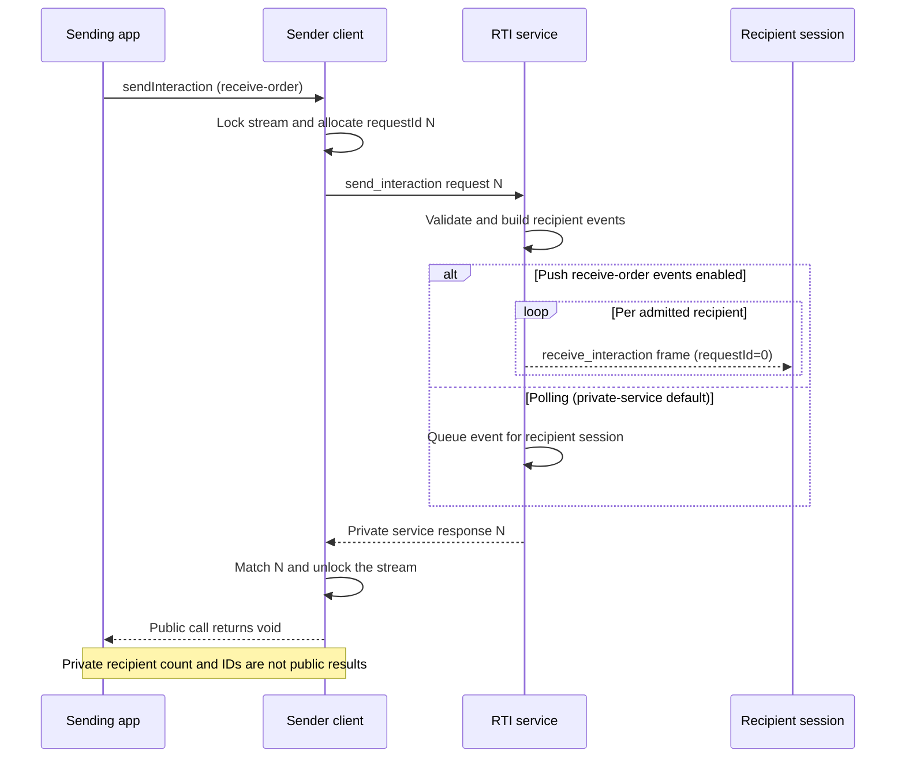

#### Keep parameter octets, handles, and process framing separate

The public 2025 call carries an interaction-class handle, a map from parameter
handles to `VariableLengthData`, and a separate user tag. For an ordinary
application interaction, if the application encodes a parameter with a
`DataElement`, its encoded octets are already the parameter value at this
boundary. The RTI does not infer the element type or decode and re-encode
ordinary parameter octets. The configured-process adapter carries the class
and sent parameter handles as routing/validation metadata, while a versioned
private interaction envelope carries parameter-handle/octet pairs and the
tag. The outer process request then adds its operation and correlation
identity; neither that frame nor the private envelope is an HLA value format.

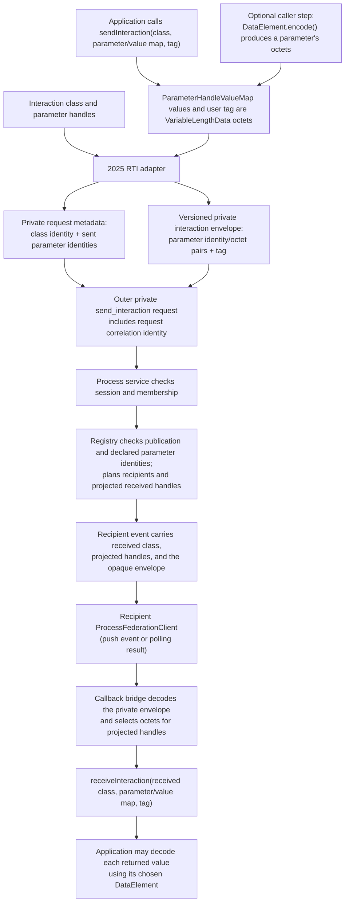

The chart follows ordinary, non-RTI-consumed receive-order interactions at the
configured-process endpoint. The predefined `HLAsetSwitches` interaction is
intercepted and has a separate control/MOM path. Push event frames and polling
responses are the two delivery routes shown above; recipient eligibility and
class/parameter projection are detailed in the [object and
interaction guide](HLA-2025-OBJECT-AND-INTERACTION-INFORMATION-FLOW-GUIDE.md#interaction-path-class-subscription-parameter-projection-callback).
For the value-side encoding boundary, see [one value from API call to octets](HLA-2025-DATA-ELEMENT-ENCODING-FLOW-GUIDE.md#one-value-from-api-call-to-octets).
The registry validates class publication and parameter identities before
fan-out, but the ordinary process path does not inspect the parameter value
octets. On receipt, the callback bridge uses the recipient's projected handle
list to rebuild the public map and extracts the tag from the private envelope;
it does not decode a `DataElement`.

The implementation mapping is visible at the [public process branch](../../cpp/src/internal/runtime/umbra_rti_ambassador_interaction_send_services.cpp#L78),
[client request](../../cpp/src/internal/federation/process_federation_client_value_services.cpp#L13),
[outer request codec](../../cpp/src/internal/federation/process_federation_service_codecs.cpp#L505),
[private value envelope codec](../../cpp/src/internal/federation/process_federation_service_interaction_event_codecs.cpp#L46),
[service validation and plan](../../cpp/src/internal/federation/process_federation_service_interaction_send.cpp#L91),
[registry handle-only planner](../../cpp/src/internal/federation/federation_registry_receive_order_interactions.cpp#L16),
[event construction](../../cpp/src/internal/federation/process_federation_service_interaction_send.cpp#L535),
and [callback reconstruction](../../cpp/src/internal/federation/process_federation_callback_bridge.cpp#L90).

The focused public process send test uses literal value bytes `01 00` and tag
bytes `50 55 42`, then checks those bytes after a raw receiver polls the service
([input](../../cpp/tests/ieee1516_2025_connection_send_interaction_catch2.cpp#L634),
[decoded result assertions](../../cpp/tests/ieee1516_2025_connection_send_interaction_catch2.cpp#L661)).
That verifies this path's byte/tag preservation, not an end-to-end
`DataElement.encode()`-to-`receiveInteraction` round trip. The separate
configured-process multi-recipient case checks official callbacks and FIFO
tags; it does not establish a typed DataElement codec at the RTI boundary.

#### Failure mapping: local typed errors versus remote rejection

This diagram isolates local connection/membership and handle checks, plus the
ordinary service-side membership and registry-plan rejection paths. It is not
an exhaustive exception map: save/restore and transport failures are outside
scope, and RTI-consumed MOM interactions use their separate branch.

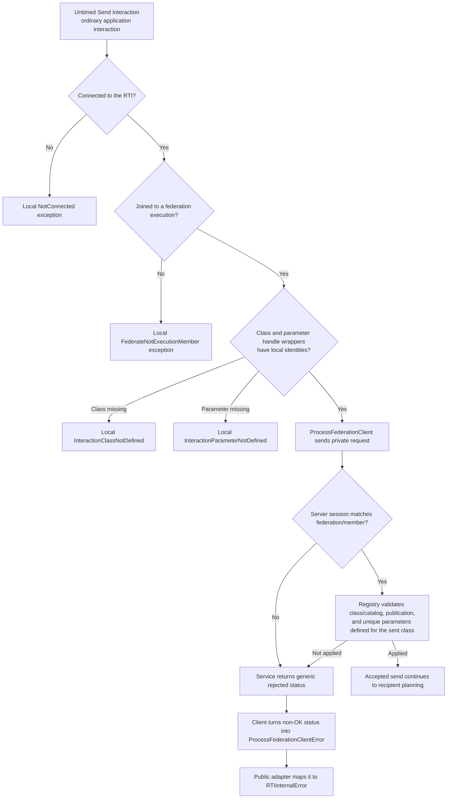

The pinned 2025 [untimed `sendInteraction` overload](../../third_party/ieee1516.1-2025/include/RTI/RTIambassador.h#L761)
declares `InteractionClassNotDefined`, `InteractionParameterNotDefined`,
`FederateNotExecutionMember`, and `NotConnected` among its exceptions. The
adapter raises those typed errors for the local checks; after a process request
is sent, a rejected session check or non-applied registry plan returns only a
generic service status. Although the registry distinguishes an unpublished
class from an invalid-for-this-class parameter handle, the process client
converts the non-OK status to `ProcessFederationClientError`, which the public
adapter maps to `RTIinternalError`. The timestamped overload has a different
declared exception list; do not apply this untimed-path observation to it.

The [focused public process Send Interaction case](../../cpp/tests/ieee1516_2025_connection_send_interaction_catch2.cpp#L457)
asserts successful delivery only. It does not establish the public exception
for a class that is valid locally but unpublished remotely, or a parameter
handle that is valid but belongs to another interaction class. Treat this as a
source-derived gap, not a normative or conformance conclusion.

Evidence: [local adapter checks](../../cpp/src/internal/runtime/umbra_rti_ambassador_interaction_send_services.cpp#L62),
[process client status conversion](../../cpp/src/internal/federation/process_federation_client_value_services.cpp#L30),
[service membership rejection](../../cpp/src/internal/federation/process_federation_service_interaction_send.cpp#L91),
[registry-plan result handling](../../cpp/src/internal/federation/process_federation_service_interaction_send.cpp#L389),
[registry publication and parameter classification](../../cpp/src/internal/federation/federation_registry_receive_order_interactions.cpp#L48),
and [public error conversion](../../cpp/src/internal/runtime/umbra_rti_ambassador_interaction_send_services.cpp#L135).

The receiver route has two distinct responsibilities: consuming an event from
the process session, then submitting the decoded event under the configured
callback model.

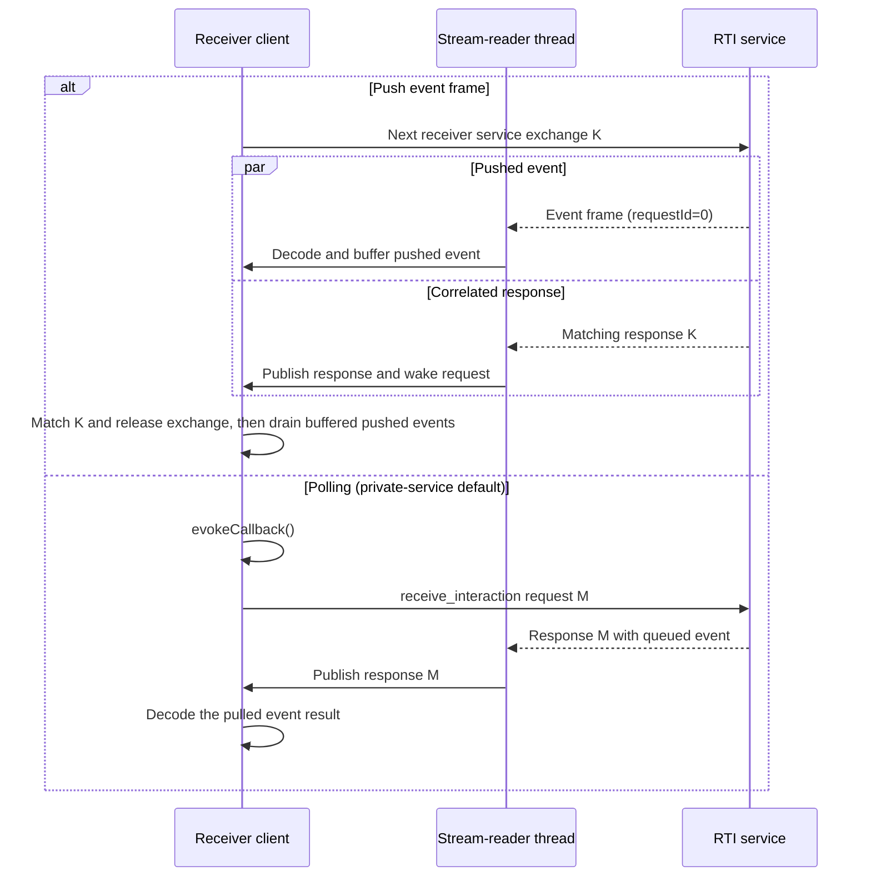

In push mode, a dedicated [stream-reader thread](../../cpp/src/internal/federation/process_federation_client.cpp#L639)
receives unsolicited event frames and correlated responses while the receiver's
service exchange is waiting. It buffers decoded pushed events; it does not
invoke the federate callback. The request path drains buffered pushes after
matching the response, while the separate callback-dispatch thread can drain
events outside a request. Polling mode returns the event in the response to
the explicit `receive_interaction` operation. Either route supplies a decoded
interaction event to the callback bridge:

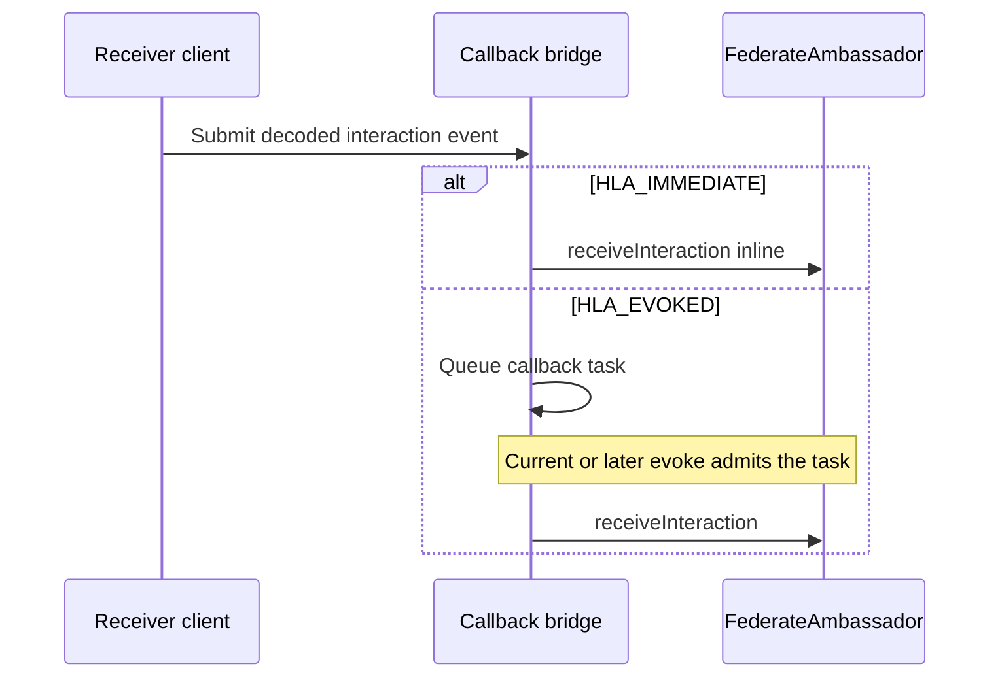

The pinned API's [receive-order overload](../../third_party/ieee1516.1-2025/include/RTI/RTIambassador.h#L761) returns `void`; the separate [timestamped overload](../../third_party/ieee1516.1-2025/include/RTI/RTIambassador.h#L778) returns a `MessageRetractionHandle`. The process service's private result fields do not change those signatures.

For the exception boundary after a pushed event reaches the callback dispatcher,
see the [process callback-exception attribution map](HLA-2025-CALLBACK-AND-SERVICE-ORDERING-FLOW-GUIDE.md#process-endpoint-callback-exception-attribution).

The configured-process [multi-recipient interaction case](../../cpp/tests/ieee1516_2025_connection_multi_recipient_interaction_ordering_catch2.cpp#L459)
asserts two `receiveInteraction` callbacks per exact-class receiver, in tag
FIFO order, under both callback models. Its fixture leaves the service in
polling mode for `HLA_EVOKED`, where the clients explicitly evoke; for
`HLA_IMMEDIATE` it enables the private push option and uses a subsequent class
lookup as the receiver-side exchange fence. That pairing is a test setup, not
an HLA rule that binds a callback model to a transport mode. The fixture sends
both messages before pumping the receivers and then observes callbacks through
receiver-side operations; this does not establish a general HLA ordering rule
relative to the sender's `sendInteraction` return. The test uses exact-class
subscriptions: it does not cover ancestor-subscription promotion or the
additional-FOM Join scenario. The separate [public send
payload case](../../cpp/tests/ieee1516_2025_connection_send_interaction_catch2.cpp#L457)
uses a raw process receiver to inspect the pulled event's parameter and tag;
that case does not assert a receiver callback.

Source map: [subscription request](../../cpp/src/internal/federation/process_federation_service_request_handlers.cpp#L338),
[shared recipient planning and event creation](../../cpp/src/internal/federation/process_federation_service_interaction_send.cpp#L389),
[push-versus-queue option](../../cpp/src/internal/federation/process_federation_service.hpp#L32),
[poll dequeue](../../cpp/src/internal/federation/process_federation_service_receive.cpp#L37),
[push-event dispatch](../../cpp/src/internal/federation/process_federation_client_callback_dispatch.cpp#L265),
[process callback pump](../../cpp/src/internal/runtime/umbra_rti_ambassador_callback_control_services.cpp#L32),
[callback-bridge submission](../../cpp/src/internal/federation/process_federation_callback_bridge.cpp#L1128),
and [FederateAmbassador invocation](../../cpp/src/internal/federation/process_federation_callback_bridge.cpp#L240).

The common outer framing is length-prefixed. Its private frame header reads the
payload length as a big-endian 32-bit value; that framing is not the public
`DataElement` representation or an HLA logical-time encoding. See
[`process_transport.cpp`](../../cpp/src/internal/federation/process_transport.cpp#L188)
and keep it separate from the edition-specific value-byte discussion in the
[DataElement guide](HLA-2025-DATA-ELEMENT-ENCODING-FLOW-GUIDE.md).

### Process mapping: receive-order object-attribute update

These are two views of the untimestamped 2025 process path only. First the
service plans and commits the registry's recipient/value projections and
returns its private request result. Then a recipient obtains its own event and
passes the decoded projection to the callback bridge. Passels, session queues,
and frame names are Umbra implementation details, not HLA protocol concepts.

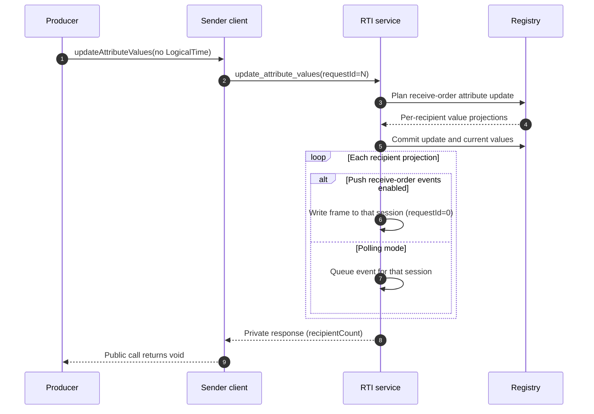

The private `recipientCount` is request bookkeeping, not a public result. The
public `updateAttributeValues` call returns `void`. Per-recipient event delivery
is a separate path:

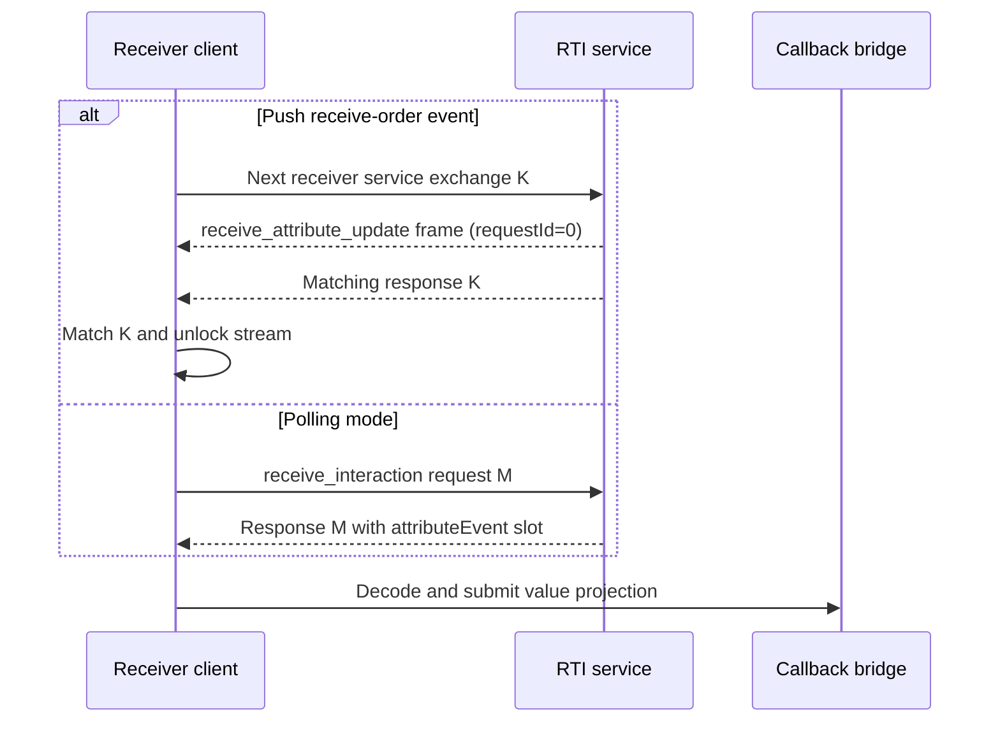

The public process callback pump uses `receive_interaction` as its deterministic
polling fence; an attribute reflection travels in the response's adjacent
`attributeEvent` slot. The pushed-event operation is `receive_attribute_update`,
with `requestId=0`. In both cases, the recipient consumes its own stream; sending
an event frame does not itself execute the receiver callback. HLA_IMMEDIATE and
HLA_EVOKED callback scheduling is covered in section 2, while timestamped
delivery and its grant/retraction boundaries remain in section 3.

For this ordinary untimed process path, decoding the private request/event
envelopes does not decode an HLA `DataElement`. The public adapter copies each
`VariableLengthData`; service planning uses the attribute identities, then the
service copies the value octets into accepted state and recipient events. The
private event codec writes those octets with their attribute handles, and the
callback bridge rebuilds the public value map without interpreting each value.
The receiving federate chooses a compatible `DataElement` if it wants to
decode the callback bytes. This is an implementation-path observation, not a
claim about the normative validity rules for every payload.
The copied-value steps are visible in the [public adapter](../../cpp/src/internal/runtime/umbra_rti_ambassador_attribute_update_services.cpp#L102),
[handle-based process plan and accepted-value copy](../../cpp/src/internal/federation/process_federation_service_attribute_value_updates.cpp#L40),
[private event codec](../../cpp/src/internal/federation/process_federation_service_codecs.cpp#L1684),
and [callback-map reconstruction](../../cpp/src/internal/federation/process_federation_callback_bridge.cpp#L281).

The focused configured-process reflection test sends the literal value bytes
`52 46 4C` and tag bytes `54 41 47`, then checks that both arrive unchanged
([input](../../cpp/tests/ieee1516_2025_connection_update_attribute_values_reflect_catch2.cpp#L793),
[callback assertions](../../cpp/tests/ieee1516_2025_connection_update_attribute_values_reflect_catch2.cpp#L821)).
That verifies byte preservation in this scenario; it is not a typed
`DataElement.encode()` round trip or a general payload-validation test. Keep
the private frame/envelope distinction separate from the 2025 value format in
the [DataElement guide](HLA-2025-DATA-ELEMENT-ENCODING-FLOW-GUIDE.md#pick-the-representation-boundary-before-reasoning-about-bytes).

#### Failure mapping: configured-process Update Attribute Values

This chart covers the untimed public service and the configured 2025 process
endpoint. It shows representative local typed failures and the remote registry
checks relevant to object knowledge, attribute definition, and ownership; it is
not an exhaustive map of save/restore, protocol, or transport failures.

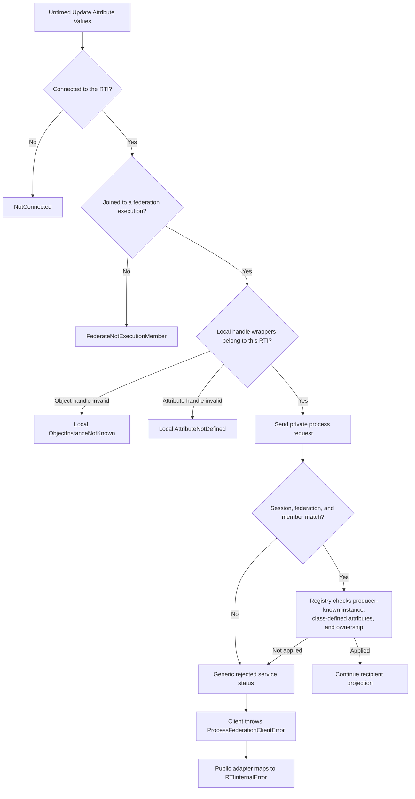

The pinned 2025 [`updateAttributeValues` untimed API](../../third_party/ieee1516.1-2025/include/RTI/RTIambassador.h#L727)
lists `ObjectInstanceNotKnown`, `AttributeNotDefined`, and `AttributeNotOwned`
among its declared exceptions. Before sending the request, the configured
adapter checks its local handle wrappers and throws typed errors for an
unrecognized object or attribute handle. After the request crosses the process
boundary, the service checks session membership and asks the registry to plan
the update. That plan distinguishes an instance not known to the producer, an
undefined attribute, and an attribute not owned by the producer;
the service returns the same generic rejected status for each non-applied
plan. The client turns a non-OK response into `ProcessFederationClientError`,
which the public adapter maps to `RTIinternalError`.

That is the same broad local-versus-remote error shape as the earlier
[untimed Send Interaction map](#failure-mapping-local-typed-errors-versus-remote-rejection),
not the same semantic decision tree. Update Attribute Values checks a known
object instance and per-instance attribute ownership; Send Interaction checks
interaction publication and parameter membership in the sent class. Do not
reuse one operation's validation rules for the other. This is a source-derived
configured-process observation, not a conformance conclusion about the
standard's exception requirements or exception precedence.

The focused public process Update Attribute Values case listed below asserts
that the valid untimed call succeeds under both callback models. It does not
establish the public exception for a remote unknown instance, undefined
attribute, or unowned attribute. The timestamped overload has additional time
validation and is outside this chart.

Evidence: [local handle checks](../../cpp/src/internal/runtime/umbra_rti_ambassador_attribute_update_services.cpp#L91),
[public process-error conversion](../../cpp/src/internal/runtime/umbra_rti_ambassador_attribute_update_services.cpp#L133),
[process-client status conversion](../../cpp/src/internal/federation/process_federation_client_value_services.cpp#L125),
[service session check](../../cpp/src/internal/federation/process_federation_service_attribute_value_updates.cpp#L27),
[service registry-plan rejection](../../cpp/src/internal/federation/process_federation_service_attribute_value_updates.cpp#L50),
[registry object-knowledge check](../../cpp/src/internal/federation/federation_registry_attribute_value_update_requests.cpp#L106),
and [registry attribute/ownership checks](../../cpp/src/internal/federation/federation_registry_attribute_value_update_requests.cpp#L139).

## 2. From a stream frame to an official callback

The process client owns one serialized request/response exchange at a time. A
pushed event may arrive while that exchange is waiting for its matching
response. The client validates and buffers it, continues reading, and only
releases the transaction lock after the response operation and `requestId`
match. Callback submission happens after that unlock, so callback re-entry does
not run under the socket-transaction lock.

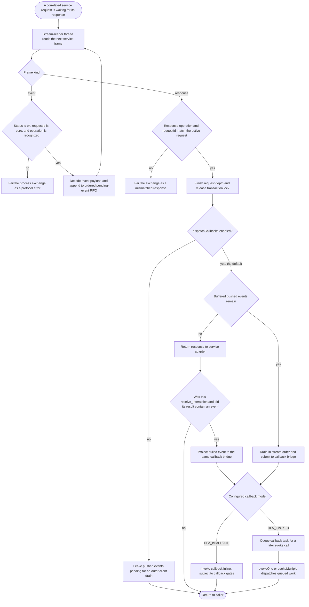

One subtlety: a pushed frame is unsolicited at the service-protocol level. The
client starts separate [stream-reader](../../cpp/src/internal/federation/process_federation_client.cpp#L365)
and [callback-dispatch](../../cpp/src/internal/federation/process_federation_client.cpp#L697)
threads. The reader consumes frames and buffers pushed events; the dispatch
thread submits them to the bridge only when request/dispatch suppression
allows. The request path also explicitly drains frames already buffered when
the correlated response arrives. A public Evoke path first drains available
work; if none is available, it can issue the explicit receive operation. In
polling mode, the event can be returned inside that operation's response. In
push mode, the reader may receive event frames while the request waits for its
correlated response. Both routes converge on the callback bridge, but their
arrival and buffering steps differ.
Synchronization registration and completion use this same private
response/event boundary; their producer-specific ordering and the distinction
from HLA callback requirements are mapped in the
[callback/service-ordering guide](HLA-2025-CALLBACK-AND-SERVICE-ORDERING-FLOW-GUIDE.md#process-endpoint-service-responses-and-synchronization-events-are-separate).

The client also preserves a heterogeneous FIFO for pushed event families. It
does not hold the stream transaction lock while submitting user-facing work to
the bridge. For timestamped deliveries, the process service has additional
in-transit and post-callback acknowledgement rules. Their grant eligibility
and retraction state remain in the [time](HLA-2025-TIME-MANAGEMENT-GUIDE.md)
and [retraction](HLA-2025-TSO-RETRACTION-FLOW-GUIDE.md) guides; the process
callback-ack seam is shown separately in section 3 below.

### Polling family priority is not pushed-stream FIFO

`pushReceiveOrderEvents` selects a private process delivery path; it is not the
HLA callback model. With polling, the service stores events in separate
per-session, per-family queues. Each `receive_interaction` checks the
synchronization-announcement queue before the synchronized, save, restore, and
interaction-event queues. Thus, if an interaction event is already queued and a
synchronization announcement is queued before the next poll, that poll selects
the announcement first. This is family precedence in this process
implementation—not a claim that HLA defines a global callback order. The method
continues with discovery/removal and other event families after the portion
shown here.

With pushed delivery, the poll selector is bypassed. When a correlated client
request reads pushed frames while waiting for its response, it appends them to
the client FIFO in stream-read order, then drains them after the matching
response releases the exchange lock. That FIFO does not retroactively apply
polling-family priority. Both paths still converge on the same callback bridge;
`HLA_IMMEDIATE` versus `HLA_EVOKED` determines inline invocation versus
deferred evoke work independently of this transport choice.

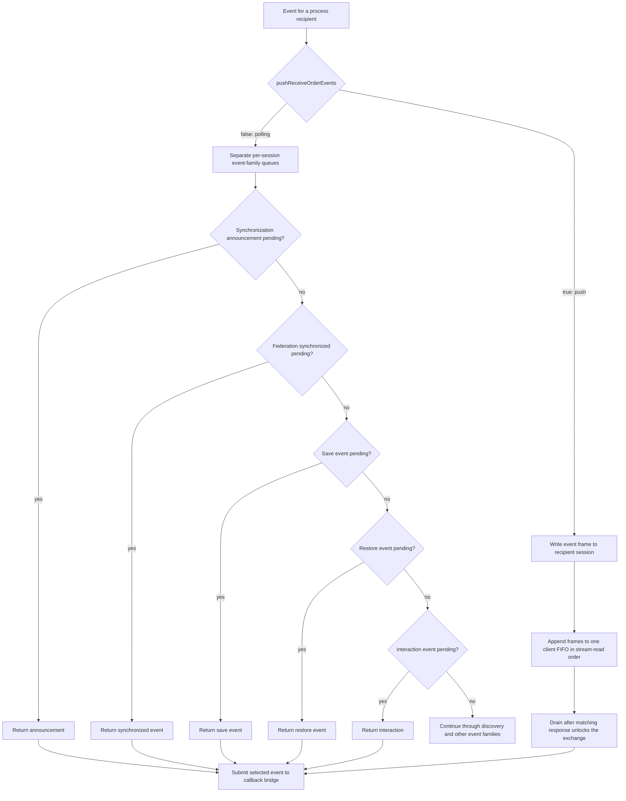

The five polling branches are a bounded excerpt of the source selector, not a
complete priority specification for every event family. The public process
synchronization cases cover polling and pushed delivery separately, but neither
asserts this mixed-family reordering; the ordering claim above is source-derived.
See the [focused source and test map](#evidence-map-and-limits).

## Walk one interaction through the code

1. The sending ambassador calls public `sendInteraction`; the configured
   process client allocates a nonzero request ID and serializes the operation.
2. The service decodes and validates the request, computes recipient
   projections, and either queues each event or writes an event frame to that
   recipient's session, according to `pushReceiveOrderEvents`.
3. The service returns a response with the same operation and request ID. The
   sender's client validates that pair before returning the result. For the
   receive-order public `sendInteraction` overload, the RTIambassador result is
   `void`; the process result's recipient count and message identity are private.
4. On the recipient side, event data can be read during another service
   exchange or by the explicit receive path. Pushed frames are validated as
   `kind=event`, `status=ok`, and `requestId=0`, then decoded into the pending
   FIFO. A polling response instead carries the receive result.
5. After a correlated exchange releases its transaction lock, pending pushed
   events are submitted to the callback bridge. The callback model decides
   whether submission invokes now or queues work for Evoke; it does not change
   the wire event's identity or order.

At the public API layer, `HLA_EVOKED` additionally gates user callback
invocation on `evokeCallback`/`evokeMultipleCallbacks`. The process callback
pump may use a receive request to admit available process events before the
shared dispatcher is asked to evoke. Do not mistake that pump for HLA logical
time advancement: receive-order callback admission has no logical timestamp.

The flowchart follows the ordinary `request` path with `dispatchCallbacks=true`
(the default). Internal callers that pass `false` can leave pushed events in
the client FIFO after the response; an enclosing operation must later drain
them. The entry node is intentionally narrower than “an exchange or callback
pump”: this particular demultiplexing loop reads frames while a correlated
request is awaiting its response.

There is an important failure edge after the response match. `request` first
validates the response operation and ID, decrements its request depth, and
releases the stream lock; it then submits buffered events before returning the
response object to the process-client service method. The event is removed
from the client's pending FIFO before it is submitted to the callback bridge.
If an `HLA_IMMEDIATE` callback throws while this thread is draining, the
already-matched wire response is not returned to that service method, and the
current event is not put back for retry. This says only that the private
response crossed the client boundary—not that its status was successful or
that the public RTI service returned normally. If another thread already owns
the immediate dispatcher, any callback exception unwinds that thread's active
call instead; see the callback/service-ordering guide's
[active-call boundary](HLA-2025-CALLBACK-AND-SERVICE-ORDERING-FLOW-GUIDE.md#which-public-call-is-active-when-the-callback-throws).

With `HLA_EVOKED`, the client FIFO event is submitted as a dispatcher task, so
the correlated request can return before application callback entry. If that
callback later throws, the dispatcher has already extracted the task: it is
consumed rather than retried, while later queued callback tasks remain. For a
timestamped event, the separate consequence is that the post-callback private
ACK is skipped and the coordinator keeps the recipient entry in transit; see
[section 3](#3-a-timestamped-process-delivery-stays-in-transit-through-callback-completion).
These are source-derived process details, not a shared 2010 rule or a
normative interpretation.

## 3. A timestamped process delivery stays in transit through callback completion

This is the process-specific seam between TSO delivery and the callback
boundary. The sequence begins **after** time management has admitted a live
timestamped recipient delivery. It does not repeat the grant-eligibility,
GALT/LITS, or retraction state machines in the [time-management
guide](HLA-2025-TIME-MANAGEMENT-GUIDE.md) and [TSO-retraction
guide](HLA-2025-TSO-RETRACTION-FLOW-GUIDE.md).
It focuses on the pushed frame being consumed while a correlated client request
is active; a direct receive path converges on the same callback bridge but is
not drawn here. The diagram also omits the exception-report projection and
lifetime-admission gate described in the [callback/service-ordering
guide](HLA-2025-CALLBACK-AND-SERVICE-ORDERING-FLOW-GUIDE.md); it is not a
projection-state flow.

The service emits the event on the recipient's process session with
`requestId=0`, carrying the TSO `messageId` and timestamp. That recipient's
coordinator ledger remains `inTransit` until its completion acknowledgment.
The callback bridge places the acknowledgment behind the public callback:
`HLA_IMMEDIATE` runs the task inline when enabled, while `HLA_EVOKED` keeps it
queued until an evoke operation admits it. In either case the bridge's
completion handler runs after the callback task returns. If a retraction won
the race before callback start, the task suppresses user code and completes
the recipient delivery once instead.

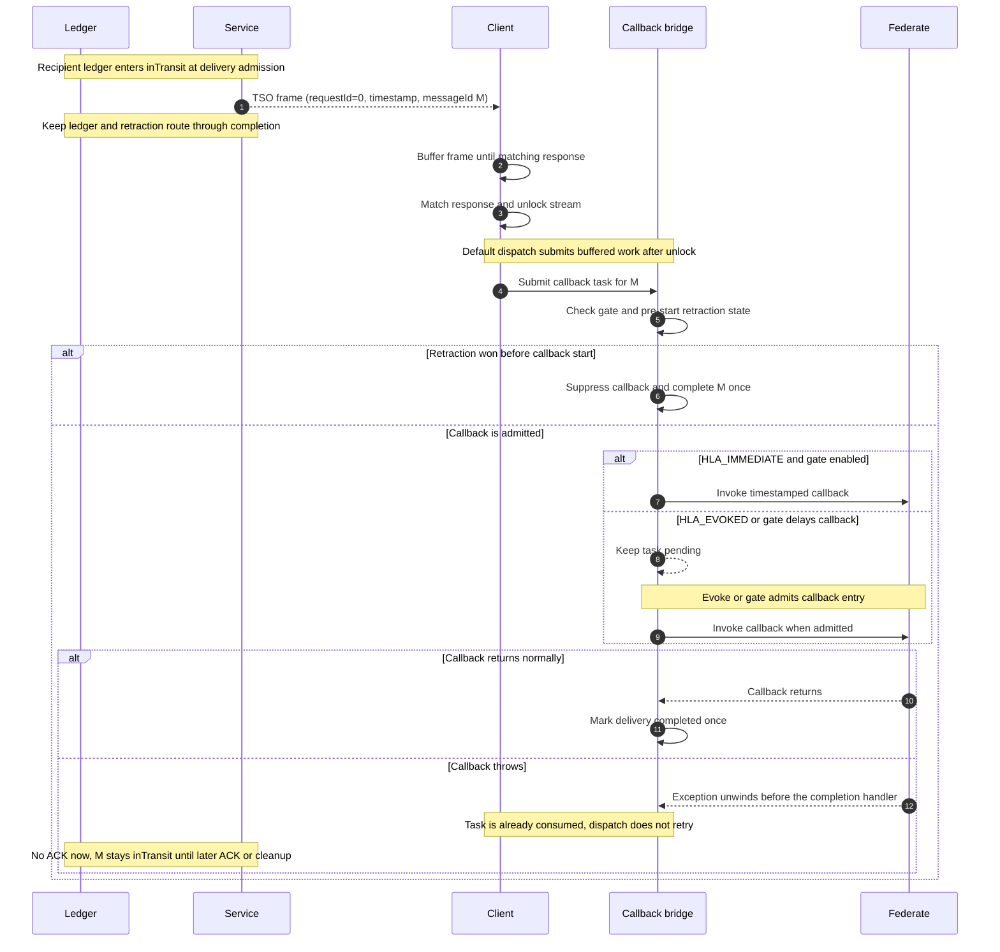

Only normal callback return or retraction suppression reaches the delivery
completion handler. A thrown callback consumes its task but skips the private
acknowledgement; the recipient ledger remains `inTransit`. The separate process
acknowledgement exchange is:

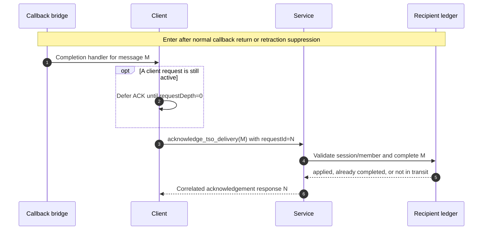

Important boundaries:

- `messageId` is the TSO/retraction identity, `requestId` is only the private
  request/response correlation, and the timestamp is the HLA time value. The
  ACK is a private process-service operation, not an HLA service.
- A fan-out message has a separate in-transit completion for each recipient;
  one recipient's callback/ACK does not stand in for another's. The service
  accepts the ACK only from the matching joined recipient session and member.
- The diagram covers a live TSO frame and the post-submission callback race.
  When retraction suppresses delivery before a TSO frame reaches the recipient,
  there is no delivery callback or ACK frame; see the separate retraction
  guide and the pre-callback test below.
- The bridge also installs this completion hook for timestamped attribute
  updates and qualifying object-removal callbacks. Immediate timestamped
  removals can retain a retraction identity but are not grant-boundary TSO
  queue entries and do not take this ACK path.
- If the receive-order callback throws, source shows the bridge has already
  marked its per-message `callbackStarted` flag but has not marked
  `deliveryAcknowledged`; the post-callback completion hook is skipped. The
  dispatcher has consumed the task, so neither the queued callback nor the
  private TSO ACK is retried. A later Request Retraction follows the
  callback-started branch; that callback is not a substitute for the missing
  TSO ACK. These are private process implementation states, not HLA state names.
  The public callback exception and active caller boundary are explained in
  the [callback/service-ordering guide](HLA-2025-CALLBACK-AND-SERVICE-ORDERING-FLOW-GUIDE.md#which-public-call-is-active-when-the-callback-throws);
  this process trace adds the private completion consequence only.
- The coordinator's remaining `inTransit` entry is included in time-bound and
  grant-frontier calculations, so it can constrain a recipient's bound or
  advancement. It blocks a timed-save readiness check when its timestamp is
  at or before the pending save time; this is not a claim about every save.
  Recipient unregister discards that recipient's queue state. These are
  source consequences only: no focused test throws from a public process TSO
  callback or verifies recovery/cleanup after that exception. For
  `HLA_EVOKED`, the same skipped ACK occurs when the task later throws through
  the recipient's Evoke call.
- The callback guide also distinguishes the recipient-side immediate
  request/pump from the sender's successful service response, and the later
  `HLA_EVOKED` call path. Do not duplicate that public exception flow here;
  this diagram isolates what is unique to this profile: the TSO completion
  hook is skipped, leaving the coordinator entry in transit until ACK or
  recipient cleanup.

### If the recipient later resigns or disconnects

A callback exception does not itself close the process client or resign its
federate. After the callback unwinds, the application may choose a separate
Resign operation; Disconnect is rejected while the ambassador remains joined,
so a successful Resign must come first. In the process path, successful Resign
unregisters the member from the coordinator, which discards that recipient's
queued, in-transit, and delivered TSO entries and re-evaluates pending grants.
The service clears that session's queued event buffers, and the client resets
its joined identity but keeps the transport and callback bridge until a later
Disconnect. Disconnect closes the local client and bridge; its service-side
`detach(session)` hook is a separate cleanup boundary.

Do not collapse that coordinator cleanup with the private retraction route.
The service's `handleResign` removes the message/recipient cache entries when
the departing federate is the message producer, but does not visibly prune a
departing receiver's session from every cached pushed-retraction recipient
list. The registry's retraction record filters departed members out of its
callback notifications, while the process service later drains its separate
cached recipient list when handling a producer Retract. The `detach(session)`
hook removes that session from those lists; `ProcessFederationClient::close`
also clears the local callback bridge's retraction state. Until the service
detach hook runs, the current source therefore appears capable of sending a
`request_retraction` frame to a still-connected session that has already
resigned. In the callback-throw case, the bridge has retained the message's
callback-started retraction state; `submitRequestRetraction` queues the direct
callback when that flag is set and does not itself check federation membership.
This completes a plausible source path, not proof that the frame is sent or
observed after Resign. It remains an unresolved process-profile source risk,
not a normative HLA rule or verified runtime outcome. The focused process TSO
tests do not cover callback-throw → receiver Resign → producer Retract, nor the
timing of service detach after public Disconnect.

## Evidence map and limits

### Source path

- [`ProcessTransportSession::request` and service dispatcher](../../cpp/src/internal/federation/process_transport_session.cpp#L50) validate nonzero request IDs and require matching response operation/identity.
- [`ProcessFederationClient::bufferEvent`](../../cpp/src/internal/federation/process_federation_client.cpp#L427) validates unsolicited event frames; [`request`](../../cpp/src/internal/federation/process_federation_client.cpp#L504) buffers recognized event families and continues until the active response matches, then dispatches buffered events before returning that response. [`dispatchPendingPushedEvents`](../../cpp/src/internal/federation/process_federation_client_callback_dispatch.cpp#L265) removes each event before bridge submission; an escaping callback exception therefore prevents the matched response from being returned and does not requeue the current event. The request catch releases bookkeeping and rethrows without closing the client session.
- [`receivePendingEvent`](../../cpp/src/internal/federation/process_federation_client_event_templates.hpp#L11) consumes already-buffered events first and otherwise reads synchronously from the session stream; [`submitReceiveOrder`](../../cpp/src/internal/federation/process_federation_callback_bridge.hpp#L57) documents the immediate-inline versus evoked-queue distinction.
- [`ProcessFederationServiceOptions`](../../cpp/src/internal/federation/process_federation_service.hpp#L26) sets polling as the private-service default. [`handleSendInteraction`](../../cpp/src/internal/federation/process_federation_service_interaction_send.cpp#L74) emits event frames in push mode before returning the sender result (see the push branch at [line 594](../../cpp/src/internal/federation/process_federation_service_interaction_send.cpp#L594)); [`handleReceiveInteraction`](../../cpp/src/internal/federation/process_federation_service_receive.cpp#L37) consumes per-session queued work for the explicit receive path.
- [`handleReceiveInteraction`](../../cpp/src/internal/federation/process_federation_service_receive.cpp#L56) checks synchronization-announcement, federation-synchronized, save, restore, and interaction-event queues in that order before later families. [`ProcessFederationService` notification handlers](../../cpp/src/internal/federation/process_federation_service_notifications.cpp#L222) either enqueue synchronization/save/restore families for polling or serialize them as pushed event frames. The client's [`bufferEvent`](../../cpp/src/internal/federation/process_federation_client.cpp#L427) appends pushed events as frames are read, and [`dispatchPendingPushedEvents`](../../cpp/src/internal/federation/process_federation_client_callback_dispatch.cpp#L265) drains that FIFO. This is a process-profile transport detail, not an HLA-wide ordering rule.
- The public [untimed Update Attribute Values adapter](../../cpp/src/internal/runtime/umbra_rti_ambassador_attribute_update_services.cpp#L61) calls the private [`ProcessFederationClient::updateAttributeValues`](../../cpp/src/internal/federation/process_federation_client_value_services.cpp#L108); its `ProcessFederationUpdateAttributeValuesResult` is not the public `void` result. [`handleUpdateAttributeValues`](../../cpp/src/internal/federation/process_federation_service_attribute_value_updates.cpp#L13) delegates selection to the shared registry planner at [line 44](../../cpp/src/internal/federation/process_federation_service_attribute_value_updates.cpp#L44), records the successful update at [line 177](../../cpp/src/internal/federation/process_federation_service_attribute_value_updates.cpp#L177), and builds push/queue events plus the private response at [line 294](../../cpp/src/internal/federation/process_federation_service_attribute_value_updates.cpp#L294).
- For polling, [`pumpProcessReceiveOrder`](../../cpp/src/internal/runtime/umbra_rti_ambassador_callback_control_services.cpp#L125) uses the public callback pump's `receive_interaction` path. [`handleReceiveInteraction`](../../cpp/src/internal/federation/process_federation_service_receive.cpp#L188) returns a reflection in `attributeEvent`; the adjacent slot is documented in [`ProcessFederationReceiveInteractionResult`](../../cpp/src/internal/federation/process_federation_service_protocol.hpp#L1606), then buffered by [`ProcessFederationClient::bufferReceiveResult`](../../cpp/src/internal/federation/process_federation_client.cpp#L355) and submitted through [`dispatchPendingPushedEvents`](../../cpp/src/internal/federation/process_federation_client_callback_dispatch.cpp#L289) to [`submitAttributeUpdate`](../../cpp/src/internal/federation/process_federation_callback_bridge.cpp#L1281). The push event frame is tagged `receive_attribute_update`; the public pump's polling response remains `receive_interaction`.
- [`dispatchPendingPushedEvents`](../../cpp/src/internal/federation/process_federation_client_callback_dispatch.cpp#L265) drains after releasing the exchange lock; `evokeOne` and `evokeMultiple` enter the callback bridge at lines 518 and 526.
- [`dispatchTsoInteractionPayloads`](../../cpp/src/internal/federation/process_federation_service_tso_payload_dispatch.cpp#L12) takes the recipient's admitted typed deliveries from the registry. [`dispatchTsoAttributeUpdateDelivery`](../../cpp/src/internal/federation/process_federation_service_tso_delivery.cpp#L15) and [`dispatchTsoInteractionDelivery`](../../cpp/src/internal/federation/process_federation_service_tso_delivery.cpp#L164) emit the recipient event frame, retain its retraction route, and leave the coordinator entry `inTransit` for `acknowledge_tso_delivery`.
- The [`request` default](../../cpp/src/internal/federation/process_federation_client.hpp#L987) enables post-response callback dispatch. [`ProcessFederationCallbackBridge::submitReceiveOrder`](../../cpp/src/internal/federation/process_federation_callback_bridge.cpp#L1128), [`submitAttributeUpdate`](../../cpp/src/internal/federation/process_federation_callback_bridge.cpp#L1281), and [`submitObjectInstanceRemoval`](../../cpp/src/internal/federation/process_federation_callback_bridge.cpp#L1441) place TSO completion after callback return, with pre-start retraction suppression handled in the same task. The client attaches the completion hook in [`process_federation_client_callback_dispatch.cpp`](../../cpp/src/internal/federation/process_federation_client_callback_dispatch.cpp#L490).
- [`ProcessFederationClient::acknowledgeTsoDelivery`](../../cpp/src/internal/federation/process_federation_client.cpp#L597) rejects identity zero, defers and deduplicates while a request is active, and sends the private ACK; [`flushDeferredTsoDeliveryAcknowledgements`](../../cpp/src/internal/federation/process_federation_client.cpp#L653) drains it after the exchange. [`handleAcknowledgeTsoDelivery`](../../cpp/src/internal/federation/process_federation_service.cpp#L87) checks session/member identity and resolves the coordinator ledger through `completeTsoDeliveryFor`.
- [`CallbackSession::invoke`](../../cpp/src/internal/callbacks/callback_session.cpp#L46) finishes invocation bookkeeping and rethrows user exceptions; [`CallbackDispatcher::evokeOne`](../../cpp/src/internal/callbacks/callback_dispatcher.cpp#L155) extracts a task before invoking it, while the immediate drainer clears its election and rethrows at [line 245](../../cpp/src/internal/callbacks/callback_dispatcher.cpp#L245). The bridge's completion hook is after `session->invoke`, so a throw skips it.
- The retained coordinator entry is source-visible to [time-bound calculation](../../cpp/src/internal/time/federation_time_bounds.cpp#L116), [grant-frontier calculation](../../cpp/src/internal/time/federation_time_grant_policy.cpp#L153), and [save readiness](../../cpp/src/internal/federation/federation_registry_save_control.cpp#L387); [recipient unregister](../../cpp/src/internal/time/federation_time_coordinator.cpp#L103) discards its queued/in-transit/delivered TSO state.
- [Process Resign](../../cpp/src/internal/federation/process_federation_service_request_handlers.cpp#L136) unregisters the member, reevaluates grants, resets session membership, and clears its event queues; the [coordinator unregister](../../cpp/src/internal/time/federation_time_coordinator.cpp#L107) discards recipient TSO phases. The public [`RTIambassador::disconnect`](../../cpp/src/internal/runtime/umbra_rti_ambassador.cpp#L2373) requires the ambassador not be joined, and the process branch of [Resign](../../cpp/src/internal/runtime/umbra_rti_ambassador_federation_lifecycle.cpp#L806) leaves the process client connected until that later call. [`ProcessFederationClient::resignFederationExecution`](../../cpp/src/internal/federation/process_federation_client_federation_management.cpp#L89) keeps its callback bridge; [`close`](../../cpp/src/internal/federation/process_federation_client_callback_dispatch.cpp#L550) later closes the transport and bridge, whose [close path](../../cpp/src/internal/federation/process_federation_callback_bridge.cpp#L1865) clears local retraction state.
- [Process service detach](../../cpp/src/internal/federation/process_federation_service.cpp#L61) prunes a detached session from cached pushed-retraction recipient lists. By contrast, [handleResign](../../cpp/src/internal/federation/process_federation_service_request_handlers.cpp#L179) prunes producer-owned message entries, not all departing-recipient list entries; [`handleRetract`](../../cpp/src/internal/federation/process_federation_service_retraction.cpp#L193) drains that separate list, while the [registry retraction record](../../cpp/src/internal/federation/federation_registry_tso_delivery.cpp#L216) adds callback notifications only for current members. The client bridge's [`submitRequestRetraction`](../../cpp/src/internal/federation/process_federation_callback_bridge.cpp#L1217) uses retained callback-started state but has no membership gate. No focused process TSO test resolves whether that source path sends or dispatches a callback after receiver Resign.
- [`pumpProcessReceiveOrder`](../../cpp/src/internal/runtime/umbra_rti_ambassador_callback_control_services.cpp#L125) drains buffered events and uses the explicit receive operation when the process callback pump needs more work.

### Focused tests

- [`Private process service dispatch correlates federation operations over framed data`](../../cpp/tests/process_transport_service_catch2.cpp#L25) checks Create, Join, and Send Interaction request/response correlation and payload preservation.
- [`Private registry-bound service exchanges federation traffic across independently launched processes`](../../cpp/tests/process_federation_service_process_catch2.cpp#L38) launches server, sender, and receiver processes. Its receiver probe enables pushed events and checks projection through the official `FederateAmbassador::receiveInteraction` bridge ([probe setup](../../cpp/tests/process_federation_service_probe.cpp#L162), [receiver assertion](../../cpp/tests/process_federation_service_probe.cpp#L1406)). This test uses the private `ProcessFederationClient` seam, not the public `RTIambassador`.
- [`RTIambassador routes public Send Interaction through a configured process endpoint`](../../cpp/tests/ieee1516_2025_connection_send_interaction_catch2.cpp#L457) checks the public send path and an explicit receiver poll in both callback-model sections. Its raw receiver verifies one parameter handle, literal value bytes, and literal tag bytes at [the decoded result assertions](../../cpp/tests/ieee1516_2025_connection_send_interaction_catch2.cpp#L661); it does not test a DataElement-to-callback round trip. It uses the service's default polling mode, so it is not evidence for pushed callback delivery.
- [`RTIambassador routes public Update Attribute Values through a configured process endpoint`](../../cpp/tests/ieee1516_2025_connection_update_attribute_values_catch2.cpp#L457) calls the untimed service successfully in both callback-model sections. It is positive-path evidence only and does not test the public exception for a remote unknown instance, undefined attribute, or unowned attribute.
- [`RTIambassador reflects an update only once for overlapping process subscriptions`](../../cpp/tests/ieee1516_2025_connection_update_attribute_values_reflect_catch2.cpp#L457) subscribes to one inherited attribute through parent and child object classes, sends one untimestamped update, and observes one reflection in both callback-model sections. The [fixture setup](../../cpp/tests/ieee1516_2025_connection_update_attribute_values_reflect_catch2.cpp#L545) enables pushed process events for HLA_IMMEDIATE and uses polling for HLA_EVOKED; that pairing is case setup, not a general callback-model/transport rule. It asserts one reflection at [line 817](../../cpp/tests/ieee1516_2025_connection_update_attribute_values_reflect_catch2.cpp#L817) and checks private `recipientCount == 1` at [line 873](../../cpp/tests/ieee1516_2025_connection_update_attribute_values_reflect_catch2.cpp#L873). It does not cover passive three-role eligibility, DSE, regional projection, or embedded/process parity.
- [`RTIambassador receives a process interaction through the official Evoke callback surface`](../../cpp/tests/ieee1516_2025_connection_receive_evoke_catch2.cpp#L457) and [`RTIambassador preserves a timestamped process interaction through the official Evoke callback surface`](../../cpp/tests/ieee1516_2025_connection_timestamped_receive_evoke_catch2.cpp#L457) exercise public configured-endpoint callback paths. The timestamped case belongs to the adjacent time/retraction boundary, not the receive-order diagram.
- The paired public process synchronization cases—[polling](../../cpp/tests/ieee1516_2025_connection_synchronization_failure_catch2.cpp#L457) and [pushed delivery](../../cpp/tests/ieee1516_2025_connection_synchronization_failure_catch2.cpp#L674)—exercise their respective announcement/completion callback paths. They do not queue synchronization, save/restore, and interaction-event families together, so they do not test the family-priority distinction described above.
- [`RTIambassadors fan out multiple timestamped process interactions FIFO to every subscribed receiver before one grant`](../../cpp/tests/ieee1516_2025_connection_process_tso_interaction_fanout_catch2.cpp#L459) observes each recipient's GALT/LITS while TSO work is in transit, then expects separate per-recipient ACK requests before later advances. Its focused 2026-10-10 rerun passed all 133 assertions; see the execution note below.
- [`RTIambassadors fan out retained timestamped process attributes around a retracted middle update`](../../cpp/tests/ieee1516_2025_connection_process_tso_attribute_retraction_fanout_catch2.cpp#L460) checks that retracting the middle update retains the other timestamped values across receiver fan-out. Its focused 2026-10-10 rerun passed all 100 assertions.
- [`Private process service releases timestamped Update Attribute Values before a constrained grant`](../../cpp/tests/process_federation_service_tso_attribute_before_grant_catch2.cpp#L78) observes a timestamped event before the receiver grant and explicitly verifies that its private ACK returns `applied`; this is a service-level test, not a public callback test.
- [`RTIambassadors suppress a retracted timestamped process attribute before the callback`](../../cpp/tests/ieee1516_2025_connection_process_tso_attribute_retraction_before_callback_catch2.cpp#L366) covers the adjacent pre-delivery race: the retraction precedes receiver callback admission, so the receiver sees no update or ACK frame. Its focused 2026-10-10 rerun passed all 51 assertions. It does not establish the behavior of a callback that has already started.

These tests are complementary, not interchangeable: transport tests establish
framing/correlation, the subprocess probe establishes a pushed private-client
callback, and public endpoint cases exercise the ambassador surface. None alone
proves every process operation, event family, callback model, deployment, or
edition. In particular, the cited TSO tests cover callback completion and
pre-start retraction suppression, not a callback that throws after entry; the
exception branch above is source-derived and has no focused integration test.

### Current local execution

On 2026-10-10, a sandboxed attempt at the three focused public process TSO
interaction-fanout, attribute-retraction-fanout, and pre-callback-retraction
cases failed at initial sender `RTIambassador::connect` with Catch2's
`Unknown exception`; CTest then classified each executable as a segmentation
fault. That attempt reached none of the behavior assertions. I reran the same
three registrations with local endpoint access enabled, and all three passed:

- Interaction fan-out: 133 assertions passed, including per-recipient
  in-transit observations and separate ACK ordering.
- Attribute retraction fan-out: 100 assertions passed, including retention
  around a retracted middle update.
- Retraction before callback admission: 51 assertions passed, including the
  absence of a callback and ACK for the suppressed update.

The passing focused run totals 284 assertions and is evidence for these public
2025 process-profile scenarios only. It does not establish process/embedded
parity, every endpoint operation, or behavior after callback execution has
started.

The earlier six-registration attempt in `.build-fom-services` on 2026-10-09
also failed in this environment:

- Both public callback test cases failed at initial `RTIambassador::connect`
  with `Unknown exception`, before their callback assertions.
- The private framed-transport test failed at localhost socket connect with
  Winsock error `10013`.
- The independently launched-process test failed `senderStatus == 0` after
  30.13 seconds; the sender helper's failure point was not established.

The earlier 2026-10-09 cases below remain environment-limited evidence for
their distinct callback, framed-transport, and independently launched-process
scenarios. They do not negate the later passing focused TSO cases above; retry
those separate scenarios only in an environment where their local endpoint
setup can complete.

## Questions for a code-reading session

1. Which connection carries the pushed event: the sender's or each recipient's?
2. Why is a pushed event's `requestId` zero, while the sender response repeats
   a nonzero request ID?
3. At what point is the transaction lock released, and why must bridge/user
   callback submission happen after that point?
4. Does `HLA_IMMEDIATE` mean “the server pushed immediately”? No: it selects
   client callback dispatch timing, independently of service push/poll mode.
5. Does a service `requestId` say anything about HLA logical time? No. Follow
   timestamp, grant, and retraction state in the dedicated time guides.
6. Why can an admitted TSO delivery remain in transit after its timestamp is eligible? The
   process path waits for the particular recipient's callback boundary and private ACK.

## Source/test entry points

For a first read, trace these in order:

1. [`transport_service_protocol.hpp`](../../cpp/src/internal/federation/transport_service_protocol.hpp) — private message kinds and operations.
2. [`process_transport_session.cpp`](../../cpp/src/internal/federation/process_transport_session.cpp) — synchronous request correlation and server dispatch.
3. [`process_federation_client.cpp`](../../cpp/src/internal/federation/process_federation_client.cpp) — pushed-frame validation and request demultiplexing.
4. [`process_federation_service_interaction_send.cpp`](../../cpp/src/internal/federation/process_federation_service_interaction_send.cpp) — recipient selection, event push/queue, sender response.
5. [`process_federation_client_callback_dispatch.cpp`](../../cpp/src/internal/federation/process_federation_client_callback_dispatch.cpp) and [`umbra_rti_ambassador_callback_control_services.cpp`](../../cpp/src/internal/runtime/umbra_rti_ambassador_callback_control_services.cpp) — lock release, bridge projection, and Evoke admission.
6. Run the cited focused tests only where the process endpoint can bind/connect; keep their outcomes separate from the source trace.
