# IEEE 1516.1-2025 Process Endpoint: Request and Callback Flow

This guide explains how 2025 RTI service requests cross Umbra's private process
endpoint and how receive-order interactions and attribute updates reach a
recipient's callback boundary. It is an implementation walkthrough, not a
normative description of the IEEE wire protocol: the transport messages and
request identities below are Umbra-private.

The main request/response and event-demultiplexing trace follows
`Send Interaction`; a companion section follows receive-order
`Update Attribute Values` through the service plan and compares its public
failure boundary. For the preceding Request Attribute Value Update and
`provideAttributeValueUpdate` solicitation, see the [2025 request-flow
guide](HLA-2025-ATTRIBUTE-VALUE-UPDATE-REQUEST-FLOW-GUIDE.md); the update trace
here starts at the provider's later `updateAttributeValues` call and does not
imply that a request itself delivers values. The guide does not attempt to
describe every callback family,
the full HLA interaction state machine, or logical-time admission. Read the
[callback/service-ordering
guide](HLA-2025-CALLBACK-AND-SERVICE-ORDERING-FLOW-GUIDE.md) for the broader
callback dispatcher, and the [object and interaction information flow
guide](HLA-2025-OBJECT-AND-INTERACTION-INFORMATION-FLOW-GUIDE.md) for portable
HLA routing, receiver eligibility, and per-federate object knowledge. Read
[time-management](HLA-2025-TIME-MANAGEMENT-GUIDE.md) and [TSO
retraction](HLA-2025-TSO-RETRACTION-FLOW-GUIDE.md) for logical-time and
retraction behavior.

## Keep the boundaries straight

- **Edition:** IEEE 1516.1-2025 process endpoint only. The 2010 reference RTI
  has its own implementation and separate documentation; none of its behavior
  is inferred here.
- **Profiles:** a process endpoint is a client/server boundary. Some focused
  tests run the service in a server thread with an embedded registry; a
  separate test launches service, sender, and receiver processes. Those test
  arrangements are evidence about their respective paths, not proof that all
  deployment profiles are equivalent.
- **Transport recovery:** a temporary socket break can resume the same live
  private process session while the host and both message histories remain
  available. This is separate from an HLA service, federation save/restore, or
  a new Join; see [process-session recovery](#4-temporary-process-session-recovery).
- **Two delivery modes:** the private service option defaults to retaining
  receive-order events in per-session queues. When pushed receive-order events
  are enabled, the service writes an unsolicited event frame to the recipient's
  session. The client can still issue an explicit `receive_interaction`
  request; pushed events are not a background callback thread.
- **Two callback models:** submitting an event to the callback bridge invokes
  user code inline in `HLA_IMMEDIATE`; in `HLA_EVOKED`, the event is queued for
  `evokeOne`/`evokeMultiple`. This is distinct from whether the process service
  pushed or queued the event.
- **Different values live at different boundaries:** the public
  `MessageRetractionHandle` designates a retractable HLA message;
  `LogicalTime` places that message on the HLA timeline. In this process
  profile, private `messageId` carries the corresponding TSO/retraction work,
  while private `requestId` correlates one service request with its response.
  These values have different jobs and must not be compared or substituted.

### HLA message designator is not transport correlation

The public API gives the federate an opaque `MessageRetractionHandle` when a
timestamped service returns one, and `Retract` accepts that handle. The
process endpoint does not put that public C++ handle on the wire: this profile
converts it to a private message identity. A process `requestId` answers a
different question— which response belongs to this service exchange. Neither
private identifier is part of the HLA contract.

At the private transport boundary, `requestId` is an outer field on
`TransportServiceMessage`; requests and responses require a nonzero ID, while
unsolicited event frames require zero ([field](../../cpp/src/internal/federation/transport_service_protocol.hpp#L380),
[protocol invariant](../../cpp/src/internal/federation/transport_service_protocol.cpp#L214)).
The client allocates an ID for each exchange and matches the response by both
ID and operation ([allocation](../../cpp/src/internal/federation/process_federation_client.cpp#L567),
[response check](../../cpp/src/internal/federation/process_federation_client.cpp#L600));
the [`ProcessTransportSession::request` helper](../../cpp/src/internal/federation/process_transport_session.cpp#L50)
and [server dispatcher](../../cpp/src/internal/federation/process_transport_session.cpp#L75)
enforce the same pair.
This outer transport correlation does not identify an HLA message, its
`LogicalTime`, or its `MessageRetractionHandle`.

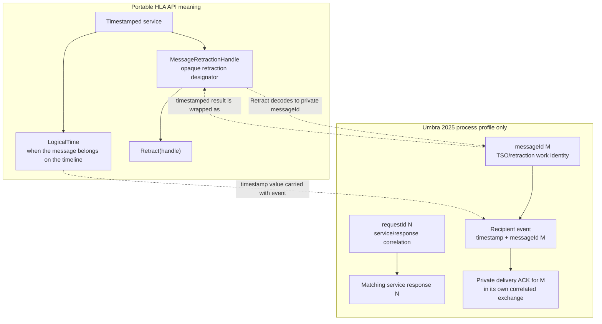

Only the left-hand API concepts are portable HLA vocabulary. The right-hand
IDs, framing, and conversion are this process implementation's choices, not
an HLA wire format or a requirement on another RTI. The pinned
[receive-order `sendInteraction` overload](../../third_party/ieee1516.1-2025/include/RTI/RTIambassador.h#L761),
[timestamped overload](../../third_party/ieee1516.1-2025/include/RTI/RTIambassador.h#L778),
and [`retract`](../../third_party/ieee1516.1-2025/include/RTI/RTIambassador.h#L1382)
declarations and the [private handle conversion boundary](../../cpp/src/internal/handles/message_retraction_handle.hpp#L10)
show the two sides without making the process IDs public API.

## 1. Sender-side service outcome and receiver-side observation

Begin with the public HLA effects, then read the process endpoint as one
implementation mapping. A successful producer service call and a receiving
federate's callback are separate observations; neither the private recipient
count nor process request identity is part of the public HLA result.

### HLA mental model: untimed update and reflection

This deliberately small 2025 API-level sequence leaves recipient eligibility
to the subscription, object-knowledge, and regional rules in their respective
guides. It is not a guarantee that every update reaches every receiver, nor
does it order the receiver callback against the producer's return.

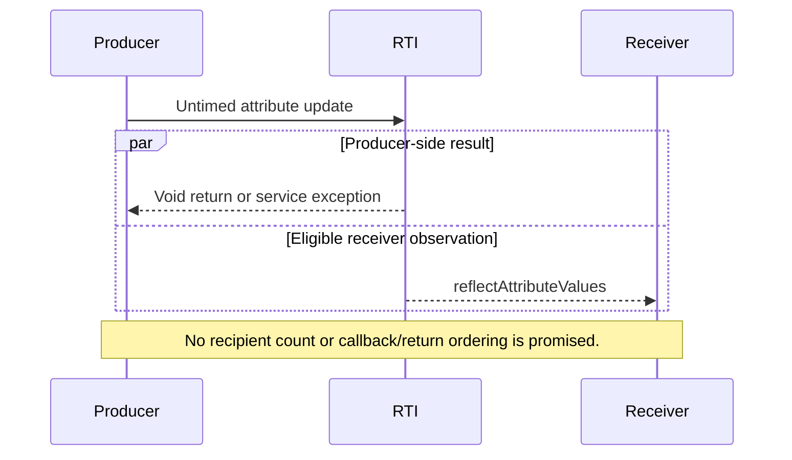

The pinned 2025 API declares the untimed
[`updateAttributeValues` service](../../third_party/ieee1516.1-2025/include/RTI/RTIambassador.h#L727) as `void` and
[`reflectAttributeValues`](../../third_party/ieee1516.1-2025/include/RTI/FederateAmbassador.h#L238) as a receiver
callback. The [subscription-state guide](HLA-2025-OBJECT-ATTRIBUTE-SUBSCRIPTION-STATE-FLOW-GUIDE.md) and
[DDM guide](HLA-2025-DATA-DISTRIBUTION-AND-REGIONS-FLOW-GUIDE.md) cover the eligibility inputs. Callback scheduling is a
separate axis; the implementation mapping below and section 2 show where this process profile makes that distinction
visible.

### Process mapping: an interaction request and its recipient stream

The sender's synchronous request and each recipient event travel on different
process sessions. In push mode, the service sends each recipient event before
returning the sender's private service response. The event is not part of that
response and does not use its request ID. The transport choice is a separate
boundary from callback scheduling: after the receiver client consumes an
event, the callback bridge either invokes it inline or waits for an evoke
operation. The branches below explain those two boundaries; they are not a
claim that every private transport-option and callback-model pairing is
implemented or tested. This example is specifically the receive-order
`sendInteraction` overload; it is not a portable HLA wire protocol.

For deferred receiver eligibility, see the [DSE guide](HLA-2025-DELAY-SUBSCRIPTION-EVALUATION-FLOW-GUIDE.md).
Its process-path note links to the [ordinary interaction projection sequence](HLA-2025-OBJECT-AND-INTERACTION-INFORMATION-FLOW-GUIDE.md#process-ordinary-interactions-snapshot-the-promoted-callback-view),
which shows how a route-only candidate is resolved before the event snapshot.

Read the sender transaction and recipient delivery as independent traces; they
do not define a general order between the public send result and the receiver
callback.

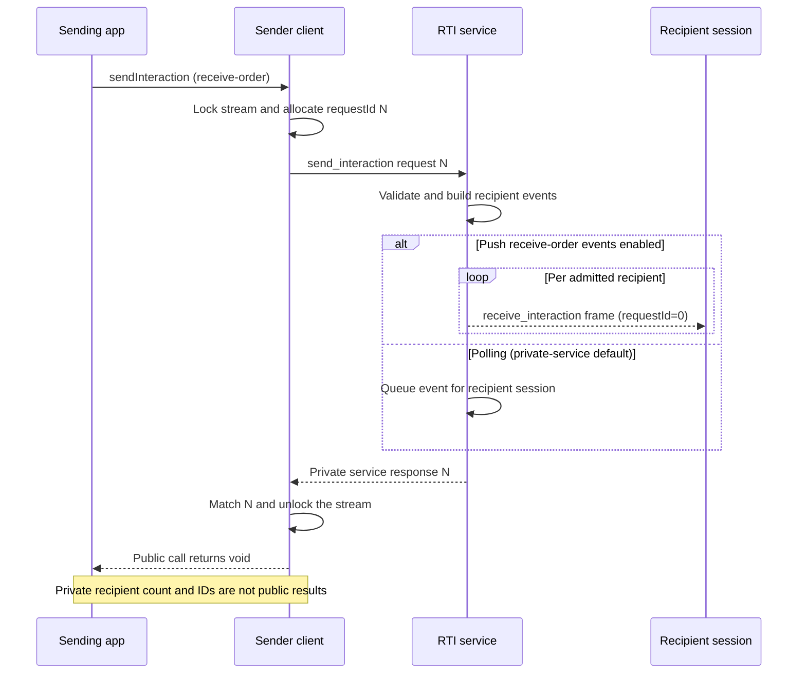

#### Keep parameter octets, handles, and process framing separate

The public 2025 call carries an interaction-class handle, a map from parameter
handles to `VariableLengthData`, and a separate user tag. For an ordinary
application interaction, if the application encodes a parameter with a
`DataElement`, its encoded octets are already the parameter value at this
boundary. The RTI does not infer the element type or decode and re-encode
ordinary parameter octets. The configured-process adapter carries the class
and sent parameter handles as routing/validation metadata, while a versioned
private interaction envelope carries parameter-handle/octet pairs and the
tag. The outer process request then adds its operation and correlation
identity; neither that frame nor the private envelope is an HLA value format.

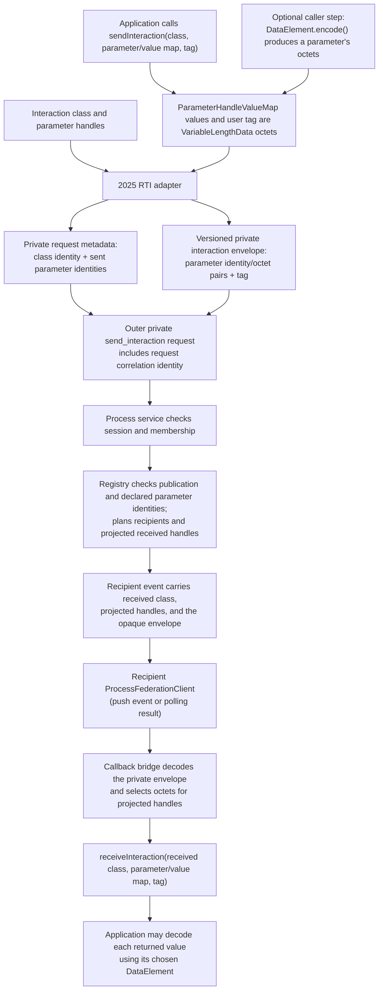

The chart follows ordinary, non-RTI-consumed receive-order interactions at the
configured-process endpoint. The predefined `HLAsetSwitches` interaction is
intercepted and has a separate control/MOM path; see the Federation MOM guide's
[HLAsetSwitches flow](HLA-2025-FEDERATION-MOM-FLOW-GUIDE.md#switch-storage-current-mom-projection-and-conditional-reflection-are-separate).
Push event frames and polling responses are the two delivery routes shown
above; recipient eligibility and class/parameter projection are detailed in
the [object and interaction guide](HLA-2025-OBJECT-AND-INTERACTION-INFORMATION-FLOW-GUIDE.md#interaction-path-class-subscription-parameter-projection-callback).
For the value-side encoding boundary, see [one value from API call to octets](HLA-2025-DATA-ELEMENT-ENCODING-FLOW-GUIDE.md#one-value-from-api-call-to-octets).
The registry validates class publication and parameter identities before
fan-out, but the ordinary process path does not inspect the parameter value
octets. On receipt, the callback bridge uses the recipient's projected handle
list to rebuild the public map and extracts the tag from the private envelope;
it does not decode a `DataElement`.

For the callback-side interleaving when a pushed frame arrives during an
active Evoke wait, see the [post-wait receive and callback drain](HLA-2025-CALLBACK-AND-SERVICE-ORDERING-FLOW-GUIDE.md#a-pushed-interaction-can-arrive-during-an-evoke-wait).
That sequence is source-derived and keeps the receive-order time gate separate
from process event buffering. The ordinary event's time eligibility and the
two callback-model branches are summarized in the Time Management guide's
[configured-process receive-order gate](HLA-2025-TIME-MANAGEMENT-GUIDE.md#configured-process-receive-order-interaction-gate).

The implementation mapping is visible at the [public process branch](../../cpp/src/internal/runtime/umbra_rti_ambassador_interaction_send_services.cpp#L57),
[client request](../../cpp/src/internal/federation/process_federation_client_value_services.cpp#L13),
[outer request codec](../../cpp/src/internal/federation/process_federation_service_codecs.cpp#L505),
[private value envelope codec](../../cpp/src/internal/federation/process_federation_service_interaction_event_codecs.cpp#L46),
[service validation and plan](../../cpp/src/internal/federation/process_federation_service_interaction_send.cpp#L75),
[registry handle-only planner](../../cpp/src/internal/federation/federation_registry_receive_order_interactions.cpp#L16),
[event construction](../../cpp/src/internal/federation/process_federation_service_interaction_send.cpp#L553),
and [callback reconstruction](../../cpp/src/internal/federation/process_federation_callback_bridge.cpp#L91).

The focused public process send test uses literal value bytes `01 00` and tag
bytes `50 55 42`, then checks those bytes after a raw receiver polls the service
([input](../../cpp/tests/ieee1516_2025_connection_send_interaction_catch2.cpp#L634),
[decoded result assertions](../../cpp/tests/ieee1516_2025_connection_send_interaction_catch2.cpp#L661)).
That verifies this path's byte/tag preservation, not an end-to-end
`DataElement.encode()`-to-`receiveInteraction` round trip. The separate
configured-process multi-recipient case checks official callbacks and FIFO
tags; it does not establish a typed DataElement codec at the RTI boundary.

#### Failure mapping: local typed errors versus remote rejection

This diagram isolates local connection/membership and handle checks, plus the
ordinary service-side membership and registry-plan rejection paths. It is not
an exhaustive exception map: save/restore and transport failures are outside
scope, and RTI-consumed MOM interactions use their separate branch.

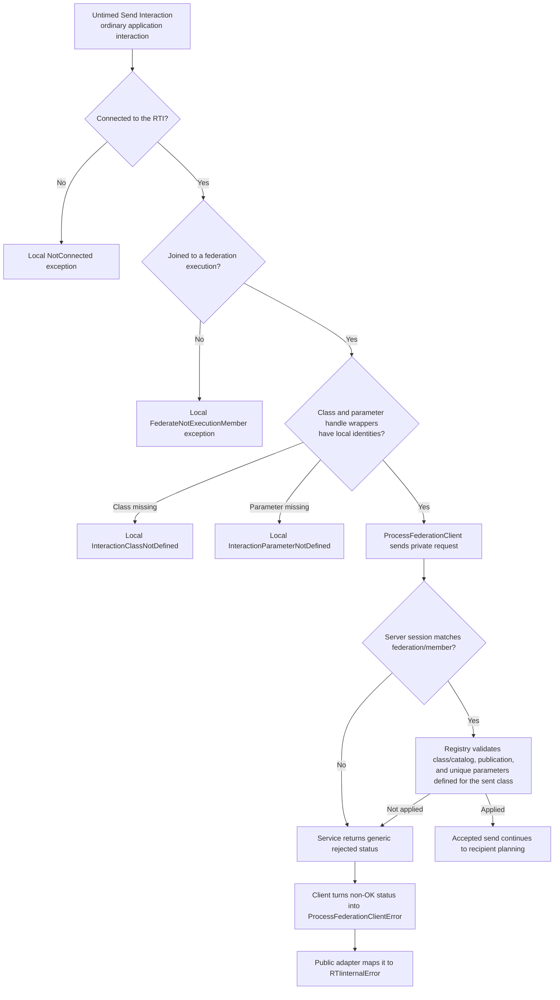

The pinned 2025 [untimed `sendInteraction` overload](../../third_party/ieee1516.1-2025/include/RTI/RTIambassador.h#L751)
declares `InteractionClassNotPublished`, `InteractionClassNotDefined`,
`InteractionParameterNotDefined`, `FederateNotExecutionMember`, and
`NotConnected` among its exceptions. The adapter raises typed errors for a
disconnected or unjoined caller and locally undefined class or parameter
handles. After a process request is sent, both a rejected session check and a
non-applied registry plan return a generic service status. Although the
registry distinguishes an unpublished class from a parameter invalid for the
sent class, the process client converts either non-OK response to
`ProcessFederationClientError`, which the public adapter maps to
`RTIinternalError`. Thus this configured-process source path does not preserve
those remote planner distinctions as public typed exceptions. The timestamped
overload has a different declared exception list; do not apply this untimed-path
observation to it.

The [focused public process Send Interaction case](../../cpp/tests/ieee1516_2025_connection_send_interaction_catch2.cpp#L457)
asserts successful delivery only. It does not establish the public exception
for a class that is valid locally but unpublished remotely, or a parameter
handle that is valid but belongs to another interaction class. Treat this as a
source-derived gap, not a normative or conformance conclusion.

Evidence: [local class-handle check](../../cpp/src/internal/runtime/umbra_rti_ambassador_interaction_send_services.cpp#L78) and [parameter-handle check](../../cpp/src/internal/runtime/umbra_rti_ambassador_interaction_send_services.cpp#L83),
[process client status conversion](../../cpp/src/internal/federation/process_federation_client_value_services.cpp#L30),
[service membership rejection](../../cpp/src/internal/federation/process_federation_service_interaction_send.cpp#L99),
[registry-plan rejection](../../cpp/src/internal/federation/process_federation_service_interaction_send.cpp#L413),
[registry publication check](../../cpp/src/internal/federation/federation_registry_receive_order_interactions.cpp#L51) and [sent-class parameter validation](../../cpp/src/internal/federation/federation_registry_receive_order_interactions.cpp#L61),
and [public error conversion](../../cpp/src/internal/runtime/umbra_rti_ambassador_interaction_send_services.cpp#L137).

#### Failure mapping: configured-process Send Directed Interaction

This untimed map shares the configured-process request boundary with Send
Interaction, but its registry plan also validates the target object. Local
handle-wrapper failures retain their declared typed errors; once sent, a
non-applied directed plan is returned as generic rejection, just like an
ordinary interaction plan.

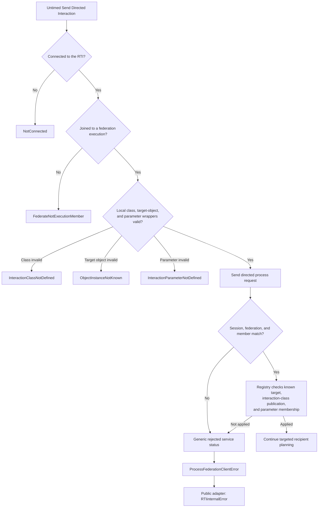

The pinned 2025 [untimed `sendDirectedInteraction` overload](../../third_party/ieee1516.1-2025/include/RTI/RTIambassador.h#L784)
declares `ObjectInstanceNotKnown`, `InteractionClassNotPublished`,
`InteractionParameterNotDefined`, `InteractionClassNotDefined`,
`FederateNotExecutionMember`, and `NotConnected` among its exceptions. The
configured-process adapter checks local class, object, and parameter handle
wrappers before sending. The service then checks session/federation/member
identity and asks the registry to plan against the target object, class
publication, and sent-class parameters. Any non-applied plan returns a generic
rejected service status; the client and public adapter convert that to
`RTIinternalError`, without preserving remote `ObjectInstanceNotKnown` or
publication/parameter distinctions. The focused [public process directed-send
case](../../cpp/tests/ieee1516_2025_connection_directed_interaction_catch2.cpp#L457)
asserts successful delivery only. No negative public exception outcome is
established, and this source observation is not a normative exception-precedence
claim.

Evidence: [local directed handle checks](../../cpp/src/internal/runtime/umbra_rti_ambassador_directed_interaction_services.cpp#L75),
[public process-error conversion](../../cpp/src/internal/runtime/umbra_rti_ambassador_directed_interaction_services.cpp#L116),
[directed service session check](../../cpp/src/internal/federation/process_federation_service_interaction_send.cpp#L689),
[directed planner rejection](../../cpp/src/internal/federation/process_federation_service_interaction_send.cpp#L707),
and directed registry status checks for [known objects](../../cpp/src/internal/federation/federation_registry.cpp#L1902), [class publication](../../cpp/src/internal/federation/federation_registry.cpp#L1917), and [sent parameters](../../cpp/src/internal/federation/federation_registry.cpp#L1939).

#### Timestamped send validation remains operation-specific

The untimed maps above do not describe the timestamped overloads. Both pinned
2025 [time overloads](../../third_party/ieee1516.1-2025/include/RTI/RTIambassador.h#L767)
declare `InvalidLogicalTime`, but the configured-process source paths handle
the service status differently:

**Timestamped Send Interaction.** The adapter reconstructs a finite time. The
process service decodes it and, when sender time state is present, checks the
sender's applicable time-plus-lookahead floor. An `invalid_logical_time`
response is translated back to public `InvalidLogicalTime`; other non-OK
results map to `RTIinternalError`. The focused process interaction cases cover
successful TSO delivery/order. A focused process FQR-arrival case also checks
the failure boundary: after the receiver grants at time 5, a later sender call
at time 4 throws public `InvalidLogicalTime`. The separate timestamped
failure-report case uses the in-process configuration, so it does not test
remote service-report behavior.

FQR's configured-process arrival policy is a separate coordinator decision:
the focused `HLA_EVOKED` process case accepts FQR(10), then sends timestamps 9
and 12 and retracts 12 before callback entry. Neither interaction is delivered
by that accepted FQR; it reports actual 5 and optimistic 10. The matching
embedded case admits the time-9 arrival at callback-time extraction and
suppresses retracted 12. This is a tested profile-policy difference, not an
HLA transport-cutoff rule or a parity claim. See the Time Management guide's
[FQR transport-arrival boundary](HLA-2025-TIME-MANAGEMENT-GUIDE.md#fqr-with-hlaevoked-transport-arrival-boundary-is-profile-policy),
the [configured-process test](../../cpp/tests/ieee1516_2025_connection_process_tso_interaction_retraction_before_callback_catch2.cpp#L829),
its [post-acceptance arrivals](../../cpp/tests/ieee1516_2025_connection_process_tso_interaction_retraction_before_callback_catch2.cpp#L961),
and the [coordinator's final-time delivery and FQG dispatch](../../cpp/src/internal/federation/process_federation_service_lifecycle.cpp#L467).

**Timestamped Send Directed Interaction.** The adapter reconstructs a finite
time and checks local handles. The process service validates the encoded finite
time, then decides whether to queue it from the producer's regulation state.
The inspected directed service path has no call to the sender time-plus-
lookahead validator. Its TSO enqueue checks finite time, implementation, and
queue identity/recipient constraints, but not that floor. Non-OK process-client
results map to `RTIinternalError`. Focused process directed-TSO cases cover
successful delivery to pending NMR/NMRA recipients, not a timestamp below the
producer's applicable floor. This is a source-path observation; it does not
establish whether such a request is accepted or make a normative conformance
claim. For the successful directed TSO route through a pending process
NMR/NMRA, including the target object, request retarget, and callback gate, see
the [Time Management sequence](HLA-2025-TIME-MANAGEMENT-GUIDE.md#directed-tso-retargets-pending-process-next-message-requests).

Evidence: [ordinary adapter finite-time check](../../cpp/src/internal/runtime/umbra_rti_ambassador_timestamped_interaction_send.cpp#L90) and [status mapping](../../cpp/src/internal/runtime/umbra_rti_ambassador_timestamped_interaction_send.cpp#L132),
[ordinary service floor check](../../cpp/src/internal/federation/process_federation_service_interaction_send.cpp#L114),
[ordinary client status preservation](../../cpp/src/internal/federation/process_federation_client_value_services.cpp#L30),
[directed local-handle checks](../../cpp/src/internal/runtime/umbra_rti_ambassador_directed_interaction_services.cpp#L404) and [finite-time check](../../cpp/src/internal/runtime/umbra_rti_ambassador_directed_interaction_services.cpp#L421),
[directed public process-error mapping](../../cpp/src/internal/runtime/umbra_rti_ambassador_directed_interaction_services.cpp#L460),
[directed client non-OK response conversion](../../cpp/src/internal/federation/process_federation_client_value_services.cpp#L84),
[directed service time validation](../../cpp/src/internal/federation/process_federation_service_interaction_send.cpp#L680) and [queue selection](../../cpp/src/internal/federation/process_federation_service_interaction_send.cpp#L714),
[directed TSO enqueue](../../cpp/src/internal/federation/process_federation_service_interaction_send.cpp#L816),
[queue validation](../../cpp/src/internal/time/tso_message_queue.cpp#L72),
[process ordinary-TSO success case](../../cpp/tests/ieee1516_2025_connection_process_tso_interaction_multiple_message_ordering_catch2.cpp#L456),
[process below-grant `InvalidLogicalTime` assertion](../../cpp/tests/ieee1516_2025_connection_process_tso_interaction_retraction_before_callback_catch2.cpp#L994),
[process directed-TSO success case](../../cpp/tests/ieee1516_2025_connection_tso_directed_interaction_callback_gating_catch2.cpp#L1594),
and [in-process timestamped failure case](../../cpp/tests/ieee1516_2025_timestamped_send_interaction_failure_file_catch2.cpp#L5).

The receiver route has two distinct responsibilities: consuming an event from
the process session, then submitting the decoded event under the configured
callback model.

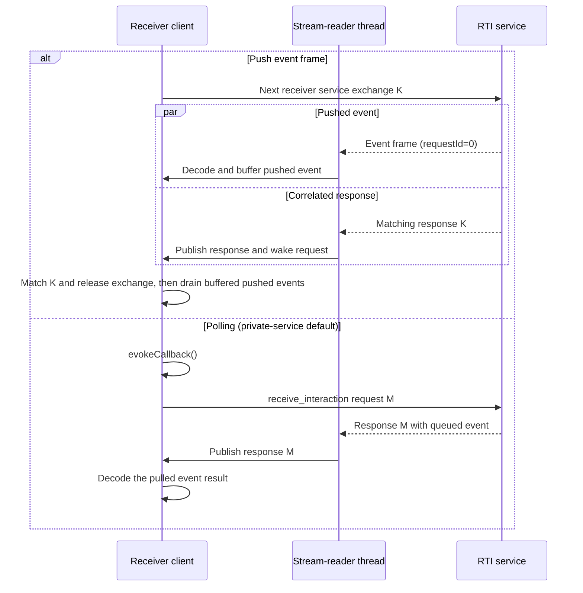

In push mode, a dedicated [stream-reader thread](../../cpp/src/internal/federation/process_federation_client.cpp#L371)
receives unsolicited event frames and correlated responses while the receiver's
service exchange is waiting. It buffers decoded pushed events; it does not
invoke the federate callback. The request path drains buffered pushes after
matching the response, while the separate callback-dispatch thread can drain
events outside a request. Polling mode returns the event in the response to
the explicit `receive_interaction` operation. Either route supplies a decoded
interaction event to the callback bridge:

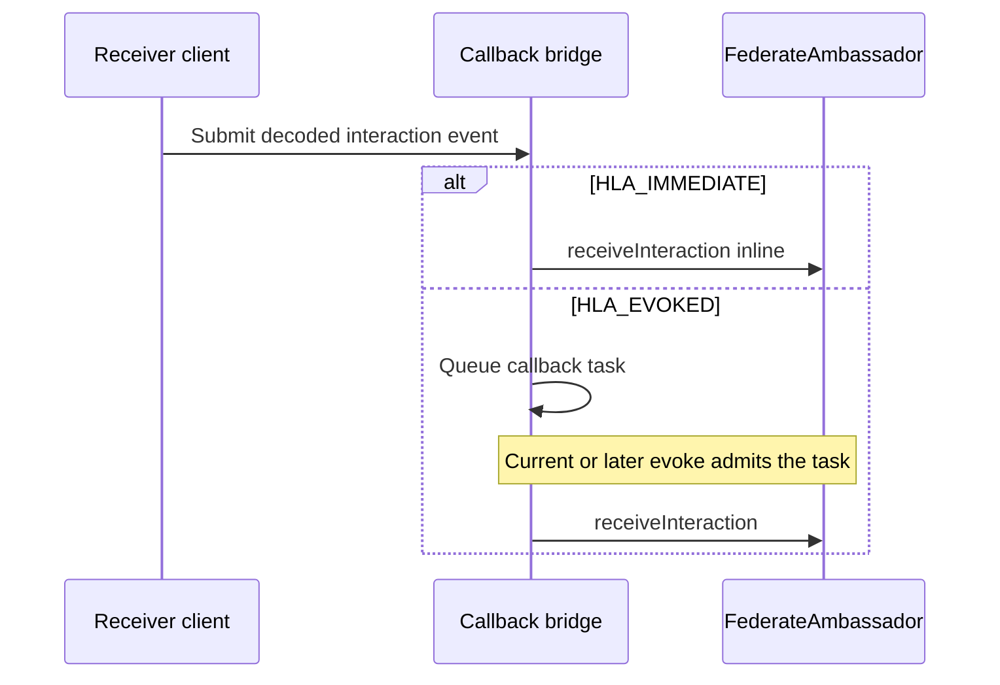

Here, “inline” means during the bridge submission on whichever thread drains
that submission. A process event may be submitted by the request path after a
correlated response, by a public Evoke receive-poll path, or by the client's
callback-dispatch worker when no request owns the stream. Therefore
`HLA_IMMEDIATE` does not, by itself, identify the application thread or order
the receiver callback against a service response on another session. The
focused process cases observe callback delivery under their selected models;
they do not assert callback thread identity, lock ownership, or callback re-entry ([request-path drain](../../cpp/src/internal/federation/process_federation_client.cpp#L622),
[background dispatch loop](https://github.com/sheepfling/umbra/blob/c9c5a9e410539b039cd8bba35b53d0ef2b24d180/cpp/src/internal/federation/process_federation_client.cpp#L722),
[multi-recipient case](../../cpp/tests/ieee1516_2025_connection_multi_recipient_interaction_ordering_catch2.cpp#L459)).

The pinned API's [receive-order overload](../../third_party/ieee1516.1-2025/include/RTI/RTIambassador.h#L761) returns
`void`; the separate [timestamped overload](../../third_party/ieee1516.1-2025/include/RTI/RTIambassador.h#L778) returns
a `MessageRetractionHandle`. The process service's private result fields do not change those signatures.

For the exception boundary after a pushed event reaches the callback dispatcher,
see the [process callback-exception attribution map](HLA-2025-CALLBACK-AND-SERVICE-ORDERING-FLOW-GUIDE.md#process-endpoint-callback-exception-attribution).

The configured-process [multi-recipient interaction case](../../cpp/tests/ieee1516_2025_connection_multi_recipient_interaction_ordering_catch2.cpp#L459)
asserts two `receiveInteraction` callbacks per exact-class receiver, in tag
FIFO order, under both callback models. Its fixture leaves the service in
polling mode for `HLA_EVOKED`, where the clients explicitly evoke; for
`HLA_IMMEDIATE` it enables the private push option and uses a subsequent class
lookup as the receiver-side exchange fence. That pairing is a test setup, not
an HLA rule that binds a callback model to a transport mode. The fixture sends
both messages before pumping the receivers and then observes callbacks through
receiver-side operations; this does not establish a general HLA ordering rule
relative to the sender's `sendInteraction` return. The test uses exact-class
subscriptions: it does not cover ancestor-subscription promotion or the
additional-FOM Join scenario. The separate [public send
payload case](../../cpp/tests/ieee1516_2025_connection_send_interaction_catch2.cpp#L457)
uses a raw process receiver to inspect the pulled event's parameter and tag;
that case does not assert a receiver callback.

For the process-specific case where an event is received while callbacks are
disabled, see the [callback admission note](HLA-2025-CALLBACK-AND-SERVICE-ORDERING-FLOW-GUIDE.md#a-process-receive-poll-can-admit-a-task-while-callbacks-are-disabled).

Source map: [subscription request](../../cpp/src/internal/federation/process_federation_service_request_handlers.cpp#L338),
[shared recipient planning](../../cpp/src/internal/federation/process_federation_service_interaction_send.cpp#L405) and [event creation](../../cpp/src/internal/federation/process_federation_service_interaction_send.cpp#L553),
[push-versus-queue option](../../cpp/src/internal/federation/process_federation_service.hpp#L80),
[interaction FIFO dequeue](../../cpp/src/internal/federation/process_federation_service_receive.cpp#L114),
[push-event dispatch](../../cpp/src/internal/federation/process_federation_client_callback_dispatch.cpp#L298),
[process callback pump](../../cpp/src/internal/runtime/umbra_rti_ambassador_callback_control_services.cpp#L57),
[callback-bridge submission](../../cpp/src/internal/federation/process_federation_callback_bridge.cpp#L1346),
and [FederateAmbassador invocation](../../cpp/src/internal/federation/process_federation_callback_bridge.cpp#L91).

The common outer framing is length-prefixed. Its private frame header reads the
payload length as a big-endian 32-bit value; that framing is not the public
`DataElement` representation or an HLA logical-time encoding. See
[`process_transport.cpp`](../../cpp/src/internal/federation/process_transport.cpp#L94)
and keep it separate from the edition-specific value-byte discussion in the
[DataElement guide](HLA-2025-DATA-ELEMENT-ENCODING-FLOW-GUIDE.md).

### Process mapping: receive-order object-attribute update

These are two views of the untimestamped 2025 process path only. First the
service plans and commits the registry's recipient/value projections and
returns its private request result. Then a recipient obtains its own event or a
readiness marker that leads to a later event claim. Passels, session queues,
and frame names are Umbra implementation details, not HLA protocol concepts.

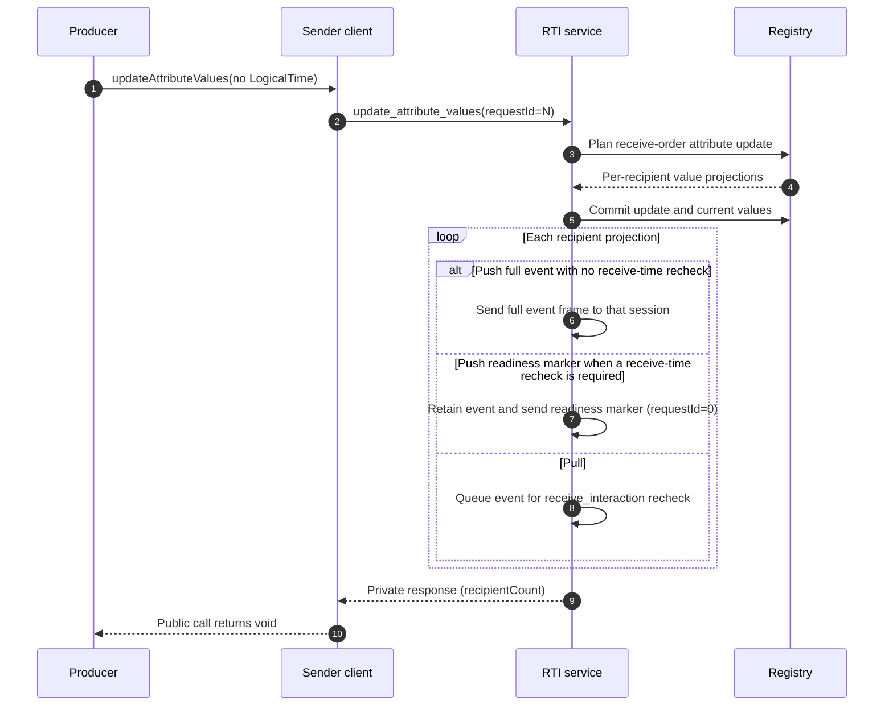

The private `recipientCount` is request bookkeeping, not a public result. The
public `updateAttributeValues` call returns `void`. Per-recipient event delivery
is a separate path:

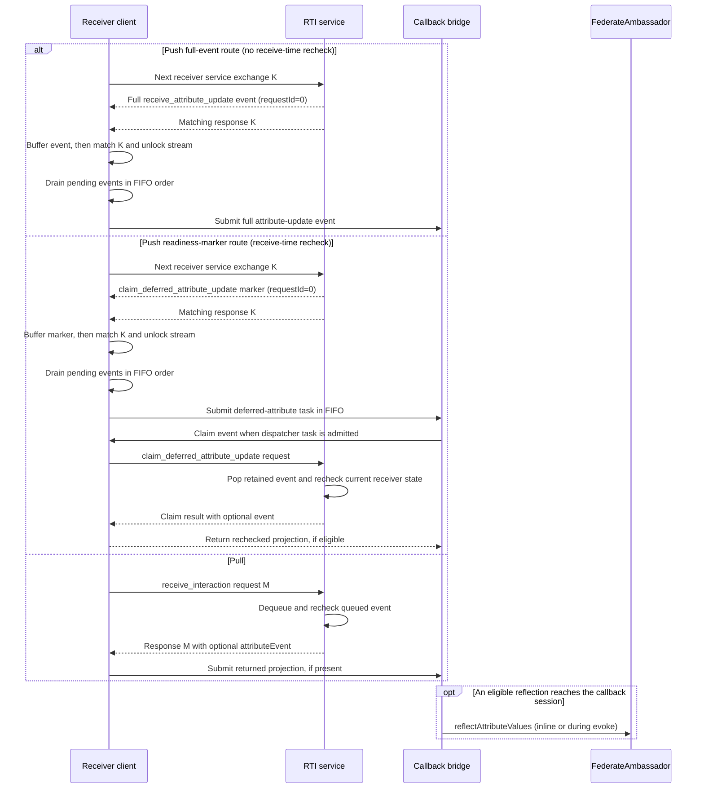

For an untimestamped update, the process service always defers Pull rechecking
until `receive_interaction`. In Push mode, it sends the complete
`receive_attribute_update` event when no receive-time recheck is needed; when
delayed-subscription evaluation or the regional path requires a recheck, it
retains the authoritative event and sends only the
`claim_deferred_attribute_update` readiness marker. The marker carries receiver
identity, not the attribute values. After the marker is drained from the client
FIFO, the bridge submits a task; when admitted, the task claims the event from
the service, which rechecks the current receiver state and returns an event
only if it remains eligible. Pull keeps the event in the session queue and
rechecks it as part of the poll response. The service's
[`recheckAtReceive` predicate](../../cpp/src/internal/federation/process_federation_service_attribute_value_updates.cpp#L222)
and [per-recipient event staging](../../cpp/src/internal/federation/process_federation_service_attribute_value_updates.cpp#L244)
select these branches; [Push frame emission](https://github.com/sheepfling/umbra/blob/c9c5a9e410539b039cd8bba35b53d0ef2b24d180/cpp/src/internal/federation/process_federation_service_attribute_value_updates.cpp#L358)
distinguishes the full event from the marker. The client dispatches the marker
through its [deferred-update path](../../cpp/src/internal/federation/process_federation_client_callback_dispatch.cpp#L314),
the admitted bridge task invokes its
[deferred-update claim callback](../../cpp/src/internal/federation/process_federation_callback_bridge.cpp#L1145)
from the [task body](../../cpp/src/internal/federation/process_federation_callback_bridge.cpp#L1769),
and the service's [claim handler](../../cpp/src/internal/federation/process_federation_service.cpp#L312)
rechecks before returning an event. The Pull poll performs its
[dequeue-time recheck](../../cpp/src/internal/federation/process_federation_service_receive.cpp#L233).

The public process callback pump uses `receive_interaction` as its deterministic
polling fence; a pulled reflection travels in the response's adjacent optional
`attributeEvent` slot. Both delivery paths reach the callback bridge, but the
service's Push/Pull choice and the public callback model are separate settings.
The focused [regional process RAVU case](../../cpp/tests/ieee1516_2025_connection_regional_class_request_attribute_value_update_catch2.cpp#L459)
configures Push for `HLA_IMMEDIATE` and Pull for `HLA_EVOKED`; it observes the
deferred claim in the former and discovery/reflection polls in the latter
([expected operations](../../cpp/tests/ieee1516_2025_connection_regional_class_request_attribute_value_update_catch2.cpp#L785)).
That is this test fixture's pairing, not a requirement that one callback model
use a particular transport. The [ordinary process reflection case](../../cpp/tests/ieee1516_2025_connection_update_attribute_values_reflect_catch2.cpp#L457)
checks byte-preserving reflection under both callback models; its
[service-option setup](../../cpp/tests/ieee1516_2025_connection_update_attribute_values_reflect_catch2.cpp#L545)
also pairs Push with `HLA_IMMEDIATE`. Callback scheduling is covered in section
2; timestamped delivery and its grant and retraction boundaries remain in
section 3.

For this ordinary untimed process path, decoding the private request/event
envelopes does not decode an HLA `DataElement`. The public adapter copies each
`VariableLengthData`; service planning uses the attribute identities, then the
service copies the value octets into accepted state and recipient events. The
private event codec writes those octets with their attribute handles, and the
callback bridge rebuilds the public value map without interpreting each value.
The receiving federate chooses a compatible `DataElement` if it wants to
decode the callback bytes. This is an implementation-path observation, not a
claim about the normative validity rules for every payload.
The copied-value steps are visible in the [public adapter](../../cpp/src/internal/runtime/umbra_rti_ambassador_attribute_update_services.cpp#L102),
[handle-based process plan](../../cpp/src/internal/federation/process_federation_service_attribute_value_updates.cpp#L46) and [accepted-value copy](../../cpp/src/internal/federation/process_federation_service_attribute_value_updates.cpp#L184),
[private event codec](../../cpp/src/internal/federation/process_federation_service_codecs.cpp#L1702),
and [callback-map reconstruction](../../cpp/src/internal/federation/process_federation_callback_bridge.cpp#L281).

The focused configured-process reflection test sends the literal value bytes
`52 46 4C` and tag bytes `54 41 47`, then checks that both arrive unchanged
([input](../../cpp/tests/ieee1516_2025_connection_update_attribute_values_reflect_catch2.cpp#L816),
[callback assertions](../../cpp/tests/ieee1516_2025_connection_update_attribute_values_reflect_catch2.cpp#L843)).
That verifies byte preservation in this scenario; it is not a typed
`DataElement.encode()` round trip or a general payload-validation test. Keep
the private frame/envelope distinction separate from the 2025 value format in
the [DataElement guide](HLA-2025-DATA-ELEMENT-ENCODING-FLOW-GUIDE.md#pick-the-representation-boundary-before-reasoning-about-bytes).

#### Failure mapping: configured-process Update Attribute Values

This chart covers the untimed public service and the configured 2025 process
endpoint. It shows representative local typed failures and the remote registry
checks relevant to object knowledge, attribute definition, and ownership; it is
not an exhaustive map of save/restore, protocol, or transport failures.

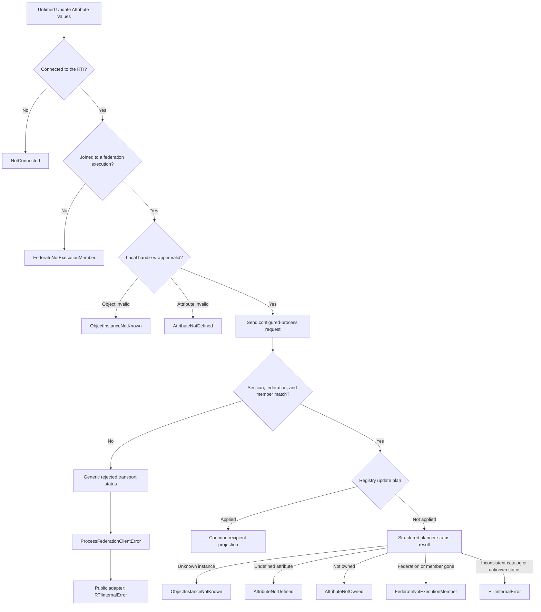

The pinned 2025 [`updateAttributeValues` untimed API](../../third_party/ieee1516.1-2025/include/RTI/RTIambassador.h#L727)
lists `ObjectInstanceNotKnown`, `AttributeNotDefined`, and `AttributeNotOwned`
among its declared exceptions. Before sending the request, the configured
adapter checks its local handle wrappers and throws typed errors for an
unrecognized object or attribute handle. After the request crosses the process
boundary, a session/federation/member mismatch returns a generic rejected transport
status, which the client reports as `ProcessFederationClientError` and the
public adapter maps to `RTIinternalError`. When the session gate passes,
registry planner failures travel as a structured result payload instead: the
adapter maps unknown object, undefined attribute, and not-owned statuses to
`ObjectInstanceNotKnown`, `AttributeNotDefined`, and `AttributeNotOwned`;
federation/member loss maps to `FederateNotExecutionMember`, while inconsistent
catalog status maps to `RTIinternalError`
([service status payload](../../cpp/src/internal/federation/process_federation_service_attribute_value_updates.cpp#L58),
[public status translation](../../cpp/src/internal/runtime/umbra_rti_ambassador_service_failure_translation.cpp#L409)).

That is the same broad local-versus-remote error shape as the earlier
[untimed Send Interaction map](#failure-mapping-local-typed-errors-versus-remote-rejection),
not the same semantic decision tree. Update Attribute Values checks a known
object instance and per-instance attribute ownership; Send Interaction checks
interaction publication and parameter membership in the sent class. Do not
reuse one operation's validation rules for the other. This is a source-derived
configured-process observation, not a conformance conclusion about the
standard's exception requirements or exception precedence.

The focused public process Update Attribute Values case listed below asserts
that the valid untimed call succeeds under both callback models. It does not
establish any negative-path public outcome. The timestamped overload uses the
same structured planner-status translation and adds local finite-time
validation; its timestamp and TSO behavior is outside this chart.

Evidence: [local handle checks](../../cpp/src/internal/runtime/umbra_rti_ambassador_attribute_update_services.cpp#L91),
[public process-error conversion](../../cpp/src/internal/runtime/umbra_rti_ambassador_attribute_update_services.cpp#L135),
[process-client status conversion](../../cpp/src/internal/federation/process_federation_client_value_services.cpp#L125),
[service session check](../../cpp/src/internal/federation/process_federation_service_attribute_value_updates.cpp#L29),
[service registry-plan rejection](../../cpp/src/internal/federation/process_federation_service_attribute_value_updates.cpp#L52),
[registry object-knowledge check](../../cpp/src/internal/federation/federation_registry_attribute_value_update_requests.cpp#L110),
and [registry attribute-definition check](../../cpp/src/internal/federation/federation_registry_attribute_value_update_requests.cpp#L167) and [ownership check](../../cpp/src/internal/federation/federation_registry_attribute_value_update_requests.cpp#L172).

## 2. From a stream frame to an official callback

The client uses [`exchangeMutex_`](../../cpp/src/internal/federation/process_federation_client.hpp#L1077) to
serialize request/response pairs and [`transactionMutex_`](../../cpp/src/internal/federation/process_federation_client.hpp#L1078)
to protect request depth and pending-event state. The state mutex is not held
while waiting on the stream reader ([lock-role comment](../../cpp/src/internal/federation/process_federation_client.hpp#L1074)).
After response kind, operation, and `requestId` match
([response check](../../cpp/src/internal/federation/process_federation_client.cpp#L599)), the client updates request
depth and releases the exchange gate ([unlock](../../cpp/src/internal/federation/process_federation_client.cpp#L618))
before draining pushed events. The dispatcher releases the state mutex before
bridge submission
([unlock](../../cpp/src/internal/federation/process_federation_client_callback_dispatch.cpp#L304)),
so submission on this path occurs outside both locks. This describes
implementation behavior, not an HLA callback-ordering requirement.

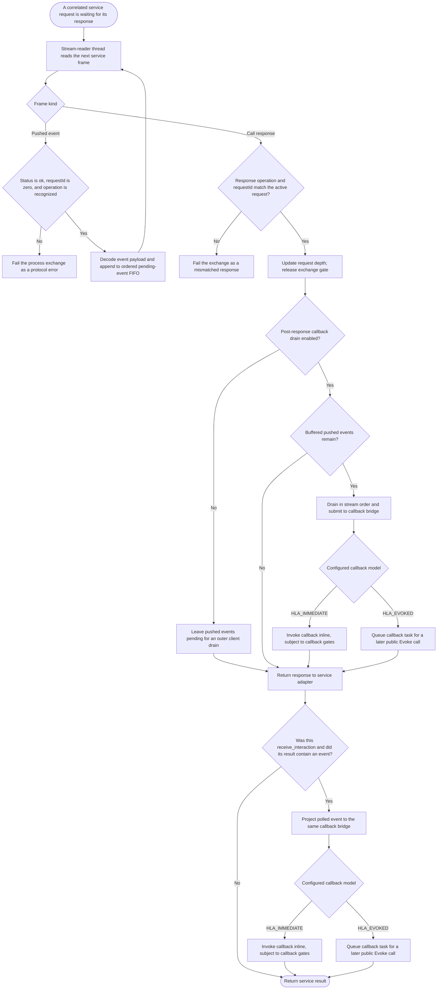

One subtlety: a pushed frame is unsolicited at the service-protocol level. The
client starts separate [stream-reader](../../cpp/src/internal/federation/process_federation_client.cpp#L371)
and [callback-dispatch](../../cpp/src/internal/federation/process_federation_client.cpp#L372)
threads. The reader consumes frames and buffers pushed events; the dispatch
thread submits them to the bridge only when request/dispatch suppression
allows. The request path also explicitly drains frames already buffered when
the correlated response arrives. A public Evoke path first drains available
work; if none is available, it can issue the explicit receive operation. In
polling mode, the event can be returned inside that operation's response. In
push mode, the reader may receive event frames while the request waits for its
correlated response. Both routes converge on the callback bridge, but their
arrival and buffering steps differ.

### Cross-family queue order and test boundary

Within the configured-process client, unsolicited interaction frames, complete
attribute-reflection frames, deferred-reflection markers, and other typed
events returned by a poll enter the same `pendingEvents_` FIFO. A polled
interaction is split out as a separate result: the client returns it to the
callback-control service, which calls `dispatchReceiveOrder` directly. It does
not enter `pendingEvents_`. FIFO events are removed in queue order and routed
to their matching bridge methods. Both the direct interaction route and the
typed FIFO routes submit callback tasks to the shared `CallbackDispatcher`.
Its queue drain takes tasks FIFO, and `HLA_EVOKED` Evoke calls consume that
queue in order
([FIFO extraction](https://github.com/sheepfling/umbra/blob/c9c5a9e410539b039cd8bba35b53d0ef2b24d180/cpp/src/internal/callbacks/callback_dispatcher.cpp#L324),
[Evoke drain](../../cpp/src/internal/callbacks/callback_dispatcher.cpp#L238)).
The immediate path drains inline and allows same-thread callback re-entry
([re-entrant submission](../../cpp/src/internal/callbacks/callback_dispatcher.cpp#L142)).
The deferred marker's task can claim and recheck its authoritative event before
it yields a reflection. These are source-observed process scheduling steps, not
a portable HLA callback-order rule.

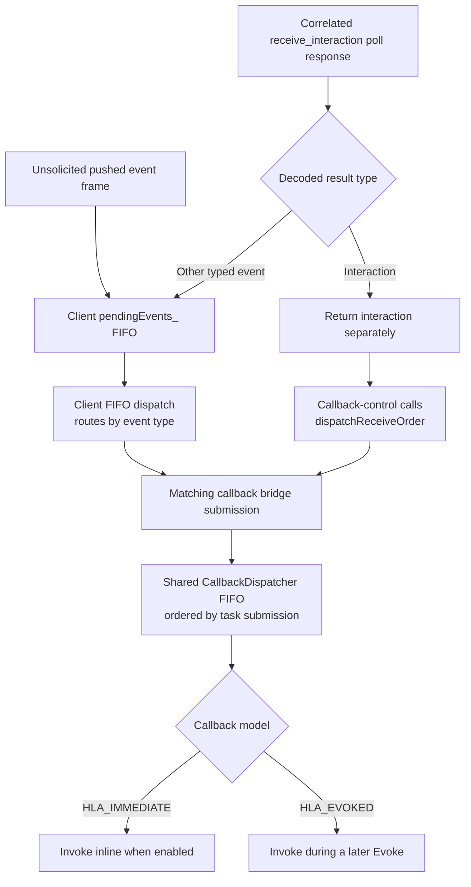

After the matching response arrives, the correlated request attempts to submit
pushed frames buffered in the client FIFO before it returns to
`receiveInteraction`. That method then extracts the poll's interaction result
and buffers other typed result fields, after which callback-control submits the
interaction directly and drains the FIFO.
The client dispatch routine can yield when another thread already owns its
dispatch lease, so this is not a total-order guarantee for every interleaving.
The chart shows source routing and queue boundaries, not a standard-mandated
callback order.

The source path is visible in [unsolicited-event buffering](../../cpp/src/internal/federation/process_federation_client.cpp#L451),
[poll-result buffering](../../cpp/src/internal/federation/process_federation_client.cpp#L389),
[poll-result splitting](../../cpp/src/internal/federation/process_federation_client_value_services.cpp#L229),
[request completion's pushed-event dispatch](../../cpp/src/internal/federation/process_federation_client.cpp#L622),
[direct dispatch of the polled interaction](../../cpp/src/internal/runtime/umbra_rti_ambassador_callback_control_services.cpp#L272),
[FIFO draining and type routing](../../cpp/src/internal/federation/process_federation_client_callback_dispatch.cpp#L305),
[the dispatch-lease guard](../../cpp/src/internal/federation/process_federation_client_callback_dispatch.cpp#L282),
the separate [interaction](../../cpp/src/internal/federation/process_federation_callback_bridge.cpp#L1346),
[full-reflection](../../cpp/src/internal/federation/process_federation_callback_bridge.cpp#L1624),
and [deferred-reflection](../../cpp/src/internal/federation/process_federation_callback_bridge.cpp#L1757)
submissions, and [callback task queueing](../../cpp/src/internal/callbacks/callback_dispatcher.cpp#L135).
The focused process TSO late-arrival tests assert interaction-before-grant in
the shared-listener case ([`I`, then `G`](../../cpp/tests/ieee1516_2025_connection_process_tso_cross_service_late_arrival_catch2.cpp#L312))
and reflection-before-grant in separate NMRA and NMR attribute cases
([NMRA](../../cpp/tests/ieee1516_2025_connection_process_tso_cross_service_late_arrival_catch2.cpp#L483),
[NMR](../../cpp/tests/ieee1516_2025_connection_process_tso_cross_service_late_arrival_catch2.cpp#L491)).
They do not combine an interaction, a full reflection, and a deferred marker in
one receiver stream or assert cross-family callback-entry order. Treat the
shared FIFO as implementation evidence, not evidence of an HLA ordering
requirement or of every mixed-event callback schedule.

Synchronization registration and completion use this same private
response/event boundary; their producer-specific ordering and the distinction
from HLA callback requirements are mapped in the
[callback/service-ordering guide](HLA-2025-CALLBACK-AND-SERVICE-ORDERING-FLOW-GUIDE.md#process-endpoint-service-responses-and-synchronization-events-are-separate).

The client also preserves a heterogeneous FIFO for pushed event families. On the
request path, the exchange gate has been released before dispatch, and the state
mutex is released before each bridge submission. For timestamped deliveries,
the process service has additional in-transit and post-callback acknowledgement rules. Their grant eligibility
and retraction state remain in the [time](HLA-2025-TIME-MANAGEMENT-GUIDE.md)
and [retraction](HLA-2025-TSO-RETRACTION-FLOW-GUIDE.md) guides; the process
callback-ack seam is shown separately in section 3 below.

### Polling family priority is not pushed-stream FIFO

`pushReceiveOrderEvents` selects a private process delivery path; it is not the
HLA callback model. With polling, the service stores events in separate
per-session, per-family queues. Each `receive_interaction` checks the
synchronization-announcement queue before the synchronized, save, restore, and
interaction-event queues. Thus, if an interaction event is already queued and a
synchronization announcement is queued before the next poll, that poll selects
the announcement first. This is family precedence in this process
implementation—not a claim that HLA defines a global callback order. The method
continues with discovery/removal and other event families after the portion
shown here.

With pushed delivery, the poll selector is bypassed. When a correlated client
request reads pushed frames while waiting for its response, it appends them to
the client FIFO in stream-read order, then drains them after the matching
response releases the exchange lock. That FIFO does not retroactively apply
polling-family priority. Both paths still converge on the same callback bridge;
`HLA_IMMEDIATE` versus `HLA_EVOKED` determines inline invocation versus
deferred evoke work independently of this transport choice.

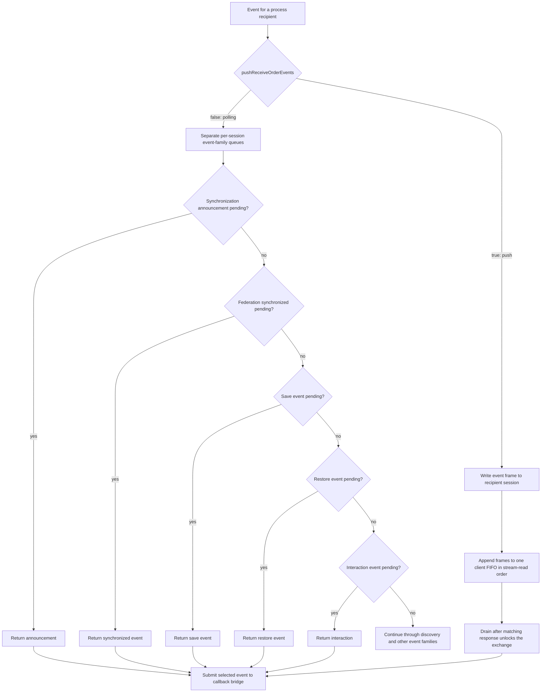

The five polling branches are a bounded excerpt, not a complete family-priority
specification. Each poll restarts the first-match chain; a persistently nonempty
earlier queue can postpone later families, and the selector has no round-robin
step. Public synchronization tests exercise polling and pushed paths separately,
not a mixed-family queue order. A private Save/Restore case also carries a queued
interaction through Restore, but its repeated polls establish persistence rather
than relative family priority or starvation; see the
[source and test map](#evidence-map-and-limits).

#### Discovery and removal share a per-session merge

After the earlier family branches are empty, the polling path compares the
front discovery and removal events for this process session. Both producers
stamp their event from the same session-local increasing sequence immediately
before enqueue. The selector returns discovery when no removal is pending or
when discovery has the lower sequence; otherwise it enters the removal path.
That path asks the registry to begin the receiver-side removal transition and
discards stale removal entries that no longer have a matching snapshot.

This describes Umbra's per-session poll selector. The pinned 2025 API headers
identify [discovery (§6.9)](../../third_party/ieee1516.1-2025/include/RTI/FederateAmbassador.h#L229),
[reflection (§6.11)](../../third_party/ieee1516.1-2025/include/RTI/FederateAmbassador.h#L238),
and [removal (§6.17)](../../third_party/ieee1516.1-2025/include/RTI/FederateAmbassador.h#L316),
but the header declarations do not establish an ordering rule among those
callback families. The [IEEE standard page](https://standards.ieee.org/ieee/1516.1/6688/)
lists access to the complete 2025 standard by subscription; this review does
not independently verify normative ordering language. Do not read the private
sequence as a federation-wide order or as proof of a standard-mandated order.

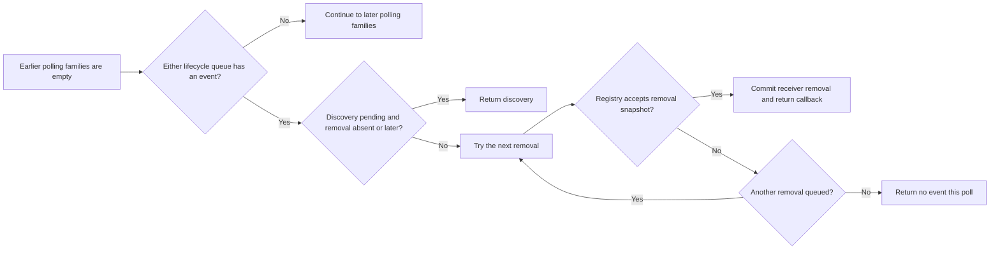

The loop does not compare the discovery head again after a removal event yields
no snapshot. A source-level interleaving makes this ordering edge reachable in
pull mode. When a timestamped Delete returns a retraction handle, the service
puts time-constrained recipients in the temporal queue; a non-time-constrained
recipient is routed through the ordinary removal queue with the retraction ID
([recipient selection](../../cpp/src/internal/federation/process_federation_service_object_instance_deletion.cpp#L89),
[remaining recipients](../../cpp/src/internal/federation/process_federation_service_object_instance_deletion.cpp#L147)).
The removal event receives the same per-session sequence used for discoveries
([queue insertion](../../cpp/src/internal/federation/process_federation_service_object_instance_removal.cpp#L109)).

On a legal Retract, the registry changes a pending recipient to retracted
([registry transition](../../cpp/src/internal/federation/federation_registry_tso_delivery.cpp#L225)).
`handleRetract` calls the registry before reacquiring the process-service mutex
to erase that recipient's queued event
([registry call](../../cpp/src/internal/federation/process_federation_service_retraction.cpp#L128),
[queue cleanup](../../cpp/src/internal/federation/process_federation_service_retraction.cpp#L174)).
A receiver poll can acquire the mutex in that gap. The registry then rejects
the retracted removal
([pending-recipient check](../../cpp/src/internal/federation/federation_registry_tso_delivery.cpp#L825));
the poll consumes it and continues through the removal queue without
re-comparing discovery
([poll loop](../../cpp/src/internal/federation/process_federation_service_receive.cpp#L134)).

For example, with higher-priority receive families empty and queue order
`R1 removal (1), D2 discovery (2), R3 valid removal (3)`, the poll selects R1,
skips it after Retract, and can return R3 before D2. Each accepted process connection runs on its own worker thread (see the
[pinned host source](https://github.com/sheepfling/umbra/blob/c9c5a9e410539b039cd8bba35b53d0ef2b24d180/cpp/src/internal/federation/process_federation_service_host.cpp#L167)),
so the producer's Retract and receiver's poll can overlap. The chart below
shows this possible interleaving; it describes current process code, not an
HLA-wide callback-order requirement.

##### Timestamped Delete Retract can expose a stale queue head

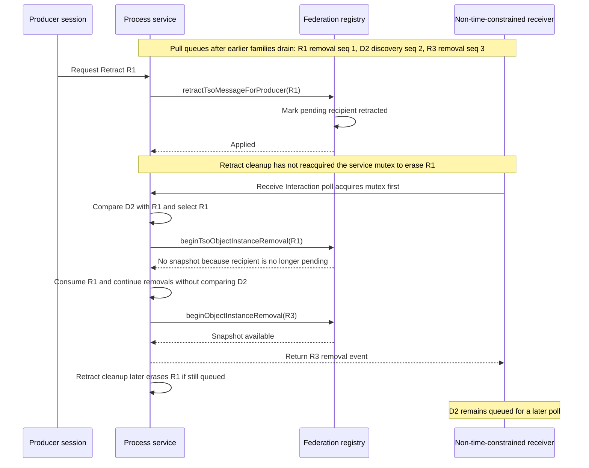

There is another reason the registry can return no removal snapshot: a forced
ConnectionLost removal is deferred while a pending timestamped object delivery
still needs the receiver's known-instance state
([deferral](../../cpp/src/internal/federation/federation_registry_object_instance_removal.cpp#L74)).
The poll still consumes that queue entry. The registry defines a helper to
release and replan deferred removals after the TSO boundary
([release helper](../../cpp/src/internal/federation/federation_registry_tso_delivery.cpp#L948)).
The embedded time-advance path calls it after completing a timestamped delivery
([embedded replan](../../cpp/src/internal/runtime/umbra_rti_ambassador_time_advance_dispatch.cpp#L748));
the configured-process TSO path completes its delivery without a corresponding
call
([process completion](../../cpp/src/internal/federation/process_federation_service_tso_payload_dispatch.cpp#L206)).
Do not transfer the embedded replan behavior to the process profile: whether a
deferred process removal is retried remains a source-derived implementation
gap, not a verified callback outcome.

The focused process retraction-gate case
([test case](../../cpp/tests/ieee1516_2025_connection_process_object_retraction_callback_gate_catch2.cpp#L319))
uses pushed receive-order events
([fixture option](../../cpp/tests/ieee1516_2025_connection_process_object_retraction_callback_gate_catch2.cpp#L101))
and verifies that a retracted removal is suppressed across callback re-enable.
It does not exercise the polling deques or the cleanup race above. The MOM
resign/rejoin case
([test case](../../cpp/tests/ieee1516_2025_connection_process_mom_resign_removal_order_catch2.cpp#L38))
waits for the old removal before rejoining, and the public Delete Object
Instance process case
([test case](../../cpp/tests/ieee1516_2025_connection_delete_object_instance_catch2.cpp#L457))
does not arrange competing queue heads. The interleaving is therefore
source-derived, not test-observed, and not a conformance finding.

The focused [MOM resign/rejoin case](../../cpp/tests/ieee1516_2025_connection_process_mom_resign_removal_order_catch2.cpp#L38)
records removal before rejoined discovery and reflection, but it explicitly
waits for the old removal before the rejoin; the two queue heads do not compete
in one poll. The public [Delete Object Instance process case](../../cpp/tests/ieee1516_2025_connection_delete_object_instance_catch2.cpp#L457)
polls discovery before issuing deletion, then checks removal identity, producer,
and tag. It also does not exercise competing queue heads or stale-removal
skipping.

### Server member-exit effects and local ConnectionLost callback

Federation member-exit notifications to other members enter through a separate
producer path.
The Lifecycle guide's [active Save/Restore member-exit flow](HLA-2025-FEDERATION-AND-FEDERATE-LIFECYCLE-FLOW-GUIDE.md#active-federation-save-and-restore-during-member-exit)
shows that the registry plans both notification families, while the configured
process [`dispatchConnectionLossResult`](../../cpp/src/internal/federation/process_federation_service_connection_loss.cpp#L19)
does not consume either `saveNotifications` or `restoreNotifications` in the
inspected source. Both process [Resign](../../cpp/src/internal/federation/process_federation_service_request_handlers.cpp#L136)
and [ConnectionLost](../../cpp/src/internal/federation/process_federation_service_connection_loss.cpp#L170)
call that dispatcher. The ordinary Save and Restore event queues and callback
bridges are separate service paths; their existence does not project these
member-exit vectors. This is a source-level dispatch omission, not a tested
runtime outcome or a conclusion about the standard. See the Save/Restore
guide's [active Save](HLA-2025-FEDERATION-SAVE-RESTORE-FLOW-GUIDE.md#member-exit-during-an-active-save)
and [active Restore](HLA-2025-FEDERATION-SAVE-RESTORE-FLOW-GUIDE.md#member-exit-during-an-active-restore)
sections for the registry plan, adapter differences, and test limits. The failed client's local
`connectionLost` callback is a separate producer; its retained client FIFO,
shared-dispatcher submission, and ordering limit are covered in the Callback
guide's [ConnectionLost map](HLA-2025-CALLBACK-AND-SERVICE-ORDERING-FLOW-GUIDE.md#connectionlost-producer-exception-containment-and-backend-specific-cleanup).

## Walk one interaction through the code

1. The sending ambassador calls public `sendInteraction`; the configured
   process client allocates a nonzero request ID and serializes the operation.
2. The service decodes and validates the request, computes recipient
   projections, and either queues each event or writes an event frame to that
   recipient's session, according to `pushReceiveOrderEvents`.
3. The service returns a response with the same operation and request ID. The
   sender's client validates that pair before returning the result. For the
   receive-order public `sendInteraction` overload, the RTIambassador result is
   `void`; the process result's recipient count and message identity are private.
4. On the recipient side, event data can be read during another service
   exchange or by the explicit receive path. Pushed frames are validated as
   `kind=event`, `status=ok`, and `requestId=0`, then decoded into the pending
   FIFO. A polling response instead carries the receive result.
5. After a correlated exchange releases its transaction lock, pending pushed
   events are submitted to the callback bridge. The callback model decides
   whether submission invokes now or queues work for Evoke; it does not change
   the wire event's identity or order.

At the public API layer, `HLA_EVOKED` additionally gates user callback
invocation on `evokeCallback`/`evokeMultipleCallbacks`. The process callback
pump may use a receive request to admit available process events before the
shared dispatcher is asked to evoke. Do not mistake that pump for HLA logical
time advancement: receive-order callback admission has no logical timestamp.
The pre-pump, timed dispatch, and remaining pushed-frame path for
`evokeMultipleCallbacks` are shown in the [process callback guide](HLA-2025-CALLBACK-AND-SERVICE-ORDERING-FLOW-GUIDE.md#process-evoke-multiple-separates-event-admission-from-callback-draining).

The flowchart follows the ordinary `request` path with `dispatchCallbacks=true`
(the default). Internal callers that pass `false` can leave pushed events in
the client FIFO after the response; an enclosing operation must later drain
them. The entry node is intentionally narrower than “an exchange or callback
pump”: this particular demultiplexing loop reads frames while a correlated
request is awaiting its response.

There is an important failure edge after the response match. `request` first
validates the response operation and ID, decrements its request depth, and
releases the stream lock; it then submits buffered events before returning the
response object to the process-client service method. The event is removed
from the client's pending FIFO before it is submitted to the callback bridge.
If an `HLA_IMMEDIATE` callback throws while this thread is draining, the
already-matched wire response is not returned to that service method, and the
current event is not put back for retry. This says only that the private
response crossed the client boundary—not that its status was successful or
that the public RTI service returned normally. If another thread already owns
the immediate dispatcher, any callback exception unwinds that thread's active
call instead; see the callback/service-ordering guide's
[active-call boundary](HLA-2025-CALLBACK-AND-SERVICE-ORDERING-FLOW-GUIDE.md#which-public-call-is-active-when-the-callback-throws).

With `HLA_EVOKED`, the client FIFO event is submitted as a dispatcher task, so
the correlated request can return before application callback entry. If that
callback later throws, the dispatcher has already extracted the task: it is
consumed rather than retried, while later queued callback tasks remain. For a
timestamped event, the separate consequence is that the post-callback private
ACK is skipped and the coordinator keeps the recipient entry in transit; see
[section 3](#3-a-timestamped-process-delivery-stays-in-transit-through-callback-completion).
These are source-derived process details, not a shared 2010 rule or a
normative interpretation.

### Enable Time Constrained: service state and callback observation

This configured-process trace separates the service's logical-time role from
when the federate application observes `TimeConstrainedEnabled`. The 2025
process service first records a pending generation. When eligible, it commits
the constrained role in its service-side `FederateTimeState` before returning
the enabled time or sending the delayed event. Client callback scheduling is a
later boundary.

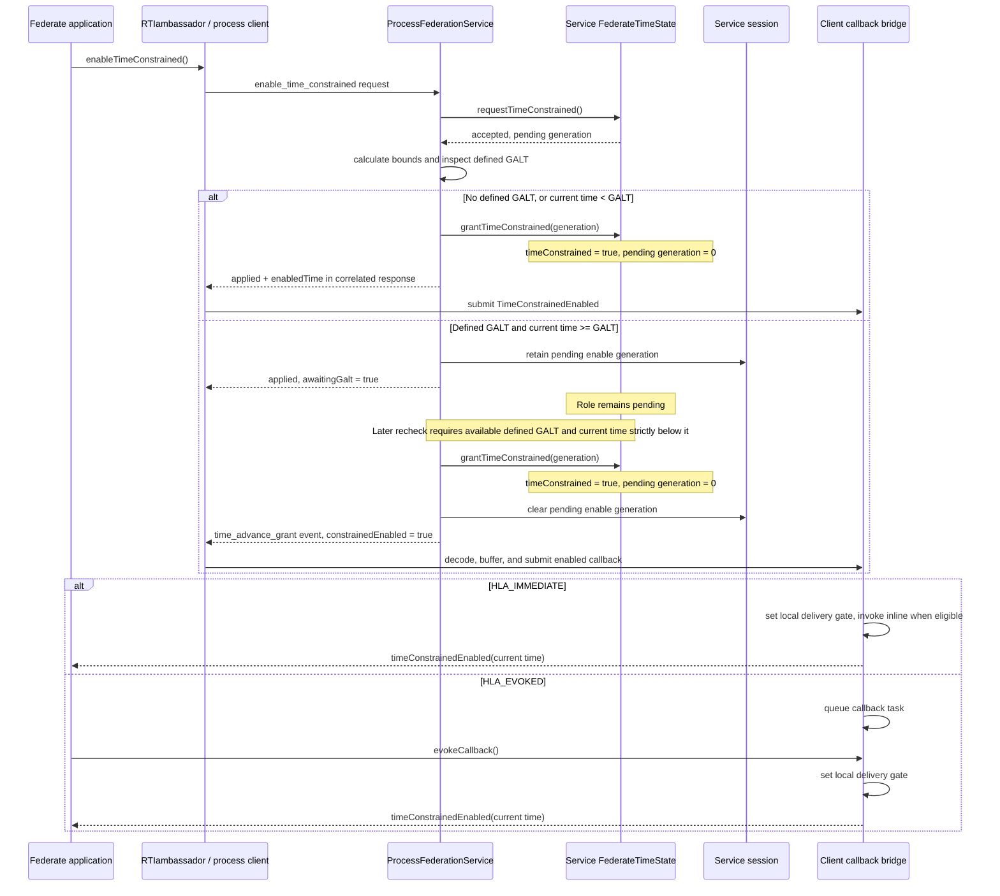

The service-side role transition and the public callback are separate events.
For an immediately eligible request, the service commits the role before its
response; for a GALT-blocked request, it commits only when a later service
recheck sees an available, defined GALT strictly greater than current time. The
client bridge's local receive-order delivery gate is set immediately before
callback invocation; that local gate is not the source of the service's logical
time role. `HLA_EVOKED` can therefore delay application observation after the
service has already activated the role. `HLA_IMMEDIATE` invokes submitted work
inline when the callback dispatcher permits it.

The service trace is in
[`handleEnableTimeConstrained`](../../cpp/src/internal/federation/process_federation_service_time_management.cpp#L513)
and the delayed eligibility/send path is in
[`dispatchEligibleTimeConstrainedEnables`](../../cpp/src/internal/federation/process_federation_service_notifications.cpp#L45).
[`FederateTimeState::grantTimeConstrained`](../../cpp/src/internal/time/federate_time_state.cpp#L711)
sets the service-side role and clears the pending generation. On the client,
the [time-advance event decoder](../../cpp/src/internal/federation/process_federation_client.cpp#L500)
turns `constrainedEnabled` into pending callback work, and the
[callback bridge](../../cpp/src/internal/federation/process_federation_callback_bridge.cpp#L2296)
sets its delivery gate immediately before invoking the public callback.

The focused public-endpoint [HLA_IMMEDIATE case](../../cpp/tests/ieee1516_2025_connection_process_asynchronous_delivery_catch2.cpp#L75)
checks that the callback has run after Enable Time Constrained returns. The
[HLA_EVOKED case](../../cpp/tests/ieee1516_2025_connection_process_asynchronous_delivery_evoked_catch2.cpp#L76)
checks it after a later service exchange and `evokeCallback`. These controlled
process-server cases exercise the client and callback route; they do not execute
the production service's GALT-blocked eligibility path. The embedded
[GALT-boundary case](../../cpp/tests/available_time_advance_inclusive_galt_catch2.cpp#L1028)
is evidence for that embedded scenario only. Do not infer process/embedded
parity from it. This section describes current Umbra code and test scope, not a
normative interpretation of IEEE 1516.1-2025.

The related configured-process Enable Time Regulation path can include an
implicit TARA and deliver queued TSO before `TimeRegulationEnabled`; see the
[Time Management flow](HLA-2025-TIME-MANAGEMENT-GUIDE.md#configured-process-enable-time-regulation-can-include-an-implicit-tara).

## 3. A timestamped process delivery stays in transit through callback completion

This is the process-specific seam between TSO delivery and the callback
boundary. The sequence begins **after** time management has admitted a live
timestamped recipient delivery. It does not repeat the grant-eligibility,
GALT/LITS, or retraction state machines in the [time-management
guide](HLA-2025-TIME-MANAGEMENT-GUIDE.md) and [TSO-retraction
guide](HLA-2025-TSO-RETRACTION-FLOW-GUIDE.md).
It focuses on the pushed frame being consumed while a correlated client request
is active; a direct receive path converges on the same callback bridge but is
not drawn here. The diagram also omits the exception-report projection and
lifetime-admission gate described in the [callback/service-ordering
guide](HLA-2025-CALLBACK-AND-SERVICE-ORDERING-FLOW-GUIDE.md); it is not a
projection-state flow.

The service emits the event on the recipient's process session with
`requestId=0`, carrying the TSO `messageId` and timestamp. That recipient's
coordinator ledger remains `inTransit` until its completion acknowledgment.
The callback bridge places the acknowledgment behind the public callback:
`HLA_IMMEDIATE` runs the task inline when enabled, while `HLA_EVOKED` keeps it
queued until an evoke operation admits it. In either case the bridge's
completion handler runs after the callback task returns. If a retraction won
the race before callback start, the task suppresses user code and completes
the recipient delivery once instead.

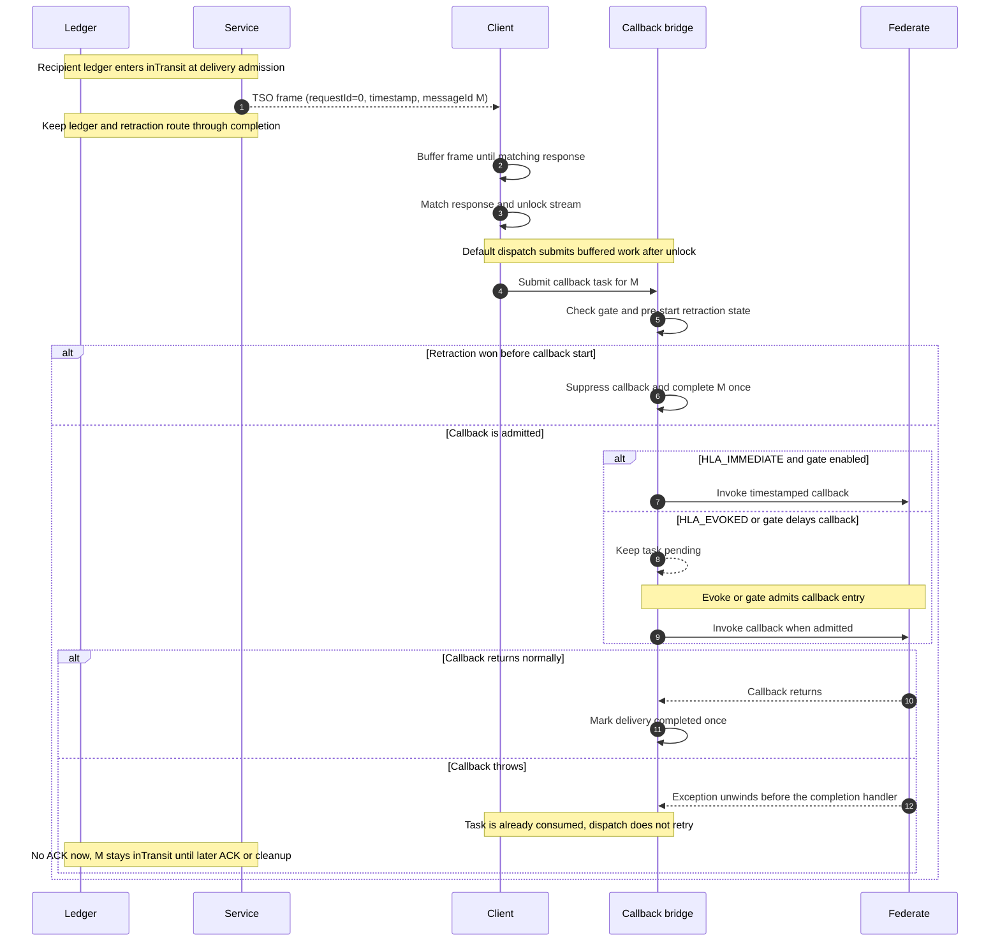

Only normal callback return or retraction suppression reaches the delivery
completion handler. A thrown callback consumes its task but skips the private
acknowledgement; the recipient ledger remains `inTransit`. The separate process
acknowledgement exchange is:

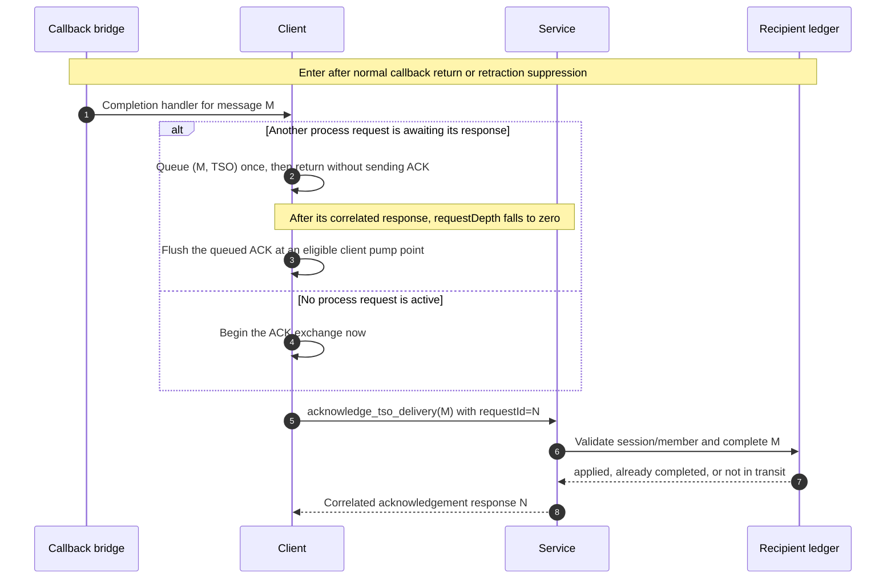

### FQR publishes FQG without waiting for the TSO completion ACK

The coordinator's configured-process FQR path submits the eligible TSO event
frame, leaves that recipient ledger `inTransit`, commits the calculated actual
and optimistic times, and publishes the FQG event. It does not wait for the
application callback or its private completion ACK before publishing FQG. The
process client receives the TSO event before the FQG event; callback admission
and the ACK are later client-side steps. The callback model changes how a thrown
Receive Interaction affects the remaining client event FIFO, so the two source-
derived exception branches are shown separately. Neither is a focused tested
interleaving.

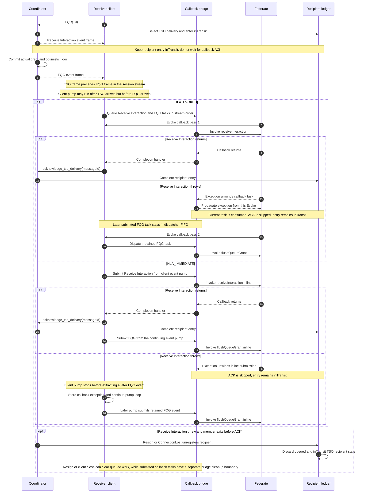

The [process grant dispatcher](../../cpp/src/internal/federation/process_federation_service_lifecycle.cpp#L467)
calls the [TSO frame sender](../../cpp/src/internal/federation/process_federation_service_tso_payload_dispatch.cpp#L160)
before it sends the FQG event at
[the grant publication site](../../cpp/src/internal/federation/process_federation_service_lifecycle.cpp#L496).
The TSO sender explicitly leaves the entry in transit for the later ACK. The
focused [configured-process GALT/FQR case](../../cpp/tests/ieee1516_2025_connection_process_flush_queue_galt_frontier_catch2.cpp#L459)
observes Receive Interaction then FQG across [two Evoke calls](../../cpp/tests/ieee1516_2025_connection_process_flush_queue_galt_frontier_catch2.cpp#L879);
its server handles the [TSO ACK independently](../../cpp/tests/ieee1516_2025_connection_process_flush_queue_galt_frontier_catch2.cpp#L745).
Source establishes that FQG publication does not wait for ACK; this case does
not assert wall-clock transport timing or a general HLA callback-order rule.

For both throwing branches, the bridge calls `deliverReceiveOrder` before its
completion/ACK code, so the exception skips the ACK and the ledger stays
`inTransit`. The queue boundary then differs by model. `HLA_EVOKED` first
submits events to the callback dispatcher; when Receive Interaction throws,
the current task has been removed, while a submitted FQG task remains in the
dispatcher FIFO for a later Evoke. If FQG has not yet been submitted, its event
remains in the client FIFO.

`HLA_IMMEDIATE` invokes each submitted task inline on the client dispatch
worker. The worker extracts the Receive Interaction event before submitting
it; a callback throw unwinds that submission and stops the current event-pump
pass, so a later FQG frame remains in `pendingEvents_` rather than entering the
callback dispatcher first. The immediate drainer clears its active-drainer
election while preserving any dispatcher backlog. The client dispatch loop
catches and stores the callback exception, then continues pumping pending
events, allowing FQG to be submitted and invoked on a later pass. The stored
exception is rethrown at the start of a later service request, so its
observation by the caller is not ordered with FQG callback entry. In either
model, FQG remains independent of the missing TSO ACK in the inspected
connected path. This is source-derived continuation, not a recovery or HLA
callback-order guarantee; no focused public process test throws from
`receiveInteraction` during FQR.

See the [bridge post-callback acknowledgement](../../cpp/src/internal/federation/process_federation_callback_bridge.cpp#L1471),
[immediate-drainer exception cleanup](../../cpp/src/internal/callbacks/callback_dispatcher.cpp#L279),
[client event-FIFO extraction](../../cpp/src/internal/federation/process_federation_client_callback_dispatch.cpp#L302),
[FQG event buffering](../../cpp/src/internal/federation/process_federation_client.cpp#L513),
[dispatch-loop exception capture and continuation](../../cpp/src/internal/federation/process_federation_client.cpp#L739),
and [later service-request exception rethrow](../../cpp/src/internal/federation/process_federation_client.cpp#L551).

The `inTransit` ledger is also bounded by recipient membership. A successful
voluntary Resign or detected `ConnectionLost` unregisters the member; the time
coordinator's unregister path calls `discardTsoRecipient`, removing that
recipient's queued, in-transit, delivered, and retired TSO entries. This is
membership cleanup, not a delayed callback ACK. The configured-process RTI
ambassador constructs the process client without a forced-resignation handler,
and the client's pushed-event switch has no forced-resignation operation. This
guide therefore does not infer that a forced event clears client callback
queues. Successful voluntary Resign clears its event FIFO and asks the bridge
to discard pending callback tasks; client close clears the FIFO and deferred
ACKs, then closes the bridge. Depending on which queue currently holds FQG,
voluntary Resign or close can discard that callback. None of these paths
implies callback replay or makes callback delivery the cause of server ledger
cleanup. See the
[2025 lifecycle guide's separate Resign and ConnectionLost paths](HLA-2025-FEDERATION-AND-FEDERATE-LIFECYCLE-FLOW-GUIDE.md#voluntary-resign-and-forced-connectionlost-use-different-entry-contracts),
[registry member-removal transition](../../cpp/src/internal/federation/federation_registry_resign_lifecycle.cpp#L1102),
[recipient TSO discard](../../cpp/src/internal/time/federation_time_coordinator.cpp#L622),
[configured-process client construction](../../cpp/src/internal/runtime/umbra_rti_ambassador_connect_services.cpp#L219) with its optional handler default [left empty](../../cpp/src/internal/federation/process_federation_client.hpp#L66), and the [pushed-event switch](../../cpp/src/internal/federation/process_federation_client.cpp#L463) with its [unknown-event rejection](../../cpp/src/internal/federation/process_federation_client.cpp#L541),
[successful client Resign event cleanup](../../cpp/src/internal/federation/process_federation_client_federation_management.cpp#L166), [bridge callback discard after Resign](../../cpp/src/internal/federation/process_federation_client_federation_management.cpp#L173),
and [client event queue cleanup](https://github.com/sheepfling/umbra/blob/c9c5a9e410539b039cd8bba35b53d0ef2b24d180/cpp/src/internal/federation/process_federation_client_callback_dispatch.cpp#L638)
plus [deferred ACK queue cleanup](https://github.com/sheepfling/umbra/blob/c9c5a9e410539b039cd8bba35b53d0ef2b24d180/cpp/src/internal/federation/process_federation_client_callback_dispatch.cpp#L640).

This is recipient-side cleanup: it removes TSO state addressed to the member
that left. When a time-regulating **producer** is lost, messages addressed to
surviving recipients follow a different cutoff path. The lifecycle guide traces
the embedded registry's last-granted-time rule and focused tests; it explicitly
does not establish configured-process TSO-cutoff parity. See [the lost-regulator
cutoff explanation](HLA-2025-FEDERATION-AND-FEDERATE-LIFECYCLE-FLOW-GUIDE.md#a-lost-regulators-tso-cutoff-is-a-narrow-exception).

No focused test combines an FQR callback throw with Resign, forced
`ConnectionLost`, or client close. The cleanup description is source-derived;
the lifecycle guide supplies the broader evidence and edition boundary.

### A completion ACK waits only for an active process request

`requestDepth_` tracks a process transport request awaiting its correlated
response; it does not measure the full lifetime of a public C++ service call.
When `request()` receives a response, it drops that depth and unlocks the
exchange before dispatching buffered pushed events. An enabled
`HLA_IMMEDIATE` callback completed during that dispatch can therefore start
its ACK exchange before the enclosing public method has returned. A completion
that occurs while another request is still awaiting a response instead queues
the TSO message identity once. Queued acknowledgments are flushed after the
request response/event dispatch, by the client dispatch loop when request and
callback-suppression depths permit, or before `evokeOne`/`evokeMultiple`.

The focused public process fan-out case uses `HLA_EVOKED`. Its server waits
for each timestamp-5 TSO ACK before accepting that receiver's later TAR(7),
after the test has evoked the timestamp-5 reflection and grant. This is one
fixture sequence; it does not force the `requestDepth_ != 0` queue path or
establish a universal order between ACK transport and a public service return.
The synthetic bridge test does not instantiate the client queue. I found no
focused test that deliberately completes a timestamped attribute callback
while a process request is awaiting its response. See the [client ACK gate and
queue](../../cpp/src/internal/federation/process_federation_client.cpp#L793),
the [response-depth release](../../cpp/src/internal/federation/process_federation_client.cpp#L610),
the [post-response event-pump flush](../../cpp/src/internal/federation/process_federation_client.cpp#L622),
the [background dispatch-loop flush](https://github.com/sheepfling/umbra/blob/c9c5a9e410539b039cd8bba35b53d0ef2b24d180/cpp/src/internal/federation/process_federation_client.cpp#L737),
and the [pre-Evoke flush](../../cpp/src/internal/federation/process_federation_client_callback_dispatch.cpp#L571).
The [public fan-out test](../../cpp/tests/ieee1516_2025_connection_process_tso_attribute_retraction_fanout_catch2.cpp#L460)
serves the timestamp-5 ACK before its receiver's [later TAR(7)](../../cpp/tests/ieee1516_2025_connection_process_tso_attribute_retraction_fanout_catch2.cpp#L1009).

The two decisions are separate: `requestDepth_` determines whether completion
can start an ACK exchange immediately, while the client's later flush points
determine when an already queued ACK can be sent.

```mermaid
flowchart TD
    Complete["TSO callback completion requests an ACK"] --> Active{"Another process request is awaiting its response?"}
    Active -->|Yes| Queue["Deduplicate and queue the message ID"]
    Active -->|No| Joined{"Session and joined recipient identity available?"}
    Joined -->|No| Skip["Return without sending an ACK request"]
    Joined -->|Yes| SendNow["Start acknowledge_tso_delivery request"]
    Queue --> Flush{"A queued-ACK flush point runs?"}
    Flush -->|After correlated response and event dispatch| Response["Request depth is zero; dispatch buffered events, then flush"]
    Flush -->|Background dispatch loop| Loop["Request and callback-suppression depths are zero"]
    Flush -->|Before Evoke| Evoke["Submit buffered pushes, then flush"]
    Response --> Depth{"Is requestDepth_ zero at the flush?"}
    Loop --> Depth
    Evoke --> Depth
    Depth -->|No| Defer["Leave queued IDs for another opportunity"]
    Depth -->|Yes| Drain["Process queue head in FIFO order while request depth stays zero"]
    Drain --> Joined
```

These flush points are implementation paths, not proof that the service has
accepted an ACK. On the response path, a callback exception during buffered
event dispatch skips that path's following flush; the client releases callback
suppression and rethrows, leaving the background dispatch loop as a separate
flush opportunity when both depths permit. The callback that throws does not
run its own post-callback completion hook. The shared deferred-ACK queue also
serves pushed receive-order attribute updates; this chart follows only the TSO
message-ID route. No focused test forces a queued TSO ACK through this
callback-exception path.

### Grouped timestamped attribute callbacks share one completion boundary

For a timestamped attribute update, the process service first projects the
recipient's eligible passels into callback events. It marks every event except
the last `more`, and marks the last event `final`. When this produces a
non-empty group accepted by the recipient callback gate, only the `final`
event is the message-level TSO acknowledgment boundary. Normal completion
acknowledges after that callback returns; earlier `more` callbacks do not
complete the message. If projection produces no events, or the callback gate
does not admit the group, the service completes the recipient delivery
directly instead of waiting for a callback event.

For an admitted non-empty group, callback exceptions affect only the current
callback task. A `more` exception consumes that task without crossing the ACK
boundary; later group events remain in the process event queue or callback
FIFO. A later dispatch can still submit and invoke `final`. If `final` returns
normally, it can complete the message even after an earlier `more` exception.
If `final` throws, its completion hook is skipped and the recipient remains
`inTransit` until a later completion or cleanup. The bridge has no group-failed
flag that cancels `final` after a `more` exception.

```mermaid
flowchart TD
    A["Admitted non-empty recipient group"] --> B["Submit ordered events: zero or more more, then final"]
    B --> C["Dispatch the next group event"]
    C --> D{"Current event?"}
    D -->|more| E["Invoke reflectAttributeValues for this passel"]
    E --> F{"Callback returns normally?"}
    F -->|yes| C
    F -->|throws| G["Consume this task; skip ACK; keep later events queued"]
    G --> C
    D -->|final| H["Invoke final callback, or suppress it at the final Retract boundary"]
    H --> I{"Final path completes without throwing?"}
    I -->|yes| J["Mark delivery acknowledged once; call completion handler"]
    I -->|throws| K["Skip completion; recipient stays inTransit"]
    J --> L{"Process request active?"}
    L -->|yes| M["Defer/deduplicate ACK until an eligible flush"]
    L -->|no| N["Send acknowledge_tso_delivery"]
```

This is source-derived process behavior. In `HLA_EVOKED`, a throwing `more`
task has already been removed from the callback FIFO and later tasks remain
queued. In `HLA_IMMEDIATE`, the dispatcher preserves its remaining FIFO after
an exception; events not yet submitted to the bridge remain in the client's
pending-event queue. A later eligible dispatch can therefore reach `final` in
either model. A `final` callback that throws does not call the completion
handler. If `final` instead reaches its retraction-suppression boundary, that
final-boundary path can complete the delivery.

Retraction has a related submission boundary. If it reaches the callback
bridge before the `final` event has been submitted, the bridge does not
acknowledge at Retract handling. In the focused `HLA_EVOKED` bridge case, it
first suppresses the queued `more` callback without acknowledgment, then
suppresses the `final` callback and acknowledges the message. Source also has
an earlier completion path when Retract arrives after the final event is
already submitted but before callback start; that timing branch is not covered
by this focused case. The case drives synthetic bridge events, so it does not
test service-side passel projection or transport ordering. These are Umbra
process details, not an HLA callback-order requirement.

After a `more` callback has started, `callbackStarted` remains set even if the
callback throws. A later legal Retract can therefore queue the public
`requestRetraction` callback, but Retract itself does not acknowledge this
grouped TSO message. If `final` is still pending, its own normal completion or
final-boundary suppression can acknowledge once; if `final` throws, the
message remains `inTransit`. An ACK reached from `final` can still be deferred
while a process request is active, as described above.

See the [service passel projection and group labels](../../cpp/src/internal/federation/process_federation_service_tso_delivery.cpp#L189),
the [bridge Retract state transition](../../cpp/src/internal/federation/process_federation_callback_bridge.cpp#L1579),
the [bridge final-group ACK predicate](../../cpp/src/internal/federation/process_federation_callback_bridge.cpp#L1660) and [normal-completion ACK](../../cpp/src/internal/federation/process_federation_callback_bridge.cpp#L1747),
the [client event-queue extraction](../../cpp/src/internal/federation/process_federation_client_callback_dispatch.cpp#L302),
the [callback dispatcher's exception behavior](../../cpp/src/internal/callbacks/callback_dispatcher.cpp#L279),
the [client ACK gate](../../cpp/src/internal/federation/process_federation_client.cpp#L793),
and the [focused internal bridge case](../../cpp/tests/process_federation_callback_bridge_catch2.cpp#L345).

The focused bridge case verifies normal `more` then `final` completion under
both callback models, plus the `HLA_EVOKED` Retract-before-final case. The
public process fan-out case verifies recipient-local TSO delivery and ACK
ordering. Neither exercises a throwing grouped callback, recovery of a later
`final` after a `more` exception, or the in-transit result after a `final`
exception; those branches are source-reviewed, not test-demonstrated.

Important boundaries:

- `messageId` is the TSO/retraction identity, `requestId` is only the private
  request/response correlation, and the timestamp is the HLA time value. The
  ACK is a private process-service operation, not an HLA service.
- A fan-out message has a separate in-transit completion for each recipient;
  one recipient's callback/ACK does not stand in for another's. The service
  accepts the ACK only from the matching joined recipient session and member.
- The diagram covers a live TSO frame and the post-submission callback race.
  When retraction suppresses delivery before a TSO frame reaches the recipient,
  there is no delivery callback or ACK frame; see the separate retraction
  guide and the pre-callback test below.
- The bridge also installs this completion hook for timestamped attribute
  updates, directed interactions, and qualifying object-removal callbacks.
  The directed coordinator-dispatch and retraction route has a separate
  [source-bounded comparison](HLA-2025-TSO-RETRACTION-FLOW-GUIDE.md#directed-timestamped-interaction-separate-dispatch-shared-retraction-seam).
  Immediate timestamped
  removals can retain a retraction identity but are not grant-boundary TSO
  queue entries and do not take this ACK path.
- If the timestamped public callback throws—including `receiveDirectedInteraction`
  for a directed event—the bridge has already marked its per-message
  `callbackStarted` flag but has not marked
  `deliveryAcknowledged`; the post-callback completion hook is skipped. The
  dispatcher has consumed the task, so neither the queued callback nor the
  private TSO ACK is retried. A later Request Retraction follows the
  callback-started branch; that callback is not a substitute for the missing
  TSO ACK. These are private process implementation states, not HLA state names.
  The public callback exception and active caller boundary are explained in
  the [callback/service-ordering guide](HLA-2025-CALLBACK-AND-SERVICE-ORDERING-FLOW-GUIDE.md#which-public-call-is-active-when-the-callback-throws);
  this process trace adds the private completion consequence only.
- The coordinator's remaining `inTransit` entry is included in time-bound and
  grant-frontier calculations, so it can constrain a recipient's bound or
  advancement. It blocks a timed-save readiness check when its timestamp is
  at or before the pending save time; this is not a claim about every save.
  See the [Save/Restore flow](HLA-2025-FEDERATION-SAVE-RESTORE-FLOW-GUIDE.md#save-flow-request-participant-work-and-the-commit-barrier)
  for the broader save-admission and participant-barrier sequence.
  Recipient unregister discards that recipient's queue state. These are
  source consequences only: no focused test throws from a public process TSO
  callback or verifies recovery/cleanup after that exception. For
  `HLA_EVOKED`, the same skipped ACK occurs when the task later throws through
  the recipient's Evoke call.
- The callback guide also distinguishes the recipient-side immediate
  request/pump from the sender's successful service response, and the later
  `HLA_EVOKED` call path. Do not duplicate that public exception flow here;
  this diagram isolates what is unique to this profile: the TSO completion
  hook is skipped, leaving the coordinator entry in transit until ACK or
  recipient cleanup.

### If the recipient later resigns or disconnects

A callback exception does not itself close the process client or resign its
federate. After the callback unwinds, the application may choose a separate
Resign operation; Disconnect is rejected while the ambassador remains joined,
so a successful Resign must come first. In the process path, successful Resign
unregisters the member from the coordinator, which discards that recipient's
queued, in-transit, and delivered TSO entries and re-evaluates pending grants.
The service clears that session's queued event buffers, and the client resets
its joined identity but keeps the transport and callback bridge until a later
Disconnect. Disconnect closes the local client and bridge; its service-side
`detach(session)` hook is a separate cleanup boundary.

Do not collapse that coordinator cleanup with the private retraction route.
The service's `handleResign` removes the message/recipient cache entries when
the departing federate is the message producer, but does not visibly prune a
departing receiver's session from every cached pushed-retraction recipient
list. The registry's retraction record filters departed members out of its
callback notifications, while the process service later drains its separate
cached recipient list when handling a producer Retract. The `detach(session)`
hook removes that session from those lists; `ProcessFederationClient::close`
also clears the local callback bridge's retraction state. Until the service
detach hook runs, the current source therefore appears capable of sending a
`request_retraction` frame to a still-connected session that has already
resigned. In the callback-throw case, the bridge has retained the message's
callback-started retraction state; `submitRequestRetraction` queues the direct
callback when that flag is set and does not itself check federation membership.
This completes a plausible source path, not proof that the frame is sent or
observed after Resign. It remains an unresolved process-profile source risk,
not a normative HLA rule or verified runtime outcome. The focused process TSO
tests do not cover callback-throw → receiver Resign → producer Retract, nor the
timing of service detach after public Disconnect.

## 4. Temporary process-session recovery

This section describes Umbra's configured-process transport. It is not a
normative HLA resumption service or a federation Save/Restore transition. The
client retries a replacement socket within its configured recovery window,
then resumes the existing private session. The service host must still hold
that session and enough in-memory message history; no focused case establishes
recovery after the host process itself restarts. The client starts its
`FED_TIMEOUT_RECONNECT` budget after it decides the endpoint is unavailable and
begins recovery. The host starts `RTI_TIMEOUT_PURGE` when it marks the session
inactive: either after the serving worker observes disconnection or when
`RTI_TIMEOUT_HEART` silence expires
(worker disconnect[^worktree-source],
host heartbeat check[^worktree-source],
purge deadline[^worktree-source]).
These timers have different triggers and can expire in either order. Recovery
requires the resume request to reach the same live host before its retained
session is purged. The focused cases cover resume and purge separately, not the
exact timing race between the client recovery budget and host retention.

The resume exchange uses the same session identity and sequence history from
before the break. The client sends its last received service-frame sequence
and the oldest outgoing sequence it still retains. The host validates the
session and whether its outgoing history can cover the client's missing
suffix, then returns the last client sequence it received. The client also
checks that it can replay its own missing suffix. Each side resends retained
service frames after the peer's receive point. If the session is invalid,
either retained history has a gap, or the recovery deadline expires, the
private transport session ends rather than silently starting a new federation
session. See the current-worktree `reconnectTransport` helper[^worktree-source],
the host resume handshake[^worktree-source],
current resume validation[^worktree-source] and
outgoing history replay[^worktree-source],
and the bounded message history[^worktree-source].

Sequence numbers cover every transport frame, but the history retains only HLA
service-message payloads, so control frames can create harmless gaps between
retained sequence numbers. The history type[^worktree-source]
retains unacknowledged service-message bytes and defaults to a 16 MiB limit.
An oversized service message or eviction of an unacknowledged message can make
a requested suffix unavailable (oversized-frame handling[^worktree-source],
byte-cap eviction[^worktree-source],
complete-suffix check[^worktree-source]);
the resume path rejects that suffix instead of replaying an incomplete prefix.
This is a private process-transport rule, not an HLA guarantee. The current worktree's bounded-history unit case[^worktree-source]
covers byte eviction, suffix replay, acknowledgement retirement, and incoming
duplicate/gap handling; the wraparound case[^worktree-source]
covers ordered replay across sequence wrap. Both are internal tests with no
normative requirement mapping and do not establish host-restart recovery.

```mermaid
sequenceDiagram
    autonumber
    participant App as HLA service caller
    participant Client as Process client
    participant Host as Same live service host
    participant Bridge as Callback bridge
    participant Fed as Federate application

    Note over Client,Host: Same session ID and in-memory histories<br/>Control frames may leave sequence gaps
    App->>Client: Begin service request Q
    Client->>Host: Sequenced request Q
    Host->>Host: Handle Q and retain its response and any pushed event frames
    Note over Client,Host: Socket breaks before all frames are observed
    Note over Host: Host purge timer starts when disconnect is observed or RTI_TIMEOUT_HEART silence expires
    Note over Client: Client reconnect budget starts when FED_TIMEOUT_RECONNECT recovery begins
    loop Retry transient socket failures until success or deadline
        Client->>Host: Resume request with session ID and receive history
        Host-->>Client: Resume status and last received client sequence
    end
    alt Resume accepted with a live session and complete service-message suffixes
        par Client to host
            Client->>Host: Replay retained requests not yet received
        and Host to client
            Host-->>Client: Replay retained responses and event frames
        end
        Host->>Host: Do not dispatch an already received request sequence again
        Client->>Client: Suppress duplicate sequence numbers
        Client->>Client: Match Q response, then release buffered event work
        Client->>Bridge: Submit event after the service exchange
        Bridge->>Fed: Deliver under the selected callback model
    else Host purge expires before a successful resume while client still retries
        Host->>Host: Remove host record, apply connectionLost, and detach on success
        Client->>Host: Later resume attempt
        Host-->>Client: Reject the purged session
        Client-->>App: Private transport failure path
    else Client recovery budget expires before host purge
        Client-->>App: Private transport failure path
        Note over Host: Retained session remains until the independent purge deadline
        Host->>Host: Purge inactive session and apply connectionLost, then detach on success
    else Session is invalid or a required service-message suffix is unavailable
        Client-->>App: Private transport failure path
    end
```

The event-buffering and request-correlation order is the same one described in
[From a stream frame to an official callback](#2-from-a-stream-frame-to-an-official-callback).
Recovery adds replay around that boundary: a request already handled by the
host must not apply twice, and an event frame recovered from host history must
not invoke its HLA callback twice. The tests below exercise those outcomes
through the private client and a live service host; they do not establish a
public-provider contract or delivery after host restart.

Keep the host's queued-event path separate from pushed-frame replay. With pushed
receive-order events disabled, the recovery test obtains a queued synchronization
announcement through an explicit poll after reconnect. With pushed events
enabled, another test exercises sequence-history replay and duplicate
suppression for the announcement and completion frames. These are two ways the
process profile carries events; successful socket recovery alone does not mean
every event was a pushed frame.

This resume path preserves an existing live-host transport session; it does not
read or apply a federation Save image. The [Save/Restore guide's comparison of
transport resume and Federation Restore](HLA-2025-FEDERATION-SAVE-RESTORE-FLOW-GUIDE.md#transport-resume-and-federation-restore-have-different-owners)
also shows the reverse boundary: a durable image can carry supported registry
state and selected queue records, but does not recreate the old service
session, transport sequence history, client FIFO, or callback-bridge tasks.
Neither guide's current test evidence combines host-process restart with image
Restore and continuation of the old client session.

When this recovery path ends terminally, the private transport failure reaches
the local ambassador and may produce the public `connectionLost` callback. The
host's registry transition still follows its separate session-purge or
terminal-resume path; neither callback submission nor callback delivery proves
that server-side membership has already been removed. See the [Lifecycle
guide's host-retention and local-callback boundary](HLA-2025-FEDERATION-AND-FEDERATE-LIFECYCLE-FLOW-GUIDE.md#process-endpoint-host-retention-and-the-local-callback-boundary)
for the two paths and their evidence limits.

## Evidence map and limits

### Source path

- [`ProcessTransportSession::request` and service dispatcher](../../cpp/src/internal/federation/process_transport_session.cpp#L50)
  validate nonzero request IDs and require matching response operation/identity.
- [`ProcessFederationClient::bufferEvent`](../../cpp/src/internal/federation/process_federation_client.cpp#L451)
  validates unsolicited event frames; [`request` response correlation](../../cpp/src/internal/federation/process_federation_client.cpp#L599) and [request-owned event drain](../../cpp/src/internal/federation/process_federation_client.cpp#L622)
  buffers recognized event families until the active response matches, then dispatches buffered events
  before returning that response.
  [`dispatchPendingPushedEvents`](../../cpp/src/internal/federation/process_federation_client_callback_dispatch.cpp#L302)
  removes each event before bridge submission; an escaping callback exception therefore prevents the matched response
  from being returned and does not requeue the current event. The request catch releases bookkeeping and rethrows
  without closing the client session ([request cleanup and rethrow](../../cpp/src/internal/federation/process_federation_client.cpp#L641)).
- [`receivePendingEvent`](../../cpp/src/internal/federation/process_federation_client_event_templates.hpp#L11) consumes
  already-buffered events first and otherwise reads synchronously from the session stream;
  [`submitReceiveOrder`](../../cpp/src/internal/federation/process_federation_callback_bridge.hpp#L76) documents the
  immediate-inline versus evoked-queue distinction.
- [`ProcessFederationServiceOptions`](../../cpp/src/internal/federation/process_federation_service.hpp#L79) sets polling
  as the private-service default.
  [`handleSendInteraction`](../../cpp/src/internal/federation/process_federation_service_interaction_send.cpp#L75) emits
  event frames in push mode or appends to the polling queue before returning the sender result
  ([push branch](../../cpp/src/internal/federation/process_federation_service_interaction_send.cpp#L595);
  [poll-queue append](../../cpp/src/internal/federation/process_federation_service_interaction_send.cpp#L604));
  [`handleReceiveInteraction`](../../cpp/src/internal/federation/process_federation_service_receive.cpp#L73) consumes
  per-session queued work for the explicit receive path. `SessionState` stores
  distinct family queues ([interaction](../../cpp/src/internal/federation/process_federation_service.hpp#L188),
  [synchronization announcement](../../cpp/src/internal/federation/process_federation_service.hpp#L235),
  [federation-synchronized](../../cpp/src/internal/federation/process_federation_service.hpp#L237),
  [save](../../cpp/src/internal/federation/process_federation_service.hpp#L238), and
  [restore](../../cpp/src/internal/federation/process_federation_service.hpp#L239)); the
  [`sessions_` map](../../cpp/src/internal/federation/process_federation_service.hpp#L814) keys that state by
  process transport session.
- [`handleReceiveInteraction`](../../cpp/src/internal/federation/process_federation_service_receive.cpp#L99) checks
  synchronization-announcement, federation-synchronized, save, restore, and interaction-event queues in that order
  before later families.
  Synchronization, federation-synchronized, save, and restore notifications use separate push/poll branches in the
  [announcement](../../cpp/src/internal/federation/process_federation_service_notifications.cpp#L313),
  [federation-synchronized](../../cpp/src/internal/federation/process_federation_service_notifications.cpp#L387),
  [save](../../cpp/src/internal/federation/process_federation_service_notifications.cpp#L450), and
  [restore](../../cpp/src/internal/federation/process_federation_service_notifications.cpp#L519) paths. The
  client's [`bufferEvent`](../../cpp/src/internal/federation/process_federation_client.cpp#L451) appends pushed events
  as frames are read, and
  [`dispatchPendingPushedEvents`](../../cpp/src/internal/federation/process_federation_client_callback_dispatch.cpp#L298)
  drains that FIFO. This is a process-profile transport detail, not an HLA-wide ordering rule.
- The process-session [`discovery and removal queues plus their shared sequence`](../../cpp/src/internal/federation/process_federation_service.hpp#L207)
  are populated by the [discovery producer](../../cpp/src/internal/federation/process_federation_service_object_discovery.cpp#L189)
  and [removal producer](../../cpp/src/internal/federation/process_federation_service_object_instance_removal.cpp#L109).
  [`handleReceiveInteraction`](../../cpp/src/internal/federation/process_federation_service_receive.cpp#L116)
  compares their queue fronts; its [removal branch](../../cpp/src/internal/federation/process_federation_service_receive.cpp#L129)
  asks the registry for the receiver-side removal snapshot and skips entries without one.
  One reachable null-snapshot path is a timestamped removal retracted before a non-time-constrained recipient polls;
  the registry state changes before the service removes the queued item. Another is the forced-loss TSO deferral
  ([registry branch](../../cpp/src/internal/federation/federation_registry_object_instance_removal.cpp#L74)); its
  the embedded time-advance path calls the registry release helper after TSO completion, but the configured-process
  TSO completion path has no corresponding call. Do not transfer embedded replan behavior to the process profile;
  the deferred process callback remains unverified.
  The receiver queues are cleared on successful Resign
  ([session cleanup](../../cpp/src/internal/federation/process_federation_service_lifecycle.cpp#L80)).
  A timestamped removal for a non-time-constrained recipient carries a retraction ID into the poll queue
  ([routing](../../cpp/src/internal/federation/process_federation_service_object_instance_deletion.cpp#L147)).
  `handleRetract` updates the registry before it later erases that queue entry
  ([retraction](../../cpp/src/internal/federation/process_federation_service_retraction.cpp#L128),
  [erase](../../cpp/src/internal/federation/process_federation_service_retraction.cpp#L174)); a concurrent poll can consume the now-stale entry and continue to a later removal without rechecking discovery. The three-event interleaving is source-derived and has no focused polling test.
- The public
  [untimed Update Attribute Values adapter](../../cpp/src/internal/runtime/umbra_rti_ambassador_attribute_update_services.cpp#L61)
  calls the private
  [`ProcessFederationClient::updateAttributeValues`](../../cpp/src/internal/federation/process_federation_client_value_services.cpp#L108);
  its `ProcessFederationUpdateAttributeValuesResult` is not the public `void` result.
  [`handleUpdateAttributeValues`](../../cpp/src/internal/federation/process_federation_service_attribute_value_updates.cpp#L14)
  delegates recipient selection to the registry plan at
  [the planning call](../../cpp/src/internal/federation/process_federation_service_attribute_value_updates.cpp#L46). It copies accepted value bytes into owned `VariableLengthData` at
  [the value snapshot](../../cpp/src/internal/federation/process_federation_service_attribute_value_updates.cpp#L184), records the update at
  [the successful registry write](../../cpp/src/internal/federation/process_federation_service_attribute_value_updates.cpp#L192), and routes work into the push or poll queues at
  [the push branch](../../cpp/src/internal/federation/process_federation_service_attribute_value_updates.cpp#L320) or [poll queue](../../cpp/src/internal/federation/process_federation_service_attribute_value_updates.cpp#L340). Push mode emits event frames at
  [the event send](../../cpp/src/internal/federation/process_federation_service_attribute_value_updates.cpp#L356) before the private result; the service returns that result at
  [the response site](../../cpp/src/internal/federation/process_federation_service_attribute_value_updates.cpp#L399).
- For polling,
  [`pumpProcessReceiveOrder`](../../cpp/src/internal/runtime/umbra_rti_ambassador_callback_control_services.cpp#L147)
  calls the process client's `receiveInteraction` operation at
  [the explicit receive site](../../cpp/src/internal/runtime/umbra_rti_ambassador_callback_control_services.cpp#L269)
  when it needs more work.
  [`handleReceiveInteraction`](../../cpp/src/internal/federation/process_federation_service_receive.cpp#L239) returns a
  reflection in `attributeEvent`; the adjacent slot is documented in
  [`ProcessFederationReceiveInteractionResult`](../../cpp/src/internal/federation/process_federation_service_protocol.hpp#L1664),
  then buffered by
  [`ProcessFederationClient::bufferReceiveResult`](../../cpp/src/internal/federation/process_federation_client.cpp#L389)
  and submitted through
  [`dispatchPendingPushedEvents`](../../cpp/src/internal/federation/process_federation_client_callback_dispatch.cpp#L298)
  to [`submitAttributeUpdate`](../../cpp/src/internal/federation/process_federation_callback_bridge.cpp#L1624). The push
  pushed event uses `receive_attribute_update` at the [frame operation](../../cpp/src/internal/federation/process_federation_service_attribute_value_updates.cpp#L361); the public pump's polling response remains `receive_interaction`.
- [`dispatchPendingPushedEvents`](../../cpp/src/internal/federation/process_federation_client_callback_dispatch.cpp#L298)
  drains after releasing the exchange lock; [`evokeOne`](../../cpp/src/internal/federation/process_federation_client_callback_dispatch.cpp#L567) and [`evokeMultiple`](../../cpp/src/internal/federation/process_federation_client_callback_dispatch.cpp#L575) drain events before entering the callback bridge.
- [`dispatchTsoInteractionPayloads`](../../cpp/src/internal/federation/process_federation_service_tso_payload_dispatch.cpp#L12)
  takes the recipient's admitted typed deliveries from the registry.
  The attribute path [sends its event frame](../../cpp/src/internal/federation/process_federation_service_tso_delivery.cpp#L233),
  [retains the retraction recipient](../../cpp/src/internal/federation/process_federation_service_tso_delivery.cpp#L246),
  and leaves the coordinator entry in transit until callback-boundary acknowledgement
  ([source note](../../cpp/src/internal/federation/process_federation_service_tso_delivery.cpp#L249)).
  The interaction path follows the same sequence at its [frame send](../../cpp/src/internal/federation/process_federation_service_tso_delivery.cpp#L381),
  [retraction-recipient registration](../../cpp/src/internal/federation/process_federation_service_tso_delivery.cpp#L393),
  and [in-transit boundary](../../cpp/src/internal/federation/process_federation_service_tso_delivery.cpp#L396).
- The [`request` default](../../cpp/src/internal/federation/process_federation_client.hpp#L1012) enables post-response
  callback dispatch.
  [`ProcessFederationCallbackBridge::submitReceiveOrder`](../../cpp/src/internal/federation/process_federation_callback_bridge.cpp#L1346),
  [`submitAttributeUpdate`](../../cpp/src/internal/federation/process_federation_callback_bridge.cpp#L1624), and
  [`submitObjectInstanceRemoval`](../../cpp/src/internal/federation/process_federation_callback_bridge.cpp#L1941) place
  TSO completion after callback return, with pre-start retraction suppression handled in the same task. The client
  attaches the completion hook in
  [`process_federation_client_callback_dispatch.cpp`](../../cpp/src/internal/federation/process_federation_client_callback_dispatch.cpp#L550).
- [`ProcessFederationClient::acknowledgeTsoDelivery`](../../cpp/src/internal/federation/process_federation_client.cpp#L783)
  rejects identity zero, defers and deduplicates while a request is active, and sends the private ACK;
  [`flushDeferredTsoDeliveryAcknowledgements`](../../cpp/src/internal/federation/process_federation_client.cpp#L883)
  drains it after the exchange.
  `handleAcknowledgeTsoDelivery` checks the session/member identity at
  [the service boundary](../../cpp/src/internal/federation/process_federation_service.cpp#L160)
  and completes the coordinator ledger through `completeTsoDeliveryFor` at
  [the registry call](../../cpp/src/internal/federation/process_federation_service.cpp#L171).
- [`CallbackSession::invoke`](../../cpp/src/internal/callbacks/callback_session.cpp#L54) finishes invocation bookkeeping
  and rethrows user exceptions;
  [`CallbackDispatcher::evokeOne`](../../cpp/src/internal/callbacks/callback_dispatcher.cpp#L156) extracts a task before
  invoking it, while the immediate drainer clears its election and rethrows in its
  [exception cleanup](https://github.com/sheepfling/umbra/blob/c9c5a9e410539b039cd8bba35b53d0ef2b24d180/cpp/src/internal/callbacks/callback_dispatcher.cpp#L279). The bridge's completion hook is after
  `session->invoke`, so a throw skips it.
- The retained coordinator entry is source-visible to
  [time-bound calculation](../../cpp/src/internal/time/federation_time_bounds.cpp#L116),
  [grant-frontier calculation](../../cpp/src/internal/time/federation_time_grant_policy.cpp#L196), and
  [save readiness](../../cpp/src/internal/federation/federation_registry_save_control.cpp#L555);
  [recipient unregister](../../cpp/src/internal/time/federation_time_coordinator.cpp#L115) discards its
  queued/in-transit/delivered TSO state.
- [Process Resign](../../cpp/src/internal/federation/process_federation_service_request_handlers.cpp#L136) unregisters
  the member, reevaluates grants, resets session membership, and clears its event queues; the
  [coordinator unregister](../../cpp/src/internal/time/federation_time_coordinator.cpp#L115) discards recipient TSO
  phases. The public [`RTIambassador::disconnect`](../../cpp/src/internal/runtime/umbra_rti_ambassador.cpp#L2525)
  rejects a joined ambassador, and the process branch of
  [Resign](../../cpp/src/internal/runtime/umbra_rti_ambassador_federation_lifecycle.cpp#L801) completes the lifecycle transition
  while leaving the process client connected for a later Disconnect.
  [`ProcessFederationClient::resignFederationExecution`](../../cpp/src/internal/federation/process_federation_client_federation_management.cpp#L166)
  keeps its callback bridge while clearing pending callback work;
  [`close`](../../cpp/src/internal/federation/process_federation_client_callback_dispatch.cpp#L647) closes the bridge after
  transport shutdown; the bridge
  [clears local retraction state at the pinned source revision](https://github.com/sheepfling/umbra/blob/c9c5a9e410539b039cd8bba35b53d0ef2b24d180/cpp/src/internal/federation/process_federation_callback_bridge.cpp#L2424).
- [Process service detach](../../cpp/src/internal/federation/process_federation_service.cpp#L117) removes the detached
  session from cached pushed-retraction recipient lists. Successful Resign calls
  [`clearJoinedFederateSessionState`](../../cpp/src/internal/federation/process_federation_service_lifecycle.cpp#L40), which removes that same session from those lists and drops producer-owned message IDs in
  [the producer cleanup loop](../../cpp/src/internal/federation/process_federation_service_lifecycle.cpp#L53). The separate
  [`handleRetract`](../../cpp/src/internal/federation/process_federation_service_retraction.cpp#L77)
  removes the cached recipient list and sends each `request_retraction` event at
  [the send site](../../cpp/src/internal/federation/process_federation_service_retraction.cpp#L204).
  The [registry retraction record](../../cpp/src/internal/federation/federation_registry_tso_delivery.cpp#L216)
  adds its callback notification at [the result insertion](../../cpp/src/internal/federation/federation_registry_tso_delivery.cpp#L219)
  only for current members. The client bridge's
  [`submitRequestRetraction`](../../cpp/src/internal/federation/process_federation_callback_bridge.cpp#L1583) uses per-message `callbackStarted` and `recipientResigned` state; its Resign cleanup marks that state and discards queued tasks at
  [`discardPendingCallbacks`](../../cpp/src/internal/federation/process_federation_callback_bridge.cpp#L1802). I found no focused configured-process test for a Request Retraction frame racing with receiver Resign.

- [`pumpProcessReceiveOrder`](../../cpp/src/internal/runtime/umbra_rti_ambassador_callback_control_services.cpp#L147)
  drains buffered events and uses the explicit receive operation when the process callback pump needs more work.

### Focused tests

- [`Private process service dispatch correlates federation operations over framed data`](../../cpp/tests/process_transport_service_catch2.cpp#L25)
  sends Create, Join, and Send Interaction exchanges with distinct request IDs and checks each response's
  operation, request ID, status, and payload. This is framing-level correlation evidence; it does not test the
  HLA retraction handle or logical-time mapping.
- [`Private registry-bound service exchanges federation traffic across independently launched processes`](https://github.com/sheepfling/umbra/blob/c9c5a9e410539b039cd8bba35b53d0ef2b24d180/cpp/tests/process_federation_service_process_catch2.cpp#L39)
  launches server, sender, and receiver processes. Its receiver probe enables pushed events and checks projection
  through the official `FederateAmbassador::receiveInteraction` bridge
  (receiver callback probe[^worktree-source],
  official callback projection checks[^worktree-source]). This test uses the private
  `ProcessFederationClient` seam, not the public `RTIambassador`.
- [`RTIambassador routes public Send Interaction through a configured process endpoint`](../../cpp/tests/ieee1516_2025_connection_send_interaction_catch2.cpp#L457)
  checks the public send path and an explicit receiver poll in both callback-model sections. Its raw receiver verifies
  one parameter handle, literal value bytes, and literal tag bytes at
  [the decoded result assertions](../../cpp/tests/ieee1516_2025_connection_send_interaction_catch2.cpp#L661); it does
  not test a DataElement-to-callback round trip. It uses the service's default polling mode, so it is not evidence for
  pushed callback delivery.
- [`RTIambassador routes public Update Attribute Values through a configured process endpoint`](../../cpp/tests/ieee1516_2025_connection_update_attribute_values_catch2.cpp#L457)
  calls the untimed service successfully in both callback-model sections. It is positive-path evidence only and does not
  test the public exception for a remote unknown instance, undefined attribute, or unowned attribute.
- [`RTIambassador reflects an update only once for overlapping process subscriptions`](../../cpp/tests/ieee1516_2025_connection_update_attribute_values_reflect_catch2.cpp#L457)
  subscribes to one inherited attribute through parent and child object classes, sends one untimestamped update, and
  observes one reflection in both callback-model sections. The
  [fixture setup](../../cpp/tests/ieee1516_2025_connection_update_attribute_values_reflect_catch2.cpp#L545) enables
  pushed process events for HLA_IMMEDIATE and uses polling for HLA_EVOKED; that pairing is case setup, not a general
  callback-model/transport rule. It asserts one reflection at
  [one-reflection count assertion](../../cpp/tests/ieee1516_2025_connection_update_attribute_values_reflect_catch2.cpp#L840) and checks
  private `recipientCount == 1` at
  [private recipient-count assertion](../../cpp/tests/ieee1516_2025_connection_update_attribute_values_reflect_catch2.cpp#L896). It does not
  cover passive three-role eligibility, DSE, regional projection, or embedded/process parity.
- [`RTIambassador receives a process interaction through the official Evoke callback surface`](../../cpp/tests/ieee1516_2025_connection_receive_evoke_catch2.cpp#L457)
  and
  [`RTIambassador preserves a timestamped process interaction through the official Evoke callback surface`](../../cpp/tests/ieee1516_2025_connection_timestamped_receive_evoke_catch2.cpp#L457)
  exercise public configured-endpoint callback paths. The timestamped case belongs to the adjacent time/retraction
  boundary, not the receive-order diagram.
- The paired public process synchronization
  cases—[polling](../../cpp/tests/ieee1516_2025_connection_synchronization_failure_catch2.cpp#L457) and
  [pushed delivery](../../cpp/tests/ieee1516_2025_connection_synchronization_failure_catch2.cpp#L678)—exercise their
  respective announcement/completion paths in separate modes. A private
  [Save/Restore poll case](../../cpp/tests/process_federation_service_catch2.cpp#L2427) carries an interaction
  queued before Save through the live receive queue and Restore. Its [live
  poll loop](../../cpp/tests/process_federation_service_catch2.cpp#L2526) and
  [restored poll loop](../../cpp/tests/process_federation_service_catch2.cpp#L2544) wait for that interaction,
  verify the delivered event, and reject a later duplicate. This is persistence
  and exactly-once evidence, not a direct assertion of family priority, mixed
  family order, or starvation.
- [`RTIambassador delivers resigned HLAfederate MOM removal before rejoined-object discovery`](../../cpp/tests/ieee1516_2025_connection_process_mom_resign_removal_order_catch2.cpp#L38)
  records callback order and asserts old-object removal before rejoined-object discovery and reflection
  ([assertions](../../cpp/tests/ieee1516_2025_connection_process_mom_resign_removal_order_catch2.cpp#L401)).
  It waits for the old removal before the rejoin ([wait](../../cpp/tests/ieee1516_2025_connection_process_mom_resign_removal_order_catch2.cpp#L336)),
  so it does not verify discovery/removal queue arbitration. The public
  [Delete Object Instance process case](../../cpp/tests/ieee1516_2025_connection_delete_object_instance_catch2.cpp#L457)
  first observes discovery, then issues deletion and checks removal identity, producer, and tag
  ([callback assertions](../../cpp/tests/ieee1516_2025_connection_delete_object_instance_catch2.cpp#L779));
  it also does not test both queue heads pending or stale-removal skipping.
- [`RTIambassadors fan out multiple timestamped process interactions FIFO to every subscribed receiver before one grant`](../../cpp/tests/ieee1516_2025_connection_process_tso_interaction_fanout_catch2.cpp#L461)
  observes each recipient's GALT/LITS while TSO work is in transit, then expects separate per-recipient ACK requests
  before later advances. Its focused 2026-10-10 rerun passed all 133 assertions; see the execution note below.
- [`RTIambassadors fan out retained timestamped process attributes around a retracted middle update`](../../cpp/tests/ieee1516_2025_connection_process_tso_attribute_retraction_fanout_catch2.cpp#L460)
  checks that retracting the middle update retains the other timestamped values across receiver fan-out. Its focused
  2026-10-10 rerun passed all 100 assertions.
- [`Private process service releases timestamped Update Attribute Values before a constrained grant`](../../cpp/tests/process_federation_service_tso_attribute_before_grant_catch2.cpp#L78)
  observes a timestamped event before the receiver grant and explicitly verifies that its private ACK returns `applied`;
  this is a service-level test, not a public callback test.
- [`RTIambassadors suppress a retracted timestamped process attribute before the callback`](../../cpp/tests/ieee1516_2025_connection_process_tso_attribute_retraction_before_callback_catch2.cpp#L366)
  covers the adjacent pre-delivery race: the retraction precedes receiver callback admission, so no reflection is
  observed. After the producer advances to 5 and the receiver evokes through the retracted callback work, the receiver
  observes its pending TAR(5) grant. The case does not use NMR/NMRA or establish a general callback/ACK ordering rule;
  it does not establish the behavior of a callback that has already started. Its focused 2026-10-10 rerun passed all
  51 assertions ([grant assertions](../../cpp/tests/ieee1516_2025_connection_process_tso_attribute_retraction_before_callback_catch2.cpp#L763)).

These tests are complementary, not interchangeable: transport tests establish
framing/correlation, the subprocess probe establishes a pushed private-client
callback, and public endpoint cases exercise the ambassador surface. None alone
proves every process operation, event family, callback model, deployment, or
edition. In particular, the cited TSO tests cover callback completion and
pre-start retraction suppression, not a callback that throws after entry; the
exception branch above is source-derived and has no focused integration test.

### Recovery-focused private process tests

- `Process federation client delivers a host synchronization callback after socket recovery`[^worktree-source]
  disconnects the receiver's transport before another federate registers a
  synchronization point. The recovered client polls the host-retained event,
  then observes one `announceSynchronizationPoint` callback with the expected
  label and tag through `HLA_EVOKED`.
- `Process federation client reports terminal loss after its bounded recovery window`[^worktree-source]
  shortens the private recovery window to 250 ms and checks that terminal
  transport failure is reported when no host session can be resumed. This is
  not a public `connectionLost` callback test.
- `Process federation client recovers an in-flight Join response from host history`[^worktree-source]
  pauses the host after Join state is installed but before its response, breaks
  the socket, and resumes. It asserts one Join-handler invocation, one live
  member, a successful follow-up member query, and no transient transport
  failure report.
- `Process federation client replays pushed callbacks around an interleaved service response across repeated socket loss`[^worktree-source]
  interleaves a member query with a pushed synchronization announcement and a
  later completion frame. It checks announcement-before-completion callback
  order, one callback for each frame, successful request results across
  recovery, and empty pending callback/event queues after a second recovery.

### Host retention, resume, and purge cases

- The host replacement-socket case[^worktree-source]
  verifies that the resume handshake keeps the session identity and that a
  follow-up service request succeeds while the host still has that session.
  It does not force a nonempty history suffix to be replayed; the in-flight
  Join and pushed-callback cases above cover those replay behaviors separately.
- The host-options purge case[^worktree-source]
  supplies short heartbeat and purge durations directly to the private host
  constructor, then observes joined-member removal. It does not parse RID
  settings or assert an exact purge deadline.
- The RID timeout case[^worktree-source]
  supplies `RTI_TIMEOUT_HEART=0.04` and `RTI_TIMEOUT_PURGE=1.0` in a private
  RID and uses the default host constructor. It observes the joined member
  still present after 120 ms, resumes the same session, and then waits for
  eventual removal within a 3-second test window. The case does not isolate
  the heartbeat value or assert exact timeout boundaries.
- The insufficient-history case[^worktree-source]
  verifies that the host closes a session when replay cannot cover the requested
  history.

These cases establish the successful-resume handshake, private-options purge,
RID-backed retention/resume and eventual purge, and insufficient-history
rejection branches separately. They do not measure a resume racing the purge
deadline, test recovery after a host restart, or inject a failure while
projecting connection-loss effects.

The public process cases exercise client transport loss while the host remains live; they do not establish buffer-exhaustion recovery, host restart behavior, or independently launched-host interoperability.

### Current local execution

On 2026-10-10, a sandboxed attempt at the three focused public process TSO
interaction-fanout, attribute-retraction-fanout, and pre-callback-retraction
cases failed at initial sender `RTIambassador::connect` with Catch2's
`Unknown exception`; CTest then classified each executable as a segmentation
fault. That attempt reached none of the behavior assertions. I reran the same
three registrations with local endpoint access enabled, and all three passed:

- Interaction fan-out: 133 assertions passed, including per-recipient
  in-transit observations and separate ACK ordering.
- Attribute retraction fan-out: 100 assertions passed, including retention
  around a retracted middle update.
- Retraction before callback admission: 51 assertions passed, including the
  absence of a callback and ACK for the suppressed update.

The passing focused run totals 284 assertions and is evidence for these public
2025 process-profile scenarios only. It does not establish process/embedded
parity, every endpoint operation, or behavior after callback execution has
started.

The earlier six-registration attempt in `.build-fom-services` on 2026-10-09
also failed in this environment:

- Both public callback test cases failed at initial `RTIambassador::connect`
  with `Unknown exception`, before their callback assertions.
- The private framed-transport test failed at localhost socket connect with
  Winsock error `10013`.
- The independently launched-process test failed `senderStatus == 0` after
  30.13 seconds; the sender helper's failure point was not established.

The earlier 2026-10-09 cases below remain environment-limited evidence for
their distinct callback, framed-transport, and independently launched-process
scenarios. They do not negate the later passing focused TSO cases above; retry
those separate scenarios only in an environment where their local endpoint
setup can complete.

## Questions for a code-reading session

1. Which connection carries the pushed event: the sender's or each recipient's?
2. Why is a pushed event's `requestId` zero, while the sender response repeats
   a nonzero request ID?
3. At what point is the transaction lock released, and why must bridge/user
   callback submission happen after that point?
4. Does `HLA_IMMEDIATE` mean “the server pushed immediately”? No: it selects
   client callback dispatch timing, independently of service push/poll mode.
5. Does a service `requestId` say anything about HLA logical time? No. Follow
   timestamp, grant, and retraction state in the dedicated time guides.
6. Why can an admitted TSO delivery remain in transit after its timestamp is eligible? The
   process path waits for the particular recipient's callback boundary and private ACK.

## Source/test entry points

For a first read, trace these in order:

1. [`transport_service_protocol.hpp`](../../cpp/src/internal/federation/transport_service_protocol.hpp) — private message kinds and operations.
2. [`process_transport_session.cpp`](../../cpp/src/internal/federation/process_transport_session.cpp) — synchronous request correlation and server dispatch.
3. [`process_federation_client.cpp`](../../cpp/src/internal/federation/process_federation_client.cpp) — pushed-frame validation and request demultiplexing.
4. [`process_federation_service_interaction_send.cpp`](../../cpp/src/internal/federation/process_federation_service_interaction_send.cpp) — recipient selection, event push/queue, sender response.
5. [`process_federation_client_callback_dispatch.cpp`](../../cpp/src/internal/federation/process_federation_client_callback_dispatch.cpp)
   and
   [`umbra_rti_ambassador_callback_control_services.cpp`](../../cpp/src/internal/runtime/umbra_rti_ambassador_callback_control_services.cpp)
   — lock release, bridge projection, and Evoke admission.
6. Run the cited focused tests only where the process endpoint can bind/connect; keep their outcomes separate from the
   source trace.

[^worktree-source]: Source/test citations marked in this guide refer to current-worktree changes absent from the hosted base; those files are excluded from the documentation-only publication path set. The [hosted source-dependency audit](HLA-2025-HOSTED-SOURCE-DEPENDENCIES.json) records the exact paths, lines, and status.
