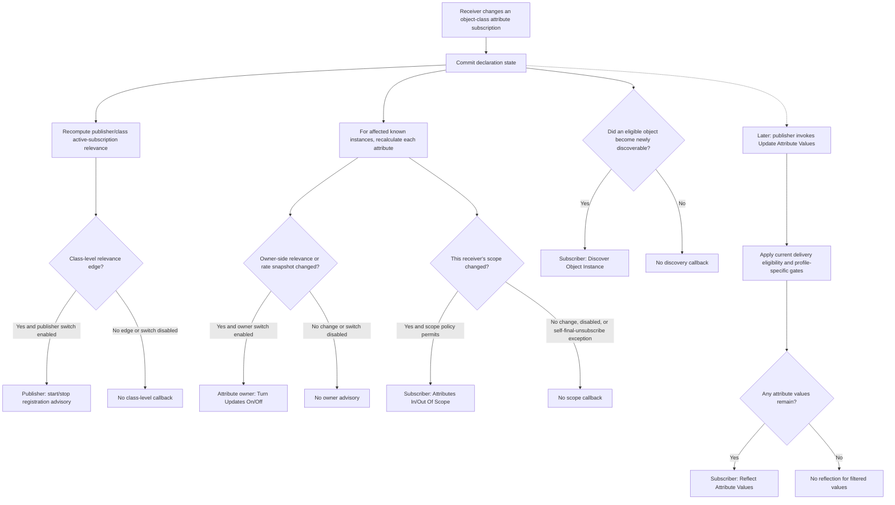
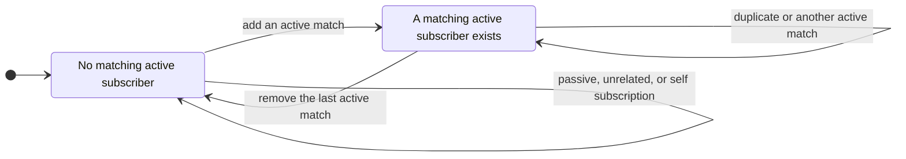
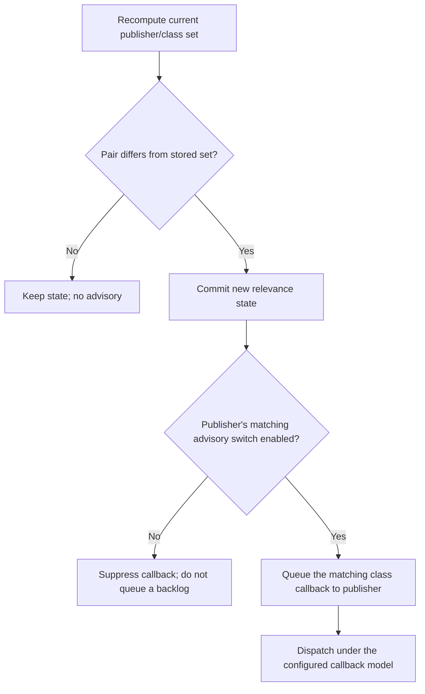
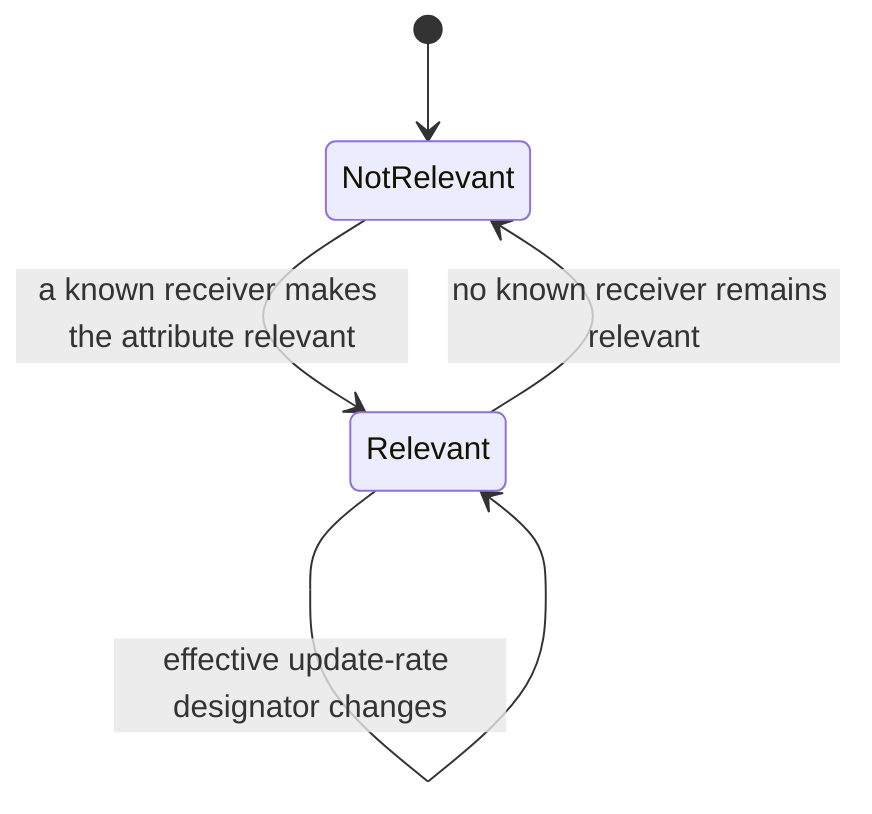

# IEEE 1516.1-2025 Declaration and Attribute Relevance Advisory Flow Guide

This guide separates two RTI-initiated advisory families that are often
mistaken for one signal:

1. **Declaration relevance** tells a publisher that at least one other joined
   federate has an active, matching class subscription.
2. **Attribute relevance** tells an object-attribute owner that a particular
   known object attribute is relevant to one or more receiving federates.

The callbacks have different granularity, recipients, state, and DDM rules.
A single object-class subscription mutation can feed both calculations, as
well as separate discovery and scope paths.

**Edition:** IEEE 1516.1-2025 only. This guide describes the current 2025 Umbra
implementation and selected test evidence; it makes no claim about the separate
2010 stream or about full conformance.

**Implementation profiles:** embedded registry planning plus selected
configured 2025 process-endpoint attribute-relevance paths. Declaration and
attribute evidence come from distinct profile/test slices; this is not a claim
of cross-profile equivalence.

The official [IEEE 1516.1-2025 edition page](https://standards.ieee.org/ieee/1516.1/6688/)
is the normative starting point. Source comments and test names below are
navigation/evidence pointers, not substitutes for the licensed standard.

## Start by separating advisories from delivery gates

| Mechanism | Trigger or state summarized | Recipient or decision point | Boundary to keep |
| --- | --- | --- | --- |
| Declaration relevance advisory | An active matching class subscription appears or the last matching subscription disappears for a published class. | Publisher; class-level Start/Stop Registration or interaction advisory. | No particular object, region overlap, or delivered value is implied. |
| Attribute relevance advisory | A known instance attribute gains or loses relevant receivers; its reported update-rate designator can also change while relevance stays on. | Current attribute owner; Turn Updates On/Off. | The callback carries no values and does not prove any value was sent or reflected. It is separate from scope and receiver-side rate admission. Compare the separate [Auto Provide flow](HLA-2025-AUTO-PROVIDE-FLOW-GUIDE.md). |
| Attribute Scope advisory | A known object's attribute enters or leaves one receiver's current scope. | Receiving federate; Attributes In/Out Of Scope. | The callback reports the transition; the underlying scope predicate, not the callback, participates in DDM routing. |
| [Update-rate admission](HLA-2025-ATTRIBUTE-UPDATE-RATE-ADMISSION-FLOW-GUIDE.md) | A candidate value reaches the current embedded per-receiver, per-attribute best-effort rate filter. | Receiver's value-delivery path; no separate advisory callback. | This is an actual value-admission gate in the described profile, not a timer that reschedules suppressed values or a change to DDM scope. |
| Discovery | A receiving federate becomes aware of a particular object instance. | Receiving federate; Discover Object Instance. | Object knowledge is not, by itself, eligibility for every attribute value. |
| Reflection | A projected attribute value survives applicable delivery gates. | Receiving federate; Reflect Attribute Values. | This is the payload path, not evidence that any particular advisory was generated. |

The pinned 2025 API also makes these public channels independently visible:

| HLA-facing signal | FederateAmbassador callback surface | RTIambassador switch surface |
| --- | --- | --- |
| Object-class declaration relevance | [`startRegistrationForObjectClass` / `stopRegistrationForObjectClass` (§§5.14–5.15)](../../third_party/ieee1516.1-2025/include/RTI/FederateAmbassador.h#L176) | [`get/setObjectClassRelevanceAdvisorySwitch` (§§10.34–10.35)](../../third_party/ieee1516.1-2025/include/RTI/RTIambassador.h#L2035) |
| Interaction-class declaration relevance | [`turnInteractionsOn` / `turnInteractionsOff` (§§5.16–5.17)](../../third_party/ieee1516.1-2025/include/RTI/FederateAmbassador.h#L188) | [`get/setInteractionRelevanceAdvisorySwitch` (§§10.40–10.41)](../../third_party/ieee1516.1-2025/include/RTI/RTIambassador.h#L2095) |
| Per-instance attribute relevance | [`turnUpdatesOnForObjectInstance` / `turnUpdatesOffForObjectInstance` (§§6.23–6.24)](../../third_party/ieee1516.1-2025/include/RTI/FederateAmbassador.h#L358) | [`get/setAttributeRelevanceAdvisorySwitch` (§§10.36–10.37)](../../third_party/ieee1516.1-2025/include/RTI/RTIambassador.h#L2055) |
| Receiver-local attribute scope | [`attributesInScope` / `attributesOutOfScope` (§§6.19–6.20)](../../third_party/ieee1516.1-2025/include/RTI/FederateAmbassador.h#L336) | [`get/setAttributeScopeAdvisorySwitch` (§§10.38–10.39)](../../third_party/ieee1516.1-2025/include/RTI/RTIambassador.h#L2075) |

These API declarations establish distinct callback and control surfaces, not
the full trigger predicates, recipient-selection rules, or dispatch ordering.
Use the applicable standard service text for normative conditions and the
implementation/test map below only for the named Umbra behavior.

Declaration and attribute relevance are independent signals. Do not use one
callback as evidence that the other was generated, enabled, or dispatched.
For object-class subscription operations, the current 2025 ambassador path
plans declaration advisories and attribute-relevance advisories separately;
it also has distinct discovery and scope-change work.
The first three rows report different committed state to different federation
roles; the update-rate row is a later receiver-side value decision. A single
subscription or region mutation can change underlying routing state and cause
one or more notifications, but the notifications do not replace the routing
predicate or each other's callback family. See the separate [scope guide](HLA-2025-ATTRIBUTE-SCOPE-ADVISORY-FLOW-GUIDE.md)
and [DDM guide](HLA-2025-DATA-DISTRIBUTION-AND-REGIONS-FLOW-GUIDE.md) for
their own transitions and evidence limits. For the broader sender-to-receiver
model that keeps object knowledge, receiver eligibility, reflection, and
application observation distinct, see the [object and interaction information
guide](HLA-2025-OBJECT-AND-INTERACTION-INFORMATION-FLOW-GUIDE.md#start-with-five-distinct-questions).

## One object subscription, separate calculations

The branches below show a receiving federate's subscription change fanning out
into separate state calculations, not a universal callback-order guarantee.
Class-level interest can change before an instance exists; per-instance
relevance and scope require a known object/attribute. Potential notifications
go to different federation roles, and a later reflected value is a separate
service event. This is a conceptual fan-out map, not one endpoint trace or a
cross-profile parity claim. Its class-level callback branch is the embedded
2025 path; the process profile's separate evidence boundary appears below.

The sender-facing class callback identifies a class; the owner-facing
attribute callback identifies an object instance and attributes; the receiver-
facing scope callback identifies that receiver's in/out transition; discovery
introduces an object; reflection carries values. These callbacks and the later
value path are not interchangeable, and the branches do not specify dispatch
order. The value lane includes profile-specific gates: the linked update-rate
admission guide documents the embedded best-effort filter and makes no process
parity claim. The [callback and service ordering guide](HLA-2025-CALLBACK-AND-SERVICE-ORDERING-FLOW-GUIDE.md)
covers their separate queue and dispatch boundaries.

## Class-level declaration relevance

Umbra stores class relevance as publisher/class pairs. It recomputes the
current set after declaration mutations and compares that set with the previous
set. A newly relevant pair can produce a Start/On callback; a pair that ceases
to be relevant can produce a Stop/Off callback, subject to the publisher's
switch and the class still being published.

For object classes, a published attribute is relevant when another joined
federate has an active subscription to that attribute at the published class
or an applicable ancestor. For interaction classes, an active subscription to
the published class or an applicable ancestor is sufficient. The publisher is
not counted as its own receiver.

The class-level calculation intentionally does **not** require an object
instance or a region-overlap result. An active regional subscription can
establish declaration relevance for a matching published class; actual
region overlap remains a separate delivery question. The focused regional
declaration test exercises the active/passive boundary, and the registry
planner explicitly keeps overlap out of this class-level predicate.

The object-class and interaction-class relevance switches are distinct,
per-federate controls in the current implementation. The composed FDD seeds
each joining federate's initial values; changing one publisher's switch does
not mutate another member's setting. The `Advisories Use Known Class` switch
is a different policy: it is static at federation scope and changes how
attribute relevance resolves class subscriptions. Do not substitute one switch
for another. The distinct Create-time versus per-member initialization boundary
is shown in the
[federation MOM switch-lifecycle flow](HLA-2025-FEDERATION-MOM-FLOW-GUIDE.md#creation-time-federation-policy-versus-per-member-switch-seeding).

### Class-level switch-off is not a queued backlog

In the current planner, the relevance sets are recomputed and committed even
when the publisher's callback switch is disabled. Turning the switch back on
does not replay the already-existing state as a fresh edge. A later transition
can produce a callback if the switch is enabled then. The embedded 2025 test
checks suppression while disabled, no callback merely from re-enabling, and
subsequent active/passive transitions.

The current callback mapping is:

| State edge | Object-class callback | Interaction-class callback |
| --- | --- | --- |
| Not relevant → relevant | `startRegistrationForObjectClass` | `turnInteractionsOn` |
| Relevant → not relevant | `stopRegistrationForObjectClass` | `turnInteractionsOff` |

This table describes callback names and the tested Umbra transition model.
Check the IEEE 1516.1-2025 text for normative conditions and exceptions.

## Per-instance attribute relevance

Attribute relevance is evaluated for a particular object instance and
attribute, using receivers that know the instance and the current declaration
and scope state. The callback is directed to the attribute owner—not to the
federate whose subscription caused the change.

On the first edge, the owner may receive
`turnUpdatesOnForObjectInstance(object, attributes[, updateRateDesignator])`.
On the second edge, it may receive
`turnUpdatesOffForObjectInstance(object, attributes)`. In the current
implementation, if the attribute remains relevant overall because another
known receiver still matches, removing one receiver does not create a spurious
Off edge.

There is an additional update-rate edge: if relevance stays On but the
effective active update-rate designator changes, the implementation can issue
another Turn Updates On callback with the newly resolved designator. In the
current resolver, the maximum applicable explicit active rate is selected; an
applicable declaration with an omitted/default rate suppresses the optional
designator. This is an implementation detail backed by focused tests, not a
general statement about every standard/profile combination.

The per-instance Attribute Relevance Advisory switch is the providing
federate's control, distinct from both the publisher's class-level relevance
switch and the receiver's Attribute Scope Advisory switch. The 2025 sources
separate switch state, relevance transitions, and callback delivery:

| Event | Embedded 2025 path | Process 2025 path |
| --- | --- | --- |
| Turn the switch on | Store the member switch; do not run the relevance planner. | Update the client callback gate and server member switch; do not run the relevance planner. |
| A relevance transition occurs while off | Plan a callback closure; its delivery gate checks switch, owner, and current relevance. | Check eligibility before queueing; an event failing this gate is not queued. |
| Work is already pending when the switch changes | Recheck switch, ownership, and expected relevance when the callback runs. | Recheck while receiving the queued event, then check the switch again at callback dispatch. |

Turning the switch on alone therefore does not synthesize a fresh Turn Updates
On edge for state that stayed relevant. But pending work is not the same as a
fresh replay: a planned/admitted callback may be dropped if a later gate fails,
or may still pass if the switch is back on and the expected state remains
current at the relevant delivery checks. These are separate source-observed
2025 paths, not a claim of cross-profile equivalence or a rule from the
standard.

The selected embedded test disables the switch, changes the subscription,
and drains owner callbacks while the switch is still off; it then unsubscribes,
re-enables the switch, and creates a fresh active transition. It does not
preserve a relevant state or hold work across the off/on cycle. The inspected
process callback tests enable the switch in setup but do not toggle it off.
No selected focused test covers a pending event across re-enable. Do not
transfer the declaration-level switch-off result above to this owner-side
switch or to receiver-local scope.

### Scope and class-selection boundaries

- For ordinary subscriptions, class ancestry and the receiver's known object
  class determine which declarations apply. The 2025 `Advisories Use Known
  Class` policy changes the class basis used for this advisory calculation;
  focused enabled/disabled tests cover the branch.
- For regional object attributes, the concrete object/receiver region
  realizations and overlap matter to per-instance relevance. A committed
  region or update-region association can move an existing known attribute
  across an On/Off edge. The [DDM and regions guide](HLA-2025-DATA-DISTRIBUTION-AND-REGIONS-FLOW-GUIDE.md)
  owns the detailed geometry and discovery branches.
- Declaration relevance for an active regional subscription is broader:
  it can turn the class-level signal On without proving any overlap. Do not
  infer regional delivery from `startRegistrationForObjectClass` or
  `turnInteractionsOn`.
- `turnUpdatesOn/Off` is not `reflectAttributeValues`. A provider still has to
  send an update, and publication, ownership, subscription, DDM, order, and
  time-management gates remain independently applicable.
- Advisory relevance is also distinct from whether a particular passive
  receiver can get a value: the current embedded active/passive recipient
  boundary and its test limit are recorded in the
  [object-attribute subscription guide](HLA-2025-OBJECT-ATTRIBUTE-SUBSCRIPTION-STATE-FLOW-GUIDE.md#passive-is-not-a-hard-delivery-veto).
- Attribute Scope callbacks are a separate lane. A nearby source comment
  references §10.1.3 for a scope-specific unsubscribe case; do not copy that
  exception into the Turn Updates relevance state machine. See the separate
  [Attribute Scope Advisory flow guide](HLA-2025-ATTRIBUTE-SCOPE-ADVISORY-FLOW-GUIDE.md).
  The source points to §6.1.5 for the 2025 `Advisories Use Known Class` policy.

The callback service may also have a service-invocation report route when
configured. That report is a separate observation from the advisory callback;
the [service invocation reporting guide](HLA-2025-SERVICE-INVOCATION-REPORTING-FLOW-GUIDE.md)
covers report routing and callback-order limits.

## Evidence map

| Topic | Current 2025 implementation | Focused test evidence |
| --- | --- | --- |
| Class-level active-subscription set and edge detection (embedded) | [Declaration planner](../../cpp/src/internal/federation/federation_registry_directed_interactions.cpp#L723); [callback mapping](../../cpp/src/internal/runtime/umbra_rti_ambassador.cpp#L1145) | [Ordinary publication/subscription transitions, switch gating, passive subscriptions, and idempotence](../../cpp/tests/declaration_relevance_advisory_catch2.cpp#L91); [declaration reports before callbacks](../../cpp/tests/declaration_relevance_service_report_catch2.cpp#L163) |
| Regional declarations (embedded) | [Class-level planner](../../cpp/src/internal/federation/federation_registry_directed_interactions.cpp#L797) | [Active/passive regional object and interaction subscriptions](../../cpp/tests/regional_declaration_relevance_advisory_catch2.cpp#L122) |
| FDD switch seeding | [Membership initialization](../../cpp/src/internal/federation/federation_registry_membership_lifecycle.cpp#L375) | [Joining members receive their composed-FDD switch values](../../cpp/tests/join_advisory_switch_seed_catch2.cpp#L4) |
| Process-profile class-level callback boundary | Process [publication handler](../../cpp/src/internal/federation/process_federation_service_declarations.cpp#L123) and [subscription handler](../../cpp/src/internal/federation/process_federation_service_declarations.cpp#L176) mutate registry state; no class-level planner call or declaration-advisory event route was found. The wire protocol has [switch GET operations](../../cpp/src/internal/federation/transport_service_protocol.hpp#L345); the public [object-class Set](../../cpp/src/internal/runtime/umbra_rti_ambassador_advisory_switches.cpp#L212) and [interaction-class Set](../../cpp/src/internal/runtime/umbra_rti_ambassador_advisory_switches.cpp#L466) methods use the embedded registry path. Process switch mutation is available through [HLAsetSwitches](../../cpp/src/internal/federation/process_federation_service_interaction_send.cpp#L107). | [Process MOM switch scenario](../../cpp/tests/ieee1516_2025_connection_process_mom_set_switches_catch2.cpp#L51) sends HLAsetSwitches and checks the getters; it does not call the public Set methods or assert class-level callbacks. No process class-level callback test was found. |
| Attribute relevance and rate snapshot | [Per-instance resolver](../../cpp/src/internal/federation/federation_registry_attribute_relevance.cpp#L255); [pre/post transition planner](../../cpp/src/internal/federation/federation_registry_attribute_relevance.cpp#L659) | [Embedded owner-switch suppression and rate transitions](../../cpp/tests/attribute_relevance_advisory_catch2.cpp#L265); [process On/Off callbacks](../../cpp/tests/ieee1516_2025_connection_attribute_relevance_advisory_catch2.cpp#L457); [rate-change reissue](../../cpp/tests/ieee1516_2025_connection_attribute_relevance_rate_reissue_catch2.cpp#L457) |
| Owner switch mutation versus pending delivery | [Embedded switch setter](../../cpp/src/internal/runtime/umbra_rti_ambassador_advisory_switches.cpp#L323), [callback gate](../../cpp/src/internal/runtime/umbra_rti_ambassador_object_instance_lifecycle_callbacks.cpp#L1254), and [transition planner](../../cpp/src/internal/federation/federation_registry_attribute_relevance.cpp#L659); process [client switch update](../../cpp/src/internal/federation/process_federation_client_region_services.cpp#L199), [server switch handler](../../cpp/src/internal/federation/process_federation_service_ddm_switches.cpp#L165), [receive-time recheck](../../cpp/src/internal/federation/process_federation_service_receive.cpp#L147), and [callback-boundary recheck](../../cpp/src/internal/federation/process_federation_callback_bridge.cpp#L1524) | [Embedded switch suppression followed by a fresh transition](../../cpp/tests/attribute_relevance_advisory_catch2.cpp#L265); [process callback path](../../cpp/tests/ieee1516_2025_connection_attribute_relevance_advisory_catch2.cpp#L457) enables the switch in setup, with no off/on or pending-event scenario |
| Attribute subscription feeds independent planners | [Subscription adapter](../../cpp/src/internal/runtime/umbra_rti_ambassador_object_class_subscription.cpp#L426) | [Embedded transition scenario](../../cpp/tests/declaration_relevance_advisory_catch2.cpp#L174); [attribute callback scenario](../../cpp/tests/ieee1516_2025_connection_attribute_relevance_advisory_catch2.cpp#L822) |
| Regional attribute relevance | [Scope resolver](../../cpp/src/internal/federation/federation_registry_attribute_relevance.cpp#L16); [process revalidation/enqueue](../../cpp/src/internal/federation/process_federation_service_attribute_relevance_advisories.cpp#L11) | [Association overlap transitions](../../cpp/tests/ieee1516_2025_connection_regional_attribute_relevance_transition_catch2.cpp#L42); [subscription overlap transitions](../../cpp/tests/ieee1516_2025_connection_regional_attribute_relevance_subscription_transition_catch2.cpp#L457); [passive regional attribute subscriptions](../../cpp/tests/regional_declaration_relevance_advisory_catch2.cpp#L282) |
| Class-basis policy | [Advisory relevance predicate](../../cpp/src/internal/federation/federation_registry_attribute_relevance.cpp#L127) | [Enabled](../../cpp/tests/attribute_relevance_known_class_enabled_subscription_catch2.cpp#L97); [disabled](../../cpp/tests/attribute_relevance_known_class_disabled_subscription_catch2.cpp#L97) |

The process MOM-switch case is mutation/readback evidence: it sends the
standard HLAsetSwitches interaction and checks the process getters. It does
not exercise the public `setObjectClassRelevanceAdvisorySwitch` or
`setInteractionRelevanceAdvisorySwitch` methods, nor does it test callback
delivery. In the inspected source those public Set methods have no process
endpoint branch, whereas their GET counterparts do; the process protocol has
the GET operations but no dedicated Set operations. Its separate
`HLAsetSwitches` MOM interaction is the process-side mutation route exercised
by that test. Process declaration handlers do not invoke the class-level
declaration planner, and the surveyed process event/dispatch path has no
Start/Stop Registration or Turn Interactions callback event. Therefore this
evidence does not establish process-profile class-level callback behavior.
Treat the boundary as a source-observed gap, not an IEEE rule or a claim of
equivalence with the embedded path. The selected attribute On/Off tests do
exercise their separate configured-process event route; do not project that
support onto class-level advisories.

## Limits and next boundary

The cited tests cover representative ordinary, regional, callback-model, and
update-rate paths. They do not exhaust every class hierarchy, multi-receiver
combination, simultaneous region/subscription mutation, member-loss race,
switch transition, or process restart. Treat source behavior as Umbra behavior
and the official 2025 standard as normative; do not infer untested standard
rules from implementation.

This guide is 2025-specific. The separate
[2010 reference-RTI guide](HLA-2010-REFERENCE-RTI-FLOW-GUIDE.md) documents a
different implementation stream; this guide makes no compatibility claim.
