# IEEE 1516.1-2025 Service Invocation Reporting: Contributor Flow Guide

Treat service-invocation reporting as an observation about a service call, not
as the service operation itself. Keep the caller's result and state effect
separate from whether a report is produced, which destination is selected,
and whether another federate later observes a report interaction. The report's
subject and its observer are different roles.

This guide traces those questions through selected Umbra behavior, including
switches, destinations, interaction filtering, file lifetime, and callback
delivery. The implementation examples are not a universal report-routing
algorithm or a conformance claim.

## Scope and authority

- **Edition boundary:** IEEE 1516.1-2025 only. The 2010 API/runtime remains a
  separate compatibility stream; this guide makes no 2010 parity claim.
- **Implementation boundary:** detailed behavior is the 2025 embedded
  federation-management development profile. Selected process-endpoint tests
  appear as separate evidence, not proof that all routes or failures are
  equivalent.
- **Normative authority:** the [official IEEE 1516.1-2025 Federate Interface
  Specification](https://standards.ieee.org/ieee/1516.1/6688/) defines service
  behavior. The standard is authoritative; source links explain Umbra's
  present behavior and tests establish only the scenarios they exercise.
  IEEE 1516.1-2025 §11.5.1 and §11.5.2 are useful clause pointers for service
  invocation reporting and report files; verify exact wording and applicability
  in the official standard.
- **Documentation boundary:** this is an Umbra contributor guide, not new
  requirements, a Requirements Lab mapping, or conformance evidence.

The scope here is the `HLAreportServiceInvocation` path and its per-member
service-report file. A few failure traces mention an `HLAreportException`
attempt only to explain its ordering relative to a service report; they are not
a complete account of exception-report routing. For the separate
`HLAreportException` and `HLAreportMOMexception` paths, see the
[exception-reporting guide](HLA-2025-EXCEPTION-REPORTING-FLOW-GUIDE.md). This
guide also does not attempt to diagram all other Management Object Model
(MOM) state projections.

For deeper implementation notes, see the [MOM service-reporting design](MOM-SERVICE-REPORTING-DESIGN.md#delivery-and-state-invariants)
and the separate [callback/service-ordering guide](HLA-2025-CALLBACK-AND-SERVICE-ORDERING-FLOW-GUIDE.md).
For a cross-service reasoning aid that separates caller outcome, state commit,
and optional reporting/observation effects, see the
[2025 cross-cutting guide](HLA-2025-CROSS-CUTTING-STATE-EVENT-OBSERVATION-GUIDE.md#a-service-result-committed-state-and-a-report-are-separate-traces).

## Three distinct traces: call outcome, invocation report, requested MOM report

The word “report” covers two different paths here. The 2025 MIM defines
`HLAreportServiceInvocation` as an RTI report about a service invocation while
Service Reporting is enabled: its parameters describe the supplied arguments
and the invocation's returned value or exception
([MIM class](../../third_party/ieee1516.2-2025/resources/mim/HLAstandardMIM-2025.xml#L1777)).
For this interaction destination, the pinned 2025 MIM specifies:

| Interaction contract | MIM-defined behavior |
| --- | --- |
| Scope and delivery | RTI-originated `HLAreportServiceInvocation`, scoped by `HLAfederate` and `HLAserviceGroup`, sent reliably in receive order. |
| Successful invocation | Supplied arguments and a true success indicator; the returned value when the service returns one; an empty exception description. |
| Failed invocation | Supplied arguments and a false success indicator; a null returned argument and a description of the raised exception. |
| Serial | Starts at zero per joined federate and increments for each report interaction for that member. |

This is the interaction contract, not a complete definition of Umbra's
per-member report-file format or lifetime.

In Umbra, the subject's switches select a per-member file record or the
`HLAreportServiceInvocation` interaction. This is not the same as explicitly
requesting current Federation MOM data with an `HLArequest...` interaction.

| Trace | Trigger | What its result or observation means |
| --- | --- | --- |
| Public service outcome | The federate invokes an HLA service. | The return value or synchronous exception is the outcome of that service call; it is not itself a report record or observer callback. See the [cross-service result map](HLA-2025-CROSS-CUTTING-STATE-EVENT-OBSERVATION-GUIDE.md#a-service-result-committed-state-and-a-report-are-separate-traces). |
| Per-invocation report | A reportable service is invoked while the subject's Service Reporting switch is enabled. | The MIM-defined report describes that invocation. Umbra routes it to the selected file or interaction sink; source-observed file-append errors can affect the caller-visible outcome in selected wrappers (the cited writer test did not reach its relevant assertions), while interaction observation follows recipient and callback rules below. |
| Request-driven Federation MOM report | A federate explicitly sends a request such as `HLArequestFOMmoduleData`. | The RTI builds a separate `HLAreport...` interaction from requested MOM/FOM/synchronization state. `sendInteraction` returns or throws for that send call; it does not return the report payload. The report reaches eligible observers as a separate callback. The selected embedded `HLA_EVOKED` case asserts observation only after callback draining ([focused case](HLA-2025-FEDERATION-MOM-FLOW-GUIDE.md#federation-reports-are-receive-order-interactions)). |

These are distinct triggers, not one synchronous RPC timeline: a MOM
`HLAreport...` is a separate RTI interaction emitted in response to a request,
not a return value from that same `sendInteraction`. They also do not imply
that report failures can never affect a service result: for one embedded
switch-setting path, an append failure surfaces as `RTIinternalError` after
the Exception Reporting switch has committed
([selected failure trace](#a-failed-report-append-leaves-exception-reporting-enabled)).
That ordering is service-wrapper-specific. The Federation MOM guide's paired
request/report interactions are a separate receive-order path, not another
`HLAreportServiceInvocation` record.

For a rejected MOM `Send Interaction`, also keep the independent
`HLAreportMOMexception` and public-service `HLAreportException` routes
distinct. Their attempted paths differ between the covered embedded and
configured-process wrappers; see the exception guide's
[MOM-rejection overlap map](HLA-2025-EXCEPTION-REPORTING-FLOW-GUIDE.md#a-mom-rejection-may-also-enter-the-general-exception-hook).
That does not establish a `HLAreportServiceInvocation` record for every such
failure.

## The mental model: subject, switch, sink, observer

There are two roles in a report interaction:

- The **subject** is the joined federate whose public service was invoked.
  Its Service Reporting switch decides whether that service call is reportable.
- An **observer** is a joined federate whose subscription and DDM scope select
  it to receive the RTI-originated report interaction. The observer's own
  Service Reporting switch controls reports about its services; it does not
  gate its receipt of another subject's report.

The subject's two switches are also different controls:

| Control | What it decides | Important distinction |
| --- | --- | --- |
| Service Reporting switch ([`getServiceReportingSwitch`](../../third_party/ieee1516.1-2025/include/RTI/RTIambassador.h#L2157) / [`setServiceReportingSwitch`](../../third_party/ieee1516.1-2025/include/RTI/RTIambassador.h#L2168)) | Whether successful or failed service invocations by this joined member are reported. | This is the master gate. Turning it off suppresses both report destinations. |
| Send Service Reports To File switch ([`getSendServiceReportsToFileSwitch`](../../third_party/ieee1516.1-2025/include/RTI/RTIambassador.h#L2198) / [`setSendServiceReportsToFileSwitch`](../../third_party/ieee1516.1-2025/include/RTI/RTIambassador.h#L2208)) | Which sink is selected while Service Reporting is enabled. | Enabled selects the member's report file instead of the `HLAreportServiceInvocation` interaction; it does not override a disabled master switch. |
| Exception Reporting switch | A separate MOM exception-report path. | Do not confuse an invocation report with `HLAreportException` or `HLAreportMOMexception`. A failed invocation report can carry failure/exception values without this guide modeling those separate report interactions. |

The report file is allocated for the joined-member lifetime. Its initial record
does not mean that invocation reporting is enabled: the switches decide
whether later service invocations add records and which sink is selected.

## The exact report interaction has a switch/subscription interlock

The Service Reporting switch and a subscription to the exact
`HLAreportServiceInvocation` interaction cannot be active for the same member
at the same time. This includes ordinary, passive, and regional subscriptions.
That is a protocol guard, not merely a reporting preference:

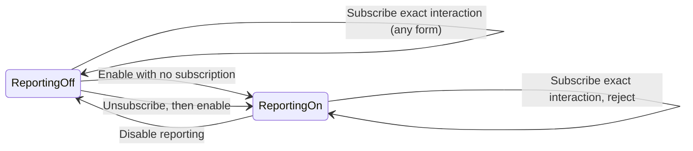

Enabling while subscribed throws `ReportServiceInvocationsAreSubscribed`;
subscribing while reporting is enabled throws
`FederateServiceInvocationsAreBeingReportedViaMOM`.

Thus the safe transition when a federate wants to observe service reports is:
disable its own Service Reporting switch, subscribe, and keep the switch off
until that subscription (including any regional declaration) is removed. The
inverse order—subscribe first, then enable reporting—is rejected and leaves the
switch off. This is directly exercised for active/passive and regional forms
by the [interlock test](../../cpp/tests/mom_service_reporting_interlock_catch2.cpp#L66).

## A reportable service call selects one destination

The following route describes the embedded callback path. Where a public-service
wrapper wires invocation reporting, a successful or failed call by a joined
subject reaches the service-report writer. Calls rejected before membership
exists are not manufactured into joined-member reports. The writer then uses
the subject's master switch and file-sink switch to choose what happens. The
configured-process endpoint uses the shared report planner and serial state,
but its recipient lifetime differs; that path is described separately below.

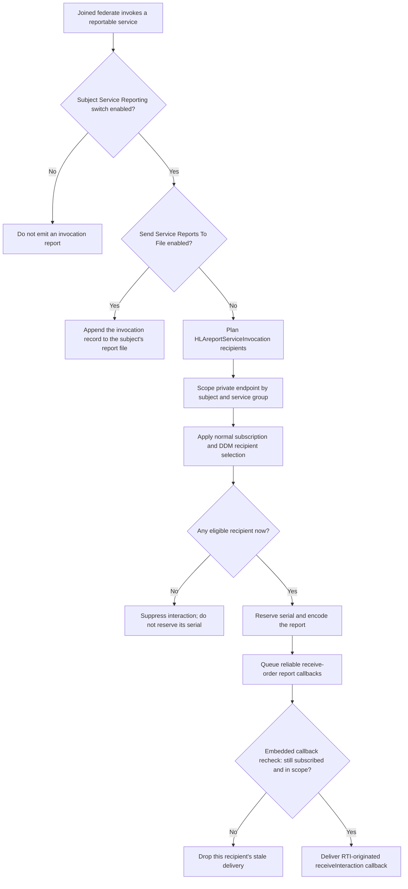

The private report endpoint is an internal producer, not a public
`sendInteraction` call. Its region identifies the subject (`HLAfederate`) and
service group (`HLAserviceGroup`); the registry selects observers through the
normal interaction subscription/DDM path. In the embedded profile, the
callback route rechecks the recipient projection so a now-stale subscription is
not delivered. Do not carry that callback-time behavior over to the configured-
process path below. Because an RTI-originated report does not go back through
the public service wrapper, reporting the report does not recursively produce
another report.

There are two useful serial-number boundaries to keep apart. If the initial
interaction plan has no eligible observer and the file sink is off, the current
implementation suppresses the report before reserving an interaction serial.
In the embedded route, if a recipient becomes ineligible after reservation but
before callback delivery, the recipient is dropped at revalidation; do not
infer that the already-reserved serial is rolled back. The process route also
reserves before enqueueing, but its later check is for a live session, not a
fresh subscription/DDM projection. The no-recipient/no-reservation rule is
source-derived; focused tests do not exhaustively exercise mutation after
reservation in either profile.

The embedded routing chart describes sink selection, not one universal
report-before-callback rule. Individual service wrappers decide whether a
report can be submitted at their particular state and lock boundary; some defer
callback-sensitive submission until after releasing service locks. For an
ordering not shown in the directed-send test, follow that service's wrapper
and its focused test rather than inferring a global ordering guarantee.

For a failed service call, the invocation report has a failed-success indicator
and the exception details in its report payload. That does not mean the
Exception Reporting switch controls this path; ordinary exception reports and
malformed-MOM reports are separate mechanisms, deliberately outside this
diagram.

### Configured-process recipient snapshot and callback boundary

For the configured-process route, the ambassador asks the process client to
write the success or failure report. The server validates that request against
the reporting session and joined member, then asks the registry to choose the
file or interaction route. For an interaction report, the registry applies the
subject and service-group endpoint together with normal subscription/DDM
selection. No eligible observer means no interaction report and no interaction
serial reservation. When observers exist, `reserveMomServiceReport` recomputes
the routing decision under the registry lock and advances the reported
member's serial only if an interaction remains eligible.

After reservation, the process server encodes the eight report parameters,
including the reported member handle and `HLAserialNumber`, and builds an
RTI-owned, reliable receive-order interaction. Before queueing or sending each
planned recipient's event, it checks that the recipient still has a mapped
session in the same federation. That is a session/federation check, not a fresh
subscription or DDM check. Pull delivery places the event in the session's
interaction queue; the later Receive Interaction poll removes that queued
interaction directly. Push delivery sends the event to the recipient session.
The process callback bridge then submits it to the callback dispatcher and
delivers `receiveInteraction` with an invalid producing-federate handle.

Push delivery is controlled by a private process-server option that defaults
to pull. When push is enabled, the server sends a report event to each selected
observer before it returns the reporting request's response.
The Service Reporting interlock makes the reporting member ineligible to
subscribe to this exact interaction while its reporting switch is enabled;
the registry also rechecks that switch when it reserves the report. Thus every
recipient of this report is a distinct observer member, never the service's
reporting subject. The [interlock test](../../cpp/tests/mom_service_reporting_interlock_catch2.cpp#L66)
covers ordinary active/passive and regional declarations, and the configured-
process report helper sets up separate reporter and observer ambassadors
([reporter switch](../../cpp/tests/ieee1516_2025_connection_process_service_report_interaction_helpers.hpp#L479),
[observer subscription](../../cpp/tests/ieee1516_2025_connection_process_service_report_interaction_helpers.hpp#L749)).

In pull mode, the event is queued in the observer's session; that observer's
Receive Interaction poll can dequeue it independently of the reporting request.
In push mode, the server sends the event before the reporting request's response.
The observer's reader buffers it, and its own in-flight request or background
dispatch loop later submits it. `HLA_IMMEDIATE` invokes the callback on that
observer-side submitter thread; `HLA_EVOKED` queues it until that observer calls
Evoke. These sessions have no shared callback/return ordering boundary: an
observer callback may run before or after the reporting subject's public
service returns, depending on the observer's poll, dispatch, and Evoke schedule.
The report writer is synchronous on the subject's side, but the observer
callback is not delivered to that subject. These are implementation
consequences, not normative HLA timing rules.

The focused process report helper invokes the reporting service before it calls
the observer's explicit `evokeCallback`, so its pull-mode `HLA_EVOKED` case
shows callback entry after that service call by test sequencing. It does not
show when the queued event first became available. No focused service-report
case exercises push delivery or `HLA_IMMEDIATE`, so those cross-session timing
edges remain source-derived.

Unlike the embedded callback route above, this process path has no
`HLAreportServiceInvocation` subscription/DDM recheck at poll or callback
admission. The callback bridge's separate projection/recheck key is specific to
`HLAreportException`; it is not attached to service-invocation report events.
Therefore a process report request's successful response establishes that the
server suppressed, appended, queued, or sent according to the selected route;
it does not establish that an observer callback has run. In push mode, a send
failure returns an internal error after serial reservation, and earlier
recipient sends may already have succeeded. These post-reservation outcomes
are source-derived; no focused test exercises them.

The focused process report matrix includes a successful regional send whose
observer receives the service report. Its helper connects both reporter and
observer with `HLA_EVOKED`, subscribes one observer, invokes `evokeCallback`,
and checks reliable transportation, the RTI-originated producer marker, the
reported-member parameter, and the first interaction serial. The server uses
the default pull-event mode; the report-specific cases do not configure
`pushReceiveOrderEvents` or `HLA_IMMEDIATE` and do not mutate the subscription
after planning. Other process tests exercise generic push delivery, but do not
establish service-report timing. A separate process concurrency test exercises
the `HLAreportException` recheck path, not this service-invocation route. These
are 2025 configured-process source/test boundaries, not normative HLA behavior.

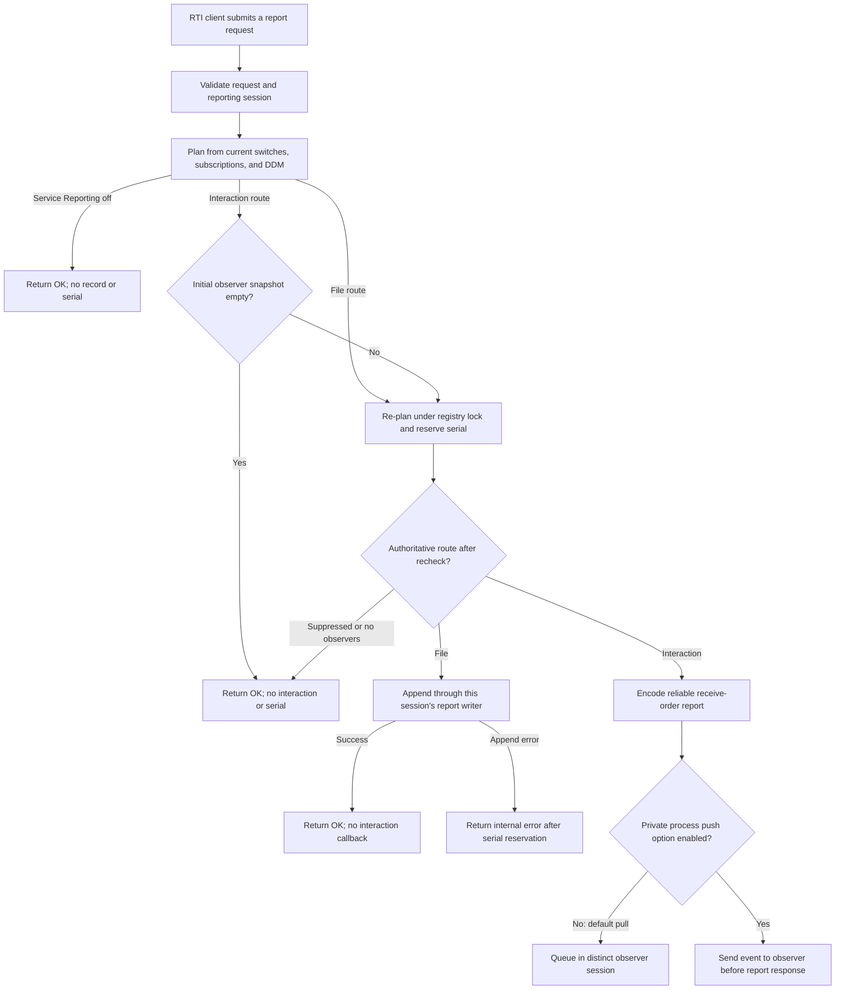

The file branch is process-specific: Join creates and installs a writer for
the reporting session, and the report handler reserves the member's serial
before it appends the record. The registry selects the file route when both
reporting gates are on and increments the member serial during reservation
([route selection](../../cpp/src/internal/federation/federation_registry_mom_service_reporting.cpp#L64),
[serial reservation](../../cpp/src/internal/federation/federation_registry_mom_service_reporting.cpp#L178),
[session-writer append](../../cpp/src/internal/federation/process_federation_service_reporting.cpp#L296)).
A write failure therefore returns an internal error after reservation; the
source has no rollback for that serial
([append error response](../../cpp/src/internal/federation/process_federation_service_reporting.cpp#L326)).
Focused process cases expect `RTIinternalError` after the report file is deleted
or write permission is removed
([file-loss case](../../cpp/tests/ieee1516_2025_connection_service_report_catch2.cpp#L2219),
[permission-change case](../../cpp/tests/ieee1516_2025_connection_service_report_catch2.cpp#L2398)).
Those cases end the failed session and do not observe the next serial, so the
reservation consequence remains source-derived.
An interaction with no initial observers returns without reserving a serial;
when observers exist, the registry re-plans before reservation. The source
steps are implementation behavior, not a normative callback-timing rule.

The timing view below assumes an interaction report with an eligible observer.
Its two branches show possible cross-session schedules: either the observer
callback enters first or the reporting subject's public call returns first.
They are source-derived alternatives, not an HLA ordering rule or an exhaustive
set of schedules.

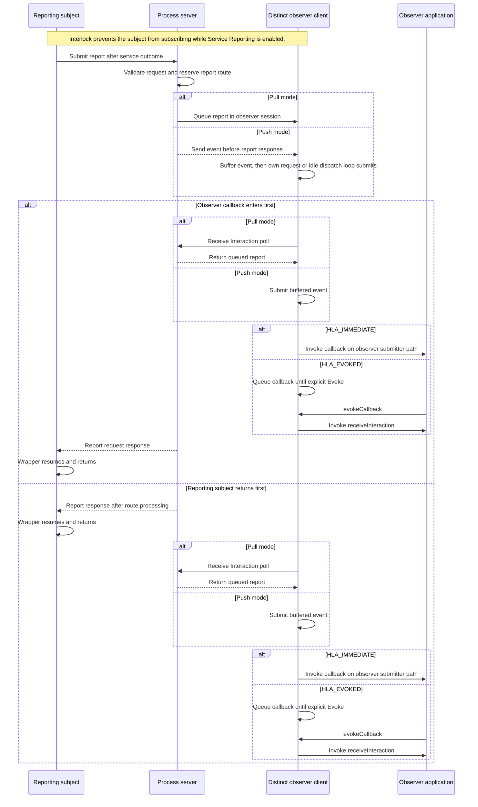

The [process report handler](../../cpp/src/internal/federation/process_federation_service_reporting.cpp#L232)
calls the shared [recipient planner](../../cpp/src/internal/federation/federation_registry_mom_service_reporting.cpp#L53)
and [serial reservation](../../cpp/src/internal/federation/federation_registry_mom_service_reporting.cpp#L148).
Its post-reservation [session check and event queue/send](../../cpp/src/internal/federation/process_federation_service_reporting.cpp#L367)
are followed by the pull path's [direct interaction dequeue](../../cpp/src/internal/federation/process_federation_service_receive.cpp#L123)
and the client's [receive-order callback bridge](../../cpp/src/internal/federation/process_federation_callback_bridge.cpp#L1346).
The bridge's [separate exception-report projection key](../../cpp/src/internal/federation/process_federation_service_protocol.hpp#L1374)
and [callback admission check](../../cpp/src/internal/federation/process_federation_callback_bridge.cpp#L1456)
do not apply to these service-invocation events.

The private [push/pull server option](../../cpp/src/internal/federation/process_federation_service.hpp#L80)
defaults to pull. The public regional [Send Interaction With Regions wrapper and
success-report point](../../cpp/src/internal/runtime/umbra_rti_ambassador_regional_interaction_send_services.cpp#L586)
calls the [service-report writer](../../cpp/src/internal/runtime/umbra_rti_ambassador_service_report_writers.cpp#L146),
which makes a synchronous [process report request](../../cpp/src/internal/federation/process_federation_client_federation_management.cpp#L552).
The [client request path](../../cpp/src/internal/federation/process_federation_client.cpp#L547)
dispatches buffered pushed events at [this point](../../cpp/src/internal/federation/process_federation_client.cpp#L622)
before returning at [this boundary](../../cpp/src/internal/federation/process_federation_client.cpp#L640);
an idle recipient is serviced by its separate [client dispatch loop](https://github.com/sheepfling/umbra/blob/c9c5a9e410539b039cd8bba35b53d0ef2b24d180/cpp/src/internal/federation/process_federation_client.cpp#L722).
The callback dispatcher's [immediate submit path](../../cpp/src/internal/callbacks/callback_dispatcher.cpp#L122)
invokes the callback on the submitting thread.
The shared request-backed and background process callback routes are diagrammed
in the [2025 callback/service-ordering guide](HLA-2025-CALLBACK-AND-SERVICE-ORDERING-FLOW-GUIDE.md#process-endpoint-callback-exception-attribution);
this report flow applies those routes specifically to MOM report recipients.

The [process regional-send success case](../../cpp/tests/ieee1516_2025_connection_process_service_report_matrix_catch2.cpp#L626)
uses the [single-observer helper](../../cpp/tests/ieee1516_2025_connection_process_service_report_interaction_helpers.hpp#L36),
which checks the report serial at [line 1414](../../cpp/tests/ieee1516_2025_connection_process_service_report_interaction_helpers.hpp#L1414)
and the invalid producer handle at [line 982](../../cpp/tests/ieee1516_2025_connection_process_service_report_interaction_helpers.hpp#L982).
The helper configures both participants as `HLA_EVOKED`, including the [reporter](../../cpp/tests/ieee1516_2025_connection_process_service_report_interaction_helpers.hpp#L424).
The separate [process exception-report concurrency test](../../cpp/tests/ieee1516_2025_connection_process_exception_report_concurrency_catch2.cpp#L460)
is not service-invocation report coverage. No focused process test found in this
review changes a report observer's subscription between report planning and
callback delivery.

### Failed invocation reporting is wrapper-specific

The failed payload contract does not mean every thrown service call reaches a
failed-invocation writer. The reviewed ordinary `Send Interaction` wrappers
show a profile-specific boundary:

- **Embedded:** the service catch attempts the applicable MOM-exception and
  public-exception hooks, then calls the failed service-report writer before
  rethrowing. That writer independently applies the subject's Service
  Reporting switch and selected sink. No cited test observes all of these
  report paths together for one failed ordinary `Send Interaction`.
- **Configured process:** the early endpoint branch translates a rejected
  process response to `RTIinternalError` and returns from the wrapper before
  its successful-invocation writer; the reviewed branch has no failed-
  invocation-writer call. The focused process [ordinary-send case](../../cpp/tests/ieee1516_2025_connection_process_service_report_matrix_catch2.cpp#L524)
  covers success only. Some server-side `HLAsetSwitches` rejections—such as a
  malformed payload or a rejected attempt to enable Service Reporting while
  reports are subscribed—can independently emit `HLAreportMOMexception`.
  That MOM-specific path is separate from a failed-invocation report and is
  not represented in the wrapper comparison below.
- **A narrower process case:** `Send Interaction With Regions` explicitly
  calls the failed-invocation writer for specific public preflight failures.
  Focused tests cover invalid region and parameter handles; they do not show
  that a server-rejected regional request follows the same route.

The chart compares only a caught embedded exception with a rejected
configured-process response. Process-local validation failures before an
endpoint request, and the regional/timestamped overloads, are outside this
comparison.

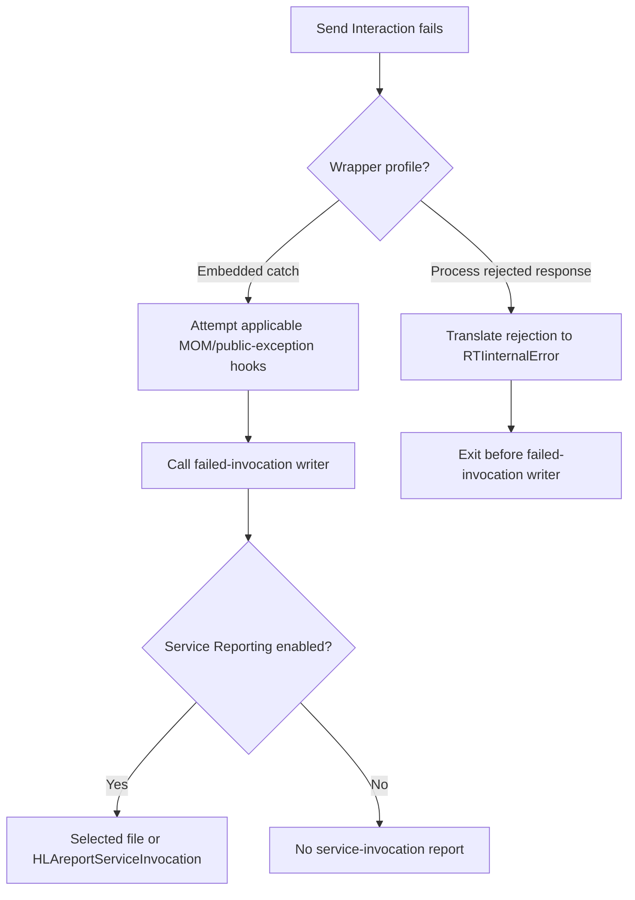

The ordinary-send source boundary is visible in the [embedded catch](../../cpp/src/internal/runtime/umbra_rti_ambassador_interaction_send_services.cpp#L2399)
and [configured-process early branch](../../cpp/src/internal/runtime/umbra_rti_ambassador_interaction_send_services.cpp#L57),
whose [service-report call follows a successful process response](../../cpp/src/internal/runtime/umbra_rti_ambassador_interaction_send_services.cpp#L130).
The [regional process parameter preflight](../../cpp/src/internal/runtime/umbra_rti_ambassador_regional_interaction_send_services.cpp#L504),
[region preflight](../../cpp/src/internal/runtime/umbra_rti_ambassador_regional_interaction_send_services.cpp#L531),
[focused invalid-region interaction-report case](../../cpp/tests/ieee1516_2025_connection_process_service_report_matrix_catch2.cpp#L648),
the [invalid-parameter file-report case](../../cpp/tests/ieee1516_2025_connection_process_service_report_matrix_catch2.cpp#L690),
and [invalid-parameter interaction-report case](../../cpp/tests/ieee1516_2025_connection_process_service_report_matrix_catch2.cpp#L714)
show the narrower evidence. The malformed-MOM server path is covered separately
in the [process exception test](../../cpp/tests/ieee1516_2025_connection_process_mom_malformed_exception_catch2.cpp#L460).
These are implementation/profile observations, not a normative distinction
between the reports.

### A failed lookup has a caller result and a separate report trace

The public lookup case makes the two outcomes concrete. The subject enables
Service Reporting and selects the interaction sink; a separate observer
subscribes to `HLAreportServiceInvocation`. The subject calls
[`getAttributeName`](../../third_party/ieee1516.1-2025/include/RTI/RTIambassador.h#L1764)
with a valid object-class handle and a default-invalid attribute handle. The
public call raises `InvalidAttributeHandle`. The observer's recorded trace
contains the failed invocation as report serial 4, after four earlier reported
calls. The diagram's branches are separate observations; they do not assert
whether the observer callback runs before or after the caller catches the
exception.

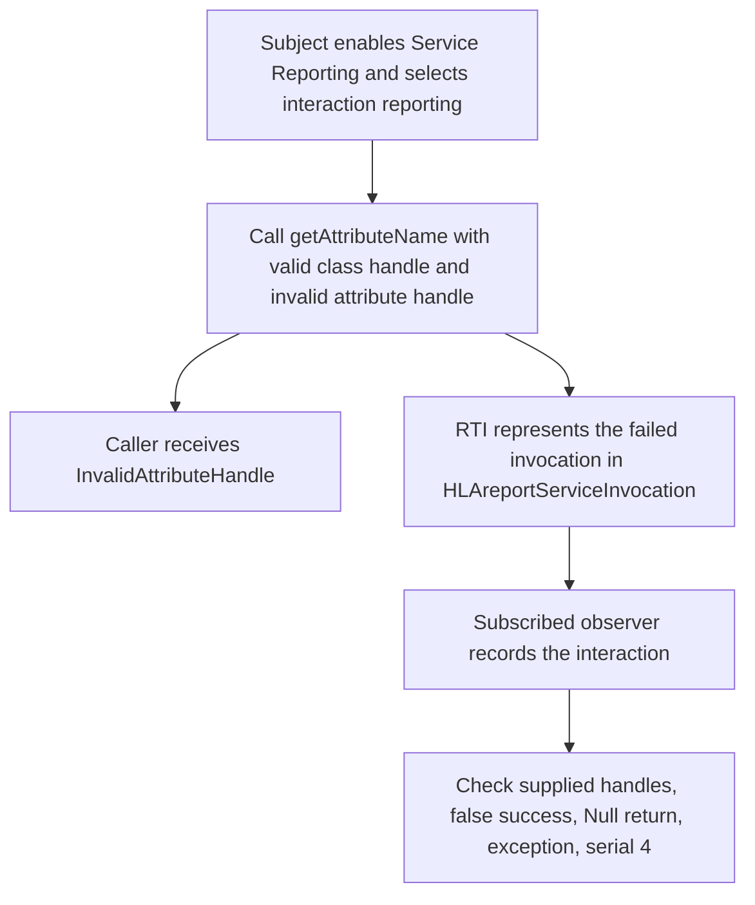

The [portable TCK scenario](../../packages/hla-rti-cpp-tck/src/tck_service_report_lookup_failure_scenarios.cpp#L347)
sets the subject's file switch off, enables its Service Reporting switch, and
subscribes the observer ([setup and switches](../../packages/hla-rti-cpp-tck/src/tck_service_report_lookup_failure_scenarios.cpp#L378)).
It catches the public exception at the [lookup call](../../packages/hla-rti-cpp-tck/src/tck_service_report_lookup_failure_scenarios.cpp#L448)
and checks report index 4 at [the failure assertion](../../packages/hla-rti-cpp-tck/src/tck_service_report_lookup_failure_scenarios.cpp#L532).
That check expects argument type 36 for the object-class handle and type 0 for
the class attribute handle, with the supplied handle strings quoted. The shared
[failure-record checker](../../packages/hla-rti-cpp-tck/src/main.cpp#L1297)
checks the false indicator, Null returned argument (type 34), exception class,
and serial. For the inherited `HLAfederate` parameter, it checks parameter
presence but does not decode or compare the federate value.

In Umbra, `getAttributeName` catches the failed lookup, routes a failed-service
record, and rethrows the caller's exception when report submission succeeds.
The embedded path can emit `HLAreportServiceInvocation` directly when
interaction reporting is selected; the configured-process path submits a
failed-invocation request to the service-report handler
([public call path](../../cpp/src/internal/runtime/umbra_rti_ambassador_attribute_lookup.cpp#L140),
[mode-specific report routing](../../cpp/src/internal/runtime/umbra_rti_ambassador_service_report_writers.cpp#L252),
[process report handler](../../cpp/src/internal/federation/process_federation_service_reporting.cpp#L228)).
The TCK case verifies the observed caller/report pair, but does not establish
identical callback timing or profile parity.

There is a useful MIM shape distinction here: `HLAreportServiceInvocation`
inherits an `HLAfederate` parameter from its parent interaction class, and
declares seven more parameters. Separately, the interaction is scoped by the
`HLAfederate` and `HLAserviceGroup` dimensions. The inherited parameter and the
dimension with the same name have different roles ([inherited parameter](../../third_party/ieee1516.2-2025/resources/mim/HLAstandardMIM-2025.xml#L915),
[report dimensions and parameters](../../third_party/ieee1516.2-2025/resources/mim/HLAstandardMIM-2025.xml#L1777)).
This scenario checks the inherited parameter's presence, but does not establish
the dimension values or validate the inherited parameter's value. Its source is
evidence for this scenario's assertions; this documentation update did not run
the TCK.

### Interaction and parameter lookup failures leave a separate report trace

The standard lookup APIs expose different errors for a missing name, an invalid
interaction-class handle, and an invalid parameter handle. The portable TCK
scenario drives four failures in sequence, then makes a valid lookup to show
that the subject can continue. It enables Service Reporting on the subject,
turns its report-file switch off, and has a separate observer subscribe to
`HLAreportServiceInvocation` ([scenario setup and switches](../../packages/hla-rti-cpp-tck/src/tck_service_report_lookup_failure_scenarios.cpp#L157),
[observer subscription](../../packages/hla-rti-cpp-tck/src/tck_service_report_lookup_failure_scenarios.cpp#L202)).

| Subject call | Caller result | Report serial in this scenario |
| --- | --- | ---: |
| [`getInteractionClassHandle`](../../third_party/ieee1516.1-2025/include/RTI/RTIambassador.h#L1806) with a missing name | `NameNotFound` | 0 |
| [`getInteractionClassName`](../../third_party/ieee1516.1-2025/include/RTI/RTIambassador.h#L1816) with a default-invalid class handle | `InvalidInteractionClassHandle` | 1 |
| [`getParameterHandle`](../../third_party/ieee1516.1-2025/include/RTI/RTIambassador.h#L1827) with a valid class and missing parameter name | `NameNotFound` | 2 |
| [`getParameterName`](../../third_party/ieee1516.1-2025/include/RTI/RTIambassador.h#L1840) with a valid class and default-invalid parameter handle | `InvalidParameterHandle` | 3 |
| `getInteractionClassHandle` with a valid name | valid handle | 4, successful report |

Matching numbers pair each invocation with its report record; they do not say
when the observer callback runs relative to the caller catching an exception.
The test waits for five observer interactions and then checks the report order
and serials. For each failure report it checks the service name and type, false
success indicator, supplied argument records, typed Null return, exception
class, and serial. The common checker also verifies the standard report
parameter set and reliable transportation ([scenario assertions](../../packages/hla-rti-cpp-tck/src/tck_service_report_lookup_failure_scenarios.cpp#L280),
[failure-record checks](../../packages/hla-rti-cpp-tck/src/main.cpp#L1297)).

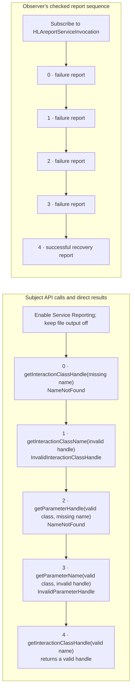

`getParameterName` also declares `InteractionParameterNotDefined` for a
parameter handle that is valid but does not belong to the supplied interaction
class. This scenario uses a default-invalid handle, so that distinct membership
error remains outside its coverage. Similarly, its `getParameterHandle` call
uses a valid interaction class and does not exercise the API's
`InvalidInteractionClassHandle` branch. The [portable TCK catalog entry](../../packages/hla-rti-cpp-tck/README.md#L590)
describes the primary and standard-contract cases; this documentation update
did not run them.

### Object-class name misses follow endpoint-specific report paths

A separate object, attribute, and update-rate lookup scenario has a nearby but
different boundary. Its `GetKnownObjectClassHandle` failure supplies a
default-invalid object-instance handle and reports `ObjectInstanceNotKnown`
(the [call](../../packages/hla-rti-cpp-tck/src/tck_service_report_lookup_failure_scenarios.cpp#L423)
and its [serial-0 record](../../packages/hla-rti-cpp-tck/src/tck_service_report_lookup_failure_scenarios.cpp#L497)).
The scenario's later `getObjectClassHandle` call uses a valid class name and
checks a successful report at serial 7
([call](../../packages/hla-rti-cpp-tck/src/tck_service_report_lookup_failure_scenarios.cpp#L469),
[report assertion](../../packages/hla-rti-cpp-tck/src/tck_service_report_lookup_failure_scenarios.cpp#L575)).
The standard API declaration lists `NameNotFound` for
[`getObjectClassHandle`](../../third_party/ieee1516.1-2025/include/RTI/RTIambassador.h#L1704),
but this portable TCK scenario does not call it with an unknown class name or
check a failed `GetObjectClassHandle` report. Two target-listed Catch2 cases
cover that missing-name behavior. The embedded case selects the in-process
endpoint, expects `NameNotFound`, and compares the file output against exact
failed serial-0 and successful serial-1 records
([calls](../../cpp/tests/ieee1516_2025_support_failed_object_class_lookup_service_report_catch2.cpp#L41),
[record assertions](../../cpp/tests/ieee1516_2025_support_failed_object_class_lookup_service_report_catch2.cpp#L57)).
The configured-process matrix case also expects `NameNotFound` and observes a
failed `HLAreportServiceInvocation` MOM interaction after an explicit observer
evoke
([case](../../cpp/tests/ieee1516_2025_connection_process_service_report_matrix_catch2.cpp#L189),
[lookup and result assertion](../../cpp/tests/ieee1516_2025_connection_process_service_report_interaction_helpers.hpp#L566),
[report observation](../../cpp/tests/ieee1516_2025_connection_process_service_report_interaction_helpers.hpp#L971)).
The embedded and process sources are listed in their Catch2 executable targets
([embedded source list](../../cmake/catch2_executable_targets.cmake#L178),
[process source list](../../cmake/ieee1516_2025_connection_test_sources.cmake#L5)).

The 2025 source traces that missing-name case through separate implementation
paths:

- **Embedded:** a registry miss raises `NameNotFound`; the ambassador catch
  attempts Exception reporting, routes the failed invocation to the selected
  service-report destination, and rethrows the public exception
  ([lookup and catch](../../cpp/src/internal/runtime/umbra_rti_ambassador_object_class_lookup.cpp#L83),
  [failure-report call](../../cpp/src/internal/runtime/umbra_rti_ambassador_object_class_lookup.cpp#L98),
  [selected report writer](../../cpp/src/internal/runtime/umbra_rti_ambassador_service_report_writers.cpp#L252)).
- **Configured-process:** the service returns `rejected` when a valid lookup
  finds no class; the client maps that response to no handle, and the
  ambassador raises `NameNotFound`. The same public catch then attempts
  Exception reporting and sends the failed-invocation report through the
  process service's report handler
  ([service lookup](../../cpp/src/internal/federation/process_federation_service_handle_lookup.cpp#L98),
  [client mapping](../../cpp/src/internal/federation/process_federation_client_handle_lookup.cpp#L162),
  [ambassador exception](../../cpp/src/internal/runtime/umbra_rti_ambassador_object_class_lookup.cpp#L55),
  [process report request](../../cpp/src/internal/runtime/umbra_rti_ambassador_service_report_writers.cpp#L272),
  [server report handler](../../cpp/src/internal/federation/process_federation_service_reporting.cpp#L172)).

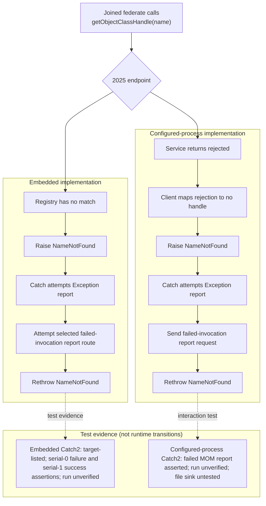

The solid arrows show implementation call order. The dotted arrows point to
test evidence; they are not runtime transitions. The Exception report is
best-effort and separate from the Service Invocation report.

The embedded case asserts the failed file record and the next successful
record. A configured-process matrix case also calls `getObjectClassHandle`
with an unknown name and asserts `NameNotFound` plus a failed
`HLAreportServiceInvocation` interaction ([case](../../cpp/tests/ieee1516_2025_connection_process_service_report_matrix_catch2.cpp#L189),
[lookup call](../../cpp/tests/ieee1516_2025_connection_process_service_report_interaction_helpers.hpp#L566),
[NameNotFound assertion](../../cpp/tests/ieee1516_2025_connection_process_service_report_interaction_helpers.hpp#L689),
[callback evoke and observation](../../cpp/tests/ieee1516_2025_connection_process_service_report_interaction_helpers.hpp#L971),
[failed indicator](../../cpp/tests/ieee1516_2025_connection_process_service_report_interaction_helpers.hpp#L1048),
[object-class argument](../../cpp/tests/ieee1516_2025_connection_process_service_report_interaction_helpers.hpp#L1081),
[reported exception](../../cpp/tests/ieee1516_2025_connection_process_service_report_interaction_helpers.hpp#L1324)).
The matrix is listed in the 2025 connection test sources
([CMake source list](../../cmake/ieee1516_2025_connection_test_sources.cmake#L5)).
The reporter uses the MOM-interaction destination by default; this case does
not establish the configured-process file-sink path. Neither test was run in
this documentation pass, and no provenance-bearing result was located. The
process case observes the report callback after an explicit evoke following
the public call; it does not measure server enqueue time or callback timing
under other schedules. The two cases also do not establish delivery across
other switch/subscription states or full profile parity.

### Object-attribute declaration reports preserve argument meaning

The standard has separate declaration services for publication (§5.2),
subscription (§5.8), and attribute-set or whole-class unsubscription (§5.9):
[`publishObjectClassAttributes`](../../third_party/ieee1516.1-2025/include/RTI/RTIambassador.h#L429),
[`subscribeObjectClassAttributes`](../../third_party/ieee1516.1-2025/include/RTI/RTIambassador.h#L535),
[`unsubscribeObjectClassAttributes`](../../third_party/ieee1516.1-2025/include/RTI/RTIambassador.h#L563), and
[`unsubscribeObjectClass`](../../third_party/ieee1516.1-2025/include/RTI/RTIambassador.h#L550).
The portable TCK keeps setup outside the reporting window, turns on Service
Reporting for the subject, disables its file route, and subscribes a separate
observer to `HLAreportServiceInvocation` ([setup and switch boundary](../../packages/hla-rti-cpp-tck/src/tck_service_report_object_attribute_declaration_scenarios.cpp#L81),
[switch activation](../../packages/hla-rti-cpp-tck/src/tck_service_report_object_attribute_declaration_scenarios.cpp#L238)).
It then checks five failed declarations and four successful declarations:

| Report serial | Public call | Caller result | Record checked by the observer |
| ---: | --- | --- | --- |
| 0 | Subscribe with an undefined object-class handle and an empty attribute set | `ObjectClassNotDefined` | Failed `SubscribeObjectClassAttributes` |
| 1 | Subscribe a valid class with an undefined attribute handle | `AttributeNotDefined` | Failed `SubscribeObjectClassAttributes` |
| 2 | Unsubscribe an undefined class with a supplied empty attribute set | `ObjectClassNotDefined` | Failed `UnsubscribeObjectClassAttributes` |
| 3 | Unsubscribe a valid class with an undefined attribute handle | `AttributeNotDefined` | Failed `UnsubscribeObjectClassAttributes` |
| 4 | Unsubscribe an undefined class using the whole-class overload | `ObjectClassNotDefined` | Failed `UnsubscribeObjectClassAttributes` |
| 5 | Subscribe a valid class and attribute | Returns normally | Successful `SubscribeObjectClassAttributes` |
| 6 | Unsubscribe a valid class and attribute set | Returns normally | Successful `UnsubscribeObjectClassAttributes` |
| 7 | Unsubscribe a valid class using the whole-class overload | Returns normally | Successful `UnsubscribeObjectClassAttributes` |
| 8 | Publish a valid class with two distinct attributes | Returns normally | Successful `PublishObjectClassAttributes` |

The two unsubscription forms encode different inputs. The attribute-set
overload supplies its set, so even the empty set in report 2 is an `[]` value;
the whole-class overload omits that optional argument and the report uses
typed `Null` (`null`) instead ([whole-class report construction](../../cpp/src/internal/runtime/umbra_rti_ambassador_object_class_subscription.cpp#L297),
[asserted argument values](../../packages/hla-rti-cpp-tck/src/tck_service_report_object_attribute_declaration_scenarios.cpp#L132)).
For subscription, the public C++ parameter is named `active`, while the MOM
argument is the passive indicator. The embedded implementation reports
`!active`; the TCK passes `active=false` and expects passive `true` ([implementation mapping](../../cpp/src/internal/runtime/umbra_rti_ambassador_object_class_subscription.cpp#L140),
[successful subscription assertion](../../packages/hla-rti-cpp-tck/src/tck_service_report_object_attribute_declaration_scenarios.cpp#L316)).
The test checks a two-attribute publication report as well ([publication assertion](../../packages/hla-rti-cpp-tck/src/tck_service_report_object_attribute_declaration_scenarios.cpp#L347)).

Every report in this void-service matrix carries a typed Null returned
argument. Failed records have a false success indicator and the expected
exception; successful records have a true indicator and no exception. The
TCK's checker also validates the declaration-management service type, all
eight report parameters, reliable transportation, the supplied argument
records, and serials 0 through 8 ([report checker](../../packages/hla-rti-cpp-tck/src/tck_service_report_object_attribute_declaration_scenarios.cpp#L132)).
The source comment says “eight declaration calls,” but its assertions cover
nine records, ending at serial 8. The package README now names the final
two-attribute publication case as part of that matrix. These are source
assertions; this documentation increment did not run the portable TCK.

#### Embedded report and callback order

Umbra's embedded 2025 path exposes the boundary behind the report. A
successful subscription commits its registry transition and releases the
native locks before selecting the report route; it reports before it queues
declaration advisories, scope changes, relevance advisories, and discovery
callbacks. A failed call enters the catch path, attempts Exception Reporting
as a separate route, selects the failed Service Invocation record, and then
rethrows the original exception ([subscription success boundary](../../cpp/src/internal/runtime/umbra_rti_ambassador_object_class_subscription.cpp#L140),
[failure path](../../cpp/src/internal/runtime/umbra_rti_ambassador_object_class_subscription.cpp#L170),
[publication success boundary](../../cpp/src/internal/runtime/umbra_rti_ambassador_object_class_publication.cpp#L113)).
The report writer uses the interaction route when selected and an eligible
observer is present. In `HLA_IMMEDIATE`, that observer can re-enter before the
report helper returns; this TCK checks the report contents after each call but
does not assert callback timing relative to the public return or exception
([report-route selection](../../cpp/src/internal/runtime/umbra_rti_ambassador_service_report_writers.cpp#L131),
[immediate callback boundary](../../cpp/src/internal/runtime/umbra_rti_ambassador_service_report_writers.cpp#L92)).
This ordering description is for the embedded route; the process-endpoint
branch is separate.

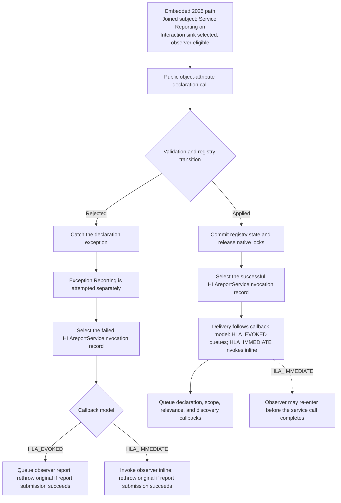

This chart assumes the report route completes. A report-route error can reach
the public catch after the registry transition has already been applied. On a
rejected declaration, if failed-report submission itself throws, control leaves
the catch before its final `throw;`; this chart does not model that writer-failure
cascade ([subscription transition and catch](../../cpp/src/internal/runtime/umbra_rti_ambassador_object_class_subscription.cpp#L140),
[publication transition and catch](../../cpp/src/internal/runtime/umbra_rti_ambassador_object_class_publication.cpp#L113),
[failed-report helper](../../cpp/src/internal/runtime/umbra_rti_ambassador_service_report_writers.cpp#L252)).

The scenario's report sequence is deliberately bounded: it exercises invalid
and valid handles in declaration calls, but it does not test unpublication,
`active=true`, update-rate defaults, or callback ordering. The package README's
coverage summary now includes the two-attribute publication call, matching the
source assertions listed above.

### Process regional sends separate public preflight from server rejection

The receive-order configured-process overload has explicit failed-invocation
writer calls for two local checks: an undefined parameter handle and an invalid
region handle. The undefined interaction-class check throws without that
writer. If those checks pass, the wrapper calls the process endpoint and
records a successful invocation only after a successful response. A rejected
response becomes `RTIinternalError`; the wrapper's protocol/client-error catches
do not call the failed-invocation writer. The shared server path returns a
rejected response when interaction planning fails, so that failure does not
flow back through the two local reporting branches.

The timestamped configured-process overload is a separate boundary. Its early
process branch performs local handle/time validation, submits the timestamped
request, and returns the retraction handle on success; that branch has no
service-invocation writer for either success or failure. Local validation
exceptions and translated process rejections therefore do not produce a
service-invocation report through this reviewed branch. An
[invalid-logical-time process status](../../cpp/src/internal/runtime/umbra_rti_ambassador_regional_interaction_send_services.cpp#L133)
becomes `InvalidLogicalTime`; [protocol errors](../../cpp/src/internal/runtime/umbra_rti_ambassador_regional_interaction_send_services.cpp#L129)
and other client errors become `RTIinternalError`. The later embedded catch
and report writer belong to the embedded path, not this process route.

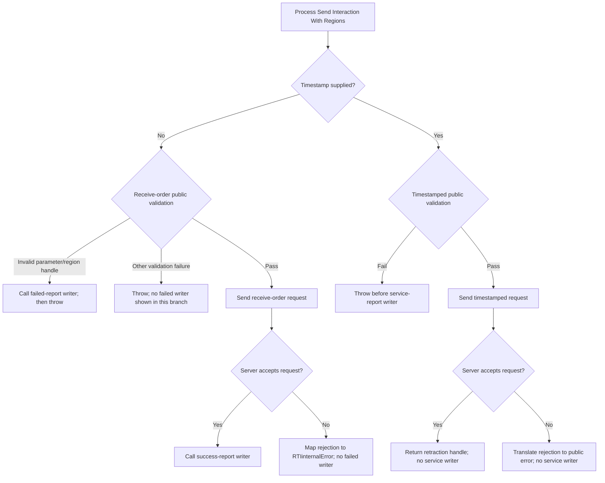

The [receive-order parameter preflight](../../cpp/src/internal/runtime/umbra_rti_ambassador_regional_interaction_send_services.cpp#L504)
and [region preflight](../../cpp/src/internal/runtime/umbra_rti_ambassador_regional_interaction_send_services.cpp#L531),
[success writer](../../cpp/src/internal/runtime/umbra_rti_ambassador_regional_interaction_send_services.cpp#L586),
and [process-error translation](../../cpp/src/internal/runtime/umbra_rti_ambassador_regional_interaction_send_services.cpp#L605)
show that wrapper boundary. The [timestamped process fast path](../../cpp/src/internal/runtime/umbra_rti_ambassador_regional_interaction_send_services.cpp#L49)
is separate from its later [embedded failure writer](../../cpp/src/internal/runtime/umbra_rti_ambassador_regional_interaction_send_services.cpp#L447).
On the server, [interaction planning/rejection](../../cpp/src/internal/federation/process_federation_service_interaction_send.cpp#L414)
is reached through the [regional request handler](../../cpp/src/internal/federation/process_federation_service_interaction_send.cpp#L665).

The process report matrix covers [invalid-region](../../cpp/tests/ieee1516_2025_connection_process_service_report_matrix_catch2.cpp#L648)
and [invalid-parameter](../../cpp/tests/ieee1516_2025_connection_process_service_report_matrix_catch2.cpp#L714)
preflight reports, not a server-rejected request. The reviewed timestamped
regional-send report cases are explicitly [embedded file-report](../../cpp/tests/timestamped_regional_interaction_failure_service_report_file_catch2.cpp#L157)
and [embedded MOM-report](../../cpp/tests/timestamped_regional_interaction_failure_service_report_interaction_catch2.cpp#L90)
tests; they do not establish process behavior. No focused process test in this
review asserts service-invocation reporting for a server-rejected regional
send or for the timestamped process branch. Keep these as implementation and
test-scope observations, not normative behavior or profile-parity claims.

### Synchronization reports separate invocation success from registration outcome

The public [`registerFederationSynchronizationPoint`](../../third_party/ieee1516.1-2025/include/RTI/RTIambassador.h#L274)
service (§4.14) requests a registration; the distinct
[`synchronizationPointRegistrationSucceeded`](../../third_party/ieee1516.1-2025/include/RTI/FederateAmbassador.h#L73)
and [`synchronizationPointRegistrationFailed`](../../third_party/ieee1516.1-2025/include/RTI/FederateAmbassador.h#L79)
callbacks (§4.15) carry its outcome. For the underlying barrier state and
announcement/completion transitions, see the
[Federation Synchronization guide](HLA-2025-FEDERATION-SYNCHRONIZATION-FLOW-GUIDE.md#hla-vocabulary-registration-announcement-and-completion-differ).
This section follows the portable TCK's service-report view of those stages.

The scenario joins a subject, another synchronization participant, and a
report sink; it subscribes the sink and then enables Service Reporting only on
the subject. The subject registers one label for both participants, retries
that same label, and then reports achievement. The second participant reports
`successfully=false` for the original point. The sink therefore sees only the
subject's report serials:

| Serial | Subject action or RTI callback stage | Reported distinction |
| ---: | --- | --- |
| 0 | Register the label with the user tag and synchronization set; the call returns normally. | `RegisterFederationSynchronizationPoint` |
| 1 | RTI reports a successful registration-result callback. | `ConfirmSynchronizationPointRegistration`; registration indicator `true`, failure reason `Null` |
| 2 | RTI announces the label and tag to the selected participants. | `AnnounceSynchronizationPoint` |
| 3 | Register the same label again; the call still returns normally. | `RegisterFederationSynchronizationPoint` |
| 4 | RTI reports the duplicate-label registration-result callback. | `ConfirmSynchronizationPointRegistration`; registration indicator `false`, failure reason `"SYNCHRONIZATION_POINT_LABEL_NOT_UNIQUE"` |
| 5 | Subject reports achievement with `successfully=true`. | `SynchronizationPointAchieved` |
| 6 | RTI reports federation-level completion. | `FederationSynchronized` |

The serial-4 record exposes two different Booleans. Its
`HLAsuccessIndicator` remains `true` and `HLAexception` is empty because the
void registration service returned normally; the supplied
`Registration-success indicator` is `false` because the later callback
reports a rejected registration result. The duplicate label is therefore an
asynchronous registration outcome in this scenario, not a synchronous
`SynchronizationPointLabelNotUnique` exception from the public call.

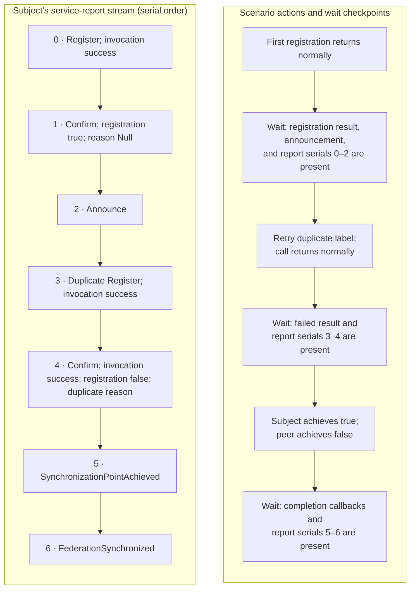

The arrows in the upper lane are the TCK's action/wait sequence; they do not
assert callback delivery order. The lower lane shows only the subject's report
serial order, with no timing relation to callbacks. The checker requires all
seven reports to use Federation Management type,
reliable transportation, a typed `Null` returned argument, an empty exception,
and a true invocation-success indicator; it checks the report serials and each
supplied argument's count, type, and name. It compares the duplicate failure
reason's value, but does not compare every supplied value, decode the
reported-federate field, or inspect the reported federate-set payload. The
scenario separately checks the registration callback
label, the announcement callback's label and tag, and that the final callback's
failed set contains the participant that achieved with `false`. It waits for
the callback and report predicates but does not assert their relative order.
See the
[focused scenario](../../packages/hla-rti-cpp-tck/src/tck_service_report_scenarios.cpp#L797),
its [record checker](../../packages/hla-rti-cpp-tck/src/tck_service_report_scenarios.cpp#L892),
and [seven serial assertions](../../packages/hla-rti-cpp-tck/src/tck_service_report_scenarios.cpp#L977).
The package README records a [4/4 installed-package result](../../packages/hla-rti-cpp-tck/README.md#L3078)
across both callback models; this documentation increment did not rerun the
scenario.

The embedded 2025 source releases its native locks, records the registration
and confirmation reports, and then submits registration callbacks. Its
`SynchronizationPointAchieved` path likewise records the invocation before
submitting `FederationSynchronized` notifications
([registration report and callback boundary](../../cpp/src/internal/runtime/umbra_rti_ambassador_federation_lifecycle.cpp#L1237),
[achievement report and notifications](../../cpp/src/internal/runtime/umbra_rti_ambassador_federation_lifecycle.cpp#L1383)).
The configured-process registration branch dispatches the registration result
callback before selecting those report records
([process branch](../../cpp/src/internal/runtime/umbra_rti_ambassador_federation_lifecycle.cpp#L1147)).
These are source-derived path details; the portable scenario does not assert
callback/report timing or establish ordering parity between those paths.

## Callback order: a focused interaction example

When one public service produces both a service-report interaction and an
application interaction callback for the same observer, their order is
observable and can matter. The focused embedded 2025 case covers one
receive-order send and one timestamped `sendDirectedInteraction` call. Under
`HLA_EVOKED`, it observes each invocation's report before that invocation's
directed callback. These are the public
[`sendDirectedInteraction` overloads](../../third_party/ieee1516.1-2025/include/RTI/RTIambassador.h#L796)
and the [`receiveDirectedInteraction` callback](../../third_party/ieee1516.1-2025/include/RTI/FederateAmbassador.h#L290):

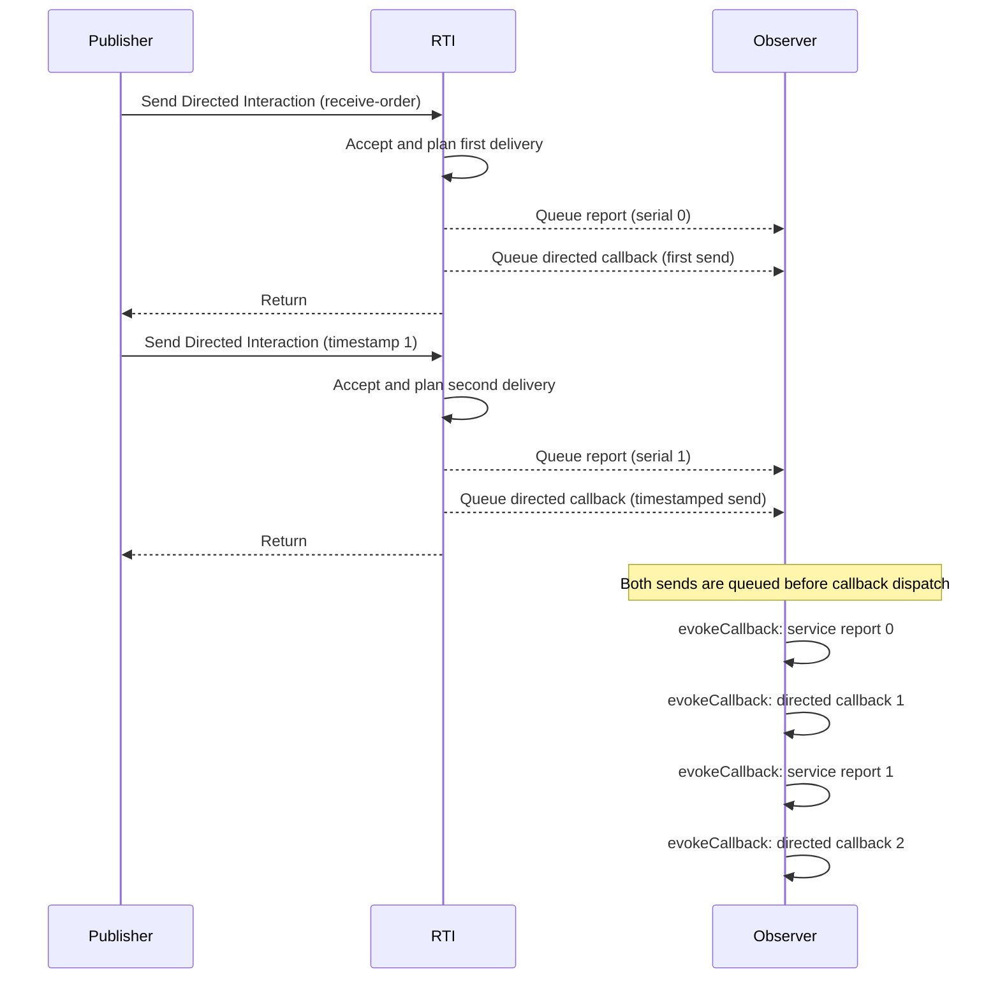

The test queues both sends before evoking one callback at a time and checks the
order report 0, directed callback 1, report 1, directed callback 2. The
timestamped send carries time 1, but this observer receives it in receive
order; the case does not establish a time-regulating TSO schedule. In the
embedded implementation, each accepted-service report is routed before its
corresponding directed callback is queued ([receive-order path](../../cpp/src/internal/runtime/umbra_rti_ambassador_directed_interaction_services.cpp#L300),
[timestamped path](../../cpp/src/internal/runtime/umbra_rti_ambassador_directed_interaction_services.cpp#L719),
[shared report-interaction queue](../../cpp/src/internal/runtime/umbra_rti_ambassador_service_report_writers.cpp#L95)).
The result is specific to this embedded test under `HLA_EVOKED`; it does not
establish `HLA_IMMEDIATE` or configured-process ordering, nor a universal order
among HLA services and callbacks. See the
[directed invocation ordering test](../../cpp/tests/ieee1516_2025_service_report_directed_invocation_ordering_interaction_catch2.cpp#L5)
and the separate [callback-ordering guide](HLA-2025-CALLBACK-AND-SERVICE-ORDERING-FLOW-GUIDE.md).

## Per-member report-file lifetime

For the embedded profile, Join creates a report writer and file with an initial
membership record, even when both reporting switches are off. The path stays
fixed for that joined membership. Invocation records append only while Service
Reporting and the file sink are both enabled; disabled intervals add no
invocation records, and switch changes do not rotate the path.

Embedded Resign removes the member first, then attempts to append the successful
`ResignFederationExecution` service report before retiring the writer. If that
append fails, membership is still removed, the writer is still retired, and
the call ultimately raises `RTIinternalError`. The
[Join writer creation](../../cpp/src/internal/runtime/umbra_rti_ambassador_federation_lifecycle.cpp#L604),
[Resign append boundary](../../cpp/src/internal/runtime/umbra_rti_ambassador_federation_lifecycle.cpp#L875),
[writer retirement](../../cpp/src/internal/runtime/umbra_rti_ambassador_federation_lifecycle.cpp#L932),
and [post-cleanup error](../../cpp/src/internal/runtime/umbra_rti_ambassador_federation_lifecycle.cpp#L1040)
show this sequence. The focused embedded file-lifecycle test verifies the
initial file, stable path across switch toggles, and a distinct file after
rejoin; it does not inspect the final Resign report or inject its append
failure. A later Join is a new membership with a new path, while the earlier
file remains present.

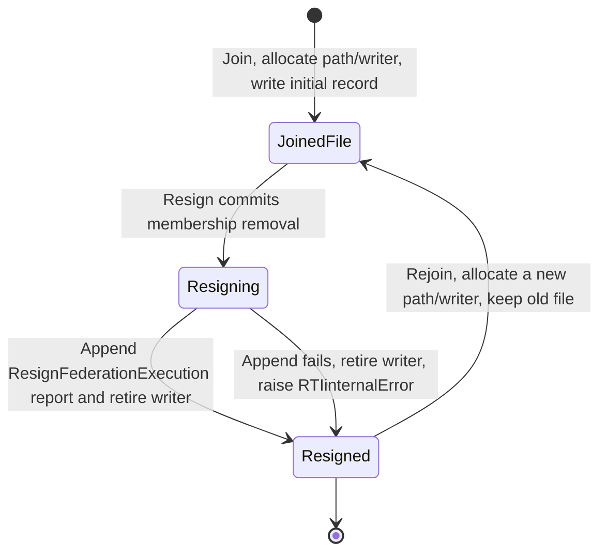

The file is therefore per joined membership, not per RTI ambassador process or
per reporting-switch cycle. The focused [embedded file-lifecycle test](../../cpp/tests/ieee1516_2025_service_report_file_lifecycle_catch2.cpp#L4)
and [process endpoint file cases](../../cpp/tests/ieee1516_2025_connection_service_report_catch2.cpp#L154)
cover distinct paths; they should not be read as one shared file implementation.

The configured-process endpoint has a separate per-session writer. Its Join
handler creates the writer, installs the report path in the joined-federate
MOM state, and stores the writer in the session before replying successfully
([allocation and MOM setup](../../cpp/src/internal/federation/process_federation_service_lifecycle.cpp#L740),
[session installation](../../cpp/src/internal/federation/process_federation_service_lifecycle.cpp#L795)).
The process switch-cycle case turns each gate off and back on, checks that
disabled intervals add no invocation records, and keeps the same file path
([switch-cycle case](../../cpp/tests/ieee1516_2025_connection_service_report_catch2.cpp#L368),
[file-sink cycle](../../cpp/tests/ieee1516_2025_connection_service_report_catch2.cpp#L577),
[master-switch cycle](../../cpp/tests/ieee1516_2025_connection_service_report_catch2.cpp#L589),
[stable path assertion](../../cpp/tests/ieee1516_2025_connection_service_report_catch2.cpp#L598)).
A separate process MOM case toggles only the file switch, explicitly requests
the stable path, then rejoins under the same federate name and observes a new
MOM object with a different absolute path while the earlier file remains
unchanged
([file switch](../../cpp/tests/ieee1516_2025_connection_process_joined_federate_mom_report_file_catch2.cpp#L481),
[explicit request](../../cpp/tests/ieee1516_2025_connection_process_joined_federate_mom_report_file_catch2.cpp#L486),
[new path on rejoin](../../cpp/tests/ieee1516_2025_connection_process_joined_federate_mom_report_file_catch2.cpp#L548),
[prior file preserved](../../cpp/tests/ieee1516_2025_connection_process_joined_federate_mom_report_file_catch2.cpp#L555)).
The direct [process file-rejoin case](../../cpp/tests/ieee1516_2025_connection_service_report_catch2.cpp#L1995)
also checks that the first file remains byte-for-byte unchanged after Resign
and that rejoining creates a second path. It does not exercise invocation
appends or serial continuation. The switch-cycle case exercises appends but
does not rejoin; these process paths remain separate from the embedded writer
lifetime above. This documentation review did not rerun them.

For the difference between the Join-time path and the MIM's
`HLAreportServiceFile` Conditional update trigger, see the
[Federation MOM source/MIM comparison](HLA-2025-FEDERATION-MOM-FLOW-GUIDE.md#report-file-condition-and-join-time-value).

## A failed report append leaves Exception Reporting enabled

This chart follows the embedded 2025 path with Service Reporting already on and
the file sink selected. `setExceptionReportingSwitch(true)` commits the distinct
Exception Reporting switch in the registry and prepares its joined-federate
MOM work before it appends the setter's successful service-invocation record.
When the append succeeds, the setter queues that MOM update and returns normally.
When the append fails, the `RTIinternalError` enters the setter's catch, which
makes a best-effort `emitExceptionReport` call and then rethrows the original
error. The switch mutation is already committed, so it remains `true`; because
the append threw before the later MOM enqueue, that projection is skipped.

The hook plans `HLAreportException` from current member state. It can submit a
receive-order callback only when Exception Reporting is on and an eligible
observer route exists. Delivery follows the observer's callback route:
`HLA_EVOKED` queues the callback for a later evoke, while `HLA_IMMEDIATE` may
invoke user code inline before the setter rethrows. The embedded source shows
this ordering in the [setter](../../cpp/src/internal/runtime/umbra_rti_ambassador_service_reporting_switches.cpp#L278),
[registry switch write](../../cpp/src/internal/federation/federation_registry_control_state.cpp#L665),
[exception hook](../../cpp/src/internal/runtime/umbra_rti_ambassador_mom_service_report_interaction.cpp#L185),
[recipient planner](../../cpp/src/internal/federation/federation_registry.cpp#L1780),
[report append before MOM enqueue](../../cpp/src/internal/runtime/umbra_rti_ambassador_service_reporting_switches.cpp#L297), the [receive-order callback route](../../cpp/src/internal/runtime/umbra_rti_ambassador.cpp#L1179), and the [immediate-dispatch boundary](../../cpp/src/internal/runtime/umbra_rti_ambassador.cpp#L1059).
The focused [injected-writer case](../../cpp/tests/service_report_writer_failure_catch2.cpp#L132)
uses `HLA_EVOKED` and asserts `RTIinternalError` plus a still-enabled switch,
but has no peer and no callback or MOM-projection assertion. A previously
recorded local run failed during `createFederationExecution` at test line 148,
before reaching the append-failure assertions; this documentation review did
not rerun it. The state and callback timing here are source-derived, not a
passing runtime observation.

The configured-process setter uses a separate process-client path. This chart
does not claim the same append-failure behavior for that endpoint.

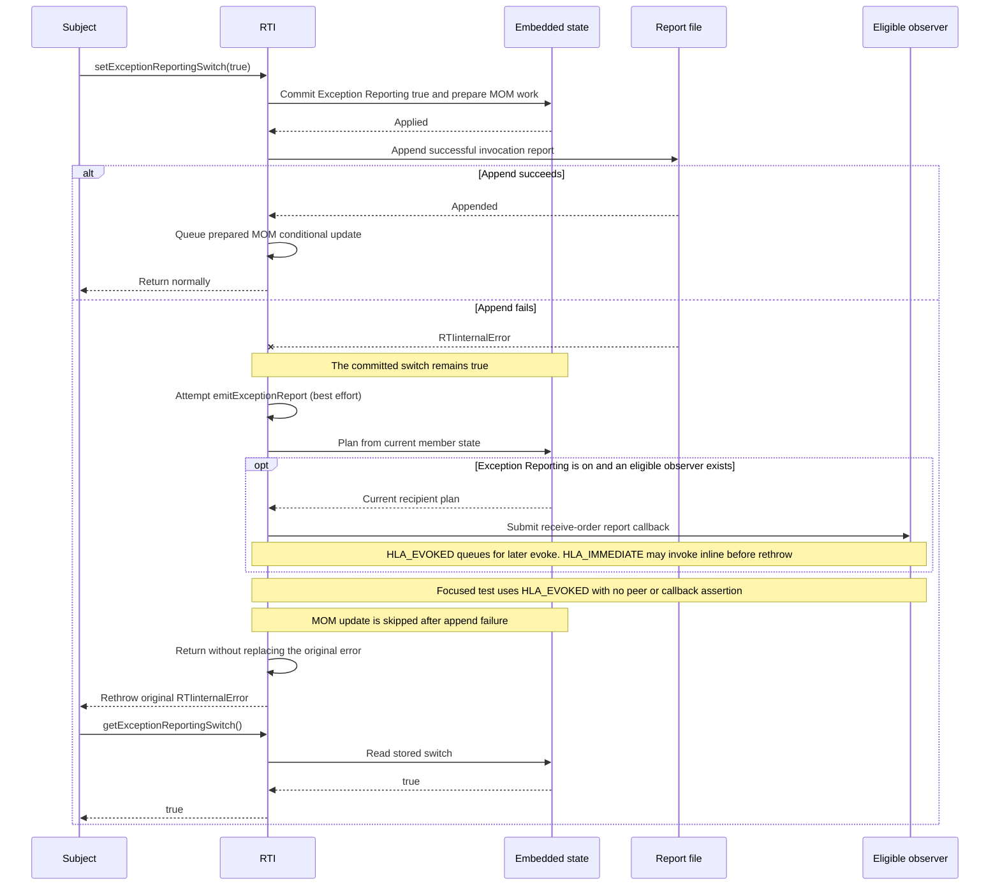

## Timestamped update admission precedes report persistence

The embedded 2025 timestamped `UpdateAttributeValues` path admits its payload
before reporting the successful invocation. In the TSO case below, a
time-regulating publisher has a timestamp-ordered passel for a
time-constrained receiver; the registry accepts the payload and retraction
entry before the reporting helper runs. The helper can emit a selected
`HLAreportServiceInvocation` interaction or append a selected file record. The
failure branch below is specifically a file-append failure. After reporting
returns successfully, the wrapper records success, reevaluates pending grants,
submits eligible grant dispatches and remaining callbacks, then returns the
retraction handle. See the [queue admission and report call](../../cpp/src/internal/runtime/umbra_rti_ambassador_attribute_update_services.cpp#L700)
and the [report-route selector](../../cpp/src/internal/runtime/umbra_rti_ambassador_service_report_writers.cpp#L191).

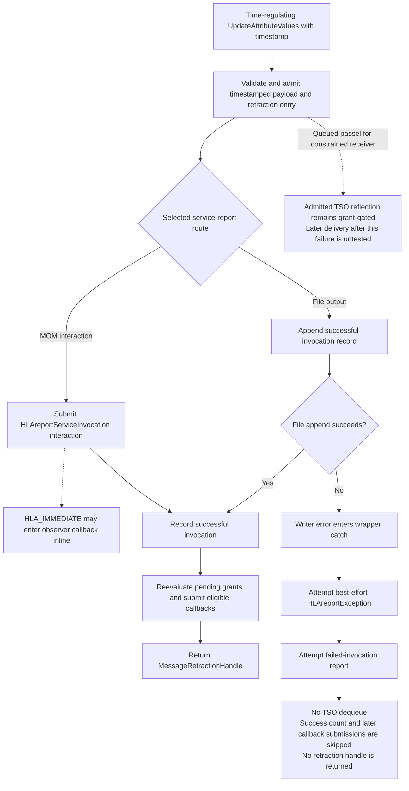

The two success tests cover different combinations. The [time-regulated MOM
case](../../cpp/tests/ieee1516_2025_time_regulated_timestamped_update_attribute_values_service_report_mom_catch2.cpp#L5)
uses a time-regulating publisher, a constrained receiver, and an `HLA_IMMEDIATE`
observer; it sees the report before the constrained reflection. The [file
case](../../cpp/tests/ieee1516_2025_timestamped_update_attribute_values_service_report_catch2.cpp#L5)
checks a durable file record at reflection callback entry, but its publisher
is not time regulating, so it does not exercise TSO queue admission. Neither
test injects a report failure in this timestamped service. The source catch
does not dequeue an already-admitted TSO message, but no cited test establishes
whether that message later reaches a callback after the file append failure.
The only injected file-writer failure case covers
[`setExceptionReportingSwitch`](../../cpp/tests/service_report_writer_failure_catch2.cpp#L132),
not this update service. The catch attempts a failed-invocation report before
its bare rethrow; if that second report attempt also throws, the second error
can escape first. The
[time-management guide](HLA-2025-TIME-MANAGEMENT-GUIDE.md) covers later grant
and TSO delivery gates. This sequence makes no 2010 or configured-process
parity claim.

## Embedded Connection Lost: the final file-report failure follows resignation

This is a separate embedded 2025 RTI-originated path, not a failed
federate-initiated service call. The registry commits forced resignation and
reserves the final service-report serial before erasing the member when the
selected destination is the file. The adapter appends the `ConnectionLost`
record while the departed member's writer is still available, then clears its
joined state and releases that writer. If append fails, it defers the
`RTIinternalError`, finishes cleanup and callback submission, and raises the
error afterward. The forced-loss registry route reserves a final file serial
only; it does not reserve a final `HLAreportServiceInvocation` interaction for
the removed member.

Keep two loss-report routes distinct. The `ConnectionLost` service invocation
is written to the lost member's selected report file. The separate
`HLAreportFederateLost` interaction goes to surviving subscribers and is queued
before automatic-resign consequences such as object removal. The lost member's
local `connectionLost` callback follows its own callback model.

The two sequence views preserve the important ownership boundary: the first
ends when the registry has committed the resignation and returns its result;
the second follows RTI-side cleanup, the optional file append, callback
submission, and deferred error reporting after that commit. The adapter then
clears connected, time, and join state and resets the old callback queue. If
the reserved final file append throws, it defers the error, completes cleanup
and surviving-member notification submission, and raises `RTIinternalError`
only afterward.

**Registry commit and final report reservation**

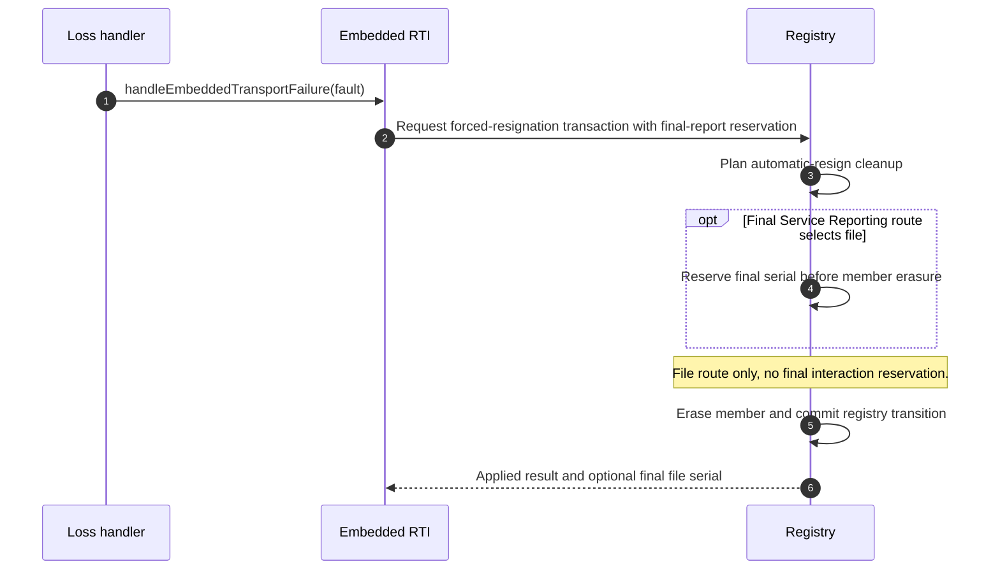

**Post-commit RTI cleanup and delivery**

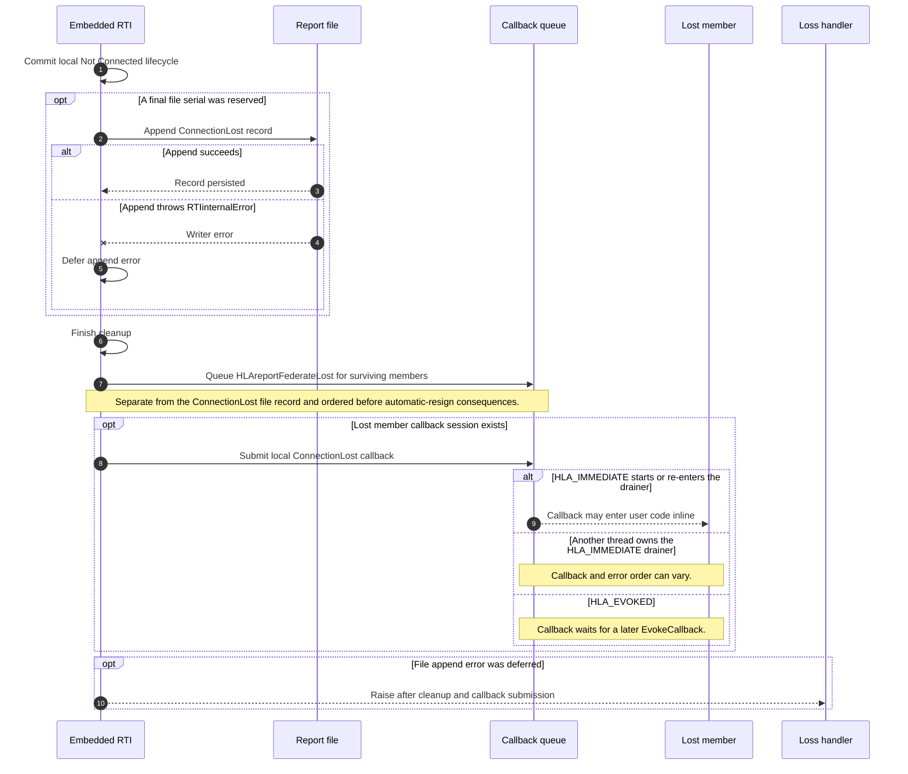

The focused [file-report case](../../cpp/tests/ieee1516_2025_service_report_catch2.cpp#L503)
asserts that the successful `ConnectionLost` record is durable before the
lost member's `HLA_EVOKED` callback. A previous local run failed during
`createFederationExecution` at test line 521, before those assertions; this
documentation review did not rerun it. A separate
[survivor-order case](../../cpp/tests/ieee1516_2025_connection_lost_report_ordering_catch2.cpp#L5)
checks that `HLAreportFederateLost` reaches two `HLA_EVOKED` survivors before
their automatic `DELETE_OBJECTS` removal callbacks. It tests that interaction
ordering, not the lost member's file record or its append-failure branch.

No test injects a `ConnectionLost` report-file failure. The deferred error and
callback-model interleavings are source-derived. The immediate dispatcher may
invoke inline when this thread starts or re-enters the drainer; when another
thread owns it, the callback can remain queued as the error escapes. The
deterministic embedded transport calls its failure handler synchronously and
does not catch the deferred error; this does not define process-endpoint or
future socket/IPC behavior. The diagrams make no 2010 or process-parity claim.

## Implementation and test evidence

| Concern | Umbra implementation | Focused evidence |
| --- | --- | --- |
| Service Reporting switch and join/leave boundary | [Public switch services](../../cpp/src/internal/runtime/umbra_rti_ambassador_service_reporting_switches.cpp#L74), [registry state transition](../../cpp/src/internal/federation/federation_registry_control_state.cpp#L316) | [switch/subscription interlock](../../cpp/tests/mom_service_reporting_interlock_catch2.cpp#L66) |
| Ordinary, passive, and regional report-service subscriptions | [Exact subscription predicate](../../cpp/src/internal/federation/federation_registry_regions.cpp#L564) | [interlock scenarios](../../cpp/tests/mom_service_reporting_interlock_catch2.cpp#L66) |
| Subject, sink, and eligible observer planning | [routing plan](../../cpp/src/internal/federation/federation_registry_mom_service_reporting.cpp#L53), [serial reservation](../../cpp/src/internal/federation/federation_registry_mom_service_reporting.cpp#L148) | [service-report interaction scenario](../../cpp/tests/ieee1516_2025_service_report_directed_invocation_ordering_interaction_catch2.cpp#L5) |
| Success/failure service report writing | [report writers](../../cpp/src/internal/runtime/umbra_rti_ambassador_service_report_writers.cpp#L132) | [master-switch suppression despite file switch on](../../cpp/tests/ieee1516_2025_service_report_disabled_suppression_integration_catch2.cpp#L6) |
| Synchronization invocation versus callback result | [embedded registration reports before callback handoff](../../cpp/src/internal/runtime/umbra_rti_ambassador_federation_lifecycle.cpp#L1239), [achievement report before completion notifications](../../cpp/src/internal/runtime/umbra_rti_ambassador_federation_lifecycle.cpp#L1383), [configured-process registration dispatches first](../../cpp/src/internal/runtime/umbra_rti_ambassador_federation_lifecycle.cpp#L1147) | [seven-record portable scenario](../../packages/hla-rti-cpp-tck/src/tck_service_report_scenarios.cpp#L977) |
| Embedded switch commit before selected file append | [switch service and post-append MOM enqueue](../../cpp/src/internal/runtime/umbra_rti_ambassador_service_reporting_switches.cpp#L219), [best-effort exception hook](../../cpp/src/internal/runtime/umbra_rti_ambassador_mom_service_report_interaction.cpp#L225), [exception-report switch and recipient planning](../../cpp/src/internal/federation/federation_registry.cpp#L1894) | [injected append failure keeps switch enabled](../../cpp/tests/service_report_writer_failure_catch2.cpp#L132); the test body asserts the thrown RTI error and getter value, but a previously recorded local run failed during federation creation before those assertions; this documentation review did not rerun it. No MOM projection or exception-report callback is asserted |
| Timestamped Update Attribute Values queue/report boundary | [embedded timestamped wrapper](../../cpp/src/internal/runtime/umbra_rti_ambassador_attribute_update_services.cpp#L373), [TSO admission](../../cpp/src/internal/runtime/umbra_rti_ambassador_attribute_update_services.cpp#L699), [report append](../../cpp/src/internal/runtime/umbra_rti_ambassador_attribute_update_services.cpp#L727), [post-report accounting/callback path](../../cpp/src/internal/runtime/umbra_rti_ambassador_attribute_update_services.cpp#L734), [registry queue commit](../../cpp/src/internal/federation/federation_registry_time_tso_enqueue.cpp#L453), [exception/failure-report catch](../../cpp/src/internal/runtime/umbra_rti_ambassador_attribute_update_services.cpp#L815) | [time-regulated MOM ordering](../../cpp/tests/ieee1516_2025_time_regulated_timestamped_update_attribute_values_service_report_mom_catch2.cpp#L5) and [file-report before reflection](../../cpp/tests/ieee1516_2025_timestamped_update_attribute_values_service_report_catch2.cpp#L5) cover successful paths. The injected writer-failure case covers a different service; no cited test covers this combined failure schedule |
| Embedded ConnectionLost final file report | [forced-loss registry reserves only the file serial before member erasure](../../cpp/src/internal/federation/federation_registry_resign_lifecycle.cpp#L1087), [adapter appends while the writer is live](../../cpp/src/internal/runtime/umbra_rti_ambassador_membership_loss.cpp#L306), [releases the writer](../../cpp/src/internal/runtime/umbra_rti_ambassador_membership_loss.cpp#L326), [queues HLAreportFederateLost for survivors](../../cpp/src/internal/runtime/umbra_rti_ambassador_membership_loss.cpp#L355), [submits the local callback](../../cpp/src/internal/runtime/umbra_rti_ambassador_membership_loss.cpp#L440), and [raises a deferred append error](../../cpp/src/internal/runtime/umbra_rti_ambassador_membership_loss.cpp#L462); [embedded failure handler](../../cpp/src/internal/federation/embedded_transport.cpp#L29), [callback dispatch model](../../cpp/src/internal/callbacks/callback_dispatcher.cpp#L122), [file append boundary](../../cpp/src/internal/runtime/umbra_rti_ambassador_service_report_writers.cpp#L335) | [successful file-record case](../../cpp/tests/ieee1516_2025_service_report_catch2.cpp#L503) was previously observed failing during federation creation at line 521, before its assertions; this review did not rerun it. [Separate survivor-order case](../../cpp/tests/ieee1516_2025_connection_lost_report_ordering_catch2.cpp#L5) covers HLAreportFederateLost before automatic removals, not the file record or append failure. No test injects a failed ConnectionLost append. |
| RTI-originated receive-order callback and callback-time recheck | [interaction callback path](../../cpp/src/internal/runtime/umbra_rti_ambassador_mom_service_report_interaction.cpp#L227) | [report precedes directed callback](../../cpp/tests/ieee1516_2025_service_report_directed_invocation_ordering_interaction_catch2.cpp#L118); that case does not mutate the subscription between planning and delivery |
| Embedded per-membership file creation and final lifetime | [Join writer creation](../../cpp/src/internal/runtime/umbra_rti_ambassador_federation_lifecycle.cpp#L604), [Resign append](../../cpp/src/internal/runtime/umbra_rti_ambassador_federation_lifecycle.cpp#L881), [writer retirement](../../cpp/src/internal/runtime/umbra_rti_ambassador_federation_lifecycle.cpp#L932), [post-cleanup error](../../cpp/src/internal/runtime/umbra_rti_ambassador_federation_lifecycle.cpp#L1040) | [embedded immutable file lifetime](../../cpp/tests/ieee1516_2025_service_report_file_lifecycle_catch2.cpp#L4); no assertion for the final Resign record or append-failure path |
| Process file route and append response | [switch-based route](../../cpp/src/internal/federation/federation_registry_mom_service_reporting.cpp#L64), [serial increment](../../cpp/src/internal/federation/federation_registry_mom_service_reporting.cpp#L178), [session-writer append](../../cpp/src/internal/federation/process_federation_service_reporting.cpp#L296), [append error response](../../cpp/src/internal/federation/process_federation_service_reporting.cpp#L326) | [append failure after file loss](../../cpp/tests/ieee1516_2025_connection_service_report_catch2.cpp#L2219), [append failure after permission change](../../cpp/tests/ieee1516_2025_connection_service_report_catch2.cpp#L2398) |
| Process file path, switch cycles, and rejoin | [process Join writer creation](../../cpp/src/internal/federation/process_federation_service_lifecycle.cpp#L740), [session installation](../../cpp/src/internal/federation/process_federation_service_lifecycle.cpp#L795) | [independent files](../../cpp/tests/ieee1516_2025_connection_service_report_catch2.cpp#L154), [path and append gates across switch cycles](../../cpp/tests/ieee1516_2025_connection_service_report_catch2.cpp#L368), [direct file rejoin](../../cpp/tests/ieee1516_2025_connection_service_report_catch2.cpp#L1995), [MOM path after rejoin](../../cpp/tests/ieee1516_2025_connection_process_joined_federate_mom_report_file_catch2.cpp#L499) |
| Process report-recipient snapshot and callback boundary | [report handler](../../cpp/src/internal/federation/process_federation_service_reporting.cpp#L232), [switch interlock](../../cpp/src/internal/federation/federation_registry_control_state.cpp#L330), [subscription interlock](../../cpp/src/internal/federation/federation_registry_directed_interactions.cpp#L551), [pull dequeue](../../cpp/src/internal/federation/process_federation_service_receive.cpp#L123), [callback bridge](../../cpp/src/internal/federation/process_federation_callback_bridge.cpp#L1378) | [interlock test](../../cpp/tests/mom_service_reporting_interlock_catch2.cpp#L66), [regional-send success report](../../cpp/tests/ieee1516_2025_connection_process_service_report_matrix_catch2.cpp#L626), [separate reporter/observer setup](../../cpp/tests/ieee1516_2025_connection_process_service_report_interaction_helpers.hpp#L424), [serial assertion](../../cpp/tests/ieee1516_2025_connection_process_service_report_interaction_helpers.hpp#L1414) — the helper invokes the service before explicit observer Evoke; no post-plan subscription mutation, push-mode, or `HLA_IMMEDIATE` report timing test. |

These are selected implementation and integration scenarios. A passing case
does not establish complete service coverage, every regional boundary, or
conformance.

## What this guide does not claim

- It does not describe IEEE 1516.1-2010 or infer that edition's reporting
  behavior from 2025 code.
- It does not claim identical embedded and process-endpoint routing, file
  semantics, failure recovery, or concurrency behavior.
- The switch append-failure sequence has one injected embedded writer case;
  the timestamped-update and ConnectionLost append-failure branches are
  source-derived and lack tests for those exact failure schedules. None
  establishes process-endpoint behavior. The skipped MOM projection enqueue
  is source-derived, and actual `HLAreportException` delivery is not asserted
  by the switch test.
- It does not claim every public service's success and exception payload has
  been checked field by field by the linked focused tests.
- It does not establish that a late subscription change after serial reservation
  is rolled back; current source drops a stale recipient at callback time.
- It does not trace the recipient routing of `HLAreportException`,
  `HLAreportMOMexception`, all MOM object projections, periodic updates, or
  general callback ordering.
- It does not add or revise Requirements Lab records.
