# IEEE 1516.1-2025 Service Invocation Reporting: Contributor Flow Guide

Treat service-invocation reporting as an observation about a service call, not
as the service operation itself. Keep the caller's result and state effect
separate from whether a report is produced, which destination is selected,
and whether another federate later observes a report interaction. The report's
subject and its observer are different roles.

This guide traces those questions through selected Umbra behavior, including
switches, destinations, interaction filtering, file lifetime, and callback
delivery. The implementation examples are not a universal report-routing
algorithm or a conformance claim.

## Scope and authority

- **Edition boundary:** IEEE 1516.1-2025 only. The 2010 API/runtime remains a
  separate compatibility stream; this guide makes no 2010 parity claim.
- **Implementation boundary:** detailed behavior is the 2025 embedded
  federation-management development profile. Selected process-endpoint tests
  appear as separate evidence, not proof that all routes or failures are
  equivalent.
- **Normative authority:** the [official IEEE 1516.1-2025 Federate Interface
  Specification](https://standards.ieee.org/ieee/1516.1/6688/) defines service
  behavior. The standard is authoritative; source links explain Umbra's
  present behavior and tests establish only the scenarios they exercise.
  IEEE 1516.1-2025 §11.5.1 and §11.5.2 are useful clause pointers for service
  invocation reporting and report files; verify exact wording and applicability
  in the official standard.
- **Documentation boundary:** this is an Umbra contributor guide, not new
  requirements, a Requirements Lab mapping, or conformance evidence.

The scope here is the `HLAreportServiceInvocation` path and its per-member
service-report file. A few failure traces mention an `HLAreportException`
attempt only to explain its ordering relative to a service report; they are not
a complete account of exception-report routing. For the separate
`HLAreportException` and `HLAreportMOMexception` paths, see the
[exception-reporting guide](HLA-2025-EXCEPTION-REPORTING-FLOW-GUIDE.md). This
guide also does not attempt to diagram all other Management Object Model
(MOM) state projections.

For deeper implementation notes, see the [MOM service-reporting design](MOM-SERVICE-REPORTING-DESIGN.md#delivery-and-state-invariants)
and the separate [callback/service-ordering guide](HLA-2025-CALLBACK-AND-SERVICE-ORDERING-FLOW-GUIDE.md).
For a cross-service reasoning aid that separates caller outcome, state commit,
and optional reporting/observation effects, see the
[2025 cross-cutting guide](HLA-2025-CROSS-CUTTING-STATE-EVENT-OBSERVATION-GUIDE.md#a-service-result-committed-state-and-a-report-are-separate-traces).

## Three distinct traces: call outcome, invocation report, requested MOM report

The word “report” covers two different paths here. The 2025 MIM defines
`HLAreportServiceInvocation` as an RTI report about a service invocation while
Service Reporting is enabled: its parameters describe the supplied arguments
and the invocation's returned value or exception
([MIM class](../../third_party/ieee1516.2-2025/resources/mim/HLAstandardMIM-2025.xml#L1777)).
For this interaction destination, the pinned 2025 MIM specifies:

| Interaction contract | MIM-defined behavior |
| --- | --- |
| Scope and delivery | RTI-originated `HLAreportServiceInvocation`, scoped by `HLAfederate` and `HLAserviceGroup`, sent reliably in receive order. |
| Successful invocation | Supplied arguments and a true success indicator; the returned value when the service returns one; an empty exception description. |
| Failed invocation | Supplied arguments and a false success indicator; a null returned argument and a description of the raised exception. |
| Serial | Starts at zero per joined federate and increments for each report interaction for that member. |

This is the interaction contract, not a complete definition of Umbra's
per-member report-file format or lifetime.

In Umbra, the subject's switches select a per-member file record or the
`HLAreportServiceInvocation` interaction. This is not the same as explicitly
requesting current Federation MOM data with an `HLArequest...` interaction.

| Trace | Trigger | What its result or observation means |
| --- | --- | --- |
| Public service outcome | The federate invokes an HLA service. | The return value or synchronous exception is the outcome of that service call; it is not itself a report record or observer callback. See the [cross-service result map](HLA-2025-CROSS-CUTTING-STATE-EVENT-OBSERVATION-GUIDE.md#a-service-result-committed-state-and-a-report-are-separate-traces). |
| Per-invocation report | A reportable service is invoked while the subject's Service Reporting switch is enabled. | The MIM-defined report describes that invocation. Umbra routes it to the selected file or interaction sink; source-observed file-append errors can affect the caller-visible outcome in selected wrappers (the cited writer test did not reach its relevant assertions), while interaction observation follows recipient and callback rules below. |
| Request-driven Federation MOM report | A federate explicitly sends a request such as `HLArequestFOMmoduleData`. | The RTI builds a separate `HLAreport...` interaction from requested MOM/FOM/synchronization state. `sendInteraction` returns or throws for that send call; it does not return the report payload. The report reaches eligible observers as a separate callback. The selected embedded `HLA_EVOKED` case asserts observation only after callback draining ([focused case](HLA-2025-FEDERATION-MOM-FLOW-GUIDE.md#federation-reports-are-receive-order-interactions)). |

These are distinct triggers, not one synchronous RPC timeline: a MOM
`HLAreport...` is a separate RTI interaction emitted in response to a request,
not a return value from that same `sendInteraction`. They also do not imply
that report failures can never affect a service result: for one embedded
switch-setting path, an append failure surfaces as `RTIinternalError` after
the Exception Reporting switch has committed
([selected failure trace](#a-failed-report-append-leaves-exception-reporting-enabled)).
That ordering is service-wrapper-specific. The Federation MOM guide's paired
request/report interactions are a separate receive-order path, not another
`HLAreportServiceInvocation` record.

For a rejected MOM `Send Interaction`, also keep the independent
`HLAreportMOMexception` and public-service `HLAreportException` routes
distinct. Their attempted paths differ between the covered embedded and
configured-process wrappers; see the exception guide's
[MOM-rejection overlap map](HLA-2025-EXCEPTION-REPORTING-FLOW-GUIDE.md#a-mom-rejection-may-also-enter-the-general-exception-hook).
That does not establish a `HLAreportServiceInvocation` record for every such
failure.

## The mental model: subject, switch, sink, observer

There are two roles in a report interaction:

- The **subject** is the joined federate whose public service was invoked.
  Its Service Reporting switch decides whether that service call is reportable.
- An **observer** is a joined federate whose subscription and DDM scope select
  it to receive the RTI-originated report interaction. The observer's own
  Service Reporting switch controls reports about its services; it does not
  gate its receipt of another subject's report.

The subject's two switches are also different controls:

| Control | What it decides | Important distinction |
| --- | --- | --- |
| Service Reporting switch | Whether successful or failed service invocations by this joined member are reported. | This is the master gate. Turning it off suppresses both report destinations. |
| Send Service Reports To File switch | Which sink is selected while Service Reporting is enabled. | Enabled selects the member's report file instead of the `HLAreportServiceInvocation` interaction; it does not override a disabled master switch. |
| Exception Reporting switch | A separate MOM exception-report path. | Do not confuse an invocation report with `HLAreportException` or `HLAreportMOMexception`. A failed invocation report can carry failure/exception values without this guide modeling those separate report interactions. |

The report file is allocated for the joined-member lifetime. Its initial record
does not mean that invocation reporting is enabled: the switches decide
whether later service invocations add records and which sink is selected.

## The exact report interaction has a switch/subscription interlock

The Service Reporting switch and a subscription to the exact
`HLAreportServiceInvocation` interaction cannot be active for the same member
at the same time. This includes ordinary, passive, and regional subscriptions.
That is a protocol guard, not merely a reporting preference:

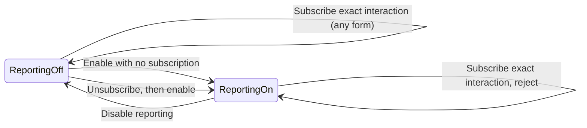

Enabling while subscribed throws `ReportServiceInvocationsAreSubscribed`;
subscribing while reporting is enabled throws
`FederateServiceInvocationsAreBeingReportedViaMOM`.

Thus the safe transition when a federate wants to observe service reports is:
disable its own Service Reporting switch, subscribe, and keep the switch off
until that subscription (including any regional declaration) is removed. The
inverse order—subscribe first, then enable reporting—is rejected and leaves the
switch off. This is directly exercised for active/passive and regional forms
by the [interlock test](../../cpp/tests/mom_service_reporting_interlock_catch2.cpp#L50).

## A reportable service call selects one destination

The following route describes the embedded callback path. Where a public-service
wrapper wires invocation reporting, a successful or failed call by a joined
subject reaches the service-report writer. Calls rejected before membership
exists are not manufactured into joined-member reports. The writer then uses
the subject's master switch and file-sink switch to choose what happens. The
configured-process endpoint uses the shared report planner and serial state,
but its recipient lifetime differs; that path is described separately below.

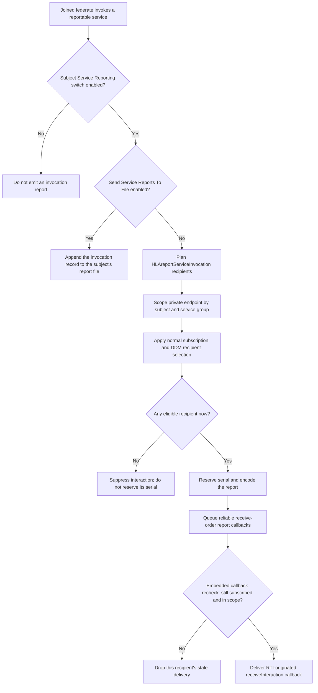

The private report endpoint is an internal producer, not a public
`sendInteraction` call. Its region identifies the subject (`HLAfederate`) and
service group (`HLAserviceGroup`); the registry selects observers through the
normal interaction subscription/DDM path. In the embedded profile, the
callback route rechecks the recipient projection so a now-stale subscription is
not delivered. Do not carry that callback-time behavior over to the configured-
process path below. Because an RTI-originated report does not go back through
the public service wrapper, reporting the report does not recursively produce
another report.

There are two useful serial-number boundaries to keep apart. If the initial
interaction plan has no eligible observer and the file sink is off, the current
implementation suppresses the report before reserving an interaction serial.
In the embedded route, if a recipient becomes ineligible after reservation but
before callback delivery, the recipient is dropped at revalidation; do not
infer that the already-reserved serial is rolled back. The process route also
reserves before enqueueing, but its later check is for a live session, not a
fresh subscription/DDM projection. The no-recipient/no-reservation rule is
source-derived; focused tests do not exhaustively exercise mutation after
reservation in either profile.

The embedded routing chart describes sink selection, not one universal
report-before-callback rule. Individual service wrappers decide whether a
report can be submitted at their particular state and lock boundary; some defer
callback-sensitive submission until after releasing service locks. For an
ordering not shown in the directed-send test, follow that service's wrapper
and its focused test rather than inferring a global ordering guarantee.

For a failed service call, the invocation report has a failed-success indicator
and the exception details in its report payload. That does not mean the
Exception Reporting switch controls this path; ordinary exception reports and
malformed-MOM reports are separate mechanisms, deliberately outside this
diagram.

### Configured-process recipient snapshot and callback boundary

For the configured-process route, the ambassador asks the process client to
write the success or failure report. The server validates that request against
the reporting session and joined member, then asks the registry to choose the
file or interaction route. For an interaction report, the registry applies the
subject and service-group endpoint together with normal subscription/DDM
selection. No eligible observer means no interaction report and no interaction
serial reservation. When observers exist, `reserveMomServiceReport` recomputes
the routing decision under the registry lock and advances the reported
member's serial only if an interaction remains eligible.

After reservation, the process server encodes the eight report parameters,
including the reported member handle and `HLAserialNumber`, and builds an
RTI-owned, reliable receive-order interaction. Before queueing or sending each
planned recipient's event, it checks that the recipient still has a mapped
session in the same federation. That is a session/federation check, not a fresh
subscription or DDM check. Pull delivery places the event in the session's
interaction queue; the later Receive Interaction poll removes that queued
interaction directly. Push delivery sends the event to the recipient session.
The process callback bridge then submits it to the callback dispatcher and
delivers `receiveInteraction` with an invalid producing-federate handle.

Push delivery is controlled by a private process-server option that defaults
to pull. When push is enabled, the server sends each selected recipient event
before it returns the reporting request's response. The receiving client's
reader buffers pushed events; its independent dispatch loop submits them once
that client's own service request is no longer in flight. The report writer
itself is synchronous: if the reporting federate is also a selected recipient,
its report request drains the buffered event before returning to the public
service wrapper. `HLA_IMMEDIATE` submission then invokes that reporter's
callback synchronously, so it can run before the public service returns;
`HLA_EVOKED` only queues it for a later evoke. A different observer has its own
reader and dispatch loop, so its `HLA_IMMEDIATE` callback may run before or
after the reporting federate's public service returns. The server's send-before-
response order does not define that cross-session callback/return order. These
are implementation consequences, not normative HLA timing rules, and no
focused process test currently exercises them.

Unlike the embedded callback route above, this process path has no
`HLAreportServiceInvocation` subscription/DDM recheck at poll or callback
admission. The callback bridge's separate projection/recheck key is specific to
`HLAreportException`; it is not attached to service-invocation report events.
Therefore a process report request's successful response establishes that the
server suppressed, appended, queued, or sent according to the selected route;
it does not establish that an observer callback has run. In push mode, a send
failure returns an internal error after serial reservation, and earlier
recipient sends may already have succeeded. These post-reservation outcomes
are source-derived; no focused test exercises them.

The focused process report matrix includes a successful regional send whose
observer receives the service report. Its helper connects both reporter and
observer with `HLA_EVOKED`, subscribes one observer, invokes `evokeCallback`,
and checks reliable transportation, the RTI-originated producer marker, the
reported-member parameter, and the first interaction serial. The server uses
the default pull-event mode; the report-specific cases do not configure
`pushReceiveOrderEvents` or `HLA_IMMEDIATE`. They also do not mutate the
subscription after planning or establish callback arrival relative to the
reporting service's return. Other process tests exercise generic push delivery,
but do not establish service-report timing. A separate process concurrency test
exercises the `HLAreportException` recheck path, not this service-invocation
route. These are 2025 configured-process source/test boundaries, not normative
HLA behavior.

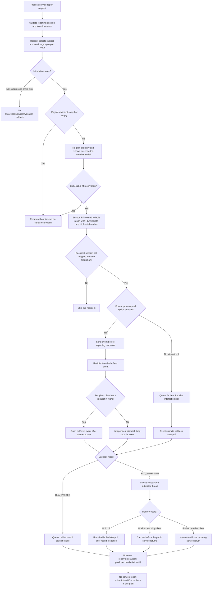

The [process report handler](../../cpp/src/internal/federation/process_federation_service_reporting.cpp#L223)
calls the shared [recipient planner](../../cpp/src/internal/federation/federation_registry_mom_service_reporting.cpp#L53)
and [serial reservation](../../cpp/src/internal/federation/federation_registry_mom_service_reporting.cpp#L144).
Its post-reservation [session check and event queue/send](../../cpp/src/internal/federation/process_federation_service_reporting.cpp#L364)
are followed by the pull path's [direct interaction dequeue](../../cpp/src/internal/federation/process_federation_service_receive.cpp#L107)
and the client's [receive-order callback bridge](../../cpp/src/internal/federation/process_federation_callback_bridge.cpp#L1211).
The bridge's [separate exception-report projection key](../../cpp/src/internal/federation/process_federation_service_protocol.hpp#L1351)
and [callback admission check](../../cpp/src/internal/federation/process_federation_callback_bridge.cpp#L1282)
do not apply to these service-invocation events.

The private [push/pull server option](../../cpp/src/internal/federation/process_federation_service.hpp#L31)
defaults to pull. The public regional [Send Interaction With Regions wrapper and
success-report point](../../cpp/src/internal/runtime/umbra_rti_ambassador_regional_interaction_send_services.cpp#L581)
calls the [service-report writer](../../cpp/src/internal/runtime/umbra_rti_ambassador_service_report_writers.cpp#L146),
which makes a synchronous [process report request](../../cpp/src/internal/federation/process_federation_client_federation_management.cpp#L487).
The [client request path](../../cpp/src/internal/federation/process_federation_client.cpp#L537)
dispatches buffered pushed events before it returns at [this boundary](../../cpp/src/internal/federation/process_federation_client.cpp#L612);
an idle recipient is serviced by its separate [client dispatch loop](../../cpp/src/internal/federation/process_federation_client.cpp#L712).
The callback dispatcher's [immediate submit path](../../cpp/src/internal/callbacks/callback_dispatcher.cpp#L122)
invokes the callback on the submitting thread.
The shared request-backed and background process callback routes are diagrammed
in the [2025 callback/service-ordering guide](HLA-2025-CALLBACK-AND-SERVICE-ORDERING-FLOW-GUIDE.md#process-endpoint-callback-exception-attribution);
this report flow applies those routes specifically to MOM report recipients.

The [process regional-send success case](../../cpp/tests/ieee1516_2025_connection_process_service_report_matrix_catch2.cpp#L626)
uses the [single-observer helper](../../cpp/tests/ieee1516_2025_connection_process_service_report_interaction_helpers.hpp#L717),
which checks the report serial at [line 1414](../../cpp/tests/ieee1516_2025_connection_process_service_report_interaction_helpers.hpp#L1414)
and the invalid producer handle at [line 982](../../cpp/tests/ieee1516_2025_connection_process_service_report_interaction_helpers.hpp#L982).
The helper configures both participants as `HLA_EVOKED`, including the [reporter](../../cpp/tests/ieee1516_2025_connection_process_service_report_interaction_helpers.hpp#L424).
The separate [process exception-report concurrency test](../../cpp/tests/ieee1516_2025_connection_process_exception_report_concurrency_catch2.cpp#L460)
is not service-invocation report coverage. No focused process test found in this
review changes a report observer's subscription between report planning and
callback delivery.

### Failed invocation reporting is wrapper-specific

The failed payload contract does not mean every thrown service call reaches a
failed-invocation writer. The reviewed ordinary `Send Interaction` wrappers
show a profile-specific boundary:

- **Embedded:** the service catch attempts the applicable MOM-exception and
  public-exception hooks, then calls the failed service-report writer before
  rethrowing. That writer independently applies the subject's Service
  Reporting switch and selected sink. No cited test observes all of these
  report paths together for one failed ordinary `Send Interaction`.
- **Configured process:** the early endpoint branch translates a rejected
  process response to `RTIinternalError` and returns from the wrapper before
  its successful-invocation writer; the reviewed branch has no failed-
  invocation-writer call. The focused process [ordinary-send case](../../cpp/tests/ieee1516_2025_connection_process_service_report_matrix_catch2.cpp#L525)
  covers success only. Some server-side `HLAsetSwitches` rejections—such as a
  malformed payload or a rejected attempt to enable Service Reporting while
  reports are subscribed—can independently emit `HLAreportMOMexception`.
  That MOM-specific path is separate from a failed-invocation report and is
  not represented in the wrapper comparison below.
- **A narrower process case:** `Send Interaction With Regions` explicitly
  calls the failed-invocation writer for specific public preflight failures.
  Focused tests cover invalid region and parameter handles; they do not show
  that a server-rejected regional request follows the same route.

The chart compares only a caught embedded exception with a rejected
configured-process response. Process-local validation failures before an
endpoint request, and the regional/timestamped overloads, are outside this
comparison.

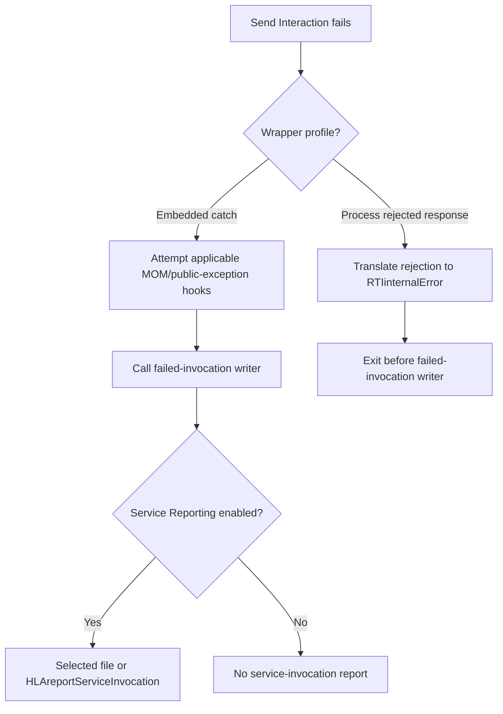

The ordinary-send source boundary is visible in the [embedded catch](../../cpp/src/internal/runtime/umbra_rti_ambassador_interaction_send_services.cpp#L2396)
and [configured-process early branch](../../cpp/src/internal/runtime/umbra_rti_ambassador_interaction_send_services.cpp#L57),
whose [service-report call follows a successful process response](../../cpp/src/internal/runtime/umbra_rti_ambassador_interaction_send_services.cpp#L130).
The [regional process parameter preflight](../../cpp/src/internal/runtime/umbra_rti_ambassador_regional_interaction_send_services.cpp#L503),
[region preflight](../../cpp/src/internal/runtime/umbra_rti_ambassador_regional_interaction_send_services.cpp#L531),
[focused invalid-region interaction-report case](../../cpp/tests/ieee1516_2025_connection_process_service_report_matrix_catch2.cpp#L649),
the [invalid-parameter file-report case](../../cpp/tests/ieee1516_2025_connection_process_service_report_matrix_catch2.cpp#L691),
and [invalid-parameter interaction-report case](../../cpp/tests/ieee1516_2025_connection_process_service_report_matrix_catch2.cpp#L715)
show the narrower evidence. The malformed-MOM server path is covered separately
in the [process exception test](../../cpp/tests/ieee1516_2025_connection_process_mom_malformed_exception_catch2.cpp#L460).
These are implementation/profile observations, not a normative distinction
between the reports.

### Process regional sends separate public preflight from server rejection

The receive-order configured-process overload has explicit failed-invocation
writer calls for two local checks: an undefined parameter handle and an invalid
region handle. The undefined interaction-class check throws without that
writer. If those checks pass, the wrapper calls the process endpoint and
records a successful invocation only after a successful response. A rejected
response becomes `RTIinternalError`; the wrapper's protocol/client-error catches
do not call the failed-invocation writer. The shared server path returns a
rejected response when interaction planning fails, so that failure does not
flow back through the two local reporting branches.

The timestamped configured-process overload is a separate boundary. Its early
process branch performs local handle/time validation, submits the timestamped
request, and returns the retraction handle on success; that branch has no
service-invocation writer for either success or failure. Local validation
exceptions and translated process rejections therefore do not produce a
service-invocation report through this reviewed branch. The later embedded
catch and report writer belong to the embedded path, not this process route.

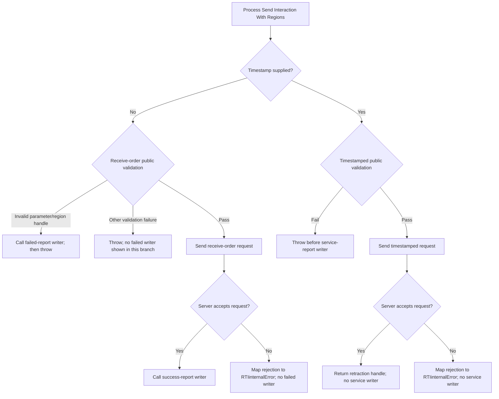

The [receive-order parameter preflight](../../cpp/src/internal/runtime/umbra_rti_ambassador_regional_interaction_send_services.cpp#L503)
and [region preflight](../../cpp/src/internal/runtime/umbra_rti_ambassador_regional_interaction_send_services.cpp#L531),
[success writer](../../cpp/src/internal/runtime/umbra_rti_ambassador_regional_interaction_send_services.cpp#L581),
and [process-error translation](../../cpp/src/internal/runtime/umbra_rti_ambassador_regional_interaction_send_services.cpp#L600)
show that wrapper boundary. The [timestamped process fast path](../../cpp/src/internal/runtime/umbra_rti_ambassador_regional_interaction_send_services.cpp#L49)
is separate from its later [embedded failure writer](../../cpp/src/internal/runtime/umbra_rti_ambassador_regional_interaction_send_services.cpp#L442).
On the server, [interaction planning/rejection](../../cpp/src/internal/federation/process_federation_service_interaction_send.cpp#L389)
is shared by the [regional operation handler](../../cpp/src/internal/federation/process_federation_service_interaction_send.cpp#L631).

The process report matrix covers [invalid-region](../../cpp/tests/ieee1516_2025_connection_process_service_report_matrix_catch2.cpp#L649)
and [invalid-parameter](../../cpp/tests/ieee1516_2025_connection_process_service_report_matrix_catch2.cpp#L715)
preflight reports, not a server-rejected request. The reviewed timestamped
regional-send report cases are explicitly [embedded file-report](../../cpp/tests/timestamped_regional_interaction_failure_service_report_file_catch2.cpp#L157)
and [embedded MOM-report](../../cpp/tests/timestamped_regional_interaction_failure_service_report_interaction_catch2.cpp#L90)
tests; they do not establish process behavior. No focused process test in this
review asserts service-invocation reporting for a server-rejected regional
send or for the timestamped process branch. Keep these as implementation and
test-scope observations, not normative behavior or profile-parity claims.

## Callback order: a focused interaction example

When one public service produces both a service-report interaction and an
application interaction callback for the same observer, their order is
observable and can matter. The selected 2025 directed-send scenario proves this
specific order under `HLA_EVOKED`:

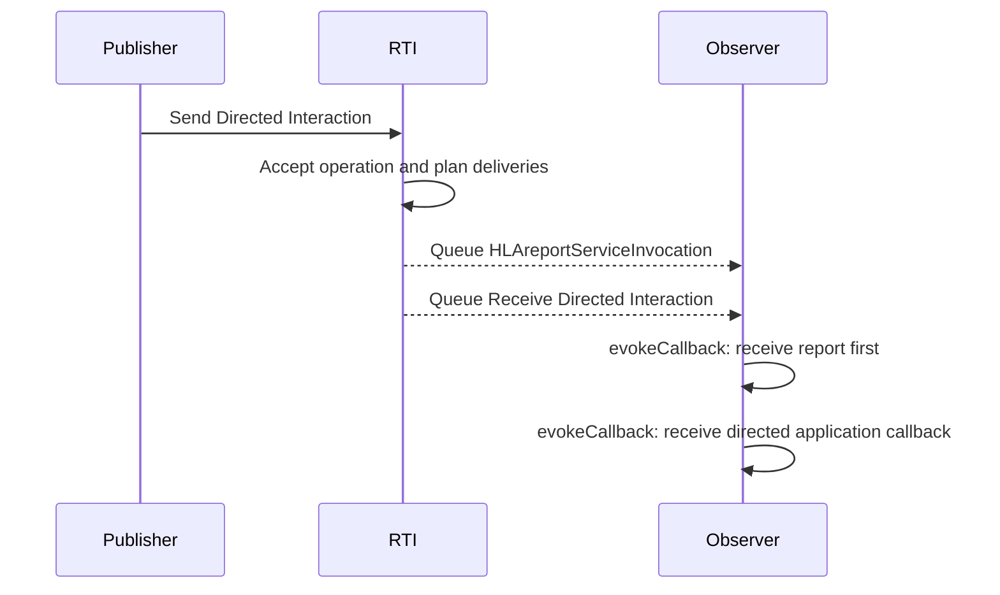

The test evokes one callback at a time and checks that the report arrives before
the directed callback. Treat this as a demonstrated service/test path, not a
universal order among every HLA service, report, and callback model. See the
[directed invocation ordering test](../../cpp/tests/ieee1516_2025_service_report_directed_invocation_ordering_interaction_catch2.cpp#L5)
and the separate [callback-ordering guide](HLA-2025-CALLBACK-AND-SERVICE-ORDERING-FLOW-GUIDE.md).

## Per-member report-file lifetime

The embedded profile allocates a unique report file when a federate joins,
writes its initial record, and keeps that file identity stable for the joined
membership. Invocation records append only while reporting is enabled and the
file sink is selected; disabled intervals add no invocation records. Switch
changes affect future records, not the path. Resignation writes the final
membership record before the membership's writer is retired. A later rejoin is
a new membership and gets a new file.

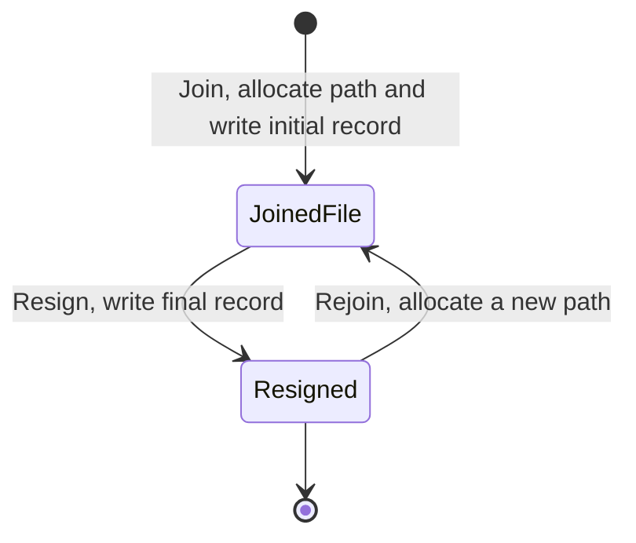

The file is therefore per joined membership, not per RTI ambassador process or
per reporting-switch cycle. The focused [embedded file-lifecycle test](../../cpp/tests/ieee1516_2025_service_report_file_lifecycle_catch2.cpp#L4)
and [process endpoint file cases](../../cpp/tests/ieee1516_2025_connection_service_report_catch2.cpp#L142)
cover distinct paths; they should not be read as one shared file implementation.

## A failed report append leaves Exception Reporting enabled

With the master Service Reporting switch already enabled and the file sink
selected, the embedded profile has a useful source-visible commit boundary.
Calling `setExceptionReportingSwitch(true)` first commits the distinct
Exception Reporting switch in the registry and prepares joined-federate MOM
work. It then appends that setter's successful service-invocation record. If
the append fails, the public call reports `RTIinternalError`, but Exception
Reporting remains `true`; the Service Reporting switch is not the value being
changed by this call. The focused injected-writer test is written to assert
that state, but its current local run failed during
`createFederationExecution` at test line 148, before reaching the switch or
append-failure assertions:

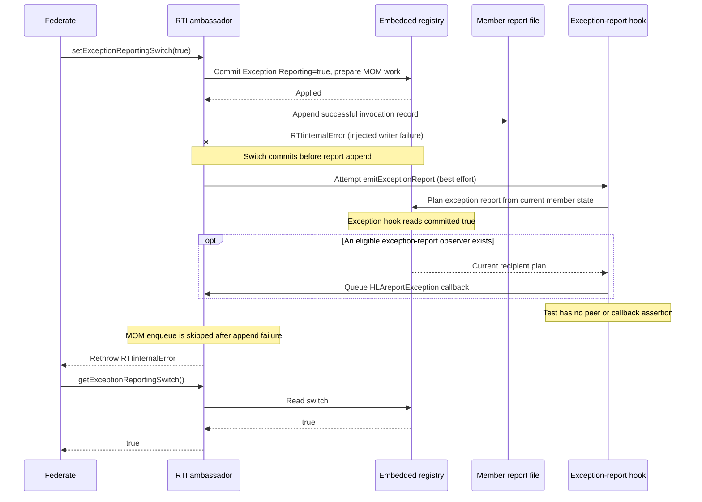

The source places the MOM projection enqueue after the append, so this failure
path skips that enqueue. Because the switch commit came first, the embedded
best-effort exception hook reads the new `true` value and can plan
`HLAreportException` only through the current eligible observer route. The test
body expects the switch to remain enabled, but the current run failed before
that assertion; it creates no reporting peer and does not assert exception
callback delivery or the corresponding MOM attribute. Thus the state and
ordering are source-derived here, not a passing runtime observation. The hook
must not replace the original error. This is a specific embedded-path
observation, not a general rule for every service or the process endpoint.

## Timestamped update admission precedes report persistence

The embedded 2025 timestamped `UpdateAttributeValues` path has a different
failure boundary. For a time-regulating publisher whose plan includes a
timestamp-ordered passel for a time-constrained receiver, the wrapper commits
the payload and retraction ledger to the federation TSO queue before it writes
the successful service-invocation report. Success accounting and later
non-queued callback submissions follow the report append. The public method
returns the retraction handle only after those later steps.

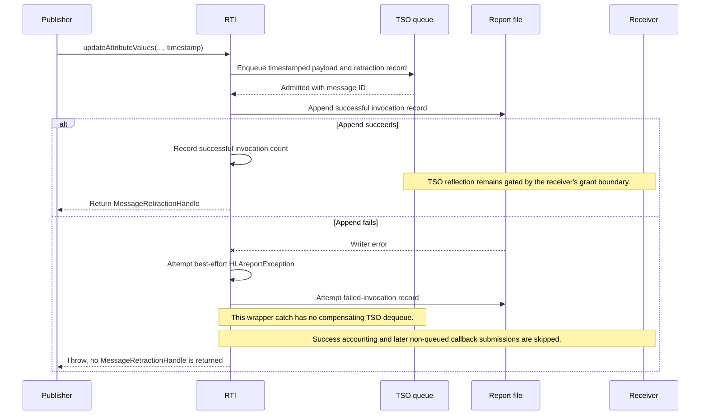

The successful route's order is exercised by the [time-regulated MOM-report
case](../../cpp/tests/ieee1516_2025_time_regulated_timestamped_update_attribute_values_service_report_mom_catch2.cpp#L5),
which sees the report before the constrained reflection, and the [file-report
case](../../cpp/tests/ieee1516_2025_timestamped_update_attribute_values_service_report_catch2.cpp#L5),
which checks the record at reflection callback entry. The injected writer
failure test covers a different service, `setExceptionReportingSwitch`, not
this TSO update. Thus the earlier queue admission and absence of rollback are
source-observed for this failure path; the cited tests do not prove whether
that queued payload later reaches a callback, nor do they test the combination
of TSO admission and a failed report append. The [time-management guide](HLA-2025-TIME-MANAGEMENT-GUIDE.md)
covers the later grant and TSO delivery gates; this sequence makes no 2010 or
process-endpoint parity claim.

## Embedded Connection Lost: the final file-report failure follows resignation

This is a separate embedded 2025 RTI-originated path, not a failed
federate-initiated service call. The registry commits forced resignation and
reserves the final service-report serial before erasing the member. If the
selected route is the file and its append then fails, the adapter defers that
`RTIinternalError`, finishes lifecycle cleanup and notification submission,
and only then raises the deferred error. The forced-loss registry route
reserves a final file serial only; this sequence does not claim a final
`HLAreportServiceInvocation` interaction for the removed member.

The two sequence views preserve the important ownership boundary: the first
ends when the registry has committed the resignation and returns its result;
the second follows RTI-side cleanup, the optional file append, callback
submission, and deferred error reporting after that commit. The adapter then
clears connected, time, and join state and resets the old callback queue. If
the reserved final file append throws, it defers the error, completes cleanup
and surviving-member notification submission, and raises `RTIinternalError`
only afterward.

**Registry commit and final report reservation**

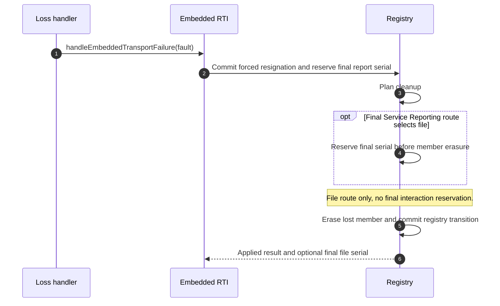

**Post-commit RTI cleanup and delivery**

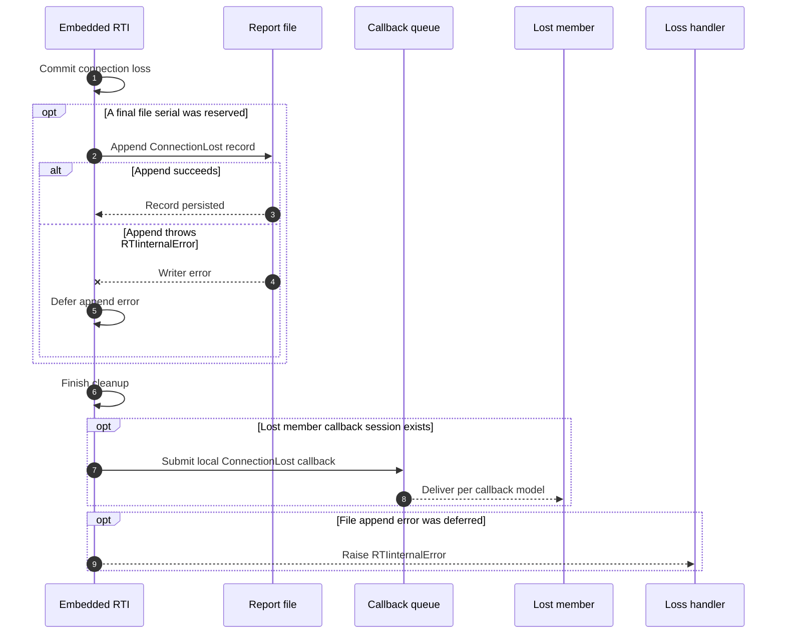

The successful append-before-callback route is encoded by the focused
embedded test, but its current local run failed during
`createFederationExecution` (test line 521), before reaching those assertions.
The error branch is source-only: no cited test injects a writer failure
specifically during `ConnectionLost`. In HLA_IMMEDIATE mode callback submission
may invoke inline; HLA_EVOKED leaves it for an Evoke service. These diagrams do
not determine how a real transport boundary consumes the deferred internal
exception, and it does not describe 2010 or the process endpoint.

## Implementation and test evidence

| Concern | Umbra implementation | Focused evidence |
| --- | --- | --- |
| Service Reporting switch and join/leave boundary | [Public switch services](../../cpp/src/internal/runtime/umbra_rti_ambassador_service_reporting_switches.cpp#L74), [registry state transition](../../cpp/src/internal/federation/federation_registry_control_state.cpp#L315) | [switch/subscription interlock](../../cpp/tests/mom_service_reporting_interlock_catch2.cpp#L50) |
| Ordinary, passive, and regional report-service subscriptions | [Exact subscription predicate](../../cpp/src/internal/federation/federation_registry_regions.cpp#L464) | [interlock scenarios](../../cpp/tests/mom_service_reporting_interlock_catch2.cpp#L82) |
| Subject, sink, and eligible observer planning | [routing plan](../../cpp/src/internal/federation/federation_registry_mom_service_reporting.cpp#L52), [serial reservation](../../cpp/src/internal/federation/federation_registry_mom_service_reporting.cpp#L143) | [service-report interaction scenario](../../cpp/tests/ieee1516_2025_service_report_directed_invocation_ordering_interaction_catch2.cpp#L42) |
| Success/failure service report writing | [report writers](../../cpp/src/internal/runtime/umbra_rti_ambassador_service_report_writers.cpp#L131) | [master-switch suppression despite file switch on](../../cpp/tests/ieee1516_2025_service_report_disabled_suppression_integration_catch2.cpp#L6) |
| Embedded switch commit before selected file append | [switch service and post-append MOM enqueue](../../cpp/src/internal/runtime/umbra_rti_ambassador_service_reporting_switches.cpp#L219), [best-effort exception hook](../../cpp/src/internal/runtime/umbra_rti_ambassador_mom_service_report_interaction.cpp#L184), [exception-report switch and recipient planning](../../cpp/src/internal/federation/federation_registry.cpp#L1661) | [injected append failure keeps switch enabled](../../cpp/tests/service_report_writer_failure_catch2.cpp#L133); the test body asserts the thrown RTI error and getter value, but the current local run failed during federation creation before those assertions; no MOM projection or exception-report callback is asserted |
| Timestamped Update Attribute Values queue/report boundary | [embedded timestamped wrapper](../../cpp/src/internal/runtime/umbra_rti_ambassador_attribute_update_services.cpp#L369), [TSO admission](../../cpp/src/internal/runtime/umbra_rti_ambassador_attribute_update_services.cpp#L687), [post-report accounting and callback path](../../cpp/src/internal/runtime/umbra_rti_ambassador_attribute_update_services.cpp#L714), [registry queue commit](../../cpp/src/internal/federation/federation_registry_time_tso_enqueue.cpp#L427), [exception/failure-report catch](../../cpp/src/internal/runtime/umbra_rti_ambassador_attribute_update_services.cpp#L790) | [time-regulated MOM ordering](../../cpp/tests/ieee1516_2025_time_regulated_timestamped_update_attribute_values_service_report_mom_catch2.cpp#L5) and [file-report before reflection](../../cpp/tests/ieee1516_2025_timestamped_update_attribute_values_service_report_catch2.cpp#L5) cover successful paths. The injected writer-failure case covers a different service; no cited test covers this combined failure schedule |
| Embedded ConnectionLost final file report | [registry reserves the final file serial before erasing the member](../../cpp/src/internal/federation/federation_registry_resign_lifecycle.cpp#L1069), [adapter appends, defers error, completes cleanup, and raises afterward](../../cpp/src/internal/runtime/umbra_rti_ambassador_membership_loss.cpp#L306), [transport failure handler propagation](../../cpp/src/internal/federation/embedded_transport.cpp#L28), [file writer append boundary](../../cpp/src/internal/runtime/umbra_rti_ambassador_service_report_writers.cpp#L335) | [embedded record-before-ConnectionLost-callback case](../../cpp/tests/ieee1516_2025_service_report_catch2.cpp#L503) encodes the successful file route but did not reach its callback assertions in the current local run; no cited test injects a failed append during ConnectionLost or establishes process/embedded parity |
| RTI-originated receive-order callback and callback-time recheck | [interaction callback path](../../cpp/src/internal/runtime/umbra_rti_ambassador_mom_service_report_interaction.cpp#L276) | [report precedes directed callback](../../cpp/tests/ieee1516_2025_service_report_directed_invocation_ordering_interaction_catch2.cpp#L114); that case does not mutate the subscription between planning and delivery |
| Embedded per-membership file creation and final lifetime | [join/report setup](../../cpp/src/internal/runtime/umbra_rti_ambassador_federation_lifecycle.cpp#L631) | [embedded immutable file lifetime](../../cpp/tests/ieee1516_2025_service_report_file_lifecycle_catch2.cpp#L4) |
| Process endpoint selection and file lifetime | [process report handling delegated from the writer](../../cpp/src/internal/runtime/umbra_rti_ambassador_service_report_writers.cpp#L140) | [independent process files](../../cpp/tests/ieee1516_2025_connection_service_report_catch2.cpp#L142), [file path across switch cycles](../../cpp/tests/ieee1516_2025_connection_service_report_catch2.cpp#L356), [failed process reports through interaction](../../cpp/tests/ieee1516_2025_connection_process_service_report_matrix_catch2.cpp#L42) |
| Process report-recipient snapshot and callback boundary | [process report handler](../../cpp/src/internal/federation/process_federation_service_reporting.cpp#L223), [pull dequeue](../../cpp/src/internal/federation/process_federation_service_receive.cpp#L107), [callback bridge](../../cpp/src/internal/federation/process_federation_callback_bridge.cpp#L1211) | [regional-send success report](../../cpp/tests/ieee1516_2025_connection_process_service_report_matrix_catch2.cpp#L626), [observer and serial assertions](../../cpp/tests/ieee1516_2025_connection_process_service_report_interaction_helpers.hpp#L717) — one pull-mode `HLA_EVOKED` observer; no post-plan subscription mutation, push-mode, or `HLA_IMMEDIATE` report test. |

These are selected implementation and integration scenarios. A passing case
does not establish complete service coverage, every regional boundary, or
conformance.

## What this guide does not claim

- It does not describe IEEE 1516.1-2010 or infer that edition's reporting
  behavior from 2025 code.
- It does not claim identical embedded and process-endpoint routing, file
  semantics, failure recovery, or concurrency behavior.
- The switch append-failure sequence has one injected embedded writer case;
  the timestamped-update and ConnectionLost append-failure branches are
  source-derived and lack tests for those exact failure schedules. None
  establishes process-endpoint behavior. The skipped MOM projection enqueue
  is source-derived, and actual `HLAreportException` delivery is not asserted
  by the switch test.
- It does not claim every public service's success and exception payload has
  been checked field by field by the linked focused tests.
- It does not establish that a late subscription change after serial reservation
  is rolled back; current source drops a stale recipient at callback time.
- It does not trace the recipient routing of `HLAreportException`,
  `HLAreportMOMexception`, all MOM object projections, periodic updates, or
  general callback ordering.
- It does not add or revise Requirements Lab records.
