# IEEE 1516.1-2025 Time Management: Contributor Guide

This guide is for contributors who need to understand the time-management
concepts before reading Umbra's implementation. It is a teaching and
implementation guide, not a substitute for the standard, a new source of
requirements, or a claim of conformance.

## Scope and authority

- **Standard boundary:** IEEE 1516.1-2025 only. Normative claims and Umbra
  implementation evidence are identified separately throughout this guide.
- **Implementation boundary:** this guide centers on the opt-in, non-installable
  2025 embedded federation-management development profile. Configured-process
  behavior appears only in explicitly labeled, source-bounded case studies.
  Support is intentionally bounded; see
  [What this guide does not claim](#what-this-guide-does-not-claim).
- **Authority order:** the [official IEEE 1516.1-2025 standard](https://standards.ieee.org/ieee/1516.1/6688/)
  defines normative behavior. The pinned Requirements Lab records help locate
  the relevant source clauses. C++ code describes Umbra's current behavior;
  tests show specific scenarios that have been exercised. Neither code nor a
  test overrides the standard.
- **Traceability status:** Requirements Lab contracts cited below are
  source-derived traceability records. Their statuses are experimental and
  explicitly not conformance evidence.

The companion [logical-time design](LOGICAL-TIME-DESIGN.md) explains the
reference-time representation and current development profile.
[Embedded time coordination](EMBEDDED-TIME-COORDINATION-DESIGN.md) records
additional implementation boundaries, edge cases, and deferred work.

## The mental model

HLA logical time is simulation time, not wall-clock time. A federate may
compute ahead locally, but the RTI coordinates when each federate may observe
timestamped events and when it may move its public logical time forward.
Member MOM reporting has a separate wall-clock cadence: `HLAsetTiming` schedules
refreshes of Periodic `HLAfederate` attributes. See the [joined-federate MOM
guide](HLA-2025-JOINED-FEDERATE-MOM-OBJECT-LIFECYCLE-FLOW-GUIDE.md#explicit-requests-and-periodic-refresh-are-independent)
for that reporting path.

Three ideas explain most of the machinery:

1. **A time role is a promise or a constraint.** A time-regulating federate
   promises a lower bound for future timestamped sends through its lookahead.
   A time-constrained federate asks the RTI not to advance it past events that
   could still arrive from other regulators.
2. **A request is not a grant.** Accepting an advance request makes it pending;
   it does not immediately change Query Logical Time. The matching grant
   callback is the public completion point.
3. **A grant is a federation decision.** For a time-constrained federate, a
   requested target can be held below a safe frontier (GALT). Known incoming
   timestamped messages and the selected request mode affect the exact
   boundary and callback order.

Time Regulation and Time Constrained are independent roles. A federate can be
neither, either one, or both. They are not two mutually exclusive clock modes.

## Vocabulary

| Term | Meaning in this guide |
| --- | --- |
| Logical time | An ordered simulation-time value from the federation's selected LogicalTime implementation. It is not a timestamp from the operating-system clock. |
| Logical time interval | A duration in that same selected time representation; lookahead is one such interval. |
| Time regulating | A role that constrains how early the federate may send timestamped messages. |
| Lookahead | The regulator's promised minimum separation between its current logical time and outgoing timestamped events. |
| Time constrained | A role that makes the federate's forward grants subject to federation-wide temporal bounds. |
| Receive order (RO) | Delivery without a logical-time timestamp ordering guarantee. |
| Timestamp order (TSO) | Delivery ordered by the message's logical timestamp and subject to time-management rules. |
| GALT | Global Available Logical Time, the federation's current safe advancement boundary as exposed by Query GALT when defined. |
| LITS | Lowest (earliest) Incoming Timestamp, the next relevant incoming timestamp boundary exposed by Query LITS when defined. |
| NRG | The FDD's Non-Regulated-Grant setting, queried through [`RTIambassador::getNonRegulatedGrantSwitch()`](../../third_party/ieee1516.1-2025/include/RTI/RTIambassador.h#L2258). The cross-cutting [support-switch map](HLA-2025-CROSS-CUTTING-STATE-EVENT-OBSERVATION-GUIDE.md#a-support-switch-has-an-owner-a-lifetime-and-a-control-surface) shows why this is a getter-only static federation policy. In the current grant policy it matters when GALT is undefined; it does not make GALT itself defined. |
| Callback-gated | The accepted operation remains pending until its matching callback is dispatched; the corresponding private time state changes at that callback boundary. |

Publisher-selected `RECEIVE`/`TIMESTAMP` order and transportation are a
separate control plane from the time-advance scheduler. See the focused
[2025 order and transportation guide](HLA-2025-ORDER-AND-TRANSPORTATION-FLOW-GUIDE.md)
for default capture, instance overrides, and the distinction between order
metadata and transportation metadata.

### The federation's time representation is not its live clock state

Logical time has two related but different boundaries: the federation uses a
selected implementation to define the type of `LogicalTime` and
`LogicalTimeInterval` values, while time-management services coordinate each
member's current logical-time progress. The pinned 2025 API exposes the first
boundary through the optional `logicalTimeImplementationName` argument on
Create Federation Execution and the API-specific `getTimeFactory()` service.
After Join, the factory lets the federate create values compatible with that
execution; receiving a factory does not advance the federate's clock or grant
permission to observe future timestamped messages.

In the current embedded development profile, Create validates the selected
factory before committing the federation definition, and `getTimeFactory()`
requires a joined member and returns a factory for that definition
([Create path](../../cpp/src/internal/runtime/umbra_rti_ambassador_federation_lifecycle.cpp#L170),
[factory lookup](../../cpp/src/internal/runtime/umbra_rti_ambassador_federation_lifecycle.cpp#L1430)).
The existing public float64 integration case selects `HLAfloat64Time`, obtains
the factory after Join, uses typed values, and observes that a time-advance
request changes `Query Logical Time` only at its grant
([focused case](../../cpp/tests/ieee1516_2025_public_float64_time_representation_catch2.cpp#L5)).
That is embedded-profile evidence, not a claim about process parity or every
supported time implementation. The separate
[logical-time encoding guide](HLA-2025-DATA-ELEMENT-ENCODING-FLOW-GUIDE.md#logical-time-is-factory-defined-not-assumed-to-be-be-or-le)
covers how the public time data elements delegate encoding to a compatible
factory.

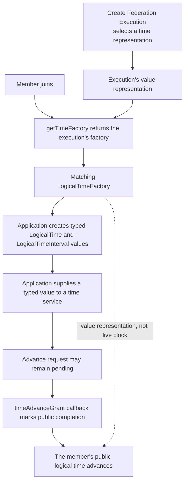

Read the diagram as two linked questions: *which value type does this
execution use?* and *when may this member advance or observe a timestamped
event?* The factory answers the first; the request mode, federation time
state, and grant/callback rules below answer the second. The arrow from factory
to current time is a contrast, not a direct state transition.

### Keep four time values distinct

For an advance request, do not casually use “the requested time” to mean four
different values:

- **Caller boundary R:** the logical time supplied by the application.
- **Effective target E:** the time the current implementation selected as
  the target of this particular request. For TAR, TARA, and FQR, E equals R.
  For NMR and NMRA, E can be the earliest currently queued recipient message
  no later than R. While either request is pending, a newly admitted eligible
  TSO can lower E without changing R; see [late arrivals during NMR/NMRA](#late-arrivals-during-nmrnmra).
- **Granted time G:** the value applied to the federate when the matching
  grant callback is dispatched. For FQR, G can be earlier than R.
- **Optimistic floor O:** an internal lower bound retained after an FQR
  whose actual grant is earlier than the optimistic progress boundary. Later
  requests cannot select an effective target below that floor.

Umbra stores the caller boundary separately from the effective target. That
separation matters for NMR/NMRA bound calculations, timestamp validation, and
diagnostics.

## Role state machines

The two roles have independent lifecycles, but request acceptance, role-state
commit, and application callback are distinct milestones. The charts below show
the embedded dispatch path: pending role state becomes active immediately
before the corresponding callback. The configured-process time-constrained path
commits service-side role state before the client callback crosses its delivery
boundary; see the [process-specific flow](HLA-2025-PROCESS-ENDPOINT-REQUEST-AND-CALLBACK-FLOW-GUIDE.md#enable-time-constrained-service-state-and-callback-observation).

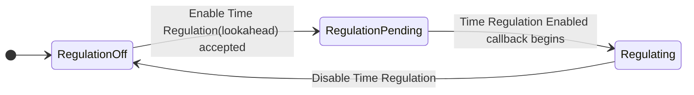

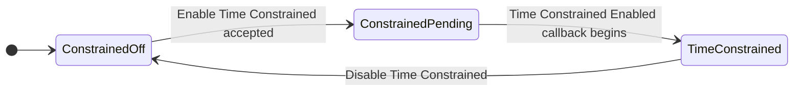

The pinned 2025 API declares [Enable Time Regulation](../../third_party/ieee1516.1-2025/include/RTI/RTIambassador.h#L1175),
[Disable Time Regulation](../../third_party/ieee1516.1-2025/include/RTI/RTIambassador.h#L1187),
[Enable Time Constrained](../../third_party/ieee1516.1-2025/include/RTI/RTIambassador.h#L1200),
and [Disable Time Constrained](../../third_party/ieee1516.1-2025/include/RTI/RTIambassador.h#L1211).
The corresponding enable notifications are [Time Regulation Enabled](../../third_party/ieee1516.1-2025/include/RTI/FederateAmbassador.h#L489)
and [Time Constrained Enabled](../../third_party/ieee1516.1-2025/include/RTI/FederateAmbassador.h#L495).
These links identify the public API surface; the pending-state transitions below
are bounded descriptions of the current Umbra implementation, not a complete
normative interpretation of those clauses.

In the current profile:

- The regulator's requested lookahead becomes the active lookahead when
  Time Regulation Enabled is dispatched. Query Lookahead reports the active
  value.
- A pending role enable blocks a time-advance request that depends on that
  role transition. Do not treat the service return as if the callback already
  ran.
- In the embedded implementation, Enable Time Constrained becomes eligible
  when GALT is undefined or the member's current time is strictly below GALT;
  equality stays pending. A regulator's grant can trigger another eligibility
  check, while `HLA_EVOKED` can still defer callback observation. The focused
  [GALT boundary case](../../cpp/tests/available_time_advance_inclusive_galt_catch2.cpp#L1028)
  shows the ordinary request path; the Save/Restore guide identifies the
  untested restored-pending branch.
- A disable removes that role from the private state and triggers grant
  re-evaluation where needed. For the regulator-disable/undefined-GALT case,
  see [Example 3](#example-3-galt-undefined) and the later
  [pending-grant re-evaluation map](#re-evaluation-why-a-pending-request-can-become-grantable).
  For the separate receiver-side effect of disabling Time Constrained on
  queued messages, see [Receive order and asynchronous
  delivery](#receive-order-and-asynchronous-delivery) and the
  [configured-process receive-order gate](#configured-process-receive-order-interaction-gate).
- A federate can be both regulating and constrained at once. Its sending
  promise and receiving constraint must both be considered.

For embedded fresh-registry Restore, a saved pending generation is restored
and its callback work is rebuilt only after the Restore barrier. The restored
GALT check can keep the role pending. When eligible work is dispatched, the
RTI sets the constrained role and clears the pending generation immediately
before invoking `timeConstrainedEnabled`; with `HLA_EVOKED`, that state change
waits until Evoke runs the queued callback. The one-member evidence and the
GALT-blocked boundary are traced in the Save/Restore guide's
[pending-role Restore case](HLA-2025-FEDERATION-SAVE-RESTORE-FLOW-GUIDE.md#worked-case-restoring-a-pending-time-constrained-request).

In the configured-process profile, `ProcessFederationService` calls
`grantTimeConstrained` and clears the pending generation before returning an
enabled-time response or sending a delayed constrained-enable event. The client
then submits that event to the callback bridge; the bridge enables its own
receive-order delivery gate immediately before invoking the public callback.
Consequently, `HLA_EVOKED` can delay application observation after service-side
role activation. The [process endpoint flow](HLA-2025-PROCESS-ENDPOINT-REQUEST-AND-CALLBACK-FLOW-GUIDE.md#enable-time-constrained-service-state-and-callback-observation)
traces both branches. This is a current-source distinction, not a normative
interpretation or a claim of profile parity.

The source-level state is in
[FederateTimeState](../../cpp/src/internal/time/federate_time_state.hpp);
public service adapters are in
[time regulation control](../../cpp/src/internal/runtime/umbra_rti_ambassador_time_regulation_control.cpp)
and
[time constrained control](../../cpp/src/internal/runtime/umbra_rti_ambassador_time_constrained_control.cpp).

### Configured-process Enable Time Regulation can include an implicit TARA

This is a current Umbra process-service path, not a universal interpretation of
the 2025 standard. If an already-constrained federate enables regulation with a
lookahead that requires it to reach a later feasible time, Umbra treats the
request as an implicit TARA. The role and requested lookahead stay pending while
the normal grant path advances the federate and delivers eligible TSO first.

The process service starts the target at the federate's current time and checks
each other active constrained peer. When `target + lookahead` is strictly below
a peer's current time, it raises the target to `peer current time - lookahead`.
If the final target is later than the current time, `FederateTimeState` retains
the requested lookahead, records the implicit advance, and enters Time Advancing.
The public Enable Time Regulation call can succeed without a `TimeRegulationEnabled`
time in its response. The service instead dispatches eligible TSO, commits the
time advance and regulating role, and sends a grant event marked
`regulationEnabled`. The client maps that marker to `TimeRegulationEnabled`, not
to a public `TimeAdvanceGrant` callback.

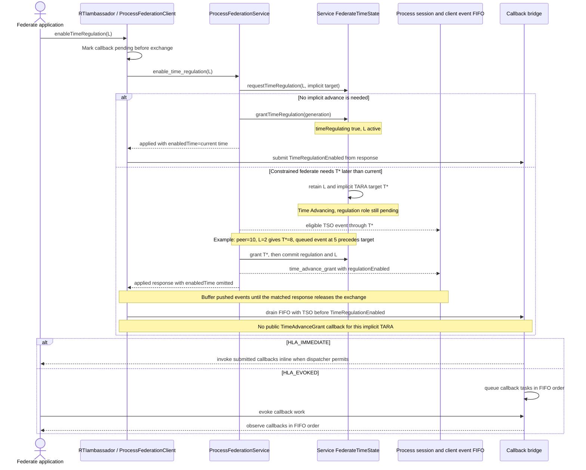

For example, the focused process-service case has an enabling federate at time
0, a constrained peer at 10, and requested lookahead 2. The calculated enable
time is 8. An already-queued interaction at time 5 is delivered before the
regulation callback, whose time is 8. With `HLA_EVOKED`, the test observes
`receiveInteraction` before `TimeRegulationEnabled` and observes no separate
`TimeAdvanceGrant`. This is process-service integration evidence for the named
scenario, not a normative target formula.

The direct-response branch commits the role and lookahead before the service
returns `enabledTime`; `HLA_EVOKED` can delay application observation. In the
implicit-TARA branch, the process client buffers event frames until the
correlated response is matched and the exchange lock is released. It then drains
them to the bridge in FIFO order. `HLA_IMMEDIATE` invokes submitted callback
work inline when eligible; `HLA_EVOKED` waits for Evoke. Callback-model timing
changes when the application sees the events, not when the service commits the
regulating role.

The source path spans the
[process implicit-target calculation and service handler](../../cpp/src/internal/federation/process_federation_service_time_management.cpp#L37),
[`FederateTimeState` request and grant](../../cpp/src/internal/time/federate_time_state.cpp#L568),
the [pre-grant TSO and marked grant event](../../cpp/src/internal/federation/process_federation_service_lifecycle.cpp#L519),
the [client event decoder](../../cpp/src/internal/federation/process_federation_client.cpp#L750),
and the [Time Regulation Enabled callback bridge](../../cpp/src/internal/federation/process_federation_callback_bridge.cpp#L2244).
The HLA_EVOKED production-service case is
[Process time-regulation enablement advances through queued TSO before Time Regulation Enabled](../../cpp/tests/ieee1516_2025_connection_time_regulation_pending_catch2.cpp#L608).
The HLA_IMMEDIATE [public-endpoint callback case](../../cpp/tests/ieee1516_2025_connection_process_asynchronous_delivery_catch2.cpp#L301)
uses a controlled server fixture and verifies client/callback dispatch, not the
production service's implicit-target calculation. These are 2025 implementation
and test observations only.

## Advance lifecycle

The following is the common shape of an accepted advance in the current 2025
profile. The policy branch and callback name depend on the request mode.

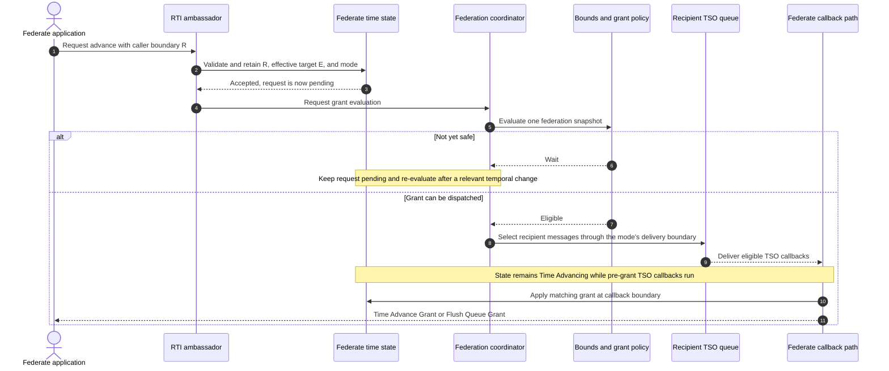

Important consequences:

- On acceptance, the federate becomes **Time Advancing**, but its current
  logical time remains the previous granted value.
- The request can remain pending while another regulator's state prevents a
  safe grant. A pending request is not a failed request.
- In the ordinary grant path, eligible TSO callbacks precede the matching
  Time Advance Grant callback. The current state changes immediately before
  that grant callback begins.
- FQR uses its own actual-grant calculation and invokes Flush Queue Grant, not
  Time Advance Grant.
- The same logical ordering applies to HLA_IMMEDIATE and HLA_EVOKED callback
  models. EVOKED applications must continue to evoke callbacks for the
  callback-gated transition to complete.

### Temporal eligibility and callback observation are separate gates

Temporal policy determines whether grant dispatch is allowed and the request
mode's delivery boundary. The delivery path selects eligible TSO callbacks
and orders them before the matching grant callback. The callback model then
determines when those callbacks enter application code. In HLA_EVOKED mode, an
eligible message is not yet an observed callback: the application must evoke
pending work. Until the matching grant callback begins, the accepted request
remains pending and the public current logical time remains at its previous
grant.

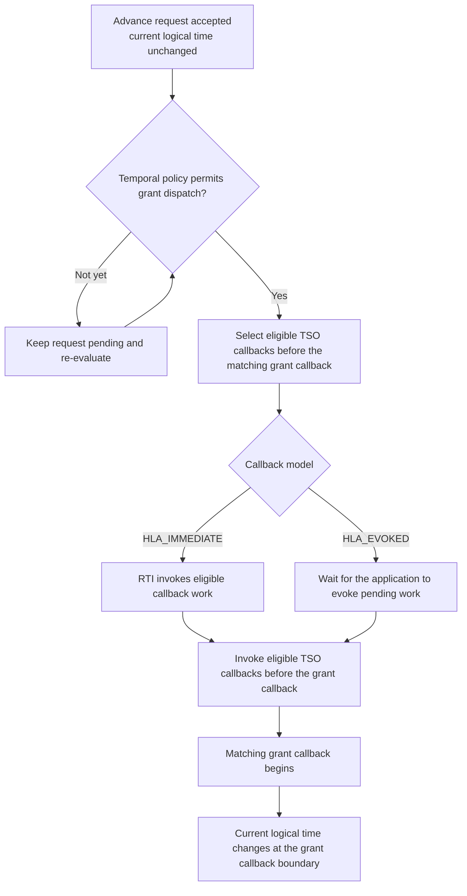

This is a layered view. The portable HLA mental model is that request
acceptance, timestamped-event eligibility, callback invocation, and grant
completion are distinct events. The specific route from eligible TSO work
through callback-model handling to grant callback is the current embedded
2025 path: its pending-task details and tested TSO-before-grant ordering below
are profile evidence, not a universal scheduler or queue algorithm. No
process-profile parity is inferred. The configured-process test shape is shown
separately in the [regional process TSO callback-gate sequence](HLA-2025-DATA-DISTRIBUTION-AND-REGIONS-FLOW-GUIDE.md#regional-process-tso-recipient-selection-callback-gate-and-evoke):
its pending-NMR case keeps callbacks enabled, while its NMRA and receiver-TAR
cases disable them until re-enable and a later Evoke. This is fixture-specific
evidence, not a cross-profile ordering rule.
The TSO-before-grant sequence covers timestamped deliveries selected for that
request; it does not place separate ownership callbacks relative to the grant.
For those state transitions, see the Ownership guide's [service and callback
boundary](HLA-2025-ATTRIBUTE-OWNERSHIP-FLOW-GUIDE.md#service-return-transfer-outcome-and-callback-time-are-separate),
[acquisition-cancellation confirmation](HLA-2025-ATTRIBUTE-OWNERSHIP-FLOW-GUIDE.md#cancel-acquisition-is-pending-until-its-confirmation-callback),
and [assumption-candidate continuation](HLA-2025-ATTRIBUTE-OWNERSHIP-FLOW-GUIDE.md#candidate-fan-out-and-callback-return-continuation-are-separate).
A bounded scan of the focused 2025 Catch2 sources found no case combining one
of those ownership callbacks with `timeAdvanceGrant`; no cross-service callback
order is claimed.
For the fuller callback-task and per-ambassador dispatch model, see the
separate [callback and service ordering guide](HLA-2025-CALLBACK-AND-SERVICE-ORDERING-FLOW-GUIDE.md).

## How Umbra calculates the timing frontier

This section describes the current bounded implementation model, not a
replacement definition of the IEEE algorithm.

For each other active time regulator, Umbra starts with its current logical
time, or its original caller advance boundary while that regulator has an
advance pending, then adds its active lookahead:

**candidate = regulator base time + active lookahead**

A forward advance from a zero-lookahead regulator makes that minimum
timestamp exclusive in the current implementation. Umbra adds one epsilon
from the federation's selected LogicalTimeFactory; it does not approximate
this with a floating-point constant.

Recipient-side queued and in-transit TSO timestamps are examined as possible
incoming boundaries; per-request and current-time rules can exclude an
individual entry. The current bounds calculator does not use
delivered-since-last-advance history; it iterates the recipient's queued and
in-transit vectors ([source](../../cpp/src/internal/time/federation_time_bounds.cpp#L148)).
In this implementation:

- With at least one other regulator, the available GALT is the minimum
  applicable regulator and known TSO boundary.
- A queue-derived exact boundary is marked separately from an ordinary
  regulator-only GALT; the grant policy uses that distinction.
- With no other regulator, GALT is undefined. An incoming TSO timestamp can
  still make LITS defined.
- When GALT is defined, LITS is the earlier of GALT and the earliest future
  incoming TSO timestamp. When GALT is undefined, LITS can still be the
  earliest future incoming timestamp.
- The coordinator retains delivered-phase entries in its snapshot until the
  recipient crosses a grant boundary, but the bounds calculator considers only
  queued and in-transit entries. A delivered timestamp therefore contributes
  neither to GALT nor LITS, even if the recipient's committed time has not yet
  reached that timestamp. The focused [acknowledged-TSO bounds case](../../cpp/tests/federation_time_bounds_catch2.cpp#L249)
  asserts that moving an equal-time message from in-transit to delivered lets
  the other regulator's bound supply GALT and LITS.

The calculator is
[FederationTimeBoundsCalculator](../../cpp/src/internal/time/federation_time_bounds.cpp);
its immutable input is assembled by
[FederationTimeCoordinator](../../cpp/src/internal/time/federation_time_coordinator.hpp).
Focused bounds tests are in
[federation_time_bounds_catch2.cpp](../../cpp/tests/federation_time_bounds_catch2.cpp)
and the queue/coordinator tests are in
[federation_time_coordinator_catch2.cpp](../../cpp/tests/federation_time_coordinator_catch2.cpp).

### Grant decision flow

The effective target E is used below. For NMR/NMRA, remember that E may
be earlier than the caller boundary R.
This high-level map covers TAR, TARA, NMR, and NMRA. FQR has a separate
actual-grant calculation and queue-flush path; see
[FQR: actual grant and optimistic floor](#fqr-actual-grant-and-optimistic-floor).
The adjacent matrix defines the exact mode-specific strict, inclusive, and
queue-bound comparisons.

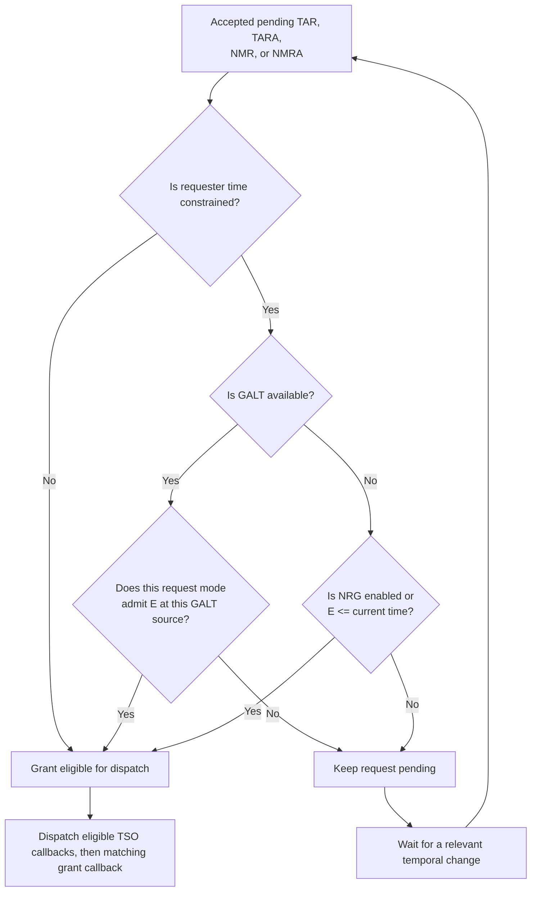

FederationTimeAdvanceGrantPolicy::decide is deliberately small: it consumes
a federate snapshot and previously calculated bounds. The surrounding
scheduler owns pending-request retention, re-evaluation, and callback
dispatch. Do not read this policy function as the complete HLA scheduler.

### Boundary comparison matrix

This matrix captures the current implemented policy and its explicitly
bounded queue behavior. The IEEE standard remains authoritative for normative
interpretation.

| Request mode | Current effective target | Current ordinary GALT behavior | Current message behavior |
| --- | --- | --- | --- |
| TAR | Caller boundary R | Strictly below GALT, even when its source is a queued TSO. | Eligible TSO callbacks precede the grant once the request is eligible; equality at GALT remains pending. |
| TARA | Caller boundary R | Equality at any available GALT is permitted by the current Available-mode policy. | Uses the currently queued message set; eligible TSO callbacks precede Time Advance Grant. |
| NMR | Earliest queued recipient TSO at or before R, otherwise R. While pending, E may move earlier; R stays separate. See [late-arrival rule](#late-arrivals-during-nmrnmra). | Strict at ordinary regulator-only GALT; equality is permitted when E equals a queue-derived TSO GALT. | Selected cohort precedes the grant; an earlier eligible arrival can retarget pending E in the documented process path. |
| NMRA | Earliest queued recipient TSO at or before R, otherwise R. While pending, E may move earlier; R stays separate. See [late-arrival rule](#late-arrivals-during-nmrnmra). | Equality at any available GALT is permitted by the current Available-mode policy. | Selected cohort precedes the grant; an earlier eligible arrival can retarget pending E in the documented process path. |
| FQR | Caller boundary R; actual grant is calculated separately | The policy does not wait for GALT; GALT can still cap the actual grant when defined. | In the embedded EVOKED path, extraction starts inside the grant callback and uses the current in-process delivery set through final time; arrivals before evoke can precede FQG even when later than R. The callback reports separate actual and optimistic times. |

Equality is request-mode and boundary-source specific in the current policy:
TAR remains strict for every GALT source; TARA and NMRA allow equality at an
available GALT; NMR allows equality when its effective target is the queued
TSO boundary. FQR bypasses this grant-policy comparison and uses its separate
calculation.

### Late arrivals during NMR/NMRA

The selected 2025 implementation allows a newly admitted TSO to move a
pending NMR or NMRA effective target earlier. It does not replace the caller's
boundary R, and this retargeting path never moves E later. For a pending
request, the coordinator accepts a retarget only when the message timestamp T
is from the same logical-time implementation, is not before current time, is
no later than R, and is strictly earlier than the current E. This is an
Umbra implementation observation, not a statement that the standard requires
this particular retarget mechanism.

The focused configured-process case starts with no queued TSO for a receiver
whose NMR(10) or NMRA(10) is pending. A producer then admits an interaction at
time 5 and requests TAR(5); the receiver observes the interaction callback
before its grant at 5. The source keeps R=10 separately while lowering E to
5. This case exercises both request modes over distinct process listeners and
uses HLA_EVOKED; it does not establish arrival-race behavior for every
transport, producer service, callback model, or implementation profile.

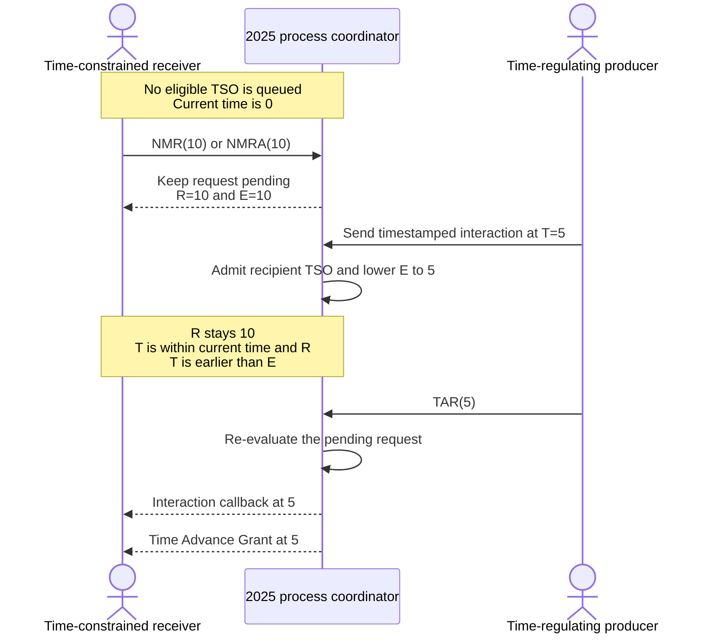

The state check is in [`retargetPendingNextMessageAdvance`](../../cpp/src/internal/time/federate_time_state.cpp#L269),
called after an applied queue admission by [`enqueueTsoMessage`](../../cpp/src/internal/time/federation_time_coordinator.cpp#L183).
The separate process-listener test covers both NMR and NMRA and asserts the
interaction-before-grant order at time 5
([shared late-arrival NMR/NMRA case](../../cpp/tests/ieee1516_2025_connection_process_tso_cross_service_late_arrival_catch2.cpp#L469),
[NMR/NMRA sections](../../cpp/tests/ieee1516_2025_connection_process_tso_cross_service_late_arrival_catch2.cpp#L470)).
The state stores the caller boundary and effective target independently
([snapshot fields](../../cpp/src/internal/time/federate_time_state.hpp#L132),
[request acceptance](../../cpp/src/internal/time/federate_time_state.cpp#L325)).
This review inspected those assertions and paths; it did not rerun the test.

#### Reverse-order arrivals retain the later TSO across the grant

One configured-process scenario starts at receiver time 12 after earlier TSO
callbacks at 5, 8, and 12. With `NMR(20)` pending, the producer's timestamped
interactions arrive in reverse timestamp order: first `T=18`, then `T=15`.
Each accepted arrival can lower the effective target `E` while caller boundary
`R=20` stays fixed, so the second arrival lowers `E` from 18 to 15. The receiver
does not observe either event or a grant until the producer advances. With
lookahead one, producer `TAR(16)` makes the bound strictly later than 15; the
receiver then observes the `T=15` interaction before its grant at 15, while
`T=18` remains queued. A later `NMRA(25)` selects that retained message; after
producer `TAR(17)`, the receiver observes the `T=18` interaction before its
grant at 18. The test exercises this sequence under both `HLA_EVOKED` and
`HLA_IMMEDIATE`.

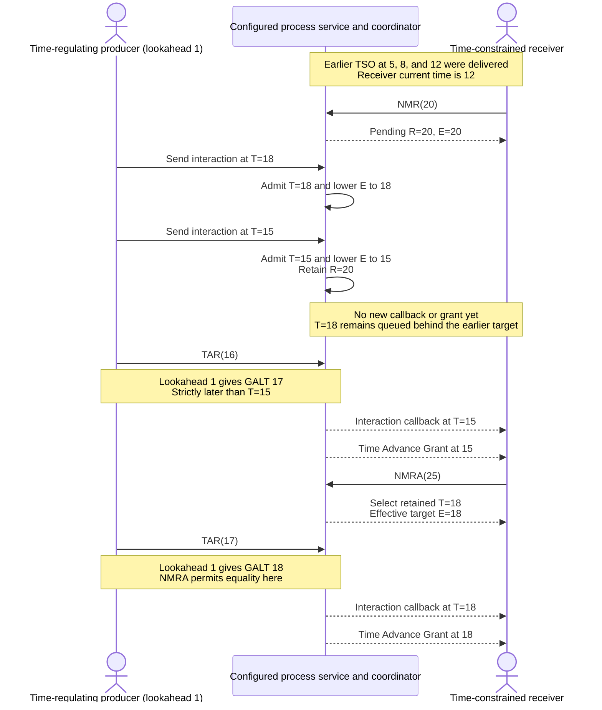

This demonstrates one ordered pair of accepted process inputs, not concurrent
arrival races or a transport-wide timestamp watermark. The source retarget
helper requires a matching logical-time implementation, a message time no
earlier than current time and no later than `R`, and the strict comparison
`T < E`; an equal or later timestamp does not lower `E`. This test does not
exercise that equal-target boundary or Retract among several queued messages
during pending NMR/NMRA. The separate [Retract path](HLA-2025-TSO-RETRACTION-FLOW-GUIDE.md#why-retracting-can-unblock-someone-elses-grant)
does not restore a previously lowered target, but its combined multi-message
grant and callback outcome remains untested. Evidence: [strict retarget predicate](../../cpp/src/internal/time/federate_time_state.cpp#L269), [retarget after queue admission](../../cpp/src/internal/time/federation_time_coordinator.cpp#L183), [reverse-order sends and NMR grant](../../cpp/tests/ieee1516_2025_connection_time_advance_next_message_queued_tso_catch2.cpp#L1225), [retained TSO and subsequent NMRA grant](../../cpp/tests/ieee1516_2025_connection_time_advance_next_message_queued_tso_catch2.cpp#L1289), [both callback models](../../cpp/tests/ieee1516_2025_connection_time_advance_next_message_queued_tso_catch2.cpp#L1411), and [coordinator retraction boundary](../../cpp/src/internal/time/federation_time_coordinator.cpp#L217).

#### Directed TSO retargets pending process next-message requests

The configured-process directed-send case connects the target-object route to
the pending-request retarget above. It starts with no queued TSO and a
time-constrained receiver whose `NMR(10)` or `NMRA(10)` is pending. The sender
then sends a directed interaction for the registered target object at time 7.
The process service selects directed recipients, queues the timestamped
message for constrained recipients, and the coordinator lowers the receiver's
effective target `E` to 7 while retaining caller boundary `R=10`. After the
sender requests `TAR(6)`, the receiver eventually observes the directed
interaction at 7 before its grant at 7.

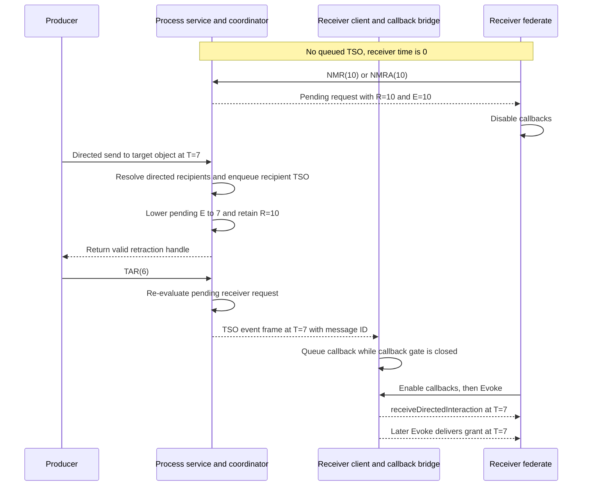

This is an implementation-scoped configured-process trace, not a normative
claim about every directed-send path or callback model. The focused HLA_EVOKED
cases cover both pending NMR and NMRA, observe interaction-before-grant, and
assert a valid retraction handle; they do not call `Retract`. Separate
HLA_IMMEDIATE cases cover delivery without a later receiver service poll. The
diagram follows the same callback-start and private acknowledgment boundary
described in the [process TSO delivery sequence](HLA-2025-PROCESS-ENDPOINT-REQUEST-AND-CALLBACK-FLOW-GUIDE.md#3-a-timestamped-process-delivery-stays-in-transit-through-callback-completion).
It does not test a directed timestamp below the producer's applicable floor;
the source-only validation gap remains described in the [operation-specific
send comparison](HLA-2025-PROCESS-ENDPOINT-REQUEST-AND-CALLBACK-FLOW-GUIDE.md#timestamped-send-validation-remains-operation-specific).

Evidence: [directed process time validation and recipient queueing](../../cpp/src/internal/federation/process_federation_service_interaction_send.cpp#L878),
[directed TSO registry admission](../../cpp/src/internal/federation/federation_registry_time_tso_enqueue.cpp#L927),
[queue admission and pending-request retarget](../../cpp/src/internal/time/federation_time_coordinator.cpp#L183),
[pending NMR/NMRA target update](../../cpp/src/internal/time/federate_time_state.cpp#L269),
[HLA_EVOKED pending-NMR case](../../cpp/tests/ieee1516_2025_connection_tso_directed_interaction_callback_gating_catch2.cpp#L1522),
[HLA_EVOKED pending-NMRA case](../../cpp/tests/ieee1516_2025_connection_tso_directed_interaction_callback_gating_catch2.cpp#L1569),
[HLA_IMMEDIATE directed pending-NMR case](../../cpp/tests/ieee1516_2025_connection_tso_directed_interaction_callback_gating_catch2.cpp#L1610), and
[HLA_IMMEDIATE directed pending-NMRA case](../../cpp/tests/ieee1516_2025_connection_tso_directed_interaction_callback_gating_catch2.cpp#L1628).

Retraction after a target has been lowered is a separate boundary. In the
inspected 2025 coordinator path, pending retraction removes the message from
the TSO queue and any unacknowledged in-transit set; it does not call the
retarget routine or restore the earlier effective target
([coordinator retraction](../../cpp/src/internal/time/federation_time_coordinator.cpp#L217),
[queue removal](../../cpp/src/internal/time/tso_message_queue.cpp#L147)). Removing
a queued entry and reconsidering a pending advance are separate effects. The
[TSO retraction guide's grant-reconsideration example](HLA-2025-TSO-RETRACTION-FLOW-GUIDE.md#why-retracting-can-unblock-someone-elses-grant)
is explicitly an embedded case; its [endpoint comparison](HLA-2025-TSO-RETRACTION-FLOW-GUIDE.md#embedded-versus-process-route)
maps the process cleanup path separately. Do not transfer that embedded grant
reevaluation trigger or outcome to the process profile. The process
late-arrival test linked above observes interaction-before-grant and returns a
valid retraction designator, but does not invoke Retract. A focused embedded
alternate-advance case covers a related but different order:
the TSO at 8 is queued before NMRA(10), so the request selects 8 immediately;
retracting before callback delivery suppresses the reflection, while NMRA
still grants at 8 ([request/retraction setup](../../cpp/tests/timestamped_default_region_attribute_update_retract_alternate_advance_catch2.cpp#L252),
[grant assertion](../../cpp/tests/timestamped_default_region_attribute_update_retract_alternate_advance_catch2.cpp#L284)).
That case does not combine a late-arrival retarget with a subsequent
retraction. The exact callback/grant result for that combined sequence remains
untested; do not infer it or claim embedded/process parity from these separate
observations.

#### A later Retract removes TSO work without restoring the old target

This source trace keeps request state separate from queue membership. It assumes
a legal Retract succeeds before recipient delivery completes. It then follows
the later scheduler entry points visible in the configured-process source; it
does not claim that this combined case must produce a grant or a particular
callback order.

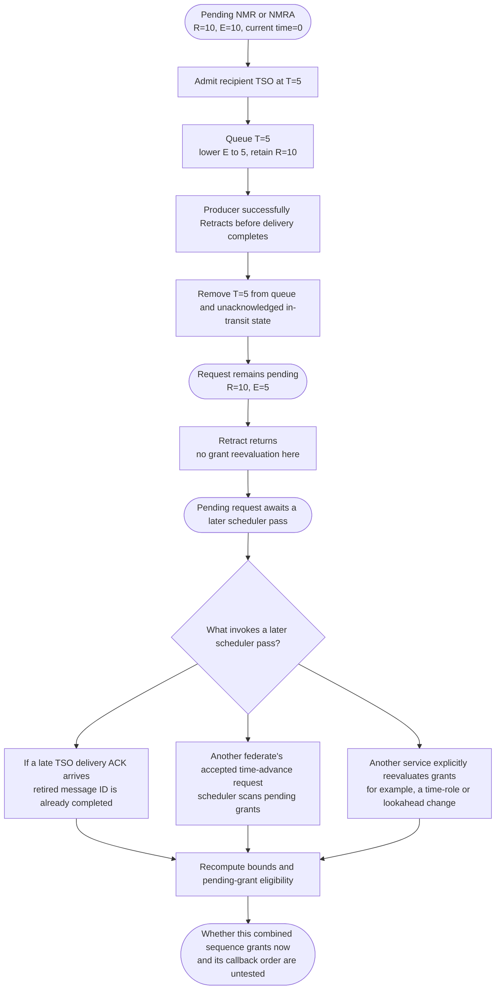

In the process service, `handleRetract` removes queue and unacknowledged
in-transit work, then returns the Retract result without calling grant
reevaluation. If an acknowledgment for that retired in-transit identity arrives
later, the coordinator accepts it as already completed; the acknowledgment
handler still calls `reevaluateTimeAdvanceGrants`. Separately, accepting another
federate's time-advance request registers its dispatch through
`requestTimeAdvanceGrant`, which runs the scheduler over all pending requests.
Other explicit reevaluation sites include successful time-role and lookahead
changes. These are source-traced triggers, not a test of this complete order.

The focused configured-process NMR and NMRA cases observe a TSO callback before
the grant and a valid retraction handle, but do not invoke Retract. The focused
process interaction-retraction case tests retraction around callback entry but
does not make an NMR/NMRA request. A separate process attribute case combines a
pending receiver TAR(5) with a timestamped update at 5: the producer advances
only to 2, successfully Retracts, then advances to 5; the receiver later drains
the retracted callback work, observes no reflection, and receives grant 5.
That establishes this adjacent TAR sequence, but not what happens to a process
NMR/NMRA after late-arrival retargeting and Retract. The combined NMR/NMRA grant
result and callback order remain untested.

Evidence: [process Retract handler](../../cpp/src/internal/federation/process_federation_service_retraction.cpp#L77),
[shared coordinator retraction and retired in-transit identity](../../cpp/src/internal/time/federation_time_coordinator.cpp#L217),
[process TSO acknowledgment and grant reevaluation](../../cpp/src/internal/federation/process_federation_service.cpp#L153),
[late acknowledgment of a retired TSO](../../cpp/src/internal/time/federation_time_coordinator.cpp#L479),
[grant reevaluation scans pending requests](../../cpp/src/internal/federation/federation_registry_time_tso_enqueue.cpp#L122),
[accepted time-advance request registers with the scheduler](../../cpp/src/internal/federation/process_federation_service_time_management.cpp#L885),
[focused process TAR scheduler case](https://github.com/sheepfling/umbra/blob/c9c5a9e410539b039cd8bba35b53d0ef2b24d180/cpp/tests/ieee1516_2025_connection_time_advance_federation_scheduler_catch2.cpp#L735),
[pending grant eligibility pass](../../cpp/src/internal/federation/federation_registry_tso_delivery.cpp#L1064),
[process pending-NMR case](../../cpp/tests/ieee1516_2025_connection_tso_directed_interaction_callback_gating_catch2.cpp#L1522),
[process pending-NMRA case](../../cpp/tests/ieee1516_2025_connection_tso_directed_interaction_callback_gating_catch2.cpp#L1569),
[process interaction retraction around callback entry](../../cpp/tests/ieee1516_2025_connection_process_tso_interaction_retraction_before_callback_catch2.cpp#L145),
and [process attribute Retract followed by receiver TAR grant](../../cpp/tests/ieee1516_2025_connection_process_tso_attribute_retraction_before_callback_catch2.cpp#L712).

#### FQR: actual grant and optimistic floor

For the bounded in-process FQR implementation, let U be the earliest
currently undelivered timestamp for the requester. Ignoring invalid-state
errors, the current calculation is:

- **G = max(current, min(R, available GALT if defined, U if present))**
- **O = max(G, min(R, U if present))**

An absent GALT or U is omitted from that minimum. The callback reports G;
O is retained privately as the minimum target for later progress. This
separation is why an FQR may complete at a time earlier than the requested
boundary without allowing a following request to go backward through work
already optimistically flushed.

There are deliberately two frontiers here: the dispatcher flushes the current
in-process recipient delivery set through the final-time queue boundary, while
the callback reports the separately calculated actual grant G and retains O
for later progress. Do not collapse the delivery frontier, actual grant, and
optimistic floor into one time value. This bounded path does not wait for
future transport arrivals.

When GALT is undefined, FQR has a separate NRG rule from an ordinary forward
TAR/TARA. In the current embedded 2025 calculation, FQR still completes. If
the requester is time-constrained and NRG is disabled, the actual grant G is
capped at the current logical time; the optimistic time O still reflects the
request and any queued TSO frontier. With NRG enabled, G may advance to the
request or the earlier queued TSO time. NRG changes the actual-grant decision;
it does not make GALT defined. This is the FQR counterpart to
[Example 3](#example-3-galt-undefined), where a forward TARA can remain pending
when NRG is disabled.

The focused test uses current time C=0 and request R=10. Its queued-message
branch has U=5; its no-message branch omits U:

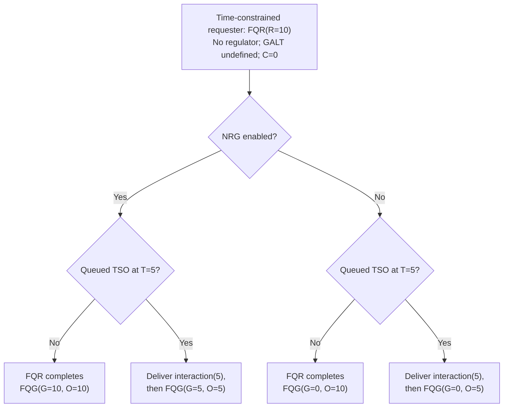

The four outcomes are asserted in the focused
[2025 embedded test](../../cpp/tests/ieee1516_2025_non_regulated_grant_switch_catch2.cpp#L163).
The undefined-GALT actual-time cap is in the
[FQR grant calculation](../../cpp/src/internal/time/federation_time_grant_policy.cpp#L229);
the grant transition retains O as the later advance floor in
[`FederateTimeState`](../../cpp/src/internal/time/federate_time_state.cpp#L535).
The test also queries GALT as undefined before and after FQR. These are
embedded implementation and test observations, not a normative NRG/FQR rule
or configured-process parity claim.

That distinction also affects a timed federation Save. In one embedded
`HLA_EVOKED` case, FQR(10) delivers an interaction at 7 and reports actual
grant G=5 / optimistic time O=7; `queryLogicalTime` still returns 5. A Save
request at 5 is rejected, while a request at 6 is accepted but does not yet
produce `initiateFederateSave`. TAR(6) is then rejected because it falls below
the retained FQR floor; a later TAR(7) crosses the Save timestamp and admits
`initiateFederateSave(6)` before the matching Time Advance Grant. This shows
that Save-request acceptance, the Save callback boundary, the public logical
time, and the FQR floor are separate facts. See the Save/Restore guide's
[worked FQR and timed-Save sequence](HLA-2025-FEDERATION-SAVE-RESTORE-FLOW-GUIDE.md#worked-case-fqr-optimistic-time-and-timed-save-initiation)
and the focused [actual-time/FQR-floor checks](../../cpp/tests/flush_queue_request_optimistic_time_catch2.cpp#L541)
and [crossing-grant callback order](../../cpp/tests/ieee1516_2025_federation_management_save_restore_catch2.cpp#L133).

A timed Save already pending before an FQR can also be admitted at that FQR's
own boundary when the constrained-member gate is satisfied. In the selected
mixed-member test, no TSO payload is queued; the callback-order assertion shows
`initiateFederateSave` before that member's FQG. The admission check requires
every time-constrained member to have a qualifying scheduled advance. In the
dispatcher, the FQR's eligible TSO delivery phase completes before timed-Save
admission, which invokes the Save callback before the private FQG state change.
The test establishes callback order for its selected case; this exact placement
and the all-member gate are source observations, not a normative callback-order
rule or process-parity claim
([mixed FQR/TAR test](../../cpp/tests/ieee1516_2025_timed_save_mixed_fqr_tar_members_catch2.cpp#L5),
[all-member admission gate](../../cpp/src/internal/federation/federation_registry_save_control.cpp#L729),
[FQR TSO delivery phase](../../cpp/src/internal/runtime/umbra_rti_ambassador_time_advance_dispatch.cpp#L765),
[Save callback admission](../../cpp/src/internal/runtime/umbra_rti_ambassador_time_advance_dispatch.cpp#L893),
[FQG state transition](../../cpp/src/internal/runtime/umbra_rti_ambassador_time_advance_dispatch.cpp#L922)).
The tests use `evokeCallback(0.0)` to observe queued callbacks; this is not a
logical-time advance or a wall-clock wait. A positive Evoke timeout remains a
host-side wait duration, separate from the simulation-time targets.

#### FQR with HLA_EVOKED: transport-arrival boundary is profile policy

The pinned 2025 Requirements Lab transcription supplies the clause text.
Section 8.12 requires delivery of messages queued in the RTI that the joined
federate will receive as TSO messages and explicitly recognizes that smaller
timestamps may arrive in the future. Section 8.13 defines OLT as the minimum
of the time supplied to FQR and the timestamps of TSO messages delivered in
response. Section 8.14 guarantees that no additional TSO message will later
be delivered with a timestamp below the actual grant. These clauses establish
the queue/delivery result, OLT inputs, and actual-grant safety boundary; they
do not prescribe a transport snapshot at FQR acceptance, an HLA_EVOKED
callback-start cutoff, or identical embedded/process policy. This is a reading
of the pinned Lab text, not an independent licensed-PDF conformance opinion.

The same ordered public scenario is covered in both profiles: the receiver
accepts FQR(10); the sender then submits timestamps 9 and 12; timestamp 12 is
retracted before the receiver starts its evoked FQG callback. The two tested
policies differ:

| Profile | TSO callbacks before FQG | Actual grant | OLT |
| --- | --- | ---: | ---: |
| Embedded | Receive Interaction at 9; retracted 12 is suppressed | 5 | 9 |
| Process coordinator | No post-acceptance TSO callback in this FQR; retracted 12 is absent | 5 | 10 |

The embedded dispatcher selects the late-arriving input when callback-time
extraction begins. The process coordinator fixes the FQR result when it accepts
the request. Neither cutoff is prescribed by the cited clauses; the tests
record a profile-policy difference, not a conformance failure or proof of
cross-profile parity. The focused process test also verifies that its
authoritative regular Send Interaction path rejects timestamp 4 from a sender
whose current-time-plus-lookahead floor is 5 after FQG(actual=5). That check is
limited to this producer path and does not establish the same safeguard for
every timestamped service family.

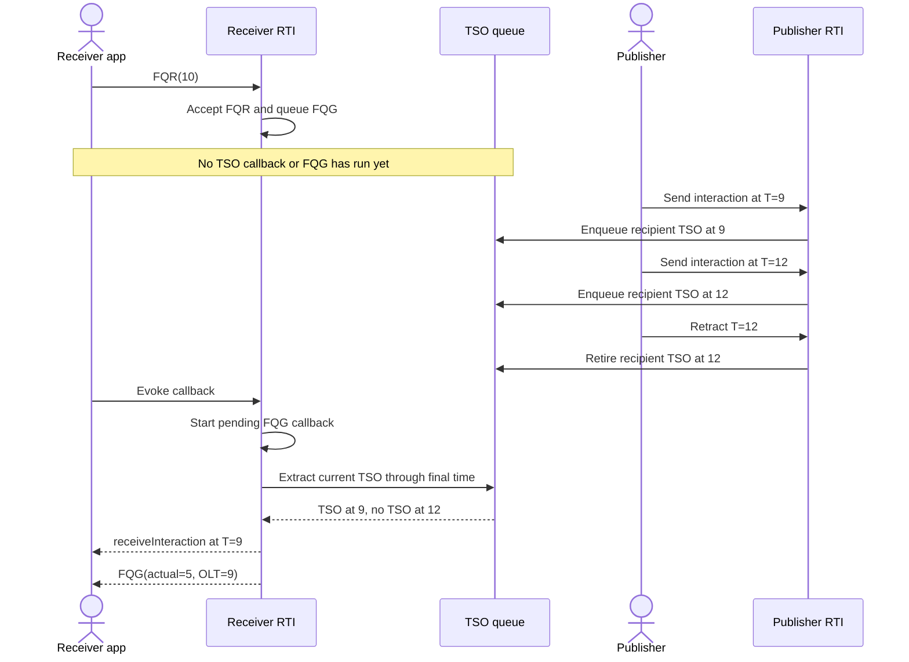

This establishes the callback-time frontier for the cited embedded EVOKED
scenario only. The paired process test records its accepted-request policy and
the different OLT (10). The tests do not define a universal transport arrival
cutoff, require profile parity, or establish behavior for other TSO service
families. Use §8.12 for FQR queue semantics, §8.13 for OLT inputs, and §8.14
for the actual-grant future-delivery guarantee; do not treat OLT as the actual
grant's safety boundary.

#### Disable Time Constrained between FQR acceptance and Evoke

Consider a time-constrained receiver that accepts FQR(R), has a matching TSO
interaction queued or admitted for delivery, then successfully calls Disable Time
Constrained before its next `HLA_EVOKED` drain. This combines three boundaries:
the temporal role change, the TSO-to-receive-order transition, and application
callback entry. Keep three questions separate: which time-management role is
active, where each already-queued payload is held and classified, and whether
the application has run its callback. Disable changes the role and may change
the delivery of queued messages; `HLA_EVOKED` can still defer application
observation. The cited §8.12–8.14 behavior does not settle callback ordering
for this combined service interleaving. The profile traces below are
implementation observations, not a normative ordering rule.

| Profile | What Disable changes before Evoke | FQG time selection and callback boundary |
| --- | --- | --- |
| Embedded | It removes the receiver's still-queued TSO payloads from the TSO delivery queue and queues them as receive-order callbacks. | The already-submitted FQR task stays earlier in the callback FIFO. When Evoke runs it, that task performs its TSO extraction and calculates actual/optimistic times afterward; the separately queued receive-order callback follows the FQG callback. |
| Configured process | The coordinator changes the temporal role and converts only TSO payloads still resident in its queue. A TSO interaction already sent to the client is beyond that server-side drain. | The coordinator has already selected and encoded the FQG pair. A TSO interaction task already submitted to the dispatcher can be changed to receive order in its existing FIFO slot; a focused public-API process integration test covers this branch. If the interaction is still only in the client `pendingEvents_` FIFO, later submission snapshots the new disable generation, so the current source path retains timestamp/order metadata. That second admission branch and its relative FQG order are not covered by a focused public case. |

In the embedded path, FQR submission places a grant task on the callback
dispatcher. Disable Time Constrained changes the role, takes the receiver's
queued TSO payloads from the registry, and submits those payloads through the
receive-order route. The dispatcher appends tasks and Evoke removes the oldest
task first. The FQR task therefore runs before these later converted callbacks.
Inside that task, Umbra performs the TSO delivery phase and then calculates
FQG actual and optimistic times from that phase's result. Since Disable has
already removed the queued payloads, those messages are not TSO callbacks in
the FQR task. Exact resulting times depend on the federation state; the
combined sequence has no focused test.

In the configured-process path, the coordinator's FQR dispatch fixes the two
logical-time values and transports them in the grant event. Disable drains
TSO payloads still held by the coordinator before it dispatches any newly
eligible grant. Separately, the process callback bridge compares the disable
generation captured when a timestamped callback task was submitted with the
generation at callback entry. If Disable occurred in between, the bridge
removes the timestamp/order metadata and invokes receive order in the same
dispatcher slot. This preserves that task's existing FIFO position.

There is a second client-side queue before that bridge. The focused public-API
process integration test uses Query GALT as an ordered stream barrier so the already-sent
TSO interaction is buffered and submitted to the callback dispatcher before Disable.
It confirms that Disable itself does not enter the callback and that the later
Evoke delivers receive order. This test does not include FQR/FQG.

If the TSO interaction is still in `pendingEvents_` when Disable succeeds, the
current source takes a different path: the bridge snapshots the already-advanced
disable generation when it later submits the interaction. The callback-time comparison
finds no intervening Disable, so the source leaves the event's timestamp and
order metadata intact and selects the timestamped callback form. This is a
source-derived configured-process behavior, not evidence of a portable
requirement. No focused public case combines FQR, Disable Time Constrained, and
this client-FIFO admission branch; its relative FQG callback order remains
unverified.

The embedded anchors are [FQR grant-task submission](../../cpp/src/internal/runtime/umbra_rti_ambassador_time_advance_services.cpp#L891),
[FQG calculation after TSO delivery](../../cpp/src/internal/runtime/umbra_rti_ambassador_time_advance_dispatch.cpp#L777),
[Disable's TSO drain](../../cpp/src/internal/runtime/umbra_rti_ambassador_time_constrained_control.cpp#L252),
[receive-order task queueing](../../cpp/src/internal/runtime/umbra_rti_ambassador_time_constrained_control.cpp#L297),
[conversion of drained payloads](../../cpp/src/internal/runtime/umbra_rti_ambassador_tso_receive_order_delivery.cpp#L561),
and the dispatcher's [FIFO append](../../cpp/src/internal/callbacks/callback_dispatcher.cpp#L164)
and [oldest-task removal](https://github.com/sheepfling/umbra/blob/c9c5a9e410539b039cd8bba35b53d0ef2b24d180/cpp/src/internal/callbacks/callback_dispatcher.cpp#L322).
The process anchors are [FQR grant dispatch](../../cpp/src/internal/federation/process_federation_service_time_management.cpp#L892),
[Disable's server-side drain](../../cpp/src/internal/federation/process_federation_service_time_management.cpp#L688),
the [adapter's post-success generation change](../../cpp/src/internal/runtime/umbra_rti_ambassador_time_constrained_control.cpp#L212),
and the [client callback bridge's disable-generation check](../../cpp/src/internal/federation/process_federation_callback_bridge.cpp#L1465).

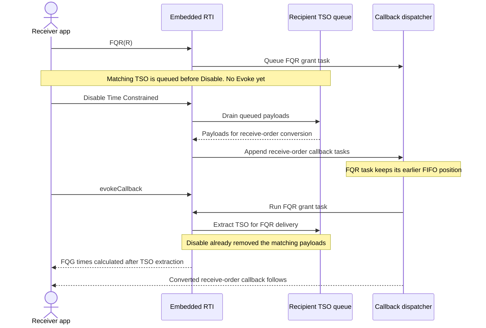

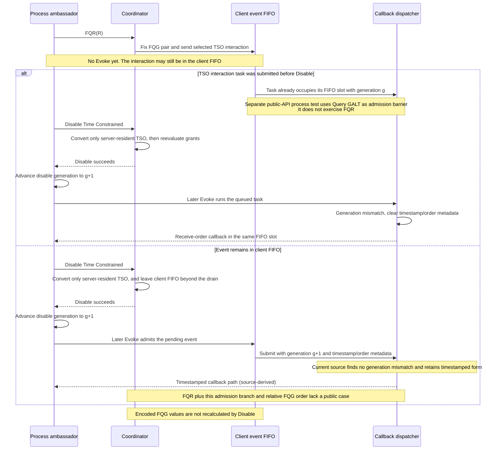

Focused evidence covers the legs separately: the [embedded Disable case](../../cpp/tests/available_time_advance_inclusive_galt_catch2.cpp#L1208)
converts queued TSO to receive order, while the [embedded FQR callback case](../../cpp/tests/ieee1516_2025_fqr_grant_callback_kind_catch2.cpp#L4)
reports its actual/optimistic pair under `HLA_EVOKED`. The [process Disable case](../../cpp/tests/ieee1516_2025_connection_process_tso_ingress_proxy_catch2.cpp#L1313)
uses a GALT barrier; the [probe](../../cpp/tests/process_federation_service_probe.cpp#L1348)
asserts no callback during Disable and a receive-order callback after Evoke. The [process FQR frontier cases](../../cpp/tests/ieee1516_2025_connection_process_flush_queue_galt_frontier_catch2.cpp#L876)
exercise FQG event delivery separately. None combines the three operations.
The [client FIFO admission](../../cpp/src/internal/federation/process_federation_client.cpp#L702)
and [later FIFO submission](../../cpp/src/internal/federation/process_federation_client_callback_dispatch.cpp#L302),
[bridge generation snapshot](../../cpp/src/internal/federation/process_federation_callback_bridge.cpp#L1350),
[generation comparison and conversion](../../cpp/src/internal/federation/process_federation_callback_bridge.cpp#L1465),
[post-success generation update](../../cpp/src/internal/federation/process_federation_callback_bridge.cpp#L1515),
and [timestamp-based callback selection](../../cpp/src/internal/federation/process_federation_callback_bridge.cpp#L207)
explain the two process queue boundaries. These are current implementation observations, not normative callback-order rules.
For the general process Evoke model, see [event admission versus callback draining](HLA-2025-CALLBACK-AND-SERVICE-ORDERING-FLOW-GUIDE.md#process-evoke-multiple-separates-event-admission-from-callback-draining).

#### Disable Time Constrained can release a pending TAR

The preceding trace starts with FQR and follows its FQG. A TAR is a separate
accepted operation that can remain pending while its receiver is constrained.
In Umbra's 2025 paths, a successful Disable Time Constrained changes that
receiver role, drains already-queued TSO into receive-order work, then
re-evaluates pending TARs. If the updated state makes a TAR eligible, the RTI
can schedule its grant. Grant eligibility and callback/event observation remain
separate steps.

The embedded tests establish the two component behaviors separately: one
pending TAR is released by Disable Time Constrained, and a different case
converts queued interaction TSO to receive order. The configured-process public
case establishes the queued-TSO conversion; no reviewed public process case
combines Disable Time Constrained with a pending TAR. The profile-specific
ordering below is therefore a source trace, not a combined callback-order
result.

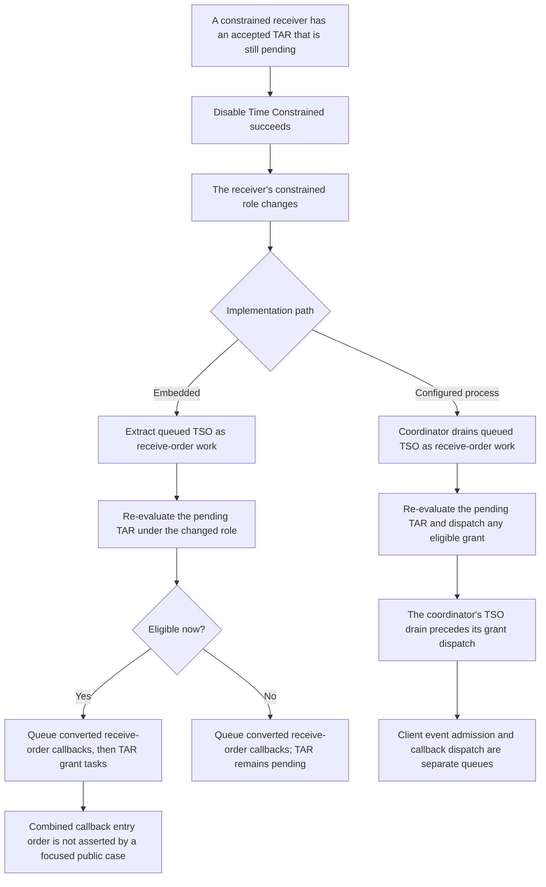

The embedded [pending-TAR case](../../cpp/tests/ieee1516_2025_embedded_time_management_catch2.cpp#L364)
asserts a grant after Disable but has no queued TSO. The separate [embedded
queued-TSO case](../../cpp/tests/available_time_advance_inclusive_galt_catch2.cpp#L1208)
asserts receive-order conversion but has no pending TAR. The [configured-process
case](../../cpp/tests/ieee1516_2025_connection_process_tso_ingress_proxy_catch2.cpp#L1313)
asserts queued interaction conversion only. Source shows the embedded role
change and grant re-evaluation
([Disable transition](../../cpp/src/internal/runtime/umbra_rti_ambassador_time_constrained_control.cpp#L249),
[receive-order submission before grant submission](../../cpp/src/internal/runtime/umbra_rti_ambassador_time_constrained_control.cpp#L297))
and the process coordinator's
[TSO drain before TAR re-evaluation](../../cpp/src/internal/federation/process_federation_service_time_management.cpp#L688).
The process client still has a distinct [event FIFO](../../cpp/src/internal/federation/process_federation_client.cpp#L702)
before callback dispatch. Do not read the diagram as a normative callback-order
rule or as proof that process callback entry matches the embedded FIFO.

Timestamped object deletion adds a separate receiver-knowledge and retraction
boundary during this transition. The [TSO deletion walkthrough](HLA-2025-TSO-RETRACTION-FLOW-GUIDE.md#disable-time-constrained-separates-known-object-removal-from-the-remove-callback)
distinguishes the embedded early known-object erase, later receive-order Remove
gate, producer-owned designator, and configured-process server/client boundary.

## Worked examples

### Example 1: equality at an ordinary GALT

Assume:

- Regulator **P** is at logical time 10 with lookahead 2.
- There are no incoming queued TSO messages that set an earlier boundary.
- Constrained federate **C** requests a grant to logical time 12.

P's current lower-bound candidate is 10 + 2 = 12, so the ordinary
regulator-only GALT is 12.

1. C's TAR target is equal to GALT, not below it, so the current strict TAR
   policy keeps the request pending.
2. C's TARA to 12 may use the current inclusive Available-mode boundary.
3. If P then requests an advance to 11, that pending regulator boundary
   contributes 11 + 2 = 13. C's still-pending TAR to 12 is now strictly
   below the current GALT and can become eligible.

The important point is that a pending regulator advance can change the
federation bound before that regulator's own grant callback runs. The current
bounds snapshot uses the regulator's original caller boundary for this
calculation.

### Example 2: exact equality depends on mode and boundary source

Assume an accepted timestamped message for C is queued at time 12, and the
current bound calculator selects that TSO as GALT=12. The current policy
distinguishes the request modes:

- **TAR(12)** remains pending. TAR is strictly below GALT even when the
  boundary comes from a queued TSO.
- **TARA(12)** and **NMRA(12)** may use equality at an available GALT under
  the current inclusive Available-mode policy.
- **NMR with E=12** may use equality only when the selected GALT is marked as
  the queued TSO boundary. At an ordinary regulator-only GALT=12, NMR remains
  pending.

When an eligible request is granted, the dispatcher orders its eligible TSO
callback before the matching grant callback. The focused policy cases assert
the exact TAR, Available-mode, and NMR comparisons; the public embedded TARA
case also observes a queued interaction callback before the grant at time 7.
Those sources do not provide an end-to-end public observation of NMR granting
at an exact queued-TSO boundary ([grant policy](../../cpp/src/internal/time/federation_time_grant_policy.cpp#L57),
[strict TAR case](../../cpp/tests/federation_time_grant_policy_catch2.cpp#L63),
[Available equality case](../../cpp/tests/federation_time_grant_policy_catch2.cpp#L83),
[NMR queue-boundary case](../../cpp/tests/federation_time_grant_policy_catch2.cpp#L97),
[public TARA case](../../cpp/tests/available_time_advance_inclusive_galt_catch2.cpp#L232)).

This is why the boundary's source and the request mode both matter. A single
“TAR is always strict” shortcut loses the NMR exception, while treating every
queue-derived equality as grantable incorrectly describes TAR.

### Example 3: GALT undefined

If C is time constrained but there is no other active regulator, GALT is
undefined. The current policy then consults the federation's NRG setting:

- With NRG enabled, a valid forward target can be granted.
- With NRG disabled, a forward request waits; a non-forward request at or
  before current time can proceed.
- The query result remains “GALT undefined” either way. NRG affects the grant
  decision, not the mathematical existence of GALT.
- If an incoming TSO message exists, LITS may still be defined even though
  GALT is not.

#### One queued TSO still limits an undefined-GALT grant

An embedded 2025 case combines these boundaries. The sole regulator sends an
interaction timestamped at 3 and then disables Time Regulation. The constrained
recipient requests TARA(10). With NRG enabled, the forward request can proceed
while GALT is undefined, but the queued TSO still limits the actual grant: the
recipient observes the interaction at 3 before its grant at 3. With NRG
disabled, TARA(10) stays pending until the producer re-enables regulation and
requests TAR(4); then the same TSO is delivered before the recipient's grant at
3.

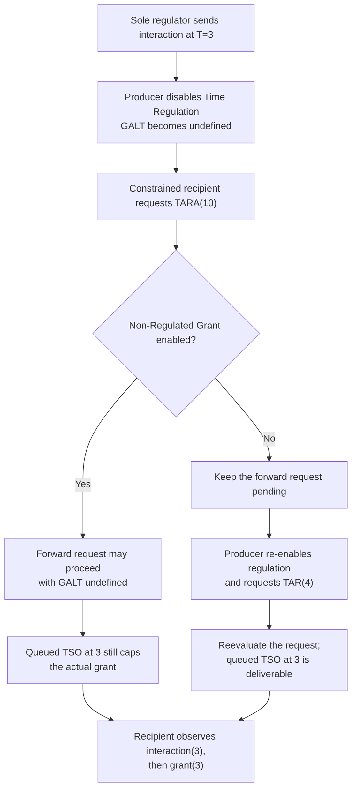

##### Configured-process bounds after the producer disables regulation

A separate configured-process public case stops at the bound queries. The
producer sends an interaction at time 5 while it is the sole regulator, then
disables Time Regulation. The receiver's subsequent Query GALT is undefined,
while Query LITS still returns 5 from the queued interaction. This directly
shows the two queries answer different questions after the producer role ends;
it does not exercise a pending advance or establish the later callback/grant
order.

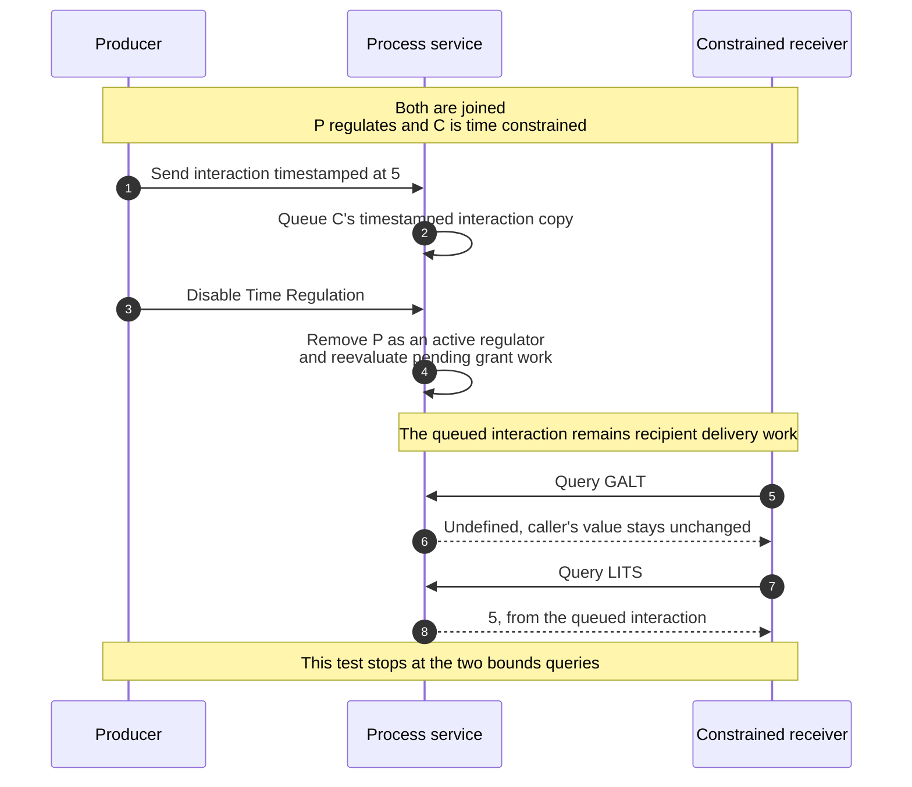

The source path reevaluates grant work after changing the producer's role. The
bounds calculator still examines the receiver's queued and in-transit TSO
messages, and the process grant dispatch sends eligible queued interaction
events before the matching grant event. Those are source observations; the
process query test does not test the grant branch
([Disable handler](../../cpp/src/internal/federation/process_federation_service_time_management.cpp#L660),
[queued-message bounds](../../cpp/src/internal/time/federation_time_bounds.cpp#L82),
[process pre-grant TSO delivery](../../cpp/src/internal/federation/process_federation_service_lifecycle.cpp#L519),
[configured-process query case](../../cpp/tests/ieee1516_2025_connection_process_query_time_bounds_queued_tso_catch2.cpp#L459),
[asserted GALT/LITS values](../../cpp/tests/ieee1516_2025_connection_process_query_time_bounds_queued_tso_catch2.cpp#L719)).

The [focused embedded case](../../cpp/tests/available_time_advance_inclusive_galt_catch2.cpp#L670)
asserts both NRG branches and the receiver's interaction-before-grant order.
The undefined-bound policy is in
[`federation_time_grant_policy.cpp`](../../cpp/src/internal/time/federation_time_grant_policy.cpp#L77).
A separate [Query GALT/LITS case](../../cpp/tests/ieee1516_2025_query_galt_lits_other_regulator_pending_advances_catch2.cpp#L5)
checks that both queries become undefined after the only regulator disables
Time Regulation when no TSO is queued. The embedded case observes the later
grant and interaction callback; the configured-process case observes GALT and
LITS only. Together they do not establish a normative interpretation or
complete cross-profile callback parity.

This example follows the recipient's queued-message and grant boundary. The
producer's ability to retract that message across Disable/re-enable is a
separate lifecycle, covered by the [TSO retraction guide](HLA-2025-TSO-RETRACTION-FLOW-GUIDE.md#disable-time-regulation-temporarily-blocks-retract-while-the-designator-remains-live).
The order used by a future timestamped send is a separate question, covered by
the [order-control guide](HLA-2025-ORDER-AND-TRANSPORTATION-FLOW-GUIDE.md#disable-time-regulation-is-a-separate-input-to-future-send-interaction-classification).

### Example 4: NMR keeps two boundaries

Suppose C calls NMR with R = 20, and the earliest currently queued message
for C is timestamped 12. The current implementation selects E = 12 as the
effective target, but retains R = 20 separately. It processes the queued
timestamp-12 cohort before granting at that selected target. The RTI does not
rewrite the application's original request boundary to 12 for unrelated
timestamp validation or federation-bound calculations.

## Timestamped message lifecycle and callback order

The queue is recipient-scoped. One send can fan out into separate recipient
entries that share a message identity and preserve sequence order for equal
timestamps. The state diagram below follows an individual copy admitted to the
TSO queue; it is not a universal path for every recipient of a timestamped
service. In the selected embedded attribute-update case below, a
non-time-constrained recipient instead receives a timestamped callback in
receive order while the constrained recipient's copy waits in the TSO queue.
For the producer-side legality check, mixed per-recipient retract outcomes,
and the distinct Request Retraction callback, see the companion [TSO
retraction lifecycle guide](HLA-2025-TSO-RETRACTION-FLOW-GUIDE.md).

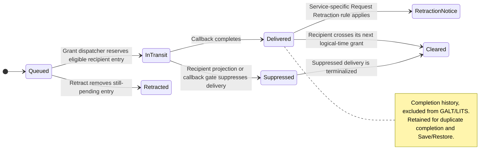

For the current coordinator:

- **Queued** means accepted for a recipient but not yet selected for callback.
- **In transit** means selected for callback and retained as a distinct phase
  while callback work is active.
- **Delivered since last advance** records a completed or terminalized TSO
  delivery until the recipient crosses a grant boundary. For a visible
  callback, completion is acknowledged after the callback returns; a
  suppressed route can be terminalized without exposing a callback. This
  phase is not a GALT/LITS input; the coordinator keeps it for
  duplicate-completion recognition and Save/Restore state
  ([completion phase](../../cpp/src/internal/time/federation_time_coordinator.cpp#L414),
  [state-image capture](../../cpp/src/internal/federation/federation_registry_state_image_capture.cpp#L860),
  [grant-boundary cleanup](../../cpp/src/internal/federation/federation_registry_time_tso_enqueue.cpp#L228)).
- Retract and Request Retraction are not interchangeable. The queue can remove
  pending fanout, but the owning service determines whether already-delivered
  recipients need a Request Retraction callback.
- Do not equate the coordinator's “delivered since last advance” phase with
  the retraction ledger's per-recipient delivered state. Here the coordinator
  phase records callback completion; the embedded retraction ledger can mark
  an original message delivered when its callback enters application code.
  Timestamped Delete Object Instance has a further service-specific boundary:
  its registry commits removal at the Remove gate immediately before invoking
  `removeObjectInstance`. See the [TSO retraction guide's deletion branch](HLA-2025-TSO-RETRACTION-FLOW-GUIDE.md#service-specific-effects-deletion-is-special)
  and the [object-removal callback boundary](HLA-2025-OBJECT-AND-INTERACTION-INFORMATION-FLOW-GUIDE.md#timestamped-deletion-each-receiver-reaches-its-own-removal-boundary).
- Resignation/disconnect cleanup is recipient-scoped; it must not erase
  another recipient's fanout.

For the receiver-side timing boundary during Resign, see the [regional TSO
receiver-Resign trace](HLA-2025-TSO-RETRACTION-FLOW-GUIDE.md#receiver-resign-around-a-regional-interaction-callback-gate).
It separates time-coordinator queue cleanup from process event acknowledgement
and records a source-level interaction Region-copy lease gap; it does not assert
a grant outcome.

In the current embedded adapter's supported grant path, the implementation
orders the steps this way:

1. The request becomes eligible and a callback-gated grant dispatch is queued.
2. The dispatcher rechecks the pending generation and the live temporal state.
3. The recipient's eligible TSO callbacks run while the private state is still
   Time Advancing.
4. The matching Time Advance Grant callback begins; the private current time
   changes at that callback boundary.
5. Delivered-since-last-advance bookkeeping is cleared as part of crossing
   the recipient's grant boundary.

The process endpoint implements a related TSO-interaction boundary through a
separate route: eligible interaction payloads cross into the receiver's event
stream before the matching grant event, and the process coordinator retains
the delivery as in-transit until callback completion is acknowledged. The
focused public process test uses `HLA_EVOKED`: it accepts two interactions at
time 5, observes no interaction callback before Evoke, then observes both in
FIFO order before one Time Advance Grant. This is one process interaction
scenario, not evidence for every TSO payload family, callback model, or
embedded/process equivalence. The process endpoint guide explains its event
and acknowledgement boundary in more detail. Its [attribute callback-group
note](HLA-2025-PROCESS-ENDPOINT-REQUEST-AND-CALLBACK-FLOW-GUIDE.md#grouped-timestamped-attribute-callbacks-share-one-completion-boundary)
shows how the final projected passel supplies the message-level callback
boundary; the [client request-depth note](HLA-2025-PROCESS-ENDPOINT-REQUEST-AND-CALLBACK-FLOW-GUIDE.md#a-completion-ack-waits-only-for-an-active-process-request)
separates callback completion from immediate versus deferred ACK transport.

The following configured-process attribute-update case connects callback
acknowledgement to the timing frontier. While the timestamp-5 event is in
transit, the focused public test source observes GALT and LITS at 5. After the
receiver's HLA_EVOKED reflection callback returns, the callback bridge invokes
the private completion handler; the client sends the ACK immediately if no
process request is awaiting its response, or defers it otherwise. Once the
process service accepts that ACK, it moves the message out of the in-transit
phase and reevaluates pending grants. The bounds calculator then uses the
producer's time-3 plus active-lookahead-3 boundary, so the receiver's pending
TAR(5) can complete. This is a bounded Umbra 2025 process trace, not a
normative queue or callback-order rule.

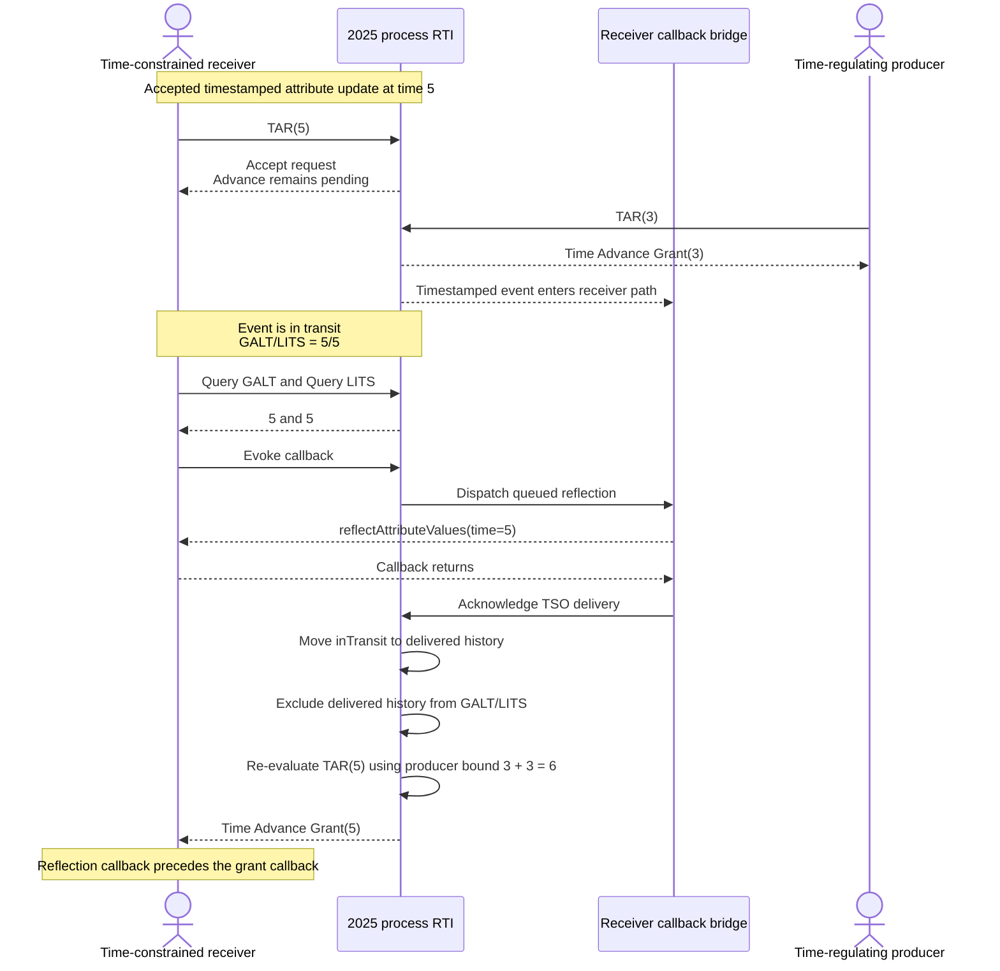

The [public process test source](../../cpp/tests/ieee1516_2025_connection_process_tso_attribute_update_regulation_reenable_changed_lookahead_catch2.cpp#L862)
asserts the in-transit GALT/LITS values and reflection-before-grant callback
order ([callback assertions](../../cpp/tests/ieee1516_2025_connection_process_tso_attribute_update_regulation_reenable_changed_lookahead_catch2.cpp#L884)).
The bridge acknowledges after the application callback returns
([callback boundary](../../cpp/src/internal/federation/process_federation_callback_bridge.cpp#L1448)).
The [process acknowledgement handler](../../cpp/src/internal/federation/process_federation_service.cpp#L172)
moves the acknowledged record and requests grant reevaluation
([reevaluation](../../cpp/src/internal/federation/process_federation_service.cpp#L229));
the focused [bounds unit case](../../cpp/tests/federation_time_bounds_catch2.cpp#L249)
separately checks that delivered-phase history no longer caps GALT/LITS. These
are complementary source/test assertions, not one standalone observation of
every internal step. No build or test was run during this documentation review.

### One timestamped update, two recipient paths

This bounded embedded case makes the per-recipient split concrete. One
accepted timestamped attribute update has a single retraction designator, but
its two subscribers do not share one delivery state:

| Recipient | Before the constrained recipient's matching grant | Observed order | Retract outcome in this case |
| --- | --- | --- | --- |
| Time-constrained | Its copy remains queued for TSO; the publisher retracts before the grant, so no reflection begins. | No reflection callback occurs, so this case records no received-order value for that copy. | The queued copy is withdrawn; the recipient later receives its grant, with no reflection or Request Retraction callback. |
| Not time-constrained | It receives the timestamped reflection through a receive-order callback before the constrained recipient's grant. | `sentOrderType=TIMESTAMP`, `receivedOrderType=RECEIVE`. | The reflection carries the valid retraction designator; because delivery already occurred, Request Retraction follows the reflection in the observed callback order. |

The [focused embedded test](../../cpp/tests/timestamped_default_region_attribute_mixed_fanout_catch2.cpp#L155)
asserts the per-recipient callback results and shared designator. The [recipient
queue split](../../cpp/src/internal/runtime/umbra_rti_ambassador_attribute_update_services.cpp#L637)
and [grant-versus-receive-order routing](../../cpp/src/internal/runtime/umbra_rti_ambassador_attribute_update_services.cpp#L743)
are explicit in the adapter. For the generic delivered-versus-pending
Retract/Request Retraction sequence, see the [TSO retraction guide's
mixed-recipient walkthrough](HLA-2025-TSO-RETRACTION-FLOW-GUIDE.md#a-mixed-recipient-walkthrough).
This is one embedded attribute-update scenario, not a rule for every
timestamped service or the process profile.

### Timestamped attribute updates: time eligibility and receiver projection

For a timestamped attribute update, reaching the recipient's logical-time
delivery boundary does not by itself guarantee a reflection. The accepted
message retains its sent values and any source-region snapshots; the current
receiver projection is checked later, against that retained source scope. The
two inspected 2025 profiles place that projection check at different points:

```mermaid
flowchart TD
  Send["Accept Update Attribute Values at logical time T"] --> Retain["Retain payload, candidate passels, and source-region snapshots"]
  Retain --> Boundary{"Recipient reaches its TSO delivery boundary?"}
  Boundary -->|"Not yet"| Pending["Keep this recipient entry pending"]
  Pending --> Boundary
  Boundary -->|"Yes"| Profile{"2025 delivery profile"}
  Profile -->|"Embedded"| EmbeddedProjection["At callback dispatch, resolve the current receiver projection against retained sent scope"]
  Profile -->|"Process"| ProcessProjection["At TSO service delivery, resolve the projection before event materialization"]
  EmbeddedProjection --> Rate["Embedded: apply the per-attribute best-effort rate gate; reliable values bypass it"]
  Rate --> EmbeddedValues{"Any projected values remain?"}
  EmbeddedValues -->|"No"| Suppress["Suppress reflection and finish this recipient delivery"]
  EmbeddedValues -->|"Yes"| Reflect["Invoke reflectAttributeValues before the matching grant callback"]
  ProcessProjection --> ProcessValues{"Any values in the current projection?"}
  ProcessValues -->|"No"| Suppress
  ProcessValues -->|"Yes"| Event["Emit an event with this stored projection before the matching grant event"]
```

This is an Umbra 2025 profile comparison, not a normative claim about when an
RTI must freeze an attribute projection. In the embedded callback path, the
current subscription, known class, and DDM projection are resolved during
callback dispatch; any best-effort rate filter is then applied before
reflection; the regional
[selector-mutation scenario](HLA-2025-DATA-DISTRIBUTION-AND-REGIONS-FLOW-GUIDE.md#a-recipient-region-can-invalidate-queued-regional-tso-delivery)
shows an accepted update suppressed after the receiver commits a disjoint
region. The process service also resolves the current projection at TSO
delivery, but does so before constructing and sending the event; after event
materialization, its stored attribute handles and values are what the callback
bridge forwards. No focused process test was found that mutates an attribute
subscription or region between update acceptance and event creation.

The public process-endpoint test uses `HLA_EVOKED` and asserts the receiver's
`reflectAttributeValues` callback before its matching `timeAdvanceGrant`; it
also checks GALT/LITS while the event is in transit. A separate private
process-service test observes a `receive_attribute_update` event frame
followed by the matching `time_advance_grant` frame. Neither test changes the
attribute subscription or region between update acceptance and event
materialization. Also, the inspected process TSO attribute dispatcher does
not apply the embedded best-effort update-rate gate; see the
[update-rate guide's process boundary](HLA-2025-ATTRIBUTE-UPDATE-RATE-ADMISSION-FLOW-GUIDE.md#process-endpoint-subscription-metadata-is-not-callback-admission).
Separate public process cases cover a future timestamped regional attribute
update with NMR under `HLA_EVOKED`, NMRA under `HLA_EVOKED`, and NMR/NMRA under
`HLA_IMMEDIATE` ([NMR](https://github.com/sheepfling/umbra/blob/c9c5a9e410539b039cd8bba35b53d0ef2b24d180/cpp/tests/ieee1516_2025_connection_tso_attribute_before_grant_catch2.cpp#L1153),
[NMRA](https://github.com/sheepfling/umbra/blob/c9c5a9e410539b039cd8bba35b53d0ef2b24d180/cpp/tests/ieee1516_2025_connection_tso_attribute_before_grant_catch2.cpp#L1172),
[HLA_IMMEDIATE cases](https://github.com/sheepfling/umbra/blob/c9c5a9e410539b039cd8bba35b53d0ef2b24d180/cpp/tests/ieee1516_2025_connection_tso_attribute_before_grant_catch2.cpp#L1159)).
They cover the regional send/update and time-advance path, but do not mutate a
region between update acceptance and process event materialization; the
source-described late receiver projection remains untested at that boundary.
The [DDM guide's regional TSO scenario](HLA-2025-DATA-DISTRIBUTION-AND-REGIONS-FLOW-GUIDE.md#a-recipient-region-can-invalidate-queued-regional-tso-delivery)
owns the detailed selector-mutation evidence; this flow adds only the
profile-specific projection timing relative to the TSO boundary.
Timestamped interaction projection has separate source paths and evidence;
compare its [own timing flow](HLA-2025-OBJECT-AND-INTERACTION-INFORMATION-FLOW-GUIDE.md#timestamped-interactions-resolve-the-receiver-projection-later)
without treating either payload family's projection point as a rule for the
other.

Keep application callback entry as a later, separate boundary. The TSO time
gate is open and profile-specific projection has run; the embedded
best-effort rate gate may still suppress individual values. Work that survives
those gates reaches callback dispatch: `HLA_IMMEDIATE` can invoke enabled work
through the immediate drainer, while `HLA_EVOKED` waits for an Evoke service.
The [Callback and Service Ordering guide's callback-task dispatch](HLA-2025-CALLBACK-AND-SERVICE-ORDERING-FLOW-GUIDE.md#callback-task-dispatch)
explains that callback-model gate, and its
[configured-process AttributeUpdate path](HLA-2025-CALLBACK-AND-SERVICE-ORDERING-FLOW-GUIDE.md#configured-process-attributeupdate-receipt-and-disabled-callback-gates)
shows how process event admission feeds the dispatcher. The before-grant cases
above are bounded test observations; they do not establish a universal order
across callback models or profiles.

For the separate question of when subscription and relevance are evaluated, see
the [2025 Delay Subscription Evaluation guide](HLA-2025-DELAY-SUBSCRIPTION-EVALUATION-FLOW-GUIDE.md#receive-order-tso-and-callback-model-are-separate-axes).
That guide marks its §8.1.8 paraphrase as provisional pending an authorized copy;
this section locates the inspected profiles' projection points relative to the
TSO delivery boundary.

Ownership is another independent timeline: an accepted timestamped attribute
update may still be queued when its producer later divests or resigns. The
[TSO retraction guide's ownership comparison](HLA-2025-TSO-RETRACTION-FLOW-GUIDE.md#ownership-changes-and-an-accepted-tso-update-are-separate-timelines)
records selected embedded evidence for that case and keeps original producer
identity, current ownership, queued recipient state, and retraction separate;
it is not a process-parity or portable HLA conclusion.

Recipient routing is a separate gate from this temporal path. For example,
the [DDM guide's embedded regional-interaction case](HLA-2025-DATA-DISTRIBUTION-AND-REGIONS-FLOW-GUIDE.md#a-replacement-regional-interaction-subscription-does-not-retarget-queued-tso-work)
shows a queued interaction reaching its time boundary but being suppressed
because the receiver's current region subscription no longer overlaps the
source-region snapshot captured at send. That is one profile-specific
subscription case, not a general HLA rule. The DDM guide separately traces
the configured-process source path: it re-resolves an already queued
recipient before emitting the process event, but the reviewed process test
does not mutate that subscription while pending.

For the adjacent producer-lifecycle case, the DDM guide's
[regional interaction source-resignation sequence](HLA-2025-DATA-DISTRIBUTION-AND-REGIONS-FLOW-GUIDE.md#a-queued-regional-interaction-survives-source-resignation)
shows the sender leaving after acceptance, the receiver's time-6 delivery
waiting for an independent regulator, and the interaction callback preceding
the receiver's grant. Its source-snapshot and retraction-record lifetimes are
specific to that embedded test; the configured-process path remains source-
derived there.

The tested public TSO producers in the current bounded profile are timestamped
Send Interaction, Update Attribute Values, Delete Object Instance, Send
Directed Interaction, and the supported Send Interaction With Regions
overload with retraction. This list is not a claim that every timestamped HLA
service family is implemented.

Delete Object Instance has service-specific state effects beyond this generic
TSO lifecycle: each receiver's removal commit and the deletion-specific
restoration branch on Retract. For those current Umbra 2025 source/test details,
see the [object-removal flow's timestamped-deletion section](HLA-2025-OBJECT-AND-INTERACTION-INFORMATION-FLOW-GUIDE.md#timestamped-deletion-each-receiver-reaches-its-own-removal-boundary)
and the [TSO retraction guide's deletion branch](HLA-2025-TSO-RETRACTION-FLOW-GUIDE.md#service-specific-effects-deletion-is-special).
The linked restoration evidence is embedded-profile evidence and does not
establish process-profile parity.

In the selected 2025 embedded attribute-update path, TSO eligibility and
update-rate admission are separate gates: a timestamped update can reach its
logical-time delivery boundary and still have individual best-effort
attributes suppressed by the receiver's steady-clock rate filter. If every
value is suppressed, no reflection is observed. In the focused test, the
sender can still call `retract` once afterward; a repeated call is rejected.
Do not infer that rate suppression itself invalidates the public retraction
handle at the recipient boundary. Compare the
[focused mixed-transport test](../../cpp/tests/timestamped_attribute_update_rate_reduction_catch2.cpp#L215)
with the [attribute update-rate guide's TSO boundary](HLA-2025-ATTRIBUTE-UPDATE-RATE-ADMISSION-FLOW-GUIDE.md#3-keep-the-wall-clock-outside-the-tso-state-machine).
This is selected source/test evidence, not a universal HLA ordering rule or
process-profile claim.

### One timestamped invocation can split by attribute order

A timestamp on `updateAttributeValues` does not force every submitted
attribute for every recipient onto one delivery path in the current 2025
embedded profile. The sender's attributes are grouped by their effective
transportation, order, and update-region association, then projected for each
recipient. If one time-constrained receiver is eligible for both receive-order
and timestamp-order passels, the single invocation reaches two distinct timing
gates:

```mermaid
flowchart TD
  Call["One timestamped Update Attribute Values(values, T, tag)"] --> Resolve["Resolve effective order and other passel metadata per attribute"]
  Resolve --> Group["Group by transportation, order, and region association"]
  Group --> Project["Project eligible passels for one receiver"]
  Project --> Split{"Receiver has both RECEIVE and TIMESTAMP passels?"}
  Split -->|RECEIVE| RO["Route receive-order passel through the RO callback gate"]
  Split -->|TIMESTAMP| TSO["Retain timestamp-order passel in the recipient TSO queue"]
  RO --> ROGate{"Receive-order temporal gate open?"}
  ROGate -->|"Asynchronous delivery enabled or time advance pending"| ROReady["Submit RECEIVE/RECEIVE reflection; this passel has no retraction designator"]
  ROGate -->|No| Deferred["Defer receive-order callback"]
  Deferred --> ROGate
  TSO --> Boundary["Wait for recipient's logical-time boundary at T"]
  Boundary --> TSOReady["Submit TIMESTAMP/TIMESTAMP reflection before the matching grant"]
```

The chart combines source-derived boundaries with one focused embedded 2025
`HLA_EVOKED` test of one call to one receiver. Both attributes use reliable
transportation, the callback asserts no sent region designator, and only one
attribute's order is changed, so order type is the passel boundary. With
asynchronous delivery enabled, the test first
observes a `RECEIVE`/`RECEIVE` reflection containing only the receive-order
attribute and no retraction designator, before any time-advance request. After
the receiver requests time 6, it observes a separate `TIMESTAMP`/`TIMESTAMP`
reflection containing only the timestamp-order attribute and a valid
retraction designator, followed by grant 6. The [focused mixed-order
case](../../cpp/tests/ieee1516_2025_mixed_order_attribute_passels_catch2.cpp#L137)
asserts that sequence and the distinct callback payloads.

A second case in the same source retracts after the receive-order reflection
has already been observed. That delivered passel remains; the queued TSO
reflection is suppressed, and the receiver still observes grant 6
([retraction case](../../cpp/tests/ieee1516_2025_mixed_order_attribute_passels_catch2.cpp#L294)).
These are embedded `HLA_EVOKED` schedules, not general HLA ordering rules.
They do not establish the `HLA_IMMEDIATE` sequence, the process-profile
outcome, or what happens to the RECEIVE passel when asynchronous delivery is
off. After either temporal gate admits work, the callback model still controls
when application code observes it.

The passel planner groups on effective per-attribute metadata in the
[registry](../../cpp/src/internal/federation/federation_registry_attribute_value_update_requests.cpp#L133);
the [embedded adapter](../../cpp/src/internal/runtime/umbra_rti_ambassador_attribute_update_services.cpp#L608)
separates each recipient's RO and TSO passels, [queues its TSO passels](../../cpp/src/internal/runtime/umbra_rti_ambassador_attribute_update_services.cpp#L634),
and sends its RO passels through the [receive-order callback route](../../cpp/src/internal/runtime/umbra_rti_ambassador_attribute_update_services.cpp#L761). The
[time-advance dispatcher](../../cpp/src/internal/runtime/umbra_rti_ambassador_time_advance_dispatch.cpp#L497)
delivers a queued TSO reflection before its matching grant. The existing
[receive-order gate](#receive-order-and-asynchronous-delivery) explains the
RO branch. The [order-control case](../../cpp/tests/order_type_control_catch2.cpp#L170)
covers effective order changes, and the [timestamped mixed-fanout
case](../../cpp/tests/timestamped_default_region_attribute_mixed_fanout_catch2.cpp#L155)
varies recipient time roles; neither is the per-attribute mixed-order
witness described above. The
[asynchronous-delivery case](../../cpp/tests/ieee1516_2025_asynchronous_delivery_temporal_state_catch2.cpp#L5)
tests an interaction route, not timestamped attribute passels. The focused
mixed-order evidence above is embedded-only; the process comparison below
remains source-derived.

### Process endpoint: the same order split crosses a different boundary

The process endpoint calls the same per-attribute registry planner. For a
time-regulating producer and one time-constrained receiver eligible for both
orders, however, its process service represents the two passels differently:
the RECEIVE passel becomes an ordinary process attribute event, while the
TIMESTAMP passel remains in the recipient's TSO message until its time
boundary. The diagram below is a 2025 process-profile source trace; the frame,
queue, and message-identity details are Umbra implementation mapping.

```mermaid
flowchart TD
  Call["One timestamped Update Attribute Values(values, T, tag)"] --> Plan["Shared registry plans per-attribute passels"]
  Plan --> Split{"Passel for this constrained receiver"}
  Split -->|RECEIVE| ROEvent["Create process event with T/tag and no retraction identity"]
  ROEvent --> Mode{"Receive-order event route"}
  Mode -->|Push| Frame["Send receive_attribute_update event frame"]
  Mode -->|Pull| Queue["Hold for receiver's poll request"]
  Frame --> Client["Receiver client submits event to callback bridge"]
  Queue --> Client
  Client --> ROCallback["Classify reflection as RECEIVE/RECEIVE"]
  Split -->|TIMESTAMP| TSOQueue["Retain passel in per-recipient TSO message"]
  TSOQueue --> Boundary["Wait for recipient's TSO delivery boundary"]
  Boundary --> TSOEvent["Materialize event with T/tag and retraction identity"]
  TSOEvent --> TSOCallback["Classify reflection as TIMESTAMP/TIMESTAMP"]
  TSOCallback --> Ack["Acknowledge TSO callback completion"]
  Ack --> Grant["Deliver matching Time Advance Grant"]
```

The [process service](../../cpp/src/internal/federation/process_federation_service_attribute_value_updates.cpp#L126)
stores only TIMESTAMP passels in the queued TSO payload; a RECEIVE passel is
materialized separately with the original timestamp and tag but no retraction
identity. It uses the process event route described in the
[process endpoint guide](HLA-2025-PROCESS-ENDPOINT-REQUEST-AND-CALLBACK-FLOW-GUIDE.md#process-mapping-receive-order-object-attribute-update).
At TSO delivery, the [service emits an event carrying the queued message
identity](../../cpp/src/internal/federation/process_federation_service_tso_delivery.cpp#L77),
and the [callback bridge maps timestamped events with and without a retraction
identity to different order classifications](../../cpp/src/internal/federation/process_federation_callback_bridge.cpp#L330).
The checked-in [public process TSO case](../../cpp/tests/ieee1516_2025_connection_process_tso_attribute_update_regulation_reenable_changed_lookahead_catch2.cpp#L460)
observes a single TSO attribute reflection before its matching grant; it does
not combine RECEIVE and TIMESTAMP attributes in one invocation. The mixed-order
test linked above is embedded-only and does not establish process parity.

The bounded source review finds no equivalent temporal gate in the process
attribute route. In [`handleUpdateAttributeValues`](../../cpp/src/internal/federation/process_federation_service_attribute_value_updates.cpp#L64),
the constrained-recipient set is used to hold eligible TIMESTAMP passels in
the TSO queue; an eligible RECEIVE passel is still materialized as an ordinary
process event and routed through push or poll. The client-side
[`dispatchAttributeUpdate`](../../cpp/src/internal/federation/process_federation_client_callback_dispatch.cpp#L36)
forwards to [`ProcessFederationCallbackBridge::submitAttributeUpdate`](../../cpp/src/internal/federation/process_federation_callback_bridge.cpp#L1612),
which submits directly to the callback dispatcher. By contrast, the shared
[`submitReceiveOrderCallback`](../../cpp/src/internal/runtime/umbra_rti_ambassador.cpp#L1180)
path checks [`FederateTimeState::receiveOrderDeliveryAllowed`](../../cpp/src/internal/time/federate_time_state.cpp#L760)
and defers a blocked callback. The process bridge does not put its attribute
events into that deferred queue, and the reviewed process path does not show
`Enable Asynchronous Delivery` changing their eligibility.

Process receive-order interactions take a different callback route, and that
route has its own asynchronous-delivery gate. The client forwards them through
[`dispatchReceiveOrder`](../../cpp/src/internal/federation/process_federation_client_callback_dispatch.cpp#L30)
to [`ProcessFederationCallbackBridge::submitReceiveOrder`](../../cpp/src/internal/federation/process_federation_callback_bridge.cpp#L1332).
At callback-session admission, the bridge checks its own constrained,
asynchronous-delivery, and pending-advance state; a blocked receive-order
interaction is retained in the bridge-local deferred queue. This is separate
from the embedded `FederateTimeState` predicate and queue. The process gate,
its release transitions, and the focused evidence are shown in
[Configured-process receive-order interaction gate](#configured-process-receive-order-interaction-gate).

This interaction result does not extend to process attribute reflections.
The client sends those through
[`dispatchAttributeUpdate`](../../cpp/src/internal/federation/process_federation_client_callback_dispatch.cpp#L36)
to [`submitAttributeUpdate`](../../cpp/src/internal/federation/process_federation_callback_bridge.cpp#L1612),
which submits to the callback session without consulting that receive-order
gate. The ordinary public process reflection case
([byte-preserving reflection](../../cpp/tests/ieee1516_2025_connection_update_attribute_values_reflect_catch2.cpp#L821))
does not combine a constrained receiver, asynchronous-delivery changes, and a
pending advance. Treat this as a source-path observation, not a normative HLA
rule or proof that the two callback classes should have identical treatment.

The process bridge's separate deferred-attribute path handles a Push readiness
marker: it enters the dispatcher in FIFO order and materializes the authoritative
attribute passel when that callback task is admitted. This is deferred
projection/order, not the receive-order temporal gate
([marker contract](../../cpp/src/internal/federation/process_federation_callback_bridge.hpp#L96),
[client dispatch](../../cpp/src/internal/federation/process_federation_client_callback_dispatch.cpp#L320),
[materialization path](../../cpp/src/internal/federation/process_federation_callback_bridge.cpp#L1745)).
The [Process Endpoint receive-order update map](HLA-2025-PROCESS-ENDPOINT-REQUEST-AND-CALLBACK-FLOW-GUIDE.md#process-mapping-receive-order-object-attribute-update)
shows how this Push marker differs from a full pushed event and the Pull
`receive_interaction` recheck path.

The configured-process interaction result is covered by separate public
[`HLA_IMMEDIATE`](../../cpp/tests/ieee1516_2025_connection_process_asynchronous_delivery_catch2.cpp#L75)
and [`HLA_EVOKED`](../../cpp/tests/ieee1516_2025_connection_process_asynchronous_delivery_evoked_catch2.cpp#L76)
cases. Both exercise a constrained receiver with asynchronous delivery off:
the receiver's pending advance allows the first receive-order interaction
through; after the matching grant clears the pending state, a later interaction
is held until asynchronous delivery is enabled. Disabling and enabling again
checks that subsequent work is held and released. The evoked case explicitly
calls `evokeCallback` before checking callback counts. These are bounded
configured-process interaction observations; they do not establish a
normative timing rule or process/embedded parity.

## Receive order and asynchronous delivery

Asynchronous delivery is a separate switch from time advancement:

- It is disabled by default in the current profile.
- For the bounded supported routes, a time-constrained federate may enable it
  to receive eligible receive-order callbacks while idle rather than waiting
  for a time advance.
- Disabling it restores the normal receive-order time-advance gate.
- Entering Time Advancing flushes eligible deferred receive-order work before
  the matching grant.
- It does not release TSO messages early. Timestamped callbacks remain
  governed by logical-time boundaries.
- Deferred callback closures are live-session state; their general
  save/restore behavior is not established by the bounded tests. The
  [Save/Restore guide's in-flight-work dispositions](HLA-2025-FEDERATION-SAVE-RESTORE-FLOW-GUIDE.md#in-flight-work-has-protocol-specific-restore-dispositions)
  contrast selected TSO image records with already-pushed callback frames in a
  still-live process. That process case does not establish persistence of these
  deferred closures or callback restoration across restart.

Do not draw asynchronous delivery as “time regulation off,” “unconstrained,”
or “skip GALT.” It changes a receive-order callback gate, not the time roles or
the TSO grant policy.

The embedded 2025 receive-order gate can be read as a small decision rule:
deliver when the recipient is unconstrained, has asynchronous delivery enabled,
or has a pending time advance. Otherwise, retain the callback and try again
when one of those temporal gates opens. Enabling asynchronous delivery changes
the switch and flushes already-deferred receive-order work; a later advance
request can also make deferred receive-order work eligible while the switch
remains off. The callback dispatcher still applies the selected callback
model after the temporal gate admits the work.

```mermaid
flowchart TD
  A[Receive-order callback reaches the recipient route] --> B{Recipient time-constrained?}
  B -->|No| G[Submit through the callback dispatcher]
  B -->|Yes| C{Asynchronous delivery enabled?}
  C -->|Yes| G
  C -->|No| D{Time advance pending?}
  D -->|Yes| G
  D -->|No| E[Retain in deferred receive-order queue]
  E --> F{Which temporal gate opens?}
  F -->|Enable Asynchronous Delivery| H[Enable switch and extract eligible deferred callbacks]
  F -->|Advance service becomes pending| I[Pending time opens receive-order gate]
  H --> J[Resubmit saved callback routes]
  I --> J
  J --> G
  G --> K{Callback model}
  K -->|HLA_IMMEDIATE| L[Callback may run synchronously]
  K -->|HLA_EVOKED| M[Callback waits for an evoke service]
```

This is an implementation gate, not a complete normative timing state machine.
The predicate comes from the 2025 `FederateTimeState`; the adapter flushes
eligible receive-order closures after opening the asynchronous-delivery gate
and at supported advance-service boundaries. Receive-order admission does not
release a timestamped message; TSO work remains governed by its independent
logical-time policy and grant dispatch.

The focused public test makes the two opening edges concrete:

```mermaid
sequenceDiagram
  autonumber
  actor Pub as Publisher
  actor App as Receiver application
  participant RTI as Receiver RTI
  participant FA as FederateAmbassador

  Note over App,RTI: Constrained, Time Granted, asynchronous delivery off
  Pub->>RTI: Send receive-order interaction
  Note over RTI: Retain callback while the RO gate is closed
  App->>RTI: enableAsynchronousDelivery
  Note over RTI: Open gate and extract deferred callback
  alt HLA_IMMEDIATE
    RTI->>FA: Invoke interaction callback before enable service returns
    FA-->>RTI: Callback returns
    RTI-->>App: Enable service returns
  else HLA_EVOKED
    RTI-->>App: Enable service returns with callback pending
    App->>RTI: evokeCallback
    RTI->>FA: Invoke interaction callback
    FA-->>RTI: Callback returns
    RTI-->>App: Evoke returns
  end
  App->>RTI: disableAsynchronousDelivery
  Pub->>RTI: Send another receive-order interaction
  Note over RTI: Retain callback until another gate opens
  App->>RTI: timeAdvanceRequest(1)
  Note over RTI: Pending advance opens the receive-order gate
  alt HLA_IMMEDIATE
    RTI->>FA: Invoke deferred interaction callback in the service path
  else HLA_EVOKED
    RTI-->>App: Advance service returns with callback pending
    App->>RTI: evokeCallback
    RTI->>FA: Invoke deferred interaction callback
    FA-->>RTI: Callback returns
    RTI-->>App: Evoke returns
  end
  Note over App,FA: This isolated test observes no Time Advance Grant
```

The [focused temporal-state test](../../cpp/tests/ieee1516_2025_asynchronous_delivery_temporal_state_catch2.cpp#L5)
executes this receive-order interaction scenario under both callback models,
verifies the default-off state, `NotConnected` and
`FederateNotExecutionMember` preconditions, repeated enable/disable exceptions,
and the deferred callback after enabling or entering a pending advance. Its
single-receiver case is not evidence for general cross-federate grant
eligibility. A separate [regional-interaction test](../../cpp/tests/ieee1516_2025_ddm_regional_async_delivery_catch2.cpp#L4)
shows that opening this temporal gate preserves the already-selected regional
interaction's producer, region designator, and user tag; it does not collapse
DDM relevance into the timing predicate.

The process callback bridge has a separate local state for receive-order
interaction admission. A process `Enable Asynchronous Delivery` or `Disable
Asynchronous Delivery` call reaches the process-client branch of the public
adapter, which updates this bridge state; enabling extracts and resubmits
eligible deferred callbacks. A supported process advance adapter marks the
advance pending before its request round trip, which opens the receive-order
gate and releases eligible deferred callbacks. The grant later clears the
pending flag. `HLA_IMMEDIATE` and `HLA_EVOKED` control callback observation
after admission; they do not replace the temporal predicate.

For the configured-process route, keep three questions separate:

1. **Temporal gate:** the process bridge's interaction predicate determines
   whether a receive-order interaction callback can pass to user code. A
   pending advance may open that gate before its grant arrives.
2. **Process event admission:** the [Process Endpoint queue map](HLA-2025-PROCESS-ENDPOINT-REQUEST-AND-CALLBACK-FLOW-GUIDE.md#cross-family-queue-order-and-test-boundary)
   distinguishes pushed event frames buffered in the client FIFO from a
   pull-returned interaction sent directly to the bridge. The [Callback and
   Service Ordering poll path](HLA-2025-CALLBACK-AND-SERVICE-ORDERING-FLOW-GUIDE.md#a-process-receive-poll-can-admit-a-task-while-callbacks-are-disabled)
   explains when an Evoke service admits that work.
3. **Application callback entry:** the [Callback and Service Ordering
   Evoke Multiple flow](HLA-2025-CALLBACK-AND-SERVICE-ORDERING-FLOW-GUIDE.md#process-evoke-multiple-separates-event-admission-from-callback-draining)
   separates its pre-dispatch polls from draining queued tasks; the callback
   model determines inline `HLA_IMMEDIATE` invocation or application-owned
   `HLA_EVOKED` dispatch.

Keep the clock basis separate as well. Umbra measures the
`evokeMultipleCallbacks` minimum/maximum window with `steady_clock`; passage
of that wall-clock time does not itself advance `Query Logical Time` or make a
TSO message eligible. The time-management policy still determines when a grant
or TSO callback becomes dispatchable during the wait. See the Callback and
Service Ordering guide's [bounded-drain clock flow](HLA-2025-CALLBACK-AND-SERVICE-ORDERING-FLOW-GUIDE.md#the-bounded-drain-uses-elapsed-time-not-hla-logical-time)
for the source path and its test limits. This is an implementation explanation,
not a normative interpretation of §10.58.

These are distinct checkpoints, not one total order across Push and Pull
routes. The callback bridge's temporal gate can defer a callback after a
dispatcher task starts, while `HLA_EVOKED` lets the application choose when
queued tasks are drained.

Ordinary configured-process AttributeUpdate follows a distinct route. The
[Process Endpoint receive-order update map](HLA-2025-PROCESS-ENDPOINT-REQUEST-AND-CALLBACK-FLOW-GUIDE.md#process-mapping-receive-order-object-attribute-update)
and [Callback and Service Ordering AttributeUpdate path](HLA-2025-CALLBACK-AND-SERVICE-ORDERING-FLOW-GUIDE.md#configured-process-attributeupdate-receipt-and-disabled-callback-gates)
show event or marker admission and callback gating; they do not establish that
AttributeUpdate shares the interaction's temporal gate.

### Configured-process receive-order interaction gate

This is an Umbra configured-process source trace and focused public-test
summary. It is not a second copy of the embedded `FederateTimeState` machine,
and it does not claim that the process attribute-reflection route shares this
gate.
The gate begins after ordinary interaction planning produces a
`ProcessFederationInteractionEvent`. `HLAsetSwitches` is consumed as a separate
MOM control interaction before ordinary recipient planning, so that request
does not enter this `receiveInteraction` gate; see the Federation MOM guide's
[switch path](HLA-2025-FEDERATION-MOM-FLOW-GUIDE.md#switch-storage-current-mom-projection-and-conditional-reflection-are-separate)
and the [process service boundary](../../cpp/src/internal/federation/process_federation_service_interaction_send.cpp#L127).

```mermaid
stateDiagram-v2
  state "Process interaction arrives" as Classify
  state "Timestamped/TSO path" as TimestampedPath
  state "Receive-order gate" as GateCheck
  state "Held in bridge-local queue" as Deferred
  state "Callback admitted" as Admitted
  state "HLA_IMMEDIATE callback" as Immediate
  state "Waiting for evoke" as AwaitEvoke
  state "Callback from evoke" as EvokedCallback
  [*] --> Classify
  Classify --> TimestampedPath: timestamp present
  Classify --> GateCheck: no timestamp
  TimestampedPath --> [*]
  GateCheck --> Admitted: unconstrained OR async enabled OR advance pending
  GateCheck --> Deferred: constrained AND async off AND no advance pending
  Deferred --> Admitted: asynchronous delivery enabled
  Deferred --> Admitted: time advance becomes pending
  Deferred --> Admitted: time constrained disabled
  Admitted --> Immediate: HLA_IMMEDIATE
  Admitted --> AwaitEvoke: HLA_EVOKED
  Immediate --> [*]
  AwaitEvoke --> EvokedCallback: evoke service
  EvokedCallback --> [*]
```

The gate condition and deferred queue are owned by
[`AsynchronousReceiveOrderDeliveryState`](../../cpp/src/internal/federation/process_federation_callback_bridge.cpp#L1166);
the check occurs when the callback session admits the interaction
([bridge admission](../../cpp/src/internal/federation/process_federation_callback_bridge.cpp#L1484)).
Enabling asynchronous delivery extracts and resubmits eligible work
([async-on bridge branch](../../cpp/src/internal/federation/process_federation_callback_bridge.cpp#L1501));
setting advance-pending also releases eligible callbacks
([pending-state bridge setter](../../cpp/src/internal/federation/process_federation_callback_bridge.cpp#L1526)).
Disabling time-constrained state updates the same bridge state and releases any
callbacks that became eligible
([bridge state/release helper](../../cpp/src/internal/federation/process_federation_callback_bridge.cpp#L1287),
[runtime disable path](../../cpp/src/internal/runtime/umbra_rti_ambassador_time_constrained_control.cpp#L212)).
The process time-advance adapter marks a request pending before sending it
([advance adapter](../../cpp/src/internal/runtime/umbra_rti_ambassador_time_advance_services.cpp#L118)),
grant delivery later clears that flag; the grant is not itself the gate-opening
edge
([grant bridge](../../cpp/src/internal/federation/process_federation_callback_bridge.cpp#L2328)).
The process async service branches are in the
[enable adapter](../../cpp/src/internal/runtime/umbra_rti_ambassador_asynchronous_delivery.cpp#L40)
and [disable adapter](../../cpp/src/internal/runtime/umbra_rti_ambassador_asynchronous_delivery.cpp#L147).
Disabling time-constrained state calls the bridge setter and drains callbacks
that became eligible
([disable adapter](../../cpp/src/internal/runtime/umbra_rti_ambassador_time_constrained_control.cpp#L212)).

The two focused process tests establish the following bounded trace. With the
receiver constrained and a TAR pending, the first receive-order interaction is
observed while async delivery remains off and before the receiver's matching
Time Advance Grant. Here, the process bridge's pending flag opens its callback
admission gate; it does not mean the receiver has received a grant or reached
the requested logical time. After the matching grant, the pending flag is
cleared and the next interaction stays queued until async delivery is enabled.
The tests then disable the switch, verify another interaction is held, and
re-enable it to release that callback. The
[`HLA_IMMEDIATE` test](../../cpp/tests/ieee1516_2025_connection_process_asynchronous_delivery_catch2.cpp#L75)
checks callback counts after the relevant calls; the
[`HLA_EVOKED` test](../../cpp/tests/ieee1516_2025_connection_process_asynchronous_delivery_evoked_catch2.cpp#L76)
evokes before checking the counts. Both sources are listed in the
[2025 connection test target](../../cmake/ieee1516_2025_connection_test_sources.cmake#L39).
This review inspected the checked-in assertions but did not rerun tests.

The bridge header describes this switch as applying to receive-order callbacks
while timestamped events remain grant-controlled
([process bridge contract comment](../../cpp/src/internal/federation/process_federation_callback_bridge.hpp#L79)).
The callback path shown above is specifically `ProcessFederationInteractionEvent`.
`ProcessFederationAttributeUpdateEvent` uses a separate submission path and
does not call this gate; the combined process attribute-reflection case remains
unverified. A timestamped interaction can also be converted to receive order
when time-constrained is disabled before callback admission; that specialized
transition retains its original dispatcher slot and then follows the gate.
These are Umbra 2025 implementation details, not a normative HLA timing rule.
For the separate case where a pushed receive-order interaction is buffered
during an active `HLA_EVOKED` wait and drained afterward, see the Callback and
Service Ordering guide's [post-wait receive sequence](HLA-2025-CALLBACK-AND-SERVICE-ORDERING-FLOW-GUIDE.md#a-pushed-interaction-can-arrive-during-an-evoke-wait).

### Save/Restore has separate time-state and callback-queue boundaries

The receive-order gate above explains when an eligible RECEIVE callback can
enter a dispatcher. Save/Restore involves other state owners; a restored time
request is not the same thing as replaying a callback closure that was already
waiting in a live queue.

```mermaid
flowchart TD
  B["Save boundary: identify who owns the pending work"] --> DOMAIN{"State domain?"}
  DOMAIN -->|RTI image| IMAGE["Selected time-state and TSO ledgers"]
  IMAGE --> TIME["Time-state record<br/>active and pending roles, logical time,<br/>lookahead, pending advance and mode"]
  TIME --> APPLY["Restore into the current time coordinator"]
  APPLY --> PENDING{"Saved time advance still pending?"}
  PENDING -->|No| READY["Saved time state applied"]
  PENDING -->|Yes| REBUILD["Rebuild grant dispatch from the live member route<br/>with a fresh dispatch identity"]
  REBUILD --> ELIGIBLE{"Eligible after restored state is applied?"}
  ELIGIBLE -->|No| WAIT["Remain pending for a later time transition"]
  ELIGIBLE -->|Yes| ORDER["Prepare federationRestored first,<br/>then schedule the eligible grant"]
  APPLY --> ROLE{"Saved Time Regulation or<br/>Time Constrained enable pending?"}
  ROLE -->|No| NO_ROLE["No role-enable callback work to rebuild"]
  ROLE -->|Yes| SELECT["Select pending regulation and any constrained request<br/>eligible under restored time bounds"]
  SELECT --> ROLE_DISPATCH_ELIGIBLE{"Any pending role selected for dispatch?"}
  ROLE_DISPATCH_ELIGIBLE -->|No| ROLE_WAIT["Blocked constrained request stays pending<br/>for a later time-state transition"]
  ROLE_DISPATCH_ELIGIBLE -->|Yes| PROFILE{"Endpoint profile?"}
  PROFILE -->|Embedded| ROLE_WORK["Rebuild role-enable work<br/>from saved request and live callback factory"]
  ROLE_WORK --> ROLE_CB["Time Regulation Enabled or<br/>Time Constrained Enabled"]
  ROLE_CB --> ROLE_ACTIVE["Role becomes active at callback boundary"]
  PROFILE -->|Configured process| PROC_JOIN["Process Join registers a grant factory,<br/>but no role-enable factory"]
  PROC_JOIN --> PROC_FAIL["Restore scheduler requires the live role factory;<br/>current source throws before returning dispatch work"]
  PROC_FAIL --> PROC_NO_EVENT["No restored role dispatch reaches<br/>process event creation"]
  IMAGE --> TSO["Selected TSO payload, recipient phase,<br/>and retraction records"]
  TSO --> GATE["Return to the normal recipient TSO queue<br/>and logical-time gate"]
  DOMAIN -->|Live callback queue| QUEUE{"Already-admitted callback work?"}
  QUEUE --> RO["Deferred embedded RECEIVE closure"]
  RO --> RO_LIMIT["Separate from time-state and TSO records;<br/>restore/replay is not established"]
  QUEUE --> PUSH["Pushed configured-process event frame"]
  PUSH --> PUSH_LIMIT["One selected test preserves frames through<br/>service Save/Restore in a live process;<br/>this is not host-process restart evidence"]
```

This is a source- and test-bounded Umbra 2025 view, not a normative HLA
persistence matrix. The image captures selected temporal-control state,
including roles, logical-time values, lookahead requests, and pending-advance
state ([capture](../../cpp/src/internal/federation/federation_registry_state_image_capture.cpp#L827));
restore decodes that record into the current coordinator
([restore](../../cpp/src/internal/federation/federation_registry_state_image_restore.cpp#L172)).
Pending role-enable requests are part of this image state: capture records the
Time Regulation and Time Constrained pending generations
([saved role generations](../../cpp/src/internal/federation/federation_registry_state_image_capture.cpp#L843)),
and restore reapplies them to the target time state
([restored role generations](../../cpp/src/internal/federation/federation_registry_state_image_restore.cpp#L163)).
After applying the image, the embedded registry rebuilds role-enable callback
work from the restored request and the live callback factory; the new work uses
the target state's callback epoch, so an older queued closure cannot consume
the restored request
([role dispatch reconstruction](../../cpp/src/internal/federation/federation_registry_tso_delivery.cpp#L1230),
[restore boundary](../../cpp/src/internal/federation/federation_registry_restore_control.cpp#L1716),
[epoch guard](../../cpp/src/internal/time/federate_time_state.cpp#L625)).
The focused registry case asserts the restored role is pending and rejects the
pre-restore callback epoch
([stale-work case](../../cpp/tests/ieee1516_2025_federation_registry_pending_time_role_callback_restore_catch2.cpp#L68)).

Two focused public embedded cases save before the enable callback is invoked,
restore through a fresh filesystem store and registry, then observe one
`timeRegulationEnabled` or `timeConstrainedEnabled` callback after explicit
`HLA_EVOKED` delivery
([pending regulation](../../cpp/tests/ieee1516_2025_durable_pending_time_regulation_restore_catch2.cpp#L35),
[pending constrained](../../cpp/tests/ieee1516_2025_durable_pending_time_constrained_restore_catch2.cpp#L35)).
Each also observes one `federationRestored` callback, but neither test asserts
the callbacks' relative order. These cases run with a fresh registry in one
test process; they do not prove operating-system process restart or configured-
process parity. No focused process test for restoration of a pending role-enable
callback was identified in this review.

#### Configured-process projection of restored role callbacks

The Restore result carries separate work lists for a saved time grant and
pending role-enable callbacks
([result field](../../cpp/src/internal/federation/federation_registry_service_types.hpp#L531)).
After applying the restored time state, the registry schedules those lists
([Restore scheduling](../../cpp/src/internal/federation/federation_registry_restore_control.cpp#L1720)).
In configured-process Join, Umbra registers a factory for time-advance grants
but omits the role-enable factory
([process Join](../../cpp/src/internal/federation/process_federation_service_lifecycle.cpp#L657));
the embedded adapter supplies both
([embedded Join](../../cpp/src/internal/runtime/umbra_rti_ambassador_federation_lifecycle.cpp#L505)).

The registry selects pending Time Regulation for dispatch. It selects pending
Time Constrained only when the restored bounds permit it
([regulation selection](../../cpp/src/internal/federation/federation_registry_tso_delivery.cpp#L1246),
[constrained eligibility](../../cpp/src/internal/federation/federation_registry_tso_delivery.cpp#L1265)).
Each selected role needs a live factory, so a missing factory throws before
Restore returns its dispatch result
([missing-factory path](../../cpp/src/internal/federation/federation_registry_tso_delivery.cpp#L1253)).
If the constrained request remains blocked, it stays pending for a later time
transition. In the eligible branch, the configured-process Restore handler
does not project role dispatch work into a process event; it handles lifecycle
notifications, ownership work, and saved receive-order payloads
([process Restore completion](../../cpp/src/internal/federation/process_federation_service_save_restore.cpp#L400)).

The ordinary process callback route is separate. Its service-held pending
constrained-enable path can produce a `time_advance_grant` event with the
constrained-enabled flag; the client decodes role flags into pending callback
events and the bridge enters the public `timeRegulationEnabled` or
`timeConstrainedEnabled` callback
([constrained event creation](../../cpp/src/internal/federation/process_federation_service_notifications.cpp#L115),
[client queue](../../cpp/src/internal/federation/process_federation_client.cpp#L750),
[regulation callback entry](../../cpp/src/internal/federation/process_federation_callback_bridge.cpp#L2258),
[constrained callback entry](../../cpp/src/internal/federation/process_federation_callback_bridge.cpp#L2286)).
The Restore path above does not reach that event route for an eligible saved
role. The three focused process Restore-status fixtures inspected define
time-role callback counters but do not assert them
([single-federate case](../../cpp/tests/ieee1516_2025_connection_process_federation_restore_status_immediate_catch2.cpp#L118),
[multi-federate case](../../cpp/tests/ieee1516_2025_connection_process_federation_restore_status_multi_federate_immediate_catch2.cpp#L118),
[idle-terminal case](../../cpp/tests/ieee1516_2025_connection_process_federation_restore_status_idle_terminal_immediate_catch2.cpp#L118)).
This is a current source-path finding, not a normative conclusion about HLA
Restore obligations. The embedded scheduler orders multiple restored role
callbacks by their saved request generations
([scheduler](../../cpp/src/internal/federation/federation_registry_tso_delivery.cpp#L1233)),
but the focused cases save only one pending role at a time; ordering when both
enable requests are pending together is therefore source-observed, not
test-observed.

For a saved pending time advance, the registry rebuilds grant work from the
current live callback factory and assigns a new dispatch identity so an old
closure is stale; it prepares `federationRestored` notifications before
scheduling grants
([rebinding](../../cpp/src/internal/federation/federation_registry_state_image_restore.cpp#L873),
[completion order](../../cpp/src/internal/federation/federation_registry_restore_control.cpp#L960)).
Selected TSO payload, queue-phase, and retraction records are a different
ledger ([queue restore](../../cpp/src/internal/federation/federation_registry_state_image_restore.cpp#L755),
[retraction records](../../cpp/src/internal/federation/federation_registry_restore_tso_payloads.cpp#L46))
and resume through recipient-specific time gates; see the
[Save/Restore dispositions](HLA-2025-FEDERATION-SAVE-RESTORE-FLOW-GUIDE.md#in-flight-work-has-protocol-specific-restore-dispositions).

Focused embedded tests show a saved logical time and actual lookahead replacing
post-save changes, and a deferred lookahead decrease returning with the saved
state ([time-window cases](../../cpp/tests/ieee1516_2025_restore_time_window_state_catch2.cpp#L3),
[deferred decrease](../../cpp/tests/ieee1516_2025_restore_time_window_state_catch2.cpp#L81)).
A fresh-registry public case records a pending TAR and pending lookahead in the
image, then observes one grant through a newly bound route after restore under
both `HLA_EVOKED` and `HLA_IMMEDIATE`
([scenario](../../cpp/tests/ieee1516_2025_restore_pending_time_role_callbacks_catch2.cpp#L252),
[saved request fields](../../cpp/tests/ieee1516_2025_restore_pending_time_role_callbacks_catch2.cpp#L392),
[restored grant](../../cpp/tests/ieee1516_2025_restore_pending_time_role_callbacks_catch2.cpp#L452)).
The new registry is created within the same test process; this is not proof of
operating-system process restart. These tests do not establish that a deferred
receive-order closure is serialized or replayed. The separate configured-process
case that retains selected pushed frames across service Save/Restore is likewise
a live-session observation, documented in the [Save/Restore guide](HLA-2025-FEDERATION-SAVE-RESTORE-FLOW-GUIDE.md#in-flight-work-has-protocol-specific-restore-dispositions).

#### Configured-process delivery of a restored pending time-advance grant

The embedded case above proves one fresh-registry pending-TAR grant. The
configured-process boundary follows a different result path. This flow is a
current Umbra source trace for a saved request that is selected for dispatch;
it does not state a normative HLA Restore rule.

```mermaid
flowchart TD
  FINAL["Final participant completes Restore"] --> IMAGE["Registry applies restored time state"]
  IMAGE --> ELIG{"Saved TAR work selected under restored<br/>time bounds and coordinator state?"}
  ELIG -->|No| PENDING["Leave request pending for a later<br/>time-state re-evaluation"]
  ELIG -->|Yes| RESULT["Registry returns rebuilt grant dispatch<br/>and marks the request dispatchQueued"]
  RESULT --> PROFILE{"Adapter path?"}
  PROFILE -->|Embedded| ADAPTER["Ambassador submits Restore notifications,<br/>then the grant dispatch"]
  ADAPTER --> LIVE["Live callback route"]
  LIVE --> CALLBACK["timeAdvanceGrant"]
  PROFILE -->|Configured process| SERVICE["Restore handler queues lifecycle and saved<br/>receive-order work; it ignores the grant dispatch"]
  SERVICE --> RESPONSE["Return Restore-control response"]
  SERVICE --> QUEUED["Pending record remains dispatchQueued"]
  QUEUED --> SKIP["Later grant scans skip queued records"]
  SERVICE --> NO_EVENT["Grant closure does not send a<br/>time_advance_grant event frame"]
  NO_EVENT --> NO_CLIENT["No event for this restored grant<br/>reaches client callback decoding"]
```

The registry returns the rebuilt grant closure in a result field separate from
Restore notifications
([result field](../../cpp/src/internal/federation/federation_registry_service_types.hpp#L526),
[Restore scheduling](../../cpp/src/internal/federation/federation_registry_restore_control.cpp#L1714)).
When selected, its scheduler sets `dispatchQueued` before returning the closure;
later scheduler passes skip a record with that flag
([selection and queued flag](../../cpp/src/internal/federation/federation_registry_tso_delivery.cpp#L1075),
[mark before return](../../cpp/src/internal/federation/federation_registry_tso_delivery.cpp#L1138),
[pending record](../../cpp/src/internal/federation/federation_registry.hpp#L2270)).
The configured-process Join path does install a live grant closure that sends a
`time_advance_grant` frame when invoked
([factory](../../cpp/src/internal/federation/process_federation_service_lifecycle.cpp#L358),
[Join registration](../../cpp/src/internal/federation/process_federation_service_lifecycle.cpp#L657),
[event send](../../cpp/src/internal/federation/process_federation_service_lifecycle.cpp#L513)).
But `handleFederateRestoreComplete` consumes notifications, ownership work,
and saved receive-order payloads without invoking
`result.timeAdvanceGrantDispatches`, then returns its Restore-control response
([handler](../../cpp/src/internal/federation/process_federation_service_save_restore.cpp#L382),
[separate restore work families](../../cpp/src/internal/federation/process_federation_service_save_restore.cpp#L400),
[response](../../cpp/src/internal/federation/process_federation_service_save_restore.cpp#L506)).
The returned closure therefore sends no event on this path. Later selector
passes skip the record while `dispatchQueued` remains set; this handler neither
invokes the closure nor clears the marker. This is a source-derived
configured-process gap; no focused process test was found for restoring an
eligible pending TAR.

The downstream event route exists for grants that are sent: the client decodes
`time_advance_grant` into a pending logical-time event, callback dispatch submits
it to the bridge, and the bridge calls `FederateAmbassador::timeAdvanceGrant`
([client decode](../../cpp/src/internal/federation/process_federation_client.cpp#L750),
[callback dispatch](../../cpp/src/internal/federation/process_federation_client_callback_dispatch.cpp#L378),
[public callback](../../cpp/src/internal/federation/process_federation_callback_bridge.cpp#L2342)).
The embedded adapter does submit the returned grant vector after Restore
notifications
([submission](../../cpp/src/internal/runtime/umbra_rti_ambassador_federation_save_restore.cpp#L1384)).
Its focused test saves a pending TAR, restores through a fresh registry, and
asserts one grant at time 20 under both callback models
([saved request](../../cpp/tests/ieee1516_2025_restore_pending_time_role_callbacks_catch2.cpp#L357),
[Restore and grant assertions](../../cpp/tests/ieee1516_2025_restore_pending_time_role_callbacks_catch2.cpp#L440)).
The process Restore-status fixtures define grant counters but do not construct
a saved TAR or assert restored grant delivery
([reporter](../../cpp/tests/ieee1516_2025_connection_process_federation_restore_status_immediate_catch2.cpp#L122),
[completion case](../../cpp/tests/ieee1516_2025_connection_process_federation_restore_status_immediate_catch2.cpp#L580)).

A restored pending Time Constrained role also affects recipient classification
for a later timestamped interaction Send. When the sender is regulating and
the effective interaction order is `TIMESTAMP`, both the embedded sender and
configured-process handler include recipients whose constrained role is
active **or still pending** in the TSO recipient set
([embedded path](../../cpp/src/internal/runtime/umbra_rti_ambassador_timestamped_interaction_send.cpp#L311),
[configured-process path](../../cpp/src/internal/federation/process_federation_service_interaction_send.cpp#L561)).
This send-time classification does not activate the role or establish callback
order. The Save/Restore guide's [later-Send flow](HLA-2025-FEDERATION-SAVE-RESTORE-FLOW-GUIDE.md#how-a-restored-order-override-affects-a-later-timestamped-send)
shows how the restored order choice and recipient role meet. The cited
[pending-role Restore case](../../cpp/tests/ieee1516_2025_durable_pending_time_constrained_restore_catch2.cpp#L35)
checks callback reconstruction; the [queued-TSO Restore case](../../cpp/tests/ieee1516_2025_public_regional_interaction_tso_ddm_filesystem_restore_catch2.cpp#L108)
replays a message sent before Save. They do not combine a restored pending
enable with a new timestamped Send, and the matching source predicates do not
establish embedded/configured-process delivery parity.

Ownership state is another, separate image ledger. The [ownership persistence
guide](HLA-2025-OWNERSHIP-PERSISTENCE-AND-RESIGNATION-FLOW-GUIDE.md#1-a-pending-release-callback-across-save-and-restore)
shows supported pending work rebuilt against restored members and live routes;
reconstructing a release request does not itself transfer ownership. It also
distinguishes those image records from callback frames already admitted to a
still-live process queue ([pushed versus reconstructed work](HLA-2025-OWNERSHIP-PERSISTENCE-AND-RESIGNATION-FLOW-GUIDE.md#4-a-pushed-callback-queue-differs-from-restored-ownership-work)).
The time-state chart does not establish ordering between ownership callbacks,
restored grants, and TSO delivery; follow each domain's selected trace.

## Lookahead changes and pending operations

Modify Lookahead has a transition of its own:

- An equal or larger request immediately replaces the active value and clears
  any deferred decrease. Query Lookahead then reports the new active value.
- A strictly smaller request becomes a pending target. Query Lookahead
  continues to report the active value, not that target.
- A Modify Lookahead call made while an advance is already pending is rejected;
  a lower target is therefore recorded before the subsequent advance request.
- At a grant boundary, the current implementation measures elapsed logical
  time and compares it with the remaining reduction from the active value to
  the pending target. If the elapsed interval is smaller, it reduces the active
  lookahead by that elapsed amount and retains the target for a later grant. If
  the elapsed interval reaches or exceeds the remaining reduction, it adopts
  the target and clears it.
- Grant preflight failure leaves the advance and deferred target available for
  retry without partially committing the current time or active lookahead.

This is an Umbra 2025 implementation flow, not a claim about the normative
meaning of Modify Lookahead. For example, with active lookahead 5 and pending
target 1, a grant from logical time 0 to 3 leaves active lookahead 2 and target
1 pending; a later grant consumes the remaining difference. An immediate
positive change also clears the implementation's exclusive zero-lookahead
minimum-timestamp marker, while a zero request does not.

The [focused state test](../../cpp/tests/federate_time_state_catch2.cpp#L369)
forces the first grant attempt to fail while preparing the deferred interval,
then retries the same advance and verifies current time 3 with active lookahead
2. It passed locally (18 assertions). A separate [process public-API test](../../cpp/tests/ieee1516_2025_connection_modify_lookahead_grant_catch2.cpp#L458)
encodes a before-grant query of 5 and after-grant query of 1, but the local run
failed at the initial client connection with `Unknown exception`, before those
lookahead assertions; it is not counted here as a passing runtime observation.

```mermaid
flowchart TD
  Modify["Modify Lookahead(requested)"] --> Ready{"Active, regulating, and no advance pending?"}
  Ready -->|No| Reject["Return service error; keep current state"]
  Ready -->|Yes| Direction{"requested >= active value?"}
  Direction -->|Yes| Immediate["Set active value; clear deferred target"]
  Immediate --> Positive{"Requested value is positive?"}
  Positive -->|Yes| ClearZero["Clear exclusive zero-lookahead marker"]
  Positive -->|No| KeepZero["Preserve zero-lookahead marker"]
  ClearZero --> QueryNew["Query reports new active value"]
  KeepZero --> QueryNew
  Direction -->|No| Defer["Store lower target; leave active value unchanged"]
  Defer --> QueryOld["Query still reports active value"]
  QueryOld --> Grant["A later logical-time grant is attempted"]
  Grant --> Prepared{"Grant preflight succeeds?"}
  Prepared -->|No| Retry["Do not commit time or lookahead; retain pending work"]
  Retry --> Grant
  Prepared -->|Yes| Elapsed["Compute elapsed time and remaining reduction"]
  Elapsed --> Reached{"Elapsed >= remaining reduction?"}
  Reached -->|Yes| ApplyTarget["Set active to target; clear deferred target"]
  Reached -->|No| ApplyPartial["Reduce active by elapsed; retain target"]
  ApplyTarget --> Commit["Commit grant time"]
  ApplyPartial --> Commit
  Commit --> Pending{"Deferred target remains?"}
  Pending -->|Yes| Later["Another advance and grant are needed"] --> Grant
  Pending -->|No| Done["Deferred decrease complete"]
```

Only describe a lookahead change as effective after checking whether it is
active or deferred. Recomputing another regulator's bound with the wrong
lookahead can allow an unsafe grant or block a safe one.

The state machine rejects or defers overlapping operations rather than
silently replacing pending work. In particular, a second advance cannot
replace an existing pending advance; pending regulation/constrained role
enables affect which advance services are currently legal. The public
exception mapping is in the service adapters and their API contracts.

## Re-evaluation: why a pending request can become grantable

The limited cross-federate process scheduler reevaluates pending work when
temporal inputs that can affect safety change. Current documented triggers
include:

- a TAR request or grant by a member;
- a successful Modify Lookahead;
- Time Regulation Enabled or Disable Time Regulation;
- Disable Time Constrained;
- resignation/removal of a member; and
- replacement of the federation definition through an additional FOM.

Do not read the member-removal trigger as “a resignation grants every waiting
federate.” The configured-process 2025 `Resign` handler re-evaluates pending
grants after registry resignation and its cleanup dispatch succeed
([handler](../../cpp/src/internal/federation/process_federation_service_request_handlers.cpp#L153)).
The embedded 2025 membership-loss path separately re-evaluates after forced
member removal ([path](../../cpp/src/internal/runtime/umbra_rti_ambassador_membership_loss.cpp#L266)).
These are source observations, not proof of a grant outcome: the focused
process scheduler case releases its request after the regulating peer's TAR,
while the focused resignation lifecycle case has no pending advance
([scheduler](https://github.com/sheepfling/umbra/blob/c9c5a9e410539b039cd8bba35b53d0ef2b24d180/cpp/tests/ieee1516_2025_connection_time_advance_federation_scheduler_catch2.cpp#L735),
[ordinary resignation](../../cpp/tests/ieee1516_2025_embedded_ordinary_resign_disconnect_catch2.cpp#L4)).
Forced connection loss also has a distinct, narrowly bounded lost-regulator
TSO cutoff; do not generalize it to voluntary `Resign` or ordinary grant rules
([lifecycle explanation](HLA-2025-FEDERATION-AND-FEDERATE-LIFECYCLE-FLOW-GUIDE.md#L950)).

One focused 2025 process case makes the pending-to-grant transition concrete:
a time-constrained member requests TAR(5) and remains ungranted; its
time-regulating peer then requests TAR(5), after which the first member's grant
is observed. This is one tested route that changes the federation's temporal
state, not a complete or normative list of events that can release every
pending request.

```mermaid
sequenceDiagram
  participant C as Time-constrained member
  participant RTI as 2025 process RTI
  participant R as Time-regulating peer
  C->>RTI: TAR(5)
  RTI->>RTI: Keep the advance pending
  Note over C,RTI: No timeAdvanceGrant callback yet
  R->>RTI: TAR(5)
  RTI->>RTI: Recompute eligibility from current federation time state
  RTI->>RTI: Recheck the pending request before grant commit
  RTI-->>C: timeAdvanceGrant(5)
  Note over C,RTI: Public time changes only<br/>at the matching grant callback
```

The [focused public process case](https://github.com/sheepfling/umbra/blob/c9c5a9e410539b039cd8bba35b53d0ef2b24d180/cpp/tests/ieee1516_2025_connection_time_advance_federation_scheduler_catch2.cpp#L735)
asserts that the first grant count is zero before the regulating peer's TAR and
one afterward, at time 5. Its HLA_EVOKED variant drains the eligible callback
through Evoke; the HLA_IMMEDIATE TAR variant is separately exercised
([case](https://github.com/sheepfling/umbra/blob/c9c5a9e410539b039cd8bba35b53d0ef2b24d180/cpp/tests/ieee1516_2025_connection_time_advance_federation_scheduler_catch2.cpp#L741)).
The implementation schedules only eligible pending requests
([scheduler](../../cpp/src/internal/federation/federation_registry_tso_delivery.cpp#L939))
and rechecks the live bound when the grant begins
([grant-entry check](../../cpp/src/internal/federation/federation_registry_time_tso_enqueue.cpp#L156)).
The chart does not assert a GALT value, include TSO traffic, or claim that the
standard mandates this particular implementation trigger or callback timing.

A successful Modify Lookahead is another source-observed trigger in both the
embedded ambassador and configured-process service paths: each updates the
federate's time state, then asks the registry to reevaluate pending grants
([embedded handler](../../cpp/src/internal/runtime/umbra_rti_ambassador_time_bounds_lookahead.cpp#L526),
[process handler](../../cpp/src/internal/federation/process_federation_service_time_management.cpp#L286)).
That scheduling pass snapshots the live time states. The bound calculator uses
another regulator's active `lookahead` when computing its future-time bound;
it does not use `pendingModifiedLookahead`
([snapshot](../../cpp/src/internal/time/federate_time_state.cpp#L223),
[bound calculation](../../cpp/src/internal/time/federation_time_bounds.cpp#L186)).
Thus an equal or larger request can change the bound used by that pass
immediately, while a smaller request only records a deferred target and leaves
the active bound input unchanged until grant processing advances the lookahead
([state transition](../../cpp/src/internal/time/federate_time_state.cpp#L672)).
Reevaluation may reconsider another member's pending grant, but it does not by
itself prove that a grant becomes eligible or that queued TSO callback work is
delivered. The existing [lookahead flow](#lookahead-changes-and-pending-operations)
explains when the deferred target becomes active; the separate
[timestamped-message lifecycle](#timestamped-message-lifecycle-and-callback-order)
covers recipient-side delivery.

The cited [configured-process Modify Lookahead case](../../cpp/tests/ieee1516_2025_connection_modify_lookahead_grant_catch2.cpp#L683)
changes lookahead before the peer's TAR requests are submitted; it therefore
does not isolate Modify Lookahead as the event that releases an already
pending cross-federate advance. The [state unit test](../../cpp/tests/federate_time_state_catch2.cpp#L369)
covers deferred-lookahead grant transactionality, not that cross-federate
trigger. Its previously recorded local run failed during initial client
connection, before its lookahead assertions, so this trigger is documented
from source rather than claimed as a passing integration observation.

The scheduler computes opaque dispatch actions under the registry boundary,
then submits callback work after releasing runtime locks. Before committing a
grant it rechecks the live state/bound, so an old queued action cannot grant a
request made unsafe by a newer state change. This is an Umbra concurrency
invariant, not a new public HLA state.

Changes to TSO queue state and other supported service paths have their own
reevaluation rules. When adding an event source, trace whether it changes
GALT/LITS, request eligibility, delivery order, or all three.

## What this guide does not claim

This is not a complete implementation of all 2025 time-management services.
The current opt-in development slice has explicit limits:

- Focused no-TSO cross-federate process cases cover TAR, NMR, NMRA, and TARA.
  They use a time-regulating peer's TAR to release the pending request and do
  not establish TSO selection or future network-arrival coordination.
- Process NMR/NMRA cases accept timestamped interactions over a separate
  process session after the request; queueing a TSO triggers pending-grant
  reevaluation, and later regulator TARs release the request at the message
  time. The focused process case now sends timestamps 18 then 15 while NMR(20)
  is pending, as traced in the [reverse-order arrival sequence](#reverse-order-arrivals-retain-the-later-tso-across-the-grant).
  It observes the grant at 15 with 18 retained for a following
  NMRA(25), then observes the grant at 18. This checks accepted, reverse-order
  inputs on separate sessions. The inspected ordinary-interaction server path
  queues the message and reevaluates pending grants before replying, while the
  process client serializes each complete request/response exchange
  ([client transaction](../../cpp/src/internal/federation/process_federation_client.cpp#L508),
  [server reevaluation](../../cpp/src/internal/federation/process_federation_service_interaction_send.cpp#L614)).
  That is implementation evidence that the same client's later TAR cannot
  overtake its completed send request; it is not a transport-wide watermark.
  The case does not force an unaccepted send to race a concurrent grant
   decision or establish independent-vendor distributed coordination. These
   successful-send cases do not establish invalid-time exception behavior; see
   the [configured-process timestamped-send validation and error comparison](HLA-2025-PROCESS-ENDPOINT-REQUEST-AND-CALLBACK-FLOW-GUIDE.md#timestamped-send-validation-remains-operation-specific).
- A separate-listener HLA_EVOKED case starts with an empty TSO queue and a
  pending NMR(10) or NMRA(10), then admits an interaction at 5 and observes
  the callback before a grant at 5. It directly demonstrates the bounded
  pending-target retarget described above; it does not broaden the arrival
  guarantee beyond the exercised configured-process path
  ([case](../../cpp/tests/ieee1516_2025_connection_process_tso_cross_service_late_arrival_catch2.cpp#L470)).
- Only the timestamped producer paths listed above are covered by this
  bounded public slice. Other time-stamped service families are not implied.
- The asynchronous-delivery implementation covers bounded receive-order
  callback routes; it does not make TSO delivery asynchronous.
- The pinned Requirements Lab transcription of §§8.12–8.14 is available in
  this workspace. It defines FQR queue delivery, OLT inputs, and the
  no-future-TSO-below-actual-grant guarantee, but not an arrival/callback-start
  cutoff or mandatory embedded/process parity. The paired late-arrival tests
  record embedded actual/OLT 5/9 (timestamp 9 delivered; timestamp 12 retracted)
  and process actual/OLT 5/10 (no late TSO callback in this FQR). These are
  implementation-policy observations, not conformance claims. The process
  timestamp-4 rejection checks only the regular Send Interaction producer
  floor and does not establish every timestamped service family's post-grant
  behavior.
- Save/restore cases cover selected temporal snapshots and pending operations;
  they do not establish general time-management persistence or complete
  callback restoration.
- Reference-time foundation tests and current runtime scenarios are not
  independent-vendor conformance evidence. Third-party variable-width time
  implementations and all adapter/package combinations are not established by
  this guide.
- Normative claims remain limited to the cited IEEE 1516.1-2025 text; source
  and test claims remain limited to their named Umbra profiles and scenarios.

The detailed limits and future coordination requirements are maintained in
[Embedded time coordination](EMBEDDED-TIME-COORDINATION-DESIGN.md). If code
and guide disagree, stop and resolve the discrepancy against the 2025 standard
and the pinned source record; do not “fix” the guide by guessing.

## Reading map: rule, implementation, and test evidence

Use the source contract to find exact pinned requirement candidates and test
names. The clause column identifies where to read in the 2025 standard; it
does not assert full coverage of that clause.

| Topic | IEEE 1516.1-2025 anchor | Umbra traceability record | Main implementation / focused evidence |
| --- | --- | --- | --- |
| Joined federate's initial/current time and TAR completion | 8.1.2, 8.8.3 | [time-advance contract](../../compliance/requirements-lab/time-advance-requirements-contract.json) | [FederateTimeState](../../cpp/src/internal/time/federate_time_state.cpp); [state tests](../../cpp/tests/federate_time_state_catch2.cpp); [public time-management tests](../../cpp/tests/ieee1516_2025_connection_time_management_catch2.cpp) |
| Enable/disable time roles and callback gating | 8.2, 8.3.1, 8.5.5, 8.6.3, 8.7.5 | [time-role contract](../../compliance/requirements-lab/time-role-requirements-contract.json) | [role tests](../../cpp/tests/ieee1516_2025_time_role_enable_callback_gating_catch2.cpp) |
| Regulator bounds, GALT, and LITS | 8.1.5, 8.18.1, 8.19.3 | [bounds contract](../../compliance/requirements-lab/time-bounds-requirements-contract.json), [queued-TSO bounds contract](../../compliance/requirements-lab/time-bounds-queued-tso-requirements-contract.json) | [bounds calculator](../../cpp/src/internal/time/federation_time_bounds.cpp); [bounds tests](../../cpp/tests/federation_time_bounds_catch2.cpp) |
| TAR grant eligibility and limited scheduler | Clause 8 timing rules | [grant-policy contract](../../compliance/requirements-lab/time-grant-policy-requirements-contract.json), [scheduler contract](../../compliance/requirements-lab/time-grant-scheduler-requirements-contract.json) | [grant policy](../../cpp/src/internal/time/federation_time_grant_policy.cpp); [policy tests](../../cpp/tests/federation_time_grant_policy_catch2.cpp) |
| Callback observation of eligible TSO work before a grant | See the service-specific time-advance and callback-model clauses; the flow above separates the concepts without asserting a new requirement. | [Embedded callback dispatch before grant](../../cpp/src/internal/runtime/umbra_rti_ambassador_time_advance_dispatch.cpp#L245); [process TSO payload dispatch before grant](../../cpp/src/internal/federation/process_federation_service_lifecycle.cpp#L376) | [Embedded HLA_EVOKED mixed TSO/TARA/NMRA setup](../../cpp/tests/timestamped_interaction_mixed_advance_catch2.cpp#L150), [no callback before Evoke](../../cpp/tests/timestamped_interaction_mixed_advance_catch2.cpp#L263), [interaction then grant after Evoke](../../cpp/tests/timestamped_interaction_mixed_advance_catch2.cpp#L301); [process HLA_EVOKED same-time FIFO interactions before one grant](../../cpp/tests/ieee1516_2025_connection_process_tso_interaction_multiple_message_ordering_catch2.cpp#L456); [public process attribute reflection before its grant](https://github.com/sheepfling/umbra/blob/c9c5a9e410539b039cd8bba35b53d0ef2b24d180/cpp/tests/ieee1516_2025_connection_tso_attribute_before_grant_catch2.cpp#L1115); and the [private process-service event-frame case](../../cpp/tests/process_federation_service_tso_attribute_before_grant_catch2.cpp#L78). These are distinct profile/scenario observations; this documentation review did not rerun them. |
| Timestamped attribute projection timing | Umbra 2025 profile comparison only; no normative projection-freeze rule is asserted. | [Embedded callback-time projection](../../cpp/src/internal/runtime/umbra_rti_ambassador_time_advance_dispatch.cpp#L351); [accepted source-region snapshot](../../cpp/src/internal/federation/federation_registry_time_tso_enqueue.cpp#L503); [process event-time projection](../../cpp/src/internal/federation/process_federation_service_tso_delivery.cpp#L77); [process callback bridge](../../cpp/src/internal/federation/process_federation_callback_bridge.cpp#L261) | [Embedded regional selector mutation](../../cpp/tests/connection_loss_regional_selector_mutation_catch2.cpp#L159); [public process HLA_EVOKED reflection-before-grant case](https://github.com/sheepfling/umbra/blob/c9c5a9e410539b039cd8bba35b53d0ef2b24d180/cpp/tests/ieee1516_2025_connection_tso_attribute_before_grant_catch2.cpp#L1115); [private process-service event-before-grant case](../../cpp/tests/process_federation_service_tso_attribute_before_grant_catch2.cpp#L78). No focused process test mutating subscription state between acceptance and event creation was identified in the reviewed candidates. |
| TARA | 8.9 | [TARA contract](../../compliance/requirements-lab/time-advance-request-available-requirements-contract.json) | [TARA tests](../../cpp/tests/available_time_advance_inclusive_galt_catch2.cpp) |
| NMR | 8.10.2 | [NMR contract](../../compliance/requirements-lab/next-message-request-requirements-contract.json) | [NMR service](../../cpp/src/internal/runtime/umbra_rti_ambassador_next_message_request.cpp); [NMR tests](../../cpp/tests/ieee1516_2025_connection_time_advance_next_message_queued_tso_catch2.cpp) |
| NMRA | 8.11, 8.11.3 | [NMRA contract](../../compliance/requirements-lab/next-message-request-available-requirements-contract.json) | [advance service tests](../../cpp/tests/ieee1516_2025_connection_time_advance_available_catch2.cpp) |
| FQR and FQG | 8.12, 8.12.3 | [FQR contract](../../compliance/requirements-lab/flush-queue-request-requirements-contract.json) | [public API declaration](../../third_party/ieee1516.1-2025/include/RTI/RTIambassador.h#L1290), [service adapter](../../cpp/src/internal/runtime/umbra_rti_ambassador_time_advance_services.cpp#L663), [grant dispatcher and final-time extraction](../../cpp/src/internal/runtime/umbra_rti_ambassador_time_advance_dispatch.cpp#L225), [grant policy/calculator](../../cpp/src/internal/time/federation_time_grant_policy.cpp), [optimistic-time test](../../cpp/tests/flush_queue_request_optimistic_time_catch2.cpp#L157), [future-input test](../../cpp/tests/flush_queue_future_input_catch2.cpp#L365) |
| Modify Lookahead | 8.20.4 | [Modify Lookahead contract](../../compliance/requirements-lab/modify-lookahead-requirements-contract.json) | [state transition](../../cpp/src/internal/time/federate_time_state.cpp#L578), [grant-boundary commit](../../cpp/src/internal/time/federate_time_state.cpp#L367), [partial reduction and retry test](../../cpp/tests/federate_time_state_catch2.cpp#L369), [process grant integration](../../cpp/tests/ieee1516_2025_connection_modify_lookahead_grant_catch2.cpp#L458) |
| Asynchronous delivery — embedded profile | 8.15.3, 8.16.5 | [asynchronous-delivery contract](../../compliance/requirements-lab/asynchronous-delivery-requirements-contract.json) | [pinned API declaration](../../third_party/ieee1516.1-2025/include/RTI/RTIambassador.h#L1302), [embedded temporal gate](../../cpp/src/internal/time/federate_time_state.cpp#L795), [receive-order callback route](../../cpp/src/internal/runtime/umbra_rti_ambassador.cpp#L1063), [enable/disable adapter](../../cpp/src/internal/runtime/umbra_rti_ambassador_asynchronous_delivery.cpp#L40), [ordinary-interaction test](../../cpp/tests/ieee1516_2025_asynchronous_delivery_temporal_state_catch2.cpp#L5), and [regional-interaction test](../../cpp/tests/ieee1516_2025_ddm_regional_async_delivery_catch2.cpp#L4) |
| Asynchronous delivery — configured-process RECEIVE interaction profile | 8.15.3, 8.16.5 | [asynchronous-delivery contract](../../compliance/requirements-lab/asynchronous-delivery-requirements-contract.json) | [bridge-local gate](../../cpp/src/internal/federation/process_federation_callback_bridge.cpp#L1166), [process callback admission](../../cpp/src/internal/federation/process_federation_callback_bridge.cpp#L1484), [process enable/disable adapters](../../cpp/src/internal/runtime/umbra_rti_ambassador_asynchronous_delivery.cpp#L40), [pending advance adapter](../../cpp/src/internal/runtime/umbra_rti_ambassador_time_advance_services.cpp#L118), [HLA_IMMEDIATE test](../../cpp/tests/ieee1516_2025_connection_process_asynchronous_delivery_catch2.cpp#L75), and [HLA_EVOKED test](../../cpp/tests/ieee1516_2025_connection_process_asynchronous_delivery_evoked_catch2.cpp#L76). These are bounded Umbra process-profile observations, not a normative timing interpretation or profile-parity claim. |
| TSO queue phases and order | Service-specific clauses; see each send/retraction contract | [queue contract](../../compliance/requirements-lab/tso-message-queue-requirements-contract.json) | [queue](../../cpp/src/internal/time/tso_message_queue.cpp); [coordinator](../../cpp/src/internal/time/federation_time_coordinator.cpp); grant dispatcher in umbra_rti_ambassador_time_advance_dispatch.cpp |

## How to extend or correct this guide

Before changing a diagram or adding a new one:

1. Identify the exact 2025 service and canonical subsection; use the official
   standard and existing Requirements Lab contract rather than unverified
   summaries or another RTI's behavior.
2. Draw the normative rule separately from Umbra's supported path. Mark
   unimplemented, partial, and experimental branches visibly.
3. Trace the current path from the public ambassador method through private
   state, federation coordination, queue/delivery, and callback dispatch.
4. Link at least one focused test that demonstrates the specific scenario.
   A test is evidence for that case, not proof of every branch in the clause.
5. Recheck both immediate and evoked callback models when dispatch timing is
   involved, and preserve the explicit embedded/process profile boundary.
6. Keep diagrams focused. Split by an actual responsibility—roles, bounds,
   advance decision, or message lifecycle—not merely to increase diagram or
   file counts.
