# IEEE 1516.1-2025 Time Management: Contributor Guide

This guide is for contributors who need to understand the time-management
concepts before reading Umbra's implementation. It is a teaching and
implementation guide, not a substitute for the standard, a new source of
requirements, or a claim of conformance.

## Scope and authority

- **Standard boundary:** IEEE 1516.1-2025 only. Normative claims and Umbra
  implementation evidence are identified separately throughout this guide.
- **Implementation boundary:** the opt-in, non-installable 2025 embedded
  federation-management development profile and the time-coordination code
  exercised by its tests. Support is intentionally bounded; see
  [What this guide does not claim](#what-this-guide-does-not-claim).
- **Authority order:** the [official IEEE 1516.1-2025 standard](https://standards.ieee.org/ieee/1516.1/6688/)
  defines normative behavior. The pinned Requirements Lab records help locate
  the relevant source clauses. C++ code describes Umbra's current behavior;
  tests show specific scenarios that have been exercised. Neither code nor a
  test overrides the standard.
- **Traceability status:** Requirements Lab contracts cited below are
  source-derived traceability records. Their statuses are experimental and
  explicitly not conformance evidence.

The companion [logical-time design](LOGICAL-TIME-DESIGN.md) explains the
reference-time representation and current development profile.
[Embedded time coordination](EMBEDDED-TIME-COORDINATION-DESIGN.md) records
additional implementation boundaries, edge cases, and deferred work.

## The mental model

HLA logical time is simulation time, not wall-clock time. A federate may
compute ahead locally, but the RTI coordinates when each federate may observe
timestamped events and when it may move its public logical time forward.

Three ideas explain most of the machinery:

1. **A time role is a promise or a constraint.** A time-regulating federate
   promises a lower bound for future timestamped sends through its lookahead.
   A time-constrained federate asks the RTI not to advance it past events that
   could still arrive from other regulators.
2. **A request is not a grant.** Accepting an advance request makes it pending;
   it does not immediately change Query Logical Time. The matching grant
   callback is the public completion point.
3. **A grant is a federation decision.** For a time-constrained federate, a
   requested target can be held below a safe frontier (GALT). Known incoming
   timestamped messages and the selected request mode affect the exact
   boundary and callback order.

Time Regulation and Time Constrained are independent roles. A federate can be
neither, either one, or both. They are not two mutually exclusive clock modes.

## Vocabulary

| Term | Meaning in this guide |
| --- | --- |
| Logical time | An ordered simulation-time value from the federation's selected LogicalTime implementation. It is not a timestamp from the operating-system clock. |
| Logical time interval | A duration in that same selected time representation; lookahead is one such interval. |
| Time regulating | A role that constrains how early the federate may send timestamped messages. |
| Lookahead | The regulator's promised minimum separation between its current logical time and outgoing timestamped events. |
| Time constrained | A role that makes the federate's forward grants subject to federation-wide temporal bounds. |
| Receive order (RO) | Delivery without a logical-time timestamp ordering guarantee. |
| Timestamp order (TSO) | Delivery ordered by the message's logical timestamp and subject to time-management rules. |
| GALT | Global Available Logical Time, the federation's current safe advancement boundary as exposed by Query GALT when defined. |
| LITS | Lowest (earliest) Incoming Timestamp, the next relevant incoming timestamp boundary exposed by Query LITS when defined. |
| NRG | The FDD's Non-Regulated-Grant setting, queried through [`RTIambassador::getNonRegulatedGrantSwitch()`](../../third_party/ieee1516.1-2025/include/RTI/RTIambassador.h#L2258). The cross-cutting [support-switch map](HLA-2025-CROSS-CUTTING-STATE-EVENT-OBSERVATION-GUIDE.md#a-support-switch-has-an-owner-a-lifetime-and-a-control-surface) shows why this is a getter-only static federation policy. In the current grant policy it matters when GALT is undefined; it does not make GALT itself defined. |
| Callback-gated | The accepted operation remains pending until its matching callback is dispatched; the corresponding private time state changes at that callback boundary. |

Publisher-selected `RECEIVE`/`TIMESTAMP` order and transportation are a
separate control plane from the time-advance scheduler. See the focused
[2025 order and transportation guide](HLA-2025-ORDER-AND-TRANSPORTATION-FLOW-GUIDE.md)
for default capture, instance overrides, and the distinction between order
metadata and transportation metadata.

### The federation's time representation is not its live clock state

Logical time has two related but different boundaries: the federation uses a
selected implementation to define the type of `LogicalTime` and
`LogicalTimeInterval` values, while time-management services coordinate each
member's current logical-time progress. The pinned 2025 API exposes the first
boundary through the optional `logicalTimeImplementationName` argument on
Create Federation Execution and the API-specific `getTimeFactory()` service.
After Join, the factory lets the federate create values compatible with that
execution; receiving a factory does not advance the federate's clock or grant
permission to observe future timestamped messages.

In the current embedded development profile, Create validates the selected
factory before committing the federation definition, and `getTimeFactory()`
requires a joined member and returns a factory for that definition
([Create path](../../cpp/src/internal/runtime/umbra_rti_ambassador_federation_lifecycle.cpp#L170),
[factory lookup](../../cpp/src/internal/runtime/umbra_rti_ambassador_federation_lifecycle.cpp#L1430)).
The existing public float64 integration case selects `HLAfloat64Time`, obtains
the factory after Join, uses typed values, and observes that a time-advance
request changes `Query Logical Time` only at its grant
([focused case](../../cpp/tests/ieee1516_2025_public_float64_time_representation_catch2.cpp#L5)).
That is embedded-profile evidence, not a claim about process parity or every
supported time implementation. The separate
[logical-time encoding guide](HLA-2025-DATA-ELEMENT-ENCODING-FLOW-GUIDE.md#logical-time-is-factory-defined-not-assumed-to-be-be-or-le)
covers how the public time data elements delegate encoding to a compatible
factory.

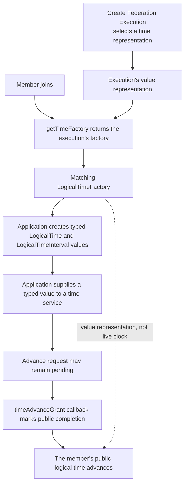

Read the diagram as two linked questions: *which value type does this
execution use?* and *when may this member advance or observe a timestamped
event?* The factory answers the first; the request mode, federation time
state, and grant/callback rules below answer the second. The arrow from factory
to current time is a contrast, not a direct state transition.

### Keep four time values distinct

For an advance request, do not casually use “the requested time” to mean four
different values:

- **Caller boundary R:** the logical time supplied by the application.
- **Effective target E:** the time the current implementation selected as
  the target of this particular request. For TAR, TARA, and FQR, E equals R.
  For NMR and NMRA, E can be the earliest currently queued recipient message
  no later than R.
- **Granted time G:** the value applied to the federate when the matching
  grant callback is dispatched. For FQR, G can be earlier than R.
- **Optimistic floor O:** an internal lower bound retained after an FQR
  whose actual grant is earlier than the optimistic progress boundary. Later
  requests cannot select an effective target below that floor.

Umbra stores the caller boundary separately from the effective target. That
separation matters for NMR/NMRA bound calculations, timestamp validation, and
diagnostics.

## Role state machines

The two roles have independent lifecycles. Enabling a role is not the same as
having the role: the enable request remains pending until the corresponding
callback begins.

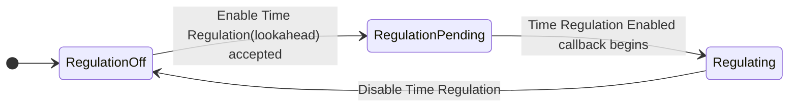

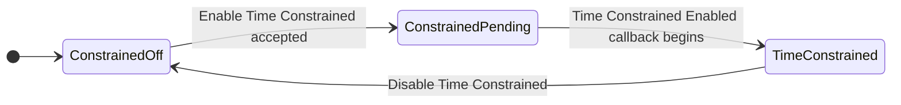

In the current profile:

- The regulator's requested lookahead becomes the active lookahead when
  Time Regulation Enabled is dispatched. Query Lookahead reports the active
  value.
- A pending role enable blocks a time-advance request that depends on that
  role transition. Do not treat the service return as if the callback already
  ran.
- A disable removes that role from the private state and triggers grant
  re-evaluation where needed.
- A federate can be both regulating and constrained at once. Its sending
  promise and receiving constraint must both be considered.

The source-level state is in
[FederateTimeState](../../cpp/src/internal/time/federate_time_state.hpp);
public service adapters are in
[time regulation control](../../cpp/src/internal/runtime/umbra_rti_ambassador_time_regulation_control.cpp)
and
[time constrained control](../../cpp/src/internal/runtime/umbra_rti_ambassador_time_constrained_control.cpp).

## Advance lifecycle

The following is the common shape of an accepted advance in the current 2025
profile. The policy branch and callback name depend on the request mode.

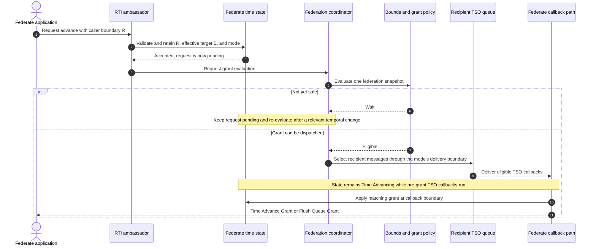

Important consequences:

- On acceptance, the federate becomes **Time Advancing**, but its current
  logical time remains the previous granted value.
- The request can remain pending while another regulator's state prevents a
  safe grant. A pending request is not a failed request.
- In the ordinary grant path, eligible TSO callbacks precede the matching
  Time Advance Grant callback. The current state changes immediately before
  that grant callback begins.
- FQR uses its own actual-grant calculation and invokes Flush Queue Grant, not
  Time Advance Grant.
- The same logical ordering applies to HLA_IMMEDIATE and HLA_EVOKED callback
  models. EVOKED applications must continue to evoke callbacks for the
  callback-gated transition to complete.

### Temporal eligibility and callback observation are separate gates

Temporal policy determines whether grant dispatch is allowed and the request
mode's delivery boundary. The delivery path selects eligible TSO callbacks
and orders them before the matching grant callback. The callback model then
determines when those callbacks enter application code. In HLA_EVOKED mode, an
eligible message is not yet an observed callback: the application must evoke
pending work. Until the matching grant callback begins, the accepted request
remains pending and the public current logical time remains at its previous
grant.

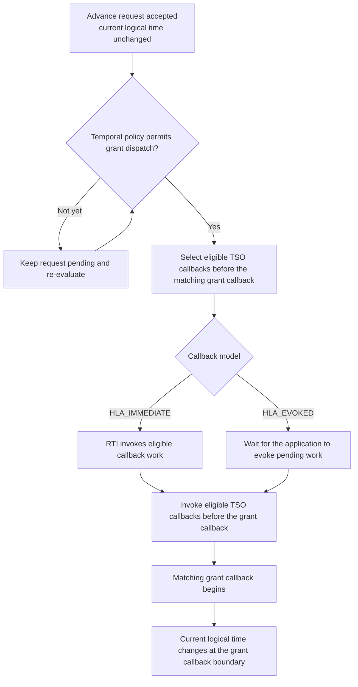

This is a layered view. The portable HLA mental model is that request
acceptance, timestamped-event eligibility, callback invocation, and grant
completion are distinct events. The specific route from eligible TSO work
through callback-model handling to grant callback is the current embedded
2025 path: its pending-task details and tested TSO-before-grant ordering below
are profile evidence, not a universal scheduler or queue algorithm. No
process-profile parity is inferred.
For the fuller callback-task and per-ambassador dispatch model, see the
separate [callback and service ordering guide](HLA-2025-CALLBACK-AND-SERVICE-ORDERING-FLOW-GUIDE.md).

## How Umbra calculates the timing frontier

This section describes the current bounded implementation model, not a
replacement definition of the IEEE algorithm.

For each other active time regulator, Umbra starts with its current logical
time, or its original caller advance boundary while that regulator has an
advance pending, then adds its active lookahead:

**candidate = regulator base time + active lookahead**

A forward advance from a zero-lookahead regulator makes that minimum
timestamp exclusive in the current implementation. Umbra adds one epsilon
from the federation's selected LogicalTimeFactory; it does not approximate
this with a floating-point constant.

Recipient-side queued, in-transit, and delivered-since-last-advance TSO
timestamps are also considered. In the current calculator:

- With at least one other regulator, the available GALT is the minimum
  applicable regulator and known TSO boundary.
- A queue-derived exact boundary is marked separately from an ordinary
  regulator-only GALT; the grant policy uses that distinction.
- With no other regulator, GALT is undefined. An incoming TSO timestamp can
  still make LITS defined.
- When GALT is defined, LITS is the earlier of GALT and the earliest future
  incoming TSO timestamp. When GALT is undefined, LITS can still be the
  earliest future incoming timestamp.
- Delivered messages remain in the snapshot until the next advance, but a
  delivered timestamp already reached by the recipient's current logical time
  no longer holds GALT at that old boundary.

The calculator is
[FederationTimeBoundsCalculator](../../cpp/src/internal/time/federation_time_bounds.cpp);
its immutable input is assembled by
[FederationTimeCoordinator](../../cpp/src/internal/time/federation_time_coordinator.hpp).
Focused bounds tests are in
[federation_time_bounds_catch2.cpp](../../cpp/tests/federation_time_bounds_catch2.cpp)
and the queue/coordinator tests are in
[federation_time_coordinator_catch2.cpp](../../cpp/tests/federation_time_coordinator_catch2.cpp).

### Grant decision flow

The effective target E is used below. For NMR/NMRA, remember that E may
be earlier than the caller boundary R.
Use this as a high-level gating map; the adjacent matrix defines the exact
mode-specific strict, inclusive, and queue-bound comparisons.

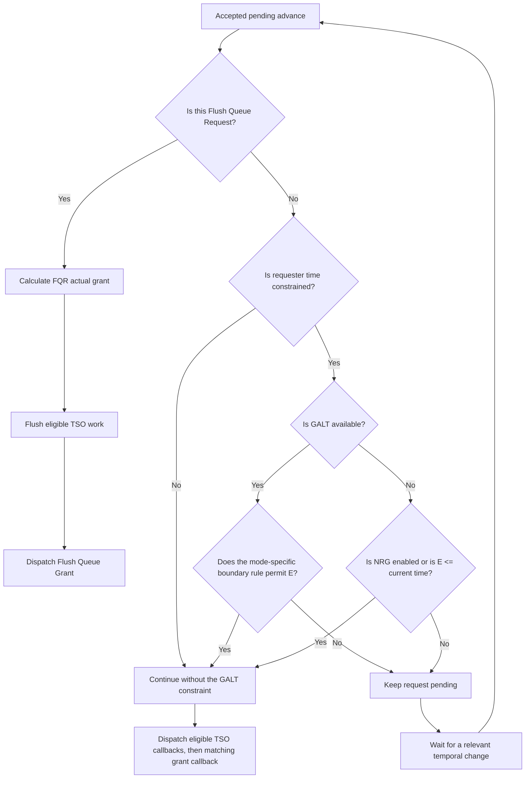

FederationTimeAdvanceGrantPolicy::decide is deliberately small: it consumes
a federate snapshot and previously calculated bounds. The surrounding
scheduler owns pending-request retention, re-evaluation, and callback
dispatch. Do not read this policy function as the complete HLA scheduler.

### Boundary comparison matrix

This matrix captures the current implemented policy and its explicitly
bounded queue behavior. The IEEE standard remains authoritative for normative
interpretation.

| Request mode | Current effective target | Current ordinary GALT behavior | Current message behavior |
| --- | --- | --- | --- |
| TAR | Caller boundary R | A time-constrained request must be strictly below regulator-only GALT. | A known queue-derived exact TSO boundary is treated as grantable; eligible messages are delivered before Time Advance Grant. |
| TARA | Caller boundary R | Equality at an available GALT is permitted by the current Available-mode policy. | Uses the currently queued message set; eligible TSO callbacks precede Time Advance Grant. |
| NMR | Earliest currently queued recipient timestamp at or before R, otherwise R | Same strict ordinary GALT rule as TAR. | The selected timestamp cohort is delivered before Time Advance Grant. Future transport arrivals are not part of target selection. |
| NMRA | Earliest currently queued recipient timestamp at or before R, otherwise R | Equality at an available GALT is permitted by the current Available-mode policy. | The selected timestamp cohort is delivered before Time Advance Grant. Future transport arrivals are not part of target selection. |
| FQR | Caller boundary R; actual grant is calculated separately | The policy does not wait for GALT; GALT can still cap the actual grant when defined. | In the embedded EVOKED path, extraction starts inside the grant callback and uses the current in-process delivery set through final time; arrivals before evoke can precede FQG even when later than R. The callback reports separate actual and optimistic times. |

The current policy also grants equality for any non-FQR advance mode when the
selected GALT is itself a known TSO boundary at the effective target. That is
an implementation-specific distinction; it must not be generalized to
ordinary regulator-only GALT.

#### FQR: actual grant and optimistic floor

For the bounded in-process FQR implementation, let U be the earliest
currently undelivered timestamp for the requester. Ignoring invalid-state
errors, the current calculation is:

- **G = max(current, min(R, available GALT if defined, U if present))**
- **O = max(G, min(R, U if present))**

An absent GALT or U is omitted from that minimum. The callback reports G;
O is retained privately as the minimum target for later progress. This
separation is why an FQR may complete at a time earlier than the requested
boundary without allowing a following request to go backward through work
already optimistically flushed.

There are deliberately two frontiers here: the dispatcher flushes the current
in-process recipient delivery set through the final-time queue boundary, while
the callback reports the separately calculated actual grant G and retains O
for later progress. Do not collapse the delivery frontier, actual grant, and
optimistic floor into one time value. This bounded path does not wait for
future transport arrivals.

#### FQR with HLA_EVOKED: transport-arrival boundary is profile policy

The pinned 2025 Requirements Lab transcription supplies the clause text.
Section 8.12 requires delivery of messages queued in the RTI that the joined
federate will receive as TSO messages and explicitly recognizes that smaller
timestamps may arrive in the future. Section 8.13 defines OLT as the minimum
of the time supplied to FQR and the timestamps of TSO messages delivered in
response. Section 8.14 guarantees that no additional TSO message will later
be delivered with a timestamp below the actual grant. These clauses establish
the queue/delivery result, OLT inputs, and actual-grant safety boundary; they
do not prescribe a transport snapshot at FQR acceptance, an HLA_EVOKED
callback-start cutoff, or identical embedded/process policy. This is a reading
of the pinned Lab text, not an independent licensed-PDF conformance opinion.

The same ordered public scenario is covered in both profiles: the receiver
accepts FQR(10); the sender then submits timestamps 9 and 12; timestamp 12 is
retracted before the receiver starts its evoked FQG callback. The two tested
policies differ:

| Profile | TSO callbacks before FQG | Actual grant | OLT |
| --- | --- | ---: | ---: |
| Embedded | Receive Interaction at 9; retracted 12 is suppressed | 5 | 9 |
| Process coordinator | No post-acceptance TSO callback in this FQR; retracted 12 is absent | 5 | 10 |

The embedded dispatcher selects the late-arriving input when callback-time
extraction begins. The process coordinator fixes the FQR result when it accepts
the request. Neither cutoff is prescribed by the cited clauses; the tests
record a profile-policy difference, not a conformance failure or proof of
cross-profile parity. The focused process test also verifies that its
authoritative regular Send Interaction path rejects timestamp 4 from a sender
whose current-time-plus-lookahead floor is 5 after FQG(actual=5). That check is
limited to this producer path and does not establish the same safeguard for
every timestamped service family.

```mermaid
sequenceDiagram
  autonumber
  actor Receiver as Evoked receiver application
  participant RRTI as Receiver RTI
  participant Dispatcher as Embedded grant dispatcher
  participant Queue as Federation TSO queue
  actor Publisher as Publisher application
  participant PRTI as Publisher RTI

  Receiver->>RRTI: flushQueueRequest(10)
  RRTI->>Dispatcher: Accept FQR and queue its grant callback
  Note over Receiver,Queue: No timestamped callback or FQG has run yet
  Publisher->>PRTI: sendInteraction(timestamp=9)
  PRTI->>Queue: Enqueue recipient TSO payload at 9
  Publisher->>PRTI: sendInteraction(timestamp=12)
  PRTI->>Queue: Enqueue recipient TSO payload at 12
  Publisher->>PRTI: retract(timestamp=12)
  PRTI->>Queue: Retire recipient payload at 12
  Receiver->>RRTI: evokeCallback()
  RRTI->>Dispatcher: Start the pending FQR grant callback
  Dispatcher->>Queue: Extract current recipient payloads through final time
  Queue-->>Dispatcher: TSO at 9; timestamp 12 is retracted
  Dispatcher-->>Receiver: receiveInteraction(timestamp=9)
  Dispatcher-->>Receiver: flushQueueGrant(actual=5, optimistic=9)
```

This establishes the callback-time frontier for the cited embedded EVOKED
scenario only. The paired process test records its accepted-request policy and
the different OLT (10). The tests do not define a universal transport arrival
cutoff, require profile parity, or establish behavior for other TSO service
families. Use §8.12 for FQR queue semantics, §8.13 for OLT inputs, and §8.14
for the actual-grant future-delivery guarantee; do not treat OLT as the actual
grant's safety boundary.

## Worked examples

### Example 1: equality at an ordinary GALT

Assume:

- Regulator **P** is at logical time 10 with lookahead 2.
- There are no incoming queued TSO messages that set an earlier boundary.
- Constrained federate **C** requests a grant to logical time 12.

P's current lower-bound candidate is 10 + 2 = 12, so the ordinary
regulator-only GALT is 12.

1. C's TAR target is equal to GALT, not below it, so the current strict TAR
   policy keeps the request pending.
2. C's TARA to 12 may use the current inclusive Available-mode boundary.
3. If P then requests an advance to 11, that pending regulator boundary
   contributes 11 + 2 = 13. C's still-pending TAR to 12 is now strictly
   below the current GALT and can become eligible.

The important point is that a pending regulator advance can change the
federation bound before that regulator's own grant callback runs. The current
bounds snapshot uses the regulator's original caller boundary for this
calculation.

### Example 2: an exact queued TSO boundary

Assume an accepted timestamped message for C is queued at time 12 and the
current bound calculator selects that message as the GALT boundary. A request
whose effective target is exactly 12 can use the current queue-boundary rule,
even though equality at an ordinary regulator-only GALT is treated
differently. The dispatcher sends the eligible time-stamped callback before
the matching grant callback.

This is why a single “TAR is always strict” slogan is insufficient to explain
the current implementation. The boundary's source matters. Check the policy
and its focused tests before changing this behavior.

### Example 3: GALT undefined

If C is time constrained but there is no other active regulator, GALT is
undefined. The current policy then consults the federation's NRG setting:

- With NRG enabled, a valid forward target can be granted.
- With NRG disabled, a forward request waits; a non-forward request at or
  before current time can proceed.
- The query result remains “GALT undefined” either way. NRG affects the grant
  decision, not the mathematical existence of GALT.
- If an incoming TSO message exists, LITS may still be defined even though
  GALT is not.

### Example 4: NMR keeps two boundaries

Suppose C calls NMR with R = 20, and the earliest currently queued message
for C is timestamped 12. The current implementation selects E = 12 as the
effective target, but retains R = 20 separately. It processes the queued
timestamp-12 cohort before granting at that selected target. The RTI does not
rewrite the application's original request boundary to 12 for unrelated
timestamp validation or federation-bound calculations.

## Timestamped message lifecycle and callback order

The queue is recipient-scoped. One send can fan out into separate recipient
entries that share a message identity and preserve sequence order for equal
timestamps. The state diagram below follows an individual copy admitted to the
TSO queue; it is not a universal path for every recipient of a timestamped
service. In the selected embedded attribute-update case below, a
non-time-constrained recipient instead receives a timestamped callback in
receive order while the constrained recipient's copy waits in the TSO queue.
For the producer-side legality check, mixed per-recipient retract outcomes,
and the distinct Request Retraction callback, see the companion [TSO
retraction lifecycle guide](HLA-2025-TSO-RETRACTION-FLOW-GUIDE.md).

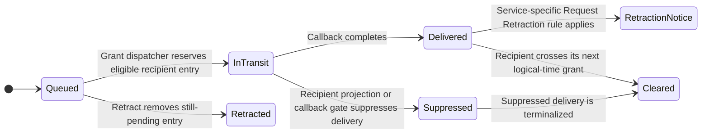

For the current coordinator:

- **Queued** means accepted for a recipient but not yet selected for callback.
- **In transit** means selected for callback and retained as a distinct phase
  while callback work is active.
- **Delivered since last advance** records a completed TSO callback until the
  recipient advances; it remains relevant to temporal-bound calculations and
  service-specific retraction bookkeeping.
- Retract and Request Retraction are not interchangeable. The queue can remove
  pending fanout, but the owning service determines whether already-delivered
  recipients need a Request Retraction callback.
- Resignation/disconnect cleanup is recipient-scoped; it must not erase
  another recipient's fanout.

In the current embedded adapter's supported grant path, the implementation
orders the steps this way:

1. The request becomes eligible and a callback-gated grant dispatch is queued.
2. The dispatcher rechecks the pending generation and the live temporal state.
3. The recipient's eligible TSO callbacks run while the private state is still
   Time Advancing.
4. The matching Time Advance Grant callback begins; the private current time
   changes at that callback boundary.
5. Delivered-since-last-advance bookkeeping is cleared as part of crossing
   the recipient's grant boundary.

The process endpoint implements a related TSO-interaction boundary through a
separate route: eligible interaction payloads cross into the receiver's event
stream before the matching grant event, and the process coordinator retains
the delivery as in-transit until callback completion is acknowledged. The
focused public process test uses `HLA_EVOKED`: it accepts two interactions at
time 5, observes no interaction callback before Evoke, then observes both in
FIFO order before one Time Advance Grant. This is one process interaction
scenario, not evidence for every TSO payload family, callback model, or
embedded/process equivalence. The process endpoint guide explains its event
and acknowledgement boundary in more detail.

### One timestamped update, two recipient paths

This bounded embedded case makes the per-recipient split concrete. One
accepted timestamped attribute update has a single retraction designator, but
its two subscribers do not share one delivery state:

| Recipient | Before the constrained recipient's matching grant | Observed order | Retract outcome in this case |
| --- | --- | --- | --- |
| Time-constrained | Its copy remains queued for TSO; the publisher retracts before the grant, so no reflection begins. | No reflection callback occurs, so this case records no received-order value for that copy. | The queued copy is withdrawn; the recipient later receives its grant, with no reflection or Request Retraction callback. |
| Not time-constrained | It receives the timestamped reflection through a receive-order callback before the constrained recipient's grant. | `sentOrderType=TIMESTAMP`, `receivedOrderType=RECEIVE`. | The reflection carries the valid retraction designator; because delivery already occurred, Request Retraction follows the reflection in the observed callback order. |

The [focused embedded test](../../cpp/tests/timestamped_default_region_attribute_mixed_fanout_catch2.cpp#L155)
asserts the per-recipient callback results and shared designator. The [recipient
queue split](../../cpp/src/internal/runtime/umbra_rti_ambassador_attribute_update_services.cpp#L637)
and [grant-versus-receive-order routing](../../cpp/src/internal/runtime/umbra_rti_ambassador_attribute_update_services.cpp#L743)
are explicit in the adapter. For the generic delivered-versus-pending
Retract/Request Retraction sequence, see the [TSO retraction guide's
mixed-recipient walkthrough](HLA-2025-TSO-RETRACTION-FLOW-GUIDE.md#a-mixed-recipient-walkthrough).
This is one embedded attribute-update scenario, not a rule for every
timestamped service or the process profile.

### Timestamped attribute updates: time eligibility and receiver projection

For a timestamped attribute update, reaching the recipient's logical-time
delivery boundary does not by itself guarantee a reflection. The accepted
message retains its sent values and any source-region snapshots; the current
receiver projection is checked later, against that retained source scope. The
two inspected 2025 profiles place that projection check at different points:

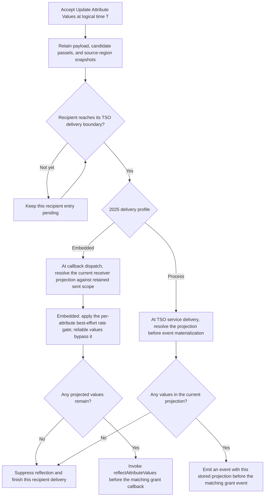

This is an Umbra 2025 profile comparison, not a normative claim about when an
RTI must freeze an attribute projection. In the embedded callback path, the
current subscription, known class, and DDM projection are resolved during
callback dispatch; any best-effort rate filter is then applied before
reflection; the regional
[selector-mutation scenario](HLA-2025-DATA-DISTRIBUTION-AND-REGIONS-FLOW-GUIDE.md#a-recipient-region-can-invalidate-queued-regional-tso-delivery)
shows an accepted update suppressed after the receiver commits a disjoint
region. The process service also resolves the current projection at TSO
delivery, but does so before constructing and sending the event; after event
materialization, its stored attribute handles and values are what the callback
bridge forwards. No focused process test was found that mutates an attribute
subscription or region between update acceptance and event creation.

The public process-endpoint test uses `HLA_EVOKED` and asserts the receiver's
`reflectAttributeValues` callback before its matching `timeAdvanceGrant`; it
also checks GALT/LITS while the event is in transit. A separate private
process-service test observes a `receive_attribute_update` event frame
followed by the matching `time_advance_grant` frame. Neither test changes the
attribute subscription or region between update acceptance and event
materialization. Also, the inspected process TSO attribute dispatcher does
not apply the embedded best-effort update-rate gate; see the
[update-rate guide's process boundary](HLA-2025-ATTRIBUTE-UPDATE-RATE-ADMISSION-FLOW-GUIDE.md#process-endpoint-subscription-metadata-is-not-callback-admission).
The existing [regional TSO attribute guide](HLA-2025-DATA-DISTRIBUTION-AND-REGIONS-FLOW-GUIDE.md#a-recipient-region-can-invalidate-queued-regional-tso-delivery)
owns the detailed DDM scenario; this flow adds only the profile-specific
projection timing relative to the TSO boundary.
Timestamped interaction projection has separate source paths and evidence;
compare its [own timing flow](HLA-2025-OBJECT-AND-INTERACTION-INFORMATION-FLOW-GUIDE.md#timestamped-interactions-resolve-the-receiver-projection-later)
without treating either payload family's projection point as a rule for the
other.

Ownership is another independent timeline: an accepted timestamped attribute
update may still be queued when its producer later divests or resigns. The
[TSO retraction guide's ownership comparison](HLA-2025-TSO-RETRACTION-FLOW-GUIDE.md#ownership-changes-and-an-accepted-tso-update-are-separate-timelines)
records selected embedded evidence for that case and keeps original producer
identity, current ownership, queued recipient state, and retraction separate;
it is not a process-parity or portable HLA conclusion.

Recipient routing is a separate gate from this temporal path. For example,
the [DDM guide's embedded regional-interaction case](HLA-2025-DATA-DISTRIBUTION-AND-REGIONS-FLOW-GUIDE.md#a-replacement-regional-interaction-subscription-does-not-retarget-queued-tso-work)
shows a queued interaction reaching its time boundary but being suppressed
because the receiver's current region subscription no longer overlaps the
source-region snapshot captured at send. That is one profile-specific
subscription case, not a general HLA rule.

The tested public TSO producers in the current bounded profile are timestamped
Send Interaction, Update Attribute Values, Delete Object Instance, Send
Directed Interaction, and the supported Send Interaction With Regions
overload with retraction. This list is not a claim that every timestamped HLA
service family is implemented.

Delete Object Instance has service-specific state effects beyond this generic
TSO lifecycle: each receiver's removal commit and the deletion-specific
restoration branch on Retract. For those current Umbra 2025 source/test details,
see the [object-removal flow's timestamped-deletion section](HLA-2025-OBJECT-AND-INTERACTION-INFORMATION-FLOW-GUIDE.md#timestamped-deletion-each-receiver-reaches-its-own-removal-boundary)
and the [TSO retraction guide's deletion branch](HLA-2025-TSO-RETRACTION-FLOW-GUIDE.md#service-specific-effects-deletion-is-special).
The linked restoration evidence is embedded-profile evidence and does not
establish process-profile parity.

In the selected 2025 embedded attribute-update path, TSO eligibility and
update-rate admission are separate gates: a timestamped update can reach its
logical-time delivery boundary and still have individual best-effort
attributes suppressed by the receiver's steady-clock rate filter. If every
value is suppressed, no reflection is observed. In the focused test, the
sender can still call `retract` once afterward; a repeated call is rejected.
Do not infer that rate suppression itself invalidates the public retraction
handle at the recipient boundary. Compare the
[focused mixed-transport test](../../cpp/tests/timestamped_attribute_update_rate_reduction_catch2.cpp#L187)
with the [attribute update-rate guide's TSO boundary](HLA-2025-ATTRIBUTE-UPDATE-RATE-ADMISSION-FLOW-GUIDE.md#3-keep-the-wall-clock-outside-the-tso-state-machine).
This is selected source/test evidence, not a universal HLA ordering rule or
process-profile claim.

### One timestamped invocation can split by attribute order

A timestamp on `updateAttributeValues` does not force every submitted
attribute for every recipient onto one delivery path in the current 2025
embedded profile. The sender's attributes are grouped by their effective
transportation, order, and update-region association, then projected for each
recipient. If one time-constrained receiver is eligible for both receive-order
and timestamp-order passels, the single invocation reaches two distinct timing
gates:

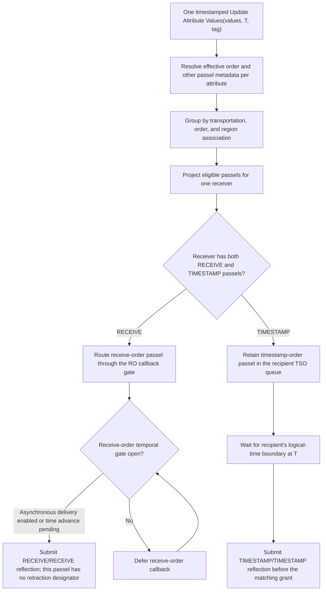

The chart combines source-derived boundaries, not one verified end-to-end
test. In this embedded path the original timestamp and tag are carried on
both callback routes, while the order fields differ: the receive-order passel
uses `RECEIVE` for sent and received order and is routed without a retraction
designator; the queued TSO passel uses timestamp order and participates in
retraction. If the TSO work is retracted after an RO callback has already been
observed, that earlier callback cannot be undone. After either temporal gate
admits its work, `HLA_IMMEDIATE` versus `HLA_EVOKED` still determines when the
application callback is invoked.

The passel planner groups on effective per-attribute metadata in the
[registry](../../cpp/src/internal/federation/federation_registry_attribute_value_update_requests.cpp#L133);
the [embedded adapter](../../cpp/src/internal/runtime/umbra_rti_ambassador_attribute_update_services.cpp#L608)
separates each recipient's RO and TSO passels, [queues its TSO passels](../../cpp/src/internal/runtime/umbra_rti_ambassador_attribute_update_services.cpp#L633),
and sends its RO passels through the [receive-order callback route](../../cpp/src/internal/runtime/umbra_rti_ambassador_attribute_update_services.cpp#L761). The
[time-advance dispatcher](../../cpp/src/internal/runtime/umbra_rti_ambassador_time_advance_dispatch.cpp#L497)
delivers a queued TSO reflection before its matching grant. The existing
[receive-order gate](#receive-order-and-asynchronous-delivery) explains the
RO branch. Nearby checked-in evidence is adjacent, not combined: the
[order-control case](../../cpp/tests/order_type_control_catch2.cpp#L169)
covers order controls; the [timestamped mixed-fanout case](../../cpp/tests/timestamped_default_region_attribute_mixed_fanout_catch2.cpp#L155)
varies recipient time roles, not per-attribute order to one receiver; and the
[asynchronous-delivery case](../../cpp/tests/ieee1516_2025_asynchronous_delivery_temporal_state_catch2.cpp#L5)
tests an interaction route, not timestamped attribute passels. No tracked
focused test combines different attribute orders for one receiver in one call.
This is an Umbra 2025 embedded case study, not a normative rule or a
process-profile claim.

### Process endpoint: the same order split crosses a different boundary

The process endpoint calls the same per-attribute registry planner. For a
time-regulating producer and one time-constrained receiver eligible for both
orders, however, its process service represents the two passels differently:
the RECEIVE passel becomes an ordinary process attribute event, while the
TIMESTAMP passel remains in the recipient's TSO message until its time
boundary. The diagram below is a 2025 process-profile source trace; the frame,
queue, and message-identity details are Umbra implementation mapping.

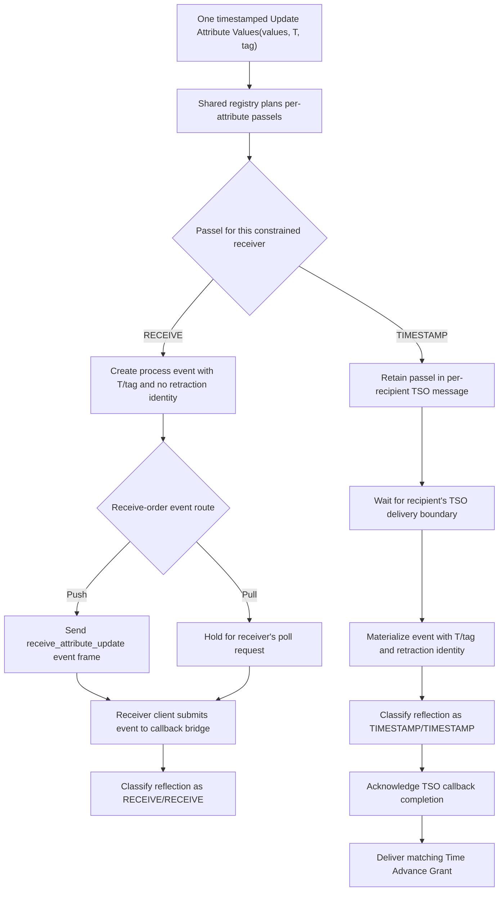

The [process service](../../cpp/src/internal/federation/process_federation_service_attribute_value_updates.cpp#L126)
stores only TIMESTAMP passels in the queued TSO payload; a RECEIVE passel is
materialized separately with the original timestamp and tag but no retraction
identity. It uses the process event route described in the
[process endpoint guide](HLA-2025-PROCESS-ENDPOINT-REQUEST-AND-CALLBACK-FLOW-GUIDE.md#process-mapping-receive-order-object-attribute-update).
At TSO delivery, the [service emits an event carrying the queued message
identity](../../cpp/src/internal/federation/process_federation_service_tso_delivery.cpp#L77),
and the [callback bridge maps timestamped events with and without a retraction
identity to different order classifications](../../cpp/src/internal/federation/process_federation_callback_bridge.cpp#L330).
The checked-in [public process TSO case](../../cpp/tests/ieee1516_2025_connection_process_tso_attribute_update_regulation_reenable_changed_lookahead_catch2.cpp#L460)
observes a single TSO attribute reflection before its matching grant; it does
not combine RECEIVE and TIMESTAMP attributes in one invocation.

The bounded source review finds no equivalent temporal gate in the process
attribute route. In [`handleUpdateAttributeValues`](../../cpp/src/internal/federation/process_federation_service_attribute_value_updates.cpp#L64),
the constrained-recipient set is used to hold eligible TIMESTAMP passels in
the TSO queue; an eligible RECEIVE passel is still materialized as an ordinary
process event and routed through push or poll. The client-side
[`dispatchAttributeUpdate`](../../cpp/src/internal/federation/process_federation_client_callback_dispatch.cpp#L23)
forwards to [`ProcessFederationCallbackBridge::submitAttributeUpdate`](../../cpp/src/internal/federation/process_federation_callback_bridge.cpp#L1366),
which submits directly to the callback dispatcher. By contrast, the shared
[`submitReceiveOrderCallback`](../../cpp/src/internal/runtime/umbra_rti_ambassador.cpp#L1097)
path checks [`FederateTimeState::receiveOrderDeliveryAllowed`](../../cpp/src/internal/time/federate_time_state.cpp#L760)
and defers a blocked callback. The process bridge does not put its attribute
events into that deferred queue, and the reviewed process path does not show
`Enable Asynchronous Delivery` changing their eligibility.

The same source boundary appears for process receive-order interactions. The
process send service may re-resolve a route-only ordinary or directed
interaction candidate while preparing the event
([ordinary](../../cpp/src/internal/federation/process_federation_service_interaction_send.cpp#L512),
[directed](../../cpp/src/internal/federation/process_federation_service_interaction_send.cpp#L805));
the client then forwards that event through
[`dispatchReceiveOrder`](../../cpp/src/internal/federation/process_federation_client_callback_dispatch.cpp#L17)
to [`ProcessFederationCallbackBridge::submitReceiveOrder`](../../cpp/src/internal/federation/process_federation_callback_bridge.cpp#L1211),
which submits callback work to its dispatcher and callback session
([dispatcher submission](../../cpp/src/internal/federation/process_federation_callback_bridge.cpp#L1236),
[callback entry](../../cpp/src/internal/federation/process_federation_callback_bridge.cpp#L1272)).
The inspected process interaction path does not consult
[`FederateTimeState::receiveOrderDeliveryAllowed`](../../cpp/src/internal/time/federate_time_state.cpp#L760)
or place the event in its deferred asynchronous-receive queue. This extends
the source observation to process interactions; it does not establish a public
process-profile outcome or normative result.

These are source-path differences, not proof of the public process-profile
outcome or a normative HLA rule. The checked-in [public process receive-order
attribute case](../../cpp/tests/ieee1516_2025_connection_update_attribute_values_reflect_catch2.cpp#L457)
covers one ordinary reflection for overlapping subscriptions, not a
time-constrained, Time-Granted receiver. The checked-in [public process TSO
case](../../cpp/tests/ieee1516_2025_connection_process_tso_attribute_update_regulation_reenable_changed_lookahead_catch2.cpp#L460)
and [private service TSO case](../../cpp/tests/process_federation_service_tso_attribute_before_grant_catch2.cpp#L78)
cover a single TIMESTAMP attribute before its matching grant, not the mixed
call. A bounded test search found no process-endpoint case combining the
constrained role, asynchronous-delivery off/on, and a pending advance. The
[mixed-order case currently present in the worktree](../../cpp/tests/ieee1516_2025_mixed_order_attribute_passels_catch2.cpp)
is untracked and embedded-profile-only, so it is neither durable evidence nor
process evidence. Keep the process callback-eligibility question open for both
attribute and interaction routes; do not reuse the embedded gate as a process
guarantee.

## Receive order and asynchronous delivery

Asynchronous delivery is a separate switch from time advancement:

- It is disabled by default in the current profile.
- For the bounded supported routes, a time-constrained federate may enable it
  to receive eligible receive-order callbacks while idle rather than waiting
  for a time advance.
- Disabling it restores the normal receive-order time-advance gate.
- Entering Time Advancing flushes eligible deferred receive-order work before
  the matching grant.
- It does not release TSO messages early. Timestamped callbacks remain
  governed by logical-time boundaries.
- Deferred callback closures are live-session state; their general
  save/restore behavior is not established by the bounded tests. The
  [Save/Restore guide's in-flight-work dispositions](HLA-2025-FEDERATION-SAVE-RESTORE-FLOW-GUIDE.md#in-flight-work-has-protocol-specific-restore-dispositions)
  contrast selected TSO image records with already-pushed callback frames in a
  still-live process. That process case does not establish persistence of these
  deferred closures or callback restoration across restart.

Do not draw asynchronous delivery as “time regulation off,” “unconstrained,”
or “skip GALT.” It changes a receive-order callback gate, not the time roles or
the TSO grant policy.

The embedded 2025 receive-order gate can be read as a small decision rule:
deliver when the recipient is unconstrained, has asynchronous delivery enabled,
or has a pending time advance. Otherwise, retain the callback and try again
when one of those temporal gates opens. Enabling asynchronous delivery changes
the switch and flushes already-deferred receive-order work; a later advance
request can also make deferred receive-order work eligible while the switch
remains off. The callback dispatcher still applies the selected callback
model after the temporal gate admits the work.

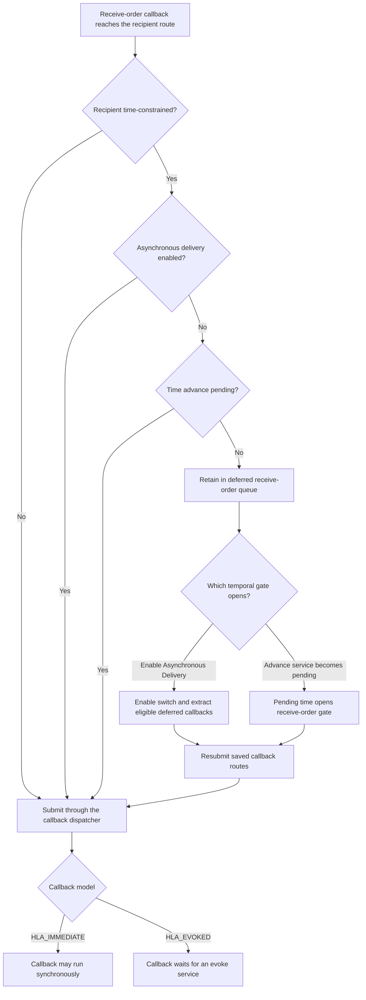

This is an implementation gate, not a complete normative timing state machine.
The predicate comes from the 2025 `FederateTimeState`; the adapter flushes
eligible receive-order closures after opening the asynchronous-delivery gate
and at supported advance-service boundaries. Receive-order admission does not
release a timestamped message; TSO work remains governed by its independent
logical-time policy and grant dispatch.

The focused public test makes the two opening edges concrete:

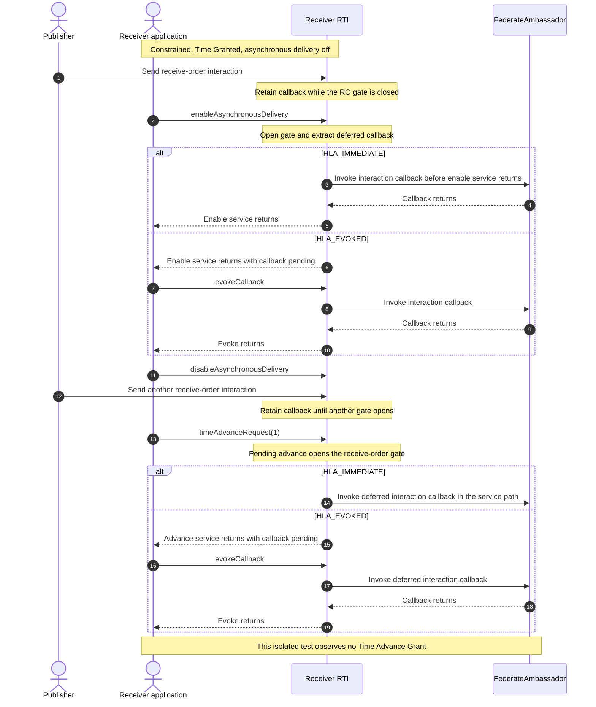

The [focused temporal-state test](../../cpp/tests/ieee1516_2025_asynchronous_delivery_temporal_state_catch2.cpp#L5)
executes this receive-order interaction scenario under both callback models,
verifies the default-off state, `NotConnected` and
`FederateNotExecutionMember` preconditions, repeated enable/disable exceptions,
and the deferred callback after enabling or entering a pending advance. Its
single-receiver case is not evidence for general cross-federate grant
eligibility. A separate [regional-interaction test](../../cpp/tests/ieee1516_2025_ddm_regional_async_delivery_catch2.cpp#L4)
shows that opening this temporal gate preserves the already-selected regional
interaction's producer, region designator, and user tag; it does not collapse
DDM relevance into the timing predicate.

Both cited public scenarios exercise the embedded profile. A bounded search
of C++ tests for `enableAsynchronousDelivery` and
`disableAsynchronousDelivery` found no process-endpoint case invoking either
service. Do not mistake the
[connection-loss TSO-cutoff case](../../cpp/tests/ieee1516_2025_connection_lost_tso_cutoff_report_catch2.cpp#L5)
for process coverage: despite its filename, it is explicitly an embedded
transport-loss scenario and injects failure through
[`failEmbeddedTransportConnectionForTesting`](../../cpp/tests/ieee1516_2025_connection_lost_tso_cutoff_report_catch2.cpp#L82).
Its asynchronous-delivery call belongs to that embedded cutoff scenario. This
section therefore establishes only the embedded 2025
receive-order gate; process-profile admission and dispatch behavior remain
unverified here, and no parity is implied.

The process-source boundary is more specific but still unverified at runtime.
The configured-process Join branch records the remote member identity and
selected logical-time implementation, then returns without assigning the
ambassador's embedded `federateTimeState_`
([process Join](../../cpp/src/internal/runtime/umbra_rti_ambassador_federation_lifecycle.cpp#L354)).
The public asynchronous-delivery adapters have no process-client branch; they
fall through to code requiring that local time state and checking service
availability through the embedded registry
([enable/disable adapters](../../cpp/src/internal/runtime/umbra_rti_ambassador_asynchronous_delivery.cpp#L39),
[embedded service-state check](../../cpp/src/internal/runtime/umbra_rti_ambassador_service_report_writers.cpp#L105)).
The inspected process interaction callback bridge invokes its callback session
without the embedded `receiveOrderDeliveryAllowed` predicate
([process callback admission](../../cpp/src/internal/federation/process_federation_callback_bridge.cpp#L1272)).
These source paths do not show a process asynchronous-delivery switch being
applied to process RECEIVE callbacks. They do not establish the public
exception/result for a process call or normative behavior; no focused process
test covers that call or the combined constrained/async/pending-advance case.

### Save/Restore has separate time-state and callback-queue boundaries

The receive-order gate above explains when an eligible RECEIVE callback can
enter a dispatcher. Save/Restore involves other state owners; a restored time
request is not the same thing as replaying a callback closure that was already
waiting in a live queue.

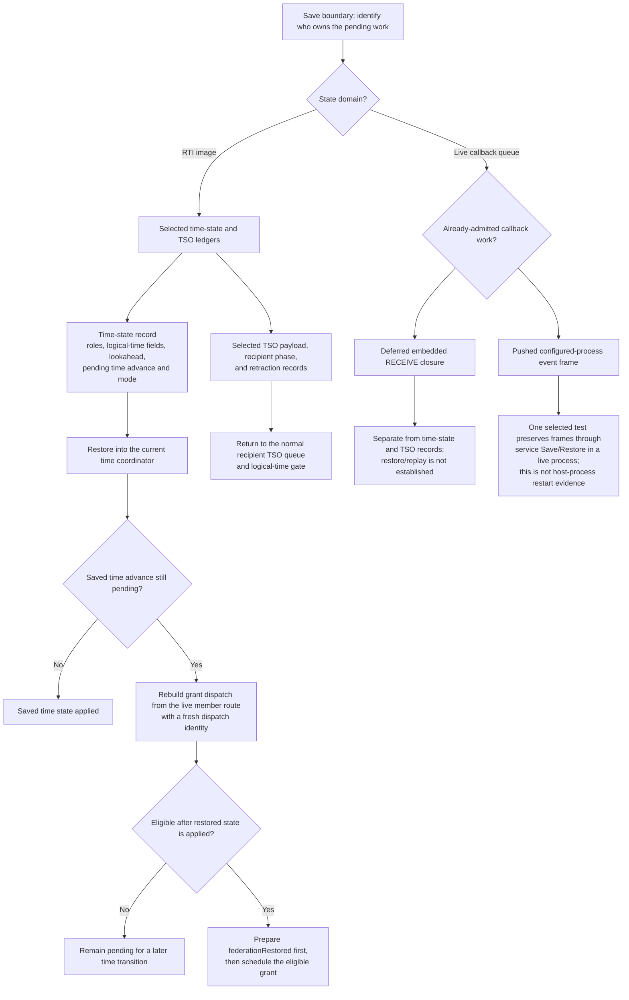

This is a source- and test-bounded Umbra 2025 view, not a normative HLA
persistence matrix. The image captures selected temporal-control state,
including roles, logical-time values, lookahead requests, and pending-advance
state ([capture](../../cpp/src/internal/federation/federation_registry_state_image_capture.cpp#L828));
restore decodes that record into the current coordinator
([restore](../../cpp/src/internal/federation/federation_registry_state_image_restore.cpp#L172)).
For a saved pending time advance, the registry rebuilds grant work from the
current live callback factory and assigns a new dispatch identity so an old
closure is stale; it prepares `federationRestored` notifications before
scheduling grants
([rebinding](../../cpp/src/internal/federation/federation_registry_state_image_restore.cpp#L873),
[completion order](../../cpp/src/internal/federation/federation_registry_restore_control.cpp#L960)).
Selected TSO payload, queue-phase, and retraction records are a different
ledger ([queue restore](../../cpp/src/internal/federation/federation_registry_state_image_restore.cpp#L753),
[retraction records](../../cpp/src/internal/federation/federation_registry_restore_tso_payloads.cpp#L46))
and resume through recipient-specific time gates; see the
[Save/Restore dispositions](HLA-2025-FEDERATION-SAVE-RESTORE-FLOW-GUIDE.md#in-flight-work-has-protocol-specific-restore-dispositions).

Focused embedded tests show a saved logical time and actual lookahead replacing
post-save changes, and a deferred lookahead decrease returning with the saved
state ([time-window cases](../../cpp/tests/ieee1516_2025_restore_time_window_state_catch2.cpp#L3),
[deferred decrease](../../cpp/tests/ieee1516_2025_restore_time_window_state_catch2.cpp#L81)).
A fresh-registry public case records a pending TAR and pending lookahead in the
image, then observes one grant through a newly bound route after restore under
both `HLA_EVOKED` and `HLA_IMMEDIATE`
([scenario](../../cpp/tests/ieee1516_2025_restore_pending_time_role_callbacks_catch2.cpp#L252),
[saved request fields](../../cpp/tests/ieee1516_2025_restore_pending_time_role_callbacks_catch2.cpp#L392),
[restored grant](../../cpp/tests/ieee1516_2025_restore_pending_time_role_callbacks_catch2.cpp#L452)).
The new registry is created within the same test process; this is not proof of
operating-system process restart. These tests do not establish that a deferred
receive-order closure is serialized or replayed. The separate configured-process
case that retains selected pushed frames across service Save/Restore is likewise
a live-session observation, documented in the [Save/Restore guide](HLA-2025-FEDERATION-SAVE-RESTORE-FLOW-GUIDE.md#in-flight-work-has-protocol-specific-restore-dispositions).

## Lookahead changes and pending operations

Modify Lookahead has a transition of its own:

- An equal or larger request immediately replaces the active value and clears
  any deferred decrease. Query Lookahead then reports the new active value.
- A strictly smaller request becomes a pending target. Query Lookahead
  continues to report the active value, not that target.
- A Modify Lookahead call made while an advance is already pending is rejected;
  a lower target is therefore recorded before the subsequent advance request.
- At a grant boundary, the current implementation measures elapsed logical
  time and compares it with the remaining reduction from the active value to
  the pending target. If the elapsed interval is smaller, it reduces the active
  lookahead by that elapsed amount and retains the target for a later grant. If
  the elapsed interval reaches or exceeds the remaining reduction, it adopts
  the target and clears it.
- Grant preflight failure leaves the advance and deferred target available for
  retry without partially committing the current time or active lookahead.

This is an Umbra 2025 implementation flow, not a claim about the normative
meaning of Modify Lookahead. For example, with active lookahead 5 and pending
target 1, a grant from logical time 0 to 3 leaves active lookahead 2 and target
1 pending; a later grant consumes the remaining difference. An immediate
positive change also clears the implementation's exclusive zero-lookahead
minimum-timestamp marker, while a zero request does not.

The [focused state test](../../cpp/tests/federate_time_state_catch2.cpp#L369)
forces the first grant attempt to fail while preparing the deferred interval,
then retries the same advance and verifies current time 3 with active lookahead
2. It passed locally (18 assertions). A separate [process public-API test](../../cpp/tests/ieee1516_2025_connection_modify_lookahead_grant_catch2.cpp#L458)
encodes a before-grant query of 5 and after-grant query of 1, but the local run
failed at the initial client connection with `Unknown exception`, before those
lookahead assertions; it is not counted here as a passing runtime observation.

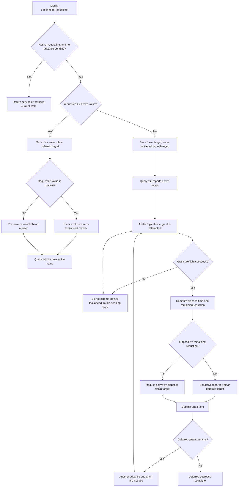

Only describe a lookahead change as effective after checking whether it is
active or deferred. Recomputing another regulator's bound with the wrong
lookahead can allow an unsafe grant or block a safe one.

The state machine rejects or defers overlapping operations rather than
silently replacing pending work. In particular, a second advance cannot
replace an existing pending advance; pending regulation/constrained role
enables affect which advance services are currently legal. The public
exception mapping is in the service adapters and their API contracts.

## Re-evaluation: why a pending request can become grantable

The limited cross-federate process scheduler reevaluates pending work when
temporal inputs that can affect safety change. Current documented triggers
include:

- a TAR request or grant by a member;
- Time Regulation Enabled or Disable Time Regulation;
- Disable Time Constrained;
- resignation/removal of a member; and
- replacement of the federation definition through an additional FOM.

Do not read the member-removal trigger as “a resignation grants every waiting
federate.” The configured-process 2025 `Resign` handler re-evaluates pending
grants after registry resignation and its cleanup dispatch succeed
([handler](../../cpp/src/internal/federation/process_federation_service_request_handlers.cpp#L153)).
The embedded 2025 membership-loss path separately re-evaluates after forced
member removal ([path](../../cpp/src/internal/runtime/umbra_rti_ambassador_membership_loss.cpp#L266)).
These are source observations, not proof of a grant outcome: the focused
process scheduler case releases its request after the regulating peer's TAR,
while the focused resignation lifecycle case has no pending advance
([scheduler](../../cpp/tests/ieee1516_2025_connection_time_advance_federation_scheduler_catch2.cpp#L729),
[resignation](../../cpp/tests/ieee1516_2025_federation_resign_lifecycle_catch2.cpp#L4)).
Forced connection loss also has a distinct, narrowly bounded lost-regulator
TSO cutoff; do not generalize it to voluntary `Resign` or ordinary grant rules
([lifecycle explanation](HLA-2025-FEDERATION-AND-FEDERATE-LIFECYCLE-FLOW-GUIDE.md#L950)).

One focused 2025 process case makes the pending-to-grant transition concrete:
a time-constrained member requests TAR(5) and remains ungranted; its
time-regulating peer then requests TAR(5), after which the first member's grant
is observed. This is one tested route that changes the federation's temporal
state, not a complete or normative list of events that can release every
pending request.

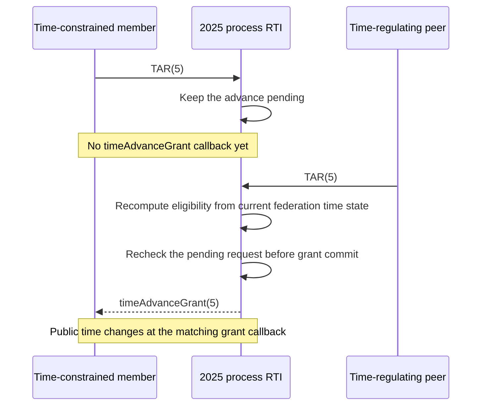

The [focused public process case](../../cpp/tests/ieee1516_2025_connection_time_advance_federation_scheduler_catch2.cpp#L729)
asserts that the first grant count is zero before the regulating peer's TAR and
one afterward, at time 5. Its HLA_EVOKED variant drains the eligible callback
through Evoke; the HLA_IMMEDIATE variant is separately exercised
([case](../../cpp/tests/ieee1516_2025_connection_time_advance_federation_scheduler_catch2.cpp#L735)).
The implementation schedules only eligible pending requests
([scheduler](../../cpp/src/internal/federation/federation_registry_tso_delivery.cpp#L939))
and rechecks the live bound when the grant begins
([grant-entry check](../../cpp/src/internal/federation/federation_registry_time_tso_enqueue.cpp#L156)).
The chart does not assert a GALT value, include TSO traffic, or claim that the
standard mandates this particular implementation trigger or callback timing.

The scheduler computes opaque dispatch actions under the registry boundary,
then submits callback work after releasing runtime locks. Before committing a
grant it rechecks the live state/bound, so an old queued action cannot grant a
request made unsafe by a newer state change. This is an Umbra concurrency
invariant, not a new public HLA state.

Changes to TSO queue state and other supported service paths have their own
reevaluation rules. When adding an event source, trace whether it changes
GALT/LITS, request eligibility, delivery order, or all three.

## What this guide does not claim

This is not a complete implementation of all 2025 time-management services.
The current opt-in development slice has explicit limits:

- Focused no-TSO cross-federate process cases cover TAR, NMR, NMRA, and TARA.
  They use a time-regulating peer's TAR to release the pending request and do
  not establish TSO selection or future network-arrival coordination.
- Process NMR/NMRA cases accept timestamped interactions over a separate
  process session after the request; queueing a TSO triggers pending-grant
  reevaluation, and later regulator TARs release the request at the message
  time. The focused process case now sends timestamps 18 then 15 while NMR(20)
  is pending, observes the grant at 15 with 18 retained for a following
  NMRA(25), then observes the grant at 18. This checks accepted, reverse-order
  inputs on separate sessions. The inspected ordinary-interaction server path
  queues the message and reevaluates pending grants before replying, while the
  process client serializes each complete request/response exchange
  ([client transaction](../../cpp/src/internal/federation/process_federation_client.cpp#L508),
  [server reevaluation](../../cpp/src/internal/federation/process_federation_service_interaction_send.cpp#L614)).
  That is implementation evidence that the same client's later TAR cannot
  overtake its completed send request; it is not a transport-wide watermark.
  The case does not force an unaccepted send to race a concurrent grant
  decision or establish independent-vendor distributed coordination.
- Only the timestamped producer paths listed above are covered by this
  bounded public slice. Other time-stamped service families are not implied.
- The asynchronous-delivery implementation covers bounded receive-order
  callback routes; it does not make TSO delivery asynchronous.
- The pinned Requirements Lab transcription of §§8.12–8.14 is available in
  this workspace. It defines FQR queue delivery, OLT inputs, and the
  no-future-TSO-below-actual-grant guarantee, but not an arrival/callback-start
  cutoff or mandatory embedded/process parity. The paired late-arrival tests
  record embedded actual/OLT 5/9 (timestamp 9 delivered; timestamp 12 retracted)
  and process actual/OLT 5/10 (no late TSO callback in this FQR). These are
  implementation-policy observations, not conformance claims. The process
  timestamp-4 rejection checks only the regular Send Interaction producer
  floor and does not establish every timestamped service family's post-grant
  behavior.
- Save/restore cases cover selected temporal snapshots and pending operations;
  they do not establish general time-management persistence or complete
  callback restoration.
- Reference-time foundation tests and current runtime scenarios are not
  independent-vendor conformance evidence. Third-party variable-width time
  implementations and all adapter/package combinations are not established by
  this guide.
- Normative claims remain limited to the cited IEEE 1516.1-2025 text; source
  and test claims remain limited to their named Umbra profiles and scenarios.

The detailed limits and future coordination requirements are maintained in
[Embedded time coordination](EMBEDDED-TIME-COORDINATION-DESIGN.md). If code
and guide disagree, stop and resolve the discrepancy against the 2025 standard
and the pinned source record; do not “fix” the guide by guessing.

## Reading map: rule, implementation, and test evidence

Use the source contract to find exact pinned requirement candidates and test
names. The clause column identifies where to read in the 2025 standard; it
does not assert full coverage of that clause.

| Topic | IEEE 1516.1-2025 anchor | Umbra traceability record | Main implementation / focused evidence |
| --- | --- | --- | --- |
| Joined federate's initial/current time and TAR completion | 8.1.2, 8.8.3 | [time-advance contract](../../compliance/requirements-lab/time-advance-requirements-contract.json) | [FederateTimeState](../../cpp/src/internal/time/federate_time_state.cpp); [state tests](../../cpp/tests/federate_time_state_catch2.cpp); [public time-management tests](../../cpp/tests/ieee1516_2025_connection_time_management_catch2.cpp) |
| Enable/disable time roles and callback gating | 8.2, 8.3.1, 8.5.5, 8.6.3, 8.7.5 | [time-role contract](../../compliance/requirements-lab/time-role-requirements-contract.json) | [role tests](../../cpp/tests/ieee1516_2025_time_role_enable_callback_gating_catch2.cpp) |
| Regulator bounds, GALT, and LITS | 8.1.5, 8.18.1, 8.19.3 | [bounds contract](../../compliance/requirements-lab/time-bounds-requirements-contract.json), [queued-TSO bounds contract](../../compliance/requirements-lab/time-bounds-queued-tso-requirements-contract.json) | [bounds calculator](../../cpp/src/internal/time/federation_time_bounds.cpp); [bounds tests](../../cpp/tests/federation_time_bounds_catch2.cpp) |
| TAR grant eligibility and limited scheduler | Clause 8 timing rules | [grant-policy contract](../../compliance/requirements-lab/time-grant-policy-requirements-contract.json), [scheduler contract](../../compliance/requirements-lab/time-grant-scheduler-requirements-contract.json) | [grant policy](../../cpp/src/internal/time/federation_time_grant_policy.cpp); [policy tests](../../cpp/tests/federation_time_grant_policy_catch2.cpp) |
| Callback observation of eligible TSO work before a grant | See the service-specific time-advance and callback-model clauses; the flow above separates the concepts without asserting a new requirement. | [Embedded callback dispatch before grant](../../cpp/src/internal/runtime/umbra_rti_ambassador_time_advance_dispatch.cpp#L244); [process TSO payload dispatch before grant](../../cpp/src/internal/federation/process_federation_service_lifecycle.cpp#L376) | [Embedded HLA_EVOKED mixed TSO/TARA/NMRA setup](../../cpp/tests/timestamped_interaction_mixed_advance_catch2.cpp#L150), [no callback before Evoke](../../cpp/tests/timestamped_interaction_mixed_advance_catch2.cpp#L263), [interaction then grant after Evoke](../../cpp/tests/timestamped_interaction_mixed_advance_catch2.cpp#L301); [process HLA_EVOKED same-time FIFO interactions before one grant](../../cpp/tests/ieee1516_2025_connection_process_tso_interaction_multiple_message_ordering_catch2.cpp#L456); [public process attribute reflection before its grant](../../cpp/tests/ieee1516_2025_connection_tso_attribute_before_grant_catch2.cpp#L458); and the [private process-service event-frame case](../../cpp/tests/process_federation_service_tso_attribute_before_grant_catch2.cpp#L78). These are distinct profile/scenario observations; this documentation review did not rerun them. |
| Timestamped attribute projection timing | Umbra 2025 profile comparison only; no normative projection-freeze rule is asserted. | [Embedded callback-time projection](../../cpp/src/internal/runtime/umbra_rti_ambassador_time_advance_dispatch.cpp#L351); [accepted source-region snapshot](../../cpp/src/internal/federation/federation_registry_time_tso_enqueue.cpp#L503); [process event-time projection](../../cpp/src/internal/federation/process_federation_service_tso_delivery.cpp#L75); [process callback bridge](../../cpp/src/internal/federation/process_federation_callback_bridge.cpp#L261) | [Embedded regional selector mutation](../../cpp/tests/connection_loss_regional_selector_mutation_catch2.cpp#L159); [public process HLA_EVOKED reflection-before-grant case](../../cpp/tests/ieee1516_2025_connection_tso_attribute_before_grant_catch2.cpp#L458); [private process-service event-before-grant case](../../cpp/tests/process_federation_service_tso_attribute_before_grant_catch2.cpp#L78). No focused process test mutating subscription state between acceptance and event creation was identified in the reviewed candidates. |
| TARA | 8.9 | [TARA contract](../../compliance/requirements-lab/time-advance-request-available-requirements-contract.json) | [TARA tests](../../cpp/tests/available_time_advance_inclusive_galt_catch2.cpp) |
| NMR | 8.10.2 | [NMR contract](../../compliance/requirements-lab/next-message-request-requirements-contract.json) | [NMR service](../../cpp/src/internal/runtime/umbra_rti_ambassador_next_message_request.cpp); [NMR tests](../../cpp/tests/ieee1516_2025_connection_time_advance_next_message_queued_tso_catch2.cpp) |
| NMRA | 8.11, 8.11.3 | [NMRA contract](../../compliance/requirements-lab/next-message-request-available-requirements-contract.json) | [advance service tests](../../cpp/tests/ieee1516_2025_connection_time_advance_available_catch2.cpp) |
| FQR and FQG | 8.12, 8.12.3 | [FQR contract](../../compliance/requirements-lab/flush-queue-request-requirements-contract.json) | [public API declaration](../../third_party/ieee1516.1-2025/include/RTI/RTIambassador.h#L1290), [service adapter](../../cpp/src/internal/runtime/umbra_rti_ambassador_time_advance_services.cpp#L663), [grant dispatcher and final-time extraction](../../cpp/src/internal/runtime/umbra_rti_ambassador_time_advance_dispatch.cpp#L224), [grant policy/calculator](../../cpp/src/internal/time/federation_time_grant_policy.cpp), [optimistic-time test](../../cpp/tests/flush_queue_request_optimistic_time_catch2.cpp#L140), [future-input test](../../cpp/tests/flush_queue_future_input_catch2.cpp#L142) |
| Modify Lookahead | 8.20.4 | [Modify Lookahead contract](../../compliance/requirements-lab/modify-lookahead-requirements-contract.json) | [state transition](../../cpp/src/internal/time/federate_time_state.cpp#L578), [grant-boundary commit](../../cpp/src/internal/time/federate_time_state.cpp#L367), [partial reduction and retry test](../../cpp/tests/federate_time_state_catch2.cpp#L369), [process grant integration](../../cpp/tests/ieee1516_2025_connection_modify_lookahead_grant_catch2.cpp#L458) |
| Asynchronous delivery | 8.15.3, 8.16.5 | [asynchronous-delivery contract](../../compliance/requirements-lab/asynchronous-delivery-requirements-contract.json) | [pinned API declaration](../../third_party/ieee1516.1-2025/include/RTI/RTIambassador.h#L1302), [temporal gate](../../cpp/src/internal/time/federate_time_state.cpp#L671), [receive-order callback route](../../cpp/src/internal/runtime/umbra_rti_ambassador.cpp#L1062), [enable/disable adapter](../../cpp/src/internal/runtime/umbra_rti_ambassador_asynchronous_delivery.cpp#L39), [ordinary-interaction test](../../cpp/tests/ieee1516_2025_asynchronous_delivery_temporal_state_catch2.cpp#L5), and [regional-interaction test](../../cpp/tests/ieee1516_2025_ddm_regional_async_delivery_catch2.cpp#L4) |
| TSO queue phases and order | Service-specific clauses; see each send/retraction contract | [queue contract](../../compliance/requirements-lab/tso-message-queue-requirements-contract.json) | [queue](../../cpp/src/internal/time/tso_message_queue.cpp); [coordinator](../../cpp/src/internal/time/federation_time_coordinator.cpp); grant dispatcher in umbra_rti_ambassador_time_advance_dispatch.cpp |

## How to extend or correct this guide

Before changing a diagram or adding a new one:

1. Identify the exact 2025 service and canonical subsection; use the official
   standard and existing Requirements Lab contract rather than unverified
   summaries or another RTI's behavior.
2. Draw the normative rule separately from Umbra's supported path. Mark
   unimplemented, partial, and experimental branches visibly.
3. Trace the current path from the public ambassador method through private
   state, federation coordination, queue/delivery, and callback dispatch.
4. Link at least one focused test that demonstrates the specific scenario.
   A test is evidence for that case, not proof of every branch in the clause.
5. Recheck both immediate and evoked callback models when dispatch timing is
   involved, and preserve the explicit embedded/process profile boundary.
6. Keep diagrams focused. Split by an actual responsibility—roles, bounds,
   advance decision, or message lifecycle—not merely to increase diagram or
   file counts.
