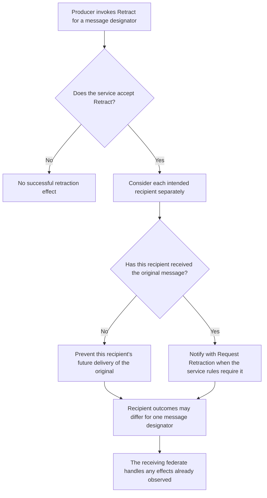
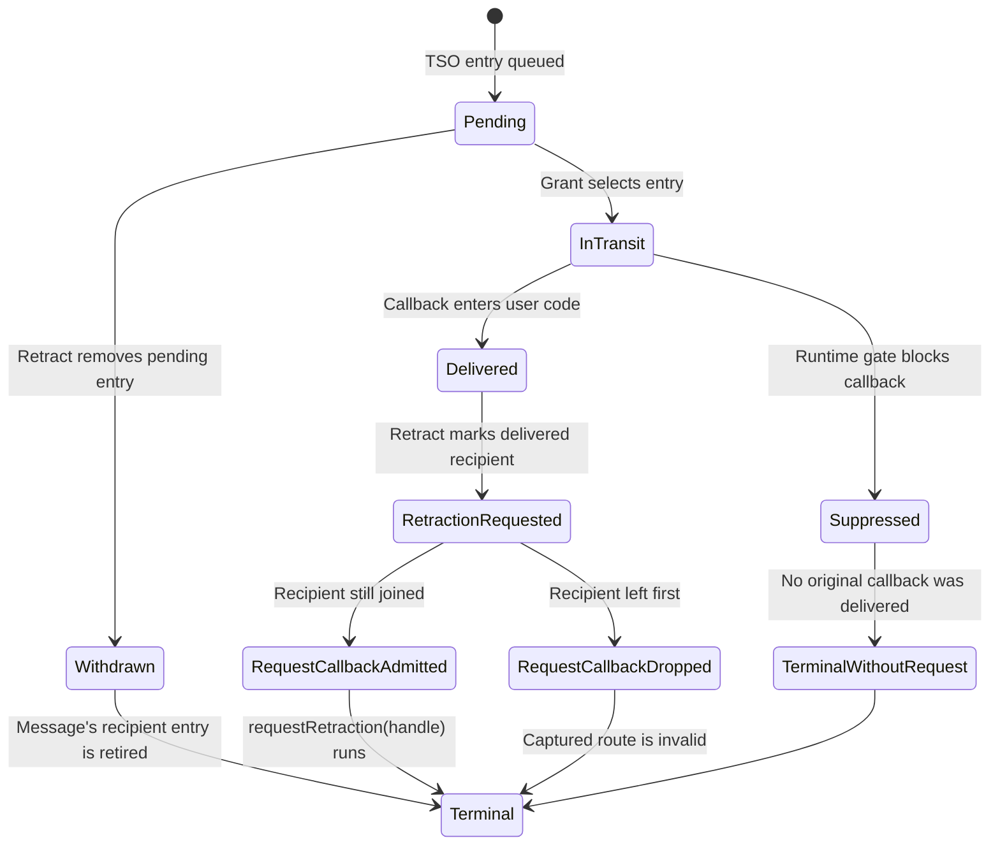
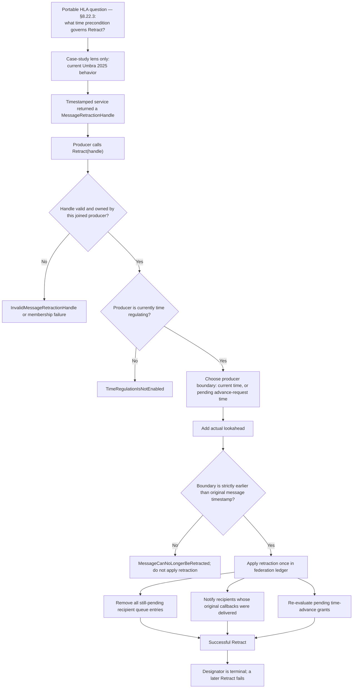
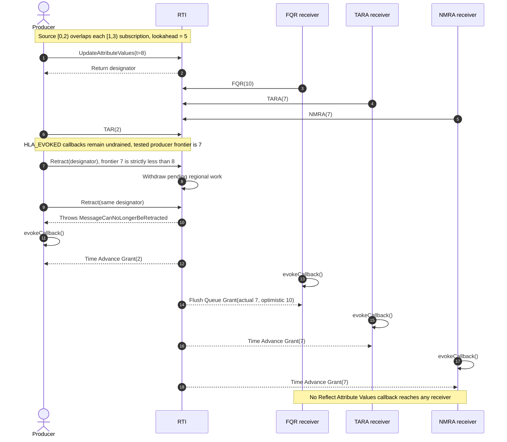
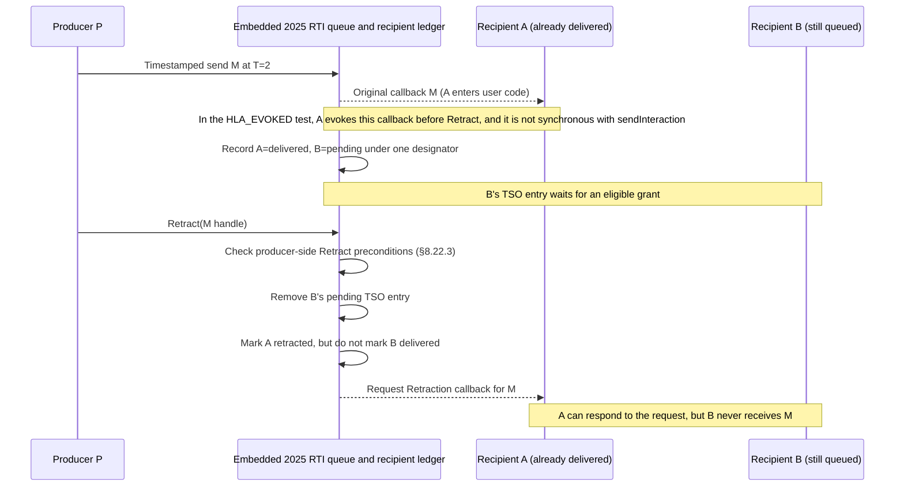
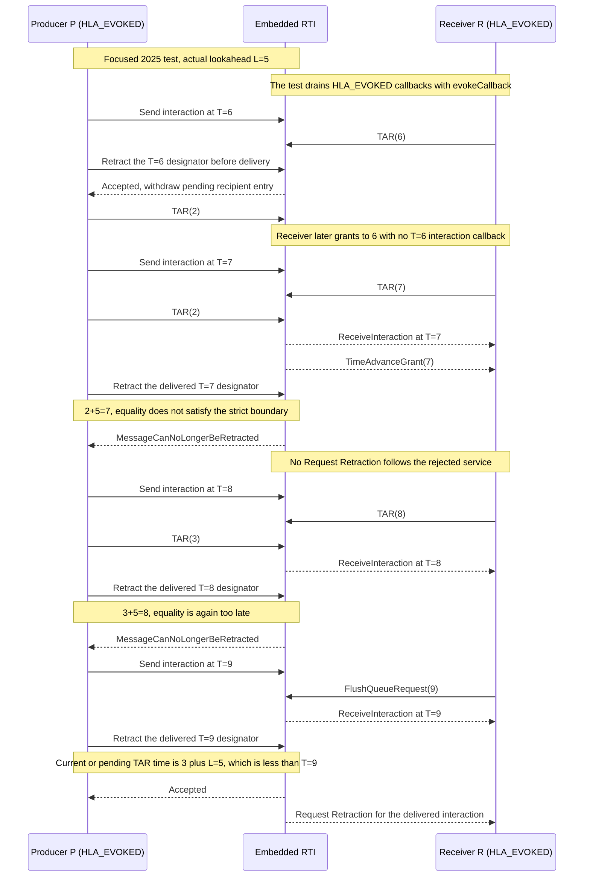
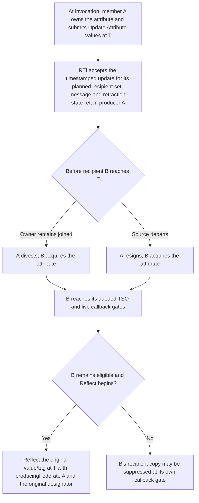
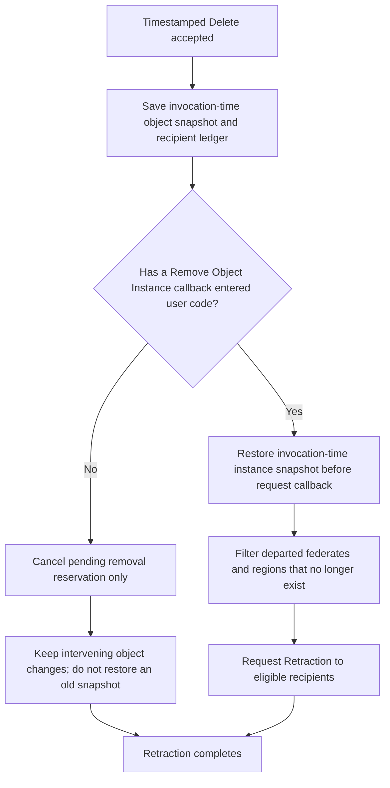
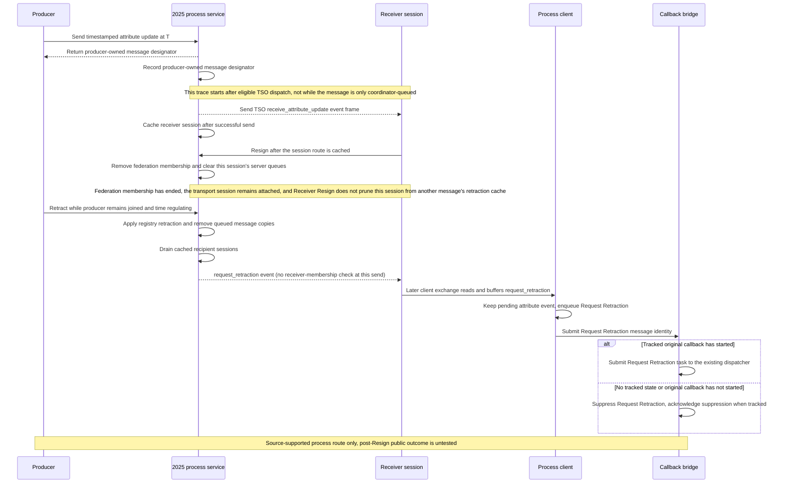
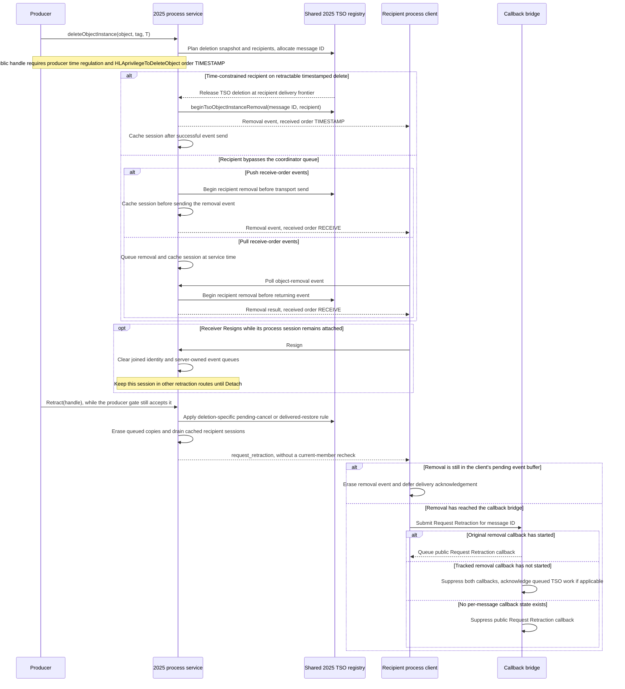

# IEEE 1516.1-2025 TSO Retraction Flow Guide

This guide is a deep dive into the lifecycle of a timestamped message that can
be retracted. It complements the [time-management guide](HLA-2025-TIME-MANAGEMENT-GUIDE.md):
that guide introduces queue phases and grant ordering; this one follows the
retraction designator from send, through recipient-specific delivery states,
to successful `Retract` and any `Request Retraction` callbacks.

**Edition:** IEEE 1516.1-2025 only. This guide does not describe the separate
2010 reference-RTI stream or infer behavioral parity between editions.

**Implementation profile:** current 2025 Umbra behavior, with embedded and
process-endpoint details identified separately. Source and tests establish
only the implementation paths and cases linked below; they do not establish
complete support or conformance.

## Keep three questions separate

Do not treat a retraction as one federation-wide yes/no state. Ask these three
related but distinct questions; their order in this table is a reader aid, not
a required RTI processing sequence:

| Question | Evaluated for | What it determines |
| --- | --- | --- |
| Is `Retract` still legal under the producer's time boundary? (§8.22.3) | The originating federate and this message timestamp | Whether the service can proceed; this is separate from whether any recipient has already observed the message. The profile-specific boundary used by Umbra is shown below. |
| What happened to the original delivery? (§§8.22–8.23) | Each planned recipient independently | A still-pending copy can be withdrawn; a recipient that already received the message may instead need `Request Retraction`. One designator can therefore have different recipient outcomes. |
| What happens to each outstanding time request afterward? | Each receiving federate and its own request mode | In the embedded case, removing queued work makes Umbra reconsider pending grant work; whether a grant follows still depends on that request's rules. The example does not make FQR, TARA, and NMRA equivalent. |

This is a reader's decomposition, not an additional normative state machine.
The later sections label the HLA contract separately from Umbra's embedded
and process evidence; verify exact normative wording against the licensed
standard text.

## Two similarly named operations, two different moments

| Name | Who invokes it? | What it means in this flow |
| --- | --- | --- |
| `RTIambassador::retract(handle)` / **Retract** | The federate that originated the timestamped message | Ask the RTI to retract the producer's timestamped message. Its time precondition and recipient-specific consequences are covered below. In the embedded 2025 path, callback entry is the implementation's delivered threshold. |
| `FederateAmbassador::requestRetraction(handle)` / **Request Retraction** | The RTI calls the recipient's ambassador | Notify a recipient that an already-delivered timestamped message was retracted. It is not another send-side service and does not mean a queued TSO callback was delivered. |

The normative clause pointers are IEEE 1516.1-2025 §8.22 (Retract), including
§8.22.3's time precondition, and §8.23 (Request Retraction). Start from the
[official IEEE 1516.1-2025 edition page](https://standards.ieee.org/ieee/1516.1/6688/)
and verify normative interpretation against the official licensed clause
text.

## One designator: portable outcomes and 2025 recipient gates

At the HLA level, evaluate the original message separately for each intended
recipient. If its copy is still pending, successful retraction prevents that
future delivery; if the recipient has already received it, Request Retraction
is the notification path. The receiving federate handles consequences of an
already-observed message; the RTI cannot undo arbitrary application state. This
is an orientation model for §§8.22–8.23, not a complete normative decision
table; check detailed conditions and timing against the licensed clause text.

The following deliberately omits RTI data structures and callback scheduling.
It shows only the portable questions: whether Retract succeeds, what each
recipient has observed, and where responsibility for already-observed effects
lands. The exact service-specific outcomes remain governed by §§8.22–8.23.

This is an HLA-level orientation, not a claim about Umbra's queue, ledger, or
callback phases. A successful Retract cannot roll back arbitrary application
state; the receiver handles consequences of a message it already observed.

### Embedded 2025 recipient-state example

The following graph adds current embedded-profile delivery and callback gates.
Umbra's private recipient ledger records `pending`, `delivered`, `suppressed`,
and `retracted`; labels such as `InTransit` and `RequestCallbackAdmitted` are
reader-facing distinctions, not HLA state names.

One send can be in different phases for different recipients at the same
instant—for example, already delivered to an unconstrained recipient while a
time-constrained recipient's copy is still pending. The portable distinction
is per-recipient delivery versus non-delivery. `Pending`, `Delivered`, and the
other capitalized states below are Umbra ledger labels that instantiate this
distinction; they are not HLA state names. `Suppressed` and callback-route
admission checks are additional embedded 2025 behavior.

Important transitions:

- **Portable outcome — original copy still pending:** the orientation map
  treats a successful Retract as preventing that recipient's future original
  delivery; there is no already-delivered effect for Request Retraction to
  address. In this embedded path, removing the queued entry implements that
  outcome. Verify the exact normative condition and timing in §§8.22–8.23.
- **Portable outcome — original copy already delivered:** Request Retraction
  is the distinct callback path for the retracted, already-delivered message;
  it is not a second delivery of the original TSO message. In the embedded
  source, `Delivered` is recorded when the original callback enters recipient
  code, and a successful Retract then queues the direct callback with the same
  opaque public handle. That callback-entry threshold is profile evidence, not
  a universal HLA application-state boundary.
- **Embedded 2025 gate — Suppressed → TerminalWithoutRequest:** a grant
  boundary may have been crossed while a runtime declaration/lifetime gate
  suppressed user code.
  This is not a delivery and must not be upgraded to a Request Retraction.
- **Embedded 2025 gate — callback admission is checked again:** in the callback
  route, Umbra rechecks that the recipient is still a member and that the
  ledger still says retracted before entering user code. A captured callback
  route is not permission to call into a federate that has since left.

## Producer-side legality and result

The portable HLA question is the time precondition in IEEE 1516.1-2025
§8.22.3: when may the originating federate retract this designator? Keep that
contract question distinct from the RTI's validation order and per-recipient
ledger updates. The following gate sequence is Umbra's current 2025 path, not a
required RTI architecture; verify normative interpretation in the licensed
clause text.

Only the first two nodes frame the question and case-study boundary; the
subsequent edges describe Umbra's validation and mutation path, not a standard
RTI's mandated internal call sequence.

In Umbra's 2025 check, let `t_base` be the producer's current logical time, or
its most recent advance-request time while an advance is pending; let `L` be
its actual lookahead and `T` the message timestamp. The tested source predicate
is `t_base + L < T`. Equality is not enough. Do not substitute the
timestamped-send admission rule here: the source explicitly keeps the Retract
precondition's actual-lookahead comparison separate from the send-service
epsilon rule.

The outcome is not just “valid handle or invalid handle”:

| Condition | Covered Umbra result |
| --- | --- |
| Malformed/default handle, or the designator belongs to another producer | `InvalidMessageRetractionHandle` |
| Producer is not joined | `FederateNotExecutionMember` |
| Producer is not currently time regulating | `TimeRegulationIsNotEnabled` |
| Timestamp is at or behind the current/requested-time-plus-lookahead boundary, or the designator has reached a terminal state | `MessageCanNoLongerBeRetracted` |
| Valid, owned, still-retractable designator | Retraction is applied once; queued fan-out is withdrawn and delivered recipients are classified separately |

An RTI-internal inconsistency while calculating or applying the operation can
produce `RTIinternalError`; the table is not an exhaustive catalogue of every
failure path.

### Why retracting can unblock someone else's grant

The federation time coordinator may be waiting for the timestamp of a queued
message before advancing another federate. Once Retract has changed the queue
and ledger state authoritatively, Umbra re-evaluates pending TAR/TARA/NMR/NMRA
grant work. The time advance is not granted merely because the producer called
Retract; the normal scheduler still decides whether each request is now
eligible, and callback gates still apply.

### Retract a regional update before three available-advance callbacks

The general HLA reading question is two-part: for each receiver, was the
original delivery still pending when Retract took effect, and separately,
what result did that receiver's outstanding time-advance request later
report? Keep recipient delivery state distinct from grant results. The
sequence below is one embedded 2025 case, not a universal schedule for these
three request services.

This embedded 2025 test follows one timestamped regional attribute update
through three receiver-side advance choices. The source region `[0,2)` overlaps
each receiver's `[1,3)` subscription. After the update at time 8, the receivers
submit Flush Queue Request(10), Time Advance Request Available(7), and Next
Message Request Available(7). The producer has lookahead 5, advances to 2, and
then retracts while the receiver callbacks have not yet been drained. The
strict producer boundary is satisfied in this case: `2 + 5 < 8`.

The focused test body asserts that the first Retract succeeds, repeating it
throws `MessageCanNoLongerBeRetracted`, and all three advance grants complete
without a reflected attribute update. Notably, FQR reports actual grant 7 but
optimistic time 10 after the sole queued message has been retracted; the time
guide describes the separate FQR actual/optimistic calculation. Treat that
value as an observation of this embedded scenario, not a new normative rule or
a general claim that the three advance services are interchangeable. The test
uses `HLA_EVOKED`; it does not record a Request Retraction callback or establish
process-profile or 2010 behavior. For the corresponding non-retracted regional
update through these three services, see the [DDM guide's mixed-advance case](HLA-2025-DATA-DISTRIBUTION-AND-REGIONS-FLOW-GUIDE.md#one-regional-update-three-available-advance-choices).

## A mixed-recipient walkthrough

This is one 2025 embedded development-profile interaction example, not another
portable HLA decision flow. The focused test source connects all three
federates with `HLA_EVOKED`; recipient **A** calls `evokeCallback` and enters
the original callback before **P** calls Retract. The sequence therefore shows
callback order, not a callback invoked synchronously by `sendInteraction`.
The first flowchart above remains the portable delivered-versus-pending
orientation.

In the test-shaped example, **P** sends message **M** at timestamp 2. Recipient
**A** is not time constrained and receives the original interaction before
Retract. Recipient **B** is time constrained and has not advanced far enough,
so B's copy remains pending in the embedded TSO queue.

The callback is a request to account for the already-delivered effect, not a
second TSO message sent at timestamp 2. It is a direct standard callback path,
not ordinary receive-order interaction traffic. The federate's callback model
still controls when user callback code runs. The focused [mixed-fanout test
source](../../cpp/tests/ieee1516_2025_request_retraction_interaction_mixed_fanout_catch2.cpp#L3)
asserts that the delivered interaction callback precedes Request Retraction
and that the queued recipient gets neither callback. Its target has no fresh
test result recorded; the checked-in assertions are source evidence, not a
newly verified run. This interaction case does not establish the separate
attribute-update behavior (see the [time-management guide's recipient
comparison](HLA-2025-TIME-MANAGEMENT-GUIDE.md#one-timestamped-update-two-recipient-paths)),
process-profile parity, or 2010 behavior.

### A focused trace: delivery does not decide Retract legality

The embedded 2025 test sends four timestamped interactions with lookahead 5.
It exercises two independent questions: has this recipient's callback already
run, and is the producer's message still beyond its Retract time boundary?
The boundary uses the producer's current time—or its pending advance-request
time—plus actual lookahead, and the timestamp must be **strictly later**. A
delivered message may therefore still be retractable, while another delivered
message may already be too late to retract.

The [focused test](../../cpp/tests/timestamped_send_interaction_retraction_catch2.cpp#L150)
checks the pre-delivery withdrawal at T=6, callback order across the T=6/T=7
requests, rejection at the T=7 and T=8 boundaries, and successful post-delivery
retraction at T=9. Its dedicated target was freshly rebuilt and the elevated-
filesystem CTest passes all 61 assertions. The sandboxed failure was traced to
`std::filesystem::canonical` being denied access to repository fixture paths,
not to a retraction assertion. Umbra computes the boundary from
current or pending request time plus actual lookahead ([snapshot and boundary](../../cpp/src/internal/runtime/umbra_rti_ambassador.cpp#L614));
the registry compares it with strict less-than before processing recipient
ledger state ([eligibility and ledger](../../cpp/src/internal/federation/federation_registry_tso_delivery.cpp#L132)).
The source path is embedded `HLA_EVOKED` behavior only, not evidence of
process-endpoint, 2010, or every callback-interleaving behavior. The normative
pointer remains IEEE 1516.1-2025 §8.22.3; consult the licensed clause text for
normative interpretation.

A separate [five-form terminalization test](../../cpp/tests/timestamped_tso_designator_terminalization_catch2.cpp)
is designed to cover TAR, TARA, NMR, NMRA, and FQR. Its dedicated target was
freshly rebuilt in single-node mode, and its focused `.build` CTest passes all
40 assertions when run with filesystem access enabled. This verifies those
five advance forms in the embedded `HLA_EVOKED` test profile only;
`.build-fom` does not register the case and provides no additional evidence.

## Ownership changes and an accepted TSO update are separate timelines

For a timestamped reflection, keep two identities separate: the federate that
produced this update and the federate that currently owns the object attribute.
The 2025 `reflectAttributeValues` callback exposes `producingFederate` alongside
the value, tag, time/order, and optional retraction designator in its
[pinned API signature](../../third_party/ieee1516.1-2025/include/RTI/FederateAmbassador.h#L243).
In the focused embedded cases below, a later ownership transfer does not
rewrite an already-accepted update's producer or cancel its queued recipient
entry.

The recipient in these cases was already subscribed and time-constrained when
the update was sent. Acquisition does not retroactively add a new recipient;
the diagram follows the original planned TSO entry. Delivery still has its own
recipient-side temporal and callback-projection gates, described in the [time
management guide](HLA-2025-TIME-MANAGEMENT-GUIDE.md). An ownership change is not
itself evidence that a receiver's queued copy was withdrawn, nor does this
focused transfer establish delivery after unrelated receiver state changes.

The embedded registry retains the update's producer identity and a separate
delivery state for each planned recipient ([enqueue](../../cpp/src/internal/federation/federation_registry_time_tso_enqueue.cpp#L428),
[producer-bound retraction check](../../cpp/src/internal/federation/federation_registry_tso_delivery.cpp#L114)).
At callback admission it checks the recipient's membership and message-ledger
state ([callback gate](../../cpp/src/internal/federation/federation_registry_tso_delivery.cpp#L373));
the delivery path then supplies the stored producer in `reflectAttributeValues`
([embedded TSO dispatch](../../cpp/src/internal/runtime/umbra_rti_ambassador_time_advance_dispatch.cpp#L472)).
These are explanatory implementation boundaries for the two cases below, not
a claim that every receiver-state change leaves delivery untouched.

Two focused 2025 **embedded `HLA_EVOKED`** tests exercise the positive path:

- In [ownership transfer before the constrained grant](../../cpp/tests/timestamped_attribute_update_ownership_transfer_catch2.cpp#L191),
  A queues an update for B, divests, and B acquires before advancing. The
  current test source asserts B as owner and A as no longer owner after the
  acquisition callback but before B advances ([ownership assertions](../../cpp/tests/timestamped_attribute_update_ownership_transfer_catch2.cpp#L309)).
  Its later reflection assertions retain the original value/tag at time 5,
  timestamp order, A as `producingFederate`, and the original valid retraction
  designator. Read these assertions together: authority over the attribute
  changes to B, while the accepted update still identifies A as its producer.
  The test's current worktree edit was inspected but not run in this docs pass;
  this is not a claim about every RTI or transfer path.
- In [source resignation before delivery](../../cpp/tests/timestamped_attribute_source_resignation_catch2.cpp#L196),
  A resigns after queueing the update; a surviving recipient acquires the
  attribute, then receives the queued update with A still named as producer and
  the original value, tag, time, and valid designator.

This is selected embedded-profile evidence, not process-endpoint parity or a
claim that all recipient-state mutations preserve delivery. For example, a
separate [post-loss subscription-change case](../../cpp/tests/connection_loss_attribute_update_tso_suppressed_cleanup_catch2.cpp#L154)
shows a recipient callback can be suppressed by its own later eligibility
change. The producer's retraction designator is also separate from current
attribute ownership: the registry ties it to the original producer and applies
membership/time/retraction-ledger checks. In the inspected embedded path, the
[ambassador Retract entry point](../../cpp/src/internal/runtime/umbra_rti_ambassador_retract_service.cpp#L22)
first requires the caller to remain joined and time-regulating; the registry's
[producer-bound check](../../cpp/src/internal/federation/federation_registry_tso_delivery.cpp#L114)
then checks current membership, that the caller matches the message's recorded
producer, and the timestamp and retraction-ledger state. That path has no
current-attribute-owner check, so the source suggests that transfer alone is
not a Retract rejection condition while the original producer remains joined
and time-regulating and the message passes its remaining checks. This is not a
portable HLA conclusion or a verified post-transfer service result: the
[ownership-transfer test](../../cpp/tests/timestamped_attribute_update_ownership_transfer_catch2.cpp#L191)
does not call Retract after transfer, and the pinned [API header](../../third_party/ieee1516.1-2025/include/RTI/RTIambassador.h)
does not include the full §8.22 normative text. The resignation test observes
a valid designator in the later reflection but does not establish that a
departed producer can still invoke the service. Process profile behavior is
not established by these embedded observations.

## Service-specific effects: deletion is special

Retract does not perform one universal “undo payload” algorithm for every
timestamped service. Each producer service has side effects that may require
separate state handling. Timestamped Delete Object Instance is the clearest
example:

The ordering matters: after an already-delivered deletion is retracted, the
registry reconstitutes the instance before queuing Request Retraction, so an
immediate recipient can observe the restored object while handling the
callback. Only still-joined holders can regain attribute ownership in the
covered profile. By contrast, before any removal callback begins, cancelling
the pending deletion clears its reservation without overwriting unrelated
updates made after the delete was invoked.

This deletion path is not the generic rule for interactions or attribute
updates. For those services, the RTI's recipient ledger decides which original
callbacks were delivered and which Request Retraction notifications to issue;
the receiving federate remains responsible for handling the callback's
service-specific consequences.

## Embedded versus process route

The public handle remains the standard opaque `MessageRetractionHandle`; the
current private implementation maps it to a federation-owned message identity.
The API route differs by endpoint:

| Endpoint | Where the authoritative retraction decision happens | What is rechecked or withdrawn |
| --- | --- | --- |
| Embedded federation | The ambassador validates its joined/time-regulation snapshot, then the embedded federation registry applies the owner, timestamp, queue, and recipient-ledger checks. | Pending queue fan-out is removed; direct Request Retraction callbacks use captured callback routes with a live membership/ledger recheck. |
| Process endpoint | The client forwards the producer identity and designator; the process service checks its producer-owned map and time state, then calls the shared registry retraction operation. | The process service erases queued event copies and drains a separate cache of recipient sessions to send `request_retraction` transport events. That send path does not recheck receiver membership or callback-started state; the client bridge later checks its per-message retraction state before submitting the public callback. See the process-after-Resign trace below. |

### Process receiver Resign after a cached TSO attribute delivery

This is a 2025 process-endpoint source trace, not a normative HLA sequence or
evidence about the embedded or 2010 streams. The important boundary is that
federation membership and transport-session attachment are separate: a
successful receiver Resign clears its server-owned event queues, but does not
remove that still-connected session from another producer's already-cached
retraction routes. This sequence follows coordinator-dispatched TSO delivery:
the service adds the route only after successfully sending the event frame; a
message still waiting only in the time coordinator has not reached this
route-cache boundary. Other recipients can bypass that coordinator queue at
the original service call, and those send-time branches populate the route
cache differently for attribute updates and ordinary interactions, as
compared below. Session detachment prunes the cache; producer Resign removes
cache entries for that producer's own message designators.

The process service's recipient cache contains session pointers, not a fresh
membership snapshot. Its detach path removes a session from that cache; the
receiver-Resign cleanup instead clears that session's ordinary event queues and
joined identity. The shared registry filters its own notification vector to
recipients that remain members and have a callback route. In the process TSO
delivery path, however, `beginTsoAttributeUpdateCallback` runs before the
transport event is sent, so the registry's internal `delivered` marker is not
proof that the public `FederateAmbassador` callback has started. The process
handler applies the registry result but sends transport events from the
separate session cache. A later producer `Retract` still has its own
producer-membership and time-regulation gates. When the control event reaches
the client, the callback bridge admits public `requestRetraction` only when it
has a tracked message whose original callback has started; otherwise it
suppresses the control callback (and acknowledges the suppressed delivery
when it has tracked state). The bridge checks its callback session and
retraction state, not the receiver's current federation membership. Immediate
versus evoked execution still follows the selected callback model.

The source path is not proof that a public callback occurs after receiver
Resign: the result depends on the exact client/bridge state and has no focused
process regression test. The [callback-ordering guide's process Resign
section](HLA-2025-CALLBACK-AND-SERVICE-ORDERING-FLOW-GUIDE.md#recipient-departure-after-planning-but-before-observation)
compares the broader buffered-event boundary; do not generalize this route to
directed interactions or other event families.

Source paths: [attribute coordinator TSO delivery records the route after sending](../../cpp/src/internal/federation/process_federation_service_tso_delivery.cpp#L157),
[attribute send-time dispatch records pull and push recipient sessions](../../cpp/src/internal/federation/process_federation_service_attribute_value_updates.cpp#L291),
[receiver-Resign queue cleanup](../../cpp/src/internal/federation/process_federation_service_lifecycle.cpp#L28),
[session detach prunes cached routes](../../cpp/src/internal/federation/process_federation_service.cpp#L61),
[process Retract producer gate](../../cpp/src/internal/federation/process_federation_service_retraction.cpp#L77),
[cached-session frame emission](../../cpp/src/internal/federation/process_federation_service_retraction.cpp#L193),
[the shared recipient ledger](../../cpp/src/internal/federation/federation_registry_tso_delivery.cpp#L115),
[client Resign and joined-identity clearing](../../cpp/src/internal/federation/process_federation_client_federation_management.cpp#L89),
[Request Retraction event buffering](../../cpp/src/internal/federation/process_federation_client.cpp#L477),
[client-to-bridge dispatch](../../cpp/src/internal/federation/process_federation_client_callback_dispatch.cpp#L350),
and [bridge retraction-state admission](../../cpp/src/internal/federation/process_federation_callback_bridge.cpp#L1217).

### Ordinary timestamped interaction comparison

The ordinary 2025 process `TsoInteractionDelivery` path shares the server-side
route-cache and receiver-Resign boundary above, but its client event-buffer
branch is not identical to attribute updates. The interaction dispatcher
reserves the registry recipient state, sends a `receive_interaction` event,
then records the session route. On `request_retraction`, the client removes a
matching interaction event if it is still in `pendingEvents_` and defers the
TSO delivery acknowledgement; if the event already left that queue, the
control event proceeds to the callback bridge. By contrast, the client does
not erase a pending `ProcessFederationAttributeUpdateEvent`; it queues
`PendingRequestRetraction` after it. Both bridge submission paths keep a
per-message `RetractionState`, and `submitRequestRetraction` gates the public
callback on whether the original callback has started. This is a process
implementation comparison, not an HLA rule. It covers ordinary TSO
interaction delivery, not the separate directed-interaction dispatch path.

There is a second callback-boundary difference in the send-time pull branch.
Both coordinator-dispatched TSO functions call their `beginTso...Callback`
gate before sending the event frame; that registry marker is earlier than
public callback entry. When a queued attribute event is pulled, the process
service calls `beginTsoAttributeUpdateCallback` before returning it. The
ordinary interaction pull handler simply removes and returns its queued event;
the inspected handler has no corresponding `beginTsoInteractionCallback`, and
the send-time pull branch has not added the session to the retraction-route
cache. This is source-observed only. The focused process interaction case
exercises coordinator-dispatched delivery, not this send-time pull branch, so
do not infer a public outcome or an HLA conformance result from the difference.

| Process boundary | Timestamped attribute update | Ordinary timestamped interaction |
| --- | --- | --- |
| Coordinator-dispatched TSO recipient | Send `receive_attribute_update`, then add the session to the retraction-route cache. | Send `receive_interaction`, then add the session to the same cache. |
| Send-time recipient that bypasses the coordinator queue | `handleUpdateAttributeValues` records the session for both pushed events and pull-queued attribute events. | `handleSendInteraction` records the session only in its pushed-event branch; its pull branch queues the interaction event without adding the session in this function. This is a source difference, not a tested outcome claim. |
| Callback-state reservation | Coordinator path reserves before send; pull path reserves when the attribute event is polled. | Coordinator path reserves before send; the inspected send-time pull receive handler has no matching reservation call. |
| Receiver Resign | Clear joined-session queues and identity; retain this session in other messages' route entries until detach. | Same shared cleanup; no interaction-specific recipient-cache pruning is visible. |
| Client receives Request Retraction | Keep a pending attribute event; bridge state decides whether its callback is suppressed or already started. | Erase a still-pending matching interaction and defer acknowledgement; otherwise pass the control event to the bridge. |
| Focused process evidence | Existing attribute cases exercise retraction before callback observation and fan-out. | The changed-lookahead case observes a coordinator-delivered timestamped interaction with a valid handle, then confirms Retract is too late; it does not test pre-callback retraction, the pull-queued send-time branch, or receiver Resign. |

Sources: [ordinary interaction TSO post-send route insertion](../../cpp/src/internal/federation/process_federation_service_tso_delivery.cpp#L297),
[attribute TSO post-send route insertion](../../cpp/src/internal/federation/process_federation_service_tso_delivery.cpp#L157),
[attribute send-time route insertion for pull and push](../../cpp/src/internal/federation/process_federation_service_attribute_value_updates.cpp#L291),
[interaction send-time push-only route insertion](../../cpp/src/internal/federation/process_federation_service_interaction_send.cpp#L608),
[attribute pull callback reservation](../../cpp/src/internal/federation/process_federation_service.cpp#L160),
[ordinary interaction pull receive handler](../../cpp/src/internal/federation/process_federation_service_receive.cpp#L37),
[interaction-versus-attribute client buffering](../../cpp/src/internal/federation/process_federation_client.cpp#L477),
[interaction bridge state](../../cpp/src/internal/federation/process_federation_callback_bridge.cpp#L1128),
[attribute bridge state](../../cpp/src/internal/federation/process_federation_callback_bridge.cpp#L1281),
and the [focused process interaction retraction case](../../cpp/tests/ieee1516_2025_connection_process_tso_interaction_regulation_reenable_changed_lookahead_catch2.cpp#L460).

Focused process tests exercise ordinary-member retraction before callback
observation: the [single-recipient attribute case](../../cpp/tests/ieee1516_2025_connection_process_tso_attribute_retraction_before_callback_catch2.cpp#L742)
retracts before the receiver polls the update, and the
[fan-out case](../../cpp/tests/ieee1516_2025_connection_process_tso_attribute_retraction_fanout_catch2.cpp#L968)
retracts one queued timestamped update across two receivers. Neither resigns a
receiver between send and Retract or asserts post-Resign `requestRetraction`.
These test sources were inspected, not run.

### Timestamped object removal follows a distinct process route

The ordinary attribute/interaction comparison above is not a complete model
for a timestamped Delete Object Instance. When the producer is time regulating
and the effective order of `HLAprivilegeToDeleteObject` is `TIMESTAMP`, the
2025 process service exposes a public retraction designator and divides planned recipients by time
constraint. Constrained recipients remain in the coordinator's TSO deletion
queue; other recipients take a send-time removal path with received order
`RECEIVE`. Both paths eventually retain a process-session route for a later
Request Retraction, but they add it at different points.

This is a 2025 process-profile source trace. It assumes the producer's own
Retract legality gate accepts the request. Its optional Resign branch begins
after that recipient has entered the route cache; it does not describe a
recipient that resigns while its copy is still waiting in the coordinator.

The split matters to readers: process-side object removal is not cached by the
same single post-send path used for coordinator-delivered attributes and
interactions. `enqueueObjectInstanceRemovals` records direct-path sessions
while it queues pull work or prepares pushed work; the coordinator-delivered
TSO branch records the session after sending. The client erases a still-buffered
removal event when its Request Retraction arrives. If the event has already
reached the callback bridge, the bridge's per-message state suppresses an
unstarted removal/retraction pair or admits Request Retraction after the
original callback has started. These are process implementation boundaries,
not general HLA callback rules.

Server-side receiver Resign clears that session's joined identity and event
queues, but does not remove the session pointer from other messages' route
entries; `detach` does. Therefore the source supports a later transport
`request_retraction` reaching a still-attached, resigned session. Whether a
public callback follows depends on the client's buffered event and bridge
state; no focused process test establishes that post-Resign outcome.

The [focused process delete scenario](../../cpp/tests/ieee1516_2025_connection_timestamped_delete_object_instance_catch2.cpp#L1091)
covers both callback models, producer regulation, time-constrained recipients,
preferred receive order, and callback gating. Its assertions cover the
removal callback and whether a handle is exposed; it does not call `retract`
or resign the receiver with a cached route. The separate
[embedded deletion-retraction case](../../cpp/tests/ieee1516_2025_timestamped_delete_object_instance_retraction_catch2.cpp#L6)
does exercise cancellation before grant and deletion reconstitution, but it is
not process-endpoint evidence. No 2010 route or parity is inferred.

Sources: [process delete recipient split](../../cpp/src/internal/federation/process_federation_service_object_instance_deletion.cpp#L81),
[direct removal queue and route-cache insertion](../../cpp/src/internal/federation/process_federation_service_object_instance_removal.cpp#L12),
[coordinator-delivered TSO removal](../../cpp/src/internal/federation/process_federation_service_tso_payload_dispatch.cpp#L170),
[delete retraction and cached-session notification](../../cpp/src/internal/federation/process_federation_service_retraction.cpp#L160),
[receiver Resign queue cleanup](../../cpp/src/internal/federation/process_federation_service_lifecycle.cpp#L28),
[Detach route pruning](../../cpp/src/internal/federation/process_federation_service.cpp#L61),
[client removal-event filtering](../../cpp/src/internal/federation/process_federation_client.cpp#L477),
[callback-bridge retraction admission](../../cpp/src/internal/federation/process_federation_callback_bridge.cpp#L1217),
and [removal callback retraction state](../../cpp/src/internal/federation/process_federation_callback_bridge.cpp#L1442).

Recipient state remains per-recipient in an additional embedded case: a peer
receives a directed TSO callback, then Resigns and Disconnects, while another
ownership-qualified recipient keeps its queued copy through save/restore and
later receives the original delivery followed by Request Retraction. This is
evidence for that embedded development-profile scenario only. It does not
establish what a departed recipient should receive, and it does not resolve the
separate process endpoint's cached-route cleanup.

In the process implementation, temporarily disabling time regulation does
not erase the producer-owned designator, but the Retract service itself is
rejected until regulation is enabled again. This is implementation behavior;
do not assume a cached client-side time switch authorizes the operation.
The private process TSO completion acknowledgement is a separate recipient
delivery fence, not a retraction callback or public HLA service. Its
callback-throws branch and remaining `inTransit` consequences are documented
in [the process endpoint flow](HLA-2025-PROCESS-ENDPOINT-REQUEST-AND-CALLBACK-FLOW-GUIDE.md#3-a-timestamped-process-delivery-stays-in-transit-through-callback-completion);
that branch is source-derived and has no focused throwing-callback test.

## Evidence map

### Implementation

- [2025 public Retract service and endpoint split](../../cpp/src/internal/runtime/umbra_rti_ambassador_retract_service.cpp#L22)
- [Retract current/requested-time plus actual-lookahead boundary](../../cpp/src/internal/runtime/umbra_rti_ambassador.cpp#L613)
- [Direct Request Retraction callback route and live admission check](../../cpp/src/internal/runtime/umbra_rti_ambassador.cpp#L983)
- [Per-recipient retraction ledger, pending withdrawal, delivered-recipient notifications, and delete reconstitution](../../cpp/src/internal/federation/federation_registry_tso_delivery.cpp#L114)
- [Process Retract service and process-event cleanup/notification](../../cpp/src/internal/federation/process_federation_service_retraction.cpp#L77)
- [Private per-recipient ledger states](../../cpp/src/internal/federation/federation_registry.hpp#L2203)

### Focused tests

- [Timestamped Send Interaction: retract before delivery, reject after the time boundary, then Request Retraction after delivery](../../cpp/tests/timestamped_send_interaction_retraction_catch2.cpp#L150) — freshly rebuilt dedicated target; elevated-filesystem CTest passes all 61 assertions. The sandboxed failure was fixture-path canonicalization access denial.
- [Regional timestamped attribute update retracted across FQR, TARA, and NMRA](../../cpp/tests/timestamped_regional_attribute_update_retract_mixed_advance_catch2.cpp#L160) — the focused test body asserts successful then terminal Retract, no attribute reflections, and the three grant results; this documentation increment did not rerun C++ tests.
- [Mixed interaction fan-out: notify the delivered recipient and suppress the still-queued recipient](../../cpp/tests/ieee1516_2025_request_retraction_interaction_mixed_fanout_catch2.cpp#L3) — no fresh result; its aggregate target was not rebuilt to completion.
- [Attribute-update mixed fan-out and delivered-recipient callback](../../cpp/tests/ieee1516_2025_request_retraction_attribute_update_mixed_fanout_catch2.cpp#L5)
- [Public embedded fresh-registry restore after a peer's post-delivery Resign](../../cpp/tests/ieee1516_2025_public_directed_tso_post_delivery_resignation_restore_catch2.cpp#L6) exercises both `HLA_EVOKED` and `HLA_IMMEDIATE`: the peer receives its directed TSO callback, Resigns and Disconnects, and a different ownership-qualified recipient keeps its queued copy through restore; a later Retract produces one valid Request Retraction for that still-joined recipient. This is development-profile test-body evidence, not process-route evidence; it does not assert a later callback to the departed peer, and no fresh CTest result was captured in this review.
- [Regional interaction recipient filtering and mixed delivery phases](../../cpp/tests/ieee1516_2025_request_retraction_delivered_regional_interaction_fanout_catch2.cpp#L4)
- [Process endpoint cancels a timestamped attribute update before reflection](../../cpp/tests/ieee1516_2025_connection_process_tso_attribute_retraction_before_callback_catch2.cpp#L366)
- [Timestamped deletion reconstitution and pending-removal cancellation](../../cpp/tests/ieee1516_2025_timestamped_delete_object_instance_retraction_catch2.cpp#L5)
- [Deletion/retraction state across save and restore](../../cpp/tests/ieee1516_2025_public_object_deletion_retraction_restore_catch2.cpp#L7)

The root cause of the sandboxed setup failures is identified: the test process
could inspect the fixture but `std::filesystem::canonical` was denied access
to its repository path. Fresh elevated-filesystem CTests pass for the FDD
materializer (38 assertions), MIM-first federation preparation (22), focused
TSO retraction (61), and five-form terminalization (40). These are current
results for their named cases, not evidence for process-endpoint or 2010
parity. The mixed-fanout and public explicit-MIM integration checks remain
unverified. The first serial aggregate build hit MSVC C1060 (compiler out of
heap) in `ieee1516_2025_federation_registry_timestamped_tso_payload_filesystem_restart_catch2.cpp`;
a later elevated attempt passed that source but was stopped before the aggregate
target completed, to avoid competing with the main implementation work. Do not
resume aggregate builds as part of this documentation goal. The earlier
aggregate FDD result came from a stale executable and should be disregarded;
the fresh dedicated FOM target provides the current result.

These cases demonstrate their named scenarios only. They do not prove that
every timestamped HLA service family is retraction-capable, that every
callback race is covered, or that arbitrary network failures and responder
restarts preserve the same outcomes.

## Edges and explicit limits

- Only timestamped service families that return a usable message retraction
  designator can enter this lifecycle. The [time-management guide's TSO
  producer list](HLA-2025-TIME-MANAGEMENT-GUIDE.md#timestamped-message-lifecycle-and-callback-order)
  identifies the current tested public producer families; that profile-bounded
  list is not an exhaustive standard enumeration or a claim that every
  timestamped service is implemented.
- Retract is producer-owned and requires current time regulation. The public
  handle is not an integer API, even though Umbra uses a private numeric
  message identity internally.
- Pending, delivered, and suppressed recipients are not interchangeable.
  A callback gate or a recipient lifetime check can make a queue phase
  terminal without any user-code delivery.
- Retract can suppress queued fan-out; Request Retraction addresses a message
  that already entered recipient code. Never draw them as duplicate service
  names for the same transition.
- This guide does not restate all grant ordering, GALT/LITS calculations,
  asynchronous-delivery rules, loss cutoffs, or save/restore behavior. Follow
  the links to the separate time-management and save/restore guides for those
  state machines.
- This is an IEEE 1516.1-2025 guide only. The bounded
  [2010 reference-RTI guide](HLA-2010-REFERENCE-RTI-FLOW-GUIDE.md) has a
  separate implementation boundary and makes no retraction-parity claim.
- No Requirements Lab rows were edited or added. Documentation and test links
  here are not new requirement mappings or conformance evidence.

Before considering the diagrams visually reviewed, render them with GitHub's
Markdown/Mermaid renderer or an approved local renderer. Static fence, link,
and line-anchor checks do not establish that the state, sequence, and
service-specific diagrams lay out clearly.
