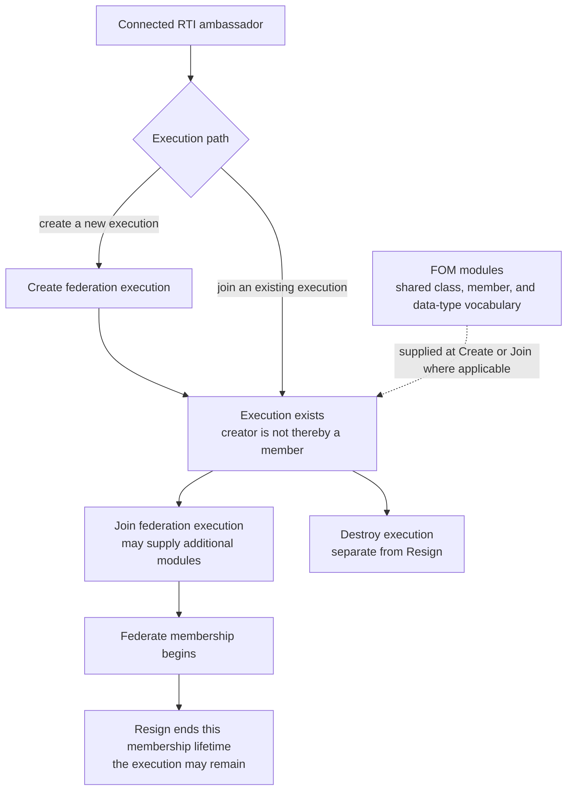
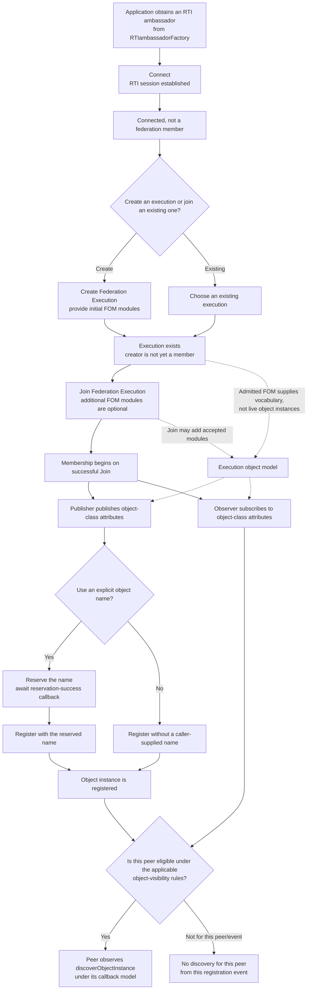
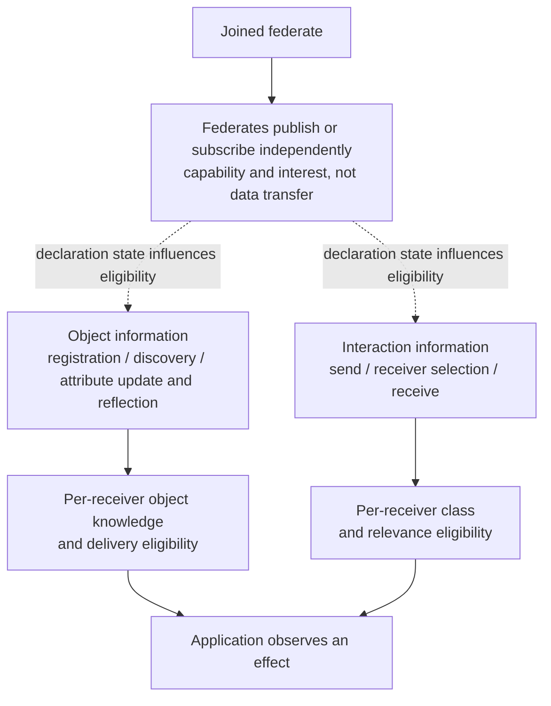

# HLA Behavior Flow Guides: Umbra Backlog

This is the living index for contributor-facing HLA flow diagrams in Umbra.
The guides explain difficult behavior before asking a reader to navigate the
implementation; they are not replacements for IEEE standards, implementation
contracts, or test evidence.
The [2025-only documentation roadmap](HLA-2025-DOCUMENTATION-ROADMAP.md)
summarizes the remaining visual, standards-text, and evidence-boundary work.

## Documentation status snapshot — 2026-10-17

This is the short action view; the detailed topic inventory, evidence notes, and
history remain in the [prioritized guide backlog](#prioritized-guide-backlog).
“Covered” means a reader-facing guide exists and has been surveyed, not that the
topic is normatively complete or every diagram has been visually reviewed.

| Status | Work |
| --- | --- |
| **Covered** | The principal 2025 areas have dedicated guides: time management, ownership, DDM/regions, object and interaction information, subscriptions/relevance, FOM admission, lifecycle/synchronization, save/restore, callbacks/reporting, MOM, [object and interaction reports](HLA-2025-MOM-OBJECT-AND-INTERACTION-REPORTS-FLOW-GUIDE.md), encoding, names/handles, authorization, and process-endpoint flows. See the backlog for profile limits and evidence gaps. |
| **2025 Evoke Multiple wait window** | The callback/service-ordering guide now distinguishes its monotonic elapsed-time window from HLA logical time and shows that the implementation checks the maximum only after a callback returns. The focused dispatcher test covers an already-queued FIFO batch, not empty-queue waits, late arrivals, or deadline overshoot. This is a 2025-source explanation, not a normative §10.58 interpretation. |
| **2025 pending transportation change and unconditional divestiture** | The order/transport guide now shows that embedded unconditional divestiture removes an attribute from pending transportation-change work: removing the last one makes the queued confirmation a no-op, while a partial multi-attribute request continues for its remaining attributes. The source establishes this implementation interaction; the focused save/restore interlock case invokes both services only while they are rejected by save/restore and does not test the interleaving. No normative ordering or process-profile result is claimed. The revised diagram is pending fresh visual review. |
| **2025 cross-federate pending TAR** | The time-management guide shows one configured-process path where a constrained member's TAR(5) remains pending until a regulating peer also advances to 5, after which the grant is observed. The focused case covers the transition under both callback models; the guide does not infer a GALT value, TSO behavior, a complete trigger set, or normative callback timing. A follow-up found that configured-process Resign and embedded forced member removal both re-evaluate pending grants in source, but no reviewed focused test shows departure alone releasing one. The lifecycle guide's lost-regulator TSO cutoff remains a separate forced-loss case. The FOM module-admission review found no new reader gap; its existing guide already explains composition, admission, commit, and bounded post-commit effects. |
| **2025 directed-interaction profile boundary** | A bounded review found the existing guide already contrasts embedded callback-time recipient re-planning with configured-process receive-order event materialization. The guide identifies the missing process test for declaration/target mutation after send acceptance; its exact-class multi-recipient test does not establish stale-event behavior. The review repaired stale Catch2 anchors for push-mode configuration and callback-model sections. No duplicate diagram is warranted, and the §4.4 normative scope remains open pending authorized text. |
| **2025 object-instance lifecycle survey** | Existing 2025 guides already separate name reservation, named-registration commit, producer knowledge, eligible peer discovery, federation-wide deletion, receiver-specific removal, local-forget, and resignation/connection-loss cleanup. A cross-cutting object-existence/known-object map and prior bounded audits connect those flows; no second lifecycle diagram is warranted. The reservation, named-registration, and peer-discovery tests remain separate, so the complete path is not claimed as one tested trace. |
| **Remaining annotation** | The major 2025 API areas have reader-facing guides; remaining annotation is driven by demonstrated reader gaps, not method coverage or a diagram quota. Recent process DSE, ResignAction, Connect/configuration, synchronization, callback/service-ordering, and object-discovery/initial-value reviews found existing diagrams sufficient for the bounded questions surveyed. The process DDM/Attribute Scope stale-event audit found a useful implementation distinction: server-poll events are rechecked at dequeue, while pushed events are checked before transport and have no later registry recheck shown; the focused process test does not exercise a stale race. A new 2025 source-bounded chart records these cutoffs without turning them into HLA callback-timing rules. The active-establisher/passive-receiver follow-up found that discovery stores one active-relevance boolean across the class/attribute scan, then separately checks the receiver's declaration; an active declaration on one discoverable attribute can open the source path for a passive receiver of another attribute. The guide now explains this as source-only; the object-attribute three-role test remains absent. The partial-achievement/late-Join synchronization sequence is correctly source-derived, and stale source anchors were corrected. A renewed test search found no process RECEIVE/asynchronous-delivery case to resolve the documented profile boundary. The Request Attribute Value Update guide distinguishes class expansion, per-instance current-owner grouping, requester-owned attributes, provider callbacks, and later reflection; focused tests do not cover one object's attributes split across providers or ownership changes at the embedded pre-enqueue/callback boundaries. The updated chart shows full-set persistence validation separately from callback-time subset projection and records the potential partial-persistence risk as source-only, not a normative or tested outcome. The 2025 Order and Transportation guide adds a source- and test-bounded TSO order-conversion example, and the reservation guide adds an embedded restore case. The ownership guide connects transfer of `HLAprivilegeToDeleteObject` to deletion authority and the embedded removal-callback assertion. The process trace maps callback producer identity to the stored registrant snapshot; both focused process deletion tests use the same federate to register and delete, so transferred-owner callback identity remains untested there. Continue bounded 2025 reviews; each candidate must produce either a useful HLA-first explanation or an evidence-backed no-change disposition. |
| **2025 RAVU response boundary** | The later Update call is planned against current provider ownership and update-region state; the original request region is not carried forward. Embedded ownership loss maps to `AttributeNotOwned`. Configured-process remote planner failures differ by overload: instance and class-without-regions requests become generic rejection surfaced as `RTIinternalError`, while regional class requests preserve typed planner status and matching API exceptions. The guide also records source-only whole-request regional validation before provider expansion: the focused test uses separate invalid-pair calls and does not prove suppression of otherwise-eligible work. The new overload map is source-only; focused process tests cover success for the first two and typed invalid-region outcomes for the regional form. No focused case transfers ownership between Provide and response. A separate reader review distinguishes RAVU provider solicitation from later receiver selection: the inspected update plan does not consume an earlier RAVU record, while enabled Delay Subscription Evaluation can defer ordinary receiver eligibility to delivery. The focused late-subscription DSE test makes no RAVU request, so direct §6.21 entitlement remains unresolved. See the [RAVU overload map](HLA-2025-ATTRIBUTE-VALUE-UPDATE-REQUEST-FLOW-GUIDE.md#configured-process-remote-failure-mapping-varies-by-overload), [later-update boundary](HLA-2025-ATTRIBUTE-VALUE-UPDATE-REQUEST-FLOW-GUIDE.md#the-later-update-call-revalidates-current-provider-state), and [receiver-eligibility review](HLA-2025-ATTRIBUTE-VALUE-UPDATE-REQUEST-FLOW-GUIDE.md#a-request-does-not-replace-receiver-eligibility). |
| **2025 RAVU fan-out/preflight review** | 2026-10-17 review confirmed the existing [RAVU flow guide](HLA-2025-ATTRIBUTE-VALUE-UPDATE-REQUEST-FLOW-GUIDE.md) already shows regional-pair validation before provider expansion, grouping by object/current provider, and configured-process preflight rejection, so no duplicate chart was warranted. Added a compact source-derived example of one object's requested attributes splitting across providers. The focused public process test covers one provider across two objects, not this same-object split. A separate private configured-process service test commits a disjoint requester region and verifies zero recipients plus no callback on the next poll for one object/provider/attribute; this is not public RTIambassador evidence. A mixed-validity review confirms source preflights supplied pairs before recipient expansion, while focused tests submit invalid cases separately and do not test suppression of otherwise-eligible work. No focused test covers same-object multi-provider splitting or later group/Push-send failure injection. Existing charts and evidence limits are adequate; no normative atomicity claim. |
| **2025 MOM synchronization-query profiles** | Revised the existing chart to distinguish `HLArequestSynchronizationPoints` (parameterless active-point list) from `HLArequestSynchronizationPointStatus` (named-point roster), then show their embedded/configured-process boundary. The pinned MIM specifies the paired reports. Embedded source and the focused test cover the list and roster; no dedicated process query planner or focused process request test was found. The generic process send path has a sender-publication check and rejection can surface as `RTIinternalError`, but actual process report delivery remains unclaimed. The core synchronization guide now cross-links these as observation paths distinct from registration, achievement, and barrier completion, and points to the exact profile-boundary explanation. Mermaid 12.1 syntax passes; visual review is pending. See the [combined query flow](HLA-2025-FEDERATION-MOM-FLOW-GUIDE.md#federation-synchronization-queries-active-point-list-and-roster-status) and [configured-process evidence boundary](HLA-2025-FEDERATION-MOM-FLOW-GUIDE.md#configured-process-request-route-evidence-boundary). |
| **2025 cross-cutting query versus transition** | The cross-cutting state/event guide now uses the paired synchronization queries as a source/test-bounded example: reports expose the active-point list or a named point's roster, while the embedded request path does not itself announce, achieve, or complete the point. The focused test observes the status change after a separate achievement; configured-process behavior remains unverified. This sharpens the existing `FACTS` → `QUERY` model without duplicating a diagram. |
| **2025 process name-reservation to peer-discovery review** | The existing [reservation guide](HLA-2025-OBJECT-INSTANCE-NAME-RESERVATION-FLOW-GUIDE.md#process-reservation-to-discovery-evidence-boundary) already separates the owner's reservation callback, named-registration commit, and later peer discovery. The [process registration handler](../../cpp/src/internal/federation/process_federation_service_request_handlers.cpp#L464) plans discovery only after registration succeeds. The focused [named-registration case](../../cpp/tests/ieee1516_2025_connection_named_object_registration_catch2.cpp#L457) covers reserve/register under both callback models in one client session; a separate [process discovery case](../../cpp/tests/ieee1516_2025_connection_object_discovery_catch2.cpp#L457) registers without a reserved name. No test composes reservation, named registration, and peer discovery end-to-end, so cross-session callback order remains unclaimed. No duplicate chart warranted. |
| **2025 process MOM staging** | A source review distinguishes pull-mode discovery/value queue insertion from push-mode batched sends for initial MOM values. The configured-process MOM test observes an evoked receiver only and does not assert discovery/reflection callback order; the guide now labels staging separately from callback order. Ordinary-object process late-subscription values remain an open source/test question. |
| **2025 ordinary late-subscription and embedded reentrancy review** | The current process source plans ordinary initial values as part of a newly accepted discovery, and the focused public test source asserts discovery plus a reflection containing only the selected stored `Name` value under both callback-model sections ([source](../../cpp/src/internal/federation/process_federation_service_object_discovery.cpp#L90), [test](../../cpp/tests/ieee1516_2025_connection_public_object_subscription_catch2.cpp#L652), [assertions](../../cpp/tests/ieee1516_2025_connection_public_object_subscription_catch2.cpp#L952)). The service implementation is modified in the current worktree; this documentation pass did not build or run the test, so no passing-result claim is made. The revised chart separates process-side planning from the embedded post-discovery path and shows the embedded callback reentrancy checkpoint: current membership and recipient eligibility are checked after `discoverObjectInstance` returns. The source comment names reentrant unsubscribe, resignation, and region changes; the cited tests do not exercise that fence. It also preserves the unresolved question for adding an attribute to an already-known object and the unreviewed licensed §5.8 text. No normative callback-order or broad profile-parity claim; the revised chart remains pending visual review. |
| **2025 nonregional process receive-order reflection review** | The existing [process endpoint guide](HLA-2025-PROCESS-ENDPOINT-REQUEST-AND-CALLBACK-FLOW-GUIDE.md#process-mapping-receive-order-object-attribute-update) already separates untimed update planning/commit, per-recipient push versus polling transport, and receiver callback dispatch. It explicitly says `receive_interaction` is the polling fence, pushed attribute frames use `receive_attribute_update`, and consuming an event does not itself invoke the callback; callback scheduling and transport mode are separate, with no cross-federate callback-order claim. The [focused public process reflection case](../../cpp/tests/ieee1516_2025_connection_update_attribute_values_reflect_catch2.cpp#L457) observes one byte-preserving reflection under both callback models ([value assertion](../../cpp/tests/ieee1516_2025_connection_update_attribute_values_reflect_catch2.cpp#L821)). In this fixture only, `HLA_IMMEDIATE` selects pushed transport and `HLA_EVOKED` selects polling ([fixture setting](../../cpp/tests/ieee1516_2025_connection_update_attribute_values_reflect_catch2.cpp#L545), [callback-model sections](../../cpp/tests/ieee1516_2025_connection_update_attribute_values_reflect_catch2.cpp#L880)); this is not a universal pairing rule. No additional diagram was warranted. |
| **2025 process Auto Provide** | Re-audit confirmed the existing [Auto Provide guide](HLA-2025-AUTO-PROVIDE-FLOW-GUIDE.md#configured-process-discovery-route-source-only-boundary) already has the process discovery/switch chart and evidence table. The only `planAutoProvideForDiscovery` call site remains the embedded discovery callback. The process subscription handler replans and commits discovery, then the event service delivers discovery, separate ordinary advisories, or MOM values; its switch handler only updates shared switch state. Public process tests separately cover discovery and switch storage, not a provider callback. No duplicate chart or normative-omission claim is warranted. |
| **2025 Auto Provide switch boundary review** | The existing [Auto Provide guide](HLA-2025-AUTO-PROVIDE-FLOW-GUIDE.md) already distinguishes a disabled switch at discovery from a switch-off while provider work is queued. The embedded disabled-baseline case confirms discovery with no provider callback in its HLA_EVOKED fixture; the two-provider case disables the switch in the first callback, suppresses the queued second solicitation, preserves the first response, and solicits again on a later discovery after re-enable. The configured-process test changes the shared switch value but does not arrange object discovery or assert provider solicitation. Strengthened the test links to the exact setup and assertions; no additional diagram. Automatic configured-process solicitation remains unverified, not a normative omission. |
| **2025 process Federation MOM FOM updates** | A 2026-10-17 bounded review confirms the [existing Federation MOM guide](HLA-2025-FEDERATION-MOM-FLOW-GUIDE.md#2025-process-profile-federation-mom-after-an-additional-module-join) already distinguishes the federation-level `HLAFOMmoduleDesignatorList` (Conditional on Create/Join adding FOM modules; first designator for identical supplied modules), the separate `HLAcurrentFDD`, and the joined-member `HLAfederate` list (Static, Join-scoped). The configured-process Join commits the effective definition and member, establishes MOM records, and discovers the new member object, but the inspected path does not enqueue a federation-list Conditional reflection. An explicit current-value request projects the live federation list after membership and known-object checks. No focused public process observer assertion covers the federation list: the process additional-FOM test checks class lookup/name, the embedded observer test checks `HLAcurrentFDD`, and member-snapshot tests do not establish federation-object callbacks. Existing source-mapped diagram is sufficient; no duplicate is warranted. Keep the process callback gap source-only, not a normative omission or parity conclusion. |
| **2025 process Federation MOM membership list** | A 2026-10-16 re-audit confirms the [existing Join/Resign trace](HLA-2025-FEDERATION-MOM-FLOW-GUIDE.md#2025-process-profile-membership-list-updates-at-join-and-resign) already separates the MIM's federation-list Conditional trigger from member-object discovery/removal and the explicit current-value request. Source projects the live membership map and shows no process Federation-list update enqueue. The only focused list-reflection test is embedded; the process resignation test covers member-object removal/rejoin ordering, not `HLAfederatesInFederation`. No diagram duplication or normative/parity claim is warranted. |
| **2025 `HLAsetSwitches` scope and decoding** | The Federation MOM guide now contrasts the two same-named MIM class paths: federation-wide `HLAautoProvide` versus joined-member switches and `HLAautomaticResignAction`. Its flow distinguishes special RTI consumption from ordinary interaction fan-out, staged member updates, extension parameters, the Service Reporting interlock, and current MOM projection. Process tests cover selected values/errors; embedded conditional-reflection evidence remains separately qualified. Sixty-seven local links in the section resolve. The new flowchart still needs syntax/render validation: the Mermaid core parser fails at the installed DOMPurify dependency, and Chromium launch for mmdc fails. No build or tests. |
| **2025 MOM exception reporting** | Audited malformed and precondition-rejected `HLAsetSwitches` reporting across the pinned MIM, embedded catch, configured-process server path, recipient planning, and focused tests. The existing [exception guide](HLA-2025-EXCEPTION-REPORTING-FLOW-GUIDE.md#route-b-a-mom-interaction-is-rejected) already separates `HLAreportMOMexception` from `HLAreportException`, `HLAreportServiceInvocation`, and the caller's public exception; it maps the `HLAfederate` dimension/parameter projection and the process-versus-embedded catch boundary. The bounded Route B link audit found and repaired one stale catch-order line anchor; otherwise no diagram or explanation change was warranted. No tests rerun. |
| **2025 FOM module-data request/report** | The Federation MOM guide already maps the duplicate federation/member `HLArequestFOMmoduleData` paths, their separate module-index lists, request parameters, paired reports, and embedded evidence. Added the source-only configured-process boundary: the public request uses the generic server interaction path, which requires publication, while both 2025 MIM request classes are Subscribe; no process FOM-report planner or focused process case was found. Keep the actual process outcome unverified; do not infer parity, a precise public exception, or conformance from source absence. Twenty-nine local links in the section resolve. No build or tests. |
| **2025 FOM variant-record composition** | The guide now distinguishes composition, configured-process commitment, and application-side encoding. The configured endpoint delegates explicit FOM preparation to the configured coordinator before registry commit; public process evidence confirms Restaurant Create acceptance and, in a separate explicit-MIM case, committed FOM/MIM module provenance and logical-time selection. Neither process test inspects `DrinkGarnish` alternatives. The bridge makes the manual value-level mapping concrete: Restaurant FOM names `Margarita`/`DryMartini` and values 1/2 must be associated by application code with typed discriminant and payload `DataElement`s. The catalog projection stores names/type references, while `addVariant` takes runtime elements. No catalog-to-octets integration is shown or tested; the example is illustrative, not a mandated application architecture or normative claim. |
| **2025 additional-module Join** | The FOM guide now shows distinct embedded and configured-process post-commit setup paths after the shared replacement-definition/member commit. Both rollback paths resign the new member; source shows no prior-definition restore call, but no focused test observes the catalog after post-commit failure with added modules. No HLA transaction rule is inferred. |
| **2025 transferred delete privilege and removal identity** | The ownership guide already connects special-attribute transfer to per-instance delete eligibility and the `removeObjectInstance` producer identity. A bounded source/test rereview confirms the embedded `HLA_EVOKED` case transfers `HLAprivilegeToDeleteObject` from registrant A to B, rejects A's delete, accepts B's delete, and asserts the observer callback still names A. Configured-process source gates on the current privilege owner but builds receive-order/TSO removal events from the original registrant snapshot; process tests register and delete through the same federate, so transferred-owner behavior is untested there. Tightened direct assertion links and qualified the test-comment attribution to §6.17 as not independently verified against licensed clause text. No duplicate diagram or process-parity claim. |
| **2025 object discovery and first reflection** | The existing object-information and subscription-state guides distinguish discovery from stored-value reflection. Embedded ordinary late-subscription source invokes discovery before planning current subscribed values; the focused test verifies both callbacks and values but stores them separately. The process pull selector prioritizes discovery before its reflection slot, but the late-subscription enqueue path creates initial values only for MOM. Current process tests do not establish ordinary late-subscription values or callback order. The companion profile chart already captures this boundary; normative 2025 clause text remains unverified. |
| **2025 configured-process object-update failure mapping** | The new [untimed Update Attribute Values failure map](HLA-2025-OBJECT-AND-INTERACTION-INFORMATION-FLOW-GUIDE.md#configured-process-update-local-handle-checks-and-remote-planner-errors) distinguishes local typed handle-conversion failures from remote planner failures. Unknown object, undefined attribute, and not-owned statuses become one generic process rejection and surface as `RTIinternalError`; the focused public endpoint case asserts only the successful path. This is source-derived, not a conformance claim, and does not cover the timestamped overload. |
| **Open process-timing evidence** | A bounded source trace finds process attribute and interaction RECEIVE events passing through the process callback dispatcher without the embedded `FederateTimeState::receiveOrderDeliveryAllowed`/deferred-queue path. Process time-management code uses constrained-recipient state for TSO queues; that does not establish a RECEIVE temporal gate. Process Join does not initialize the local embedded time state, and the public asynchronous-delivery adapters have no process-client branch; source falls through to the embedded service-state path. No focused process endpoint test calls those services or combines a constrained receiver, asynchronous-delivery off/on, and a pending advance. The time guide records this source-only boundary; the public process outcome and normative HLA meaning remain unresolved. Do not infer parity or add a diagram without new evidence. |
| **Normative follow-up** | Several precise claims still need canonical 1516.1-2025 prose unavailable in this checkout: the FQR argument/delivery boundary (§8.12), regional-subscription rule, the full voluntary `ResignAction` applicability/effect ordering (including §4.12.3–§4.12.4), automatic-resign action semantics, and lifecycle cutoff wording (§4.4). Keep these tagged as unverified; source and test observations cannot settle normative meaning. |
| **2025 callback-enable exception boundary** | The callback guide now connects `Enable Callbacks` state change with exception propagation: immediate draining can throw after the enabled flag is set, consuming the failed task while leaving later work queued; Evoked mode defers invocation to Evoke. This is source-only; existing dispatcher tests cover normal enable/disable behavior, not throwing callbacks. The new chart parses, but Chromium could not launch for visual review. |
| **2025 process synchronization-point callback exception** | The synchronization guide now diagrams the configured-process push path: the registry erases the completed barrier before event delivery, and the completing client's response drain submits the event before the public success-report step. A throwing `HLA_IMMEDIATE` callback can unwind after commit; known process protocol/client/bridge errors map to `RTIinternalError`, RTI `Exception` objects reach the outer exception-report path, and no general conversion/report path is shown for arbitrary C++ exceptions. `HLA_EVOKED` defers application invocation to a later Evoke. Focused process tests use a non-throwing recorder and do not inject callback failure or assert post-error barrier/report state. Mermaid 12.1 syntax passed; local render/screenshot remains pending. No normative callback-order or rollback claim. |
| **2025 process Federation Save initiation exception** | For an untimed configured-process request with no time-constrained members, source sets an active save and marks participants instructed before pushing initiation callbacks and returning the correlated response. If the caller's `HLA_IMMEDIATE` initiation callback throws during the post-response drain, its public request can throw after admission; the wrapper attempts `HLAreportException`, skips the later success report, and shows no rollback or failed-invocation report. `HLA_EVOKED` queues the task. This is source-only; the focused tests use non-throwing callbacks and do not assert the exception outcome. |
| **2025 process Federation Save completion boundary** | The last participant's process `federateSaveComplete` can queue `federationSaved` only after state-image commit, or `federationNotSaved(RTI_UNABLE_TO_SAVE)` after an encode/store failure. For pushed events, `HLA_IMMEDIATE` drains the terminal callback before the wrapper's successful Complete-report append; a callback HLA `Exception` can escape after the server-side outcome is resolved and skip that append. `HLA_EVOKED` queues the callback so the service can return first. The one-member process test proves HLA_EVOKED callback deferral in polling mode; a pushed multi-member HLA_EVOKED case later observes the save callback but does not assert zero immediately after Complete. Commit-failure and exception/report-order branches remain source/internal-test evidence, not process-endpoint tests. Two focused sequences now separate coordinator outcome from application callback/report observation; they do not strengthen the untested process failure or exception branches. |
| **Diagram validation** | The current 2025-only inventory has 339 charts in 31 guides: 199 flowcharts, 117 sequences, and 23 state diagrams (331 backtick-fenced plus 8 tilde-fenced). Fifteen selected diagrams have local render/screenshot review and 39 selected diagrams have local visual review; those totals predate recent revisions and were not recomputed. Mermaid 12.1 parsed 53 charts in five selected 2025 guides, including all eight subscription-state guide diagrams. Twenty-three charts are confirmed pending render/screenshot review; the Service Invocation Reporting status reconciliation is complete, with three of its charts still pending. The fourth Attribute Scope process-event transport chart, the new forced-loss joined-federate MOM route-availability chart, the new object/knowledge/DDM synthesis, and the restore-time state/callback-queue chart are also pending. The exact queue is maintained in the [2025 documentation roadmap](HLA-2025-DOCUMENTATION-ROADMAP.md). The 336 diagrams present at the last whole-tree sweep passed a 2025-only local Mermaid core syntax parse; three subsequent source-bounded charts passed separate focused core parses. These are syntax checks only. Scoop mmdc 12.0.0 is installed, but Puppeteer Chromium exits before image creation (2147483651); direct installed Chromium headless exits 3221225506. GitHub rendering and whole-tree visual review remain unverified. |
| **2025 Save completion link audit** | The new configured-process completion subsection adds 16 local destinations checked separately: 10 source-line anchors and six focused-test anchors. These are not folded into the aggregate inline-link scan. |
| **2025 inline-link audit** | A focused scan of the 31 `HLA-2025-*` guides checked 3,288 local inline destinations: no missing files, 2,629 valid source line anchors, and 264 resolved Markdown section anchors. It repaired two stale section links. Later additions contributed 59 local destinations, checked separately; all 55 added source-line anchors, the schema path, and three additional guide-heading fragments resolve. Six source anchors in the configured-process interaction subsection, four source anchors plus one guide-section link in the variant-record process review, two source anchors plus one guide-section link in the runtime codec boundary review, 11 source anchors plus two guide-heading links in the payload-layer review, eight source anchors in the Send Interaction failure review, and nine source anchors plus one guide-heading link in the Update Attribute Values failure review were checked individually and are not folded into the aggregate. The latest RAVU overload review adds ten separately checked local links (nine source-line anchors and one guide-heading anchor), also not folded into the aggregate. The Federation Save initiation exception subsection adds 17 separately checked destinations (16 source-line anchors and one guide-heading link), not folded into the aggregate. The new synchronization callback-exception subsection adds 15 separately checked source/test line anchors, not folded into the aggregate. Reference-style links, external URLs, full Markdown parsing, and rendered GitHub presentation are outside these checks; section anchors follow [GitHub's documented rules](https://docs.github.com/en/get-started/writing-on-github/getting-started-with-and-formatting-syntax#section-links). |
| **2025 FOM/runtime bridge link check** | The new bridge subsection adds four local destinations checked individually: three focused-test line anchors and one guide-heading anchor. These are not folded into the historical aggregate. |
| **2025 order-conversion link check** | The revised section adds one local guide link to the 2025 time-management guide; the destination exists. This addition is checked separately, not folded into the historical aggregate. |
| **2025 authorization credential lifetime** | Bounded rereview (2026-10-17) confirms the existing flow covers the typed credential envelope, Connect authorization and local commit, the connection-scope snapshot used by Create/Destroy/Join, joined Disconnect rejection, and snapshot/authorizer cleanup after successful Disconnect. Repaired stale source anchors for the connected-operation helpers, Connect commit, and Disconnect path. The authorization test source uses Disconnect for cleanup but does not assert same-ambassador reauthorization; keep that detail source-derived and do not infer HLA-mandated credential retention. The existing chart remains pending visual review; no second chart is warranted. |
| **2025 Federation MOM forced connection loss** | The MIM marks `HLAfederatesInFederation` Conditional on Join/Resign. Current embedded source also queues the federation-list update after forced connection loss; the inspected configured-process loss dispatcher projects cleanup effects but has no corresponding list-update enqueue. The only focused test naming this attribute covers ordinary Join/Resign, not loss; no process membership-list reflection test was found. Added a source-bounded profile flow and clarified that the execution-scoped Federation MOM record survives the shared loss transition. This is not a normative expansion or process-parity claim. Both the new flow and revised state chart syntax-parse, but need visual QA. |
| **2025 object existence, receiver knowledge, and DDM** | Added a source-bounded synthesis connecting object existence, per-receiver known-class state, current regional discovery/value eligibility, and removal planning. The three-dimensional regional test and embedded delete test cover separate pieces; no reviewed focused case combines a disjoint-region transition followed by removal. The combined relation remains source-only, with no normative or configured-process parity claim. The new flow passed Mermaid core syntax parsing and is pending render/visual review. |
| **2025 directed-interaction target/recipient review** | No new chart was warranted. The guide already separates producer, target object, and receiver identities; distinguishes registered-class FOM/publication checks from per-receiver known-class selector lookup; and keeps universal/by-ownership selection separate from DDM regions. Embedded ancestry/selector/known-target tests and an exact-class process multi-recipient test support different bounded slices; process ancestor selection and normative inheritance remain unclaimed. |
| **2025 Save/Restore admission and completion review** | No new chart was warranted. The existing guide distinguishes source-image and live-membership validation before request success/begun callbacks, each participant's restore report, the all-participant barrier, subsequent RTI-state rehydration, and the federation-wide outcome. It separates the retained process-local snapshot from the bounded durable-image path. The exact Join-during-active-Save/Restore rule remains open: inspected 2025 API annotations/source and the representative interlock test do not establish it. No build or test rerun. |
| **2025 restored time state versus callback queues** | Added a source/test-bounded flow distinguishing restored time-coordinator state and selected TSO/retraction ledgers from already-admitted RECEIVE closures and configured-process pushed frames. Existing tests cover restored logical time/lookahead, a pending TAR rebuilt against a fresh live route under both callback models, and one same-live-process pushed-frame case. No test establishes general deferred RECEIVE closure replay or OS-process restart. The new chart parsed with Mermaid core; render and visual review are pending. |
| **2025 DataElement to public value path** | Added a reciprocal link from the Data Element guide to the object guide's FOM-member-type → compatible DataElement → handle-keyed value map → service/callback → receiver-decode flow. The Data Element guide remains focused on value octets and codec rules. The existing views are complementary; no combined chart or all-types/profile end-to-end claim was warranted. The new heading link resolves; no build or test rerun. |
| **2025 order/transport evidence review** | Added exact links to the per-recipient TSO test's shared metadata, received-order, and callback-before-grant assertions. The same accepted sent-TSO is observed as RECEIVE by one unconstrained receiver and TIMESTAMP by one constrained receiver in a single embedded HLA_EVOKED schedule; full §8.1.4 Table 3 interpretation remains open. The interaction query note now distinguishes queried federate from callback requester: embedded source applies a target override only when the target publishes, while the process test queries its own handle only. Cross-target and post-unpublish outcomes remain source-only. |
| **2025 DataElement byte-order audit** | Refined the guide to enumerate the pinned BE/LE type set (signed/unsigned 16/32/64-bit integers, float32/64, and `HLAoctetPair`) and link literal-vector/decode tests for every listed family. No 8-bit integer BE/LE pair exists; one-octet types need no order. Rechecked fixed BE Boolean, UTF-16BE/BE-count strings, BE variable-array count, factory-owned logical-time bytes, and the separate BE process frame. No diagram changed or test rerun. |
| **Next** | Review 2025 composite shape, cursor, and padding against fixed-record, fixed-array, variable-array, and variant code plus focused vectors. In particular, keep the BE count, each child's own type order, inter-element padding, and no-padding-after-final-child rules distinct. Preserve the 23-chart visual queue; no 2010 work, builds, tests, or CI. |
| **2025 renderer retry** | A 2026-10-17 Mermaid CLI smoke test with installed Chrome failed before rendering (process code 2147483651); Edge reported an existing profile and Windows credential errors. The refreshed Chromium window displayed the Windows lock screen, so UI interaction stopped there. Mermaid 12.1 did parse 45 selected charts across four guides, but no screenshot review was obtained for the four pending diagrams. |
| **2025 renderer follow-up** | On 2026-10-17, Mermaid CLI 12.0.0 full-Markdown renders for the 2025 TSO retraction, RAVU, and callback/service-ordering guides produced no PNGs: bundled Chromium exited 2147483651; installed Chrome with a separate profile reported an existing browser/profile and a Windows username/password error. The authorization flow was not rendered. Mermaid 12.1 accepted the selected charts syntactically, but no new screenshot review is claimed. Keep the RAVU, synchronization-exception, Delete/Retract, and authorization credential-lifetime charts pending visual review. |
| **Pending validation** | Twenty-three 2025 charts are confirmed pending render/screenshot review; the Service Invocation Reporting status reconciliation is complete, with three of its charts still queued. The fourth Attribute Scope process-event transport chart, joined-federate MOM route-availability chart, object/knowledge/DDM synthesis, and restore-time state/callback-queue chart are itemized. The [2025 documentation roadmap](HLA-2025-DOCUMENTATION-ROADMAP.md) maintains the exact list and review order. Earlier selected-review totals predate recent edits and are not recomputed. The 336 diagrams present at the last whole-tree syntax sweep passed; three subsequent source-bounded charts passed focused core parses. Syntax checks do not establish rendering or visual review. Local browser-render attempts failed before image creation; no new screenshot was captured. Whole-tree visual review and GitHub rendering remain pending. |

The configured-process regional class-RAVU per-group failure subsection adds
nine separately checked local source/test links; these are not folded into the
aggregate link audit.

The 2025 class-level RAVU object-awareness question was rechecked. The existing
guide already distinguishes the known-object guard on instance requests from
class expansion, and states that the process test discovers both targets before
the request; no focused test targets an undiscovered object. The API exception
list is not the clause text, so it does not settle normative applicability. The
Auto Provide and subscription-state guides likewise already distinguish
discovery solicitation from explicit requests and initial reflection while
preserving the unverified ordinary process edges. No duplicate chart was
warranted.

The configured-process Federation MOM review found the existing 2025 sequence
clear: it separates federation-level Conditional reflection from new-member
HLAfederate discovery, shows explicit requests projecting the live Current FDD,
and distinguishes process class-lookup evidence from the embedded reflection
test. The process reflection gap remains source/test-only; no normative
conclusion or duplicate chart was added.

The variant-record model-to-runtime boundary is also already explicit: the FOM
guide describes merged discriminant/alternative resolution and its composer
tests, while the DataElement guide shows a runtime map configured through
`addVariant` and states that it does not consume the composed catalog. The
process Restaurant-FOM Create assertion is labeled incidental baseline
coverage, not variant-merge, discriminant-validation, or codec evidence. No
additional chart or broader process claim was warranted.

The 2025 additional-module Join failure boundary is already explicit in the
FOM admission guide. Its flow and evidence note separate the registry's atomic
catalog/member commit from later report/MOM/session/event setup, and say that
rollback resigns the member without an inspected prior-catalog restore. The
guide also states that existing failure tests are ordinary Join or pre-commit
rejection and do not assert catalog state after a post-commit added-module
failure. This remains source-only; no duplicate chart was warranted.

The latest 2025 RAVU review separates three kinds of Save/Restore evidence: an
embedded public fresh-registry test observes a regional-request callback after
`federationRestored`; configured-process source uses the shared registry image
for request metadata; and the process callback event remains a separate live
session event or pushed frame with no RAVU-specific Save/Restore test. This
does not establish configured-process replay or callback timing. In the
process profile, pull polling checks pending Restore notifications before the
RAVU queue, while pushed frames and callback tasks retain client/dispatcher
arrival order; neither is an HLA callback-order guarantee. The preceding
regional-validation review also found that mixed valid/invalid suppression is
source-derived, not tested. See the [RAVU guide](HLA-2025-ATTRIBUTE-VALUE-UPDATE-REQUEST-FLOW-GUIDE.md#configured-process-path-region-check-before-event-routing).

A bounded 2025 mixed-validity review confirmed that the existing RAVU guide
already explains the configured-process boundary: the registry validates all
normalized region/attribute pairs before building provider recipients, and a
typed rejection returns before the service enters its provider loop. Focused
process tests exercise invalid selectors in separate calls; none combines an
invalid pair with eligible work or asserts that such work is suppressed. The
guide's source-only qualification is accurate, so no duplicate prose or chart
was added. This is not a normative atomicity, exception-precedence, or
embedded/process parity claim.

A further review of the configured-process regional path confirmed that the
guide's planner chart already shows owner partitioning and per-attribute
request/source-region filtering, but it did not show the distinct error
checkpoints after groups are planned. Pull appends each eligible group event
inside the group loop; Push stages frames and sends them only after group
preparation finishes. A later registration failure or sequential send failure
can therefore occur after different amounts of source-visible progress. Added
a separate failure-phase chart and explicitly limited it to source behavior:
no focused regional process test covers multiple providers, a disjoint
provider, a later group failure, or a Push send failure. Nine local source/test
anchors in the new section were checked; the chart passed an individual
Mermaid 12.1.0 core syntax parse but remains unrendered. No normative atomicity,
callback delivery/order, or cross-profile rule is inferred.

The latest 2025 Attribute Scope Advisory review distinguishes switch-off at
three event positions: embedded queued closures recheck at callback entry;
process pull events recheck at server dequeue; pushed frames and client
callback tasks have no later switch check or switch-triggered purge visible in
the source. No focused test toggles the switch across already-admitted scope
work. These are implementation observations, not normative cancellation or
delivery rules. See the [Attribute Scope Advisory guide](HLA-2025-ATTRIBUTE-SCOPE-ADVISORY-FLOW-GUIDE.md#switching-off-is-not-a-common-queue-flush).

The latest 2025 process ordinary-interaction review traced event projection
through push/pull routing. The process service consumes predefined federation
`HLAsetSwitches` before ordinary recipient planning; separately, pushed
recipient frames are sent sequentially, and a later send failure returns an
error without visible rollback of earlier frames. The client/public adapter
maps that response to `RTIinternalError`, but no focused test injects a
mid-fan-out failure or proves which callbacks occur. The existing guide now
labels these as source-only boundaries and links the control path to the MOM
guide; no duplicate chart was needed. See the [ordinary-interaction process
section](HLA-2025-OBJECT-AND-INTERACTION-INFORMATION-FLOW-GUIDE.md#process-ordinary-interactions-snapshot-the-promoted-callback-view).

The 2025 process late-subscription review now has a focused public test source
for an existing ordinary object that becomes newly discoverable after the
receiver subscribes: it asserts discovery and a reflection with only the
selected stored value under both callback-model sections. The current service
source plans those ordinary values in the discovery enqueue path; the
implementation change is uncommitted and this documentation pass did not run
the test. The separate MOM snapshot path remains distinct. Adding an attribute
to an already-known object still has only provider-advisory evidence, and the
licensed §5.8 rule remains unreviewed. See the [subscription-state guide's
process comparison](HLA-2025-OBJECT-ATTRIBUTE-SUBSCRIPTION-STATE-FLOW-GUIDE.md#process-late-subscription-path-same-selectors-an-unresolved-initial-value-edge).

The 2025 configured-process Unconditional Divestiture review confirmed that
the ownership guide already distinguishes registry commit, later acquisition
work, ownership-assumption offers, and the recipient-specific push/pull gates.
Push can begin and commit an acquisition notification before sending its frame;
pull begins it at receive polling. The selected process tests cover a later
acquisition after observing unowned state and assumption offers, not a regular
request pending at divestiture or an injected post-commit enqueue/send failure.
The failure trace distinguishes push preparation gates from the later batch
send loop, pull's incremental queue insertion from later polling gates, and the
subsequent assumption-offer projection. A helper failure maps to
`RTIinternalError`; inspected source shows no rollback, but no untested runtime
residual effect is asserted. The embedded 2025 case does cover a regular
request already pending: it observes the later notification, original request
tag, and resulting ownership. The process-path failure and pending-request
branches remain untested. The guide's failure-phase chart and its overview
chart were syntax-parsed individually, not rendered. No fairness,
callback-timing, normative rollback, or profile-parity claim was added. See the
[process divestiture section](HLA-2025-ATTRIBUTE-OWNERSHIP-FLOW-GUIDE.md#process-endpoint-unconditional-divestiture-and-recipient-work-are-separate).

The 2025 configured-process Release Denied/cancellation audit separated
cancellation acceptance, denial planning, and callback-delivery gates. A
pending cancellation reservation does not itself remove the request; an
Unavailable delivery can consume a later reservation, while denial planning
can consume one that already exists. Push checks owner-release eligibility
before send and claims again before the public callback; pull checks at receive
poll and examines Unavailable before acquisition/cancellation events. An
embedded test verifies one arranged after-entry schedule, but the configured-
process tests do not combine after-entry Release Denied with cancellation.
The ownership guide now explains both the source-derived process branches and
the embedded/process boundary; its updated Mermaid chart passed core syntax
parsing only. No rendering, tests, builds, CI, or Requirements Lab work.

The 2025 configured-process cancellation/Unconditional Divestiture review
confirmed that cancellation planning and notification begin are competing
registry transitions. If cancellation planning wins, it reserves the attribute
without immediately removing it from the pending request; notification begin
then suppresses transfer. Push begins cancellation in the service handler
before sending its confirmation frame, while pull keeps the reservation until
the recipient polls. If notification begin wins, it assigns ownership before
callback projection and a later cancellation is rejected. Existing process
cancellation and divestiture tests exercise the paths separately; the embedded
pending-request divestiture case does not add cancellation. A separate embedded
assumption-search case does cancel before divestiture, but tests later
assumption-callback eligibility rather than the configured-process queued-
notification race. The ownership guide now makes the two gates and push/pull
timing explicit. The configured-process race remains source-derived, not a
normative ordering or profile-parity claim. Mermaid core syntax parsing passed
with a no-op sanitizer; the chart remains unrendered.

Open normative or test-evidence questions stay attached to their topic rows; a
diagram does not resolve them. Do not infer embedded/process parity without
evidence from both relevant 2025 profiles.

## Remaining roadmap and finish condition — 2026-10-16

The portfolio already has reader-facing guides for the major 2025 API families.
The remaining work is a small, explicit close-out queue rather than a promise to
diagram every service:

| Priority | Work remaining | Current state and finish condition |
| --- | --- | --- |
| **1 — Active** | 2025 evidence-gated reader-gap closeout | Continue bounded 2025 reviews, adding a portable explanation only when available source/test evidence answers a real reader question; otherwise record a no-change disposition or preserve the gap. Open profile/test boundaries include untested process RECEIVE timing beyond the focused regional attribute-update pull/push cases, multi-provider and mixed-validity regional requests, stale regional-scope events, three-role passive discovery, partial-achievement/late-Join synchronization, configured-process Auto Provide solicitation, transferred-owner removal callback identity, and embedded class-request persistence. The embedded disabled-switch and queued-switch Auto Provide cases are covered; configured-process switch storage does not establish provider solicitation. The completed regional-request order comparison is source/test-only: embedded and process checks differ, the API exception list does not define precedence, and combined-fault plus process save/restore outcomes remain untested. Other recent source/test findings are retained in topic guides and the progress log; do not infer normative HLA behavior or cross-profile parity from them. A selected full-width GitHub review of DSE #003 is now recorded separately from local rendering; the visual ledger covers all 515 current diagram bodies. |
| **2 — Evidence-gated** | Open profile/test boundaries | Keep untested process RECEIVE paths—especially nonregional receive-order push and other temporal-gate interleavings—the separate active-establisher/passive-receiver object-attribute scenario, the stale queued regional-scope event, and the partial-achievement-before-expanding-Join interleaving as explicit source/test gaps. The focused regional process attribute-update case covers pull and configured push checkpoints, but does not close broader process RECEIVE coverage. The source suggests the discovery active gate can come from a different attribute than the passive receiver's subscription, but this remains an untested object-attribute case; do not transfer the interaction-service test result or present the source path as normative. The process Join-rollback test covers a different event sequence and does not close the synchronization gap. Revisit only when focused checked-in evidence changes the conclusion. |
| **3 — Standards-text dependent** | Resolve precise normative questions | The FQR argument/delivery boundary (§8.12), regional-subscription rule, full voluntary `ResignAction` applicability/effect ordering (§4.12.3–§4.12.4), automatic-resign action semantics, and lifecycle cutoff wording (§4.4) remain open without the relevant canonical 1516.1-2025 prose. Keep them labeled unverified until that source is available; source code and tests cannot substitute for the standard. |
| **4 — Selected visual review** | Render and inspect selected diagrams | The process-attribute DSE flowchart (#003 at guide line 350) was rendered locally and screenshot-reviewed, then inspected on the published candidate in GitHub’s expanded Mermaid dialog on 2026-11-15. Its three route lanes and outcome labels are legible without clipping; the tall chart requires vertical scrolling to inspect its full path. This is one hosted layout sample. GitHub hydration covers 515/515 diagrams but does not establish full-width readability for all 515; continue selected layout checks after chart changes. Nonregional receive-order push remains a source-only path without focused DSE test evidence. |

This documentation goal is ready for handoff when every concrete reader gap is
either explained with bounded evidence or explicitly dispositioned, unresolved
normative/profile questions retain their limits, and each changed diagram's
syntax/render/visual status is accurately recorded. It does not require complete
normative coverage, visual review of every diagram, or a fixed diagram count.
The later Requirements Lab translation remains a separate goal.

## Guide pattern and boundaries

Use the [2025 time-management guide](HLA-2025-TIME-MANAGEMENT-GUIDE.md) as the
first structural example. Each new guide should:

- State its API edition and implementation profile at the top. A 2010 guide
  must be separate from a 2025 guide; never combine state machines or imply
  compatibility unless that equivalence has been demonstrated.
- Use GitHub-renderable Mermaid diagrams, with service calls, callbacks, and
  state-commit points labeled. Prefer several cohesive diagrams over one
  all-encompassing chart.
- Separate standard concepts, current Umbra behavior, test observations, and
  known limits. The standard is normative; code and tests describe only the
  implementation and scenarios exercised.
- Apply a portability test to each primary diagram: could its actors, states,
  events, and observable effects still explain HLA if Umbra were replaced by a
  different RTI? Keep registry layouts, queues, callback dispatchers, and
  transport plumbing in a clearly labeled implementation mapping unless they
  establish a protocol invariant. Never promote a source-only implementation
  detail into a general HLA rule.
- Link implementation claims to the relevant source and focused tests. Treat
  a passing test as evidence for its scenario, not proof of complete support or
  conformance.
- Identify interactions with other areas (time, ownership, regions, save and
  restore) without silently absorbing those state machines into the guide.
- Keep this work in Umbra documentation. Any later translation into or
  expansion of the HLA Requirements Lab is a separate phase and is not part of
  this backlog's current authorization.

## Long-running goal and delivery phases

**Goal:** Turn the durable HLA logic and infrastructure concepts discovered
while implementing Umbra into clear, reader-centered diagrams and guides.
Explain what a federate can do, what state changes, which participants become
eligible, and when effects become observable—not merely how Umbra's C++ happens
to implement them. Use Umbra source and existing focused-test evidence to
ground examples, while keeping portable HLA concepts distinct from implementation
choices and exact normative claims. Lead with the durable HLA mental model;
include Umbra's internal state and architecture only when they explain an HLA
invariant, an observable consequence, or an important implementation limit.
Use the 2025 time-management guide as a quality and structure example, not as
the topic-selection bias: keep building equally clear guides for the other
major HLA behavior areas. Prefer synthesizing relationships that cross service
families when that resolves a real reader gap; improve a focused guide where
that is clearer. There is no diagram-count quota.

Deliver the goal in reviewable phases:

1. **Keep the map current.** Maintain the topic inventory, reader paths, and
   prioritized backlog here. A candidate area starts with a bounded comparison
   of existing guides, relevant implementation/profile boundaries, and focused
   tests; a missing method-name mention alone is not a gap.
2. **Translate implementation discoveries into durable HLA explanations.**
   Prioritize portable concepts and cross-cutting invariants that are hard to
   see in isolated requirements or service code. Use Umbra as a case study,
   not the subject of the explanation: translate each useful C++ discovery back
   into the HLA actors, protocol state, eligibility rules, and observation
   boundary it helps explain. Identify edition and profile boundaries; link
   existing source and focused-test evidence in a separate implementation
   mapping; and label source-only or unverified edges plainly. Reuse verified
   evidence; do not compile, rerun tests, or start CI for documentation work by default.
   Keep the main implementation worker's build capacity free. Request fresh
   runtime verification only when a material claim cannot be responsibly
   documented otherwise. Link adjacent guides instead of absorbing their state
   machines.
3. **Validate documentation proportionately.** Distinguish grammar acceptance
   from actual Markdown preview, visual inspection, and post-publication GitHub
   rendering. Keep each pending check visible and do not upgrade evidence based
   on a parser-only pass. Reuse already-verified focused-test evidence. Record
   setup/environment failures separately from assertions that ran. When the
   permitted preview path is unavailable, leave visual review pending and keep
   substantive HLA documentation moving; do not unlock the desktop or route
   around the restriction. Documentation-only increments do not justify
   competing C++ builds or CI runs.
4. **Close or disposition each backlog item.** An area is complete when its
   guide and diagrams meet the per-guide completion check below, or when the
   survey records why another standalone diagram would only duplicate existing
   coverage. Leave a concrete next handoff for anything still open.

IEEE 1516.1-2010 and IEEE 1516.1-2025 remain separate behavior streams, with
separate guides, source paths, and test evidence. The 2025 embedded and process
profiles are also distinguished where their behavior or evidence differs.
Shared explanations require evidence from every stream they purport to cover.
The eventual idea of adding richer diagrams to the HLA Requirements Lab is a
separate later goal: this work improves Umbra documentation only and makes no
Requirements Lab edits.

## Edition-boundary text audit — 2026-10-09

A bounded scan of the 29 current 2025 guides for `2010` and
`rti1516_2010` markers found only explicit separation notes, legacy-model input
or catalog-only compatibility descriptions, and clearly labeled parallel
implementation references. The DataElement guide's comparison diagram gives
2010 and 2025 separate subgraphs and source paths; it does not combine codec
behavior or tests. In particular, `fomEdition=2010` is described as a
compatibility input to the 2025 ambassador, not as the 2010 RTI stream. The
separate 2010 reference-RTI guide and the new 2010 encoding companion remain
edition-specific; neither is used to fill evidence gaps in a 2025 guide. This is
a documentation-marker review, not evidence of cross-edition equivalence;
future shared explanations still need direct evidence from both streams.

## 2010 scope resurvey — 2026-10-10

A bounded path inventory found eight test files with `2010` in their names;
these include both 2010 runtime smoke programs and external-FOM edition or
composition cases, so a filename alone does not establish 2010 RTI behavior.
The existing [2010 reference-RTI guide](HLA-2010-REFERENCE-RTI-FLOW-GUIDE.md)
already covers the supported process-local lifecycle, object and interaction
flows, callback behavior, and the source-only synchronization barrier; it also
marks time-managed execution and other absent services as unsupported. The
separate [2010 encoding guide](HLA-2010-DATA-ELEMENT-ENCODING-FLOW-GUIDE.md)
covers selected scalar and composite byte behavior. The 2010 RTI binding smoke
is a single `HLA_IMMEDIATE` integration scenario; the time and encoding files
are value/marshalling smoke programs, not evidence of a 2010 time-management
state machine.

The separate `external_2010_fom_catch2.cpp` cases exercise FOM validation and
composition or the 2025 API with a 2010 model input. They are useful edition-
boundary evidence, not behavior evidence for the separate 2010 reference RTI.
The synchronization flow has no focused 2010 test in this bounded inventory.
The current evidence does not justify another 2010 service-flow guide: it
would duplicate the bounded reference guide or borrow 2025 behavior. Keep the
sync test gap visible, do not re-enable 2010 CI, and revisit only when new
2010-specific implementation or focused evidence creates a distinct reader
need.

## 2025 callback/service-ordering survey — 2026-10-10

A bounded comparison of the pinned 2025 API, callback guide, dispatcher, and
existing focused tests found no missing reader-facing distinction that needs a
new diagram. The guide already explains the durable model—producing/accepting a
callback task is distinct from invoking it and from the application observing
it—then shows the different HLA_IMMEDIATE and HLA_EVOKED drain boundaries in
separate diagrams. The pinned API exposes those callback models, the Evoke
operations, and callback enable/disable services; its declarations alone are
not a substitute for normative service prose. As implementation evidence, the
dispatcher drains enabled immediate work from submission and only invokes
evoked work when an Evoke operation claims it. Existing unit tests cover
synchronous immediate dispatch/FIFO and one-at-a-time evoked dispatch; these
tests were inspected, not rerun. Keep the known gaps explicit: the public
FederationSynchronized integration does not assert exact service-specific
HLA_IMMEDIATE-before-return timing, and the generic dispatcher lacks a focused
throwing-task recovery case. Record this area as surveyed rather than adding a
duplicative synthesis. The next bounded topic was whether the 2025 exception-
reporting and service-invocation-reporting guides needed one portable account
of service outcome, report production, callback invocation, and observation;
that survey and its disposition are recorded below.

## 2025 service outcome/report survey — 2026-10-10

The exception-reporting and service-invocation-reporting guides already give
service-specific report families, selectors, recipients, profile boundaries,
and detailed source/test limits. The broader cross-cutting guide already had
portable milestones for request validity, state transition, effects, caller
result, and observation, but it did not connect those milestones around the
surprising case where reporting fails after a state commit or changes a public
failure result. A fifth synthesis flowchart now relates those traces and three
2025 case studies connect it to the existing guides; no new normative rule or
2010 claim is made. The combined process two-report schedule and timestamped
queue/report failure are source-derived; the switch-append test body did not
reach its assertions in the last recorded run. No C++ source changed and no
build, test, or CI was run. The later whole-worktree grammar pass recorded
below accepts this chart; it generated no SVG. Rendered-layout review remains
separate and pending.

### Cancellation, invalidation, and already-observed effects — 2026-10-10

The bounded 2025 comparison found a reader-facing distinction worth
synthesizing, but no universal cancellation rule. The cross-cutting guide now
has a decision lens that scopes work per operation/request/recipient, separates
committed/query-visible facts from callback phase, and asks whether pending
work is re-evaluated, withdrawn, invalidated, or preserved—or whether an
already-observed effect has a service-specific follow-up. Six examples link
per-attribute subscription eligibility, accepted object deletion and its
per-recipient removal gate, ordinary versus directed interaction publication
withdrawal, ownership cancellation on resignation, recipient-specific TSO
Retract, and member-route invalidation in lifecycle cleanup.

The chart is explanatory, not normative. Its evidence remains bounded to the
linked 2025 guides, selected embedded tests, and any explicitly source-derived
edges; it does not assert process parity, a complete resignation-action
matrix, or rollback semantics. No C++ build, test rerun, CI, or Requirements
Lab change was made. The later whole-worktree grammar pass recorded below
accepts this block; that pass generated no SVG. Permitted visual review remains
separate and pending in the review inventory.

### Durable image state, live routes, and participant lifetime — 2026-10-10

The bounded 2025 comparison found no need for another state-machine diagram.
The save/restore guide already distinguishes federate-owned application state,
the process-local snapshot, supported durable RTI records, callback
routes/closures, and route-free restart projection, with an explicit limit
against assuming arbitrary crash recovery. The ownership companion separately
models ledger, route, and membership; the lifecycle guide distinguishes the
ambassador connection, federate membership, and federation execution, then
records what remains after resignation. The cross-cutting guide now adds a
short reader map connecting those explanations. A new chart would repeat these
existing models rather than resolve a remaining gap.

Evidence is still limited to the linked 2025 implementation and focused-test
scopes; no 2010 or general RTI parity, arbitrary process restart, or blanket
portability of callback-bearing operations is claimed. No C++ build, test
rerun, CI, or Requirements Lab change was made.

### Participant-set changes across synchronization and save/restore — 2026-10-10

The bounded comparison found a genuine reader gap: the focused guides explain
each protocol, but do not make the participant-set difference visible beside
one another. The seventh 2025 cross-cutting diagram shows that this registry
defaults an empty synchronization set to current membership but expands on
later Join only when the set was omitted; resignation removes the member and
rechecks barrier completion. Restore admission instead checks the saved/current
roster before restore begins, while resignation during an active save or
restore fails the operation for survivors. Connection loss reuses the
forced-resignation cleanup path, but pending-protocol notification outcomes
remain source-derived without a focused loss/protocol cross-product test.

The source audit also found an unresolved Join edge. Both 2025 Join overloads
in the pinned interface list `SaveInProgress` and `RestoreInProgress`, but the
inspected embedded adapter, shared registry transaction, and process Join
handler have no matching operation-state gate. Save/restore participant-status
maps are initialized from the cohort present at operation start, and the Join
path does not update them. The bounded test search found no focused
Join-during-save/restore case. Treat this as an apparent API/source gap, not a
verified runtime outcome or confirmed conformance defect; the exact 2025
§4.11 conditions still need an authorized full-text check.

Evidence remains selected 2025 source and focused tests. Late-Join expansion,
the explicit-empty distinction, and restore-roster rejection are source-derived;
the focused synchronization and active save/restore resignation cases cover
only their named interleavings. Keep process evidence separate, claim no 2010
rule, and make no C++ build, test rerun, CI, or Requirements Lab change.

### 2025 attribute-ownership reader-model review — 2026-10-10

A bounded content review found no missing reader-facing ownership diagram in
the existing [2025 ownership guide](HLA-2025-ATTRIBUTE-OWNERSHIP-FLOW-GUIDE.md).
Its opening teaches per-object-attribute ownership, separates publication and
object knowledge from ownership, and makes accepted acquisition distinct from
the later transfer outcome. The existing flows then distinguish owner denial,
unconditional and negotiated divestiture, assumption offers, query snapshots,
and stale callback invalidation. Those are supported by linked focused
scenarios and are explicitly scoped to the selected 2025 profiles; a new
summary chart would repeat the current model. This was a documentation/source
survey only: no normative interpretation was added, and no C++ build, test
rerun, CI, or Requirements Lab change was made.

A follow-up boundary audit found one useful reader improvement without needing
another diagram: the If-Available and If-Wanted sections described service
acceptance, typed failures, callback outcomes, and ownership queries in separate
places. Added a compact comparison table to the
[ownership guide](HLA-2025-ATTRIBUTE-OWNERSHIP-FLOW-GUIDE.md#compare-the-call-per-attribute-outcome-and-observed-ownership).
It marks typed exceptions as synchronous service outcomes, then separately
compares per-attribute callbacks and `isAttributeOwnedByFederate` observations.
The exception names are examples from the pinned API and focused tests, not an
exhaustive matrix. The evidence is selected embedded `HLA_EVOKED` behavior;
process and 2010 parity remain unclaimed. No chart or diagram-count change;
no build, test rerun, CI, or Requirements Lab edit.

### 2025 delete-privilege transfer cross-service review — 2026-10-16

The ownership guide already separated `HLAprivilegeToDeleteObject` from
ordinary attribute authority, while the object-information guide explained the
delete and removal lifecycle. A focused current-worktree 2025 embedded test
source exposed the useful seam between them: a prospective owner publishes and
acquires the special attribute, the current owner divests it if wanted, and
the new owner can delete without becoming the object's registrant. The paired
source scenario also isolates publication eligibility. Added one sequence to
the ownership guide; it preserves the per-attribute versus delete-privilege
distinction and labels the observed callback producer identity and deletion tag
as assertions in this selected embedded `HLA_EVOKED` path. The test sources were
not run in this documentation review.

The process timestamped-delete path carries separate producer metadata, so
the new chart explicitly makes no process-profile parity claim. The follow-up
source trace is recorded in the next review entry: it maps the public process
callback to the stored registrant snapshot, while the focused process case
does not separate registrant and deleter. The new chart parses with Mermaid
12.1.0, but no rendered image or visual review was possible because browser
launch remains denied. At that review, the inventory was 307 diagrams; a broad local-link
check found no missing destinations or invalid line anchors. No build, test,
CI, or Requirements Lab work was performed.

### 2025 DDM/regions reader-model review — 2026-10-10

A bounded learner review found one useful cross-topic seam that the DDM guide
stated in prose but had not diagrammed directly: regional scope, logical-time
eligibility, and application callback dispatch are separate questions. Added
a conceptual flow for one regional update or interaction and one receiver. It
shows that a region match alone does not prove callback delivery, receive-order
delivery does not use the TSO grant frontier, and a timestamp does not make a
disjoint regional path eligible. It leaves DDM evaluation/recheck timing
service-specific and explicitly says the arrows are not a universal internal
algorithm. The existing embedded and process examples remain separate evidence
cases; no 2010 behavior or profile parity is inferred.

The new flow passed the VS Code 1.141.0 Mermaid grammar parser, but no SVG or
screenshot was produced; local visual and GitHub-render review remain pending.
This was a documentation/source review only; no C++ build, test rerun, CI, or
Requirements Lab change was made.

### 2025 regional-interaction context and rejected-operation effects — 2026-10-10

A bounded reader review found a useful DDM distinction: a valid region handle
can still be incompatible with a particular interaction class because one of
its dimensions is not available to that class. Two separate embedded 2025
`HLA_EVOKED` tests exercise the sender and receiver sides. The send case rejects
a mixed valid/unavailable region set before any delivery is observed, then
delivers a valid-only send once. The subscription case rejects an unavailable-
dimension region, verifies a later send does not expose a hidden declaration,
then accepts a valid regional subscription and observes the later send.

Added an HLA-first flow to the [DDM guide](HLA-2025-DATA-DISTRIBUTION-AND-REGIONS-FLOW-GUIDE.md)
to show the shared class-dimension constraint and keep the two service effects
separate. The test comments point to §§9.1.3.3 and 9.1.4; the complete standard
text is unavailable here, so the prose does not enlarge those tested cases into
a universal transaction/rollback rule. The focused C++ test source was read,
not rerun. The new diagram has not yet had a fresh grammar or visual review;
there is no process or 2010 parity claim and no Requirements Lab change.

At this 2026-10-10 reader-review checkpoint, the inventory was 173 Mermaid blocks across 31 diagram-bearing guides:
86 flowcharts, 65 sequences, and 22 state diagrams. The separate 2010 stream
remains 10 diagrams; the 2025 set has 163. A fresh whole-docs VS Code 1.141.0
grammar pass accepted all 173 blocks, including the new DDM flow. It generated
no SVGs or screenshots. The earlier 178-block inventory is a previous
worktree snapshot, not the current count; visual/GitHub review is a separate
check.

### 2025 FOM admission/composition reader-model review — 2026-10-10

A bounded learner review found that the existing guide already makes the
important distinction clear: a module can pass DIF validation yet fail when
the ordered set is composed, when references are resolved against the complete
model, or when the resulting model is materialized and checked as an FDD. Its
separate Create and additional-module Join flows then show where the prepared
definition crosses into shared federation state. A fourth diagram would repeat
those stages rather than teach another durable HLA concept. Existing focused
tests cover cross-module reference resolution, an FDD-schema rejection, Create
failure without name reservation, and replacement-definition-plus-membership
commit; these sources/tests were inspected, not rerun. No C++ build, test rerun,
CI, Requirements Lab edit, or 2010 behavior claim was made. Corrected the
official IEEE 1516.2-2025 product link after checking the IEEE SA listing.

### 2025 order/transportation reader-model review — 2026-10-10

A bounded review confirmed the guide already separates sender-selected order
from the transportation category, receiver relevance, and time-management
eligibility. One useful test-backed nuance was less visible in the diagram:
calling a timestamped update/send service does not, by itself, establish that
the receiver observes a TSO event. The existing order-control test sets the
publisher's effective interaction order to `RECEIVE`, supplies a logical-time
argument, and observes receive-order metadata with no valid retraction handle.
Added that as an explicitly embedded-2025 test example in the delivery flow;
it is not presented as an independent normative interpretation. The existing
change-lifecycle and query diagrams already cover the other distinct reader
questions, so no additional diagram was needed. Source and focused-test evidence
were inspected, not rerun. No C++ build, test, CI, 2010 claim, or Requirements
Lab change was made. The added sequence note uses Mermaid's documented
multi-participant note and line-break syntax; no local visual render was made,
so visual and post-publication GitHub review remain pending.

Next bounded candidate: compare the 2025 publication/subscription, relevance,
and attribute-scope guides for a concise HLA-first explanation of declaration
changes versus class- and instance-level advisories. Keep current eligibility
and callback gates separate, avoid repeating the DDM/time diagrams, and create
or revise a flow only if the comparison exposes a real learner gap. Reuse
existing evidence and do not run C++ builds, tests, or CI by default.

### 2025 subscription and advisory reader-model review — 2026-10-10

A bounded comparison of the object-attribute subscription, declaration and
attribute relevance, and Attribute Scope guides found the distinctions already
explicit: subscription declarations are receiver state; class-level relevance
is reported to a publisher; object-attribute relevance is reported to an owner;
scope changes are reported to the receiving federate; and none of those
advisories is the attribute-value update itself. The relevance guide already
shows a subscription mutation feeding independent class and attribute
calculations, with discovery and scope planning kept separate. The scope guide
has the four-signal comparison; the subscription guide owns active/passive
declaration state. Current source paths and focused cases support these
separate lanes, while the cited profile and test limits are clearly labeled.
No combined chart would add a new state transition without duplicating those
guides, so no diagram was added. Source and test evidence were inspected, not
rerun; no C++ build, CI, 2010 claim, or Requirements Lab change was made.

Next bounded candidate: review the 2025 names/handle guide for a junior-friendly
distinction between declaration names, execution/member-scoped identities,
category-typed opaque API handles, and encoded handle values. Keep HLA API
semantics separate from Umbra's internal integer representation; add a flow
only if the current prose/diagrams leave a real learner gap. Reuse pinned API,
source, and existing test evidence without rebuilding or rerunning tests.

### 2025 HLA-first timing and reporting reader review — 2026-10-10

The time guide already puts the portable role, request, and grant mental model
before Umbra's effective-target, frontier, queue, and callback-policy details;
the existing diagrams and labels maintain that boundary, so no additional
timing chart was justified. The exception-reporting guide distinguishes
`HLAreportServiceInvocation`, `HLAreportException`, and
`HLAreportMOMexception`, while the cross-cutting guide separately connects the
service result, state effect, report path, and observer visibility. Together,
they already teach the difference between a thrown service exception and an
independent report; another combined diagram would duplicate the existing
model.

A bounded inventory of the six service-group headings in the pinned 2025
[RTIambassador.h](../../third_party/ieee1516.1-2025/include/RTI/RTIambassador.h)
found contributor-guide families for Federation Management,
Declaration Management, Object Management, Ownership Management, Time
Management, and RTI Support Services. This is topic-level navigation coverage,
not a claim that every service, overload, exception, or implementation profile
is documented. No source or tests were changed or rerun, and no C++ build, CI,
2010 behavior claim, or Requirements Lab edit was made.

Next bounded candidate: audit the 2025 object-instance deletion/removal flow
against the existing object-information, ownership, and time guides. Separate
ordinary deletion from timestamped deletion, receiver-known/removal effects,
ownership consequences, and time/retraction gates. Reuse existing evidence and
revise a flow only for a concrete HLA learner gap; do not build or rerun tests.

### 2025 Declaration Management publication-withdrawal review — 2026-10-10

A bounded method-level review of the pinned 2025 Declaration Management group
confirmed existing guide coverage for publication/subscription, active/passive
state, relevance, regional scope, directed interactions, delayed evaluation,
Auto Provide, update-rate admission, and explicit attribute-value requests.
One real reader gap remained: ordinary object-class publication withdrawal
has an ownership consequence that was not visible in the object/interaction
overview. Added a focused 2025 embedded flow to
[that guide](HLA-2025-OBJECT-AND-INTERACTION-INFORMATION-FLOW-GUIDE.md):
selected versus whole-class withdrawal, superclass/subclass declaration
separation, the pending-acquisition rejection, ownership removal on matching
instances, and profile-specific metadata cleanup.

The pinned API declares `OwnershipAcquisitionPending` for the §5.3 withdrawal
services. The existing class-hierarchy case exercises withdrawal at a subclass
while a superclass publication remains; the pending-acquisition case observes
rejection. The registry source maps the guard and owner-loss rule to §5.3.3 and
shows the associated update-region/transportation/order cleanup, but the cited
tests do not assert each cleanup postcondition. The process adapter forwards
the services; the new explanation makes no process/embedded parity claim. The
new Mermaid flow has not yet been parser- or visually reviewed. No C++ build,
test rerun, CI, 2010 behavior claim, or Requirements Lab edit was made.

The follow-up ordinary interaction review found a second, distinct boundary.
In the current embedded path, `planReceiveOrderInteraction` checks publication
before acceptance; ordinary callback dispatch later rechecks the receiver's
eligibility and projection, not the sender's publication set. An unpublish
between acceptance and `HLA_EVOKED` callback dispatch therefore does not itself
fence that ordinary queued route in the inspected code. The separate directed
path explicitly rechecks its publication pair at callback time, and its focused
case covers suppression after withdrawal. Added a source-labeled ordinary
send/unpublish/evoke sequence to the object/interaction guide and connected the
contrast to the cross-cutting stale-work lens. No focused ordinary
send → unpublish → evoke test was found, so that behavior remains source-only;
no IEEE-wide rule, process parity, or 2010 behavior is asserted.

The four new 2025 diagrams—the object-class publication-withdrawal flow,
ordinary interaction unpublish-after-acceptance sequence, save/restore
responsibility map, and federation/federate lifecycle map—subsequently passed
targeted, non-rendering Mermaid grammar parsing with the installed VS Code
1.141.0 modules. The ordinary sequence's semicolon label was changed to a
comma after the parser identified it as a statement separator. This confirms
grammar acceptance only: no SVG or screenshot was generated, so visual layout
and GitHub rendering remain pending. No C++ build, test rerun, CI, 2010
behavior claim, or Requirements Lab edit was made.

## Suggested reader paths

The guides are standalone topic explanations. These paths are a navigation
aid, not a claim that adjacent topics are one normative state machine or that
the implementation profiles are equivalent.

### A conceptual map of one HLA federation execution (2025)

This is an application-facing orientation, not a required call sequence. Two
different questions are shown separately: how an execution and its members
come into and leave existence, and how joined federates exchange information.
Arrows show relationships, not one required per-federate script; use the
focused guides for each service's exact rules.

#### Execution model and member lifetime

Creation establishes an execution; it does not make the creator a member.
Join creates the member relationship, and Resign ends that member lifetime.
Destroy is a distinct execution-lifecycle operation. FOM modules provide
vocabulary for the execution and may be supplied through the applicable
Create/Join path. The [lifecycle](HLA-2025-FEDERATION-AND-FEDERATE-LIFECYCLE-FLOW-GUIDE.md)
and [FOM composition](HLA-2025-FOM-MODULE-ADMISSION-AND-COMPOSITION-FLOW-GUIDE.md)
guides define the detailed boundaries.

#### From ambassador construction to observer discovery

This 2025-only orientation joins five focused reader paths without replacing
their service rules. It is not a required script for every federate: the
publisher and observer roles may be different members, and the arrows show
prerequisites rather than a total call order. FOM admission supplies the
class/attribute vocabulary; it does not create object instances. An explicit
name is optional, reservation success is not registration, and discovery is
not a value reflection.

This is a synthesis of separate API/service examples, not one end-to-end test.
The pinned API landmarks are [factory construction](../../third_party/ieee1516.1-2025/include/RTI/RTIambassadorFactory.h#L34),
[Connect](../../third_party/ieee1516.1-2025/include/RTI/RTIambassador.h#L55),
[Create](../../third_party/ieee1516.1-2025/include/RTI/RTIambassador.h#L128),
[Join](../../third_party/ieee1516.1-2025/include/RTI/RTIambassador.h#L212),
[name reservation](../../third_party/ieee1516.1-2025/include/RTI/RTIambassador.h#L647),
[registration](../../third_party/ieee1516.1-2025/include/RTI/RTIambassador.h#L697),
and [discovery callback](../../third_party/ieee1516.1-2025/include/RTI/FederateAmbassador.h#L229).
Focused examples are the [Connect/Create/Join lifecycle case](../../cpp/tests/ieee1516_2025_federation_resign_lifecycle_catch2.cpp#L4),
[reservation](../../cpp/tests/object_instance_name_reservation_catch2.cpp#L95),
[named registration](../../cpp/tests/object_instance_named_registration_catch2.cpp#L93),
and [registration/discovery](../../cpp/tests/object_instance_registration_discovery_catch2.cpp#L78)
cases. They cover different slices and profiles; they do not assert this whole
sequence or all normative discovery-eligibility rules. The detailed [connection](HLA-2025-CONNECTION-AND-CONFIGURATION-FLOW-GUIDE.md),
[lifecycle](HLA-2025-FEDERATION-AND-FEDERATE-LIFECYCLE-FLOW-GUIDE.md),
[FOM admission](HLA-2025-FOM-MODULE-ADMISSION-AND-COMPOSITION-FLOW-GUIDE.md),
[name reservation](HLA-2025-OBJECT-INSTANCE-NAME-RESERVATION-FLOW-GUIDE.md),
and [object information](HLA-2025-OBJECT-AND-INTERACTION-INFORMATION-FLOW-GUIDE.md)
guides retain their separate evidence and profile boundaries. This chart does
not describe the 2010 stream or claim embedded/process callback parity.

#### Information paths and application observation

The object and interaction branches are not interchangeable. Discovery and
known-object state matter to object services; interaction delivery has its own
class and relevance rules. Regions, time/order, and callback model can further
constrain delivery or observation only where the selected service uses them.
See the [object/interaction information](HLA-2025-OBJECT-AND-INTERACTION-INFORMATION-FLOW-GUIDE.md),
[callback/service-ordering](HLA-2025-CALLBACK-AND-SERVICE-ORDERING-FLOW-GUIDE.md),
[time-management](HLA-2025-TIME-MANAGEMENT-GUIDE.md), and
[DDM/regions](HLA-2025-DATA-DISTRIBUTION-AND-REGIONS-FLOW-GUIDE.md) guides.
This overview is 2025-only; it does not summarize the separate 2010 stream or
assert embedded/process parity.

### Navigate by the IEEE 1516.1-2025 API service family

The pinned public `RTIambassador` interface groups services by family. Use this
map to find a reader path; a row is not a method-by-method coverage claim, and
the guides intentionally link across families where one HLA behavior crosses
service boundaries.

| Public API family | Reader path |
| --- | --- |
| Federation Management Services | [Connection and configuration](HLA-2025-CONNECTION-AND-CONFIGURATION-FLOW-GUIDE.md), [federation and federate lifecycle](HLA-2025-FEDERATION-AND-FEDERATE-LIFECYCLE-FLOW-GUIDE.md), [FOM admission and composition](HLA-2025-FOM-MODULE-ADMISSION-AND-COMPOSITION-FLOW-GUIDE.md), [synchronization points](HLA-2025-FEDERATION-SYNCHRONIZATION-FLOW-GUIDE.md), [save and restore](HLA-2025-FEDERATION-SAVE-RESTORE-FLOW-GUIDE.md), and [federation-scoped MOM](HLA-2025-FEDERATION-MOM-FLOW-GUIDE.md). |
| Declaration Management Services | [Object and interaction information](HLA-2025-OBJECT-AND-INTERACTION-INFORMATION-FLOW-GUIDE.md), [object-attribute subscription state](HLA-2025-OBJECT-ATTRIBUTE-SUBSCRIPTION-STATE-FLOW-GUIDE.md), [relevance advisories](HLA-2025-RELEVANCE-ADVISORY-FLOW-GUIDE.md), [Attribute Scope Advisory](HLA-2025-ATTRIBUTE-SCOPE-ADVISORY-FLOW-GUIDE.md), [Auto Provide](HLA-2025-AUTO-PROVIDE-FLOW-GUIDE.md), and [Delay Subscription Evaluation](HLA-2025-DELAY-SUBSCRIPTION-EVALUATION-FLOW-GUIDE.md). |
| Object Management Services | [Object and interaction information](HLA-2025-OBJECT-AND-INTERACTION-INFORMATION-FLOW-GUIDE.md), [object-instance name reservation](HLA-2025-OBJECT-INSTANCE-NAME-RESERVATION-FLOW-GUIDE.md), [attribute-value update requests](HLA-2025-ATTRIBUTE-VALUE-UPDATE-REQUEST-FLOW-GUIDE.md), [directed interactions](HLA-2025-DIRECTED-INTERACTION-FLOW-GUIDE.md), [order and transportation](HLA-2025-ORDER-AND-TRANSPORTATION-FLOW-GUIDE.md), and [TSO retraction](HLA-2025-TSO-RETRACTION-FLOW-GUIDE.md). |
| Ownership Management Services | [Attribute ownership](HLA-2025-ATTRIBUTE-OWNERSHIP-FLOW-GUIDE.md) explains pending acquisition, owner response, If Available, cancellation confirmation, Divestiture If Wanted's output-set result versus later notification, and ownership queries; [ownership persistence and resignation](HLA-2025-OWNERSHIP-PERSISTENCE-AND-RESIGNATION-FLOW-GUIDE.md) covers selected pending work across those boundaries. |
| Time Management Services | [Time management](HLA-2025-TIME-MANAGEMENT-GUIDE.md), with adjacent [TSO retraction](HLA-2025-TSO-RETRACTION-FLOW-GUIDE.md) and [attribute update-rate admission](HLA-2025-ATTRIBUTE-UPDATE-RATE-ADMISSION-FLOW-GUIDE.md) for their own service-specific interactions with time. |
| Data Distribution Management | [DDM and regions](HLA-2025-DATA-DISTRIBUTION-AND-REGIONS-FLOW-GUIDE.md) and the regional paths in [object and interaction information](HLA-2025-OBJECT-AND-INTERACTION-INFORMATION-FLOW-GUIDE.md). |
| RTI Support Services | The cross-cutting [switch-control map](HLA-2025-CROSS-CUTTING-STATE-EVENT-OBSERVATION-GUIDE.md#a-support-switch-has-an-owner-a-lifetime-and-a-control-surface) distinguishes static federation policy, federation-wide Auto Provide mutation through the MOM path, Join-seeded member defaults, and member-local controls, then asks when each consuming service samples the value and how its effect becomes observable. Follow [names and handle resolution](HLA-2025-NAME-AND-HANDLE-RESOLUTION-FLOW-GUIDE.md), [callback](HLA-2025-CALLBACK-AND-SERVICE-ORDERING-FLOW-GUIDE.md), [update-rate](HLA-2025-ATTRIBUTE-UPDATE-RATE-ADMISSION-FLOW-GUIDE.md), [advisory](HLA-2025-RELEVANCE-ADVISORY-FLOW-GUIDE.md), [exception-reporting](HLA-2025-EXCEPTION-REPORTING-FLOW-GUIDE.md), and [service-invocation-reporting](HLA-2025-SERVICE-INVOCATION-REPORTING-FLOW-GUIDE.md) for operation-specific rules. |
| API-specific services | [Time management](HLA-2025-TIME-MANAGEMENT-GUIDE.md) explains the federation-selected logical-time representation and `getTimeFactory`; [DataElement encoding](HLA-2025-DATA-ELEMENT-ENCODING-FLOW-GUIDE.md) covers the logical-time element codec handoff; [names and handle resolution](HLA-2025-NAME-AND-HANDLE-RESOLUTION-FLOW-GUIDE.md) covers typed-handle value boundaries. |

This index follows the 2025 API grouping only. Read the separate 2010 guides
on their own; this family map does not infer 2010 behavior or parity.

- **A portable way to reason across HLA services:** begin with the
  [cross-cutting state, event, and observation model](HLA-2025-CROSS-CUTTING-STATE-EVENT-OBSERVATION-GUIDE.md),
  then use the focused time-management, object/interaction, DDM, and callback
  guides for operation-specific rules. Its examples are 2025-only and do not
  bridge the separate 2010 stream.
- **From ambassador construction to a first eligible object observer** (2025
  reading path, not a required call sequence):
  [connection/configuration](HLA-2025-CONNECTION-AND-CONFIGURATION-FLOW-GUIDE.md)
  → [authorization](HLA-2025-AUTHORIZATION-FLOW-GUIDE.md) →
  [federation lifecycle](HLA-2025-FEDERATION-AND-FEDERATE-LIFECYCLE-FLOW-GUIDE.md)
  → [FOM admission/composition](HLA-2025-FOM-MODULE-ADMISSION-AND-COMPOSITION-FLOW-GUIDE.md)
  → [object/interaction information](HLA-2025-OBJECT-AND-INTERACTION-INFORMATION-FLOW-GUIDE.md).
  Create and Join remain distinct execution/member transitions, and discovery
  is a per-receiver eligibility effect, not an automatic consequence of Join.
  Read [name reservation](HLA-2025-OBJECT-INSTANCE-NAME-RESERVATION-FLOW-GUIDE.md)
  alongside registration only for the optional named-registration path:
  unnamed registration has no reservation step, and a reservation neither
  creates an instance nor notifies peers. Continue to [federation-scoped MOM](HLA-2025-FEDERATION-MOM-FLOW-GUIDE.md)
  → [joined-federate MOM lifecycle](HLA-2025-JOINED-FEDERATE-MOM-OBJECT-LIFECYCLE-FLOW-GUIDE.md)
  when studying RTI-owned management objects. The focused guides define each
  boundary and its evidence.
- **Connection, membership, and execution are separate:**
  [Connect, Disconnect, and configuration](HLA-2025-CONNECTION-AND-CONFIGURATION-FLOW-GUIDE.md) explains the local RTI
  session gates and separates client recovery from host retention. Continue to
  [federation lifecycle](HLA-2025-FEDERATION-AND-FEDERATE-LIFECYCLE-FLOW-GUIDE.md)
  for terminal forced ConnectionLost and survivor effects, then distinguish
  Connect/Disconnect, Join/Resign, and Create/Destroy. [Authorization and
  credentials](HLA-2025-AUTHORIZATION-FLOW-GUIDE.md) follows the 2025 authorizer
  from Connect through Create/Destroy/Join and separates the typed credential
  envelope from authorizer-specific policy. The lifecycle guide also covers
  rejoining on the same connected ambassador in one focused embedded case.
- **Why an attribute update reached a federate:** start with the cross-cutting
  [attribute-value concept map](HLA-2025-CROSS-CUTTING-STATE-EVENT-OBSERVATION-GUIDE.md#an-object-attribute-value-touches-several-independent-boundaries),
  then use the
  [delivery and observation checklist](HLA-2025-CROSS-CUTTING-STATE-EVENT-OBSERVATION-GUIDE.md#keep-delivery-and-observation-questions-separate).
  The focused guides distinguish publication and per-instance ownership, receiver knowledge and subscription/DDM,
  optional solicitation, update-rate admission, logical-time eligibility, and callback observation; follow only the
  gates relevant to the service. Begin with
  [object/interaction information](HLA-2025-OBJECT-AND-INTERACTION-INFORMATION-FLOW-GUIDE.md), then choose
  [subscription state](HLA-2025-OBJECT-ATTRIBUTE-SUBSCRIPTION-STATE-FLOW-GUIDE.md),
  [attribute-value requests](HLA-2025-ATTRIBUTE-VALUE-UPDATE-REQUEST-FLOW-GUIDE.md),
  [ownership transfer](HLA-2025-ATTRIBUTE-OWNERSHIP-FLOW-GUIDE.md),
  [DDM/regions](HLA-2025-DATA-DISTRIBUTION-AND-REGIONS-FLOW-GUIDE.md),
  [update-rate admission](HLA-2025-ATTRIBUTE-UPDATE-RATE-ADMISSION-FLOW-GUIDE.md),
  [time management](HLA-2025-TIME-MANAGEMENT-GUIDE.md), or
  [callback/service ordering](HLA-2025-CALLBACK-AND-SERVICE-ORDERING-FLOW-GUIDE.md) as needed. For broader
  update/interaction routing and advisory paths, see [relevance advisories](HLA-2025-RELEVANCE-ADVISORY-FLOW-GUIDE.md),
  [attribute scope](HLA-2025-ATTRIBUTE-SCOPE-ADVISORY-FLOW-GUIDE.md),
  [Auto Provide](HLA-2025-AUTO-PROVIDE-FLOW-GUIDE.md),
  [Delay Subscription Evaluation](HLA-2025-DELAY-SUBSCRIPTION-EVALUATION-FLOW-GUIDE.md), or
  [directed interactions](HLA-2025-DIRECTED-INTERACTION-FLOW-GUIDE.md).
- **How timestamp, order, transport, callbacks, and retraction relate:**
  [time management](HLA-2025-TIME-MANAGEMENT-GUIDE.md) →
  [callback/service ordering](HLA-2025-CALLBACK-AND-SERVICE-ORDERING-FLOW-GUIDE.md) →
  [order and transportation](HLA-2025-ORDER-AND-TRANSPORTATION-FLOW-GUIDE.md) →
  [TSO retraction](HLA-2025-TSO-RETRACTION-FLOW-GUIDE.md). Then read
  [DSE](HLA-2025-DELAY-SUBSCRIPTION-EVALUATION-FLOW-GUIDE.md) or
  [directed interactions](HLA-2025-DIRECTED-INTERACTION-FLOW-GUIDE.md) for their recipient boundaries.
- **What happens when in-flight work becomes stale:** start with the cross-cutting guide's
  [withdraw/invalidate/preserve/account lens](HLA-2025-CROSS-CUTTING-STATE-EVENT-OBSERVATION-GUIDE.md#when-work-becomes-stale-withdraw-invalidate-preserve-or-account),
  then follow the service-specific subscription, ownership/resignation, TSO-retraction, or lifecycle guide. For a queued
  regional TSO interaction after the receiver replaces its subscription, see the DDM guide's
  [bounded no-retarget trace](HLA-2025-DATA-DISTRIBUTION-AND-REGIONS-FLOW-GUIDE.md#a-replacement-regional-interaction-subscription-does-not-retarget-queued-tso-work).
  Do not merge their cancellation and observation rules.
- **How a service and callback cross the 2025 process endpoint:**
  [process request/callback flow](HLA-2025-PROCESS-ENDPOINT-REQUEST-AND-CALLBACK-FLOW-GUIDE.md) separates private
  request correlation, pushed frames, explicit receive polling, callback-model dispatch, the per-recipient TSO
  callback-acknowledgment seam, source-derived poll-family priority versus pushed-stream FIFO, and local typed errors
  versus generic remote rejection for Send Interaction and Update Attribute Values.
- **Which protocol result am I waiting for, and when can the app observe it?** Use the cross-cutting
  [completion-boundary map](HLA-2025-CROSS-CUTTING-STATE-EVENT-OBSERVATION-GUIDE.md#different-protocols-have-different-completion-boundaries)
  to keep time-advance, synchronization, and save/restore outcomes distinct from callback dispatch; then follow
  [federation lifecycle](HLA-2025-FEDERATION-AND-FEDERATE-LIFECYCLE-FLOW-GUIDE.md) →
  [synchronization points](HLA-2025-FEDERATION-SYNCHRONIZATION-FLOW-GUIDE.md) →
  [save/restore](HLA-2025-FEDERATION-SAVE-RESTORE-FLOW-GUIDE.md), including a bounded embedded trace of a live regional
  TSO interaction →
  [ownership persistence and resignation](HLA-2025-OWNERSHIP-PERSISTENCE-AND-RESIGNATION-FLOW-GUIDE.md) →
  [joined-federate MOM lifecycle](HLA-2025-JOINED-FEDERATE-MOM-OBJECT-LIFECYCLE-FLOW-GUIDE.md); add
  [TSO retraction](HLA-2025-TSO-RETRACTION-FLOW-GUIDE.md) when in-flight timestamped work is involved.
- **How a failure becomes a report or callback:** begin with the cross-cutting guide's
  [service-result/state/report distinction](HLA-2025-CROSS-CUTTING-STATE-EVENT-OBSERVATION-GUIDE.md#a-service-result-committed-state-and-a-report-are-separate-traces),
  then follow [exception reporting](HLA-2025-EXCEPTION-REPORTING-FLOW-GUIDE.md) →
  [service invocation reporting](HLA-2025-SERVICE-INVOCATION-REPORTING-FLOW-GUIDE.md) →
  [callback/service ordering](HLA-2025-CALLBACK-AND-SERVICE-ORDERING-FLOW-GUIDE.md) for the separate mechanisms and
  callback boundary.
- **Why a set-valued operation may have partial or all-or-nothing outcomes:** start with the cross-cutting
  [service-contract versus argument-shape map](HLA-2025-CROSS-CUTTING-STATE-EVENT-OBSERVATION-GUIDE.md), then compare
  the [name-reservation](HLA-2025-OBJECT-INSTANCE-NAME-RESERVATION-FLOW-GUIDE.md),
  [FOM composition](HLA-2025-FOM-MODULE-ADMISSION-AND-COMPOSITION-FLOW-GUIDE.md), and
  [attribute ownership](HLA-2025-ATTRIBUTE-OWNERSHIP-FLOW-GUIDE.md) guides. Read outcomes from each service contract;
  Umbra's state-commit units are profile-specific examples, not semantics inferred from the argument's shape.
- **Model declarations, identity, and encoded values:** Begin with the 2025 cross-cutting guide's
  model-vocabulary/runtime-state distinction, then use
  [FOM module admission/composition](HLA-2025-FOM-MODULE-ADMISSION-AND-COMPOSITION-FLOW-GUIDE.md) for model assembly;
  [names and handle resolution](HLA-2025-NAME-AND-HANDLE-RESOLUTION-FLOW-GUIDE.md) for typed lookup, active federate
  names, and known-object scope;
  [object-instance name reservation](HLA-2025-OBJECT-INSTANCE-NAME-RESERVATION-FLOW-GUIDE.md) for the distinct
  owner-reservation and peer-discovery paths; and
  [2025 DataElement encoding](HLA-2025-DATA-ELEMENT-ENCODING-FLOW-GUIDE.md) plus its
  [separate 2010 companion](HLA-2010-DATA-ELEMENT-ENCODING-FLOW-GUIDE.md) for edition-specific public C++ value bytes.
  Keep model representation, API encoding, and RTI transport framing distinct.
- **Bounded 2010 reference behavior:** read the
  [separate 2010 reference-RTI guide](HLA-2010-REFERENCE-RTI-FLOW-GUIDE.md) on its own. The 2025 paths above are not
  evidence of 2010 behavior.

## Local Mermaid rendering and syntax audit

The current 2025-only census finds 305 Mermaid fences across 31
`HLA-2025-*` topic guides (172 flowcharts, 110 sequences, 23 state diagrams).
A Mermaid 12.0.0 core syntax pass with a Node-only no-op DOMPurify adapter
accepted all 305 charts with zero grammar failures. This validates grammar
only; it does not validate sanitization, SVG rendering, layout, visual clarity,
or GitHub presentation. The queued process regional-attribute DDM sequence
remains unrendered: a targeted attempt with the installed Chromium executable
failed to launch (code 3221225506; an earlier attempt failed with 2147483651).

A focused check also validated all 23 local links and 22 source line anchors in
the process-recipient subsection; these are not merged into the historical link
aggregate.

The per-recipient order-conversion sequence in the 2025 Order and Transportation
guide and the reservation-owner restore sequence pass the whole-tree syntax
scan. The new ownership/delete-privilege sequence also parses separately; all
three await local render and visual review.

A separate local-link integrity pass on 2026-10-16 scanned all 43 Markdown
files under `docs/design`. It checked 3,513 local inline link destinations and
2,634 GitHub `#L...` line anchors; every referenced file exists and every line
range fell within its target at the time. The scan excludes fenced code,
external URLs, reference-style link definitions, and non-line fragments, so it
does not validate heading slugs or GitHub rendering. A broad post-edit local
link check found no missing targets or invalid line anchors; its total counts
do not match this prior audit's counting method and are not substituted here.

The dated static fence census (2026-10-11 working-tree scan) found 247 Mermaid
diagrams across 34 diagram-bearing Markdown files (41 design Markdown files
total). Count both backtick and tilde Mermaid fences. This counts fenced
blocks only; it does not establish syntax validity, rendering, visual review,
or GitHub presentation. A bounded recount on 2026-10-12 after the new
Federation MOM observation-path flowchart found 256 diagrams at that time
across 34 of 43 design Markdown files: 14 in the separate 2010 guides, 227 in
2025 topic guides, and 15 in the cross-cutting guide and this index. Types at
that time were 148 flowcharts, 85 sequence diagrams, and 23 state diagrams.

A fresh 2026-10-14 working-tree census counted 299 Mermaid fences in 34 of 43
design Markdown files: 16 diagrams in the separate 2010 guides, 267 in 2025
topic guides, 13 in the cross-cutting guide, and 3 in this index. The current
diagram types at that census were 169 flowcharts, 107 sequence diagrams, and
23 state diagrams. A 2026-10-15 update-rate generation flowchart brings the
current count to 300 fences across the same 34 files: 16 separate 2010 charts,
268 2025 topic charts, 13 cross-cutting charts, and 3 index charts (170
flowcharts, 107 sequences, 23 state diagrams). The update-rate chart had no
syntax or render verdict at that census because Puppeteer could not launch;
the 2026-10-16 parser-only pass later accepted all 303 fences. Rendering and
visual review remain pending; the census is not whole-tree visual sign-off.

The successful local render evidence is a historical 247-diagram snapshot
(the 242-chart baseline plus five later charts), not a render of the current
305 source fences. On 2026-10-14, Mermaid CLI 12.0.0 rendered all six charts in
the Attribute Value Update Request guide; the new process-path comparison was
visually reviewed. This is targeted coverage, not a whole-tree render. Do not
infer an exact pending-chart count from the historical render totals: edits to
existing charts also make old renders stale, while some charts have separate
targeted rerender evidence. The review
ledger records evidence by chart; without a current source-to-render manifest,
no exact current pending count is claimed. The process attribute DSE chart's
syntax is included in the 2026-10-16 whole-tree parser pass; it has no local
render or visual verdict because Mermaid CLI could not launch its browser (exit
code 2147483651). The living backlog's historical
reader-gap notes have been moved to the non-diagram
[progress log](HLA-BEHAVIOR-FLOW-GUIDES-PROGRESS-LOG.md).

- The separate 2010 guides contain 16 diagrams across 2 files.
- The current scan of 2025-prefixed topic guides contains 305 diagrams across 31 files.
- The cross-cutting guide and this index contain 16 reader-model/navigation
  flowcharts across 2 files; these do not assert edition-specific behavior.

The current 2025-only census comprises 172 flowcharts, 110 sequence diagrams, and 23 state diagrams.
The 2026-10-11 local Mermaid CLI 12.0.0 pass rendered the 242-block baseline;
five later charts were separately rendered and screenshot-reviewed, producing
the historical 247-block evidence set. On 2026-10-12, a fresh source-fence
inventory, before the timestamped-deletion chart was added, counted the
then-current set as 14 2010 diagrams,
223 2025 topic-guide diagrams, 13 cross-cutting-guide diagrams, and 2 index
diagrams. A full current-set render was attempted with the already available
Mermaid CLI 12.0.0, but Puppeteer/Chrome could not launch: it reported an
already-running browser profile and then a Windows account-launch error, even
with a fresh profile under the permitted validation workspace. No SVGs were
produced, so this attempt establishes neither current render nor syntax
coverage. Existing chart-specific evidence remains valid only for the exact
source snapshot recorded in the review ledger.
Both fence styles were extracted explicitly because the CLI's Markdown mode
silently skips tilde fences. The pass found two existing 2025 semicolon-label
syntax errors; after correction, all six diagrams in the reservation guide
and all four in the process request/callback guide rendered. The 11 callback-
ordering diagrams rendered after the new exception sequence was reflowed.
One dense 2025 callback sequence and a separate 2010 DataElement flow were
visually inspected in the baseline review. The five charts that extended the
242-chart baseline to the historical 247-chart snapshot have their own
targeted screenshot review; this does not review later edits or additions.
GitHub rendering remains a separate post-publication check. Current local
render and screenshot status must be reconciled chart-by-chart in the review
ledger rather than inferred from aggregate counts.
No C++ build, test rerun, CI, or Requirements Lab work was performed.

The 2025 credential-envelope chart was locally rendered from its source
Markdown with Mermaid CLI 12.0.0 and visually inspected on 2026-10-11. All
four authorization-guide diagrams rendered as PNGs; this targeted check does
not establish GitHub rendering or validate the full diagram set. The review
ledger records the renderer setup and chart-specific status.
The temporal-admission/callback-entry synthesis chart was revised after a
source/test boundary review: it now distinguishes deferred receive-order work,
dispatcher-pending work, the temporary pending-advance gate, and the bounded
pre-grant callback observation. It is included in these counts and received a
targeted local Mermaid render and visual review on 2026-10-11. That review
caught unquoted parenthetical node labels; the `HLA_IMMEDIATE` endpoint now
states callback entry explicitly. At that chart-specific checkpoint, the
complete inventory had not yet been audited; the current full-set result is
recorded above. A prior whole-set non-rendering grammar pass accepted a
different 205-block snapshot and is historical, not the current result.
The eleven-item review queue below was recorded for an earlier 214-block
snapshot; it is historical evidence, not a current pending-review count. That
214 total has no saved per-file manifest, so the identity of the six-block
difference cannot be reconstructed from the totals. Reconcile current charts
against dated, chart-specific evidence before claiming their status. The
historical queue named the TSO strict producer-boundary
sequence, “Retract a regional update before three available-advance callbacks,”
the TSO ownership-change timeline, the support-switch map, the revised HLA
contract/outcome map, the reservation/peer-visibility synthesis, the revised
single-name reservation callback sequence (HLA_IMMEDIATE versus HLA_EVOKED),
the portable TSO-retraction outcome diagram, the cross-cutting attribute-value
map, the order/transportation orientation map, and the new HLA/API-to-process
identity map. The associated historical notes explicitly marked the first two
TSO sequences pending and recorded no review for the ownership timeline. These
are not asserted as current statuses; check the current chart and dated ledger
before treating any item as open. The
handle-keyed value-path map has now been locally rendered and screenshot-
reviewed; its HLA API container, typed member key, encoded value, and separate
tag boundaries are clear. It does not imply a wire-format or Umbra process-
frame contract. The DataElement representation-boundary map, the
HLA-first subscription-interest reader map, and the HLA/API authorization
admission map have been rendered and visually reviewed locally; GitHub
rendering remains open for all three. The DDM mixed-advance sequence and the
synchronization late-join chart and partial-result sequence have also been
rendered and screenshot-reviewed locally; their test/source-specific limits
remain explicit. Local visual review and post-publication GitHub rendering are
separate checks; individual status remains in the review ledger. Earlier
local-only syntax/layout corrections are separately tracked for rerender. On
2026-10-11, the installed Mermaid CLI and its matching Chrome headless shell
successfully rendered the four diagrams in the 2025 Authorization guide; the
credential-envelope diagram was screenshot-reviewed and its labels and paths
were legible without overlap. This is a targeted local visual check, not a
whole-set render or GitHub verification. No repository-derived diagram text
was sent to an external preview.
An earlier
197-block pass found and led to fixes for two malformed labels: a
parenthesized `HLAsetTiming` flowchart edge label and a semicolon in a
sequence-diagram note. The member-specific periodic-MOM cadence sequence,
current Join-boundary map, and time-representation/factory bridge were also
included in that earlier pass.
No SVGs or screenshots were produced; visual layout and GitHub rendering
remain unverified.

The following parser and inventory notes preserve historical checkpoints; the
205-fence result above is the latest whole-set grammar checkpoint, not a syntax
result for later 209-, 214-, or current 220-block inventories.

A non-rendering whole-docs grammar pass on 2026-10-10 accepted the previous
173-block snapshot using the Mermaid modules bundled with VS Code 1.141.0,
including the DDM scope/time/callback chart. Four later 2025 diagrams are not
included in that parser result or rendered: the object-class publication
withdrawal flow, ordinary interaction unpublish-after-acceptance sequence, and
the save/restore-responsibility and lifecycle-scope orientation flows. That
pass generated no SVGs or screenshots and did not establish layout or GitHub
parity. Older 178-block totals below describe a different earlier worktree
snapshot.

A later targeted VS Code 1.141.0 grammar pass accepted all four named blocks
above, including the ordinary-interaction sequence after its semicolon label
was changed to a comma. This pass did not render those diagrams. Since that
checkpoint, the two conceptual maps in this guide were visually inspected in
the local VS Code Markdown preview and displayed without Mermaid error panels.
That visual check covers only those two maps, not the then-current 188-block set;
GitHub rendering remains unverified. The recorded whole-worktree and targeted
parser results have not been reconciled against every current block. Do not
claim a fresh whole-set syntax pass or infer that any unmatched block is
invalid.

On 2026-10-10, an initial syntax sweep parsed all 155 blocks with the Mermaid grammar
modules bundled in VS Code 1.141.0: the separate 2010 set passed 10/10 (7
flowcharts and 3 sequences), and the 2025 set passed 145/145 (70 flowcharts,
53 sequences, and 22 state diagrams). The first sweep exposed five sequence
charts with semicolon-separated prose and one authorization flowchart with
unquoted function-call labels; those source blocks were corrected before the
clean rerun. The parser ran in a non-rendering Node harness with a minimal
DOMPurify shim. The initial sweep established grammar acceptance only; it
generated no SVGs or screenshots and did not prove preview layout readability.
A current sequence-only rerun on 2026-10-10 accepted all 65 sequence blocks
with the VS Code 1.141.0 bundled grammar: 3 in the separate 2010 guides and
62 in 2025 guides. It caught a semicolon-delimited label in the new process-
endpoint DDM sequence; the Mermaid label punctuation was repaired and the
complete set then passed 65/65. This parser-only rerun generated no SVGs or
screenshots and did not prove rendered readability. A whole-set grammar pass
on the current inventory then accepted all 165 blocks using the same VS Code
1.141.0 Mermaid modules with a minimal browser/DOMPurify shim: 78 flowcharts,
65 sequences, and 22 state diagrams. The separate 2010 stream passed 7
flowcharts and 3 sequences (10 total); 2025 passed 71 flowcharts, 62
sequences, and 22 state diagrams (155 total). This establishes parser
acceptance only; it generated no SVGs or screenshots and does not prove
GitHub rendering or visual readability. The first four diagrams in the
cross-cutting state/event guide were separately parsed with the same VS Code
1.141.0 Mermaid grammar modules, bringing the recorded inventory to 169. Later
2026-10-10 static scans counted 172 blocks across 31 guides, then 178 across
33 diagram-bearing guides. A fresh 2026-10-10 VS Code 1.141.0 grammar pass
accepted that 178-block snapshot (87 flowcharts,
67 sequences, 24 state diagrams; 2010: 10, 2025: 168). It generated no SVGs or
screenshots, so rendered layout and GitHub parity remain unverified.
An earlier post-clarification run on 2026-10-10 reaccepted all 165 then-current
blocks with the same bundled grammar (78 flowcharts, 65 sequences, and 22
state diagrams). A fresh whole-worktree parser pass on 2026-10-10 accepted all
169 blocks in the inventory at that time (82 flowcharts, 65 sequences, and 22
state diagrams) using the VS Code Mermaid module in a non-rendering Node
harness with a minimal DOMPurify shim. It generated no SVGs or screenshots:
grammar acceptance does not establish GitHub rendering or visual readability.
The two chart-boundary revisions described below first brought the total to
157. The evidence-backed regional-TSO restore trace brought it to 158; the
timed directed-TSO restore trace brought it to 159. Two additional 2025
object-deletion restore traces brought the total at that point to 161: 78
flowcharts, 61 sequences, and 22 state diagrams (2010 remains 10/10; 2025 is
151). The test-shaped producer-boundary trace in the TSO-retraction guide adds
one 2025 sequence, bringing the total to 162 (78 flowcharts, 62 sequences,
22 state diagrams; 2010 remains 10/10; 2025 is now 152).

A first preview attempt on 2026-10-10 found no open app or browser tabs and
could not reach its temporary loopback endpoint. After explicit user permission
for local sockets, the 12 charts that had been pending were rendered and
screenshot-reviewed with the installed VS Code Mermaid Markdown feature
bundle. Each rendered to one SVG with no Mermaid error panel. The preview
covered 2025 charts only; it did not merge or re-review the separate 2010 set,
and it does not substitute for GitHub verification after publication.

Visual review found the class-relevance self-loop crowded, the embedded
ConnectionLost sequence too wide, and the federation-scope chart combining
independent lifetimes. The relevance labels were clarified; the two latter
charts were split at their real ownership boundaries (registry commit versus
post-commit cleanup, and federation scope versus per-member seeding). All
resulting diagrams were rendered and inspected. These two thematic splits—not
line-count targets—account for the increase from 155 to 157. The regional-TSO
worked restore sequence brought the set to 158; the timed directed-TSO save
boundary trace is one additional evidence-backed sequence and brings the
earlier checkpoint count to 159.

Before this parser sweep, 102 diagrams had been rendered through the Mermaid
Markdown renderer bundled with the installed VS Code build and produced SVGs
with zero renderer error nodes. The
three ownership-persistence/resignation diagrams were separately rendered
through that same bundle in a loopback-only Edge preview; all three produced
SVGs with zero diagram errors and were visually inspected. One semicolon in a
sequence-note label was replaced after the first parse attempt, then all three
were rendered and inspected again. The added object-removal invalidation
flowchart and revised deletion sequence were rendered through the same bundle
in a loopback-only Edge preview; both produced SVGs with no diagram errors and
were visually inspected. The accepted-send,
interaction-relevance/projection, and three attribute-update validation,
projection, and callback-boundary flowcharts all parsed and were visually
inspected in local Chrome. The three update-rate charts and four
attribute-value-request charts also parsed and were visually inspected. The
request-scope planning view was split into scope expansion and per-group
filtering after the first preview exposed intertwined loops; both views are
now separately readable. The request-response sequence's logical-time queue
note was revised to avoid implying an internal self-call. The
handle-normalization support-service flowchart, the
automatic-resign directive lifecycle sequence, and all three subscription-state
diagrams were rendered with the Mermaid bundle shipped in VS Code and
individually screenshot-reviewed in local Chrome. The passive/active gate
sequence needed two semicolon-to-comma repairs. Visual review also caught
registry self-call labels crossing the automatic-resign chart's lifeline; the
chart now distinguishes its registry-owned per-member directive field from
external service calls. All five final charts parse; normalization and regional
subscription are tall but readable when scrolled. The six remaining charts—
federate-local object forget, connection-loss regional TSO, FQR EVOKED delivery
frontier, directed-interaction unpublish, directed queued-callback fence, and
federation member-list snapshot—now all parse and have been visually reviewed
in local Chrome. The regional sequence's semicolon parse failure was repaired;
registry/queue self-loops were replaced with boundary notes; and the member-
list sequence now places EVOKED invocation after `evokeCallback` and IMMEDIATE
invocation inside submission. The object-forget and unpublish flowcharts are
tall but remain readable while scrolling. The no-time regional object-
attribute update sequence was also rendered and visually inspected locally
after two note-label punctuation repairs; it is tall but readable when
scrolled, with no text or lifeline collisions. These are local renderer
findings only, not GitHub verification.
The five baseline diagrams in the 2025 federation-synchronization guide were
parsed by the VS Code Mermaid bundle and individually screenshot-reviewed in
local Chrome. The registration chart is tall but readable while scrolling; the
late-join chart separates expandable from fixed participant sets; and the
achievement state and sequence views make resignation completion, false-result
fan-in, and callback dispatch legible. The persistence sequence traces the
saved achievement ledger but labels multi-member partial progress as
source-derived: public API tests restore one-member unachieved points, while the
codec test only round-trips a false result. The late-join chart and the partial-
result-before-join sequence have now also been rendered and screenshot-reviewed
locally. The trace shows A's false report retained across C's expanding join,
then requires both B and C before the barrier closes; its caveat states that the
focused direct and public tests join before any achievement. This remains a
source-derived 2025 implementation path, not a standard-mandated late-join
rule. GitHub verification remains pending publication.
The callback and service-ordering guide's new FederationSynchronized flow was
also parsed and screenshot-reviewed locally. It connects registry completion
and point removal to per-recipient report logging and callback submission,
including immediate-drainer contention and the HLA_EVOKED evoke gate. Its
service-specific IMMEDIATE-before-return ordering remains source-derived, not
asserted by the public synchronization-point test. GitHub verification is
pending publication.

The prior
102-diagram audit
includes the four federation-scoped MOM diagrams; its state chart was
shortened after an initial preview showed overlapping terminal/self-loop
labels. The earlier
review also includes the six valid tilde-fenced diagrams in the Auto Provide
and Attribute Scope guides (two flowcharts, two sequence diagrams, and two
state diagrams), which were missed by the original backtick-only scan and
were then individually inspected. That review found a clipped note in the
Auto Provide discovery sequence; an explicit line break fixed it, and the
updated chart was rendered and checked again. This is local renderer evidence,
not GitHub renderer or published-page verification.

The 22 previously queued local-only or revised diagrams were opened
individually and visually inspected. The added object-removal invalidation
flowchart, revised deletion sequence, no-time regional update sequence, and the
five-chart handle-normalization/automatic-resign/subscription batch brought
that reviewed set to 30. The five object/interaction charts and seven charts
from the update-rate/request batch (including the additional request-scope
view) have since been rendered and visually inspected, bringing the reviewed
local-only/revised set to 42 diagrams. The six formerly pending charts were
then rendered and inspected, bringing that set to 48; no chart in the current
local-review backlog remains pending. Two additional 2025 ownership-query
diagrams now cover classification/result grouping and the callback-time
revalidation fence. Both parsed in the installed VS Code Mermaid core and were
individually screenshot-reviewed in local Chrome; the tall classification
flow is readable while scrolling. The reviewed local-only/revised set is now
50 diagrams. Two more diagrams in the 2025 timing guide show asynchronous
receive-order admission and a test-shaped EVOKED/IMMEDIATE callback trace
across enable, disable, and pending-advance gates. Both parsed and were
individually screenshot-reviewed in local Chrome. That brings the reviewed
local-only/revised set to 52 diagrams. Two further save/restore status-query
sequences were rendered and individually inspected in local Chrome. They
distinguish read-only callback snapshots from operation completion and are
bounded to the named embedded `HLA_IMMEDIATE` tests; this brings the reviewed
local-only/revised set to 54 diagrams. These local checks do not establish
GitHub renderer parity. A 2010-only sequence in the separate reference-RTI
guide now shows that its generated shell accepts but does not load FOM paths,
then lazily allocates class handles through the reference provider directory.
It was rendered and screenshot-reviewed locally against the 2010 shell/source
and binding-smoke evidence, bringing the reviewed local-only/revised set to 55.
It does not imply 2025 behavior or normative 2010 FOM semantics.
A separate embedded 2025 ownership flowchart now shows accepted object
deletion invalidating queued query, regular owner-release, If-Available, and
cancellation work while retaining an independently gated receiver-removal
callback. It rendered and was screenshot-reviewed locally; the four cited
tests cover those callback families separately and do not establish global
ordering or process parity, bringing the reviewed local-only/revised set to 56.
Targeted rechecks confirmed the repaired
ownership and synchronization labels/sequences and the revised TSO
recipient-state layout. The time-grant chart remains tall, but its decisions
and outcomes are legible in the expanded preview. Tall charts still require
scrolling and are called out in the backlog where relevant.

The 2025 service-invocation guide adds an embedded switch/report failure
sequence: the Exception Reporting switch commits before its selected file
append, an injected append failure reaches the caller as `RTIinternalError`,
and a getter still observes the committed switch. The source-derived MOM
projection enqueue after the append is skipped on this path; its state is not
asserted by the focused test. The diagram parsed in the local VS Code Mermaid
renderer and was screenshot-reviewed, bringing the reviewed local-only/revised
set to 57. A sixth service-reporting diagram now traces timestamped attribute
update TSO admission before file-report persistence. Its source-derived failure
branch has no TSO rollback and returns no retraction handle; the existing tests
cover the normal TSO/report route and writer failure on a different service,
not that combined schedule. It parsed and was screenshot-reviewed locally,
bringing the reviewed local-only/revised set to 58. Neither diagram establishes
process-endpoint or 2010 behavior.

An earlier isolated headless check parsed 72 flowchart and sequence blocks
with identity text sanitization. It is historical and is superseded for local
syntax/render coverage by the complete 98-chart browser pass; neither check validates
GitHub's renderer, sanitization behavior, or published-page layout. Recheck
locally changed diagrams in GitHub after publication, and do not claim GitHub
parity from this preview. The lifecycle sequence's participant ID was changed
from `Link` to `Transport` because the installed renderer rejected `Link` while
GitHub rendered it; the visible participant label is unchanged, so this is a
local renderer-compatibility adjustment, not evidence of a GitHub defect.

## Normative source access — 2026-10-09

The [official IEEE 1516.1-2025 page](https://standards.ieee.org/ieee/1516.1/6688/)
identifies the standard and offers purchase/subscription access, but its public
metadata does not expose clause 4.4. Keep the lifecycle cutoff flow explicitly
scoped to Umbra's implementation until the exact normative text can be checked
in an authorized copy; do not infer the clause from implementation comments.

On 2026-10-10, the same official listing was checked for the exact §4.11
conditions attached to Join's `SaveInProgress` and `RestoreInProgress`
exceptions. Its public page exposes purchase and subscription access, not the
clause text. The API exception list is not enough to establish those
conditions, so the Join/source discrepancy remains an unresolved question,
not a conformance conclusion. This access limit does not block the
documentation goal: continue bounded, content-first guide reviews using
existing evidence and leave the Join outcome unknown until an authorized copy
is available.

The official [IEEE 1516.1-2025 listing](https://standards.ieee.org/ieee/1516.1/6688/)
was also checked against the test-authored references to §§9.1.3.3 and 9.1.4
for the new interaction-region context flow. The page identifies the active
2025 edition and its supersession of 2010, but does not expose those clauses;
the chart therefore remains a bounded record of the tests and their cited
sections, not an independently verified normative interpretation.

On 2026-10-11, I checked the [official IEEE downloads page](https://standards.ieee.org/downloads/)
and retrieved its linked `1516.1-2025_downloads.zip` under the page's personal-use
terms. The archive contains a nested `1516-2025_API_XML_2025_08_14.zip`; its
contents are C++/Java API files plus protobuf, XML, and schema files, with no
PDF or HTML normative document. It therefore does not supply §6.21 text. The
standard listing still identifies purchase/subscription access, so the exact
requester-response entitlement remains open pending an authorized copy. Do
not infer it from the API archive or Umbra's planner.

On 2026-10-12, the [official API archive](https://standards.ieee.org/wp-content/uploads/2025/08/1516.1-2025_downloads.zip)
was checked for the discovery/first-reflection question. Its
`FederateAmbassador.h` labels `discoverObjectInstance` as §6.9 and
`reflectAttributeValues` as §6.11, but contains API declarations rather than
the clause prose or an ordering rule. The process selector's
discovery-before-reflection comment therefore remains an implementation
interpretation; the focused process test checks both callbacks occurred but
does not assert their relative order. Keep this question open until the
authorized standard text is available.

The [official IEEE 1516.1-2025 listing](https://standards.ieee.org/ieee/1516.1/6688/)
was rechecked on 2026-10-12 for the §8.22 Retract/ownership-transfer question.
It offers purchase and subscription access and does not expose the clause
prose; the public API download is not the normative standard text. Keep the
registry's missing attribute-owner check labeled as an embedded source fact,
not a portable Retract rule or a verified post-transfer service result.

### 2025 DDM recipient-path survey — 2026-10-12

A bounded comparison of the DDM, object/interaction, relevance-advisory, and
directed-interaction guides found the reader paths already separate the three
regional questions. Object-attribute delivery compares the publisher's
per-attribute update-region association with each receiver's regional
subscription; ordinary interaction delivery uses its own explicit/default
source realization and receiver subscription; and logical-time eligibility
and callback observation remain separate gates. The focused ordinary
interaction case demonstrates that a disjoint explicit regional subscription
does not fall back to a retained ordinary subscription, while removing the
regional declaration restores the ordinary default-region path. The empty
`sendInteractionWithRegions` set is separately documented as no-send, not as
the default region.

One cross-topic nuance is already covered by the relevance-advisory guide:
in the inspected 2025 source, an active regional declaration can establish a
publisher's class-level relevance signal without a particular object or a
region-overlap result. That signal does not establish receiver delivery. A
directed send instead names an object target and uses a directed receiver
selector; its API has no region-set argument. The directed guide correctly
leaves any normative directed-DDM relationship open. Regional state found in
the directed source file belongs to declaration-level relevance logic and is
not evidence for adding an overlap gate to directed delivery.

Conclusion: no new synthesis diagram is warranted; the existing guides and
their reciprocal pointers cover the distinct eligibility questions without
merging them. The pinned API, source, and focused test bodies were inspected,
not run. No guide diagram changed, so the 261-diagram inventory and prior
per-chart render status are unchanged. No build, test rerun, CI, 2010 claim, or
Requirements Lab edit was made.

### 2025 federation lifecycle versus connection teardown review — 2026-10-12

A bounded reader audit of the lifecycle guide and the revised connection guide
found the important exits already form separate, understandable paths. The
2025 lifecycle map distinguishes ambassador connection, member lifetime, and
execution existence; successful Resign ends membership, Disconnect is only
available after resignation, and connection loss enters RTI-forced cleanup
with a per-member automatic directive plus its forced safety effects. In the
selected embedded final-member cases, both voluntary resignation and loss can
apply the final-member object cleanup while leaving the execution available
until explicit Destroy. This is selected Umbra evidence, not a complete
normative ResignAction matrix or cross-profile rule.

The updated connection flow owns the separate adapter/client teardown details:
process-client close is not a Resign operation, and the service-side Detach
call remains conditional and unproven as an API-caused action. The lifecycle
guide already points to that companion; save/restore, synchronization, and
TSO consequences likewise remain in their own guides. Its process member-list
route gap and the full-standard clause gaps are labeled. Focused final-member,
forced-`NO_ACTION`, and connection-loss test sources were inspected, not run.
No additional lifecycle diagram or prose change is warranted; diagram count
remains 261, and no new chart requires a render check. No build, test rerun,
CI, 2010 behavior claim, or Requirements Lab edit was made.

## Prioritized guide backlog

### Portfolio triage and priorities beyond timing — 2026-10-11

A bounded inventory of the current guide map, matching source paths, and
focused test names found that the principal 2025 service families already have
dedicated guides: object/interaction flow, ownership, DDM, FOM composition,
federation lifecycle, synchronization, save/restore, callbacks, and exception
reporting. The next useful increment is therefore a cross-guide explanation
only where a reader must join distinct service concepts; do not commission
another guide simply because a service method or source file is not named in a
diagram.

The 2010 path inventory is intentionally narrower. The matching source files
cover the separate reference-RTI path plus 2010 DataElement, handle, and
logical-time code; the current test-name scan found seven `ieee1516_2010_*`
smokes and one external-FOM case. Keep the two 2010 guides independent and do
not borrow 2025 service behavior to fill this smaller evidence surface.

Current priority order:

1. **Object existence versus local knowledge (completed synthesis).** The detailed
   object guide already has registration/discovery, federation deletion, and
   local-forget flows, but the cross-cutting guide's concise explanation was
   prose-only. A small relationship map now connects those concepts without
   absorbing their service gates or callback timing.
2. **Ownership transfer and persistence (reviewed).** The core guide covers
   per-attribute transfer and callback-time state; its persistence companion
   covers selected image records, resignation, and recipient validation. A
   new process-profile map now distinguishes a callback already queued for
   HLA_EVOKED invocation from value-only ownership work reconstructed by
   restore. These are separate tested paths, not one state machine or an
   HLA-wide ordering rule. The ownership guide now also has a four-path HLA-first
   selector for requester-driven If Available, owner-driven Unconditional and
   If Wanted divestiture, and negotiated confirmation; each route remains
   linked to its own detailed diagram and bounded test evidence.
3. **Synchronization and save/restore participant sets (reviewed; forced-loss closure audited; active Join unresolved).**
   The cross-guide audit distinguishes synchronization late-join expansion,
   save/restore participation, and resignation-during-save outcomes. Exact
   Join-during-save admission remains unresolved without licensed §4.11 text;
   do not infer a shared participant rule.
4. **Resign versus Disconnect with in-flight work (surveyed; profile teardown clarified).**
   The lifecycle guide separates ambassador connection, federate membership,
   and execution lifetimes; the callback guide distinguishes server-queued,
   client-buffered, and callback-bridge work at Resign; the TSO guide shows
   process Resign versus transport Detach for its retraction route. The
   object/interaction guide now traces pending ownership-assumption and removal
   effects across receiver Resign and links back to the callback guide for
   dispatcher behavior; the combined race remains untested. The
   connection guide now branches the existing Disconnect flow by profile and
   separates adapter CallbackSession close, process-client socket/bridge close,
   and server `ProcessFederationService::detach`. The checkout has no production
   callsite for that service cleanup, and the focused process test calls it
   separately in its server fixture. Keep this integration limit explicit;
   post-Resign process behavior remains source-scoped and not publicly tested.
   A 2026-10-14 HLA-first lifecycle audit found the existing three-lifetime
   model and Create/Join/Destroy and Resign/Disconnect paths already explain
   the core membership/execution distinction; no duplicate map was warranted.
   All 15 current lifecycle diagrams rendered locally. The active-save
   resignation sequence was simplified and visually reviewed; the connection-
   loss TSO cutoff flow was also visually reviewed. GitHub rendering is still
   pending publication, and exact §4.4 wording remains unverified without the
   full standard text.
5. **2025 data-distribution management and regions (reader-model and restore-profile survey reviewed).**
   The DDM guide and object/interaction companions already separate per-
   attribute update-region associations, effective regional subscriptions,
   ordinary interaction source regions, directed target selection, and
   regional provider solicitation. Keep their time gates separate. Save/Restore
   now has distinct embedded examples for an unassociated committed Region and
   for an active object-attribute association plus queued TSO update across a
   fresh `EmbeddedFederationRegistry`. The selected tests verify restored
   handles/bounds and queued delivery; source confirms association capture and
   reconstruction. A new source-derived 2025 process map shows that the
   configured client/service delegates Save/Restore to the registry's typed
   image path, including Region definitions and restore-time catalog/member
   validation. This is not a process Region test: the inspected process public
   cases cover lifecycle/status/callbacks without Region operations, while
   the file-backed Region test creates a second registry in the same test
   process. Keep the actual process-endpoint persistence outcome unverified;
   do not infer OS-process restart or 2010 behavior.
6. **2010 expansion.** A bounded 2010-only orientation sequence now connects
   the separate ambassador/execution state diagrams to the object-information
   flow using the existing two-member binding-shell smoke. It records the
   profile's ignored FOM path, lazy provider-directory handles, and inline
   discovery/reflection callbacks; this is not a normative 2010 algorithm or
   evidence of 2025 parity. The separate 2010 DataElement guide now has three
   focused flows: scalar byte order, composite encoding shape, and composite
   decoding/placement validation. The decode chart follows configured fixed
   array slots, signed-count variable arrays, declaration-order records, and
   mapped/unmapped variant alternatives; full-buffer trailing-byte rejection
   and padding checks are source-observed profile behavior. The dedicated
   composite smoke covers only selected round trips/count/encoded-length and
   nonzero-record-padding behavior, not each branch in the chart. All three
   guide diagrams rendered locally; the new decode chart received visual
   review. Keep this evidence separate from 2025 and make no parity claim.
   The 2010 logical-time value section now distinguishes the pinned
   factory/value API (integer64 or float64, matching time and interval values,
   sentinels, comparison/arithmetic, and serialization) from this reference
profile's unconnected factory-selection and unavailable ambassador-service
paths. The smoke tests cover selected value operations, not those service
stubs; the reworked existing chart was locally rendered and visually
reviewed, with no count change. This is an API/source-scoped 2010 guide, not
a complete time-management algorithm or evidence of 2025 parity. The bounded
2025 FOM admission/composition audit added a fifth chart separating catalog,
live-object, and Federation MOM observations after additional-module Join.
The configured-process follow-up confirmed the public Join test uses an
object-only extension and stops at catalog lookup. A later descendant send
matching a stored ancestor subscription is source-inferred, not test evidence;
no additional chart was warranted. The fifth chart added historically (the
fourth Mermaid fence in current source order) has now been rendered with
Mermaid CLI 12.0.0 and visually reviewed locally after sandboxed browser
launches failed; its top-down branches are legible without edits. All five
current FOM-guide diagrams now have targeted local render/review evidence;
GitHub review remains pending publication. The 2025 process callback-exception
audit distinguishes post-response request-drain propagation, background
`HLA_IMMEDIATE` first-exception storage/rethrow before the next client request,
and `HLA_EVOKED` propagation from Evoke. A follow-up traces one
`getInteractionClassHandle` wrapper: for `FederateInternalError`, it attempts
the `noexcept` `HLAreportException` hook and then the failed service-invocation
report; failure of the latter can replace the original. Arbitrary non-RTI C++
exceptions bypass that typed catch. The stream-reader only buffers, and the
producer `Send Interaction` and recipient callback stacks remain separate.
Added cross-links from the process and Exception Reporting guides. The original
combined sequence was split into separate request-drain and background-dispatch
timelines because it was too dense at preview width. Those two sequences and
the wrapper/report flowchart now render and have been visually reviewed locally.
Focused process tests cover successful callbacks only; no test exercises a
throwing callback or combined report-failure schedule. The wrapper path is
implementation evidence, not a universal or normative HLA rule. A bounded
2025 DataElement API/source/test review found its existing guide already
distinguishes caller-selected BE/LE element types, fixed-format elements,
single-octet values, child-owned composite encodings, factory-defined logical
time, and private frame metadata; no further chart was warranted. A bounded
2025 `RTIambassador` service-family audit found all eight API group headings
represented in this reader map, and all 28 linked guide targets exist. The
Support Services candidates are routed by effect to handle/name, DDM, update-
rate, order/transport, time, callback, and reporting guides. The getter-only
Non-Regulated-Grant policy already appears in the cross-cutting switch map and
the time-grant decision flow; the time glossary now links `getNonRegulatedGrantSwitch()`
to that scope explanation. No additional guide or diagram was justified.

### 2025 object-attribute subscription ancestry audit — 2026-10-15

A bounded comparison of the subscription-state, object-information, relevance-
advisory, and DDM guides with the embedded discovery resolver, attribute
recipient planner, and focused tests found the main mechanics already diagrammed
but their ancestry roles scattered across guides. Added a concise crosswalk to
the subscription guide: class-level active relevance is distinct from
per-receiver discovery and saved known-class selection; later value projection
uses that receiver-known class; regional declarations remain exact class/attribute
entries even when the embedded discovery walk inspects ancestors. The existing
object-ancestry and regional-DDM diagrams already carry the detailed flows, so
no duplicate chart was added.

The crosswalk preserves the evidence limits: the embedded child-object/base-
subscription case does not test a separate passive receiver; the process
parent/child case shows one callback for overlapping active subscriptions only;
and parent-keyed regional lookup for a child object remains source-only because
the reviewed regional tests use the same class. Publisher declaration
advisories, owner relevance advisories, receiver scope advisories, discovery,
and value reflection remain separate effects. No 2010 or profile-parity claim,
build, test rerun, CI, or Requirements Lab edit.

### 2025 subscription-generation and update-rate audit — 2026-10-15

A bounded comparison of the subscription and update-rate guides, registry
mutation paths, admission-key builder, deterministic gate test, and public
regional-subscription case found a useful gap between declaration changes and
the rate filter's history key. Added one flowchart to the update-rate guide.
The embedded source advances the receiver-wide generation on ordinary
subscription mutation paths; for regional subscription, an empty outer map
returns unchanged, a nonempty map advances it even when an inner region set is
empty, and regional unsubscribe advances it only after removing a stored pair.
The generation is part of every receiver/object/attribute key, so a new value
stream can begin after a mutation even when that mutation did not change the
stored regional pairs.

This remains a composed source/test inference: the private rate-gate test uses
synthetic keys to show a new generation has fresh history, while the public
empty-region case checks retained declaration behavior but does not measure a
rate window across the call. Its §9.8.4 no-op comment is test-author
interpretation, not independent normative evidence. The 2026-10-16
parser-only pass accepts the new chart's syntax; Mermaid CLI still cannot
launch Puppeteer, so rendering and visual review remain pending. No
build, test rerun, CI, Requirements Lab, 2010 behavior, or profile-parity claim.

### 2025 additional-module Join and object-subscription audit — 2026-10-15

A bounded comparison of the FOM Join, subscription, and object-information
guides found a reader gap between two already-documented paths: the Join commit
does not replan ordinary discovery for existing instances, while the discovery
resolver walks a registered object's class toward subscribed ancestors. The
FOM guide now distinguishes an existing object registered before Join from a
new object registered later under a Join-added descendant. Its existing chart
shows the source path from that later registration through the current-catalog
resolver to the receiver-known class used by subsequent value projection.

This is a cross-path embedded-source inference. The additional-FOM lookup test
checks catalog visibility and preservation of an earlier handle; the
child-object/base-subscription test uses a class already present at Create.
No focused case combines retained ancestor subscription, Join-added class,
later registration, discovery, and subsequent reflection. The configured-
process Join case also stops at lookup. The chart makes no process-parity,
2010-parity, or normative Join-to-callback claim. Its changed Mermaid source
needs a fresh syntax/render and visual review; no C++, build, test, CI, or
Requirements Lab work was done.

### 2025 additional-module Join and interaction-subscription audit — 2026-10-15

A bounded source/test review confirmed the FOM guide already traces interaction
handle reconciliation, retained per-federate declarations, current-catalog
ancestor matching on a later send, closest callback-class selection, and
parameter projection. The object/interaction guide already diagrams the
ordinary interaction event path and the separate active-relevance,
receiver-selection, and parameter-projection decisions. Added direct links from
the Join section instead of duplicating that state machine.

The evidence remains split: the embedded receipt case exercises a
base/middle/child hierarchy present at Create and uses an empty parameter map;
the separate registry projection case filters parameters for distinct
receivers. The configured-process additional-FOM case checks object-class
lookup, while the process send path delegates to the shared registry planner.
No focused test combines Join-added descendant, retained ancestor interaction
subscription, subsequent send, and callback projection. This is not process
parity or normative evidence. No diagram source changed; no build, test, CI,
Requirements Lab, or 2010 work was done.

### 2025 additional-module Join and object DDM audit — 2026-10-15

The DDM guide already has a Join-specific source chart: added class-dimension
references can grow current class availability while an existing region keeps
its captured dimension set. The bounded audit found the missing bridge was
between that context-admission check and the later object subscription/update
route. Added prose and cross-links to show that regional subscription and
update-region association requests are independently validated against current
class availability, while their declaration/association state and later
source/receiver overlap remain separate transitions.

The joined scenario remains source-only. The additional-module dimension test
adds a separate class/dimension and checks stable prior handles; the focused
three-dimensional regional object test covers overlap without a later Join.
No test combines a same-class dimension extension, retained regions, new
regional subscription/association state, and an observed later update. No new
chart was warranted because the class-ancestry and overlap paths already have
separate diagrams. No normative or process/2010 parity claim; no build, test,
CI, Requirements Lab, or 2010 work.

### 2025 additional-module Join and regional-interaction reader audit — 2026-10-16

The bounded audit confirmed that the DDM guide already traces current
dimension context, exact-class regional declaration storage, and later
descendant-send parent/overlap selection; the FOM guide links directly to that
trace. The focused embedded cases separately cover a newly added class and
dimension lookup, and a same-class regional send, not their Join-plus-retained-
parent-subscription combination. Added the configured process source mapping:
process Join supplies its prepared definition to the registry, regional
subscriptions call the registry declaration methods, and receive-order send
uses the same registry planner. The process fan-out test joins without an
additional module and does not cover the combined route. This is shared
source-path evidence, not process parity or a normative callback rule; no
second chart was warranted.

Next: perform a bounded reader-gap audit of the 2025 Delay Subscription
Evaluation guide. Clarify deferred subscription/relevance evaluation versus
service validity and delivery guarantees; compare receive-order, timestamped,
directed, and process routes against existing focused evidence. Revise diagrams
only for a demonstrated reader gap. Keep 2010 and 2025 separate, distinguish
embedded/process evidence, and do not build, rerun tests, start CI, or edit the
Requirements Lab.

### 2025 Delay Subscription Evaluation reader audit — 2026-10-16

The guide already distinguishes sender-side validity, receiver eligibility,
receive-order versus TSO boundaries, directed selectors, and embedded versus
process rechecks. A remaining timing seam was that `HLA_EVOKED`/
`HLA_IMMEDIATE` could be mistaken for the only receive-order delivery gate.
Added a concise boundary note and cross-links to the existing 2025 time guide
and focused asynchronous-delivery/TSO-exclusion tests: in the embedded profile,
time-constrained receive-order work can be deferred until asynchronous
delivery is enabled or a time advance is pending, while asynchronous delivery
does not release TSO work early. This is adjacent time-management evidence,
not additional DSE or process evidence. No fourth chart was warranted because
the time guide already diagrams this temporal gate; no 2010/2025 parity or
normative §8.1.8 claim was added.

### 2025 FOM post-Join chart: local render and visual review — 2026-10-16

A fresh isolated Mermaid CLI 12.0.0 render of the revised consequence chart
succeeded after earlier browser-launch failures. Visual review found the
vertical branches legible without clipping. It also exposed a chronology
ambiguity: the entry box said “Join succeeds” before the registry commit. The
chart now starts at a prepared additional-module Join request and labels the
atomic catalog/handle-directory/member commit. The preceding Join-phase chart
already covers composition and post-commit setup/rollback, so no duplicated
phase chart was added. The normative Join-to-callback duty and the complete
post-Join behavior remain unresolved; the configured-process test checks
catalog lookup only. This local render does not establish GitHub presentation.

### 2025 per-recipient sent-TSO order-conversion chart: render and visual review — 2026-10-16

Rendered the per-recipient order-conversion sequence from the 2025 Order and
Transportation guide with Mermaid CLI 12.0.0 and visually reviewed the result.
Review found that the prior sequence omitted the test's `HLA_EVOKED` polling,
which could make callbacks look asynchronous, and its polling loop could read
as if a grant repeated on every poll. The revised sequence shows the
unconstrained receiver polling for its receive-order callback, the constrained
receiver polling before its time advance with no interaction yet, the test's
sender `timeAdvanceRequest(2)`, and constrained polling until the TSO callback
and grant are observed.

The evidence remains one embedded `HLA_EVOKED` test: both receivers report a
sent `TIMESTAMP` order and valid retraction designator, while only the
time-constrained receiver reports received `TIMESTAMP`; it also checks the
interaction before the grant, payload, tag, transportation, and logical time.
The source-comment mapping to §8.1.4 Table 3 is not independently verified
against licensed standard text. No configured-process parity or complete
order-conversion table is claimed. The 2025 inventory remains 317 diagrams
across 31 guides (179 flowcharts, 115 sequences, 23 state diagrams); twenty-two
selected charts have local visual review. GitHub presentation and whole-tree
review remain pending. Next: review the 2025 reservation-owner restore flow.
No C++ build, test, CI, or Requirements Lab work.

### 2025 reservation-owner restore chart: render and visual review — 2026-10-16

Rendered the saved-reservation sequence in the 2025 Object-Instance Name
Reservation guide with Mermaid CLI 12.0.0 and visually reviewed it. The
sequence is readable without clipping; shortened its saved-image note while
preserving the assertion that the image contains the name and original
Federate A owner ID.

The source and focused two-federate public test support the depicted boundary:
the state image records the reserved name and owner ID; a fresh registry is
created in the same test process; both federates rejoin with their original
handles; restore validation reattaches the reservation to the live owner;
the peer cannot release or reserve it; after the owner releases it, the peer
can reserve it and the former owner can no longer release it. The guide
correctly limits this to the embedded profile and notes that callback reports
are checked after a follow-up helper, not at a universal service-return
boundary. It does not establish OS-process-restart behavior or a normative
save/restore rule. The 2025 inventory remains 317 diagrams across 31 guides
(179 flowcharts, 115 sequences, 23 state diagrams); twenty-three selected
charts have local visual review. GitHub presentation and whole-tree review
remain pending. Next: review the updated embedded Request Attribute Value
Update flow. No C++ build, test, CI, or Requirements Lab work.

### 2025 Request Attribute Value Update: direct requester entitlement — 2026-10-16

Rechecked the existing guide's open §6.21 question against its selected source
and tests. The embedded requester-as-receiver example subscribes before the
request; the process request case seeds subscription state through the registry
fixture. Neither isolates an otherwise ineligible requester receiving a
provider's later update. The pinned API header provides the signature and
exception list, not clause prose. The official IEEE product page offers
purchase/subscription access; its linked ZIP could not be inspected in the
browser reader, so no authorized §6.21 text was reviewed. The existing guide
already labels the entitlement question unresolved, so no wording or diagram
change was warranted. No normative rule was inferred.

The former process-endpoint receive-order timing handoff was completed on
2026-10-16. The bounded audit confirmed a source-path difference from the
embedded temporal gate, but found no checked-in public process case for the
constrained/asynchronous/pending-advance matrix. The public outcome remains
unresolved; no additional timing diagram or parity claim is warranted.

Next: continue the non-timing, gap-driven reader audit in the current roadmap
above. Revisit this timing edge only when direct source or focused test evidence
changes. Do not build, rerun tests, start CI, or edit the Requirements Lab.

Syntax/render validation, local visual inspection, and post-publication GitHub
review are separate checks. The last full census before the process
callback-exception diagrams counted 294 diagrams. The current post-edit fence
count is 305 across 34 diagram-bearing files (172 flowcharts, 110 sequences,
and 23 state diagrams), counting both backtick and tilde Mermaid fences. The
two callback routes and wrapper/report chart have been locally rendered and
visually reviewed. Mermaid CLI 12.0.0
is installed globally through the existing Scoop Node.js/npm installation;
its compatible Puppeteer browser runtime is cached locally. An earlier local
render pass covered 48 diagrams in five sources: this index (3), the separate
2010 reference guide (13), the 2025 Federation MOM guide (10), the 2025
Connect/configuration guide (4), and the 2025 Save/Restore guide (18). A later
whole-guide pass rendered all 13 diagrams currently in the Federation MOM
guide, so the same five-source set now has 51 rendered charts. The three new
MOM charts were also rendered individually and visually inspected. This is
targeted source coverage, not a render of all 306 diagrams. Nine previously
queued charts received local PNG visual review; their chart-specific findings
are in the review ledger. The former parser-only snapshot and 247-chart render
remain historical, partial results. GitHub rendering remains pending until
publication; do not infer whole-tree visual coverage from the selected files.

Separately, six targeted 2025 DDM charts were rendered with Mermaid CLI 12.0.0
and visually inspected on 2026-10-14: the fifth Attribute Value Update
Request flow, Region deletion gate, interaction-region dimension context,
FOM-dimension-to-Region bridge, queued regional-attribute TSO revalidation,
and queued regional-interaction subscription replacement. These are
chart-specific reviews, not a whole-guide or whole-tree rendering claim.

A seventh chart was reviewed later that day: the conceptual “Keep time and DDM
as separate filters” map now branches region scope, order/time, callback model,
and callback enablement as independent questions rather than one implied
service sequence. Its focused process case uses `HLA_EVOKED` and a separate
callback-enable switch; it is not embedded or 2010 parity evidence. The revised
chart was rendered and visually reviewed locally.

| Order | Area | Purpose and likely diagrams | Status |
| --- | --- | --- | --- |
| Synthesis | Cross-cutting state, event, and observation model | Teach portable ways to distinguish model vocabulary from runtime declarations, then separate admission, state ownership, recipient eligibility, pending effects, application observation, distinct coordination-completion contracts, public service outcome versus report/state effects, protocol-specific participant-set changes, configuration scope, and operation-defined HLA outcomes versus profile-specific commit points; link focused guides instead of copying their flows. | The current guide contains 13 diagrams; the latest 2026-10-16 inventory is 314 diagrams across 34 files (179 flowcharts, 112 sequences, 23 state diagrams). All nine entries in the current local render-review queue still have local PNG visual review. They cover the HLA-first onboarding map, a separate 2010 binding-shell trace, two 2025 process Federation MOM traces, Connect finalization, and four Save/Restore views. Separately, a whole-guide Mermaid CLI pass rendered all 13 current Federation MOM diagrams, and its three newly added diagrams were visually reviewed. The same five targeted Markdown sources now cover 51 diagrams; this is not a whole-tree render. GitHub rendering remains pending until publication. Keep these conceptual lenses explanatory, not a universal RTI architecture or normative state machine. |
| Baseline | Time management | Role enable/disable, advance requests, grant bounds, TSO queue delivery, callback ordering, and the receive-order asynchronous-delivery gate. | Four of five baseline diagrams were individually inspected on GitHub (2026-10-09): the two independent role charts are clear, though the constrained-state label sits under the preview controls; the grant-decision chart is very tall with converging/crossing branches; and the TSO queue-phase chart is readable. The advance-lifecycle sequence fails baseline parsing where semicolon prose runs into the next message; the local comma repair is present. The grant chart is simplified locally into mode/role/GALT gates, leaving exact boundary cases in the adjacent matrix. The additional source/test-bounded FQR EVOKED delivery-frontier sequence now parses and has been visually inspected locally; clause 8.12 interpretation remains unverified. The receive-order asynchronous-delivery gate flow and focused EVOKED/IMMEDIATE sequence now parse and were screenshot-reviewed locally; they distinguish callback admission from dispatcher policy and keep TSO/grant rules separate. A new 2025 embedded Modify Lookahead flow distinguishes immediate increases from deferred decreases, partial lookahead reduction at successive grants, and retry-safe grant preflight. Its focused internal state test passed locally (18 assertions); the process public-API test encodes before/after grant queries but failed at initial RTI connection in this environment, before lookahead assertions. Modify Lookahead was rendered and screenshot-reviewed in the 2026-10-10 local preview; GitHub verification of local revisions remains pending. The 2026-10-12 recipient audit clarified that the queue chart follows an individual TSO-queued copy; an adjacent table records one embedded attribute mixed-fanout test's distinct order and retract outcomes. The existing retraction-guide timeline already teaches generic mixed-recipient behavior, so no chart or inventory-count change was warranted |
| 1 | Attribute ownership | Per-attribute regular and If-Available acquisition, denial, negotiated/unconditional divestiture, assumption offers, callback-time state changes, cancellation/staleness edges, query-only ownership classification, and deletion-driven invalidation of pending ownership callbacks. | All three baseline parse-clean diagrams were opened and visually reviewed on GitHub (2026-10-09); the negotiated-divestiture sequence is legible, the unconditional-divestiture flow is tall but readable while scrolling, and the requester-state chart has stray states from a semicolon label. The other two acquisition sequences failed baseline parsing; local comma repairs are in place. The 2025 embedded query classification/revalidation diagrams and the accepted-delete invalidation flow were added from source and focused-test review, rendered, and visually reviewed locally. The tall classification flow remains readable while scrolling. The deletion chart is limited to selected embedded HLA_EVOKED query, regular owner-release, If-Available, and cancellation tests; If-Wanted/negotiated/Confirm Divestiture deletion remains source-observed only. The guide now distinguishes void acquisition calls and synchronous typed exceptions from per-attribute callback outcomes, and records a bounded HLA_IMMEDIATE process observation at its actual subsequent-call delivery boundary. It does not claim global callback ordering or process parity. Verify all local ownership revisions in GitHub after publication A bounded cross-guide HLA-first survey on 2026-10-11 found the per-attribute request, callback-result, service-return, and transfer boundaries already explicit in the core guide; the persistence companion separately explains saved ownership facts, live callback routes, and membership validation. The existing cross-cutting milestone model supplies the overview, so no duplicate acquisition/resignation map is warranted. Normative arbitration and untested profile behavior remain open. The 2026-10-14 full local Mermaid audit rendered and visually reviewed all 18 current guide diagrams. It fixed a semicolon that blocked sequence parsing and shortened crowded labels in acquisition, If-Available, negotiated-divestiture, process cancellation, and If-Wanted charts while leaving exact API names and citations in surrounding prose. Revised charts were rerendered and visually checked. GitHub review remains pending publication; no test rerun, build/CI, Requirements Lab, or 2010 behavior work. |
| 2 | DDM and regions | FOM dimensions and class availability; region range/commit lifecycle; source/receiver overlap; object discovery and per-attribute relevance; interaction routing; and the separate logical-time gate. | The 20-diagram guide version rendered and visually inspected on 2026-10-14. That pass fixed two inline-code backtick labels, compacted the Region-template lifecycle chart, and reduced process fan-out lanes while retaining separate strict/relaxed routes and making no cross-receiver callback-order claim. Three later DDM diagrams remain pending. This turn revised the commit-triggered discovery sequence to distinguish pending bounds, the committed routing snapshot, and the embedded `HLA_EVOKED` callback boundary. Mermaid 12.1 syntax parsing passed; the current 23-diagram guide now has four charts pending fresh render/visual review. GitHub rendering of current revisions remains pending publication; no build, tests, or CI. |
| 3 | Save and restore | Federate save coordination, callback gates, save completion/failure, restore selection/rejoin, restoration of deferred runtime work, read-only status snapshots, and the separation between void request services and callback-reported protocol outcomes. | The HLA-first orientation map distinguishes each federate's application-owned checkpoint from the RTI's federation-owned checkpoint, and local completion reports from the federation-level outcome; it is explicitly a responsibility model, not a normative sequence. The service vocabulary now also distinguishes void request returns from callback-reported restore admission and terminal outcome, without assuming callback entry always follows the service call. The detailed diagrams retain service/profile boundaries. All four baseline diagrams were GitHub-rendered and visually reviewed (2026-10-09). The two worked 2025 embedded `HLA_EVOKED` traces contrast an untimed regional interaction save with a timed directed-interaction cutoff; a separate evidence row links the regional attribute-update payload case without duplicating its lifecycle diagram. The timed trace preserves the focused test's `FlushQueueRequest` callback-before-grant sequence and following `evokeCallback(0.0) == false` observation as implementation evidence, not a general rule. Both traces are test-bounded and explicitly exclude process/durable-restart parity and 2010. The revised restore sequence and two `HLA_IMMEDIATE` status-query sequences were rendered and inspected locally; they do not claim process/embedded parity or all status transitions. Verify changed diagrams on GitHub after publication. The bounded 2026-10-11 Join audit found the unresolved §4.11 admission/participant contract already framed accurately; it now explicitly distinguishes synchronization-point late-join expansion from save/restore participation. A 2026-10-12 embedded `HLA_IMMEDIATE` sequence now shows an unassociated committed Region deleted after Save, then restored and queried with the same handle, dimensions, and bounds. It distinguishes the live Region object from queued TSO source-region metadata; pending edits, active associations, process endpoint, host restart, and 2010 remain unproven. Included in the targeted local Mermaid render and individually visually reviewed; GitHub rendering remains pending until publication. No normative conclusion is inferred without the standard text. |
| 4 | Object and interaction information flow | Publication/subscription, registration/discovery, update/request, interaction delivery, and removal/resignation effects; connect typed value encoding to the RTI service/callback boundary without merging routing into serialization. | Baseline and subsequent deletion, removal-invalidation, accepted-send/report, interaction-relevance/projection, attribute-update, receiver-projection, callback-boundary, and federate-local forget diagrams were rendered and reviewed locally or on GitHub as recorded above. The twelfth regional active/passive relevance sequence was included in the 2026-10-10 preview and screenshot review. Its focused test still fails during federation creation before reaching the transition assertions, so visual review does not upgrade the behavior to runtime-verified. The ordinary publication-withdrawal-after-send sequence now distinguishes send admission from callback-time receiver eligibility and the directed path's separate publication fence; the ordinary edge is source-only and has no focused send → unpublish → evoke case. The API-header-grounded value path now connects the FOM member type, typed value map, service call, corresponding callback, and receiver decode. It was parsed, rendered, and visually inspected locally on 2026-10-11; object update/reflection and interaction send/receive stay separate through callback entry before joining at decode. The cited element-encoding, embedded interaction-callback, and configured-process attribute-reflection cases provide layered evidence, not one end-to-end proof across all data types or profiles. GitHub verification remains pending. Both diagrams were locally rendered and visually reviewed on 2026-10-11. The publication-withdrawal sequence was compacted to three lifelines so service calls, successful returns, the still-pending accepted route, and receiver eligibility recheck are legible; it remains an embedded 2025 source observation with no focused send → unpublish → evoke test. The callback-boundary chart is tall but clear. GitHub verification remains pending. The public process active/passive declaration test verifies only Boolean state storage through the endpoint, not interaction delivery. The two-recipient regional transition remains source/test-intent evidence because the last recorded local run failed before its assertions. The accepted-send chart now points readers to the separate temporal-admission and callbacks-enabled gates; this is a cross-guide clarification, not a new diagram or process-parity claim.  A bounded 2026-10-11 cross-guide audit found the existing HLA mental model already separates declarations, per-instance ownership, receiver selection, object knowledge, and application observation. The object guide now labels the distinct 2025 embedded callback-time versus process pre-transport known-object commit points as source-only; the cited process test covers eventual discovery, not pre-callback handle use. No universal delivery pipeline or new diagram was added.  A bounded process late-subscription audit confirmed the existing subscription guide accurately records the ordinary initial-reflection source/test gap: the process discovery branch constructs initial values only for RTI-owned MOM objects, while selected ordinary-process tests cover discovery or advisories but not late-subscription values. This is not a conformance finding; §5.8 authority remains unavailable.  A bounded 2026-10-11 interaction audit confirmed that the guide already separates ordinary active relevance, recipient matching/class promotion/parameter projection, and directed target-class selector lookup versus sent-class parameter namespace. The embedded callback-time recheck and process stored-projection paths remain distinct; no duplicate map was warranted. Exact inheritance rules and untested declaration-change behavior remain source-only.  A bounded 2026-10-11 review of focused unpublication candidates found no test asserting that an already-accepted ordinary interaction route survives sender unpublication through evoke/receive: the public process send case receives immediately, and the inspected regional candidates drain before unpublishing. The guide's source-only status remains accurate; no additional diagram was warranted.  A bounded 2026-10-11 directed-interaction audit confirmed the dedicated guide already distinguishes sender, target, and receiving federates; target-class ancestry and selector checks; ownership versus universal selection; and embedded callback revalidation versus process event snapshots. Its process test is exact-class/two-recipient evidence only and does not prove ancestor lookup or stale-event suppression; no duplicate diagram was needed. |
| 5 | Federation and federate lifecycle | Create/join/resign/destroy, connection loss, final-member behavior, member-scoped automatic resign directives, member-list snapshots, and cleanup of member-owned state. | All five baseline diagrams were inspected in GitHub's renderer (2026-10-09). Two execution-state self-loops were consolidated locally. The sixth, source-reviewed 2025 diagram on the lost-regulator TSO cutoff rendered and was visually reviewed locally; verify GitHub after publication. The seventh diagram tracing FDD-default seeding, per-member override, and connection-loss behavior now parses and has been screenshot-reviewed locally; the chart makes the registry-owned per-member directive field explicit to avoid self-loop label collisions. Verify GitHub after publication. The eighth source/test-bounded member-list snapshot sequence now parses and is visually reviewed locally; its callback branches show EVOKED-after-evoke versus IMMEDIATE-inline submission. Direct IMMEDIATE coverage for this member-list service remains a test gap. A new HLA/API-facing map now shows the one-shot member-list request/report boundary, `NotConnected`, callback-model observation, and the need for a fresh request after membership changes. It deliberately makes no exact snapshot-instant or callback-order claim; Mermaid grammar/render/visual review remains pending. Existing embedded evidence copies member records before callback submission; focused HLA_EVOKED success and missing-execution cases do not cover mutation between query and evoke or direct IMMEDIATE delivery. The ninth source/test-backed sequence explains callback-time resignation rejection and active-save failure for survivors; it passes the bundled Mermaid syntax check, while local screenshot review remains pending. A new HLA/API-facing ResignAction map separates requested cleanup, RTI admission, successful membership exit, and execution lifetime; it is vocabulary orientation, not a normative action decision table, and awaits grammar/render review. A bounded HLA-first reader review confirmed the three lifetimes and their scope map remain distinct; the guide now links the pinned API return types (including Join's `FederateHandle`) without conflating the returned member identity with observer discovery. The newer API vocabulary table distinguishes connection failures from membership failures and explicitly limits claims about exception precedence. That lifetime-scope review needed no duplicate map. Verify exact IEEE 1516.1-2025 clause 4.4 wording against the full standard before treating implementation flows as normative guidance. A bounded HLA-first survey on 2026-10-11 confirmed that the guide already separates caller-visible ResignAction results, successful membership exit, execution lifetime, the local connectionLost report, and conditional survivor notifications. No extra generic callback map is warranted. The full normative action matrix and total survivor-callback ordering remain explicitly unresolved; 2010 behavior stays in its separate guide. |
| 6 | Callback and service ordering | Queueing, callback models, service re-entry boundaries, ordering guarantees, and interactions with time-managed delivery not already covered elsewhere. | The four baseline diagrams were GitHub-rendered and visually reviewed (2026-10-09). FederationSynchronized dispatch, task-exception cleanup, and process-profile Resign remain locally parsed and screenshot-reviewed; the Resign explanation preserves the distinction between pending EVOKED work, disabled IMMEDIATE backlog, and event-specific staleness guards. The eighth 2025 ConnectionLost producer flow distinguishes process-local cleanup (no shared-dispatcher reset) from embedded forced resignation (dispatcher reset before local callback), and both producer catch-all boundaries. It is source-derived: the cited embedded report test fails during federation creation before its callback assertions, and no cited test injects an exception from ConnectionLost. Do not infer profile parity. The embedded service-report sequence is now split at registry commit versus post-commit cleanup; both rendered views and the matching process producer flow were screenshot-reviewed with the installed VS Code Mermaid Markdown bundle. Focused dispatcher tests still lack a generic throwing-task case; public synchronization-point tests do not assert exact IMMEDIATE-before-return timing. The callback-exception prose distinguishes the process recipient-side post-response dispatch path from the producer's Send Interaction stack. The process TSO sequence now branches when a recipient callback throws: the task is consumed, its private completion ACK is skipped, and the coordinator's inTransit entry remains visible to time-bound/grant and save-readiness calculations until completion or recipient cleanup. This is source-derived; no focused throw/recovery test exists. No 2010 or embedded parity is inferred. Verify local-only changes in GitHub after publication A bounded HLA-first cross-guide survey on 2026-10-11 compared this guide with the time-management and cross-cutting state/event/observation guides. No new map is warranted: service acceptance/return, callback submission and eligibility, callback entry/return, application observation, and service-specific state/completion boundaries are already separately explained and cross-linked. Existing source/test examples remain path-specific; this does not establish universal ordering or process/2010 parity. The 2026-10-14 full local visual audit rendered all 12 current guide diagrams. Shortened labels in the dense process synchronization registration/achievement sequence; it still separates private correlated responses, recipient events, push/poll paths, and callback/report order. All 12 charts rendered after revision. GitHub review remains pending publication; no build/tests/CI, Requirements Lab, or 2010 work. |
| 7 | Federation synchronization points | Teach a named synchronization barrier and its federation-level result; keep participation/achievement distinct from logical-time grants, ordinary execution membership, and callback observation. Preserve omitted versus explicit set behavior, late joins, resignation completion, and in-flight save/restore as separate cases. | Added a compact HLA/API comparison of synchronization, time-management, and membership service paths with links to the time and lifecycle guides; no extra diagram was warranted because it would repeat the portable barrier model and existing flows. Five baseline diagrams were parsed with the VS Code Mermaid bundle and screenshot-reviewed in local Chrome. The late-join state chart and sixth, source-derived partial-result sequence were also rendered and screenshot-reviewed locally on 2026-10-11. The sequence shows A's false report retained through C's join and makes the larger three-report fan-in visible; the direct and public tests join participants before any achievement, so this interleaving remains source-derived rather than test-observed or a standard-mandated late-join rule. Multi-member partial restore is also source-derived; public tests restore one-member unachieved points and the codec test only round-trips a false result. Preserve the separate 2010 stream |
| 8 | Service invocation reporting | Per-member reporting/subscription interlock, interaction-vs-file routing, DDM recipient selection, serial reservation, callback ordering, and report-file lifetime. | The current guide has eleven Mermaid diagram blocks. The 2026-10-14 eight-chart full-review set corresponds to the eight pre-expansion diagrams; a diagram comparison finds seven unchanged, while the report-destination chart now includes a callback-time-recheck label added after that review. The ordinary Send Interaction wrapper-specific failure chart received a separate local visual review on 2026-10-16. The configured-process regional-send chart is explicitly unrendered, and the configured-process recipient-snapshot/callback-boundary chart has no per-chart review record. Together with the revised report-destination chart, these are the three reporting charts still pending; regional-send was already queued, and the other two are newly itemized. The reconciliation is complete, but guide-wide visual review is not. The guide remains source/test-bounded: process tests cover successful ordinary send and selected regional public-preflight failures, not server rejection; timestamped process send-report behavior remains untested. The injected writer test’s last recorded run failed during federation creation before target assertions. GitHub rendering remains pending publication. No build, tests, CI, Requirements Lab, or 2010 behavior work. |
| 9 | FOM module admission and composition | Per-module DIF validation, ordered Annex C merge, whole-model reference resolution, FDD materialization, and prepare-before-Create plus registry-atomic additional-module Join boundaries. | Five diagrams cover Create, composition, additional-module Join, the edition boundary, and post-Join catalog/runtime/MOM observations. All five current charts have local Mermaid CLI 12.0.0 render and visual-review evidence. The latest post-Join chart revision separates membership-driven `HLAfederate` discovery from catalog-driven application-object questions; its 2026-10-16 fresh render review corrected the chronology so the prepared Join request precedes the atomic catalog, handle-directory, and membership commit. The edition chart scopes the 2025 RTI interface separately from alternate catalog-only model inputs; no parity claim is made. The configured-process Join test uses an object-only extension and checks object-class handle/name lookup. A stored ancestor subscription may be considered by the source's current-catalog parent walk for a later send of an added descendant, but no focused post-Join interaction test verifies delivery. GitHub review of local revisions remains pending until publication; no builds/tests/CI or Requirements Lab work. |
| 10 | Joined-federate MOM object lifecycle | Private RTI snapshot versus public discovery/reflection, Join-scoped values, save/restore `HLAfederateState`, and pending resign-removal lifetime. | Three baseline diagrams were visually inspected on GitHub (2026-10-09); the Join flow is tall but readable and `HLAfederateState` compact. The resignation chart's stray states and the subscription/discovery sequence's parse failure were local semicolon repairs. On 2026-10-14, all six diagrams rendered with Mermaid CLI 12.0.0; both repaired charts were visually inspected and are legible without clipping. The resignation chart separates pending removals and snapshot retention; the sequence separates Join, observer discovery/reflection, explicit value request, and resign removal. Local revisions still await GitHub rerender after publication. The guide keeps member-level `HLAfederate` distinct from federation-level membership, process evidence separate, and the 2010 RTI boundary explicit. No builds, tests, CI, or Requirements Lab. |
| 11 | Exception reporting | Separate the caller's typed service return/exception from observer-side `receiveInteraction` reports; distinguish `HLAreportException`, `HLAreportMOMexception`, and `HLAreportServiceInvocation`, including switch gates, subscriber/DDM selection, process rechecks, and payload projection. | Six Mermaid diagrams render locally with Mermaid CLI 12.0.0 and were visually inspected on 2026-10-14. Split the Route A sequence into separate embedded-registry and process-endpoint traces because they are distinct routing paths; shorter lane labels improve legibility. Keep the caller's typed exception distinct from HLAreportException observer delivery, HLAreportMOMexception, and HLAreportServiceInvocation. The combined process two-report trace remains source-derived: its focused cases each enable only one switch and do not test the combined configuration, report arrival order, or the second-report failure outcome. The 2026-10-09 GitHub audit covers only baseline charts; verify the current six-chart revision after publication. No builds, tests, CI, 2010, or Requirements Lab work. The 2026-10-14 full local render/visual audit covered all six current charts. Shortened crowded messages and lane names in four sequence diagrams while keeping exact protocol names and caller/API/hook/client/server/observer roles clear. The final render succeeded; the combined two-report path remains explicitly source-derived, not a tested arrival-order claim. GitHub review awaits publication; no build/tests/CI, Requirements Lab, or 2010 behavior work. |
| 12 | TSO message retraction | Producer Retract legality, per-recipient pending/delivered/suppressed phases, Request Retraction, mixed fan-out, and timestamped deletion. | All 10 Mermaid diagrams render locally with Mermaid CLI 12.0.0. All 10 have local visual review as of 2026-10-14. The latest full-guide render visually inspected the timestamped-delete restoration chart: callback-entered restoration/filter/retraction and no-callback reservation-cancel paths are legible without clipping. The preceding review inspected per-recipient state, mixed-recipient walkthrough, focused trace, and receiver-Resign route, and refreshed the ownership timeline. The ownership map is now top-down; regional labels were shortened and adjacent-note/semicolon syntax corrected without changing behavior or evidence. The timestamped-delete chart retains its 2026-10-09 GitHub visual review; the per-recipient chart was also refreshed locally after revision. The mixed-recipient walkthrough is one embedded 2025 HLA_EVOKED interaction case and does not establish process parity or callback invocation at send; no test was rerun. The portable outcome diagram is orientation only, not a complete §§8.22–8.23 decision table. Infer no normative equivalence, process parity, or 2010 behavior. Local review does not verify GitHub rendering of later revisions; that check remains pending publication. No builds, tests, CI, or Requirements Lab changes. |
| 13 | Object-instance name reservation | Single and bulk reservation callbacks, partial reserve versus atomic release, owner-only named registration, and the distinction between a reservation claim, a live instance, and peer discovery; also resignation and restored reservation state. | Freshly rendered and visually inspected all seven diagrams on 2026-10-14 with Mermaid CLI 12.0.0. Shortened reservation-lifetime edge labels after preview showed they stretched the chart; failure, release, resignation-before-registration, named-registration, global deletion, and save/restore transitions remain distinct. The owner/peer map separates reservation consumption from later discovery. Its two focused embedded cases are complementary, not one end-to-end test. HLA-level void request versus callback outcomes remain distinct from Umbra routing. Registered-to-Available is global object/name purge, not local forgetting; the local-delete case uses an unnamed object, so named-name retention is source-derived. Bulk-reserve per-name outcomes do not prescribe a registry lock; rollback is embedded-only. Current revisions need GitHub review after publication. No C++ checks, 2010 behavior, or Requirements Lab work. |
| 14 | Order and transportation controls | Keep RO/TSO order separate from transport type; trace class defaults, per-instance overrides, callback-gated transportation changes, queries, and what receivers observe. | The four baseline diagrams were visually inspected on GitHub (2026-10-09). A targeted local render of all six Markdown diagrams with Mermaid CLI 12.0.0 caught and fixed a semicolon parse error in the transportation pending-state chart; the revised chart is now visually inspected and readable. The source-level write-before-callback ordering is marked embedded-only; confirmation remains the federate-visible boundary, with no portable or normative timing claim. It separates admission/rejection, pending state, dispatch-time revalidation and commit-before-confirmation, stale/cancelled discard, and pending save/restore. Prose now distinguishes RTI commit from public callback observation and notes HLA_IMMEDIATE inline versus HLA_EVOKED dispatch; both callback-model restore tests are linked. GitHub re-render remains pending until publication, and full-guide/whole-tree rendering remains incomplete. The §6.21 exact normative entitlement question remains open pending authorized clause text. No builds, tests, CI, 2010 changes, or Requirements Lab. |
| 15 | Declaration and attribute relevance advisories | Distinguish class-level publisher notifications from per-instance owner notifications; explain active/passive subscriptions, switches, class hierarchy, regional boundaries, known-object state, and update-rate reissues. | All four baseline parse-clean diagrams were individually opened and visually reviewed on GitHub (2026-10-09): the combined subscription-flow chart is balanced, the declaration-relevance state chart is compact, and the switch-off decision chart is tall but readable while scrolling. The per-instance state chart has crowded self-loop labels; its redundant no-change/no-advisory self-loop is removed locally, retaining the real update-rate reissue edge. GitHub rerender is pending. A 2026-10-11 bounded cross-guide survey found no synthesis gap: the object/interaction guide separates producer declarations, receiver selection, object knowledge, and observation; the subscription guide treats interest as input to distinct outcomes; the relevance guide shows one subscription mutation feeding separate class, owner, scope, discovery, and later value paths; and the scope guide distinguishes four signals by recipient and implication. A 2026-10-12 HLA-first audit added bounded owner-switch evidence: selected embedded tests suppress On/Off callbacks during disabled-switch subscription changes, but do not determine whether an already-relevant state is replayed after re-enabling; the declaration-switch no-backlog result remains scoped to its own family. No new diagram. Existing source/test evidence is profile-bounded. 2026-10-14 owner-switch audit: turning the switch on does not invoke the 2025 relevance planner, but callbacks planned/admitted earlier follow profile-specific delivery-time gates. The embedded test drains while off then tests a fresh post-enable transition; process callback tests enable the switch in setup and do not cover an off/on pending-work case. Added this source-observed distinction to the guide; no standard or 2010 claim. 2026-10-14 process class-level audit: process wire protocol provides switch GETs; public object-/interaction-switch Set methods still use the embedded registry path; the configured-process HLAsetSwitches test changes values and reads getters, not callback delivery or direct Set calls. Process declaration handlers do not call the class-level planner, and no process class-level advisory event route or callback test was found. The guide now marks the conceptual class-level branch embedded-only and records the process source gap. Source observation only; no standard rule or 2010/parity claim. 2026-10-14 process member-level follow-up: HLAsetSwitches stores object-class and interaction-relevance values in member state; getters read them back, while the HLAfederate current-value projection is a separate observation route. The MIM marks these fields Conditional, but the inspected process handler enqueues automatic conditional work only when exceptionReporting is supplied; the focused process test checks getter readback, not observer reflection. The Federation MOM guide documents this source-observed gap, and the cross-cutting map now distinguishes embedded direct-setter reflection from the process MOM route. This is not a conformance or parity claim. No builds, tests, CI, Requirements Lab, or 2010 comparison. |
| 16 | Attribute Scope Advisory | Model receiver-local per-object-attribute scope, region and subscription transitions, the self-final-unsubscribe exception, receiver switch, grouping, and stale callback rechecks; keep it separate from owner relevance and data delivery. | The three pre-existing diagrams render on GitHub at commit `5392bde4f41e7da33a03835ff16a78c663d62022`; the state chart and mutation-to-callback sequence were visually reviewed on 2026-10-09, and the repaired decision flow on 2026-10-11. A fourth process-event transport chart was added on 2026-10-16 and parsed with Mermaid 12.1.0, but has no render or visual review yet. The audit distinguishes the server polling queue's dequeue-time registry recheck from pushed events' pre-send check; the client dispatch path shows no later registry scope check. The public process test configures polling for HLA_EVOKED and pushed events for HLA_IMMEDIATE, but tests ordinary transitions, not the stale race. Treat the possible after-check race as untested implementation behavior, not an HLA cutoff. The embedded HLA_EVOKED stale-In case and HLA_IMMEDIATE ordering remain separately scoped. The embedded switch-off test coincides with self-final-unsubscribe, so switch suppression for an otherwise-reportable transition is source-only; the process test keeps the switch enabled. |
| 17 | Auto Provide | Trace the federation-wide FDD/MOM switch, discovery-triggered provider grouping, mandatory empty tag, regional eligibility, provider response separation, and callback-time switch/scope fences; call out the unverified process automatic path. | All three current diagrams were rendered and visually reviewed in VS Code Markdown Preview (2026-10-11). The switch chart now shows initialization and switch transitions, with discovery effects in an adjacent table; the sequence shows initial reflection as separate embedded data delivery before Auto Provide planning. The initial-value test covers reflection separately, not the combined order. The wide sequence and tall eligibility flow are readable while scrolling. GitHub rendering remains pending after publication; no process or 2010 behavior is inferred. |
| 18 | Directed interactions | Separate sender, target object, and receiver identities; explain object-class/interaction-class publication, universal versus by-ownership selection, receiver fan-out, callback-time rechecks, and the TSO/retraction boundary. | Two baseline diagrams were GitHub-rendered and visually reviewed (2026-10-09); the declaration selector and tall timestamped-routing flow are legible when expanded/scrolled. The locally repaired receive-order sequence rendered and was visually reviewed; verify GitHub after publication. The implementation-scoped unpublish-state and queued-callback-fence diagrams now both parse and are visually reviewed locally; the former is tall but clear when scrolled. Verify GitHub after publication |
| 19 | Delay Subscription Evaluation | Explain that DSE changes when receiver subscription/relevance is evaluated, not whether delivery is guaranteed. Keep sender-service validity, receiver eligibility and service-specific region/selector predicates, receive-order callback dispatch, TSO grant eligibility, and current-state rechecks distinct; show Umbra's route-only work item only as a labeled implementation case. | The guide leads with the HLA timing distinction and labels the §8.1.8 summary as a conservative paraphrase pending an authorized copy. Umbra's route-only candidate remains explicitly implementation-specific. A bounded 2010 reference-profile scan found no DSE-specific symbol/case; this is not a claim about IEEE 1516.1-2010 normative behavior or a full RTI. All three original diagrams were rendered and visually reviewed locally. The 2026-10-12 audit clarified that the DSE TSO grant lane is the time-constrained recipient case and that embedded focused TSO tests cover time-constrained recipients. A 2026-10-15 source re-audit corrected process attribute receive-order context handling. The 2026-10-16 test-tag audit found configured-process regional attribute cases for HLA_EVOKED receive-fence and HLA_IMMEDIATE callback-task-admission rechecks, plus one callback/Resign fence case. Nonregional receive-order push remains on the existing pre-event path pending a separate DSE slice and has no focused DSE test. The revised process attribute chart is pending fresh local render/visual review. Verify GitHub after publication and do not infer cross-edition or process parity |
| 20 | DataElement encoding | Trace explicit scalar byte order, composite counts and alignment, discriminant-selected variants, cursor-based decoding, and the logical-time factory boundary; distinguish public value encoding from handle encoding, FOM/OMT input, and transport framing; keep edition-specific codec layers separate. | A bounded audit found that ordinary `HLAvariantRecord` and `HLAextendableVariantRecord` needed a clearer unknown-discriminant comparison. The revised existing chart now shows discriminant-only ordinary handling versus the extendable record's signed length field, fixed eight-octet alternative boundary, and ability to skip a length-delimited unknown payload; this is current 2025 source/test evidence, not a 2010 or normative-parity claim. The 2025 guide currently has eight Mermaid diagrams and the separate 2010 companion has three; the 2010 guide was not changed. Prior render evidence does not cover the revised variant chart. Mermaid CLI 12.0.0 is installed, but Puppeteer could not launch its bundled browser or installed Chrome in this Windows environment, so fresh syntax/render and visual review remain pending. |
| 21 | Names and handle resolution | Explain distinct typed handle categories, model-name and active federate-name lookups, inherited attribute/parameter resolution, per-federate object-instance knowledge, handle encode/decode versus hashes, and 2025 support-service normalization versus execution-scoped coordinates. | All seven diagrams rendered and were visually reviewed in the local VS Code Markdown Preview (2026-10-11). The existing flows already distinguish model declarations, active federate identity, member-scoped class lookup, federate-local instance knowledge, opaque typed handles, encoded values, and normalization coordinates; no extra diagram was warranted. Tall and parallel charts remain readable while scrolling. The additional-module Join sequence remains one embedded test pattern, not process/2010 parity. The post-resignation identity asymmetry remains labeled as one process-test observation. GitHub rendering remains pending after publication |
| 22 | Connect, Disconnect, and configuration | Separate factory object construction from Connect-time RID authorization-profile selection, ambassador connection from federation membership, and embedded versus process address selection; show overload/precondition/auth gates, optional-setting outcomes, result reporting, and post-resign teardown. | The three established diagrams were rendered and visually reviewed in the installed VS Code Mermaid renderer. The revised 2025 Connect-ordering chart has since been locally rendered and screenshot-reviewed in the official Mermaid Live Editor. The fourth factory/RID sequence was rendered individually and visually reviewed with Mermaid CLI 12.0.0 on 2026-10-14. The local preview showed that full participant labels and the HLAauthorizer branch stretched the sequence; shortening display labels improved readability without changing branches or timing. Its focused test last failed while creating the temporary RID file before assertions and was not rerun; the sequence remains source-grounded, not passing-test evidence. The absent-connection `NotConnected` behavior remains flagged against the pinned API comment for normative review. Verify local revisions on GitHub after publication |
| 23 | Federation-scoped MOM | Distinguish the execution-scoped `HLAmanager.HLAfederation` object and its conditional values from each member's `HLAfederate` object; separate object reflections from federation request/report interactions, switch scopes, and mark the embedded 2025 test boundary. | The four existing diagrams rendered through the VS Code Mermaid bundle and were visually inspected in a loopback preview; the first state-chart layout was shortened after review. The former fifth switch-scope chart is now two diagrams because federation-wide Create-time capture and per-member Join-time seeding have distinct owners and lifetimes, and map to two separate focused test bodies. Both test executables built, but the tests still fail at `createFederationExecution` with `Unknown exception` before assertions; both flows remain source-derived, not runtime-verified. Both revised views rendered and were screenshot-reviewed locally. A seventh, HLA-first scope map now relates the MIM's execution and member projections to their distinct observer paths; bounded embedded tests observe membership-list reflection and member-object removal separately, while a process case orders member removal before its rediscovery/reflection only. No cross-path order or profile parity is asserted. A follow-up audit clarifies that the list's `FederateHandle` reference is identity, not the receiver-facing `ObjectInstanceHandle` or proof of local object knowledge; the existing focused cases do not test member-object lookup from the list. A second audit clarifies late-observer handling: request the current membership value after discovery rather than assuming its own Join's conditional update will be replayed; the focused test uses observer-first ordering and does not test a late observer, so no universal no-replay rule is claimed. The targeted local Mermaid render covered the guide's diagrams, including the late-observer flow; that flow was not one of the nine charts individually visually reviewed in this pass. Do not infer general switch mutability, backend parity, or 2010 behavior. Verify changed diagrams in GitHub after publication |
| 24 | Ownership persistence and resignation | Explain the boundary between HLA-visible membership/attribute ownership and Umbra's durable pending-work ledger/live callback routes; separate the resign service's void-or-typed-exception result from the selected action's object/ownership effects, the reject-versus-cancel fork, and surviving recipients across restore. | Three diagrams rendered through the VS Code-bundled Mermaid renderer in a loopback Edge preview and visually inspected. A bounded reader review now labels the ledger/route table as an Umbra implementation model, links the pinned `resignFederationExecution` contract, and confines the pending-acquisition rejection/retry example to its focused embedded test. The broader `ResignAction` table stays in the lifecycle guide; no duplicate action diagram was added. Claims remain limited to selected embedded 2025 development-profile tests; verify GitHub after publication |
| 25 | Attribute update-rate admission | Resolve active ordinary/regional designators per receiver and attribute, then show best-effort wall-clock admission at receive-order and TSO callback boundaries without merging the logical-time state machine. | All four charts now pass the Mermaid 12.0.0 whole-tree syntax pass (2026-10-16). The three pre-existing 2025-only diagrams were parsed and visually inspected locally; the admission chart is tall but readable when scrolled. The new fourth subscription-generation chart still needs render/visual review because browser launch is blocked. Process-profile parity and full normative rate semantics are not claimed |
| 26 | Attribute-value update requests | Distinguish object-instance, class expansion, regional routing, provider callback versus later value response, and the different pending-request/RO-delivered/TSO-queued restore cut points. | Four existing 2025-only diagrams based on API, source, and focused tests parsed and were visually inspected locally. The scope-planning view was split into expansion and per-group filtering to untangle routing loops. A bounded HLA-first review makes explicit that embedded request planning does not itself create a subscription or special reflection recipient; the embedded baseline calls public Subscribe, while the process fixture seeds subscription state directly in the registry. Neither tests an unsubscribed requester, so direct response entitlement for an otherwise ineligible receiver remains an unverified normative question. A follow-on fan-out audit found that focused class tests show multiple instances routed to one remote provider, not one object's attributes split across multiple remote providers; that branch remains source-derived and untested. A new fifth 2025 flow distinguishes embedded regional provider solicitation from the later update's ordinary per-receiver DDM, without transferring request-region state or claiming normative/process parity; Mermaid CLI 12.0.0 rendered it, and local screenshot review found the tall layout readable with clear, uncrossed branches. This confirms syntax and layout only, not normative completeness or process/embedded parity. Exhaustive overload coverage is not claimed. A bounded 2026-10-14 HLA-first audit compared the §6.21 API declaration, embedded provider planning, ordinary receiver planning, and focused 2025 tests. The vendored header contains the operation signature and exception list, not clause prose; the official IEEE listing says access is by purchase or subscription. Embedded request/response examples subscribe the requester; the configured-process object-request fixture seeds subscription directly in the registry and later values travel through the ordinary update path. The process class-request test ends after provider callbacks and does not send a later value update. The ordinary receiver planner separately applies subscription and regional eligibility. No focused case tests a provider response to an unsubscribed requester, so the guide correctly leaves that normative question open. Added an IEEE access reference only; no diagram or behavior claim changed. No builds, tests, CI, Requirements Lab, or 2010 comparison. |
| 27 | Object-attribute subscription state | Explain per-attribute additive ordinary declarations, active/passive coexistence, discovery versus value eligibility, separate regional pair state, and how a late interest change affects discovery, initial values, scope, provider advice, and Auto Provide. | The original embedded diagrams and revised regional subscribe/unsubscribe chart were visually reviewed locally. The HLA-first reader-interest map rendered and was visually reviewed in VS Code Markdown Preview (2026-10-11); it shows subscription interest as one input to separate discovery and per-attribute value gates, then leaves later routing/delivery gates explicit. Its labels are readable at the available preview width; it does not claim a full algorithm or callback ordering. On 2026-10-14, Mermaid CLI 12.0.0 rendered all eight diagrams; local visual review covered the source-derived passive-recipient chart, HLA-first late-interest effects chart, and embedded regional evidence sequence. All three are legible in the expanded preview, with no source edits warranted. The embedded/process late-subscription comparison was also visually inspected; the profile lanes and separate MOM-only branch are legible, and the ordinary process gap remains clearly unresolved. No chart edit or normative inference was warranted. The focused passive test covers passive-only suppression and a passive-to-active transition, not a separate active establisher plus passive receiver. The embedded regional-routing test shows the latest accepted value reflected with discovery. Process source has no ordinary initial-reflection planner callsite in the bounded scan; existing process tests do not resolve that late-discovery edge. Treat this as an open source/test/normative question, not a conformance finding. The empty-region/update-rate generation inference and §9.8.4 author-comment limit remain unchanged. No 2010 or broad process-parity claim. A bounded 2026-10-12 audit found the known-object flow used one scope-change decision for both the receiver scope-advisory gate and the unresolved new-attribute value question, which made independent effects look mutually exclusive. The chart now evaluates them separately from a shared scope delta. Existing tests still do not settle ordinary current-value reflection for a newly added attribute; process MOM values remain a distinct exception. No chart count change. On 2026-10-14, the revised known-object scope-change diagram was rendered individually with Mermaid CLI 12.0.0 and visually reviewed. Its tall layout remains readable; the receiver scope-advisory gate and newly added subscribed-attribute value question branch independently from the per-attribute scope delta. It retains the embedded post-discovery initial-value/Auto Provide path separately and does not fill the unresolved ordinary current-value result. The process MOM-only exception and absence of an ordinary initial-value event on the inspected process route remain separate. No new transition or normative, process-parity, or 2010 claim was added. |
| 28 | 2025 authorization and credentials | Teach authorization as an operation-scoped admission gate, distinct from service preconditions, state effects, and caller-visible outcomes; explain the typed credential envelope without generalizing Umbra's reference policy. | The guide has four diagrams: the portable HLA/API admission flow, a credential-envelope flow, and two Umbra case studies for Connect and connected operations. All four were rendered locally with Mermaid CLI 12.0.0 on 2026-10-11; the credential-envelope diagram was also screenshot-reviewed and its labels and paths were legible. GitHub rendering remains pending. A previously recorded focused CTest run passed 7/10; the RID fixture and Destroy/Join cases failed in setup before target assertions, and tests were not rerun for this documentation review. Both no-Credentials Connect overloads declare Unauthorized but omit InvalidCredentials, while Umbra's shared mapper can map INVALID_CREDENTIALS to InvalidCredentials; the full §4.2 question remains open. The process-operation gate is source-observed, with no process authorization integration test. No 2010 equivalence is claimed. |
| 29 | Process endpoint request and callback flow | Explain private request/response correlation, pushed event frames versus explicit receive polling, callback-model timing, and the per-recipient TSO callback-ack boundary without conflating transport request identity with HLA time. | On 2026-10-14, Mermaid CLI 12.0.0 rendered all 11 diagrams and each was visually reviewed. Reorganized sequences at real ownership boundaries: sender request versus recipient stream; event acquisition versus callback bridge; receive-order attribute planning/commit versus recipient delivery; TSO callback outcome versus the private completion ACK. The HLA/API-to-process map and polling-family selector use top-down layout. These are local previews; GitHub review of this revision remains pending publication. Process details remain source-derived, not HLA ordering guarantees: public void results, private recipientCount, requestId, TSO messageId, public MessageRetractionHandle, and LogicalTime remain distinct. A throwing timestamped callback consumes its task, skips the private ACK, and leaves the coordinator recipient inTransit; that entry can constrain time bounds/grant advancement and timed-save readiness. Successful Resign clears recipient TSO phases and event buffers but leaves the client and callback bridge connected; Disconnect follows Resign. handleResign removes producer-owned routes, while cached pushed-recipient sessions are pruned only on service detach; handleRetract drains that cache separately from the registry's current-member notification list. A stale post-Resign request_retraction frame is a source-level risk only, not verified runtime or normative behavior. No focused test covers callback throw → receiver Resign → producer Retract or disconnect-to-detach timing. The 2025 process value-boundary review now states explicitly that ordinary untimed attribute payload octets pass through process planning/events and are rebuilt into `VariableLengthData` without RTI-side `DataElement` decoding; the raw-byte test checks preservation, not typed decoding or general validation. Other endpoint CTest failures remain environment-limited as recorded in the guide. No builds, tests, CI, or Requirements Lab were run for this review; no 2010 behavior is inferred. |
| Separate 2010 profile | Bounded reference RTI service slice | Federation membership, discovery/update/interaction, synchronization barrier, provider-directory handle lookup, callback dispatch/failure boundaries, and explicit unsupported-flow map for the 2010 shell only. | Three of four baseline diagrams parsed and were individually visually reviewed on GitHub (2026-10-09). The membership chart is broad but zoom-readable; the interaction-routing chart was too wide at default preview scale and is now top-down locally; the synchronization barrier is tall but legible while scrolling. The discovery/update sequence failed baseline parsing at semicolon-separated message text; its local comma repair and the interaction layout revision await GitHub rerender. The fifth source-reviewed 2010-only chart distinguishes value/factory smoke coverage from unavailable ambassador time services. The sixth source/test-backed 2010-only sequence shows accepted-but-unloaded FOM paths and lazy provider-directory class handles. A seventh source-only sequence makes the synchronization completion-callback failure/retry edge visible; no focused 2010 barrier test was found or run. The eighth, source-derived chart explains inline callback dispatch, service-local exception conversion, and the unavailable evoke path; callback-error and HLA_EVOKED tests are absent. The separate 2010 DataElement guide adds two source/test-backed, locally reviewed diagrams. These guides make no 2010 time-advancement or standard FOM-loading claim. Keep both 2010 guides and their evidence separate from 2025 behavior |

On 2026-10-15, a bounded audit of the 2025 Names and Handle Resolution guide
rechecked the model lookup, active-versus-known federate identity, inherited
class-member resolution, per-federate object knowledge, typed handle encoding,
and normalization evidence. All 54 local source/test links and line anchors
resolve against the current tree. It found one reader ambiguity: the shared
`unsigned long` return type of the four typed normalization services could be
mistaken for a global handle-identity space. The guide now describes values as
category/dimension-scoped coordinates and cautions against cross-category
numeric identity comparisons, with the relevant source and test limits. No
diagram changed, so its seven chart render reviews remain applicable; the
separate 2010 stream was not touched. The next bounded audit covers 2025
Connect, Disconnect, and configuration.

On 2026-10-16, the Connect/Disconnect reader audit corrected a stale process
cleanup claim. The 2025 `ProcessFederationServiceHost` implementation calls
`connectionLost` and then `detach` after its serving loop exits; client
`Disconnect` only closes its local socket and does not wait for that remote
worker. The public lifecycle fixture manually calls `detach`, while the host
integration test disconnects clients before host shutdown but does not assert
server-session cleanup state or timing. The repository search found host
construction only in tests. Updated the existing cleanup chart and kept the
production-host implementation distinct from a non-test server launch path.
The revised chart now needs a fresh render/visual review; the 300-chart count is
unchanged. The 2010 stream remains separate.

On 2026-10-16, the bounded Federation and Federate Lifecycle audit corrected a
stale process-endpoint claim: the host worker calls `connectionLost(session)`
after its serving loop exits (and attempts cleanup on exceptions), then calls
`detach` and closes the connection. The session-loss operation removes joined
membership and dispatches eligible survivor effects; `detach` clears service
routing. This is implemented source behavior, but this checkout has no
non-test host construction site, and the host integration tests do not exercise
loss of a joined session or assert cleanup timing. The separate current-process
fault fixture remains manually driven. Clarified that the final-member loss
test reconnects through the same RTI ambassador object but starts a fresh
connection and member lifetime; it does not resume the old session. Revised
the existing process-loss chart and evidence mapping. Fresh visual review is
pending; 2010 remains separate, and no build, test, CI, or Requirements Lab
work was done.

The 2026-10-16 DSE reader audit found one specific process-path omission. In
the process attribute service, pull delivery and regional receive-order push
use the receiving-boundary recheck, while nonregional receive-order push stays
on its existing pre-event route pending a separate DSE slice. An unprojected
candidate on that route is re-resolved before event construction; it is not
covered by the receiving-boundary path. The source comment and branch now have
an explicit note and label in the existing chart. A configured-process test
covers regional receive-order attributes in HLA_EVOKED and HLA_IMMEDIATE
modes, but no focused test covers nonregional push. The chart was revised, not
added; fresh syntax/render and visual review remain pending. No 2010 behavior
or process conformance is inferred, and no C++, build, test, CI, or
Requirements Lab work was done.

This order is a working prioritization, not a statement that one area is more
normative or more complete than another. At the outset of this documentation
effort, a bounded 2025 survey found dedicated runtime and focused test families
for ownership, DDM/regions, save/restore, information flow, and federation
membership, but few cohesive contributor flow guides beyond timing. A focused
synchronization-point survey then identified
participant-set expansion, achievement fan-in, resignation, callback, and
state-image boundaries suitable for their own 2025 guide. A bounded
service-report survey found an existing implementation dossier and focused
tests for the report-subscription interlock, file sink, interaction sink, and
callback order, but no learner-facing flow guide; this guide narrows itself to
invocation reports rather than the whole MOM. The FOM-admission survey found
an extensive validation design and focused tests, but no compact flow guide
for the distinction between per-module DIF checks, complete-set composition,
FDD validation, and transactional Create/additional-Join behavior. The joined-
federate MOM survey found public-lifecycle and save/restore evidence for the
RTI-owned `HLAfederate` instance, but no learner-facing account of its private
snapshot, subscriber-visible callbacks, conditional state values, and
callback-time removal lifetime. A separate federation-scoped MOM survey found
the existing service-reporting design dossier and focused membership,
current-FDD/FOM-module, and synchronization-report tests, while the joined-
federate guide explicitly left the execution-scoped `HLAfederation` projection
out of scope. The new companion keeps its object/reflection lifecycle distinct
from federation request/report interactions and limits implementation claims
to the tested embedded development profile. The core ownership guide explicitly
left persistence and resignation out of scope, so a follow-up survey traced
typed ownership-image capture/restore, the pending-acquisition resignation
guard, and focused fresh-registry and cancellation tests. That evidence supports
a companion on selected pending release work, candidate pruning, and the
reject-versus-cancel fork; it does not imply every ownership operation is
restartable. An exception-report survey then found separate
focused routes and tests for `HLAreportException` and `HLAreportMOMexception`,
plus an existing design note documenting an inconsistency in the vendored 2025
MIM wording; the new guide makes the reporting-switch and subscription rules,
process callback rechecks, payload projection, and known source ambiguity
explicit without editing the Requirements Lab. The separate 2010 survey found a narrower but
real in-process reference service slice: the binding-shell smoke exercises
membership, object information, and interaction delivery, while synchronization
has source but no focused test in the surveyed family. The 2010 guide documents
only that slice and its known absences; it does not infer parity from the 2025
guides. A follow-up compared the generated 2010 time-service overrides and
timestamped overloads with the eight test files whose names identify the 2010
stream. The reference guide now lists all 17 unavailable time-management
overrides, the unavailable timestamped update/send/delete/region-send/save
overloads, and the ignored create-time logical-time implementation name. The
bounded test search found no ambassador time-service calls in those files;
their time smoke cases exercise value/factory/marshalling operations only.
This remains a separate 2010 support-boundary explanation, not an imported
2025 time state machine. A retraction survey found that the timing overview's
queue diagram did not fully explain the producer's strict time/lookahead
boundary, recipient ledger, or the distinction between withdrawing pending
fan-out and requesting reversal after delivery. Focused interaction,
attribute, regional, process, delete, and save/restore tests support a separate
2025 companion deep dive; it links back to the overview instead of restating
all time-management behavior. Test-file-name searches are topic-discovery
signals, not coverage measurements. The object-instance-name survey then found
a distinct state machine not explained by the generic registration flow:
single-name collisions
report asynchronously, multi-name reserve permits a successful subset while
multi-name release validates atomically, and named registration consumes only
the owner's reservation at commit. It also found focused embedded, process,
restore, and restart tests. A test that feeds a 2010 FOM to the 2025 API is
explicitly treated as 2025 behavior with legacy-model input, not evidence about
the separate 2010 reference RTI. The order/transportation survey then found a
separate control plane with synchronous order changes and callback-gated
transportation changes, class defaults captured by later registrations,
per-instance overrides, callback-visible order and transport metadata, and
selected pending-change restore coverage. Existing time and DDM guides explain
the adjacent grant and recipient-selection boundaries, so this guide focuses
on the control decisions rather than duplicating those state machines.

The next advisory survey found a distinct class-level declaration signal and
per-object-attribute relevance signal. A 2025 object subscription can feed both
planners, but callbacks differ in recipient, granularity, region criteria, and
switch behavior. The new guide separates them and links regional details back
to the DDM guide instead of repeating its overlap state machine.

The Attribute Scope Advisory survey found distinct embedded and public
process-endpoint test cases, both covering HLA_EVOKED and HLA_IMMEDIATE. The
new 2025-only guide gives scope its own receiver-centered state machine,
documents the implementation's self-final-unsubscribe exception and
delivery-time stale-work filtering, and links back to the broader DDM and
relevance guides instead of merging their state machines. Keep the 2010
profile separate when repairing or reviewing diagrams, and do not infer its
behavior from 2025. The direct-render status is recorded below.

The Auto Provide survey found a distinct discovery-triggered path beside
explicit Request Attribute Value Update: the 2025 embedded planner groups
currently owned in-scope attributes by provider, supplies an empty tag, and
rechecks switch and scope before provider code. Focused tests cover disabled
discovery-only behavior, regional/reentrant changes, multi-provider fan-out,
MOM switch mutation, and timestamped admission. The process profile exposes
explicit requests and switch mutation, but no automatic discovery planner or
focused process Auto Provide test was found in this bounded survey; the guide
marks that path unverified rather than claiming edition/profile parity.

The directed-interaction survey found a distinct object-context routing model:
the sender supplies a target instance, while the RTI fans out according to
object-class/interaction-class declarations and each receiver's universal or
by-ownership selector. Focused evidence includes embedded selector, known-
target, timestamped delayed-subscription and retraction tests, plus a process
multi-recipient endpoint case. The new guide keeps embedded callback-time
revalidation separate from the process evidence and links timestamp/grant and
retraction state back to their dedicated guides.

The DSE survey found one cross-cutting 2025 state machine across ordinary
interactions, attribute updates, regional traffic, and directed interactions.
The focused embedded tests assert late-subscribe admission only when enabled,
and callback/grant-time unsubscribe suppression in either switch mode. The
guide treats HLA_EVOKED/HLA_IMMEDIATE and TSO grants as separate dispatch
boundaries, notes that the switch is initialized and saved with federation
state, and marks process behavior as source-observed rather than test-proven.

A focused ordinary attribute-update survey found a separate receive-order
delivery boundary: the sender's attributes are validated against its registered
class and ownership, while each receiver's projection is filtered through its
own known class. One API update may form distinct transportation/order/region
passels; queued delivery re-evaluates the receiver for each passel, so an
unsubscribe can suppress it without merging the passels. The embedded test
directly exercises class promotion, reliable/best-effort callbacks, immediate
versus evoked delivery, validation failures, and unsubscribe suppression. The
guide keeps source-derived copy/re-plan, report/counter, and lock-release detail
distinct from that test evidence. The focused update-rate companion now traces
applicable active ordinary/regional designators, the per-attribute steady-clock
gate, and its receive-order/TSO delivery boundaries. It separates this filter
from owner relevance advisories and logical-time grant selection, and labels
the implementation/test scope as embedded 2025 evidence.

A follow-up subscription-state survey found that ordinary declarations
accumulate by selected attribute, active/passive mode affects discovery
separately from attribute projection, and regional attribute/region entries
occupy a distinct declaration map. The new guide bounds these claims to
embedded focused tests and flags the unresolved update-rate-key effect of a
regional subscribe call whose supplied region sets are all empty.

A follow-up interaction-subscription survey compared the passive, selector,
and regional focused tests against the existing object/interaction,
directed-interaction, relevance-advisory, DDM, and DSE guides. Those guides
already separate active class-level relevance from passive recipient matching,
selector choice, class/parameter projection, and regional/time gates. A new
standalone subscription guide would currently repeat those flows, so the next
survey moves back to RTI service families to find any genuinely uncovered
state machine.

A bounded API-heading survey then checked the seven 2025 `RTIambassador`
service groups—Federation, Declaration, Object, Ownership, Time, Data
Distribution Management, and RTI Support—plus callback controls against the
existing reader paths and guide backlog. Each top-level group already has
relevant guide coverage, so this scan did not justify another umbrella guide.
It was an inventory of service headings, not proof that every overload,
callback boundary, or state transition is fully explained; future additions
should come from a specific source- and test-backed gap inside a covered area.
The 2010 reference stream was not folded into this survey.

A cross-guide review found one useful conceptual seam: the FOM admission guide
explains how a model becomes available to an execution, while the object and
interaction guide explains member declarations and runtime instances. Neither
guide's service-level flows should be repeated, but the synthesis guide had not
yet shown the portable distinction between shared model vocabulary and dynamic
publication, subscription, registration, discovery, and delivery facts. Its
fourth diagram now connects those layers and links to the existing guides'
source/test evidence. This adds no new runtime claim or test result; the
service-specific examples and embedded/process limits remain in the linked
guides. The new chart passed the bundled Mermaid grammar but still needs visual
review when the permitted preview is accessible.

The DataElement survey found a bounded value-encoding pipeline relevant to
the original byte-order/serialization concerns: public 2025 scalar and
composite elements, explicit BE/LE selection, cursor-returning nested decode,
composite alignment, variant discriminants, and factory-defined logical time.
One generic byte-order primitive is genuinely shared, while edition-specific
element sources and 2010/2025 composite helpers remain distinct. The new guide
documents the 2025 path only and does not infer 2010 parity or transport-wire
behavior. Its next gate is the same rendered-diagram review as the existing
set. A later Connect/Disconnect survey found a separate local-session state
boundary beside Join/Resign: four public overloads converge on callback-model,
authorization, configuration, resource-preparation, and commit gates, while
Disconnect rejects joined members and releases callback/endpoint resources
after its state transition. Focused tests cover overloads, malformed settings,
credentials, duplicate Connect, callback model, and Disconnect guards. The new
2025-only companion flags a difference between Umbra's absent-connection
`NotConnected` result and the pinned API header's 4.3 exception annotation for
comparison with the full normative clause; it does not turn that observation
into a conformance claim.

A process-endpoint survey found a distinct implementation boundary not covered
by the HLA service-flow guides: one service request can share a session stream
with unsolicited event frames, while recipient events and sender responses use
different sessions. The new 2025-only companion diagrams trace request-ID
correlation, push-versus-poll arrival, event buffering, transaction-lock
release, callback-model dispatch, and the Evoke receive fallback. Source and
test cases exist at transport, private-client, and public-ambassador layers,
but the current local focused run was blocked before callback assertions or by
localhost socket restrictions. Keep the guide implementation-scoped; do not
infer 2010 behavior or reinterpret request IDs as HLA logical time.

### 2025 federation/federate lifecycle reader review — 2026-10-11

A bounded HLA-first review found the lifecycle guide already answers the
handoff's reader questions without another chart. It starts from three
different lifetimes—ambassador connection, federate membership, and
federation execution—then compares successful voluntary Resign and forced
connection loss for both peer and final-member exits. It states that Resign
does not itself Destroy the execution, and marks final-member cleanup,
per-member automatic directives, forced safety cleanup, and connection-loss
callback/report paths as current Umbra evidence. The API declarations supply
the 2025 service/callback vocabulary and clause pointers, but not the full
normative decision table; that limitation remains explicit. The separate 2010
reference-RTI guide is linked without borrowing 2025 behavior. No additional
diagram was justified.

## Completion check for each guide

A guide is ready only when a reader can follow the HLA behavior without first
understanding Umbra's internal class structure:

1. **Start with the portable HLA question.** Name the edition and the service or
   protocol boundary. State what a federate can request, what result the HLA
   contract defines, and which effects or callbacks are relevant. Link
   normative claims to the exact standard section; distinguish API declarations
   from standard prose.
2. **Trace the behavior, not the code layout.** Show the important decision,
   state change, affected participant or recipient, and point when an effect
   becomes observable. Keep accepted requests, committed state, pending work,
   callback eligibility, and callback observation distinct. Do not imply that
   a sequence diagram is a shared call stack or a callback-return guarantee.
3. **Use implementation details only to explain an HLA consequence.** Bring in
   Umbra source when it clarifies a required invariant, observable outcome, or
   profile limit. Put implementation commit points and private structures in a
   clearly labeled case-study lane, not in the portable HLA model.
4. **Label evidence and uncertainty.** Separate standard requirements, pinned
   API behavior, source-observed paths, focused-test observations, and open
   questions. A passing focused test supports only its exercised case and
   profile; it does not establish universal behavior, process/embedded parity,
   or conformance.
5. **Preserve edition and profile boundaries.** Keep IEEE 1516.1-2010 and
   1516.1-2025 behavior in separate guides and diagrams. Compare them only
   where equivalence is demonstrated. Mark 2025 embedded/process differences
   and source-only inferences explicitly.
6. **Make every diagram earn its place.** Use a flowchart for decisions and
   state changes, a sequence for ordering/causality, and a state diagram for
   durable lifecycle phases. Show receiver-specific or per-attribute state
   separately when aggregation would hide distinct outcomes. Do not add maps
   just to increase the count.
7. **Verify the artifact at the right layer.** Parse and visually inspect each
   new or changed Mermaid diagram in the local Markdown preview, then verify
   GitHub rendering after publication. Parser acceptance and fence counts do
   not prove legibility or remote rendering. Prose/diagram changes do not
   require C++ rebuilds, test reruns, or CI by default; reuse existing evidence.
8. **Leave a handoff.** Update the current backlog and roadmap with unresolved
   reader questions, evidence/render gaps, and one concrete next step. Keep
   detailed dated audit history in the separate
   [review ledger](HLA-BEHAVIOR-FLOW-GUIDES-REVIEW-LEDGER.md); use this index
   for current navigation and priorities.

## Historical reader-gap review archive

Dated reader-gap reviews now live in the separate
[historical review archive](HLA-BEHAVIOR-FLOW-GUIDES-HISTORY.md). This index
stays focused on current navigation, priorities, and handoff. Historical
2010 entries remain explicitly edition-labelled in the archive and do not
describe 2025 behavior.
