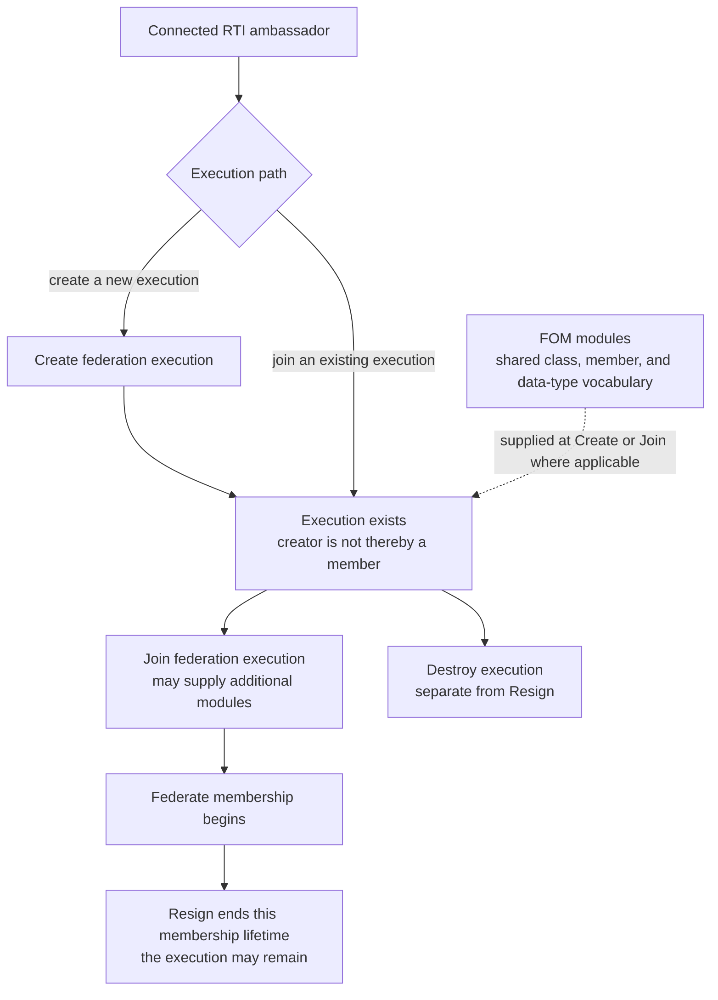
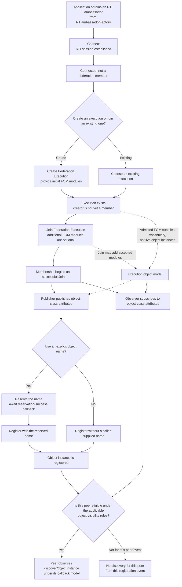
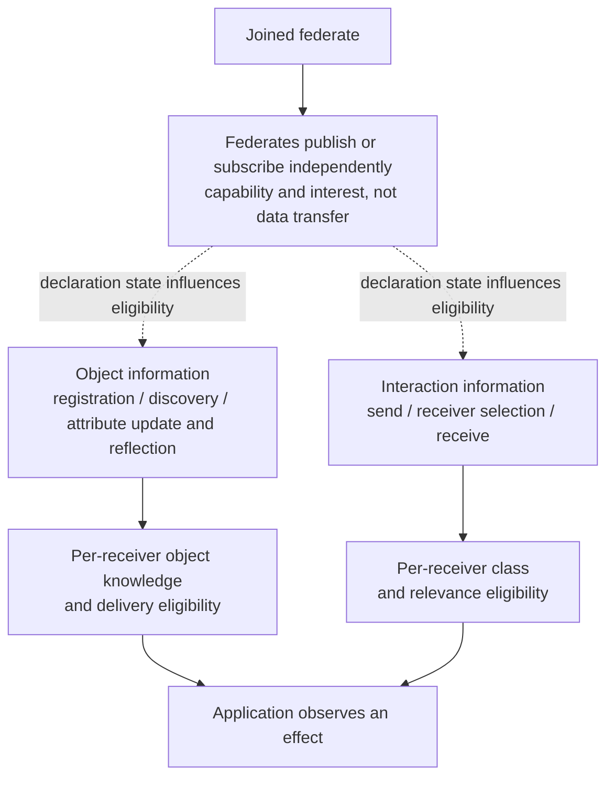

# HLA Behavior Flow Guides: Umbra Backlog

This is the living index for contributor-facing HLA flow diagrams in Umbra.
The guides explain difficult behavior before asking a reader to navigate the
implementation; they are not replacements for IEEE standards, implementation
contracts, or test evidence.

## Guide pattern and boundaries

Use the [2025 time-management guide](HLA-2025-TIME-MANAGEMENT-GUIDE.md) as the
first structural example. Each new guide should:

- State its API edition and implementation profile at the top. A 2010 guide
  must be separate from a 2025 guide; never combine state machines or imply
  compatibility unless that equivalence has been demonstrated.
- Use GitHub-renderable Mermaid diagrams, with service calls, callbacks, and
  state-commit points labeled. Prefer several cohesive diagrams over one
  all-encompassing chart.
- Separate standard concepts, current Umbra behavior, test observations, and
  known limits. The standard is normative; code and tests describe only the
  implementation and scenarios exercised.
- Apply a portability test to each primary diagram: could its actors, states,
  events, and observable effects still explain HLA if Umbra were replaced by a
  different RTI? Keep registry layouts, queues, callback dispatchers, and
  transport plumbing in a clearly labeled implementation mapping unless they
  establish a protocol invariant. Never promote a source-only implementation
  detail into a general HLA rule.
- Link implementation claims to the relevant source and focused tests. Treat
  a passing test as evidence for its scenario, not proof of complete support or
  conformance.
- Identify interactions with other areas (time, ownership, regions, save and
  restore) without silently absorbing those state machines into the guide.
- Keep this work in Umbra documentation. Any later translation into or
  expansion of the HLA Requirements Lab is a separate phase and is not part of
  this backlog's current authorization.

## Long-running goal and delivery phases

**Goal:** Turn the durable HLA logic and infrastructure concepts discovered
while implementing Umbra into clear, reader-centered diagrams and guides.
Explain what a federate can do, what state changes, which participants become
eligible, and when effects become observable—not merely how Umbra's C++ happens
to implement them. Use Umbra source and existing focused-test evidence to
ground examples, while keeping portable HLA concepts distinct from implementation
choices and exact normative claims. Lead with the durable HLA mental model;
include Umbra's internal state and architecture only when they explain an HLA
invariant, an observable consequence, or an important implementation limit.
Use the 2025 time-management guide as a quality and structure example, not as
the topic-selection bias: keep building equally clear guides for the other
major HLA behavior areas. Prefer synthesizing relationships that cross service
families when that resolves a real reader gap; improve a focused guide where
that is clearer. There is no diagram-count quota.

Deliver the goal in reviewable phases:

1. **Keep the map current.** Maintain the topic inventory, reader paths, and
   prioritized backlog here. A candidate area starts with a bounded comparison
   of existing guides, relevant implementation/profile boundaries, and focused
   tests; a missing method-name mention alone is not a gap.
2. **Translate implementation discoveries into durable HLA explanations.**
   Prioritize portable concepts and cross-cutting invariants that are hard to
   see in isolated requirements or service code. Use Umbra as a case study,
   not the subject of the explanation: translate each useful C++ discovery back
   into the HLA actors, protocol state, eligibility rules, and observation
   boundary it helps explain. Identify edition and profile boundaries; link
   existing source and focused-test evidence in a separate implementation
   mapping; and label source-only or unverified edges plainly. Reuse verified
   evidence; do not compile, rerun tests, or start CI for documentation work by default.
   Keep the main implementation worker's build capacity free. Request fresh
   runtime verification only when a material claim cannot be responsibly
   documented otherwise. Link adjacent guides instead of absorbing their state
   machines.
3. **Validate documentation proportionately.** Distinguish grammar acceptance
   from actual Markdown preview, visual inspection, and post-publication GitHub
   rendering. Keep each pending check visible and do not upgrade evidence based
   on a parser-only pass. Reuse already-verified focused-test evidence. Record
   setup/environment failures separately from assertions that ran. When the
   permitted preview path is unavailable, leave visual review pending and keep
   substantive HLA documentation moving; do not unlock the desktop or route
   around the restriction. Documentation-only increments do not justify
   competing C++ builds or CI runs.
4. **Close or disposition each backlog item.** An area is complete when its
   guide and diagrams meet the per-guide completion check below, or when the
   survey records why another standalone diagram would only duplicate existing
   coverage. Leave a concrete next handoff for anything still open.

IEEE 1516.1-2010 and IEEE 1516.1-2025 remain separate behavior streams, with
separate guides, source paths, and test evidence. The 2025 embedded and process
profiles are also distinguished where their behavior or evidence differs.
Shared explanations require evidence from every stream they purport to cover.
The eventual idea of adding richer diagrams to the HLA Requirements Lab is a
separate later goal: this work improves Umbra documentation only and makes no
Requirements Lab edits.

## Edition-boundary text audit — 2026-10-09

A bounded scan of the 29 current 2025 guides for `2010` and
`rti1516_2010` markers found only explicit separation notes, legacy-model input
or catalog-only compatibility descriptions, and clearly labeled parallel
implementation references. The DataElement guide's comparison diagram gives
2010 and 2025 separate subgraphs and source paths; it does not combine codec
behavior or tests. In particular, `fomEdition=2010` is described as a
compatibility input to the 2025 ambassador, not as the 2010 RTI stream. The
separate 2010 reference-RTI guide and the new 2010 encoding companion remain
edition-specific; neither is used to fill evidence gaps in a 2025 guide. This is
a documentation-marker review, not evidence of cross-edition equivalence;
future shared explanations still need direct evidence from both streams.

## 2010 scope resurvey — 2026-10-10

A bounded path inventory found eight test files with `2010` in their names;
these include both 2010 runtime smoke programs and external-FOM edition or
composition cases, so a filename alone does not establish 2010 RTI behavior.
The existing [2010 reference-RTI guide](HLA-2010-REFERENCE-RTI-FLOW-GUIDE.md)
already covers the supported process-local lifecycle, object and interaction
flows, callback behavior, and the source-only synchronization barrier; it also
marks time-managed execution and other absent services as unsupported. The
separate [2010 encoding guide](HLA-2010-DATA-ELEMENT-ENCODING-FLOW-GUIDE.md)
covers selected scalar and composite byte behavior. The 2010 RTI binding smoke
is a single `HLA_IMMEDIATE` integration scenario; the time and encoding files
are value/marshalling smoke programs, not evidence of a 2010 time-management
state machine.

The separate `external_2010_fom_catch2.cpp` cases exercise FOM validation and
composition or the 2025 API with a 2010 model input. They are useful edition-
boundary evidence, not behavior evidence for the separate 2010 reference RTI.
The synchronization flow has no focused 2010 test in this bounded inventory.
The current evidence does not justify another 2010 service-flow guide: it
would duplicate the bounded reference guide or borrow 2025 behavior. Keep the
sync test gap visible, do not re-enable 2010 CI, and revisit only when new
2010-specific implementation or focused evidence creates a distinct reader
need.

## 2025 callback/service-ordering survey — 2026-10-10

A bounded comparison of the pinned 2025 API, callback guide, dispatcher, and
existing focused tests found no missing reader-facing distinction that needs a
new diagram. The guide already explains the durable model—producing/accepting a
callback task is distinct from invoking it and from the application observing
it—then shows the different HLA_IMMEDIATE and HLA_EVOKED drain boundaries in
separate diagrams. The pinned API exposes those callback models, the Evoke
operations, and callback enable/disable services; its declarations alone are
not a substitute for normative service prose. As implementation evidence, the
dispatcher drains enabled immediate work from submission and only invokes
evoked work when an Evoke operation claims it. Existing unit tests cover
synchronous immediate dispatch/FIFO and one-at-a-time evoked dispatch; these
tests were inspected, not rerun. Keep the known gaps explicit: the public
FederationSynchronized integration does not assert exact service-specific
HLA_IMMEDIATE-before-return timing, and the generic dispatcher lacks a focused
throwing-task recovery case. Record this area as surveyed rather than adding a
duplicative synthesis. The next bounded topic was whether the 2025 exception-
reporting and service-invocation-reporting guides needed one portable account
of service outcome, report production, callback invocation, and observation;
that survey and its disposition are recorded below.

## 2025 service outcome/report survey — 2026-10-10

The exception-reporting and service-invocation-reporting guides already give
service-specific report families, selectors, recipients, profile boundaries,
and detailed source/test limits. The broader cross-cutting guide already had
portable milestones for request validity, state transition, effects, caller
result, and observation, but it did not connect those milestones around the
surprising case where reporting fails after a state commit or changes a public
failure result. A fifth synthesis flowchart now relates those traces and three
2025 case studies connect it to the existing guides; no new normative rule or
2010 claim is made. The combined process two-report schedule and timestamped
queue/report failure are source-derived; the switch-append test body did not
reach its assertions in the last recorded run. No C++ source changed and no
build, test, or CI was run. The later whole-worktree grammar pass recorded
below accepts this chart; it generated no SVG. Rendered-layout review remains
separate and pending.

### Cancellation, invalidation, and already-observed effects — 2026-10-10

The bounded 2025 comparison found a reader-facing distinction worth
synthesizing, but no universal cancellation rule. The cross-cutting guide now
has a decision lens that scopes work per operation/request/recipient, separates
committed/query-visible facts from callback phase, and asks whether pending
work is re-evaluated, withdrawn, invalidated, or preserved—or whether an
already-observed effect has a service-specific follow-up. Six examples link
per-attribute subscription eligibility, accepted object deletion and its
per-recipient removal gate, ordinary versus directed interaction publication
withdrawal, ownership cancellation on resignation, recipient-specific TSO
Retract, and member-route invalidation in lifecycle cleanup.

The chart is explanatory, not normative. Its evidence remains bounded to the
linked 2025 guides, selected embedded tests, and any explicitly source-derived
edges; it does not assert process parity, a complete resignation-action
matrix, or rollback semantics. No C++ build, test rerun, CI, or Requirements
Lab change was made. The later whole-worktree grammar pass recorded below
accepts this block; that pass generated no SVG. Permitted visual review remains
separate and pending in the review inventory.

### Durable image state, live routes, and participant lifetime — 2026-10-10

The bounded 2025 comparison found no need for another state-machine diagram.
The save/restore guide already distinguishes federate-owned application state,
the process-local snapshot, supported durable RTI records, callback
routes/closures, and route-free restart projection, with an explicit limit
against assuming arbitrary crash recovery. The ownership companion separately
models ledger, route, and membership; the lifecycle guide distinguishes the
ambassador connection, federate membership, and federation execution, then
records what remains after resignation. The cross-cutting guide now adds a
short reader map connecting those explanations. A new chart would repeat these
existing models rather than resolve a remaining gap.

Evidence is still limited to the linked 2025 implementation and focused-test
scopes; no 2010 or general RTI parity, arbitrary process restart, or blanket
portability of callback-bearing operations is claimed. No C++ build, test
rerun, CI, or Requirements Lab change was made.

### Participant-set changes across synchronization and save/restore — 2026-10-10

The bounded comparison found a genuine reader gap: the focused guides explain
each protocol, but do not make the participant-set difference visible beside
one another. The seventh 2025 cross-cutting diagram shows that this registry
defaults an empty synchronization set to current membership but expands on
later Join only when the set was omitted; resignation removes the member and
rechecks barrier completion. Restore admission instead checks the saved/current
roster before restore begins, while resignation during an active save or
restore fails the operation for survivors. Connection loss reuses the
forced-resignation cleanup path, but pending-protocol notification outcomes
remain source-derived without a focused loss/protocol cross-product test.

The source audit also found an unresolved Join edge. Both 2025 Join overloads
in the pinned interface list `SaveInProgress` and `RestoreInProgress`, but the
inspected embedded adapter, shared registry transaction, and process Join
handler have no matching operation-state gate. Save/restore participant-status
maps are initialized from the cohort present at operation start, and the Join
path does not update them. The bounded test search found no focused
Join-during-save/restore case. Treat this as an apparent API/source gap, not a
verified runtime outcome or confirmed conformance defect; the exact 2025
§4.11 conditions still need an authorized full-text check.

Evidence remains selected 2025 source and focused tests. Late-Join expansion,
the explicit-empty distinction, and restore-roster rejection are source-derived;
the focused synchronization and active save/restore resignation cases cover
only their named interleavings. Keep process evidence separate, claim no 2010
rule, and make no C++ build, test rerun, CI, or Requirements Lab change.

### 2025 attribute-ownership reader-model review — 2026-10-10

A bounded content review found no missing reader-facing ownership diagram in
the existing [2025 ownership guide](HLA-2025-ATTRIBUTE-OWNERSHIP-FLOW-GUIDE.md).
Its opening teaches per-object-attribute ownership, separates publication and
object knowledge from ownership, and makes accepted acquisition distinct from
the later transfer outcome. The existing flows then distinguish owner denial,
unconditional and negotiated divestiture, assumption offers, query snapshots,
and stale callback invalidation. Those are supported by linked focused
scenarios and are explicitly scoped to the selected 2025 profiles; a new
summary chart would repeat the current model. This was a documentation/source
survey only: no normative interpretation was added, and no C++ build, test
rerun, CI, or Requirements Lab change was made.

A follow-up boundary audit found one useful reader improvement without needing
another diagram: the If-Available and If-Wanted sections described service
acceptance, typed failures, callback outcomes, and ownership queries in separate
places. Added a compact comparison table to the
[ownership guide](HLA-2025-ATTRIBUTE-OWNERSHIP-FLOW-GUIDE.md#compare-the-call-per-attribute-outcome-and-observed-ownership).
It marks typed exceptions as synchronous service outcomes, then separately
compares per-attribute callbacks and `isAttributeOwnedByFederate` observations.
The exception names are examples from the pinned API and focused tests, not an
exhaustive matrix. The evidence is selected embedded `HLA_EVOKED` behavior;
process and 2010 parity remain unclaimed. No chart or diagram-count change;
no build, test rerun, CI, or Requirements Lab edit.

### 2025 DDM/regions reader-model review — 2026-10-10

A bounded learner review found one useful cross-topic seam that the DDM guide
stated in prose but had not diagrammed directly: regional scope, logical-time
eligibility, and application callback dispatch are separate questions. Added
a conceptual flow for one regional update or interaction and one receiver. It
shows that a region match alone does not prove callback delivery, receive-order
delivery does not use the TSO grant frontier, and a timestamp does not make a
disjoint regional path eligible. It leaves DDM evaluation/recheck timing
service-specific and explicitly says the arrows are not a universal internal
algorithm. The existing embedded and process examples remain separate evidence
cases; no 2010 behavior or profile parity is inferred.

The new flow passed the VS Code 1.141.0 Mermaid grammar parser, but no SVG or
screenshot was produced; local visual and GitHub-render review remain pending.
This was a documentation/source review only; no C++ build, test rerun, CI, or
Requirements Lab change was made.

### 2025 regional-interaction context and rejected-operation effects — 2026-10-10

A bounded reader review found a useful DDM distinction: a valid region handle
can still be incompatible with a particular interaction class because one of
its dimensions is not available to that class. Two separate embedded 2025
`HLA_EVOKED` tests exercise the sender and receiver sides. The send case rejects
a mixed valid/unavailable region set before any delivery is observed, then
delivers a valid-only send once. The subscription case rejects an unavailable-
dimension region, verifies a later send does not expose a hidden declaration,
then accepts a valid regional subscription and observes the later send.

Added an HLA-first flow to the [DDM guide](HLA-2025-DATA-DISTRIBUTION-AND-REGIONS-FLOW-GUIDE.md)
to show the shared class-dimension constraint and keep the two service effects
separate. The test comments point to §§9.1.3.3 and 9.1.4; the complete standard
text is unavailable here, so the prose does not enlarge those tested cases into
a universal transaction/rollback rule. The focused C++ test source was read,
not rerun. The new diagram has not yet had a fresh grammar or visual review;
there is no process or 2010 parity claim and no Requirements Lab change.

At this 2026-10-10 reader-review checkpoint, the inventory was 173 Mermaid blocks across 31 diagram-bearing guides:
86 flowcharts, 65 sequences, and 22 state diagrams. The separate 2010 stream
remains 10 diagrams; the 2025 set has 163. A fresh whole-docs VS Code 1.141.0
grammar pass accepted all 173 blocks, including the new DDM flow. It generated
no SVGs or screenshots. The earlier 178-block inventory is a previous
worktree snapshot, not the current count; visual/GitHub review is a separate
check.

### 2025 FOM admission/composition reader-model review — 2026-10-10

A bounded learner review found that the existing guide already makes the
important distinction clear: a module can pass DIF validation yet fail when
the ordered set is composed, when references are resolved against the complete
model, or when the resulting model is materialized and checked as an FDD. Its
separate Create and additional-module Join flows then show where the prepared
definition crosses into shared federation state. A fourth diagram would repeat
those stages rather than teach another durable HLA concept. Existing focused
tests cover cross-module reference resolution, an FDD-schema rejection, Create
failure without name reservation, and replacement-definition-plus-membership
commit; these sources/tests were inspected, not rerun. No C++ build, test rerun,
CI, Requirements Lab edit, or 2010 behavior claim was made. Corrected the
official IEEE 1516.2-2025 product link after checking the IEEE SA listing.

### 2025 order/transportation reader-model review — 2026-10-10

A bounded review confirmed the guide already separates sender-selected order
from the transportation category, receiver relevance, and time-management
eligibility. One useful test-backed nuance was less visible in the diagram:
calling a timestamped update/send service does not, by itself, establish that
the receiver observes a TSO event. The existing order-control test sets the
publisher's effective interaction order to `RECEIVE`, supplies a logical-time
argument, and observes receive-order metadata with no valid retraction handle.
Added that as an explicitly embedded-2025 test example in the delivery flow;
it is not presented as an independent normative interpretation. The existing
change-lifecycle and query diagrams already cover the other distinct reader
questions, so no additional diagram was needed. Source and focused-test evidence
were inspected, not rerun. No C++ build, test, CI, 2010 claim, or Requirements
Lab change was made. The added sequence note uses Mermaid's documented
multi-participant note and line-break syntax; no local visual render was made,
so visual and post-publication GitHub review remain pending.

Next bounded candidate: compare the 2025 publication/subscription, relevance,
and attribute-scope guides for a concise HLA-first explanation of declaration
changes versus class- and instance-level advisories. Keep current eligibility
and callback gates separate, avoid repeating the DDM/time diagrams, and create
or revise a flow only if the comparison exposes a real learner gap. Reuse
existing evidence and do not run C++ builds, tests, or CI by default.

### 2025 subscription and advisory reader-model review — 2026-10-10

A bounded comparison of the object-attribute subscription, declaration and
attribute relevance, and Attribute Scope guides found the distinctions already
explicit: subscription declarations are receiver state; class-level relevance
is reported to a publisher; object-attribute relevance is reported to an owner;
scope changes are reported to the receiving federate; and none of those
advisories is the attribute-value update itself. The relevance guide already
shows a subscription mutation feeding independent class and attribute
calculations, with discovery and scope planning kept separate. The scope guide
has the four-signal comparison; the subscription guide owns active/passive
declaration state. Current source paths and focused cases support these
separate lanes, while the cited profile and test limits are clearly labeled.
No combined chart would add a new state transition without duplicating those
guides, so no diagram was added. Source and test evidence were inspected, not
rerun; no C++ build, CI, 2010 claim, or Requirements Lab change was made.

Next bounded candidate: review the 2025 names/handle guide for a junior-friendly
distinction between declaration names, execution/member-scoped identities,
category-typed opaque API handles, and encoded handle values. Keep HLA API
semantics separate from Umbra's internal integer representation; add a flow
only if the current prose/diagrams leave a real learner gap. Reuse pinned API,
source, and existing test evidence without rebuilding or rerunning tests.

### 2025 HLA-first timing and reporting reader review — 2026-10-10

The time guide already puts the portable role, request, and grant mental model
before Umbra's effective-target, frontier, queue, and callback-policy details;
the existing diagrams and labels maintain that boundary, so no additional
timing chart was justified. The exception-reporting guide distinguishes
`HLAreportServiceInvocation`, `HLAreportException`, and
`HLAreportMOMexception`, while the cross-cutting guide separately connects the
service result, state effect, report path, and observer visibility. Together,
they already teach the difference between a thrown service exception and an
independent report; another combined diagram would duplicate the existing
model.

A bounded inventory of the six service-group headings in the pinned 2025
[RTIambassador.h](../../third_party/ieee1516.1-2025/include/RTI/RTIambassador.h)
found contributor-guide families for Federation Management,
Declaration Management, Object Management, Ownership Management, Time
Management, and RTI Support Services. This is topic-level navigation coverage,
not a claim that every service, overload, exception, or implementation profile
is documented. No source or tests were changed or rerun, and no C++ build, CI,
2010 behavior claim, or Requirements Lab edit was made.

Next bounded candidate: audit the 2025 object-instance deletion/removal flow
against the existing object-information, ownership, and time guides. Separate
ordinary deletion from timestamped deletion, receiver-known/removal effects,
ownership consequences, and time/retraction gates. Reuse existing evidence and
revise a flow only for a concrete HLA learner gap; do not build or rerun tests.

### 2025 Declaration Management publication-withdrawal review — 2026-10-10

A bounded method-level review of the pinned 2025 Declaration Management group
confirmed existing guide coverage for publication/subscription, active/passive
state, relevance, regional scope, directed interactions, delayed evaluation,
Auto Provide, update-rate admission, and explicit attribute-value requests.
One real reader gap remained: ordinary object-class publication withdrawal
has an ownership consequence that was not visible in the object/interaction
overview. Added a focused 2025 embedded flow to
[that guide](HLA-2025-OBJECT-AND-INTERACTION-INFORMATION-FLOW-GUIDE.md):
selected versus whole-class withdrawal, superclass/subclass declaration
separation, the pending-acquisition rejection, ownership removal on matching
instances, and profile-specific metadata cleanup.

The pinned API declares `OwnershipAcquisitionPending` for the §5.3 withdrawal
services. The existing class-hierarchy case exercises withdrawal at a subclass
while a superclass publication remains; the pending-acquisition case observes
rejection. The registry source maps the guard and owner-loss rule to §5.3.3 and
shows the associated update-region/transportation/order cleanup, but the cited
tests do not assert each cleanup postcondition. The process adapter forwards
the services; the new explanation makes no process/embedded parity claim. The
new Mermaid flow has not yet been parser- or visually reviewed. No C++ build,
test rerun, CI, 2010 behavior claim, or Requirements Lab edit was made.

The follow-up ordinary interaction review found a second, distinct boundary.
In the current embedded path, `planReceiveOrderInteraction` checks publication
before acceptance; ordinary callback dispatch later rechecks the receiver's
eligibility and projection, not the sender's publication set. An unpublish
between acceptance and `HLA_EVOKED` callback dispatch therefore does not itself
fence that ordinary queued route in the inspected code. The separate directed
path explicitly rechecks its publication pair at callback time, and its focused
case covers suppression after withdrawal. Added a source-labeled ordinary
send/unpublish/evoke sequence to the object/interaction guide and connected the
contrast to the cross-cutting stale-work lens. No focused ordinary
send → unpublish → evoke test was found, so that behavior remains source-only;
no IEEE-wide rule, process parity, or 2010 behavior is asserted.

The four new 2025 diagrams—the object-class publication-withdrawal flow,
ordinary interaction unpublish-after-acceptance sequence, save/restore
responsibility map, and federation/federate lifecycle map—subsequently passed
targeted, non-rendering Mermaid grammar parsing with the installed VS Code
1.141.0 modules. The ordinary sequence's semicolon label was changed to a
comma after the parser identified it as a statement separator. This confirms
grammar acceptance only: no SVG or screenshot was generated, so visual layout
and GitHub rendering remain pending. No C++ build, test rerun, CI, 2010
behavior claim, or Requirements Lab edit was made.

## Suggested reader paths

The guides are standalone topic explanations. These paths are a navigation
aid, not a claim that adjacent topics are one normative state machine or that
the implementation profiles are equivalent.

### A conceptual map of one HLA federation execution (2025)

This is an application-facing orientation, not a required call sequence. Two
different questions are shown separately: how an execution and its members
come into and leave existence, and how joined federates exchange information.
Arrows show relationships, not one required per-federate script; use the
focused guides for each service's exact rules.

#### Execution model and member lifetime

Creation establishes an execution; it does not make the creator a member.
Join creates the member relationship, and Resign ends that member lifetime.
Destroy is a distinct execution-lifecycle operation. FOM modules provide
vocabulary for the execution and may be supplied through the applicable
Create/Join path. The [lifecycle](HLA-2025-FEDERATION-AND-FEDERATE-LIFECYCLE-FLOW-GUIDE.md)
and [FOM composition](HLA-2025-FOM-MODULE-ADMISSION-AND-COMPOSITION-FLOW-GUIDE.md)
guides define the detailed boundaries.

#### From ambassador construction to observer discovery

This 2025-only orientation joins five focused reader paths without replacing
their service rules. It is not a required script for every federate: the
publisher and observer roles may be different members, and the arrows show
prerequisites rather than a total call order. FOM admission supplies the
class/attribute vocabulary; it does not create object instances. An explicit
name is optional, reservation success is not registration, and discovery is
not a value reflection.

This is a synthesis of separate API/service examples, not one end-to-end test.
The pinned API landmarks are [factory construction](../../third_party/ieee1516.1-2025/include/RTI/RTIambassadorFactory.h#L34),
[Connect](../../third_party/ieee1516.1-2025/include/RTI/RTIambassador.h#L55),
[Create](../../third_party/ieee1516.1-2025/include/RTI/RTIambassador.h#L128),
[Join](../../third_party/ieee1516.1-2025/include/RTI/RTIambassador.h#L212),
[name reservation](../../third_party/ieee1516.1-2025/include/RTI/RTIambassador.h#L647),
[registration](../../third_party/ieee1516.1-2025/include/RTI/RTIambassador.h#L697),
and [discovery callback](../../third_party/ieee1516.1-2025/include/RTI/FederateAmbassador.h#L229).
Focused examples are the [Connect/Create/Join lifecycle case](../../cpp/tests/ieee1516_2025_federation_resign_lifecycle_catch2.cpp#L4),
[reservation](../../cpp/tests/object_instance_name_reservation_catch2.cpp#L95),
[named registration](../../cpp/tests/object_instance_named_registration_catch2.cpp#L93),
and [registration/discovery](../../cpp/tests/object_instance_registration_discovery_catch2.cpp#L78)
cases. They cover different slices and profiles; they do not assert this whole
sequence or all normative discovery-eligibility rules. The detailed [connection](HLA-2025-CONNECTION-AND-CONFIGURATION-FLOW-GUIDE.md),
[lifecycle](HLA-2025-FEDERATION-AND-FEDERATE-LIFECYCLE-FLOW-GUIDE.md),
[FOM admission](HLA-2025-FOM-MODULE-ADMISSION-AND-COMPOSITION-FLOW-GUIDE.md),
[name reservation](HLA-2025-OBJECT-INSTANCE-NAME-RESERVATION-FLOW-GUIDE.md),
and [object information](HLA-2025-OBJECT-AND-INTERACTION-INFORMATION-FLOW-GUIDE.md)
guides retain their separate evidence and profile boundaries. This chart does
not describe the 2010 stream or claim embedded/process callback parity.

#### Information paths and application observation

The object and interaction branches are not interchangeable. Discovery and
known-object state matter to object services; interaction delivery has its own
class and relevance rules. Regions, time/order, and callback model can further
constrain delivery or observation only where the selected service uses them.
See the [object/interaction information](HLA-2025-OBJECT-AND-INTERACTION-INFORMATION-FLOW-GUIDE.md),
[callback/service-ordering](HLA-2025-CALLBACK-AND-SERVICE-ORDERING-FLOW-GUIDE.md),
[time-management](HLA-2025-TIME-MANAGEMENT-GUIDE.md), and
[DDM/regions](HLA-2025-DATA-DISTRIBUTION-AND-REGIONS-FLOW-GUIDE.md) guides.
This overview is 2025-only; it does not summarize the separate 2010 stream or
assert embedded/process parity.

### Navigate by the IEEE 1516.1-2025 API service family

The pinned public `RTIambassador` interface groups services by family. Use this
map to find a reader path; a row is not a method-by-method coverage claim, and
the guides intentionally link across families where one HLA behavior crosses
service boundaries.

| Public API family | Reader path |
| --- | --- |
| Federation Management Services | [Connection and configuration](HLA-2025-CONNECTION-AND-CONFIGURATION-FLOW-GUIDE.md), [federation and federate lifecycle](HLA-2025-FEDERATION-AND-FEDERATE-LIFECYCLE-FLOW-GUIDE.md), [FOM admission and composition](HLA-2025-FOM-MODULE-ADMISSION-AND-COMPOSITION-FLOW-GUIDE.md), [synchronization points](HLA-2025-FEDERATION-SYNCHRONIZATION-FLOW-GUIDE.md), [save and restore](HLA-2025-FEDERATION-SAVE-RESTORE-FLOW-GUIDE.md), and [federation-scoped MOM](HLA-2025-FEDERATION-MOM-FLOW-GUIDE.md). |
| Declaration Management Services | [Object and interaction information](HLA-2025-OBJECT-AND-INTERACTION-INFORMATION-FLOW-GUIDE.md), [object-attribute subscription state](HLA-2025-OBJECT-ATTRIBUTE-SUBSCRIPTION-STATE-FLOW-GUIDE.md), [relevance advisories](HLA-2025-RELEVANCE-ADVISORY-FLOW-GUIDE.md), [Attribute Scope Advisory](HLA-2025-ATTRIBUTE-SCOPE-ADVISORY-FLOW-GUIDE.md), [Auto Provide](HLA-2025-AUTO-PROVIDE-FLOW-GUIDE.md), and [Delay Subscription Evaluation](HLA-2025-DELAY-SUBSCRIPTION-EVALUATION-FLOW-GUIDE.md). |
| Object Management Services | [Object and interaction information](HLA-2025-OBJECT-AND-INTERACTION-INFORMATION-FLOW-GUIDE.md), [object-instance name reservation](HLA-2025-OBJECT-INSTANCE-NAME-RESERVATION-FLOW-GUIDE.md), [attribute-value update requests](HLA-2025-ATTRIBUTE-VALUE-UPDATE-REQUEST-FLOW-GUIDE.md), [directed interactions](HLA-2025-DIRECTED-INTERACTION-FLOW-GUIDE.md), [order and transportation](HLA-2025-ORDER-AND-TRANSPORTATION-FLOW-GUIDE.md), and [TSO retraction](HLA-2025-TSO-RETRACTION-FLOW-GUIDE.md). |
| Ownership Management Services | [Attribute ownership](HLA-2025-ATTRIBUTE-OWNERSHIP-FLOW-GUIDE.md) explains pending acquisition, owner response, If Available, cancellation confirmation, Divestiture If Wanted's output-set result versus later notification, and ownership queries; [ownership persistence and resignation](HLA-2025-OWNERSHIP-PERSISTENCE-AND-RESIGNATION-FLOW-GUIDE.md) covers selected pending work across those boundaries. |
| Time Management Services | [Time management](HLA-2025-TIME-MANAGEMENT-GUIDE.md), with adjacent [TSO retraction](HLA-2025-TSO-RETRACTION-FLOW-GUIDE.md) and [attribute update-rate admission](HLA-2025-ATTRIBUTE-UPDATE-RATE-ADMISSION-FLOW-GUIDE.md) for their own service-specific interactions with time. |
| Data Distribution Management | [DDM and regions](HLA-2025-DATA-DISTRIBUTION-AND-REGIONS-FLOW-GUIDE.md) and the regional paths in [object and interaction information](HLA-2025-OBJECT-AND-INTERACTION-INFORMATION-FLOW-GUIDE.md). |
| RTI Support Services | The cross-cutting [switch-control map](HLA-2025-CROSS-CUTTING-STATE-EVENT-OBSERVATION-GUIDE.md#a-support-switch-has-an-owner-a-lifetime-and-a-control-surface) distinguishes static federation policy, federation-wide Auto Provide mutation through the MOM path, Join-seeded member defaults, and member-local controls, then asks when each consuming service samples the value and how its effect becomes observable. Follow [names and handle resolution](HLA-2025-NAME-AND-HANDLE-RESOLUTION-FLOW-GUIDE.md), [callback](HLA-2025-CALLBACK-AND-SERVICE-ORDERING-FLOW-GUIDE.md), [update-rate](HLA-2025-ATTRIBUTE-UPDATE-RATE-ADMISSION-FLOW-GUIDE.md), [advisory](HLA-2025-RELEVANCE-ADVISORY-FLOW-GUIDE.md), [exception-reporting](HLA-2025-EXCEPTION-REPORTING-FLOW-GUIDE.md), and [service-invocation-reporting](HLA-2025-SERVICE-INVOCATION-REPORTING-FLOW-GUIDE.md) for operation-specific rules. |
| API-specific services | [Time management](HLA-2025-TIME-MANAGEMENT-GUIDE.md) explains the federation-selected logical-time representation and `getTimeFactory`; [DataElement encoding](HLA-2025-DATA-ELEMENT-ENCODING-FLOW-GUIDE.md) covers the logical-time element codec handoff; [names and handle resolution](HLA-2025-NAME-AND-HANDLE-RESOLUTION-FLOW-GUIDE.md) covers typed-handle value boundaries. |

This index follows the 2025 API grouping only. Read the separate 2010 guides
on their own; this family map does not infer 2010 behavior or parity.

- **A portable way to reason across HLA services:** begin with the
  [cross-cutting state, event, and observation model](HLA-2025-CROSS-CUTTING-STATE-EVENT-OBSERVATION-GUIDE.md),
  then use the focused time-management, object/interaction, DDM, and callback
  guides for operation-specific rules. Its examples are 2025-only and do not
  bridge the separate 2010 stream.
- **From ambassador construction to a first eligible object observer** (2025
  reading path, not a required call sequence):
  [connection/configuration](HLA-2025-CONNECTION-AND-CONFIGURATION-FLOW-GUIDE.md)
  → [authorization](HLA-2025-AUTHORIZATION-FLOW-GUIDE.md) →
  [federation lifecycle](HLA-2025-FEDERATION-AND-FEDERATE-LIFECYCLE-FLOW-GUIDE.md)
  → [FOM admission/composition](HLA-2025-FOM-MODULE-ADMISSION-AND-COMPOSITION-FLOW-GUIDE.md)
  → [object/interaction information](HLA-2025-OBJECT-AND-INTERACTION-INFORMATION-FLOW-GUIDE.md).
  Create and Join remain distinct execution/member transitions, and discovery
  is a per-receiver eligibility effect, not an automatic consequence of Join.
  Read [name reservation](HLA-2025-OBJECT-INSTANCE-NAME-RESERVATION-FLOW-GUIDE.md)
  alongside registration only for the optional named-registration path:
  unnamed registration has no reservation step, and a reservation neither
  creates an instance nor notifies peers. Continue to [federation-scoped MOM](HLA-2025-FEDERATION-MOM-FLOW-GUIDE.md)
  → [joined-federate MOM lifecycle](HLA-2025-JOINED-FEDERATE-MOM-OBJECT-LIFECYCLE-FLOW-GUIDE.md)
  when studying RTI-owned management objects. The focused guides define each
  boundary and its evidence.
- **Connection, membership, and execution are separate:** [Connect, Disconnect, and configuration](HLA-2025-CONNECTION-AND-CONFIGURATION-FLOW-GUIDE.md) explains the local RTI session gates; [authorization and credentials](HLA-2025-AUTHORIZATION-FLOW-GUIDE.md) follows the 2025 authorizer from Connect through Create/Destroy/Join and distinguishes the typed credential envelope from authorizer-specific policy; [federation lifecycle](HLA-2025-FEDERATION-AND-FEDERATE-LIFECYCLE-FLOW-GUIDE.md) distinguishes Connect/Disconnect, Join/Resign, and Create/Destroy, including rejoining on the same connected ambassador in one focused embedded case.
- **Why an attribute update reached a federate:** start with the cross-cutting [attribute-value concept map](HLA-2025-CROSS-CUTTING-STATE-EVENT-OBSERVATION-GUIDE.md#an-object-attribute-value-touches-several-independent-boundaries), then use the [delivery and observation checklist](HLA-2025-CROSS-CUTTING-STATE-EVENT-OBSERVATION-GUIDE.md#keep-delivery-and-observation-questions-separate). The focused guides distinguish publication and per-instance ownership, receiver knowledge and subscription/DDM, optional solicitation, update-rate admission, logical-time eligibility, and callback observation; follow only the gates relevant to the service. Begin with [object/interaction information](HLA-2025-OBJECT-AND-INTERACTION-INFORMATION-FLOW-GUIDE.md), then choose [subscription state](HLA-2025-OBJECT-ATTRIBUTE-SUBSCRIPTION-STATE-FLOW-GUIDE.md), [attribute-value requests](HLA-2025-ATTRIBUTE-VALUE-UPDATE-REQUEST-FLOW-GUIDE.md), [ownership transfer](HLA-2025-ATTRIBUTE-OWNERSHIP-FLOW-GUIDE.md), [DDM/regions](HLA-2025-DATA-DISTRIBUTION-AND-REGIONS-FLOW-GUIDE.md), [update-rate admission](HLA-2025-ATTRIBUTE-UPDATE-RATE-ADMISSION-FLOW-GUIDE.md), [time management](HLA-2025-TIME-MANAGEMENT-GUIDE.md), or [callback/service ordering](HLA-2025-CALLBACK-AND-SERVICE-ORDERING-FLOW-GUIDE.md) as needed. For broader update/interaction routing and advisory paths, see [relevance advisories](HLA-2025-RELEVANCE-ADVISORY-FLOW-GUIDE.md), [attribute scope](HLA-2025-ATTRIBUTE-SCOPE-ADVISORY-FLOW-GUIDE.md), [Auto Provide](HLA-2025-AUTO-PROVIDE-FLOW-GUIDE.md), [Delay Subscription Evaluation](HLA-2025-DELAY-SUBSCRIPTION-EVALUATION-FLOW-GUIDE.md), or [directed interactions](HLA-2025-DIRECTED-INTERACTION-FLOW-GUIDE.md).
- **How timestamp, order, transport, callbacks, and retraction relate:** [time management](HLA-2025-TIME-MANAGEMENT-GUIDE.md) → [callback/service ordering](HLA-2025-CALLBACK-AND-SERVICE-ORDERING-FLOW-GUIDE.md) → [order and transportation](HLA-2025-ORDER-AND-TRANSPORTATION-FLOW-GUIDE.md) → [TSO retraction](HLA-2025-TSO-RETRACTION-FLOW-GUIDE.md). Then read [DSE](HLA-2025-DELAY-SUBSCRIPTION-EVALUATION-FLOW-GUIDE.md) or [directed interactions](HLA-2025-DIRECTED-INTERACTION-FLOW-GUIDE.md) for their recipient boundaries.
- **What happens when in-flight work becomes stale:** start with the cross-cutting guide's [withdraw/invalidate/preserve/account lens](HLA-2025-CROSS-CUTTING-STATE-EVENT-OBSERVATION-GUIDE.md#when-work-becomes-stale-withdraw-invalidate-preserve-or-account), then follow the service-specific subscription, ownership/resignation, TSO-retraction, or lifecycle guide. For a queued regional TSO interaction after the receiver replaces its subscription, see the DDM guide's [bounded no-retarget trace](HLA-2025-DATA-DISTRIBUTION-AND-REGIONS-FLOW-GUIDE.md#a-replacement-regional-interaction-subscription-does-not-retarget-queued-tso-work). Do not merge their cancellation and observation rules.
- **How a service and callback cross the 2025 process endpoint:** [process request/callback flow](HLA-2025-PROCESS-ENDPOINT-REQUEST-AND-CALLBACK-FLOW-GUIDE.md) separates private request correlation, pushed frames, explicit receive polling, callback-model dispatch, the per-recipient TSO callback-acknowledgment seam, and the source-derived poll-family priority versus pushed-stream FIFO distinction.
- **Which protocol result am I waiting for, and when can the app observe it?** Use the cross-cutting [completion-boundary map](HLA-2025-CROSS-CUTTING-STATE-EVENT-OBSERVATION-GUIDE.md#different-protocols-have-different-completion-boundaries) to keep time-advance, synchronization, and save/restore outcomes distinct from callback dispatch; then follow [federation lifecycle](HLA-2025-FEDERATION-AND-FEDERATE-LIFECYCLE-FLOW-GUIDE.md) → [synchronization points](HLA-2025-FEDERATION-SYNCHRONIZATION-FLOW-GUIDE.md) → [save/restore](HLA-2025-FEDERATION-SAVE-RESTORE-FLOW-GUIDE.md), including a bounded embedded trace of a live regional TSO interaction → [ownership persistence and resignation](HLA-2025-OWNERSHIP-PERSISTENCE-AND-RESIGNATION-FLOW-GUIDE.md) → [joined-federate MOM lifecycle](HLA-2025-JOINED-FEDERATE-MOM-OBJECT-LIFECYCLE-FLOW-GUIDE.md); add [TSO retraction](HLA-2025-TSO-RETRACTION-FLOW-GUIDE.md) when in-flight timestamped work is involved.
- **How a failure becomes a report or callback:** begin with the cross-cutting guide's [service-result/state/report distinction](HLA-2025-CROSS-CUTTING-STATE-EVENT-OBSERVATION-GUIDE.md#a-service-result-committed-state-and-a-report-are-separate-traces), then follow [exception reporting](HLA-2025-EXCEPTION-REPORTING-FLOW-GUIDE.md) → [service invocation reporting](HLA-2025-SERVICE-INVOCATION-REPORTING-FLOW-GUIDE.md) → [callback/service ordering](HLA-2025-CALLBACK-AND-SERVICE-ORDERING-FLOW-GUIDE.md) for the separate mechanisms and callback boundary.
- **Why a set-valued operation may have partial or all-or-nothing outcomes:** start with the cross-cutting [service-contract versus argument-shape map](HLA-2025-CROSS-CUTTING-STATE-EVENT-OBSERVATION-GUIDE.md), then compare the [name-reservation](HLA-2025-OBJECT-INSTANCE-NAME-RESERVATION-FLOW-GUIDE.md), [FOM composition](HLA-2025-FOM-MODULE-ADMISSION-AND-COMPOSITION-FLOW-GUIDE.md), and [attribute ownership](HLA-2025-ATTRIBUTE-OWNERSHIP-FLOW-GUIDE.md) guides. Read outcomes from each service contract; Umbra's state-commit units are profile-specific examples, not semantics inferred from the argument's shape.
- **Model declarations, identity, and encoded values:** Begin with the 2025 cross-cutting guide's model-vocabulary/runtime-state distinction, then use [FOM module admission/composition](HLA-2025-FOM-MODULE-ADMISSION-AND-COMPOSITION-FLOW-GUIDE.md) for model assembly; [names and handle resolution](HLA-2025-NAME-AND-HANDLE-RESOLUTION-FLOW-GUIDE.md) for typed lookup, active federate names, and known-object scope; [object-instance name reservation](HLA-2025-OBJECT-INSTANCE-NAME-RESERVATION-FLOW-GUIDE.md) for the distinct owner-reservation and peer-discovery paths; and [2025 DataElement encoding](HLA-2025-DATA-ELEMENT-ENCODING-FLOW-GUIDE.md) plus its [separate 2010 companion](HLA-2010-DATA-ELEMENT-ENCODING-FLOW-GUIDE.md) for edition-specific public C++ value bytes. Keep model representation, API encoding, and RTI transport framing distinct.
- **Bounded 2010 reference behavior:** read the [separate 2010 reference-RTI guide](HLA-2010-REFERENCE-RTI-FLOW-GUIDE.md) on its own. The 2025 paths above are not evidence of 2010 behavior.

## Local Mermaid rendering and syntax audit

The dated static fence census (2026-10-11 working-tree scan) found 247 Mermaid
diagrams across 34 diagram-bearing Markdown files (41 design Markdown files
total). Count both backtick and tilde Mermaid fences. This counts fenced
blocks only; it does not establish syntax validity, rendering, visual review,
or GitHub presentation. A bounded recount on 2026-10-12 after the new
Federation MOM observation-path flowchart found 256 diagrams at that time
across 34 of 43 design Markdown files: 14 in the separate 2010 guides, 227 in
2025 topic guides, and 15 in the cross-cutting guide and this index. Types at
that time were 148 flowcharts, 85 sequence diagrams, and 23 state diagrams.

A fresh 2026-10-14 working-tree census counts 299 Mermaid fences in 34 of 43
design Markdown files: 16 diagrams in the separate 2010 guides, 267 in 2025
topic guides, 13 in the cross-cutting guide, and 3 in this index. The current
diagram types are 169 flowcharts, 107 sequence diagrams, and 23 state diagrams.
This is a source-fence count, not a syntax, rendering, or whole-tree visual
review result.

The successful local render evidence is a historical 247-diagram snapshot
(the 242-chart baseline plus five later charts), not a render of today's exact
299 source fences. On 2026-10-14, Mermaid CLI 12.0.0 rendered all six charts in
the Attribute Value Update Request guide; the new process-path comparison was
visually reviewed. This is targeted coverage, not a whole-tree render. Do not
infer an exact pending-chart count from the historical render totals: edits to
existing charts also make old renders stale, while some charts have separate
targeted rerender evidence. The review
ledger records evidence by chart; without a current source-to-render manifest,
no exact current pending count is claimed. The new process attribute DSE chart
has no syntax/render or visual verdict because Mermaid CLI could not launch its
browser (exit code 2147483651). The living backlog's historical
reader-gap notes have been moved to the non-diagram
[progress log](HLA-BEHAVIOR-FLOW-GUIDES-PROGRESS-LOG.md).

- The separate 2010 guides contain 16 diagrams across 2 files.
- The 2025-specific topic guides contain 267 diagrams across 30 files.
- The cross-cutting guide and this index contain 16 reader-model/navigation
  flowcharts across 2 files; these do not assert edition-specific behavior.

Overall there are 169 flowcharts, 107 sequence diagrams, and 23 state diagrams.
The 2026-10-11 local Mermaid CLI 12.0.0 pass rendered the 242-block baseline;
five later charts were separately rendered and screenshot-reviewed, producing
the historical 247-block evidence set. On 2026-10-12, a fresh source-fence
inventory, before the timestamped-deletion chart was added, counted the
then-current set as 14 2010 diagrams,
223 2025 topic-guide diagrams, 13 cross-cutting-guide diagrams, and 2 index
diagrams. A full current-set render was attempted with the already available
Mermaid CLI 12.0.0, but Puppeteer/Chrome could not launch: it reported an
already-running browser profile and then a Windows account-launch error, even
with a fresh profile under the permitted validation workspace. No SVGs were
produced, so this attempt establishes neither current render nor syntax
coverage. Existing chart-specific evidence remains valid only for the exact
source snapshot recorded in the review ledger.
Both fence styles were extracted explicitly because the CLI's Markdown mode
silently skips tilde fences. The pass found two existing 2025 semicolon-label
syntax errors; after correction, all six diagrams in the reservation guide
and all four in the process request/callback guide rendered. The 11 callback-
ordering diagrams rendered after the new exception sequence was reflowed.
One dense 2025 callback sequence and a separate 2010 DataElement flow were
visually inspected in the baseline review. The five charts that extended the
242-chart baseline to the historical 247-chart snapshot have their own
targeted screenshot review; this does not review later edits or additions.
GitHub rendering remains a separate post-publication check. Current local
render and screenshot status must be reconciled chart-by-chart in the review
ledger rather than inferred from aggregate counts.
No C++ build, test rerun, CI, or Requirements Lab work was performed.

The 2025 credential-envelope chart was locally rendered from its source
Markdown with Mermaid CLI 12.0.0 and visually inspected on 2026-10-11. All
four authorization-guide diagrams rendered as PNGs; this targeted check does
not establish GitHub rendering or validate the full diagram set. The review
ledger records the renderer setup and chart-specific status.
The temporal-admission/callback-entry synthesis chart was revised after a
source/test boundary review: it now distinguishes deferred receive-order work,
dispatcher-pending work, the temporary pending-advance gate, and the bounded
pre-grant callback observation. It is included in these counts and received a
targeted local Mermaid render and visual review on 2026-10-11. That review
caught unquoted parenthetical node labels; the `HLA_IMMEDIATE` endpoint now
states callback entry explicitly. At that chart-specific checkpoint, the
complete inventory had not yet been audited; the current full-set result is
recorded above. A prior whole-set non-rendering grammar pass accepted a
different 205-block snapshot and is historical, not the current result.
The eleven-item review queue below was recorded for an earlier 214-block
snapshot; it is historical evidence, not a current pending-review count. That
214 total has no saved per-file manifest, so the identity of the six-block
difference cannot be reconstructed from the totals. Reconcile current charts
against dated, chart-specific evidence before claiming their status. The
historical queue named the TSO strict producer-boundary
sequence, “Retract a regional update before three available-advance callbacks,”
the TSO ownership-change timeline, the support-switch map, the revised HLA
contract/outcome map, the reservation/peer-visibility synthesis, the revised
single-name reservation callback sequence (HLA_IMMEDIATE versus HLA_EVOKED),
the portable TSO-retraction outcome diagram, the cross-cutting attribute-value
map, the order/transportation orientation map, and the new HLA/API-to-process
identity map. The associated historical notes explicitly marked the first two
TSO sequences pending and recorded no review for the ownership timeline. These
are not asserted as current statuses; check the current chart and dated ledger
before treating any item as open. The
handle-keyed value-path map has now been locally rendered and screenshot-
reviewed; its HLA API container, typed member key, encoded value, and separate
tag boundaries are clear. It does not imply a wire-format or Umbra process-
frame contract. The DataElement representation-boundary map, the
HLA-first subscription-interest reader map, and the HLA/API authorization
admission map have been rendered and visually reviewed locally; GitHub
rendering remains open for all three. The DDM mixed-advance sequence and the
synchronization late-join chart and partial-result sequence have also been
rendered and screenshot-reviewed locally; their test/source-specific limits
remain explicit. Local visual review and post-publication GitHub rendering are
separate checks; individual status remains in the review ledger. Earlier
local-only syntax/layout corrections are separately tracked for rerender. On
2026-10-11, the installed Mermaid CLI and its matching Chrome headless shell
successfully rendered the four diagrams in the 2025 Authorization guide; the
credential-envelope diagram was screenshot-reviewed and its labels and paths
were legible without overlap. This is a targeted local visual check, not a
whole-set render or GitHub verification. No repository-derived diagram text
was sent to an external preview.
An earlier
197-block pass found and led to fixes for two malformed labels: a
parenthesized `HLAsetTiming` flowchart edge label and a semicolon in a
sequence-diagram note. The member-specific periodic-MOM cadence sequence,
current Join-boundary map, and time-representation/factory bridge were also
included in that earlier pass.
No SVGs or screenshots were produced; visual layout and GitHub rendering
remain unverified.

The following parser and inventory notes preserve historical checkpoints; the
205-fence result above is the latest whole-set grammar checkpoint, not a syntax
result for later 209-, 214-, or current 220-block inventories.

A non-rendering whole-docs grammar pass on 2026-10-10 accepted the previous
173-block snapshot using the Mermaid modules bundled with VS Code 1.141.0,
including the DDM scope/time/callback chart. Four later 2025 diagrams are not
included in that parser result or rendered: the object-class publication
withdrawal flow, ordinary interaction unpublish-after-acceptance sequence, and
the save/restore-responsibility and lifecycle-scope orientation flows. That
pass generated no SVGs or screenshots and did not establish layout or GitHub
parity. Older 178-block totals below describe a different earlier worktree
snapshot.

A later targeted VS Code 1.141.0 grammar pass accepted all four named blocks
above, including the ordinary-interaction sequence after its semicolon label
was changed to a comma. This pass did not render those diagrams. Since that
checkpoint, the two conceptual maps in this guide were visually inspected in
the local VS Code Markdown preview and displayed without Mermaid error panels.
That visual check covers only those two maps, not the then-current 188-block set;
GitHub rendering remains unverified. The recorded whole-worktree and targeted
parser results have not been reconciled against every current block. Do not
claim a fresh whole-set syntax pass or infer that any unmatched block is
invalid.

On 2026-10-10, an initial syntax sweep parsed all 155 blocks with the Mermaid grammar
modules bundled in VS Code 1.141.0: the separate 2010 set passed 10/10 (7
flowcharts and 3 sequences), and the 2025 set passed 145/145 (70 flowcharts,
53 sequences, and 22 state diagrams). The first sweep exposed five sequence
charts with semicolon-separated prose and one authorization flowchart with
unquoted function-call labels; those source blocks were corrected before the
clean rerun. The parser ran in a non-rendering Node harness with a minimal
DOMPurify shim. The initial sweep established grammar acceptance only; it
generated no SVGs or screenshots and did not prove preview layout readability.
A current sequence-only rerun on 2026-10-10 accepted all 65 sequence blocks
with the VS Code 1.141.0 bundled grammar: 3 in the separate 2010 guides and
62 in 2025 guides. It caught a semicolon-delimited label in the new process-
endpoint DDM sequence; the Mermaid label punctuation was repaired and the
complete set then passed 65/65. This parser-only rerun generated no SVGs or
screenshots and did not prove rendered readability. A whole-set grammar pass
on the current inventory then accepted all 165 blocks using the same VS Code
1.141.0 Mermaid modules with a minimal browser/DOMPurify shim: 78 flowcharts,
65 sequences, and 22 state diagrams. The separate 2010 stream passed 7
flowcharts and 3 sequences (10 total); 2025 passed 71 flowcharts, 62
sequences, and 22 state diagrams (155 total). This establishes parser
acceptance only; it generated no SVGs or screenshots and does not prove
GitHub rendering or visual readability. The first four diagrams in the
cross-cutting state/event guide were separately parsed with the same VS Code
1.141.0 Mermaid grammar modules, bringing the recorded inventory to 169. Later
2026-10-10 static scans counted 172 blocks across 31 guides, then 178 across
33 diagram-bearing guides. A fresh 2026-10-10 VS Code 1.141.0 grammar pass
accepted that 178-block snapshot (87 flowcharts,
67 sequences, 24 state diagrams; 2010: 10, 2025: 168). It generated no SVGs or
screenshots, so rendered layout and GitHub parity remain unverified.
An earlier post-clarification run on 2026-10-10 reaccepted all 165 then-current
blocks with the same bundled grammar (78 flowcharts, 65 sequences, and 22
state diagrams). A fresh whole-worktree parser pass on 2026-10-10 accepted all
169 blocks in the inventory at that time (82 flowcharts, 65 sequences, and 22
state diagrams) using the VS Code Mermaid module in a non-rendering Node
harness with a minimal DOMPurify shim. It generated no SVGs or screenshots:
grammar acceptance does not establish GitHub rendering or visual readability.
The two chart-boundary revisions described below first brought the total to
157. The evidence-backed regional-TSO restore trace brought it to 158; the
timed directed-TSO restore trace brought it to 159. Two additional 2025
object-deletion restore traces brought the total at that point to 161: 78
flowcharts, 61 sequences, and 22 state diagrams (2010 remains 10/10; 2025 is
151). The test-shaped producer-boundary trace in the TSO-retraction guide adds
one 2025 sequence, bringing the total to 162 (78 flowcharts, 62 sequences,
22 state diagrams; 2010 remains 10/10; 2025 is now 152).

A first preview attempt on 2026-10-10 found no open app or browser tabs and
could not reach its temporary loopback endpoint. After explicit user permission
for local sockets, the 12 charts that had been pending were rendered and
screenshot-reviewed with the installed VS Code Mermaid Markdown feature
bundle. Each rendered to one SVG with no Mermaid error panel. The preview
covered 2025 charts only; it did not merge or re-review the separate 2010 set,
and it does not substitute for GitHub verification after publication.

Visual review found the class-relevance self-loop crowded, the embedded
ConnectionLost sequence too wide, and the federation-scope chart combining
independent lifetimes. The relevance labels were clarified; the two latter
charts were split at their real ownership boundaries (registry commit versus
post-commit cleanup, and federation scope versus per-member seeding). All
resulting diagrams were rendered and inspected. These two thematic splits—not
line-count targets—account for the increase from 155 to 157. The regional-TSO
worked restore sequence brought the set to 158; the timed directed-TSO save
boundary trace is one additional evidence-backed sequence and brings the
earlier checkpoint count to 159.

Before this parser sweep, 102 diagrams had been rendered through the Mermaid
Markdown renderer bundled with the installed VS Code build and produced SVGs
with zero renderer error nodes. The
three ownership-persistence/resignation diagrams were separately rendered
through that same bundle in a loopback-only Edge preview; all three produced
SVGs with zero diagram errors and were visually inspected. One semicolon in a
sequence-note label was replaced after the first parse attempt, then all three
were rendered and inspected again. The added object-removal invalidation
flowchart and revised deletion sequence were rendered through the same bundle
in a loopback-only Edge preview; both produced SVGs with no diagram errors and
were visually inspected. The accepted-send,
interaction-relevance/projection, and three attribute-update validation,
projection, and callback-boundary flowcharts all parsed and were visually
inspected in local Chrome. The three update-rate charts and four
attribute-value-request charts also parsed and were visually inspected. The
request-scope planning view was split into scope expansion and per-group
filtering after the first preview exposed intertwined loops; both views are
now separately readable. The request-response sequence's logical-time queue
note was revised to avoid implying an internal self-call. The
handle-normalization support-service flowchart, the
automatic-resign directive lifecycle sequence, and all three subscription-state
diagrams were rendered with the Mermaid bundle shipped in VS Code and
individually screenshot-reviewed in local Chrome. The passive/active gate
sequence needed two semicolon-to-comma repairs. Visual review also caught
registry self-call labels crossing the automatic-resign chart's lifeline; the
chart now distinguishes its registry-owned per-member directive field from
external service calls. All five final charts parse; normalization and regional
subscription are tall but readable when scrolled. The six remaining charts—
federate-local object forget, connection-loss regional TSO, FQR EVOKED delivery
frontier, directed-interaction unpublish, directed queued-callback fence, and
federation member-list snapshot—now all parse and have been visually reviewed
in local Chrome. The regional sequence's semicolon parse failure was repaired;
registry/queue self-loops were replaced with boundary notes; and the member-
list sequence now places EVOKED invocation after `evokeCallback` and IMMEDIATE
invocation inside submission. The object-forget and unpublish flowcharts are
tall but remain readable while scrolling. The no-time regional object-
attribute update sequence was also rendered and visually inspected locally
after two note-label punctuation repairs; it is tall but readable when
scrolled, with no text or lifeline collisions. These are local renderer
findings only, not GitHub verification.
The five baseline diagrams in the 2025 federation-synchronization guide were
parsed by the VS Code Mermaid bundle and individually screenshot-reviewed in
local Chrome. The registration chart is tall but readable while scrolling; the
late-join chart separates expandable from fixed participant sets; and the
achievement state and sequence views make resignation completion, false-result
fan-in, and callback dispatch legible. The persistence sequence traces the
saved achievement ledger but labels multi-member partial progress as
source-derived: public API tests restore one-member unachieved points, while the
codec test only round-trips a false result. The late-join chart and the partial-
result-before-join sequence have now also been rendered and screenshot-reviewed
locally. The trace shows A's false report retained across C's expanding join,
then requires both B and C before the barrier closes; its caveat states that the
focused direct and public tests join before any achievement. This remains a
source-derived 2025 implementation path, not a standard-mandated late-join
rule. GitHub verification remains pending publication.
The callback and service-ordering guide's new FederationSynchronized flow was
also parsed and screenshot-reviewed locally. It connects registry completion
and point removal to per-recipient report logging and callback submission,
including immediate-drainer contention and the HLA_EVOKED evoke gate. Its
service-specific IMMEDIATE-before-return ordering remains source-derived, not
asserted by the public synchronization-point test. GitHub verification is
pending publication.

The prior
102-diagram audit
includes the four federation-scoped MOM diagrams; its state chart was
shortened after an initial preview showed overlapping terminal/self-loop
labels. The earlier
review also includes the six valid tilde-fenced diagrams in the Auto Provide
and Attribute Scope guides (two flowcharts, two sequence diagrams, and two
state diagrams), which were missed by the original backtick-only scan and
were then individually inspected. That review found a clipped note in the
Auto Provide discovery sequence; an explicit line break fixed it, and the
updated chart was rendered and checked again. This is local renderer evidence,
not GitHub renderer or published-page verification.

The 22 previously queued local-only or revised diagrams were opened
individually and visually inspected. The added object-removal invalidation
flowchart, revised deletion sequence, no-time regional update sequence, and the
five-chart handle-normalization/automatic-resign/subscription batch brought
that reviewed set to 30. The five object/interaction charts and seven charts
from the update-rate/request batch (including the additional request-scope
view) have since been rendered and visually inspected, bringing the reviewed
local-only/revised set to 42 diagrams. The six formerly pending charts were
then rendered and inspected, bringing that set to 48; no chart in the current
local-review backlog remains pending. Two additional 2025 ownership-query
diagrams now cover classification/result grouping and the callback-time
revalidation fence. Both parsed in the installed VS Code Mermaid core and were
individually screenshot-reviewed in local Chrome; the tall classification
flow is readable while scrolling. The reviewed local-only/revised set is now
50 diagrams. Two more diagrams in the 2025 timing guide show asynchronous
receive-order admission and a test-shaped EVOKED/IMMEDIATE callback trace
across enable, disable, and pending-advance gates. Both parsed and were
individually screenshot-reviewed in local Chrome. That brings the reviewed
local-only/revised set to 52 diagrams. Two further save/restore status-query
sequences were rendered and individually inspected in local Chrome. They
distinguish read-only callback snapshots from operation completion and are
bounded to the named embedded `HLA_IMMEDIATE` tests; this brings the reviewed
local-only/revised set to 54 diagrams. These local checks do not establish
GitHub renderer parity. A 2010-only sequence in the separate reference-RTI
guide now shows that its generated shell accepts but does not load FOM paths,
then lazily allocates class handles through the reference provider directory.
It was rendered and screenshot-reviewed locally against the 2010 shell/source
and binding-smoke evidence, bringing the reviewed local-only/revised set to 55.
It does not imply 2025 behavior or normative 2010 FOM semantics.
A separate embedded 2025 ownership flowchart now shows accepted object
deletion invalidating queued query, regular owner-release, If-Available, and
cancellation work while retaining an independently gated receiver-removal
callback. It rendered and was screenshot-reviewed locally; the four cited
tests cover those callback families separately and do not establish global
ordering or process parity, bringing the reviewed local-only/revised set to 56.
Targeted rechecks confirmed the repaired
ownership and synchronization labels/sequences and the revised TSO
recipient-state layout. The time-grant chart remains tall, but its decisions
and outcomes are legible in the expanded preview. Tall charts still require
scrolling and are called out in the backlog where relevant.

The 2025 service-invocation guide adds an embedded switch/report failure
sequence: the Exception Reporting switch commits before its selected file
append, an injected append failure reaches the caller as `RTIinternalError`,
and a getter still observes the committed switch. The source-derived MOM
projection enqueue after the append is skipped on this path; its state is not
asserted by the focused test. The diagram parsed in the local VS Code Mermaid
renderer and was screenshot-reviewed, bringing the reviewed local-only/revised
set to 57. A sixth service-reporting diagram now traces timestamped attribute
update TSO admission before file-report persistence. Its source-derived failure
branch has no TSO rollback and returns no retraction handle; the existing tests
cover the normal TSO/report route and writer failure on a different service,
not that combined schedule. It parsed and was screenshot-reviewed locally,
bringing the reviewed local-only/revised set to 58. Neither diagram establishes
process-endpoint or 2010 behavior.

An earlier isolated headless check parsed 72 flowchart and sequence blocks
with identity text sanitization. It is historical and is superseded for local
syntax/render coverage by the complete 98-chart browser pass; neither check validates
GitHub's renderer, sanitization behavior, or published-page layout. Recheck
locally changed diagrams in GitHub after publication, and do not claim GitHub
parity from this preview. The lifecycle sequence's participant ID was changed
from `Link` to `Transport` because the installed renderer rejected `Link` while
GitHub rendered it; the visible participant label is unchanged, so this is a
local renderer-compatibility adjustment, not evidence of a GitHub defect.

## Normative source access — 2026-10-09

The [official IEEE 1516.1-2025 page](https://standards.ieee.org/ieee/1516.1/6688/)
identifies the standard and offers purchase/subscription access, but its public
metadata does not expose clause 4.4. Keep the lifecycle cutoff flow explicitly
scoped to Umbra's implementation until the exact normative text can be checked
in an authorized copy; do not infer the clause from implementation comments.

On 2026-10-10, the same official listing was checked for the exact §4.11
conditions attached to Join's `SaveInProgress` and `RestoreInProgress`
exceptions. Its public page exposes purchase and subscription access, not the
clause text. The API exception list is not enough to establish those
conditions, so the Join/source discrepancy remains an unresolved question,
not a conformance conclusion. This access limit does not block the
documentation goal: continue bounded, content-first guide reviews using
existing evidence and leave the Join outcome unknown until an authorized copy
is available.

The official [IEEE 1516.1-2025 listing](https://standards.ieee.org/ieee/1516.1/6688/)
was also checked against the test-authored references to §§9.1.3.3 and 9.1.4
for the new interaction-region context flow. The page identifies the active
2025 edition and its supersession of 2010, but does not expose those clauses;
the chart therefore remains a bounded record of the tests and their cited
sections, not an independently verified normative interpretation.

On 2026-10-11, I checked the [official IEEE downloads page](https://standards.ieee.org/downloads/)
and retrieved its linked `1516.1-2025_downloads.zip` under the page's personal-use
terms. The archive contains a nested `1516-2025_API_XML_2025_08_14.zip`; its
contents are C++/Java API files plus protobuf, XML, and schema files, with no
PDF or HTML normative document. It therefore does not supply §6.21 text. The
standard listing still identifies purchase/subscription access, so the exact
requester-response entitlement remains open pending an authorized copy. Do
not infer it from the API archive or Umbra's planner.

On 2026-10-12, the [official API archive](https://standards.ieee.org/wp-content/uploads/2025/08/1516.1-2025_downloads.zip)
was checked for the discovery/first-reflection question. Its
`FederateAmbassador.h` labels `discoverObjectInstance` as §6.9 and
`reflectAttributeValues` as §6.11, but contains API declarations rather than
the clause prose or an ordering rule. The process selector's
discovery-before-reflection comment therefore remains an implementation
interpretation; the focused process test checks both callbacks occurred but
does not assert their relative order. Keep this question open until the
authorized standard text is available.

The [official IEEE 1516.1-2025 listing](https://standards.ieee.org/ieee/1516.1/6688/)
was rechecked on 2026-10-12 for the §8.22 Retract/ownership-transfer question.
It offers purchase and subscription access and does not expose the clause
prose; the public API download is not the normative standard text. Keep the
registry's missing attribute-owner check labeled as an embedded source fact,
not a portable Retract rule or a verified post-transfer service result.

### 2025 DDM recipient-path survey — 2026-10-12

A bounded comparison of the DDM, object/interaction, relevance-advisory, and
directed-interaction guides found the reader paths already separate the three
regional questions. Object-attribute delivery compares the publisher's
per-attribute update-region association with each receiver's regional
subscription; ordinary interaction delivery uses its own explicit/default
source realization and receiver subscription; and logical-time eligibility
and callback observation remain separate gates. The focused ordinary
interaction case demonstrates that a disjoint explicit regional subscription
does not fall back to a retained ordinary subscription, while removing the
regional declaration restores the ordinary default-region path. The empty
`sendInteractionWithRegions` set is separately documented as no-send, not as
the default region.

One cross-topic nuance is already covered by the relevance-advisory guide:
in the inspected 2025 source, an active regional declaration can establish a
publisher's class-level relevance signal without a particular object or a
region-overlap result. That signal does not establish receiver delivery. A
directed send instead names an object target and uses a directed receiver
selector; its API has no region-set argument. The directed guide correctly
leaves any normative directed-DDM relationship open. Regional state found in
the directed source file belongs to declaration-level relevance logic and is
not evidence for adding an overlap gate to directed delivery.

Conclusion: no new synthesis diagram is warranted; the existing guides and
their reciprocal pointers cover the distinct eligibility questions without
merging them. The pinned API, source, and focused test bodies were inspected,
not run. No guide diagram changed, so the 261-diagram inventory and prior
per-chart render status are unchanged. No build, test rerun, CI, 2010 claim, or
Requirements Lab edit was made.

### 2025 federation lifecycle versus connection teardown review — 2026-10-12

A bounded reader audit of the lifecycle guide and the revised connection guide
found the important exits already form separate, understandable paths. The
2025 lifecycle map distinguishes ambassador connection, member lifetime, and
execution existence; successful Resign ends membership, Disconnect is only
available after resignation, and connection loss enters RTI-forced cleanup
with a per-member automatic directive plus its forced safety effects. In the
selected embedded final-member cases, both voluntary resignation and loss can
apply the final-member object cleanup while leaving the execution available
until explicit Destroy. This is selected Umbra evidence, not a complete
normative ResignAction matrix or cross-profile rule.

The updated connection flow owns the separate adapter/client teardown details:
process-client close is not a Resign operation, and the service-side Detach
call remains conditional and unproven as an API-caused action. The lifecycle
guide already points to that companion; save/restore, synchronization, and
TSO consequences likewise remain in their own guides. Its process member-list
route gap and the full-standard clause gaps are labeled. Focused final-member,
forced-`NO_ACTION`, and connection-loss test sources were inspected, not run.
No additional lifecycle diagram or prose change is warranted; diagram count
remains 261, and no new chart requires a render check. No build, test rerun,
CI, 2010 behavior claim, or Requirements Lab edit was made.

## Prioritized guide backlog

### Portfolio triage and priorities beyond timing — 2026-10-11

A bounded inventory of the current guide map, matching source paths, and
focused test names found that the principal 2025 service families already have
dedicated guides: object/interaction flow, ownership, DDM, FOM composition,
federation lifecycle, synchronization, save/restore, callbacks, and exception
reporting. The next useful increment is therefore a cross-guide explanation
only where a reader must join distinct service concepts; do not commission
another guide simply because a service method or source file is not named in a
diagram.

The 2010 path inventory is intentionally narrower. The matching source files
cover the separate reference-RTI path plus 2010 DataElement, handle, and
logical-time code; the current test-name scan found seven `ieee1516_2010_*`
smokes and one external-FOM case. Keep the two 2010 guides independent and do
not borrow 2025 service behavior to fill this smaller evidence surface.

Current priority order:

1. **Object existence versus local knowledge (completed synthesis).** The detailed
   object guide already has registration/discovery, federation deletion, and
   local-forget flows, but the cross-cutting guide's concise explanation was
   prose-only. A small relationship map now connects those concepts without
   absorbing their service gates or callback timing.
2. **Ownership transfer and persistence (reviewed).** The core guide covers
   per-attribute transfer and callback-time state; its persistence companion
   covers selected image records, resignation, and recipient validation. A
   new process-profile map now distinguishes a callback already queued for
   HLA_EVOKED invocation from value-only ownership work reconstructed by
   restore. These are separate tested paths, not one state machine or an
   HLA-wide ordering rule. The ownership guide now also has a four-path HLA-first
   selector for requester-driven If Available, owner-driven Unconditional and
   If Wanted divestiture, and negotiated confirmation; each route remains
   linked to its own detailed diagram and bounded test evidence.
3. **Synchronization and save/restore participant sets (reviewed; forced-loss closure audited; active Join unresolved).**
   The cross-guide audit distinguishes synchronization late-join expansion,
   save/restore participation, and resignation-during-save outcomes. Exact
   Join-during-save admission remains unresolved without licensed §4.11 text;
   do not infer a shared participant rule.
4. **Resign versus Disconnect with in-flight work (surveyed; profile teardown clarified).**
   The lifecycle guide separates ambassador connection, federate membership,
   and execution lifetimes; the callback guide distinguishes server-queued,
   client-buffered, and callback-bridge work at Resign; the TSO guide shows
   process Resign versus transport Detach for its retraction route. The
   object/interaction guide now traces pending ownership-assumption and removal
   effects across receiver Resign and links back to the callback guide for
   dispatcher behavior; the combined race remains untested. The
   connection guide now branches the existing Disconnect flow by profile and
   separates adapter CallbackSession close, process-client socket/bridge close,
   and server `ProcessFederationService::detach`. The checkout has no production
   callsite for that service cleanup, and the focused process test calls it
   separately in its server fixture. Keep this integration limit explicit;
   post-Resign process behavior remains source-scoped and not publicly tested.
   A 2026-10-14 HLA-first lifecycle audit found the existing three-lifetime
   model and Create/Join/Destroy and Resign/Disconnect paths already explain
   the core membership/execution distinction; no duplicate map was warranted.
   All 15 current lifecycle diagrams rendered locally. The active-save
   resignation sequence was simplified and visually reviewed; the connection-
   loss TSO cutoff flow was also visually reviewed. GitHub rendering is still
   pending publication, and exact §4.4 wording remains unverified without the
   full standard text.
5. **2025 data-distribution management and regions (reader-model and restore-profile survey reviewed).**
   The DDM guide and object/interaction companions already separate per-
   attribute update-region associations, effective regional subscriptions,
   ordinary interaction source regions, directed target selection, and
   regional provider solicitation. Keep their time gates separate. Save/Restore
   now has distinct embedded examples for an unassociated committed Region and
   for an active object-attribute association plus queued TSO update across a
   fresh `EmbeddedFederationRegistry`. The selected tests verify restored
   handles/bounds and queued delivery; source confirms association capture and
   reconstruction. A new source-derived 2025 process map shows that the
   configured client/service delegates Save/Restore to the registry's typed
   image path, including Region definitions and restore-time catalog/member
   validation. This is not a process Region test: the inspected process public
   cases cover lifecycle/status/callbacks without Region operations, while
   the file-backed Region test creates a second registry in the same test
   process. Keep the actual process-endpoint persistence outcome unverified;
   do not infer OS-process restart or 2010 behavior.
6. **2010 expansion.** A bounded 2010-only orientation sequence now connects
   the separate ambassador/execution state diagrams to the object-information
   flow using the existing two-member binding-shell smoke. It records the
   profile's ignored FOM path, lazy provider-directory handles, and inline
   discovery/reflection callbacks; this is not a normative 2010 algorithm or
   evidence of 2025 parity. The separate 2010 DataElement guide now has three
   focused flows: scalar byte order, composite encoding shape, and composite
   decoding/placement validation. The decode chart follows configured fixed
   array slots, signed-count variable arrays, declaration-order records, and
   mapped/unmapped variant alternatives; full-buffer trailing-byte rejection
   and padding checks are source-observed profile behavior. The dedicated
   composite smoke covers only selected round trips/count/encoded-length and
   nonzero-record-padding behavior, not each branch in the chart. All three
   guide diagrams rendered locally; the new decode chart received visual
   review. Keep this evidence separate from 2025 and make no parity claim.
   The 2010 logical-time value section now distinguishes the pinned
   factory/value API (integer64 or float64, matching time and interval values,
   sentinels, comparison/arithmetic, and serialization) from this reference
profile's unconnected factory-selection and unavailable ambassador-service
paths. The smoke tests cover selected value operations, not those service
stubs; the reworked existing chart was locally rendered and visually
reviewed, with no count change. This is an API/source-scoped 2010 guide, not
a complete time-management algorithm or evidence of 2025 parity. The bounded
2025 FOM admission/composition audit added a fifth chart separating catalog,
live-object, and Federation MOM observations after additional-module Join.
The configured-process follow-up confirmed the public Join test uses an
object-only extension and stops at catalog lookup. A later descendant send
matching a stored ancestor subscription is source-inferred, not test evidence;
no additional chart was warranted. The fifth chart added historically (the
fourth Mermaid fence in current source order) has now been rendered with
Mermaid CLI 12.0.0 and visually reviewed locally after sandboxed browser
launches failed; its top-down branches are legible without edits. All five
current FOM-guide diagrams now have targeted local render/review evidence;
GitHub review remains pending publication. The 2025 process callback-exception
audit distinguishes post-response request-drain propagation, background
`HLA_IMMEDIATE` first-exception storage/rethrow before the next client request,
and `HLA_EVOKED` propagation from Evoke. A follow-up traces one
`getInteractionClassHandle` wrapper: for `FederateInternalError`, it attempts
the `noexcept` `HLAreportException` hook and then the failed service-invocation
report; failure of the latter can replace the original. Arbitrary non-RTI C++
exceptions bypass that typed catch. The stream-reader only buffers, and the
producer `Send Interaction` and recipient callback stacks remain separate.
Added cross-links from the process and Exception Reporting guides. The original
combined sequence was split into separate request-drain and background-dispatch
timelines because it was too dense at preview width. Those two sequences and
the wrapper/report flowchart now render and have been visually reviewed locally.
Focused process tests cover successful callbacks only; no test exercises a
throwing callback or combined report-failure schedule. The wrapper path is
implementation evidence, not a universal or normative HLA rule. A bounded
2025 DataElement API/source/test review found its existing guide already
distinguishes caller-selected BE/LE element types, fixed-format elements,
single-octet values, child-owned composite encodings, factory-defined logical
time, and private frame metadata; no further chart was warranted. A bounded
2025 `RTIambassador` service-family audit found all eight API group headings
represented in this reader map, and all 28 linked guide targets exist. The
Support Services candidates are routed by effect to handle/name, DDM, update-
rate, order/transport, time, callback, and reporting guides. The getter-only
Non-Regulated-Grant policy already appears in the cross-cutting switch map and
the time-grant decision flow; the time glossary now links `getNonRegulatedGrantSwitch()`
to that scope explanation. No additional guide or diagram was justified.
Next: do a bounded reader-gap audit of the 2025 Object-Attribute Subscription
State guide. Trace inherited and regional subscription declarations through
their effects on active relevance, discovery/known-object state, advisories, and
callbacks. Compare existing diagrams with focused source/test evidence, keeping
declaration intent, update relevance, and object knowledge distinct. Keep the
2010 and 2025 streams separate, distinguish embedded/process evidence, and do
not build, rerun tests, start CI, or edit the Requirements Lab.

Syntax/render validation, local visual inspection, and post-publication GitHub
review are separate checks. The last full census before the process
callback-exception diagrams counted 294 diagrams. The current post-edit fence
count is 299 across 34 diagram-bearing files (169 flowcharts, 107 sequences,
and 23 state diagrams), counting both backtick and tilde Mermaid fences. The
two callback routes and wrapper/report chart have been locally rendered and
visually reviewed. Mermaid CLI 12.0.0
is installed globally through the existing Scoop Node.js/npm installation;
its compatible Puppeteer browser runtime is cached locally. An earlier local
render pass covered 48 diagrams in five sources: this index (3), the separate
2010 reference guide (13), the 2025 Federation MOM guide (10), the 2025
Connect/configuration guide (4), and the 2025 Save/Restore guide (18). A later
whole-guide pass rendered all 13 diagrams currently in the Federation MOM
guide, so the same five-source set now has 51 rendered charts. The three new
MOM charts were also rendered individually and visually inspected. This is
targeted source coverage, not a render of all 299 diagrams. Nine previously
queued charts received local PNG visual review; their chart-specific findings
are in the review ledger. The former parser-only snapshot and 247-chart render
remain historical, partial results. GitHub rendering remains pending until
publication; do not infer whole-tree visual coverage from the selected files.

Separately, six targeted 2025 DDM charts were rendered with Mermaid CLI 12.0.0
and visually inspected on 2026-10-14: the fifth Attribute Value Update
Request flow, Region deletion gate, interaction-region dimension context,
FOM-dimension-to-Region bridge, queued regional-attribute TSO revalidation,
and queued regional-interaction subscription replacement. These are
chart-specific reviews, not a whole-guide or whole-tree rendering claim.

A seventh chart was reviewed later that day: the conceptual “Keep time and DDM
as separate filters” map now branches region scope, order/time, callback model,
and callback enablement as independent questions rather than one implied
service sequence. Its focused process case uses `HLA_EVOKED` and a separate
callback-enable switch; it is not embedded or 2010 parity evidence. The revised
chart was rendered and visually reviewed locally.

| Order | Area | Purpose and likely diagrams | Status |
| --- | --- | --- | --- |
| Synthesis | Cross-cutting state, event, and observation model | Teach portable ways to distinguish model vocabulary from runtime declarations, then separate admission, state ownership, recipient eligibility, pending effects, application observation, distinct coordination-completion contracts, public service outcome versus report/state effects, protocol-specific participant-set changes, configuration scope, and operation-defined HLA outcomes versus profile-specific commit points; link focused guides instead of copying their flows. | The current guide contains 13 diagrams; the latest 2026-10-14 inventory is 299 diagrams across 34 files (169 flowcharts, 107 sequences, 23 state diagrams). All nine entries in the current local render-review queue still have local PNG visual review. They cover the HLA-first onboarding map, a separate 2010 binding-shell trace, two 2025 process Federation MOM traces, Connect finalization, and four Save/Restore views. Separately, a whole-guide Mermaid CLI pass rendered all 13 current Federation MOM diagrams, and its three newly added diagrams were visually reviewed. The same five targeted Markdown sources now cover 51 diagrams; this is not a whole-tree render. GitHub rendering remains pending until publication. Keep these conceptual lenses explanatory, not a universal RTI architecture or normative state machine. |
| Baseline | Time management | Role enable/disable, advance requests, grant bounds, TSO queue delivery, callback ordering, and the receive-order asynchronous-delivery gate. | Four of five baseline diagrams were individually inspected on GitHub (2026-10-09): the two independent role charts are clear, though the constrained-state label sits under the preview controls; the grant-decision chart is very tall with converging/crossing branches; and the TSO queue-phase chart is readable. The advance-lifecycle sequence fails baseline parsing where semicolon prose runs into the next message; the local comma repair is present. The grant chart is simplified locally into mode/role/GALT gates, leaving exact boundary cases in the adjacent matrix. The additional source/test-bounded FQR EVOKED delivery-frontier sequence now parses and has been visually inspected locally; clause 8.12 interpretation remains unverified. The receive-order asynchronous-delivery gate flow and focused EVOKED/IMMEDIATE sequence now parse and were screenshot-reviewed locally; they distinguish callback admission from dispatcher policy and keep TSO/grant rules separate. A new 2025 embedded Modify Lookahead flow distinguishes immediate increases from deferred decreases, partial lookahead reduction at successive grants, and retry-safe grant preflight. Its focused internal state test passed locally (18 assertions); the process public-API test encodes before/after grant queries but failed at initial RTI connection in this environment, before lookahead assertions. Modify Lookahead was rendered and screenshot-reviewed in the 2026-10-10 local preview; GitHub verification of local revisions remains pending. The 2026-10-12 recipient audit clarified that the queue chart follows an individual TSO-queued copy; an adjacent table records one embedded attribute mixed-fanout test's distinct order and retract outcomes. The existing retraction-guide timeline already teaches generic mixed-recipient behavior, so no chart or inventory-count change was warranted |
| 1 | Attribute ownership | Per-attribute regular and If-Available acquisition, denial, negotiated/unconditional divestiture, assumption offers, callback-time state changes, cancellation/staleness edges, query-only ownership classification, and deletion-driven invalidation of pending ownership callbacks. | All three baseline parse-clean diagrams were opened and visually reviewed on GitHub (2026-10-09); the negotiated-divestiture sequence is legible, the unconditional-divestiture flow is tall but readable while scrolling, and the requester-state chart has stray states from a semicolon label. The other two acquisition sequences failed baseline parsing; local comma repairs are in place. The 2025 embedded query classification/revalidation diagrams and the accepted-delete invalidation flow were added from source and focused-test review, rendered, and visually reviewed locally. The tall classification flow remains readable while scrolling. The deletion chart is limited to selected embedded HLA_EVOKED query, regular owner-release, If-Available, and cancellation tests; If-Wanted/negotiated/Confirm Divestiture deletion remains source-observed only. The guide now distinguishes void acquisition calls and synchronous typed exceptions from per-attribute callback outcomes, and records a bounded HLA_IMMEDIATE process observation at its actual subsequent-call delivery boundary. It does not claim global callback ordering or process parity. Verify all local ownership revisions in GitHub after publication A bounded cross-guide HLA-first survey on 2026-10-11 found the per-attribute request, callback-result, service-return, and transfer boundaries already explicit in the core guide; the persistence companion separately explains saved ownership facts, live callback routes, and membership validation. The existing cross-cutting milestone model supplies the overview, so no duplicate acquisition/resignation map is warranted. Normative arbitration and untested profile behavior remain open. The 2026-10-14 full local Mermaid audit rendered and visually reviewed all 18 current guide diagrams. It fixed a semicolon that blocked sequence parsing and shortened crowded labels in acquisition, If-Available, negotiated-divestiture, process cancellation, and If-Wanted charts while leaving exact API names and citations in surrounding prose. Revised charts were rerendered and visually checked. GitHub review remains pending publication; no test rerun, build/CI, Requirements Lab, or 2010 behavior work. |
| 2 | DDM and regions | FOM dimensions and class availability; region range/commit lifecycle; source/receiver overlap; object discovery and per-attribute relevance; interaction routing; and the separate logical-time gate. | All 20 Mermaid blocks rendered successfully from current source with Mermaid CLI 12.0.0 and all 20 visually inspected on 2026-10-14. The full pass found and fixed two inline-code backtick labels in the Region-deletion gate that blocked chart parsing. The Region-template lifecycle state chart was reoriented from extremely wide left-to-right to a compact top-down layout. The process fan-out sequence was reduced from seven to four combined client/service lanes; strict and relaxed DDM remain separate, ranges and per-send receiver selections remain explicit, and tag labels A1/A2 now match the focused process test. The simplified sequence intentionally omits client/server framing and makes no cross-receiver callback-order claim. The cited test was inspected, not rerun. GitHub rendering of current revisions remains pending publication; no build, tests, CI, Requirements Lab, or 2010 comparison. |
| 3 | Save and restore | Federate save coordination, callback gates, save completion/failure, restore selection/rejoin, restoration of deferred runtime work, read-only status snapshots, and the separation between void request services and callback-reported protocol outcomes. | The HLA-first orientation map distinguishes each federate's application-owned checkpoint from the RTI's federation-owned checkpoint, and local completion reports from the federation-level outcome; it is explicitly a responsibility model, not a normative sequence. The service vocabulary now also distinguishes void request returns from callback-reported restore admission and terminal outcome, without assuming callback entry always follows the service call. The detailed diagrams retain service/profile boundaries. All four baseline diagrams were GitHub-rendered and visually reviewed (2026-10-09). The two worked 2025 embedded `HLA_EVOKED` traces contrast an untimed regional interaction save with a timed directed-interaction cutoff; a separate evidence row links the regional attribute-update payload case without duplicating its lifecycle diagram. The timed trace preserves the focused test's `FlushQueueRequest` callback-before-grant sequence and following `evokeCallback(0.0) == false` observation as implementation evidence, not a general rule. Both traces are test-bounded and explicitly exclude process/durable-restart parity and 2010. The revised restore sequence and two `HLA_IMMEDIATE` status-query sequences were rendered and inspected locally; they do not claim process/embedded parity or all status transitions. Verify changed diagrams on GitHub after publication. The bounded 2026-10-11 Join audit found the unresolved §4.11 admission/participant contract already framed accurately; it now explicitly distinguishes synchronization-point late-join expansion from save/restore participation. A 2026-10-12 embedded `HLA_IMMEDIATE` sequence now shows an unassociated committed Region deleted after Save, then restored and queried with the same handle, dimensions, and bounds. It distinguishes the live Region object from queued TSO source-region metadata; pending edits, active associations, process endpoint, host restart, and 2010 remain unproven. Included in the targeted local Mermaid render and individually visually reviewed; GitHub rendering remains pending until publication. No normative conclusion is inferred without the standard text. |
| 4 | Object and interaction information flow | Publication/subscription, registration/discovery, update/request, interaction delivery, and removal/resignation effects; connect typed value encoding to the RTI service/callback boundary without merging routing into serialization. | Baseline and subsequent deletion, removal-invalidation, accepted-send/report, interaction-relevance/projection, attribute-update, receiver-projection, callback-boundary, and federate-local forget diagrams were rendered and reviewed locally or on GitHub as recorded above. The twelfth regional active/passive relevance sequence was included in the 2026-10-10 preview and screenshot review. Its focused test still fails during federation creation before reaching the transition assertions, so visual review does not upgrade the behavior to runtime-verified. The ordinary publication-withdrawal-after-send sequence now distinguishes send admission from callback-time receiver eligibility and the directed path's separate publication fence; the ordinary edge is source-only and has no focused send → unpublish → evoke case. The API-header-grounded value path now connects the FOM member type, typed value map, service call, corresponding callback, and receiver decode. It was parsed, rendered, and visually inspected locally on 2026-10-11; object update/reflection and interaction send/receive stay separate through callback entry before joining at decode. The cited element-encoding, embedded interaction-callback, and configured-process attribute-reflection cases provide layered evidence, not one end-to-end proof across all data types or profiles. GitHub verification remains pending. Both diagrams were locally rendered and visually reviewed on 2026-10-11. The publication-withdrawal sequence was compacted to three lifelines so service calls, successful returns, the still-pending accepted route, and receiver eligibility recheck are legible; it remains an embedded 2025 source observation with no focused send → unpublish → evoke test. The callback-boundary chart is tall but clear. GitHub verification remains pending. The public process active/passive declaration test verifies only Boolean state storage through the endpoint, not interaction delivery. The two-recipient regional transition remains source/test-intent evidence because the last recorded local run failed before its assertions. The accepted-send chart now points readers to the separate temporal-admission and callbacks-enabled gates; this is a cross-guide clarification, not a new diagram or process-parity claim.  A bounded 2026-10-11 cross-guide audit found the existing HLA mental model already separates declarations, per-instance ownership, receiver selection, object knowledge, and application observation. The object guide now labels the distinct 2025 embedded callback-time versus process pre-transport known-object commit points as source-only; the cited process test covers eventual discovery, not pre-callback handle use. No universal delivery pipeline or new diagram was added.  A bounded process late-subscription audit confirmed the existing subscription guide accurately records the ordinary initial-reflection source/test gap: the process discovery branch constructs initial values only for RTI-owned MOM objects, while selected ordinary-process tests cover discovery or advisories but not late-subscription values. This is not a conformance finding; §5.8 authority remains unavailable.  A bounded 2026-10-11 interaction audit confirmed that the guide already separates ordinary active relevance, recipient matching/class promotion/parameter projection, and directed target-class selector lookup versus sent-class parameter namespace. The embedded callback-time recheck and process stored-projection paths remain distinct; no duplicate map was warranted. Exact inheritance rules and untested declaration-change behavior remain source-only.  A bounded 2026-10-11 review of focused unpublication candidates found no test asserting that an already-accepted ordinary interaction route survives sender unpublication through evoke/receive: the public process send case receives immediately, and the inspected regional candidates drain before unpublishing. The guide's source-only status remains accurate; no additional diagram was warranted.  A bounded 2026-10-11 directed-interaction audit confirmed the dedicated guide already distinguishes sender, target, and receiving federates; target-class ancestry and selector checks; ownership versus universal selection; and embedded callback revalidation versus process event snapshots. Its process test is exact-class/two-recipient evidence only and does not prove ancestor lookup or stale-event suppression; no duplicate diagram was needed. |
| 5 | Federation and federate lifecycle | Create/join/resign/destroy, connection loss, final-member behavior, member-scoped automatic resign directives, member-list snapshots, and cleanup of member-owned state. | All five baseline diagrams were inspected in GitHub's renderer (2026-10-09). Two execution-state self-loops were consolidated locally. The sixth, source-reviewed 2025 diagram on the lost-regulator TSO cutoff rendered and was visually reviewed locally; verify GitHub after publication. The seventh diagram tracing FDD-default seeding, per-member override, and connection-loss behavior now parses and has been screenshot-reviewed locally; the chart makes the registry-owned per-member directive field explicit to avoid self-loop label collisions. Verify GitHub after publication. The eighth source/test-bounded member-list snapshot sequence now parses and is visually reviewed locally; its callback branches show EVOKED-after-evoke versus IMMEDIATE-inline submission. Direct IMMEDIATE coverage for this member-list service remains a test gap. A new HLA/API-facing map now shows the one-shot member-list request/report boundary, `NotConnected`, callback-model observation, and the need for a fresh request after membership changes. It deliberately makes no exact snapshot-instant or callback-order claim; Mermaid grammar/render/visual review remains pending. Existing embedded evidence copies member records before callback submission; focused HLA_EVOKED success and missing-execution cases do not cover mutation between query and evoke or direct IMMEDIATE delivery. The ninth source/test-backed sequence explains callback-time resignation rejection and active-save failure for survivors; it passes the bundled Mermaid syntax check, while local screenshot review remains pending. A new HLA/API-facing ResignAction map separates requested cleanup, RTI admission, successful membership exit, and execution lifetime; it is vocabulary orientation, not a normative action decision table, and awaits grammar/render review. A bounded HLA-first reader review confirmed the three lifetimes and their scope map remain distinct; the guide now links the pinned API return types (including Join's `FederateHandle`) without conflating the returned member identity with observer discovery. The newer API vocabulary table distinguishes connection failures from membership failures and explicitly limits claims about exception precedence. That lifetime-scope review needed no duplicate map. Verify exact IEEE 1516.1-2025 clause 4.4 wording against the full standard before treating implementation flows as normative guidance. A bounded HLA-first survey on 2026-10-11 confirmed that the guide already separates caller-visible ResignAction results, successful membership exit, execution lifetime, the local connectionLost report, and conditional survivor notifications. No extra generic callback map is warranted. The full normative action matrix and total survivor-callback ordering remain explicitly unresolved; 2010 behavior stays in its separate guide. |
| 6 | Callback and service ordering | Queueing, callback models, service re-entry boundaries, ordering guarantees, and interactions with time-managed delivery not already covered elsewhere. | The four baseline diagrams were GitHub-rendered and visually reviewed (2026-10-09). FederationSynchronized dispatch, task-exception cleanup, and process-profile Resign remain locally parsed and screenshot-reviewed; the Resign explanation preserves the distinction between pending EVOKED work, disabled IMMEDIATE backlog, and event-specific staleness guards. The eighth 2025 ConnectionLost producer flow distinguishes process-local cleanup (no shared-dispatcher reset) from embedded forced resignation (dispatcher reset before local callback), and both producer catch-all boundaries. It is source-derived: the cited embedded report test fails during federation creation before its callback assertions, and no cited test injects an exception from ConnectionLost. Do not infer profile parity. The embedded service-report sequence is now split at registry commit versus post-commit cleanup; both rendered views and the matching process producer flow were screenshot-reviewed with the installed VS Code Mermaid Markdown bundle. Focused dispatcher tests still lack a generic throwing-task case; public synchronization-point tests do not assert exact IMMEDIATE-before-return timing. The callback-exception prose distinguishes the process recipient-side post-response dispatch path from the producer's Send Interaction stack. The process TSO sequence now branches when a recipient callback throws: the task is consumed, its private completion ACK is skipped, and the coordinator's inTransit entry remains visible to time-bound/grant and save-readiness calculations until completion or recipient cleanup. This is source-derived; no focused throw/recovery test exists. No 2010 or embedded parity is inferred. Verify local-only changes in GitHub after publication A bounded HLA-first cross-guide survey on 2026-10-11 compared this guide with the time-management and cross-cutting state/event/observation guides. No new map is warranted: service acceptance/return, callback submission and eligibility, callback entry/return, application observation, and service-specific state/completion boundaries are already separately explained and cross-linked. Existing source/test examples remain path-specific; this does not establish universal ordering or process/2010 parity. The 2026-10-14 full local visual audit rendered all 12 current guide diagrams. Shortened labels in the dense process synchronization registration/achievement sequence; it still separates private correlated responses, recipient events, push/poll paths, and callback/report order. All 12 charts rendered after revision. GitHub review remains pending publication; no build/tests/CI, Requirements Lab, or 2010 work. |
| 7 | Federation synchronization points | Teach a named synchronization barrier and its federation-level result; keep participation/achievement distinct from logical-time grants, ordinary execution membership, and callback observation. Preserve omitted versus explicit set behavior, late joins, resignation completion, and in-flight save/restore as separate cases. | Added a compact HLA/API comparison of synchronization, time-management, and membership service paths with links to the time and lifecycle guides; no extra diagram was warranted because it would repeat the portable barrier model and existing flows. Five baseline diagrams were parsed with the VS Code Mermaid bundle and screenshot-reviewed in local Chrome. The late-join state chart and sixth, source-derived partial-result sequence were also rendered and screenshot-reviewed locally on 2026-10-11. The sequence shows A's false report retained through C's join and makes the larger three-report fan-in visible; the direct and public tests join participants before any achievement, so this interleaving remains source-derived rather than test-observed or a standard-mandated late-join rule. Multi-member partial restore is also source-derived; public tests restore one-member unachieved points and the codec test only round-trips a false result. Preserve the separate 2010 stream |
| 8 | Service invocation reporting | Per-member reporting/subscription interlock, interaction-vs-file routing, DDM recipient selection, serial reservation, callback ordering, and report-file lifetime. | The guide has eight diagrams: four baseline charts, the switch-append failure sequence, the timestamped-update TSO/report sequence, and two ConnectionLost views split at registry commit versus post-commit cleanup. The four baseline charts have GitHub rendering and visual review (2026-10-09). The switch-failure sequence was rendered as part of all eight guide diagrams with Mermaid CLI 12.0.0 and visually reviewed. Shorter participant and note labels fixed right-edge crowding; the chart remains wide but readable and preserves its commit-before-append, best-effort-hook, no-peer/no-callback-test, and skipped-MOM-enqueue distinctions. No state change or evidence claim changed. The writer test's last recorded run still failed at federation creation before target assertions; it was not rerun. GitHub review remains pending publication. Both ConnectionLost views and the matching process producer flow were rendered and screenshot-reviewed locally with the VS Code Mermaid Markdown bundle (see row 6 and the review ledger), not verified on GitHub. The switch-append case is specifically `setExceptionReportingSwitch(true)`: Service Reporting and the file sink are pre-enabled, Exception Reporting commits before the invocation-record append, and remains true if append fails. Its test body asserts `RTIinternalError` and the getter, but the last recorded local run failed during federation creation before those assertions; it has no reporting peer and asserts no exception callback. The timestamped-update sequence places TSO admission before report persistence; its append-failure consequences are source-derived and have no combined focused test. The ConnectionLost append-failure branch is source-derived; the cited success-path test's last recorded run failed during federation creation before callback assertions. Preserve the embedded/process boundary and do not infer 2010 behavior. The 2026-10-14 full local audit rendered and visually reviewed all eight current diagrams. Revised switch-interlock labels, shortened the final-resign edge, removed a redundant report-write self-loop from the per-member file-lifecycle chart, and shortened post-commit ConnectionLost self-messages; final renders are legible. Exact interlock errors, file-sink gating and stable path, and registry/post-commit failure boundaries remain explicit in prose. No source/test semantics were revalidated; GitHub review remains pending publication. No build, tests, CI, Requirements Lab, or 2010 behavior work. |
| 9 | FOM module admission and composition | Per-module DIF validation, ordered Annex C merge, whole-model reference resolution, FDD materialization, and prepare-before-Create plus registry-atomic additional-module Join boundaries. | Five diagrams cover Create, composition, additional-module Join, the separate FOM-edition lane, and post-Join catalog/runtime/MOM observations. All five current diagrams now have local Mermaid CLI 12.0.0 render and visual-review evidence: the fifth chart added historically is the fourth fence in source order and was rendered after the sandbox browser-launch failure was worked around locally. Its top-down branches are legible without edits. The edition chart keeps the 2025 RTI interface distinct from a 2010 catalog-only model-input lane; no RTI parity claim is made. The configured-process Join test uses an object-only extension and checks object-class handle/name lookup. A stored ancestor subscription may be considered by the source's current-catalog parent walk for a later send of an added descendant, but no focused post-Join interaction test verifies delivery. GitHub review of local revisions remains pending until publication; no builds/tests/CI, Requirements Lab, or 2010 behavior change. |
| 10 | Joined-federate MOM object lifecycle | Private RTI snapshot versus public discovery/reflection, Join-scoped values, save/restore `HLAfederateState`, and pending resign-removal lifetime. | Three baseline diagrams were visually inspected on GitHub (2026-10-09); the Join flow is tall but readable and `HLAfederateState` compact. The resignation chart's stray states and the subscription/discovery sequence's parse failure were local semicolon repairs. On 2026-10-14, all six diagrams rendered with Mermaid CLI 12.0.0; both repaired charts were visually inspected and are legible without clipping. The resignation chart separates pending removals and snapshot retention; the sequence separates Join, observer discovery/reflection, explicit value request, and resign removal. Local revisions still await GitHub rerender after publication. The guide keeps member-level `HLAfederate` distinct from federation-level membership, process evidence separate, and the 2010 RTI boundary explicit. No builds, tests, CI, or Requirements Lab. |
| 11 | Exception reporting | Separate the caller's typed service return/exception from observer-side `receiveInteraction` reports; distinguish `HLAreportException`, `HLAreportMOMexception`, and `HLAreportServiceInvocation`, including switch gates, subscriber/DDM selection, process rechecks, and payload projection. | Six Mermaid diagrams render locally with Mermaid CLI 12.0.0 and were visually inspected on 2026-10-14. Split the Route A sequence into separate embedded-registry and process-endpoint traces because they are distinct routing paths; shorter lane labels improve legibility. Keep the caller's typed exception distinct from HLAreportException observer delivery, HLAreportMOMexception, and HLAreportServiceInvocation. The combined process two-report trace remains source-derived: its focused cases each enable only one switch and do not test the combined configuration, report arrival order, or the second-report failure outcome. The 2026-10-09 GitHub audit covers only baseline charts; verify the current six-chart revision after publication. No builds, tests, CI, 2010, or Requirements Lab work. The 2026-10-14 full local render/visual audit covered all six current charts. Shortened crowded messages and lane names in four sequence diagrams while keeping exact protocol names and caller/API/hook/client/server/observer roles clear. The final render succeeded; the combined two-report path remains explicitly source-derived, not a tested arrival-order claim. GitHub review awaits publication; no build/tests/CI, Requirements Lab, or 2010 behavior work. |
| 12 | TSO message retraction | Producer Retract legality, per-recipient pending/delivered/suppressed phases, Request Retraction, mixed fan-out, and timestamped deletion. | All 10 Mermaid diagrams render locally with Mermaid CLI 12.0.0. All 10 have local visual review as of 2026-10-14. The latest full-guide render visually inspected the timestamped-delete restoration chart: callback-entered restoration/filter/retraction and no-callback reservation-cancel paths are legible without clipping. The preceding review inspected per-recipient state, mixed-recipient walkthrough, focused trace, and receiver-Resign route, and refreshed the ownership timeline. The ownership map is now top-down; regional labels were shortened and adjacent-note/semicolon syntax corrected without changing behavior or evidence. The timestamped-delete chart retains its 2026-10-09 GitHub visual review; the per-recipient chart was also refreshed locally after revision. The mixed-recipient walkthrough is one embedded 2025 HLA_EVOKED interaction case and does not establish process parity or callback invocation at send; no test was rerun. The portable outcome diagram is orientation only, not a complete §§8.22–8.23 decision table. Infer no normative equivalence, process parity, or 2010 behavior. Local review does not verify GitHub rendering of later revisions; that check remains pending publication. No builds, tests, CI, or Requirements Lab changes. |
| 13 | Object-instance name reservation | Single and bulk reservation callbacks, partial reserve versus atomic release, owner-only named registration, and the distinction between a reservation claim, a live instance, and peer discovery; also resignation and restored reservation state. | Freshly rendered and visually inspected all seven diagrams on 2026-10-14 with Mermaid CLI 12.0.0. Shortened reservation-lifetime edge labels after preview showed they stretched the chart; failure, release, resignation-before-registration, named-registration, global deletion, and save/restore transitions remain distinct. The owner/peer map separates reservation consumption from later discovery. Its two focused embedded cases are complementary, not one end-to-end test. HLA-level void request versus callback outcomes remain distinct from Umbra routing. Registered-to-Available is global object/name purge, not local forgetting; the local-delete case uses an unnamed object, so named-name retention is source-derived. Bulk-reserve per-name outcomes do not prescribe a registry lock; rollback is embedded-only. Current revisions need GitHub review after publication. No C++ checks, 2010 behavior, or Requirements Lab work. |
| 14 | Order and transportation controls | Keep RO/TSO order separate from transport type; trace class defaults, per-instance overrides, callback-gated transportation changes, queries, and what receivers observe. | The four baseline diagrams were visually inspected on GitHub (2026-10-09). A targeted local render of all six Markdown diagrams with Mermaid CLI 12.0.0 caught and fixed a semicolon parse error in the transportation pending-state chart; the revised chart is now visually inspected and readable. The source-level write-before-callback ordering is marked embedded-only; confirmation remains the federate-visible boundary, with no portable or normative timing claim. It separates admission/rejection, pending state, dispatch-time revalidation and commit-before-confirmation, stale/cancelled discard, and pending save/restore. Prose now distinguishes RTI commit from public callback observation and notes HLA_IMMEDIATE inline versus HLA_EVOKED dispatch; both callback-model restore tests are linked. GitHub re-render remains pending until publication, and full-guide/whole-tree rendering remains incomplete. The §6.21 exact normative entitlement question remains open pending authorized clause text. No builds, tests, CI, 2010 changes, or Requirements Lab. |
| 15 | Declaration and attribute relevance advisories | Distinguish class-level publisher notifications from per-instance owner notifications; explain active/passive subscriptions, switches, class hierarchy, regional boundaries, known-object state, and update-rate reissues. | All four baseline parse-clean diagrams were individually opened and visually reviewed on GitHub (2026-10-09): the combined subscription-flow chart is balanced, the declaration-relevance state chart is compact, and the switch-off decision chart is tall but readable while scrolling. The per-instance state chart has crowded self-loop labels; its redundant no-change/no-advisory self-loop is removed locally, retaining the real update-rate reissue edge. GitHub rerender is pending. A 2026-10-11 bounded cross-guide survey found no synthesis gap: the object/interaction guide separates producer declarations, receiver selection, object knowledge, and observation; the subscription guide treats interest as input to distinct outcomes; the relevance guide shows one subscription mutation feeding separate class, owner, scope, discovery, and later value paths; and the scope guide distinguishes four signals by recipient and implication. A 2026-10-12 HLA-first audit added bounded owner-switch evidence: selected embedded tests suppress On/Off callbacks during disabled-switch subscription changes, but do not determine whether an already-relevant state is replayed after re-enabling; the declaration-switch no-backlog result remains scoped to its own family. No new diagram. Existing source/test evidence is profile-bounded. 2026-10-14 owner-switch audit: turning the switch on does not invoke the 2025 relevance planner, but callbacks planned/admitted earlier follow profile-specific delivery-time gates. The embedded test drains while off then tests a fresh post-enable transition; process callback tests enable the switch in setup and do not cover an off/on pending-work case. Added this source-observed distinction to the guide; no standard or 2010 claim. 2026-10-14 process class-level audit: process wire protocol provides switch GETs; public object-/interaction-switch Set methods still use the embedded registry path; the configured-process HLAsetSwitches test changes values and reads getters, not callback delivery or direct Set calls. Process declaration handlers do not call the class-level planner, and no process class-level advisory event route or callback test was found. The guide now marks the conceptual class-level branch embedded-only and records the process source gap. Source observation only; no standard rule or 2010/parity claim. 2026-10-14 process member-level follow-up: HLAsetSwitches stores object-class and interaction-relevance values in member state; getters read them back, while the HLAfederate current-value projection is a separate observation route. The MIM marks these fields Conditional, but the inspected process handler enqueues automatic conditional work only when exceptionReporting is supplied; the focused process test checks getter readback, not observer reflection. The Federation MOM guide documents this source-observed gap, and the cross-cutting map now distinguishes embedded direct-setter reflection from the process MOM route. This is not a conformance or parity claim. No builds, tests, CI, Requirements Lab, or 2010 comparison. |
| 16 | Attribute Scope Advisory | Model receiver-local per-object-attribute scope, region and subscription transitions, the self-final-unsubscribe exception, receiver switch, grouping, and stale callback rechecks; keep it separate from owner relevance and data delivery. | All three diagrams render on GitHub at commit `5392bde4f41e7da33a03835ff16a78c663d62022`. The state chart and mutation-to-callback sequence were individually visually reviewed on 2026-10-09; the repaired decision flow was screenshot-inspected on 2026-10-11. It is tall but readable while scrolling, and the quoted callback labels parse. This closes the earlier GitHub render/layout check for the third chart; later edits need their own review. A 2026-10-12 HLA-first audit clarified the stale-In callback-model boundary: the embedded HLA_EVOKED branch drops In after a later region mutation, while HLA_IMMEDIATE enters In before that mutation; selected process tests cover both models but not a stale-queue race. Process stale filtering is source-evidenced only. The embedded switch-off test coincides with self-final-unsubscribe, so switch suppression for an otherwise-reportable transition is currently source-only; the process test keeps the switch enabled. No chart changed. |
| 17 | Auto Provide | Trace the federation-wide FDD/MOM switch, discovery-triggered provider grouping, mandatory empty tag, regional eligibility, provider response separation, and callback-time switch/scope fences; call out the unverified process automatic path. | All three current diagrams were rendered and visually reviewed in VS Code Markdown Preview (2026-10-11). The switch chart now shows initialization and switch transitions, with discovery effects in an adjacent table; the sequence shows initial reflection as separate embedded data delivery before Auto Provide planning. The initial-value test covers reflection separately, not the combined order. The wide sequence and tall eligibility flow are readable while scrolling. GitHub rendering remains pending after publication; no process or 2010 behavior is inferred. |
| 18 | Directed interactions | Separate sender, target object, and receiver identities; explain object-class/interaction-class publication, universal versus by-ownership selection, receiver fan-out, callback-time rechecks, and the TSO/retraction boundary. | Two baseline diagrams were GitHub-rendered and visually reviewed (2026-10-09); the declaration selector and tall timestamped-routing flow are legible when expanded/scrolled. The locally repaired receive-order sequence rendered and was visually reviewed; verify GitHub after publication. The implementation-scoped unpublish-state and queued-callback-fence diagrams now both parse and are visually reviewed locally; the former is tall but clear when scrolled. Verify GitHub after publication |
| 19 | Delay Subscription Evaluation | Explain that DSE changes when receiver subscription/relevance is evaluated, not whether delivery is guaranteed. Keep sender-service validity, receiver eligibility and service-specific region/selector predicates, receive-order callback dispatch, TSO grant eligibility, and current-state rechecks distinct; show Umbra's route-only work item only as a labeled implementation case. | The guide leads with the HLA timing distinction and labels the §8.1.8 summary as a conservative paraphrase pending an authorized copy. Umbra's route-only candidate remains explicitly implementation-specific. A bounded 2010 reference-profile scan found no DSE-specific symbol/case and confirms that regions and time-managed delivery are absent from the surveyed 2010 service paths; this is not a claim about IEEE 1516.1-2010 normative behavior or a full RTI. All three original diagrams were rendered and visually reviewed locally. The 2026-10-12 audit clarified that the DSE TSO grant lane is the time-constrained recipient case; an adjacent embedded attribute test shows the non-time-constrained receive-order path, while embedded callback source and the process event-planning seam differ. Focused DSE tests cover only time-constrained timestamped recipients, and the process path remains source-only. Two revised diagrams need local rerender/screenshot review. Verify GitHub after publication and do not infer cross-edition or process parity |
| 20 | DataElement encoding | Trace explicit scalar byte order, composite counts and alignment, discriminant-selected variants, cursor-based decoding, and the logical-time factory boundary; distinguish public value encoding from handle encoding, FOM/OMT input, and transport framing; keep edition-specific codec layers separate. | The six existing 2025 diagrams and the separate 2010 companion's two diagrams were previously rendered and individually visually reviewed in the installed VS Code Mermaid renderer. The seventh 2025 representation-boundary map rendered and was screenshot-reviewed in local VS Code Markdown Preview (2026-10-11); after narrow-pane inspection, its four parallel branches were reflowed into a vertical decision path with readable labels while scrolling. It separates DataElement values, public RTI handle bytes, private Umbra process frames, FOM/OMT model input, and other representations without claiming an HLA wire format. The guide now records all seven diagrams as locally reviewed. The separate 2010 guide remains untouched; sharing the unsigned-octet primitive is not a parity claim. Verify GitHub after publication |
| 21 | Names and handle resolution | Explain distinct typed handle categories, model-name and active federate-name lookups, inherited attribute/parameter resolution, per-federate object-instance knowledge, handle encode/decode versus hashes, and 2025 support-service normalization versus execution-scoped coordinates. | All seven diagrams rendered and were visually reviewed in the local VS Code Markdown Preview (2026-10-11). The existing flows already distinguish model declarations, active federate identity, member-scoped class lookup, federate-local instance knowledge, opaque typed handles, encoded values, and normalization coordinates; no extra diagram was warranted. Tall and parallel charts remain readable while scrolling. The additional-module Join sequence remains one embedded test pattern, not process/2010 parity. The post-resignation identity asymmetry remains labeled as one process-test observation. GitHub rendering remains pending after publication |
| 22 | Connect, Disconnect, and configuration | Separate factory object construction from Connect-time RID authorization-profile selection, ambassador connection from federation membership, and embedded versus process address selection; show overload/precondition/auth gates, optional-setting outcomes, result reporting, and post-resign teardown. | The three established diagrams were rendered and visually reviewed in the installed VS Code Mermaid renderer. The revised 2025 Connect-ordering chart has since been locally rendered and screenshot-reviewed in the official Mermaid Live Editor. The fourth factory/RID sequence was rendered individually and visually reviewed with Mermaid CLI 12.0.0 on 2026-10-14. The local preview showed that full participant labels and the HLAauthorizer branch stretched the sequence; shortening display labels improved readability without changing branches or timing. Its focused test last failed while creating the temporary RID file before assertions and was not rerun; the sequence remains source-grounded, not passing-test evidence. The absent-connection `NotConnected` behavior remains flagged against the pinned API comment for normative review. Verify local revisions on GitHub after publication |
| 23 | Federation-scoped MOM | Distinguish the execution-scoped `HLAmanager.HLAfederation` object and its conditional values from each member's `HLAfederate` object; separate object reflections from federation request/report interactions, switch scopes, and mark the embedded 2025 test boundary. | The four existing diagrams rendered through the VS Code Mermaid bundle and were visually inspected in a loopback preview; the first state-chart layout was shortened after review. The former fifth switch-scope chart is now two diagrams because federation-wide Create-time capture and per-member Join-time seeding have distinct owners and lifetimes, and map to two separate focused test bodies. Both test executables built, but the tests still fail at `createFederationExecution` with `Unknown exception` before assertions; both flows remain source-derived, not runtime-verified. Both revised views rendered and were screenshot-reviewed locally. A seventh, HLA-first scope map now relates the MIM's execution and member projections to their distinct observer paths; bounded embedded tests observe membership-list reflection and member-object removal separately, while a process case orders member removal before its rediscovery/reflection only. No cross-path order or profile parity is asserted. A follow-up audit clarifies that the list's `FederateHandle` reference is identity, not the receiver-facing `ObjectInstanceHandle` or proof of local object knowledge; the existing focused cases do not test member-object lookup from the list. A second audit clarifies late-observer handling: request the current membership value after discovery rather than assuming its own Join's conditional update will be replayed; the focused test uses observer-first ordering and does not test a late observer, so no universal no-replay rule is claimed. The targeted local Mermaid render covered the guide's diagrams, including the late-observer flow; that flow was not one of the nine charts individually visually reviewed in this pass. Do not infer general switch mutability, backend parity, or 2010 behavior. Verify changed diagrams in GitHub after publication |
| 24 | Ownership persistence and resignation | Explain the boundary between HLA-visible membership/attribute ownership and Umbra's durable pending-work ledger/live callback routes; separate the resign service's void-or-typed-exception result from the selected action's object/ownership effects, the reject-versus-cancel fork, and surviving recipients across restore. | Three diagrams rendered through the VS Code-bundled Mermaid renderer in a loopback Edge preview and visually inspected. A bounded reader review now labels the ledger/route table as an Umbra implementation model, links the pinned `resignFederationExecution` contract, and confines the pending-acquisition rejection/retry example to its focused embedded test. The broader `ResignAction` table stays in the lifecycle guide; no duplicate action diagram was added. Claims remain limited to selected embedded 2025 development-profile tests; verify GitHub after publication |
| 25 | Attribute update-rate admission | Resolve active ordinary/regional designators per receiver and attribute, then show best-effort wall-clock admission at receive-order and TSO callback boundaries without merging the logical-time state machine. | All three 2025-only diagrams parsed and were visually inspected locally; the admission chart is tall but readable when scrolled. Process-profile parity and full normative rate semantics are not claimed |
| 26 | Attribute-value update requests | Distinguish object-instance, class expansion, regional routing, provider callback versus later value response, and the different pending-request/RO-delivered/TSO-queued restore cut points. | Four existing 2025-only diagrams based on API, source, and focused tests parsed and were visually inspected locally. The scope-planning view was split into expansion and per-group filtering to untangle routing loops. A bounded HLA-first review makes explicit that embedded request planning does not itself create a subscription or special reflection recipient; the embedded baseline calls public Subscribe, while the process fixture seeds subscription state directly in the registry. Neither tests an unsubscribed requester, so direct response entitlement for an otherwise ineligible receiver remains an unverified normative question. A follow-on fan-out audit found that focused class tests show multiple instances routed to one remote provider, not one object's attributes split across multiple remote providers; that branch remains source-derived and untested. A new fifth 2025 flow distinguishes embedded regional provider solicitation from the later update's ordinary per-receiver DDM, without transferring request-region state or claiming normative/process parity; Mermaid CLI 12.0.0 rendered it, and local screenshot review found the tall layout readable with clear, uncrossed branches. This confirms syntax and layout only, not normative completeness or process/embedded parity. Exhaustive overload coverage is not claimed. A bounded 2026-10-14 HLA-first audit compared the §6.21 API declaration, embedded provider planning, ordinary receiver planning, and focused 2025 tests. The vendored header contains the operation signature and exception list, not clause prose; the official IEEE listing says access is by purchase or subscription. Embedded request/response examples subscribe the requester; the configured-process object-request fixture seeds subscription directly in the registry and later values travel through the ordinary update path. The process class-request test ends after provider callbacks and does not send a later value update. The ordinary receiver planner separately applies subscription and regional eligibility. No focused case tests a provider response to an unsubscribed requester, so the guide correctly leaves that normative question open. Added an IEEE access reference only; no diagram or behavior claim changed. No builds, tests, CI, Requirements Lab, or 2010 comparison. |
| 27 | Object-attribute subscription state | Explain per-attribute additive ordinary declarations, active/passive coexistence, discovery versus value eligibility, separate regional pair state, and how a late interest change affects discovery, initial values, scope, provider advice, and Auto Provide. | The original embedded diagrams and revised regional subscribe/unsubscribe chart were visually reviewed locally. The HLA-first reader-interest map rendered and was visually reviewed in VS Code Markdown Preview (2026-10-11); it shows subscription interest as one input to separate discovery and per-attribute value gates, then leaves later routing/delivery gates explicit. Its labels are readable at the available preview width; it does not claim a full algorithm or callback ordering. On 2026-10-14, Mermaid CLI 12.0.0 rendered all eight diagrams; local visual review covered the source-derived passive-recipient chart, HLA-first late-interest effects chart, and embedded regional evidence sequence. All three are legible in the expanded preview, with no source edits warranted. The embedded/process late-subscription comparison was also visually inspected; the profile lanes and separate MOM-only branch are legible, and the ordinary process gap remains clearly unresolved. No chart edit or normative inference was warranted. The focused passive test covers passive-only suppression and a passive-to-active transition, not a separate active establisher plus passive receiver. The embedded regional-routing test shows the latest accepted value reflected with discovery. Process source has no ordinary initial-reflection planner callsite in the bounded scan; existing process tests do not resolve that late-discovery edge. Treat this as an open source/test/normative question, not a conformance finding. The empty-region/update-rate generation inference and §9.8.4 author-comment limit remain unchanged. No 2010 or broad process-parity claim. A bounded 2026-10-12 audit found the known-object flow used one scope-change decision for both the receiver scope-advisory gate and the unresolved new-attribute value question, which made independent effects look mutually exclusive. The chart now evaluates them separately from a shared scope delta. Existing tests still do not settle ordinary current-value reflection for a newly added attribute; process MOM values remain a distinct exception. No chart count change. On 2026-10-14, the revised known-object scope-change diagram was rendered individually with Mermaid CLI 12.0.0 and visually reviewed. Its tall layout remains readable; the receiver scope-advisory gate and newly added subscribed-attribute value question branch independently from the per-attribute scope delta. It retains the embedded post-discovery initial-value/Auto Provide path separately and does not fill the unresolved ordinary current-value result. The process MOM-only exception and absence of an ordinary initial-value event on the inspected process route remain separate. No new transition or normative, process-parity, or 2010 claim was added. |
| 28 | 2025 authorization and credentials | Teach authorization as an operation-scoped admission gate, distinct from service preconditions, state effects, and caller-visible outcomes; explain the typed credential envelope without generalizing Umbra's reference policy. | The guide has four diagrams: the portable HLA/API admission flow, a credential-envelope flow, and two Umbra case studies for Connect and connected operations. All four were rendered locally with Mermaid CLI 12.0.0 on 2026-10-11; the credential-envelope diagram was also screenshot-reviewed and its labels and paths were legible. GitHub rendering remains pending. A previously recorded focused CTest run passed 7/10; the RID fixture and Destroy/Join cases failed in setup before target assertions, and tests were not rerun for this documentation review. Both no-Credentials Connect overloads declare Unauthorized but omit InvalidCredentials, while Umbra's shared mapper can map INVALID_CREDENTIALS to InvalidCredentials; the full §4.2 question remains open. The process-operation gate is source-observed, with no process authorization integration test. No 2010 equivalence is claimed. |
| 29 | Process endpoint request and callback flow | Explain private request/response correlation, pushed event frames versus explicit receive polling, callback-model timing, and the per-recipient TSO callback-ack boundary without conflating transport request identity with HLA time. | On 2026-10-14, Mermaid CLI 12.0.0 rendered all 11 diagrams and each was visually reviewed. Reorganized sequences at real ownership boundaries: sender request versus recipient stream; event acquisition versus callback bridge; receive-order attribute planning/commit versus recipient delivery; TSO callback outcome versus the private completion ACK. The HLA/API-to-process map and polling-family selector use top-down layout. These are local previews; GitHub review of this revision remains pending publication. Process details remain source-derived, not HLA ordering guarantees: public void results, private recipientCount, requestId, TSO messageId, public MessageRetractionHandle, and LogicalTime remain distinct. A throwing timestamped callback consumes its task, skips the private ACK, and leaves the coordinator recipient inTransit; that entry can constrain time bounds/grant advancement and timed-save readiness. Successful Resign clears recipient TSO phases and event buffers but leaves the client and callback bridge connected; Disconnect follows Resign. handleResign removes producer-owned routes, while cached pushed-recipient sessions are pruned only on service detach; handleRetract drains that cache separately from the registry's current-member notification list. A stale post-Resign request_retraction frame is a source-level risk only, not verified runtime or normative behavior. No focused test covers callback throw → receiver Resign → producer Retract or disconnect-to-detach timing. Historical focused public 2025 process TSO results passed 2026-10-10 (133 interaction fan-out, 100 attribute retraction fan-out, 51 pre-callback retraction; 284 assertions), but do not cover callback throw, resignation routing, or embedded parity. Other endpoint CTest failures remain environment-limited as recorded in the guide. No builds, tests, CI, or Requirements Lab were run for this review; no 2010 behavior is inferred. |
| Separate 2010 profile | Bounded reference RTI service slice | Federation membership, discovery/update/interaction, synchronization barrier, provider-directory handle lookup, callback dispatch/failure boundaries, and explicit unsupported-flow map for the 2010 shell only. | Three of four baseline diagrams parsed and were individually visually reviewed on GitHub (2026-10-09). The membership chart is broad but zoom-readable; the interaction-routing chart was too wide at default preview scale and is now top-down locally; the synchronization barrier is tall but legible while scrolling. The discovery/update sequence failed baseline parsing at semicolon-separated message text; its local comma repair and the interaction layout revision await GitHub rerender. The fifth source-reviewed 2010-only chart distinguishes value/factory smoke coverage from unavailable ambassador time services. The sixth source/test-backed 2010-only sequence shows accepted-but-unloaded FOM paths and lazy provider-directory class handles. A seventh source-only sequence makes the synchronization completion-callback failure/retry edge visible; no focused 2010 barrier test was found or run. The eighth, source-derived chart explains inline callback dispatch, service-local exception conversion, and the unavailable evoke path; callback-error and HLA_EVOKED tests are absent. The separate 2010 DataElement guide adds two source/test-backed, locally reviewed diagrams. These guides make no 2010 time-advancement or standard FOM-loading claim. Keep both 2010 guides and their evidence separate from 2025 behavior |

This order is a working prioritization, not a statement that one area is more
normative or more complete than another. At the outset of this documentation
effort, a bounded 2025 survey found dedicated runtime and focused test families
for ownership, DDM/regions, save/restore, information flow, and federation
membership, but few cohesive contributor flow guides beyond timing. A focused
synchronization-point survey then identified
participant-set expansion, achievement fan-in, resignation, callback, and
state-image boundaries suitable for their own 2025 guide. A bounded
service-report survey found an existing implementation dossier and focused
tests for the report-subscription interlock, file sink, interaction sink, and
callback order, but no learner-facing flow guide; this guide narrows itself to
invocation reports rather than the whole MOM. The FOM-admission survey found
an extensive validation design and focused tests, but no compact flow guide
for the distinction between per-module DIF checks, complete-set composition,
FDD validation, and transactional Create/additional-Join behavior. The joined-
federate MOM survey found public-lifecycle and save/restore evidence for the
RTI-owned `HLAfederate` instance, but no learner-facing account of its private
snapshot, subscriber-visible callbacks, conditional state values, and
callback-time removal lifetime. A separate federation-scoped MOM survey found
the existing service-reporting design dossier and focused membership,
current-FDD/FOM-module, and synchronization-report tests, while the joined-
federate guide explicitly left the execution-scoped `HLAfederation` projection
out of scope. The new companion keeps its object/reflection lifecycle distinct
from federation request/report interactions and limits implementation claims
to the tested embedded development profile. The core ownership guide explicitly
left persistence and resignation out of scope, so a follow-up survey traced
typed ownership-image capture/restore, the pending-acquisition resignation
guard, and focused fresh-registry and cancellation tests. That evidence supports
a companion on selected pending release work, candidate pruning, and the
reject-versus-cancel fork; it does not imply every ownership operation is
restartable. An exception-report survey then found separate
focused routes and tests for `HLAreportException` and `HLAreportMOMexception`,
plus an existing design note documenting an inconsistency in the vendored 2025
MIM wording; the new guide makes the reporting-switch and subscription rules,
process callback rechecks, payload projection, and known source ambiguity
explicit without editing the Requirements Lab. The separate 2010 survey found a narrower but
real in-process reference service slice: the binding-shell smoke exercises
membership, object information, and interaction delivery, while synchronization
has source but no focused test in the surveyed family. The 2010 guide documents
only that slice and its known absences; it does not infer parity from the 2025
guides. A follow-up compared the generated 2010 time-service overrides and
timestamped overloads with the eight test files whose names identify the 2010
stream. The reference guide now lists all 17 unavailable time-management
overrides, the unavailable timestamped update/send/delete/region-send/save
overloads, and the ignored create-time logical-time implementation name. The
bounded test search found no ambassador time-service calls in those files;
their time smoke cases exercise value/factory/marshalling operations only.
This remains a separate 2010 support-boundary explanation, not an imported
2025 time state machine. A retraction survey found that the timing overview's
queue diagram did not fully explain the producer's strict time/lookahead
boundary, recipient ledger, or the distinction between withdrawing pending
fan-out and requesting reversal after delivery. Focused interaction,
attribute, regional, process, delete, and save/restore tests support a separate
2025 companion deep dive; it links back to the overview instead of restating
all time-management behavior. Test-file-name searches are topic-discovery
signals, not coverage measurements. The object-instance-name survey then found
a distinct state machine not explained by the generic registration flow:
single-name collisions
report asynchronously, multi-name reserve permits a successful subset while
multi-name release validates atomically, and named registration consumes only
the owner's reservation at commit. It also found focused embedded, process,
restore, and restart tests. A test that feeds a 2010 FOM to the 2025 API is
explicitly treated as 2025 behavior with legacy-model input, not evidence about
the separate 2010 reference RTI. The order/transportation survey then found a
separate control plane with synchronous order changes and callback-gated
transportation changes, class defaults captured by later registrations,
per-instance overrides, callback-visible order and transport metadata, and
selected pending-change restore coverage. Existing time and DDM guides explain
the adjacent grant and recipient-selection boundaries, so this guide focuses
on the control decisions rather than duplicating those state machines.

The next advisory survey found a distinct class-level declaration signal and
per-object-attribute relevance signal. A 2025 object subscription can feed both
planners, but callbacks differ in recipient, granularity, region criteria, and
switch behavior. The new guide separates them and links regional details back
to the DDM guide instead of repeating its overlap state machine.

The Attribute Scope Advisory survey found distinct embedded and public
process-endpoint test cases, both covering HLA_EVOKED and HLA_IMMEDIATE. The
new 2025-only guide gives scope its own receiver-centered state machine,
documents the implementation's self-final-unsubscribe exception and
delivery-time stale-work filtering, and links back to the broader DDM and
relevance guides instead of merging their state machines. Keep the 2010
profile separate when repairing or reviewing diagrams, and do not infer its
behavior from 2025. The direct-render status is recorded below.

The Auto Provide survey found a distinct discovery-triggered path beside
explicit Request Attribute Value Update: the 2025 embedded planner groups
currently owned in-scope attributes by provider, supplies an empty tag, and
rechecks switch and scope before provider code. Focused tests cover disabled
discovery-only behavior, regional/reentrant changes, multi-provider fan-out,
MOM switch mutation, and timestamped admission. The process profile exposes
explicit requests and switch mutation, but no automatic discovery planner or
focused process Auto Provide test was found in this bounded survey; the guide
marks that path unverified rather than claiming edition/profile parity.

The directed-interaction survey found a distinct object-context routing model:
the sender supplies a target instance, while the RTI fans out according to
object-class/interaction-class declarations and each receiver's universal or
by-ownership selector. Focused evidence includes embedded selector, known-
target, timestamped delayed-subscription and retraction tests, plus a process
multi-recipient endpoint case. The new guide keeps embedded callback-time
revalidation separate from the process evidence and links timestamp/grant and
retraction state back to their dedicated guides.

The DSE survey found one cross-cutting 2025 state machine across ordinary
interactions, attribute updates, regional traffic, and directed interactions.
The focused embedded tests assert late-subscribe admission only when enabled,
and callback/grant-time unsubscribe suppression in either switch mode. The
guide treats HLA_EVOKED/HLA_IMMEDIATE and TSO grants as separate dispatch
boundaries, notes that the switch is initialized and saved with federation
state, and marks process behavior as source-observed rather than test-proven.

A focused ordinary attribute-update survey found a separate receive-order
delivery boundary: the sender's attributes are validated against its registered
class and ownership, while each receiver's projection is filtered through its
own known class. One API update may form distinct transportation/order/region
passels; queued delivery re-evaluates the receiver for each passel, so an
unsubscribe can suppress it without merging the passels. The embedded test
directly exercises class promotion, reliable/best-effort callbacks, immediate
versus evoked delivery, validation failures, and unsubscribe suppression. The
guide keeps source-derived copy/re-plan, report/counter, and lock-release detail
distinct from that test evidence. The focused update-rate companion now traces
applicable active ordinary/regional designators, the per-attribute steady-clock
gate, and its receive-order/TSO delivery boundaries. It separates this filter
from owner relevance advisories and logical-time grant selection, and labels
the implementation/test scope as embedded 2025 evidence.

A follow-up subscription-state survey found that ordinary declarations
accumulate by selected attribute, active/passive mode affects discovery
separately from attribute projection, and regional attribute/region entries
occupy a distinct declaration map. The new guide bounds these claims to
embedded focused tests and flags the unresolved update-rate-key effect of a
regional subscribe call whose supplied region sets are all empty.

A follow-up interaction-subscription survey compared the passive, selector,
and regional focused tests against the existing object/interaction,
directed-interaction, relevance-advisory, DDM, and DSE guides. Those guides
already separate active class-level relevance from passive recipient matching,
selector choice, class/parameter projection, and regional/time gates. A new
standalone subscription guide would currently repeat those flows, so the next
survey moves back to RTI service families to find any genuinely uncovered
state machine.

A bounded API-heading survey then checked the seven 2025 `RTIambassador`
service groups—Federation, Declaration, Object, Ownership, Time, Data
Distribution Management, and RTI Support—plus callback controls against the
existing reader paths and guide backlog. Each top-level group already has
relevant guide coverage, so this scan did not justify another umbrella guide.
It was an inventory of service headings, not proof that every overload,
callback boundary, or state transition is fully explained; future additions
should come from a specific source- and test-backed gap inside a covered area.
The 2010 reference stream was not folded into this survey.

A cross-guide review found one useful conceptual seam: the FOM admission guide
explains how a model becomes available to an execution, while the object and
interaction guide explains member declarations and runtime instances. Neither
guide's service-level flows should be repeated, but the synthesis guide had not
yet shown the portable distinction between shared model vocabulary and dynamic
publication, subscription, registration, discovery, and delivery facts. Its
fourth diagram now connects those layers and links to the existing guides'
source/test evidence. This adds no new runtime claim or test result; the
service-specific examples and embedded/process limits remain in the linked
guides. The new chart passed the bundled Mermaid grammar but still needs visual
review when the permitted preview is accessible.

The DataElement survey found a bounded value-encoding pipeline relevant to
the original byte-order/serialization concerns: public 2025 scalar and
composite elements, explicit BE/LE selection, cursor-returning nested decode,
composite alignment, variant discriminants, and factory-defined logical time.
One generic byte-order primitive is genuinely shared, while edition-specific
element sources and 2010/2025 composite helpers remain distinct. The new guide
documents the 2025 path only and does not infer 2010 parity or transport-wire
behavior. Its next gate is the same rendered-diagram review as the existing
set. A later Connect/Disconnect survey found a separate local-session state
boundary beside Join/Resign: four public overloads converge on callback-model,
authorization, configuration, resource-preparation, and commit gates, while
Disconnect rejects joined members and releases callback/endpoint resources
after its state transition. Focused tests cover overloads, malformed settings,
credentials, duplicate Connect, callback model, and Disconnect guards. The new
2025-only companion flags a difference between Umbra's absent-connection
`NotConnected` result and the pinned API header's 4.3 exception annotation for
comparison with the full normative clause; it does not turn that observation
into a conformance claim.

A process-endpoint survey found a distinct implementation boundary not covered
by the HLA service-flow guides: one service request can share a session stream
with unsolicited event frames, while recipient events and sender responses use
different sessions. The new 2025-only companion diagrams trace request-ID
correlation, push-versus-poll arrival, event buffering, transaction-lock
release, callback-model dispatch, and the Evoke receive fallback. Source and
test cases exist at transport, private-client, and public-ambassador layers,
but the current local focused run was blocked before callback assertions or by
localhost socket restrictions. Keep the guide implementation-scoped; do not
infer 2010 behavior or reinterpret request IDs as HLA logical time.

### 2025 federation/federate lifecycle reader review — 2026-10-11

A bounded HLA-first review found the lifecycle guide already answers the
handoff's reader questions without another chart. It starts from three
different lifetimes—ambassador connection, federate membership, and
federation execution—then compares successful voluntary Resign and forced
connection loss for both peer and final-member exits. It states that Resign
does not itself Destroy the execution, and marks final-member cleanup,
per-member automatic directives, forced safety cleanup, and connection-loss
callback/report paths as current Umbra evidence. The API declarations supply
the 2025 service/callback vocabulary and clause pointers, but not the full
normative decision table; that limitation remains explicit. The separate 2010
reference-RTI guide is linked without borrowing 2025 behavior. No additional
diagram was justified.

## Completion check for each guide

A guide is ready only when a reader can follow the HLA behavior without first
understanding Umbra's internal class structure:

1. **Start with the portable HLA question.** Name the edition and the service or
   protocol boundary. State what a federate can request, what result the HLA
   contract defines, and which effects or callbacks are relevant. Link
   normative claims to the exact standard section; distinguish API declarations
   from standard prose.
2. **Trace the behavior, not the code layout.** Show the important decision,
   state change, affected participant or recipient, and point when an effect
   becomes observable. Keep accepted requests, committed state, pending work,
   callback eligibility, and callback observation distinct. Do not imply that
   a sequence diagram is a shared call stack or a callback-return guarantee.
3. **Use implementation details only to explain an HLA consequence.** Bring in
   Umbra source when it clarifies a required invariant, observable outcome, or
   profile limit. Put implementation commit points and private structures in a
   clearly labeled case-study lane, not in the portable HLA model.
4. **Label evidence and uncertainty.** Separate standard requirements, pinned
   API behavior, source-observed paths, focused-test observations, and open
   questions. A passing focused test supports only its exercised case and
   profile; it does not establish universal behavior, process/embedded parity,
   or conformance.
5. **Preserve edition and profile boundaries.** Keep IEEE 1516.1-2010 and
   1516.1-2025 behavior in separate guides and diagrams. Compare them only
   where equivalence is demonstrated. Mark 2025 embedded/process differences
   and source-only inferences explicitly.
6. **Make every diagram earn its place.** Use a flowchart for decisions and
   state changes, a sequence for ordering/causality, and a state diagram for
   durable lifecycle phases. Show receiver-specific or per-attribute state
   separately when aggregation would hide distinct outcomes. Do not add maps
   just to increase the count.
7. **Verify the artifact at the right layer.** Parse and visually inspect each
   new or changed Mermaid diagram in the local Markdown preview, then verify
   GitHub rendering after publication. Parser acceptance and fence counts do
   not prove legibility or remote rendering. Prose/diagram changes do not
   require C++ rebuilds, test reruns, or CI by default; reuse existing evidence.
8. **Leave a handoff.** Update the current backlog and roadmap with unresolved
   reader questions, evidence/render gaps, and one concrete next step. Keep
   detailed dated audit history in the separate
   [review ledger](HLA-BEHAVIOR-FLOW-GUIDES-REVIEW-LEDGER.md); use this index
   for current navigation and priorities.

## Historical reader-gap review summaries

The dated entries below preserve reader-gap conclusions as they were recorded;
their inventory and pending-review counts are historical snapshots, not the
current queue. Use the current inventory and handoff above, and the
[roadmap index](../planning/ROADMAP-INDEX.json), for current priorities. The
separate [review ledger](HLA-BEHAVIOR-FLOW-GUIDES-REVIEW-LEDGER.md) holds the
detailed renderer, source, and test audit trail.

The 2026-10-11 inventory above was recalculated from the current Markdown
fences: 209 diagrams across 32 diagram-bearing files, with the 2010,
2025-specific, and cross-cutting/index breakdowns stated separately. It does
not validate Mermaid syntax or rendering. The prior VS Code 1.141.0 grammar
pass covered a different 205-block snapshot. Keep the seven named parse/render
checks pending until each is reviewed; refresh this inventory only if
diagram-bearing files change.

The contract-first save/restore review found that the guide distinguishes the
federate's application checkpoint from RTI-managed federation state, local
reports from federation-wide outcomes, and request admission from terminal
outcome. Its portable overview now avoids making RTI image commit mechanics
sound like an HLA-level responsibility; detailed image and callback behavior
remains explicitly profile-bounded. No extra diagram was warranted. Exact
Join/Resign membership rules during an active operation remain open pending
licensed §4.11 text. Do not infer them from API exception lists or Umbra's
membership path.

The bounded comparison of the pinned 2025 `RTIambassador` headings with this
index found reader paths for all seven named service families—Federation,
Declaration, Object, Ownership, Time, Data Distribution, and RTI Support—and
for the separate API-specific section. This is navigation coverage, not a
method-by-method contract audit. One Support Services distinction surfaced
and is documented in the names-and-handle guide: class-name lookup in the
joined FOM versus querying the class of an object known to the calling
federate.

The bounded 2025 order-and-transportation review found that the guide already
separates order, transport selection, logical-time eligibility, callback
delivery, and class defaults versus per-instance overrides. One reader gap
was that it named a generic transportation handle without naming the standard
`HLAreliable` and `HLAbestEffort` categories or explaining their MIM semantics.
The guide now names those categories, links the pinned MIM, and explicitly
avoids inferring an RTI's network protocol or deployed QoS from the names. Its
four existing diagrams already cover the relevant flows, so no diagram was
added. The local transportation pending-state chart still awaits its already-
tracked GitHub rerender; this prose-only change does not change the 209-diagram
inventory or the nine pending syntax/layout reviews. No C++ build, test, CI, or
Requirements Lab work occurred; 2010 behavior remains separate.

The bounded FOM-guide review reaffirmed that IEEE 1516.2 specifies model
format and syntax, not model content, so schema validity is not a semantic
review of the federation design. Source inspection also caught an ordering
error in the composition flow: Umbra checks each module's edition and source
profile against the first module before revalidation and merge, not after the
merge. The flow now marks this as an Umbra-specific gate and places it before
the ordered Annex C merge. Existing cross-module, mixed-edition, FDD-boundary,
and atomic-commit test evidence remains appropriately scoped. No new diagram
was added. The modified composition chart remains pending syntax/layout and
GitHub-render review; the current fence inventory is unchanged at 209, with
nine tracked review items. No C++ build, test, CI, or Requirements Lab work
occurred; 2010 and 2025 remain separate.

The bounded attribute-value request review confirmed that both the focused
request guide and the object-information guide already teach the portable
distinction: the request solicits provider work; a later update carries values;
reflection is a further receiver-eligibility result. The request sequence now
also says its arrows show causal order, not a shared call stack or a callback-
return guarantee. It links the provider's selected HLA callback model and cites
the pinned 2025 enum/Evoke API, without conflating callback observation with
value transfer. No new diagram or runtime claim was added. The 209-diagram
inventory remains 209 diagrams. Three maps remain in the targeted syntax/layout
backlog after local review of the DDM mixed-advance, synchronization late-join,
and handle-keyed value-path diagrams. No C++ build, test, CI, or Requirements
Lab work occurred; 2010 remains separate.

The update-rate review confirmed that the existing flows already separated
transportation, receive/timestamp order, and TSO grant eligibility, but the
ownership-authority distinction was dispersed across the opening and related
guides. A compact six-question orientation table now brings ownership,
candidate receiver projection, order, transportation, logical-time eligibility,
and per-attribute rate admission together. It labels rate-gate mechanics as
embedded 2025 observations and introduces no combined normative processing
order. No new flowchart or runtime claim was added; the diagram count remains
unchanged, and the table's visual layout has not been previewed.

The object/interaction review found the current guide already leads with four
separate questions—producer authority, relevant recipients, receiver object
knowledge, and application observation. Its embedded receive-order update
flows then separate sender validation, receiver/passel projection, callback-
time revalidation, and the best-effort per-attribute rate gate; the text links
time management and DDM as separate state machines. No duplicate chart or
wording change was warranted. The guide does not claim process parity or 2010
behavior.

The bounded DataElement and callback-model reviews found the existing HLA-first
explanations clear: value representation is distinct from handle/model/private
transport formats, while callback eligibility, callback-model dispatch, and
service-specific completion remain separate questions. Umbra codecs, dispatch
queues, and transport paths stay in their case-study roles. No duplicate chart
or wording change was warranted; the 2010 encoding companion remains separate.

The save/restore review confirmed the guide leads with the two HLA-owned
checkpoints—federate application state and RTI federation state—and separates
local participant reports from the federation outcome. Its conceptual map is
explicitly not a normative sequence; the detailed diagrams label current
profile behavior and evidence. The exact Join/save/restore contract remains
open because the available official public download contains API headers, not
the full standard text. The reader path now directs contributors to inspect
existing scenarios rather than rerun them during documentation work.

The FOM guide already leads with the durable HLA distinction: a model supplies
shared vocabulary, while syntax/schema validity, complete-set composition, and
an RTI's ability to materialize or support the result are separate questions.
Its Create and Join commit diagrams explicitly label Umbra's embedded
transaction boundaries, and its 2010 catalog branch is not presented as a
2010 RTI stream. No duplicate concept map was warranted.

The names/handle review confirmed that the guide teaches the important HLA
distinctions before its implementation details: model symbols are execution-
scoped, object-instance knowledge is federate-local, and federate name/handle
lookups have distinct lifetime rules. It separates typed opaque public handles,
their category-matched encodings, hashes, and normalization coordinates from
Umbra's private numeric representation. Its process observations and 2010
boundary are explicitly scoped. No duplicate chart or wording change was
warranted.

The 2010 reference-RTI review found its scope consistently explicit: it
distinguishes the normative IEEE 1516.1-2010 API from Umbra's small in-process
reference profile, labels unsupported services and untested synchronization
behavior, and imports no 2025 timing or callback-queue semantics. Its 72 local
Markdown link targets resolve. The paired 2025 MOM guides likewise distinguish
the execution-scoped HLAfederation object from each joined member's
HLAfederate object; their existing cross-links make a combined lifecycle chart
unnecessary.

### 2025 provider solicitation vs. relevance notification — 2026-10-11

The bounded reader review found one useful cross-guide distinction: Auto
Provide solicits current values from the provider after the relevant discovery
path, while Turn Updates On/Off reports a change in an owner's attribute
relevance or effective demand and carries no values. The guides already kept
their diagrams and service effects separate; reciprocal links and an explicit
comparison row now make the distinction easy to follow across them. No combined
state machine was warranted. This is a 2025 guide/profile distinction, not a
claim that the implementation exhausts the standard. Existing source and test
references were reused; no builds or tests were run.

### 2025 subscription-state reader-model review — 2026-10-11

The existing HLA-first map makes subscription interest an input—not a synonym
for object knowledge or for per-attribute value eligibility. The late-interest
flow keeps discovery and embedded initial-value reflection separate from
receiver scope advice, owner relevance advice, and Auto Provide solicitation;
the source/test and process-profile limits are stated beside those flows. The
current guide already teaches this boundary, so no duplicate diagram or wording
change was warranted. A bounded audit found 60 Markdown links with no missing
local targets or out-of-range source line anchors. The passive-recipient and
late-subscription diagrams remain pending visual review; this audit does not
close that check.

Next handoff: review the 2025 Delay Subscription Evaluation guide as a
cross-cutting eligibility-timing concept. Check that the reader can distinguish
when subscription/relevance is evaluated from whether delivery is guaranteed,
and keep that timing choice separate from declaration state, callback
scheduling, logical-time grants, and the 2010 stream. Reuse existing source and
test evidence; change content only for a concrete reader gap. Do not run C++
builds, tests, or CI or edit the Requirements Lab. The TSO, contract/outcome,
support-switch, and revised reservation maps remain in the visual-review queue
until a supported Markdown preview surface is available.

### 2025 DSE and provider-facing value paths — 2026-10-11

The DSE guide now leads with the portable distinction between *when receiver
eligibility is evaluated* and *whether a value is delivered*. Sender-side
service validity, receiver eligibility, callback scheduling, and TSO grant
boundaries stay separate; Umbra's route-only candidate is explicitly an
implementation work item, not HLA terminology. The cited §8.1.8 paraphrase
remains provisional pending comparison with an authorized copy of the clause.

A bounded comparison of explicit Request Attribute Value Update, discovery-
triggered Auto Provide, Turn Updates On/Off, initial reflection, and scope
notifications found their existing guides already distinguish triggers,
recipients, and effects. Auto Provide's neighboring-path table makes the
cross-guide distinction directly; another combined state chart would repeat it.

The repaired Attribute Scope decision diagram was rendered and screenshot-
reviewed on GitHub at commit `5392bde4f41e7da33a03835ff16a78c663d62022`.
It is tall but readable while scrolling. The passive-recipient and late-
subscription diagrams in the modified local subscription guide remain pending
visual review; they are not present in that remote revision. No C++ build,
test, CI, Requirements Lab, or 2010 work occurred.

Next handoff: review the 2025 save/restore guide's unresolved Join-during-
operation boundary. Use exact IEEE 1516.1-2025 §4.11 text from an authorized
source to determine participant admission and effects; do not infer normative
rules from Umbra source or tests. Keep this separate from synchronization-point
achievement, ordinary execution membership, and time grants. If the clause
text is unavailable, preserve the question as unresolved and continue to the
next HLA-first documentation gap. Do not build, rerun tests, start CI, edit the
Requirements Lab, or infer 2010 parity.

### 2025 save/restore Join boundary: authorized-text check — 2026-10-11

The pinned Join declarations list `SaveInProgress` and `RestoreInProgress` on
both overloads, while the inspected focused interlock case joins participants
before starting either operation. The public IEEE product page exposes
purchase/subscription access rather than §4.11 text, and the pinned vendor tree
contains API headers rather than the specification PDF. The exact precondition
and participant-set effect remain unresolved; neither the exception list nor
the bounded embedded/process source review can settle them.

The current HLA-first save/restore responsibility map remains architecture-
neutral. Its four worked cases surface separate questions about the save cut,
pending timestamped work, restored retraction state, and recipient-specific
effects, while each labels the embedded 2025 test profile and callback details
as case evidence. No additional normative chart was justified by the Join
access check. No build or test was run in this review.

Next handoff: continue a reader-gap audit of the save/restore responsibility
map and worked-case series. Check that readers can extract the HLA-level save
cut and recipient/retraction distinctions before encountering embedded queue,
callback, or fresh-registry mechanics. Reuse the existing focused-test results;
do not compile, rerun tests, start CI, edit the Requirements Lab, or infer
2010/process parity. GitHub visual review of the modified local diagrams remains
pending until that revision is published.

### 2025 FOM module admission/composition reader audit — 2026-10-11

A bounded review confirmed the guide already presents the learner path in
meaningful HLA concepts: shared model vocabulary; per-module structural
validation; complete ordered-set composition and reference resolution; and
the distinct FDD materialization/runtime-support boundary. The three
transaction/composition flows and the separate 2010-model-edition chart explain
Create preparation, additional-module Join commit, and the catalog-only 2010
model lane without conflating it with the 2010 RTI implementation. No additional
diagram or prose was needed.

Current-state checks counted four Mermaid diagrams in this guide and 209 across
32 diagram-bearing design documents. The first three baseline FOM charts were
previously rendered and inspected on GitHub; the local Create/Composition
revisions and added edition-boundary chart still await GitHub review after
publication. The public IEEE 1516.2-2025 page confirms the specification's
scope as object-model format and syntax, not content; it does not expose the
full clause text. Targeted source inspection confirmed Create prepares the
definition before registry creation, additional-module Join prepares and
reconciles replacement handles before the registry swaps the definition, and
the existing focused test checks that failed preparation leaves the base
federation joinable. No build, test, CI, Requirements Lab, or 2010 RTI work
occurred.

Next handoff: audit the 2025 [TSO message-retraction guide](HLA-2025-TSO-RETRACTION-FLOW-GUIDE.md), focusing on whether its producer-legality, per-recipient delivery/retraction, and source-versus-current-owner diagrams lead with reusable HLA questions before profile-specific timelines. Reuse existing source/test evidence and inspect the pending diagram set without compiling or rerunning tests. Keep 2025 embedded/process distinctions and the 2010 stream separate; leave GitHub visual review pending until the local revisions are published.

### 2025 save/restore HLA-question reader audit — 2026-10-11

A bounded read of the save/restore guide found that its architecture-neutral
responsibility map and four worked cases already distinguish local versus
federation outcomes and several implementation boundaries. The learner gap was
the bridge from those detailed traces back to reusable HLA reasoning questions.
A compact table now precedes the cases and asks readers to track work pending
at the save point, federation completion versus receiver observation, restored
retraction state, and recipient-specific observation. It labels the traces as
independent embedded 2025 evidence and directs normative questions to the
standard; it is not a fifth state machine or a claim about general behavior.
The linked test bodies were rechecked without rerunning them. No C++ build,
test, CI, 2010 change, or Requirements Lab edit occurred.

Next handoff: audit the 2025 [FOM module admission and composition
guide](HLA-2025-FOM-MODULE-ADMISSION-AND-COMPOSITION-FLOW-GUIDE.md) for the
learner-facing boundaries between per-module validation, complete-set
composition, FDD validation, and Create/Join commit. Check whether its existing
diagrams explain those distinct HLA questions before implementation mechanics;
add or revise content only for a concrete gap. Reuse pinned sources and focused
test evidence, do not compile or rerun tests, keep 2010 separate, and leave the
Requirements Lab untouched. Preserve pending GitHub visual reviews rather than
claiming them complete.

### 2025 joined-federate MOM HLA reader model — 2026-10-11

A bounded review found a learner gap at the entrance to the joined-federate MOM
guide: it moved from scope directly into Umbra's private registry snapshot
without first stating the portable management-object cardinalities and the
receiver-local knowledge boundary. Added a compact HLA reader table separating
execution membership, the per-member `HLAfederate` object from the per-execution
`HLAfederation` object, receiver discovery, value freshness, and resignation
from observer-side removal. The 2025 MIM links ground the one-instance-per-join
and one-instance-per-execution statements; detailed field/update policies and
the embedded trace remain in their existing sections. No new diagram was
warranted because the guide already has the lifecycle sequence; this change
puts the HLA model ahead of that implementation trace.

The bounded subscription/advisory cross-read found their existing concept map,
fan-out flow, and four-signal table already explain declaration state,
discovery, owner relevance, receiver scope, and value delivery as distinct
outcomes; no duplicate synthesis was added. No C++ source, tests, CI,
Requirements Lab, or 2010 behavior changed, and no build or test was run.

Next handoff: audit the 2025 [federation and federate lifecycle
guide](HLA-2025-FEDERATION-AND-FEDERATE-LIFECYCLE-FLOW-GUIDE.md) for a clear
HLA-level distinction between local RTI connection, federation-execution
lifetime, federate membership, and per-member MOM lifetime. Reuse the pinned
API/MIM and existing evidence; revise only for a concrete reader gap, keep the
2010 stream separate, and do not build, rerun tests, start CI, or edit the
Requirements Lab. Keep the six targeted Mermaid parse/render checks visible.

### 2025 federation lifecycle: three scopes and MOM representation — 2026-10-11

The lifecycle guide already leads with three separate scopes—local RTI
ambassador connection, federate membership, and federation-execution
existence—and uses distinct local and execution state diagrams. A cross-read
against the joined-federate MOM guide found one useful bridge: the 2025 MIM's
per-member `HLAfederate` object represents a membership but is not another
membership state, and any observer's knowledge of it follows object discovery.
Added a direct link at the lifecycle boundary to the MIM-grounded reader model.
No duplicate state diagram was warranted; the existing lifecycle maps already
show the transitions.

No C++ implementation or tests were inspected or run for this link-only
increment. No build, CI, Requirements Lab, or 2010 change occurred. The current
six-diagram syntax/render backlog remains open.

Next handoff: audit the 2025 federation
[synchronization guide](HLA-2025-FEDERATION-SYNCHRONIZATION-FLOW-GUIDE.md) for
a concise HLA-level barrier mental model: participant selection, each
participant's achievement result, and the federation-level completion outcome.
Check its separation from logical-time progress, execution membership, and
callback observation; do not guess at unresolved standard rules without the
exact clause. Reuse existing evidence, add only a real reader improvement, and
do not build, rerun tests, start CI, merge the 2010 stream, or edit the
Requirements Lab.

### 2025 synchronization API vocabulary — 2026-10-11

The guide already explains synchronization as a named barrier and keeps it
separate from time advancement, membership, and callback execution. The useful
reader gap was the bridge from that mental model to the public API sequence.
Added a compact table mapping the 2025 registration overloads and registration
result callbacks, participant announcement, each participant's achieved
result, and the federation-level completion callback. Pinned API declarations
for §§4.14–4.18 ground the names and parameter roles; the table explicitly
does not settle full participant-set, late-join/resign, or callback-ordering
rules. Those require the standard clauses or remain bounded implementation
observations in the later sections.

No new diagram was warranted: the existing registration, fan-in, and callback
traces already show the sequence, while the new table supplies a more portable
API vocabulary map ahead of implementation details. No C++ implementation or
test source was inspected for this addition; no build, test, CI, 2010, or
Requirements Lab work occurred. The diagram inventory is unchanged and six
targeted parse/render checks remain open.

Next handoff: audit the separate 2010 synchronization section in the bounded
[reference-RTI guide](HLA-2010-REFERENCE-RTI-FLOW-GUIDE.md) for edition/profile
labeling and evidence limits. Ensure its source-only callback/retry path is
not presented as 2025 behavior or as normative 2010 conformance; do not infer
equivalence from shared API names. Make only a concrete documentation
correction, do not run 2010 CI/builds/tests, and leave the Requirements Lab
untouched.

### 2010 synchronization boundary: same API name, separate source behavior — 2026-10-11

A bounded read of the separate 2010 reference-RTI guide found that its barrier
flow is already clearly marked as source-derived, untested in a focused 2010
case, and not equivalent to the 2025 implementation. No edit to the 2010 guide
was needed. Targeted source ranges provide a concrete reason not to share the
achievement diagram: `ReferenceRuntime2010` inserts into its achieved set only
when `successfully` is true, and returns immediately for false; the 2025
embedded registry records the first true-or-false result and derives a failed
set at completion. This is an implementation-profile contrast, not a claim
about normative 2010/2025 standard differences. No 2010 CI, build, or test was
run, and the Requirements Lab remains untouched.

Next handoff: audit the 2025
[directed-interaction guide](HLA-2025-DIRECTED-INTERACTION-FLOW-GUIDE.md) as
an HLA participant-role model. Check that sender, target object/owner, and
receiving federates remain distinct, and that target selection is not
confused with publication, subscription, DDM eligibility, or callback
observation. Reuse existing API and test evidence; revise only for a real
reader gap. Keep 2010 separate; do not build, rerun tests, start CI, or edit
the Requirements Lab.

### 2025 directed-interaction target versus DDM API boundary — 2026-10-11

The directed-interaction guide already gives a portable role model: the
producing federate supplies a target object instance, the target owner is a
separate role, and the RTI selects receiving federates from directed
declarations. It also distinguishes publication from the receiver's
universal/by-ownership selector. One reader gap remained: the guide did not
explicitly separate that target-object selector from regional DDM.

Added a bounded API-shape note. The 2025 directed send names an
`ObjectInstanceHandle`; regional interaction send/subscription services name
`RegionHandleSet`s. The note says a target handle is not a region and the
directed selector is not a region-overlap test, while explicitly leaving any
broader normative interaction between directed routing and DDM unresolved
without the exact standard text. The existing DDM guide remains the home for
regional interaction routing. No extra diagram was needed: the existing role
table and selector flow already explain the directed path.

No C++ implementation was inspected and no build, test, or CI was run. The
2025 API header and existing DDM guide were the only additional evidence; no
2010 stream or Requirements Lab changes occurred. The six targeted Mermaid
visual checks remain pending.

Next handoff: review the 2025
[order and transportation guide](HLA-2025-ORDER-AND-TRANSPORTATION-FLOW-GUIDE.md)
for a portable HLA mental model that keeps delivery order (receive order vs.
timestamp order) distinct from transportation (reliable vs. best effort),
then connects those axes to recipient eligibility and callback observation.
Reuse the time-management guide, verify claims only against available pinned
standard/API material, and leave unresolved normative details explicit. Do
not recompile, rerun tests, start CI, merge 2010 behavior, or edit the
Requirements Lab.

### 2025 order, transportation, and callback observation — 2026-10-11

The guide already separates order from transportation and connects recipient
eligibility to DDM and TSO gating to time management. A bounded cross-read of
the 2025 callback guide exposed one missing boundary: the delivery diagram's
last arrow could be read as immediate application invocation. Added a short
HLA-level explanation that callback model governs application entry after a
participant-specific callback effect is due; it neither selects recipients
nor changes event order or transportation. Added this prose boundary note
and a link to the callback guide. This reuses the callback
guide's HLA_IMMEDIATE/HLA_EVOKED mental model and keeps implementation
dispatcher details in that guide.

No new diagram was needed because the existing sequence already traces
delivery to a callback; the guide now clarifies that application entry is a
separate boundary. No C++ source, build, test, CI, 2010, or Requirements Lab
work occurred. The six targeted Mermaid visual checks remain pending.

Next handoff: review the 2025
[FOM admission and composition guide](HLA-2025-FOM-MODULE-ADMISSION-AND-COMPOSITION-FLOW-GUIDE.md)
for an HLA-first separation between portable model validity/composition and
Umbra's selected Create/Join implementation boundaries. Reuse the pinned
standard/API and existing diagrams; do not widen into implementation source
unless a concrete documentation claim needs verification. Keep 2010 separate,
do not build, rerun tests, start CI, or edit the Requirements Lab.

### 2025 FOM composition: keep API inputs and profile ordering distinct — 2026-10-11

The guide already leads with the portable HLA boundary: 1516.2 defines
object-model format and syntax, not content, and document/schema validity does not
settle semantic suitability or RTI feature support. The Create, compose, and
additional-module Join charts are clearly scoped to Umbra's selected embedded
profile, and the separate 2010 catalog lane is not presented as a 2010 RTI.
The audit found one small reader risk: “MIM-first” in the composition figure
could be mistaken for a normative module-order rule. Added a bounded caveat
that this is the current Umbra preparation sequence and directs readers to
the exact standards clauses for any normative ordering claim. Also linked the
pinned 2025 Create single/vector and Join additional-module API declarations
to show how model designators enter those services without conflating that
input shape with validation/composition.

The official IEEE 1516.2-2025 page confirms the syntax/content boundary. All
31 local links in the guide resolve; its four Mermaid blocks have matching
fences. No C++ source, tests, build, or CI were inspected/run. No 2010 or
Requirements Lab content changed; six targeted visual checks remain open.

2026-10-11 review: The 2025 object/interaction information-flow guide gives
readers four distinct questions—authorization, recipient relevance,
per-receiver object knowledge, and callback observation—and follows their
different paths through ordinary/directed interactions, object discovery,
ownership, updates, and callbacks. It already separates embedded and process
behavior where evidence differs. No additional diagram or prose was justified
for those covered paths. The guide deliberately leaves the complete class
declaration lattice and all active/passive transitions to focused companions;
that is the useful next review boundary, not a reason to duplicate their state
machines here.

Structural audit: all 141 local Markdown links resolve; 17 Mermaid blocks have
balanced fences. Mermaid visual review is not claimed; the existing six
targeted visual checks remain open. No implementation source, tests, build, or
CI were inspected/run. The 2010 stream and Requirements Lab were untouched.

Next handoff: compare the 2025 object-attribute subscription-state and
relevance-advisory guides against this overview to see whether they jointly
explain the HLA distinction between declared subscription interest, active /
passive advisories, effective recipient eligibility, per-federate object
knowledge, and reflection delivery. Reuse their detailed flows; add only a
crosslink or a small synthesis if a real reader gap remains. Start from pinned
API/standards material and existing documentation, label evidence limits, and
do not build, rerun tests, start CI, cross into 2010, or edit the Requirements
Lab.

2026-10-11 review: The 2025 directed-interaction guide already leads with the
portable role distinction: the sender chooses one target object, while the
RTI selects zero or more receivers; the target owner can be a different
federate. It separates producer publication from receiver selection, and the
target/selector from discovery, parameter selection, ownership transfer, and
regional DDM. Its receive-order and timestamped paths retain their distinct
time/callback boundaries, with embedded/process differences stated rather
than generalized. One wording risk remained: “default false selector” could
blur the API's default argument with Umbra's mapping. Clarified that the pinned
API defaults `universally` to false, Umbra maps false to by-ownership and true
to universal, and the cited test uses omitted false versus explicit true.

All 43 local links in the guide resolve; its six Mermaid blocks have balanced
fences. This is structural validation, not visual rendering. Existing test and
API evidence was inspected, not rerun; no implementation source, build, test,
or CI work occurred. No 2010 or Requirements Lab content changed.

Next handoff: review the 2025 cross-service class-ancestry map against the
ordinary-object, ordinary-interaction, and directed-interaction guides. Check
that readers see one composed class model but distinct service-specific uses
for discovery, attribute projection, interaction-class promotion/parameter
projection, and directed target selectors. Keep object-class and
interaction-class trees separate; label Umbra-derived lookup details rather
than presenting them as unverified normative rules. Reuse existing API/source/
test evidence and change the docs only for a concrete learner gap. Do not
build, rerun tests, start CI, cross into 2010, or edit the Requirements Lab.

2026-10-11 class-ancestry review: The object/interaction overview already
states that there are separate object-class and interaction-class chains, then
shows why there is no single reusable “nearest ancestor” rule: discovery sets
each receiver's known object class; reflection projects through that known
class; ordinary interaction matching may promote the sent class and project
parameters; directed matching searches the target object's ancestry for its
pair and selector while preserving the sent interaction class for the
callback. The claims are explicitly source-observed 2025 paths, not a complete
normative inheritance rule. Evidence limits distinguish the embedded focused
cases, an internal-only ordinary-promotion test, and the process exact-class
directed test, which does not establish ancestor lookup. No new crosswalk was
needed; the map and linked service flows already make the distinct jobs
legible without duplicating their state machines.

No source, test, build, or CI work occurred in this documentation review. No
2010 or Requirements Lab behavior was inferred or changed. Existing Mermaid
visual checks remain pending; no rendering is claimed.

Next handoff: audit the 2025 cross-cutting guide's “Service contracts—not
argument shape—define outcomes” map as an HLA-first teaching tool. Check that
the portable question (what outcomes and observable effects the specific
service contract defines) stays distinct from Umbra's selected state-commit
units in bulk reservation, bulk release, additional-module Join, and
attribute-level ownership. Keep the examples profile-scoped and avoid
generalizing a behavior from set/composite argument shape. Reuse existing
evidence; change content only for a concrete reader gap. Do not build, rerun
tests, start CI, cross into 2010, or edit the Requirements Lab.

2026-10-11 contract/commit review: The four examples remain clearly scoped to
selected 2025 Umbra behavior: bulk name reservation reports per-name subsets,
bulk release validates the whole requested set before removal, additional-FOM
Join prepares then commits model and membership together, and ownership state
is per object-attribute. The prose and chart distinguish these profile commit
units from the portable HLA question of required outcomes and externally
observable effects; they explicitly reject inferring atomicity from argument
shape. I tightened the preceding service-result diagram so its state/effect
node names the HLA-required observable effect rather than implying the
implementation's private commit point is prescribed by the contract. I also
added a reader path for this reasoning to the guide index.

The cross-cutting guide's 85 local file links resolve and its 10 Mermaid
fences are balanced; no visual rendering or grammar acceptance is claimed.
The tenth map remains in the documented parse/render backlog. Existing source
and test references were reviewed, not rerun. No C++ builds, tests, CI, 2010
behavior, or Requirements Lab changes occurred.

Next handoff: audit the 2025 cross-cutting guide's support-switch map for the
reader distinction among federation policy, FDD-seeded member defaults,
member-local setters, and save/restore storage. Check authority, scope, and
sampling time against the pinned API and existing focused evidence; keep
profile behavior separate from normative claims and do not infer 2010 or
process parity. Reuse existing docs, and do not build, rerun tests, start CI,
or edit the Requirements Lab.

## 2025 TSO retraction reader-boundary audit — 2026-10-11

The TSO guide already foregrounds three distinct reader questions: producer
retractability, each recipient's delivery outcome, and the receiver's later
time-grant result. Its producer-legality and producer-versus-current-owner
sections appropriately separate portable HLA questions from current 2025
evidence. The bounded cross-read found one clarity gap: the per-recipient chart
placed HLA outcomes beside embedded callback-suppression and route-liveness
gates. Added the portable outcome explanation before the chart and labeled the
chart and its implementation-only gates as embedded 2025 behavior. No extra
diagram was warranted.

The relevant registry and callback-gate source, plus the existing interaction,
ownership-transfer, and source-resignation test bodies, were inspected. No C++
build, test rerun, or CI was performed. No 2010 or process parity is inferred;
the licensed normative details for §§8.22–8.23 remain unverified. The lifecycle
visual review and six other targeted Mermaid checks remain pending; no GitHub
rendering is claimed. Requirements Lab content was not changed.

Next handoff: continue with the 2025 cross-cutting guide's support-switch map.
Audit whether its HLA teaching order distinguishes read-only federation
policy, FDD-seeded per-member defaults, member-local setters, and save/restore
sampling before introducing Umbra's storage details. Reuse existing evidence;
do not build, rerun tests, start CI, cross into 2010, or edit the Requirements
Lab.

## 2025 support-switch map disposition — 2026-10-11

The cross-cutting guide already leads with the durable reader model: classify
who sets or supplies a value, whose state it belongs to, and when the consuming
service reads it. Its map separates getter-only federation policy,
FDD-seeded per-member defaults, and member-local setters; subsequent sections
separately cover sampling time and the embedded save-image boundary. Existing
source and focused test bodies substantiate the selected examples, but do not
make all switches or services equivalent. No content edit or extra diagram was
warranted.

This was a content/evidence review only. The support-switch diagram remains in
the render backlog; no parser, screenshot, or GitHub result is claimed. No
builds, tests, CI, 2010 behavior, or Requirements Lab work occurred.

Next handoff: review the 2025 [federation save/restore guide](HLA-2025-FEDERATION-SAVE-RESTORE-FLOW-GUIDE.md)
at its Join-during-save/restore boundary. Separate the portable §4.11 question
from the embedded adapter/registry behavior and the existing interlock case,
which joins before requesting save. Keep exact normative wording open unless
the authorized text is available; use existing sources/tests only and do not
rerun them. Keep 2010 separate and leave the Requirements Lab untouched.

## 2025 save/restore Join boundary disposition — 2026-10-11

The guide already distinguishes the unresolved HLA §4.11 contract from the
reviewed embedded and process Join paths and from the existing interlock test,
which joins before save begins. The API exception lists and these bounded
implementation/test observations do not establish whether or how Join is
admitted during an active save or restore. The public IEEE product page does
not expose the clause text, so that question remains open pending an
authorized copy. No content or diagram change was warranted. No build, test
rerun, or CI occurred; no 2010 behavior or Requirements Lab content changed.
The Mermaid review backlog remains open, with no rendering claim.

Next handoff: survey the 2025 attribute-update-rate admission guide for a
concrete learner gap. Keep the HLA meaning of rate selection/admission
distinct from actual update delivery and callback observation; label any
implementation sampling detail as bounded evidence. Reuse existing API,
source, and test evidence; change content only if the distinction is unclear.
Do not build, rerun tests, or start CI. Preserve the 2010/2025 boundary and
leave the Requirements Lab untouched.

## 2025 update-rate names, values, and observations — 2026-10-11

Added a reader-facing bridge between the FDD/OMT name/rate row, the named
numeric lookup, and the object/attribute-scoped query. The guide now says
explicitly that a query result is not a delivered value or callback. Current
embedded aggregation across active ordinary/regional declarations remains
profile evidence, not a portable HLA rule. Existing selection, admission, and
delivery diagrams already cover the separate flows; no duplicate diagram was
added. No tests were rerun, and no build, CI, 2010 behavior, or Requirements
Lab content changed. The normative rate-combination wording and pending
Mermaid review remain open.

Next handoff: review the 2025 [attribute-value update-request
guide](HLA-2025-ATTRIBUTE-VALUE-UPDATE-REQUEST-FLOW-GUIDE.md) for the HLA
roles of request scope, provider solicitation, value response, and application
observation. Keep its MOM special case and save/restore stages distinct from
ordinary object-update delivery. Reuse existing evidence; change the guide
only for a concrete learner gap. Do not build, rerun tests, or start CI.
Preserve the 2010/2025 boundary and leave the Requirements Lab untouched.

## 2025 attribute-value request: solicitation and response boundary — 2026-10-11

The guide's existing flows already distinguish the request from the value
transfer: an explicit request solicits provider work, the provider chooses
whether to send an update with its own tag, and a receiver's reflection follows
separate eligibility/time rules. The pinned API vocabulary and one focused
timestamped class-response test support the bounded example, including the
HLA_EVOKED provider callback and tested reflection-before-grant order. The
current diagrams, MOM exception, restore cut points, and evidence limits
already make these roles clear; no duplicate diagram or prose was warranted.
No tests were rerun, no build or CI was started, and no 2010 or Requirements
Lab behavior changed.

Next handoff: review the 2025 attribute-ownership guide where it meets pending
attribute-value requests. Keep portable per-attribute authority separate from
the embedded current-provider grouping and callback-boundary revalidation.
Compare existing ownership-transfer evidence with the request guide; revise
only for a concrete learner gap. Do not build, rerun tests, or start CI.
Preserve 2010/2025 and embedded/process boundaries, pending Mermaid reviews,
and the Requirements Lab exclusion.

## 2025 ownership/request revalidation reader review — 2026-10-11

The request guide now makes the embedded class-request callback boundary
concrete without turning it into an HLA rule: the original provider is retained,
the requested subset is projected against current per-attribute ownership,
and empty work is suppressed rather than reselected. The portable authority
concept links to the ownership guide. Evidence links distinguish the current
source path from the ordinary-request baseline, which does not cover an
ownership change between planning and dispatch. No tests/build/CI were run,
and no rendering or process-parity claim is made.

Next handoff: survey whether a single HLA-first attribute-value map would help
readers connect authority, subscription interest, update-rate admission,
request solicitation, update delivery, callback observation, and time-based
reflection. Reuse existing guides and diagrams, and synthesize only to close a
real comprehension gap. Keep Umbra source as bounded evidence, 2010 as a
separate stream, embedded/process differences explicit, and the Requirements
Lab out of scope. Do not compile, rerun tests, or start CI.

## Attribute-value concepts stitched across the 2025 guide set — 2026-10-11

The survey found substantial, complementary detail already in the focused
guides: object-update authority and receiver projection, optional request
solicitation, subscription and DDM selection, embedded best-effort rate
admission, logical-time eligibility, and callback observation. The missing
reader aid was a single HLA-first orientation that connected those questions
without falsely turning them into a universal ordered pipeline. Added that
concept map to the cross-cutting guide using dotted edges for related lenses,
with the explicit-request path separate from an independently sent update.
Rate admission is labeled as a bounded embedded 2025 example.

The map routes readers to the existing topic guides and their source/test
evidence instead of copying their state machines. The object-update and request
guides continue to distinguish embedded from process observations; no process
parity or 2010 behavior is inferred. This was a documentation-only survey:
existing guide evidence was reviewed, but no build, test, CI, or Mermaid render
was run or claimed. The Requirements Lab was not touched.

Next handoff: review the 2025 interaction-delivery guides for the distinction
between ordinary class publication/subscription and directed interaction
targeting. Check that the HLA mental model explains who can send, how
receivers/parameters are selected, and when applications observe delivery,
while keeping the separate service contracts and embedded/process evidence
visible. Reuse current source and focused-test evidence; add or revise a map
only for a concrete learner gap. Do not compile, rerun tests, or start CI.
Keep 2010 separate and the Requirements Lab out of scope.

## Ordinary versus directed interaction delivery review — 2026-10-11

The comparison and ancestry diagrams already distinguish ordinary
active-relevance plus receiver subscription matching from directed
target-object selection with a universal/by-ownership selector. The focused
review found one useful detail buried in the neighboring ancestry map: the
ordinary receive-order resolver can promote a callback to a receiver's
closest eligible interaction class and project parameters to it, while the
current directed receive-order candidate retains the sent interaction class
and checks parameters in that class's namespace. Added this source-bounded
distinction to the side-by-side routing table; no duplicate diagram was
needed.

Evidence was checked in the current registry source and existing tests. The
ordinary class-promotion test is an internal plan test; the directed parameter
test covers exact-class valid/foreign parameters but not ancestor declarations.
The process multi-recipient test also uses exact-class declarations. Existing
guides explicitly keep callback-time embedded revalidation separate from
process event materialization and identify the missing process stale-work
scenario. No normative inheritance rule, process parity, or 2010 equivalence
is inferred. No build, test, CI, or diagram render was run; the Requirements
Lab remains untouched.

## FOM vocabulary is not runtime declaration — 2026-10-11

The admission/composition guide already explains the stages of model validity
and where Umbra materializes its FDD. The remaining learner gap was the
handoff from a successfully composed model to live federate behavior: the
model supplies shared class/member/type vocabulary, while publish/subscribe
declarations, object registration, and receiver knowledge arise through
separate runtime services and effects. Added a brief boundary note linking to
the existing HLA-first state map and object/interaction flows instead of
repeating their diagrams. The pinned 2025 API and existing guide evidence
support the service distinction; no new conformance claim was made.

No C++ implementation edits, build, test rerun, CI, or Mermaid render was
performed. The 2010 RTI stream and Requirements Lab remain separate and
untouched.

## Name-and-handle identity scopes — 2026-10-11

The 2025 name-and-handle guide already gives readers three separate identity
questions: whether a model declaration exists in the joined execution, whether
a federate name is active or a handle is known, and whether one federate knows
an object instance. Its scope/failure table, hierarchy flows, and typed-handle
section make lookup results' non-implications explicit. Bounded inspection of
the identity and object-instance lookup paths confirms that Umbra resolves
against the caller's joined execution/member and that the object-instance path
queries that member's known-object view. The cited process post-resignation
asymmetry and embedded evoked-discovery threshold remain explicitly limited to
their respective tests. No prose or diagram change was justified.

No build, test rerun, CI, or Mermaid render was performed. The 2010 RTI stream
and Requirements Lab remain untouched.

## Reservation ownership, commit, and callback observation — 2026-10-11

The reservation guide already separates a name claim from a live object and
peer knowledge, and distinguishes partial bulk reservation from all-or-nothing
release. A concrete diagram gap remained: the single-name sequence placed a
normal service return before callback delivery for every callback model. The
current Umbra `HLA_IMMEDIATE` dispatcher can invoke the submitted callback
inline before the service returns; `HLA_EVOKED` keeps it pending until an
explicit evoke. The sequence now branches on those models, and the prose labels
the inline point as source-derived rather than a universal HLA scheduling rule.

Added direct links to the pinned 2025 service/callback declarations and linked
the callback route, dispatcher, and process scenario. The evoked embedded test
observes the queued-before-evoke boundary. The process case covers both models,
but does not directly assert the exact immediate return boundary. No bulk
callback ordering or wider parity claim was added. Local Mermaid rendering was
not available from the command-line tools checked, so the revised sequence
still needs visual review; GitHub verification also remains pending.

No builds, tests, or CI were run. The 2010 RTI stream and Requirements Lab
remain untouched.

Next handoff: use an available GitHub-compatible Markdown/Mermaid preview to
parse and visually inspect the revised single-name reservation sequence. Keep
its local/GitHub review pending if no preview is available; do not install a
project dependency or run C++ builds/tests/CI just for this chart. Preserve the
other pending Mermaid checks and then resume the HLA-first guide survey.

## 2025 order and transportation: keep call form, order, and observation separate — 2026-10-11

The order/transportation guide's prose already distinguished order, category,
receiver relevance, time management, and callback observation. A bounded
review found “timestamped” could still blur the service overload accepting
`LogicalTime` with effective sending order and the receiver's delivery-order
outcome. Added a portable HLA-level orientation map before the Umbra control
lifecycles. It shows receiver eligibility and callback observation as separate
gates, keeps transportation metadata independent, and leaves the full
sender-to-receiver normative mapping explicitly unresolved. The pinned API and
existing embedded order-control case are linked as evidence; no new standards
claim is made.

No build, test rerun, CI, or Mermaid preview was performed. The 2010 stream and
Requirements Lab remain untouched.

Next handoff: use an available GitHub-compatible Mermaid preview to parse and
visually inspect the new HLA/API-to-process identity map. Leave its review
pending if the preview is unavailable; do not install dependencies or run C++
builds, tests, or CI. Then resume the HLA-first guide survey with a concept
that has not already been reviewed, keeping edition/profile boundaries intact
and the Requirements Lab out of scope.

## 2025 ResignAction intent and membership boundary — 2026-10-11

A bounded review of the federation lifecycle guide found the detailed
implementation sequence and action table, but no HLA-facing orientation that
separates the caller's selected `ResignAction` from RTI admission and the end
of membership. Added a 2025-only map grouping the six API enum values by their
requested cleanup labels, then separating rejection/success and membership
departure from execution destruction. It is explicitly an API vocabulary map,
not a normative decision table; the implementation sequence and selected
embedded action tests remain bounded evidence.

The new map links the pinned 2025 API enum and service declaration. It does not
claim that a requested cleanup is always admissible or successful, and keeps
the standard's exact guards/effects unresolved. No C++ implementation, test,
build, CI, 2010 behavior, or Requirements Lab content was changed. Static fence
and link checks pass; grammar parsing and visual review remain pending.

Next handoff: survey the 2010 reference-RTI guide's separate resignation path
using only its pinned 2010 API, runtime source, and smoke evidence. Decide
whether the existing note that the reference runtime ignores `ResignAction`
and erases owned objects is a sufficient reader boundary or needs a focused
2010-only explanation. Do not infer 2025 behavior, enable 2010 CI, or claim
standard semantics from that reference profile. Keep the Requirements Lab
out of scope.

## 2010 ResignAction evidence boundary — 2026-10-11

The 2010 API exposes six `ResignAction` values and the generated shell forwards
the selected value, but `ReferenceRuntime2010::resign` does not inspect it. The
bounded runtime removes the departing member's owned object records without a
removal callback, then erases membership. The sole binding-shell smoke uses
`NO_ACTION` for both departures, so it supplies no evidence for the other
values' behavior.

The 2010 guide already has a separate session/execution lifecycle flow and a
plain warning that this runtime behavior is not the standard's general resign
semantics. Added the test-scope caveat and a direct source-test link; no second
diagram is warranted because it would visualize the reference runtime's
ignored parameter rather than explain portable HLA behavior. No test, build,
CI, 2025 inference, or Requirements Lab work occurred.

Next handoff: survey the 2025 declaration-management boundary across the
object/interaction, object-attribute subscription, relevance-advisory, and
attribute-scope guides. Check whether readers can distinguish publish/subscribe
declarations from class-level advisories, per-instance advisories, and actual
receiver eligibility. Synthesize only if the current guides leave a real
cross-service comprehension gap; do not turn them into one universal pipeline
or infer 2010 parity. Do not build, rerun tests, start CI, or edit the
Requirements Lab.

## 2025 Declaration-management boundary survey — 2026-10-11

A bounded cross-read of the four named guides found the HLA reader distinctions
already present and complementary:

- The [object/interaction guide](HLA-2025-OBJECT-AND-INTERACTION-INFORMATION-FLOW-GUIDE.md)
  separates producer declaration, per-attribute ownership, receiver
  qualification, object-instance knowledge, and application observation.
- The [subscription guide](HLA-2025-OBJECT-ATTRIBUTE-SUBSCRIPTION-STATE-FLOW-GUIDE.md)
  treats receiver interest as an input, not as object
  creation or value delivery, and links later discovery, scope, owner relevance,
  and reflection as separate observations.
- The [relevance guide](HLA-2025-RELEVANCE-ADVISORY-FLOW-GUIDE.md) distinguishes
  publisher/class-level declaration callbacks from owner/object/attribute
  relevance, and its subscription-change map routes class advisories, owner
  advisories, receiver scope, discovery, and later values to separate paths.
- The [Attribute Scope guide](HLA-2025-ATTRIBUTE-SCOPE-ADVISORY-FLOW-GUIDE.md)'s
  four-signal table separates receiver-local scope from owner relevance, class
  relevance, and reflected values.

The existing evidence tables also keep embedded declaration cases separate
from configured process attribute-relevance/scope scenarios; no cross-profile
equivalence or new callback-order guarantee follows. No extra synthesis
diagram or prose was warranted—the existing relevance fan-out is already the
cross-guide orientation, while the focused guides retain their own state
machines. No C++ source, test, build, CI, or Requirements Lab content changed.

Next handoff: survey the 2025 HLA distinction among data-attribute ownership,
`HLAprivilegeToDeleteObject`, deleting a known object instance, and locally
forgetting one receiver's object knowledge. Compare the ownership, object /
interaction, and federation-lifecycle guides for whether the existing links
make the non-implications clear to a new reader. Add a HLA-first map only if a
real gap remains; keep deletion rights distinct from attribute ownership and
local delete, and do not infer 2010 parity. No builds, test reruns, CI, or
Requirements Lab edits.

## 2025 Ownership, delete privilege, and receiver-local forgetting — 2026-10-11

A bounded comparison of the 2025 ownership, object/interaction, and federation-
lifecycle guides found the HLA distinctions already explicit and cross-linked:

- Ownership belongs to an object-instance attribute; it does not by itself
  grant `HLAprivilegeToDeleteObject`.
- `deleteObjectInstance` is a federation-wide delete request gated by the
  distinct delete privilege; it is not a receiver-local cleanup operation.
- `localDeleteObjectInstance` forgets only the caller's known-object view in the
  documented Umbra profile; it does not delete the federation instance or
  transfer/erase other members' attribute ownership.
- ResignAction `DELETE_OBJECTS` names requested cleanup, while eligibility,
  rejection, and successful departure remain separate questions.

No synthesis chart is warranted: it would restate the ownership guide's
non-implication table and the object guide's paired deletion/local-forget
flows. The lifecycle guide links those effects while labeling its action matrix
as current-implementation evidence, not a complete normative decision table.
These guides already meet the reader need without turning Umbra's state
transitions into portable HLA claims. No source, tests, build, CI, 2010 stream,
or Requirements Lab content changed.

Next handoff: survey the 2025 time-management, object/interaction, and
callback/service-ordering guides around timestamped interactions and receive-
order delivery. Check whether their HLA-first timeline clearly separates
message ordering/timestamp, recipient eligibility, time-advance grant, and
callback observation without presenting Umbra's queue/frontier as a standard
rule. Add or refine a diagram only for a documented reader gap, and reuse
existing source/test evidence as bounded profile evidence. Do not build, rerun
tests, start CI, merge the 2010 stream, or edit the Requirements Lab.

## 2025 Timestamped delivery and callback-observation boundary — 2026-10-11

A bounded cross-read of the time-management, object/interaction, and
callback/service-ordering guides found a clear layered HLA explanation already
in place:

- Service-specific rules determine which participants have a callback effect;
  callback model controls how the application enters that path, not who is a
  recipient or what message ordering applies.
- The object guide treats order, transportation, and timestamp eligibility as
  distinct message properties and sends timestamped sends to the time guide.
- The time guide distinguishes accepted requests from grants, temporal
  eligibility from callback observation, and the portable HLA model from the
  current embedded TSO-before-grant delivery path.
- The callback guide explicitly warns that per-ambassador FIFO is not a global
  HLA event-order rule; TSO ordering and loss/retraction cutoffs stay in the
  time guide.

The existing callback-gate diagram and TSO lifecycle map already bridge these
questions without creating one universal delivery pipeline. No additional
chart or prose was warranted. Umbra queue/frontier behavior remains labeled as
profile evidence; no C++ source, tests, builds, CI, 2010 stream, or Requirements
Lab content changed.

Next handoff: review the 2025 save/restore guide alongside time-management and
callback/service-ordering, focusing on the HLA distinctions among application-
owned and RTI-owned saved state, per-federate versus federation-level
completion, and when completion becomes observable. Check whether the existing
maps make these protocol boundaries easy to follow without turning Umbra's
snapshot layout or callback queues into portable HLA behavior. Keep the exact
Join-during-progress contract unresolved absent authorized standard text; add
or refine a diagram only for a concrete reader gap. No builds, test reruns, CI,
2010 merge, or Requirements Lab work.

## 2025 Save/restore ownership and completion boundary — 2026-10-11

A bounded read across the save/restore, time-management, and
callback/service-ordering guides found the intended HLA distinction already
clear:

- A federate checkpoints and restores application-owned state; the RTI
  coordinates and persists federation-owned state. These are related
  responsibilities, not one shared checkpoint.
- A participant's `federateSaveComplete` or `federateRestoreComplete` report is
  not the federation-level success outcome. The guides distinguish admission,
  local work, RTI commit/rehydration, and terminal federation callbacks.
- The save/restore maps expose the time-advance boundary for a timed save and
  link to the time guide instead of inlining its grant algorithm.
- The callback guide keeps callback-model dispatch and per-ambassador queue
  mechanics separate from service-specific completion semantics; it does not
  imply a total cross-federate order.

No synthesis map is needed: the save/restore guide already has a responsibility
map plus separate save and restore state/sequence diagrams, and its implementation
tables and tests are explicitly profile-bounded. The exact Join-during-progress
contract remains unresolved because authorized §4.11 text is unavailable. No
source, test, build, CI, 2010 stream, or Requirements Lab content changed.

The next handoff had named FOM admission/composition, but the current index and
review ledger already contain several recent, detailed audits of that guide's
module/schema/composition boundaries and Create/Join commit evidence. The bounded
recheck found no contradiction or unaddressed reader gap; avoid duplicating that
audit.

### 2025 lifecycle observation and state-error vocabulary — 2026-10-11

The new HLA/API-facing member-list map presents `listFederationExecutionMembers`
as one query followed by a member-list or missing-execution report, with
`NotConnected` as the disconnected-call outcome and callback-model selection
governing when the application observes the report. A later Join or Resign
requires a new query; the map does not assert an exact snapshot instant,
callback order, or a standing membership feed. The existing embedded sequence
remains the bounded implementation trace: it copies the member records before
submitting callbacks. Its focused HLA_EVOKED cases cover success and a missing
execution, not mutation between query and evoke or direct IMMEDIATE delivery.

A cross-read of the lifecycle state chart and the Connect/Disconnect guide
found one API-vocabulary gap, not a need for another state diagram. Added a
small table mapping the pinned 2025 declarations for Connect, Join, Resign,
and Disconnect to their connection- and membership-related exception names.
It distinguishes `NotConnected` from `FederateNotExecutionMember`, notes that
the declarations do not establish precedence when conditions overlap, and
keeps Umbra's additional Disconnect `NotConnected` behavior explicitly
implementation-specific. The existing local state chart and Disconnect flow
already explain the transitions, so no duplicated flow was added.

The added Mermaid map has not yet had grammar/render/visual review. No C++
implementation was inspected and no tests, builds, or CI were run for this
documentation increment. The Requirements Lab and separate 2010 stream remain
unchanged; do not claim GitHub rendering.

Next handoff: survey the 2025 TSO producer Retract boundary across the
[retraction](HLA-2025-TSO-RETRACTION-FLOW-GUIDE.md), [time-management](HLA-2025-TIME-MANAGEMENT-GUIDE.md),
and [callback/service-ordering](HLA-2025-CALLBACK-AND-SERVICE-ORDERING-FLOW-GUIDE.md)
guides. Lead with what the public HLA request and retraction handle mean, then
trace only the producer-side state and observation details needed to explain a
real reader gap. Reuse existing source/test evidence; add or revise a map only
if the portable model is not already clear. Keep 2010 separate; do not build,
rerun tests, start CI, or edit the Requirements Lab. Preview the pending local
charts only when a permitted renderer is available, and record exactly what
was checked.

### 2025 producer Retract and recipient observation survey — 2026-10-11

The current TSO retraction guide already separates the portable HLA questions:
the producer 8.22.3 Retract precondition, each recipient delivery state, and
the effect of retraction on time requests. Its HLA-facing map separates a
still-pending delivery from a message already received; its producer map labels
the actual-time/lookahead predicate as Umbra 2025 behavior rather than a
standard-mandated internal algorithm. Exact licensed-clause interpretation
remains explicitly open.

The time-management guide owns recipient queue phases and grant order, and
links producer legality and mixed recipient outcomes to the TSO guide. The
callback/service-ordering guide explains event-specific retraction gates
without converting callback admission into user-code delivery. A direct anchor
now connects the TSO guide to the time guide timestamped-message producer
inventory. Together, these guides already show the HLA-to-profile boundaries;
an additional synthesis map would repeat them.

No C++ implementation or tests were inspected or run for this docs-only
survey. No build, CI, 2010 edit, or Requirements Lab change occurred. The
official IEEE 2025 standard page lists subscription access to the full text,
so the exact 8.22.3 interpretation remains unverified against licensed text;
do not promote Umbra behavior to a normative rule. No visual rendering was
available or claimed.

Next handoff: audit the 2025 object-instance name reservation guide alongside
the [object/interaction information](HLA-2025-OBJECT-AND-INTERACTION-INFORMATION-FLOW-GUIDE.md),
[name/handle resolution](HLA-2025-NAME-AND-HANDLE-RESOLUTION-FLOW-GUIDE.md),
and [federation lifecycle](HLA-2025-FEDERATION-AND-FEDERATE-LIFECYCLE-FLOW-GUIDE.md).
Check whether a reader can distinguish a reservation claim, a live object
instance, owner-only registration, and observer discovery, including bulk
partial-reservation versus release outcomes. Reuse existing API, source, and
focused-test evidence; add a diagram only for a concrete reader gap. Keep the
2010 stream separate, and do not build, rerun tests, start CI, or edit the
Requirements Lab. Revisit exact normative Retract interpretation only with
authorized §8.22.3 text.

### 2025 reservation, registration, and peer-knowledge audit — 2026-10-11

The [name-reservation guide](HLA-2025-OBJECT-INSTANCE-NAME-RESERVATION-FLOW-GUIDE.md)
already teaches the requested distinctions directly. Its API table separates
void reservation/release services from later reservation callbacks and from
named registration returning an owner handle. Its bulk flows distinguish
per-name partial reservation from all-or-nothing release. The owner/peer map
shows reservation, named registration, and peer discovery as separate events;
the name-resolution guide reinforces that lookup remains federate-local until
discovery becomes visible. The object/interaction guide links to the reservation
path, and the lifecycle guide describes cleanup of unconsumed reservations.

Bounded API, embedded source, and focused-test review supports the documented
edges: mixed bulk reservation outcomes, atomic release validation, failed
registration retaining the claim, successful named registration consuming it,
and an eligible peer learning the instance through discovery. The named-
registration and known-object tests are separate observations, not one complete
end-to-end test. Process evidence is also profile-bounded; it does not establish
general backend parity. Existing maps and cross-links are sufficient, so no
duplicate synthesis diagram or prose was added. No test, build, or CI was run;
the separate 2010 guide and Requirements Lab remain untouched. Existing pending
Mermaid visual reviews remain open; none was performed in this audit.

### 2025 attribute update request: solicitation versus delivery audit — 2026-10-11

The [attribute-value update request guide](HLA-2025-ATTRIBUTE-VALUE-UPDATE-REQUEST-FLOW-GUIDE.md)
already distinguished the provider callback from the later value-bearing
update, but its detailed Umbra provider-planning flow preceded that
HLA-facing model. Reordered the guide so the API-level causal model leads and
the embedded request-scope, per-owner, regional, and callback-revalidation
flows follow as explicitly profile-specific examples. The first sequence now
uses only the HLA participants and services; it does not expose Umbra's
registry/queue mechanics as if they were protocol steps.

The cross-read of object information, DDM/regions, ownership, and callback
ordering confirmed that receiver relevance, per-attribute ownership, regional
eligibility, callback observation, and time gating already have focused
coverage. No extra synthesis chart was needed. Exact §6.21 direct-response
entitlement remains unresolved; existing process and embedded observations
are not promoted to a portable rule. The pinned public API declarations were
checked, but C++ sources and tests were not reinspected or run. No build, test,
CI, 2010, or Requirements Lab change occurred. Local links resolve; the edited
Mermaid sequence still needs a permitted preview, and no GitHub rendering is
claimed.

### 2025 federation synchronization: HLA barrier-path audit — 2026-10-11

The [synchronization guide](HLA-2025-FEDERATION-SYNCHRONIZATION-FLOW-GUIDE.md)
already has an HLA vocabulary table separating registration, registration
outcome, participant announcement, achievement report, and federation result.
Its diagrams then move into embedded participant-set construction, late-join
expansion, fan-in, resignation, and save/restore behavior. The missing reader
bridge was a compact HLA-facing map of those distinct roles before the
profile-specific state.

Added a conceptual flow connecting registration, announcement, participant
reports, completion under applicable rules, `federationSynchronized`, and the
callback-model observation boundary. It deliberately abstracts participant
set selection and changes, leaves registration-result and announcement
callback ordering unspecified, and does not turn embedded resignation or
restore behavior into portable HLA rules. The callback and save/restore guides
already keep callback dispatch and federation-level restore coordination
separate, so no further synthesis map was needed. Pinned API declarations were
checked; C++ sources and tests were not inspected or run. No build, test, CI,
2010, or Requirements Lab change occurred. The static inventory is 218 Mermaid
diagrams across 32 files (123 flowcharts, 73 sequences, 22 state diagrams).
The new map is not rendered; no GitHub rendering is claimed.

### 2025 directed interaction and DDM boundary audit — 2026-10-11

The [directed-interaction guide](HLA-2025-DIRECTED-INTERACTION-FLOW-GUIDE.md)
already explains the HLA-facing distinction among the target object, producer
declaration pair, receiver selector, target knowledge, and per-recipient
delivery. The object-information guide reinforces this with an
ordinary-versus-directed comparison. The DDM guide's interaction diagrams,
however, covered ordinary regional sends without explicitly stating that scope.
Added a short boundary note identifying those flows as ordinary interactions
and linking the directed target/selector model. The note preserves the existing
DDM heading anchor and does not invent a region-overlap rule for directed
sends; the precise normative relationship remains outside the inspected API
shape evidence.

No new diagram was warranted. Pinned API signatures and existing docs were
checked; C++ implementation sources/tests were not inspected or run. No build,
test, CI, 2010, or Requirements Lab change occurred. The new local link resolves.

### 2025 declaration and attribute-relevance advisory audit — 2026-10-11

The [relevance-advisory guide](HLA-2025-RELEVANCE-ADVISORY-FLOW-GUIDE.md)
already separates class-level declaration relevance, owner-facing per-instance
attribute relevance, receiver-local scope, discovery, update-rate admission,
and reflected values. Its overview table identifies each recipient and what
the signal does not imply; its subscription-change flow shows the branches as
separate calculations. The object-information guide supplies the broader
object-knowledge and value-delivery model, while the DDM guide owns regional
geometry and per-attribute scope. The reviewed diagrams and direct links cover
the requested distinctions; no duplicate map or prose was warranted.

Added a direct cross-link from the relevance overview to the object-information
guide's delivery/observation questions. Pinned callback declarations and
existing docs were checked; implementation sources and tests were not
inspected or run. No build, test, CI, 2010, or Requirements Lab change occurred.
No diagram was added or rendered in this audit.

### 2025 Attribute Scope Advisory cross-guide audit — 2026-10-11

The [scope-advisory guide](HLA-2025-ATTRIBUTE-SCOPE-ADVISORY-FLOW-GUIDE.md)
already defines scope per receiving federate, known object instance, and
attribute. Its opening table distinguishes receiver `attributesInScope` /
`attributesOutOfScope` from owner-facing Turn Updates, class-level declaration
relevance, and value reflection. The state and decision flows cover commit-
then-compare transitions, the final-self-unsubscribe Out exception, switch
gating, grouping, and stale callback rechecks. The relevance guide owns owner
state; DDM owns regional geometry and discovery/routing; object information
connects known-object state to delivery and observation. These boundaries and
cross-links are already clear, so no new diagram or guide prose was warranted.

Reviewed the current docs and their API/source/test pointers; no C++ source or
test file was inspected or run. No build, test, CI, 2010, or Requirements Lab
change occurred. No diagram was changed or rendered during this audit.

### 2025 Auto Provide: solicitation versus value delivery — 2026-10-11

The [Auto Provide guide](HLA-2025-AUTO-PROVIDE-FLOW-GUIDE.md) already separates
the RTI-triggered provider solicitation from initial reflection, explicit
Attribute Value Update Requests, and later value-bearing updates/reflections.
It also connects the provider-specific attribute subset to current ownership
and receiver scope, while keeping scope advisories and attribute relevance as
separate signals. The empty automatic tag, stale-work rechecks, and the
discovery-triggered planning sequence are identified as the current 2025
embedded profile rather than portable HLA guarantees; process-profile behavior
and the combined ordering with initial reflection remain explicitly unverified.
The neighboring object-information, scope, and relevance guides already own
their respective concepts and link back to this path. No reader gap warranted
another diagram or prose change.

This was a bounded documentation cross-read. No C++ source or tests, builds,
test reruns, or CI were involved; no 2010 or Requirements Lab changes occurred.
No normative standard text was newly inspected, and no diagram was changed or
rendered.

### 2025 object-attribute subscription state: interest, knowledge, delivery — 2026-10-11

The [subscription-state guide](HLA-2025-OBJECT-ATTRIBUTE-SUBSCRIPTION-STATE-FLOW-GUIDE.md)
already leads with a portable HLA concept map separating a receiver's declared
interest, becoming aware of an object instance, and seeing a value reflected.
It keeps routing predicates and observation timing in their specialized
guides, and distinguishes discovery, initial values, receiver scope, owner
relevance advice, Auto Provide, and subsequent updates without implying a
global callback order. Its active/passive discussion carefully separates the
API vocabulary from Umbra's source-derived relevance/recipient selectors.

The pinned API, the discovery and update-recipient source paths, and the
focused passive-subscription test were inspected. That test establishes
passive-only suppression and a passive-to-active transition; it does not test
a separate active member making a passive receiver eligible. The guide marks
that and process late-subscription initial-value behavior as open evidence
questions, not normative conclusions. No new diagram or prose was warranted.
No source was changed and no test/build/CI was run; the 2010 stream and
Requirements Lab remain untouched. No licensed standard text was newly
reviewed.

### 2010 object information: profile path and empty-set edge — 2026-10-11

The [2010 reference-RTI guide](HLA-2010-REFERENCE-RTI-FLOW-GUIDE.md) keeps
the standard's service concepts apart from its small reference profile. Its
object flow already distinguishes object registration/discovery, stored
instance values, receiver-side attribute filtering, and callback observation;
the companion state map covers record commit, callback failure, absent deletion
services, and silent resignation cleanup. Source and the binding-shell smoke
support the described successful path, while callback-failure and removal
outcomes remain explicitly source-only or untested.

The bounded source review found one additional profile edge: subscribing with
an empty attribute set creates a per-class entry, and registration checks for
entry presence when planning discovery. Later value projection through that
empty set produces no reflection. Added a short source-only note to the guide;
the cited smoke case uses a nonempty set, so this remains untested and is not
presented as IEEE 1516.1-2010 semantics. The guide remains separate from the
2025 stream. No test, build, or CI was run, and the Requirements Lab is
untouched.

### 2010 object state and interaction-event boundary — 2026-10-11

The 2010 reference guide had a working send/receive flow but relied on that
flow and a service inventory to imply the broader HLA distinction. Added a
compact API-level comparison: object updates address an instance and
attribute-value map, whereas ordinary interactions address a class and
parameter-value map, with no object-instance target. The table then separates
that mental model from the reference profile's stored object values versus
inline interaction fan-out. Existing detailed diagrams remain the right place
for exact 2010 validation and callback behavior; no duplicate diagram was
needed.

The pinned 2010 API declarations, reference-runtime object/update and
interaction/send paths, and the single-subscriber binding-shell smoke case
were inspected. The smoke case demonstrates successful callbacks, not
partial fan-out or callback-failure behavior; those limits remain explicit.
No tests/build/CI were run, and no 2025 or Requirements Lab behavior was
changed.

### 2010 synchronization-point barrier: roles, failures, and callback boundary — 2026-10-11

The 2010 guide already maps the HLA-facing roles and transitions from
registration through announcement, participant achievement, and completion.
Extended its Mermaid flow to expose validation before point creation and the
source-observed callback failures after insertion: an error can leave the
point stored and announcements partial. The accompanying note records that
the pinned API declares `synchronizationPointRegistrationFailed`, but this
reference runtime path does not call it; its validation failures use service
exceptions. This distinction is explicitly profile evidence, not an inferred
normative callback rule. No other diagram was needed.

The source also confirms that `successfully = false` does not record a failed
participant, and a completion callback receives an empty failed-to-sync set;
both facts are already visible in the guide's state/sequence map. No focused
2010 barrier test was found (the similarly named Catch2 suite uses the 2025
API). No build/test/CI was run. The edited Mermaid was not rendered because
`mmdc` is unavailable; GitHub rendering is not claimed. The 2025 stream and
Requirements Lab remain untouched.

### 2025 DataElement byte-stream boundary review — 2026-10-11

The [2025 encoding guide](HLA-2025-DATA-ELEMENT-ENCODING-FLOW-GUIDE.md)
already gives readers an HLA-first path through typed values, per-type byte
order, composite shape and padding, variants, logical-time factories, and the
separation from handle/model/process-frame representations. Its byte vectors
and focused test links are bounded to 2025 API cases. The distinct
[2010 encoding guide](HLA-2010-DATA-ELEMENT-ENCODING-FLOW-GUIDE.md) explains
its own wrappers, composite behavior, and smoke evidence; the common unsigned-
octet primitive is not treated as edition parity.

One terminology gap remained: “octet alignment” could be mistaken for native
C++ object or struct alignment. Added a concise distinction between an
element's encoded-octet boundary and memory layout, then linked the API and
bounded fixed-record/array implementations that illustrate record-local and
serialized-length offsets. Existing test vectors already cover actual padding
and rejection behavior, so no new diagram was warranted. No test/build/CI was
run and no 2010 source or guide was changed.

### 2025 names and handles: identity and scope audit — 2026-10-11

The [2025 names-and-handles guide](HLA-2025-NAME-AND-HANDLE-RESOLUTION-FLOW-GUIDE.md)
already separates execution-scoped model symbols, federate identity, and each
federate's known-object view. It explains inherited member lookup with the
parent class in the key, distinguishes both directions of federate lookup, and
marks post-resignation and endpoint-specific validation order as source/test
observations rather than portable guarantees. Its typed-handle section also
separates public category types, hashes, private numeric storage, encoded
handle bytes, and normalized DDM coordinates.

The pinned 2025 `Handle.h` confirms separate public classes and a potentially
colliding hash; `RTIambassador.h` gives the distinct lookup exception sets.
Bounded source/test pointers already cover embedded additional-FOM lookup,
federate-local discovery, process identity lookup, handle round trips, and
normalization. The separate 2010 guide is explicitly linked without parity
claims. No additional diagram or prose would clarify a missing concept, so no
guide body was changed. No test/build/CI ran and no 2010 or Requirements Lab
content changed.

### 2025 authorization: gate versus service outcome audit — 2026-10-11

The [authorization guide](HLA-2025-AUTHORIZATION-FLOW-GUIDE.md) already leads
with the durable distinction: an `AUTHORIZED` callback clears one admission
gate; the requested RTI service still checks its own preconditions, commits
its own state, and returns its own result. It lists the three callback scopes,
credential flow, denial/error mapping, and Connect resource-commit boundary.
The RID-backed reference authorizer and the absent-authorizer rules are
clearly labeled as Umbra integration behavior, not universal HLA policy.

The pinned API's operation-specific exception declarations are compared with
Umbra's result mapping. The Connect-overload `@throws` mismatch remains open
because authorized full §4.2 text is unavailable; the official IEEE listing
offers purchase/subscription access rather than that clause text. Existing
test evidence is presented cautiously: the prior focused run passed 7 of 10
selected cases, while three Create/Destroy/Join setup paths failed before
their target assertions. No test was rerun. Process authorization parity is
also unproven. The existing diagrams and evidence map cover the reader model;
no additional flow was justified. No 2010 behavior or Requirements Lab
content changed.

### 2025 Connect ordering: preflight precedence and commit — 2026-10-11

The [connection/configuration guide](HLA-2025-CONNECTION-AND-CONFIGURATION-FLOW-GUIDE.md)
already separates the ambassador's local connected state from federation
membership and execution lifetime; it distinguishes API-visible outcomes
from Umbra's RID, endpoint, and additional-settings behavior, and links the
authorization gate without merging those flows. A source-to-diagram check
found one ordering error in its Connect chart: Umbra validates the callback
model before checking `AlreadyConnected`. Corrected the chart and described
that combined-invalid precedence as source-observed only. The two focused
tests cover unsupported callback model and AlreadyConnected-before-bad
settings separately; neither tests both failures together.

This does not reorder the public exception contract or claim normative
precedence. `mmdc` is unavailable, so the edited Mermaid's local visual review
remains pending. Existing source/test evidence for settings selection, callback
setup, credential retention, and disconnect teardown remains linked. No test,
build, or CI was run, and the separate 2010 guide was not changed.

Next handoff: audit the 2010 reference guide's “Ambassador connection and
execution membership” section against only its pinned 2010 API and reference
runtime. Compare the portable Connect-versus-Join concept without transferring
2025 callback-model or validation order; keep 2010 profile behavior separate
and do not re-enable 2010 CI. Also close the local visual review for the
revised 2025 Connect flow if an approved preview route is available; otherwise
leave it explicitly pending. No Requirements Lab work.

### 2010 connection and execution membership: Connect/Disconnect edges — 2026-10-11

Re-audited the existing section against only the pinned 2010 `RTIambassador`
declarations, generated 2010 shell, `ReferenceRuntime2010`, and the existing
binding-shell smoke case. The guide already separates the per-ambassador
connected/joined lifecycle from the independently existing execution and
correctly places federation membership at Join, not Connect. The chart now
shows the source-profile outcomes for duplicate Connect and Disconnect while
disconnected or joined.

The 2010 shell's first Connect stores the callback object and callback-model
value without validating the model, and ignores `localSettingsDesignator`,
although the pinned API declares `UnsupportedCallbackModel` and
`InvalidLocalSettingsDesignator`. Existing smoke evidence covers only
`HLA_IMMEDIATE`, the default designator, and `AlreadyConnected` on a repeated
call; unsupported-model/nonempty-settings behavior and combined error
precedence remain source-observed only. The disconnected Disconnect case is
different: the smoke explicitly asserts `RTIinternalError`, which is allowed
by the 2010 exception specification. These details are labeled as binding
profile behavior, not portable HLA requirements.

The connection material now uses two separate flowcharts for the 2010
ambassador-session and federation-execution lifecycles; the prose carries the
cross-track Join/Resign relationship and exact exception names. Both were
rendered and screenshot-reviewed in the official Mermaid Live Editor, along
with the revised 2025 Connect-ordering chart. This is local preview only, not
GitHub verification. No `mmdc` package was installed because that preview
sufficed. No tests, build, or CI ran; 2010 CI remains disabled, no 2025
behavior was changed, and the Requirements Lab remains out of scope.

Next handoff: boundedly survey the existing 2025 time, ownership, DDM,
synchronization, and save/restore guides for a genuine HLA-first synthesis gap
around request admission, committed protocol state, per-recipient eligibility,
pending effects, and application observation. Add or revise a conceptual map
only if it clarifies cross-service relationships that the focused guides do
not already explain. Keep all 2010 behavior separate, reuse evidence without
rebuilding, and leave the Requirements Lab untouched.

### 2025 cross-service synthesis survey — 2026-10-11

Compared the existing time, ownership, DDM, synchronization, save/restore, and
object/interaction guides against the cross-cutting questions of admission,
committed protocol state, recipient eligibility, pending effects, and
application observation. Their focused maps already explain those boundaries;
another umbrella state machine would duplicate rather than clarify them. The
cross-cutting guide remains a navigation lens, not a universal HLA algorithm.

Simplified the model-vocabulary/runtime-state chart: the accepted model now
constrains federate service calls, which branch into distinct object and
interaction paths. Kept the important distinction that registration is not
receiver discovery, and that interaction delivery does not depend on object
instance knowledge. A static audit of the hierarchy, participant-set, and
stale-work maps found their existing scope disclaimers and topic-guide links
adequate. The hierarchy chart now uses short question labels; its adjacent
prose carries the precise selected 2025 embedded/receive-order boundaries and
the test-versus-source distinction. Referenced heading anchors were checked.
`git diff --check` passed. Screenshot review is pending: external preview was
blocked because it would carry repository-derived chart text, and configured
Scoop sources do not provide Mermaid CLI. No build, test, CI, or Requirements
Lab change was made.

Completed the bounded static audit of cross-cutting maps 5–7 and 9–10. The
delivery matrix remains a set of independent questions, not a universal
pipeline; the attribute map separates solicitation from a provider's later
send; the completion map keeps protocol results apart from callback entry; and
the service-contract map does not infer partiality or atomicity from argument
shape. One concrete diagram ambiguity was corrected: its generic HLA service
contract no longer implies that every service mutates protocol state. The
state/effect branch is now explicitly conditional and distinct from an
RTI-private commit point. Other maps needed no change. The small Mermaid label
edit has not been rerendered; visual review remains pending. No C++ source,
build, test, CI, 2010, or Requirements Lab work occurred.

Completed the bounded 2025 ordinary-interaction reader audit across the
object/interaction, DDM, DataElement, time, and callback guides. The existing
guides already separate parameter/value meaning, receiver relevance and
regional scope, TSO eligibility, and participant-specific callback
observation. Updated the interaction guide's class-promotion map and test
evidence for the newly verified embedded receipt case: the selected candidate
class matches the callback class for base, middle, and exact subscriptions.
The empty-parameter test does not establish inherited parameter projection;
the DDM guide now explicitly says that it does not verify regional overlap or
dimension-context behavior. No new chart was needed. Modified Mermaid remains
unrendered, and full visual/GitHub review remains pending.

Completed the bounded 2025 directed-interaction receipt audit. The guide now
separates the target's registered object class (FOM and producer-publication
gate) from each receiver's known object class, and shows the receiver's
object-class/interaction-class subscription search as two independent axes.
The latest retained embedded CTest log records 35 assertions passing for the
focused inherited-receipt case: child target and sent interaction, receiver
knowledge at the base object class, and one callback using the base
interaction class. This does not establish object-ancestor fallback,
parameter projection, TSO or process behavior, a normative rule, or 2010
equivalence. Updated Mermaid remains unrendered and full GitHub review remains
pending. No C++ build, test, CI, 2010, or Requirements Lab work occurred in
this documentation increment.

Completed the process-side receive-order boundary audit for directed
interactions. The guide now distinguishes the embedded callback-time
recipient recheck from the process endpoint's send-time event projection. The
process route branches into pushed event frames or a queued event returned by
`Receive Interaction`; the callback bridge forwards the selected class,
target, parameter projection, tag, and producer from that event. The existing
process case exercises an exact-class two-receiver send under both
`HLA_IMMEDIATE` and `HLA_EVOKED`, but it does not test ancestry, mutation after
acceptance, or callback timing against service return. The Mermaid update is
not rendered; full visual/GitHub review remains open. No C++ build or test was
run for this documentation increment; no 2010 or Requirements Lab work was
done.

Completed the bounded 2025 timestamped directed-interaction audit. The guide
now makes the per-recipient temporal split explicit: in the embedded source,
one retraction record covers planned recipients, constrained recipients enter
the TSO queue, and non-constrained recipients use receive-order delivery. It
indexes the mixed-fanout retraction case, the selected multi-recipient source-
resignation case, and a process-endpoint callback-gating case. The process TSO
event-frame/recheck/acknowledgement boundary is linked separately; no
embedded/process parity is inferred. The Mermaid chart was not rendered, no C++
build or tests were run, and the existing renderer/browser-launch failure was
not retried. No 2010 or Requirements Lab work occurred.

### 2025 HLA-first portfolio survey and inventory reconciliation — 2026-10-11

A bounded scan of the current guide map and 2025 RTI service families found
existing coverage across Federation, Declaration, Object, Ownership, Time,
DDM, RTI Support, and callback controls; another umbrella guide would repeat
the topic guides. A source check of the cross-cutting service-outcome/report
map found the HLA contract/result, optional observable effect, profile-specific
commit point, and independently selected report route kept separate. Its
failure examples are bounded to the cited 2025 Umbra paths, including the
explicitly unverified injected-failure schedule; no universal transaction,
rollback, process/embedded, or 2010 rule is inferred.

The refreshed inventory is 248 Mermaid diagrams across 34 diagram-bearing
files: 145 flowcharts, 80 sequences, and 23 state diagrams; 14 remain in the
separate 2010 stream and 232 in 2025. The prior 247-diagram local-render and
syntax evidence does not cover the current addition. The cross-cutting guide
currently has 13 diagrams, and its backlog row is corrected. No C++ build,
test, CI, 2010, or Requirements Lab work occurred.

### Six-example stale-work evidence audit — 2026-10-11

Source-checked the cross-cutting “When work becomes stale” examples against
the linked subscription/DSE, deletion, ordinary/directed interaction,
ownership, retraction, and lifecycle guides. The distinctions hold:
active/passive changes affect later per-attribute projections. DSE defers
eligibility only for certain service-specific candidates. Accepted deletion
invalidates selected object work while each receiver's removal has its own
commit gate. Ordinary and directed publication withdrawal use different
callback fences; resignation cancellation is member-scoped; TSO retract
separates pending delivery from an already-entered callback; and lifecycle
cleanup distinguishes the departing member's route from survivor routes. No
shared HLA cancellation/rollback rule is implied. The table now distinguishes
active/passive projection from DSE candidates; its lifecycle row limits
callback-queue reset to the selected embedded voluntary-resign path and links
forced connection loss separately. These remain bounded 2025 source/test
observations, not normative or cross-profile equivalence claims. No C++ build,
test, CI, 2010, or Requirements Lab work occurred.

### Already-known object subscription evidence audit — 2026-10-11

Rechecked the open 2025 §5.8 question against current source and focused test
bodies. The embedded callback path plans ordinary initial values only after
`Discover Object Instance`; its focused late-discovery test observes the
selected stored value, but no reviewed test isolates adding a new attribute to
an object the receiver already knows. The process subscription path replans
discovery, while its separate initial-value event is gated to RTI-owned MOM
objects. The public process discovery test subscribes before registration and
asserts discovery; the private known-object/second-attribute test asserts the
owner's relevance advisory, not a subscriber reflection. Thus the inspected
source/tests do not establish an ordinary current-value snapshot for an
already-known object, and they do not resolve the normative result or profile
parity. The public [IEEE 1516.1-2025 listing](https://standards.ieee.org/ieee/1516.1/6688/)
offers purchase and subscription access, not the licensed §5.8 clause text;
leave that interpretation open. The existing subscription guide already
states this gap, so no duplicate chart or speculative rule was added. No C++
source, tests, build, CI, 2010 stream, or Requirements Lab content changed.

### Attribute Value Update Request guide evidence audit — 2026-10-11

Checked the guide's HLA-facing sequence and scope diagrams against the current
registry, ambassador, process-service, and focused-test evidence. They keep the
request tag/provider callback separate from the provider's optional later
value-bearing update and each receiver's ordinary eligibility decision; the
roles may coalesce, and the request does not guarantee callback-before-return.
The implementation diagrams explicitly separate object-known validation,
class expansion/provider partitioning, regional request filtering, and the
embedded callback-entry recheck. The process service uses its own event seam;
its class-request test covers registered subclass instances, not complete
profile parity. The RTI-owned MOM direct-reflection path is separately
implemented and exercised for a selected report-file value, not generalized
to ordinary provider solicitation. Existing focused evidence does not settle
direct response entitlement for an unsubscribed requester; the public IEEE
listing exposes purchase/subscription access, not §6.21 text. The guide already
states these boundaries, so no duplicate chart or normative guess was added.
No C++ build, tests, CI, 2010, or Requirements Lab work occurred.

### 2025 DDM region-template deletion gate — 2026-10-12

Compared the 2025 region-template state chart with the focused embedded
region-lifecycle tests and registry usage ledger. The existing chart already
separates a region's fixed dimension set, pending bounds, and committed routing
snapshot, but omitted the distinct handle-lifetime gate. Added a small adjacent
flow: live regional subscriptions or object update-region associations cause
`RegionInUseForUpdateOrSubscription`; release of the last dependency permits
deletion, after which a later query fails with `InvalidRegion`. The note keeps
this separate from range commit state and calls out that some object-removal
paths retain an association until the final removal callback. Evidence is
bounded to the embedded 2025 profile: the passive interaction-subscription
case ([test](../../cpp/tests/ieee1516_2025_federation_management_region_lifecycle_catch2.cpp#L134)),
registered-object association ([test](../../cpp/tests/ieee1516_2025_federation_management_region_lifecycle_catch2.cpp#L221)),
callback-delayed association release ([test](../../cpp/tests/ieee1516_2025_federation_management_region_lifecycle_catch2.cpp#L369)),
and registry in-use guard/ledger ([delete guard](../../cpp/src/internal/federation/federation_registry_regions.cpp#L320),
[usage ledger](../../cpp/src/internal/federation/federation_registry_regions.cpp#L732)).
The test also checks stale-handle failure after deletion ([assertion](../../cpp/tests/ieee1516_2025_federation_management_region_lifecycle_catch2.cpp#L161)).
The new chart was not rendered: `mmdc` is absent, and Scoop has no `mmdc` or
`mermaid-cli` manifest in the configured buckets. The install attempts refreshed
Scoop's bucket metadata but installed no package; no external renderer received
repository text. No C++ build, test rerun, CI, 2010, or Requirements Lab work
occurred.

### 2025 Delay Subscription Evaluation: recipient-specific TSO boundary — 2026-10-12

The DSE guide already separated eligibility from sender validity, regional
predicates, callback dispatch, and time advance. The audit found one wording
risk: “receiver TSO delivery/grant boundary” could read as a gate for every
timestamped recipient. The two affected diagrams now limit that lane to a
time-constrained receiver. Added evidence that a non-time-constrained recipient
can follow a receive-order callback path in the embedded profile; embedded
interaction/attribute callback source rechecks the current projection at
callback entry, while the process interaction service re-resolves a deferred
recipient before event construction. The eight focused DSE test files are all
embedded; their timestamped cases enable time constraint, so the unconstrained
DSE path and process behavior remain source-observed, not DSE-test-demonstrated.
The 2010 guide remains separate and no cross-edition rule is inferred.
Two changed diagrams were not rerendered: configured Scoop buckets still have
no mmdc or mermaid-cli manifest. No C++ build, tests, CI, 2010, or Requirements
Lab work occurred.

### 2025 federation synchronization: participant result vs service failure — 2026-10-12

The synchronization guide already separates registration, announcement,
per-member achievement, and the aggregate federation result. A bounded API,
service-source, and public-test review found one learner trap worth making
explicit: `successfully=false` is accepted result data, while an unannounced
label raises the typed `SynchronizationPointLabelNotAnnounced` service
exception. The focused embedded case checks that a false report returns
normally, appears in the final failed-to-synchronize set, and that a later
report after completion throws. Updated the fan-in explanation and its existing
sequence to distinguish that call boundary from the aggregate callback; the
source submits the final notifications within the achievement service, and the
paired callback-model tests do not assert relative order with its return.

The revised sequence was not rendered: `scoop install mmdc` found no manifest
in the configured Scoop sources. No C++ build, test rerun, CI, 2010, or
Requirements Lab work occurred; process parity is not inferred. Diagram count
is unchanged.

### 2025 FOM module admission and additional-module Join commit boundary — 2026-10-12

Reviewed the existing module-admission and composition explanations against
the pinned 2025 API and bounded embedded registry, ambassador, and test paths.
The portable DIF/complete-model/FDD stages remain distinct from Umbra's
implementation sequence. The Join diagram previously stopped at the registry
commit and the prose generalized its atomicity to the entire public service.
Extended that existing diagram through post-commit ambassador setup and
qualified the state guarantee: registry replacement and membership commit
together, but a later report/lifecycle setup failure resigns the applicant
without restoring the newly installed definition. The existing writer-failure
test covers ordinary Join and member-name reuse, not an additional-FOM failure
after commit; catalog state on that path is source-observed and untested. Kept
embedded, process, and 2010 evidence separate; no normative HLA rule is inferred.
The revised diagram remains unrendered because the configured Scoop sources
have no Mermaid CLI manifest. No C++ build, test rerun, CI, or Requirements Lab
work occurred.

Next handoff: audit the existing 2025 [Federation and Federate Lifecycle guide](HLA-2025-FEDERATION-AND-FEDERATE-LIFECYCLE-FLOW-GUIDE.md) for the HLA-first membership mental model across Join, resignation, connection loss, and execution destruction. Distinguish portable participant/execution state from Umbra's service rollback and callback-observation mechanics; compare only bounded 2025 API/source/test evidence, keep 2010 separate, and do not build or rerun tests.

### 2025 federation membership: rejected Disconnect and post-commit Join effects — 2026-10-12

Audited the local ambassador state machine and federation-execution membership
overview against the pinned 2025 API, the selected embedded lifecycle test, and
the current Join implementation. The local state diagram omitted a concrete
rejected transition: Disconnect by a joined federate throws
`FederateIsExecutionMember` and leaves the member joined. Added that self-loop
and linked its API/test evidence. Also linked the additional-FOM Join guide's
post-commit failure nuance: later ambassador setup may roll back membership
without restoring the replacement catalog. This is embedded source behavior;
no focused test exercises that failure with additional modules. No 2010 or
process parity is implied. The existing Mermaid state diagram remains
unrendered because configured Scoop sources have no Mermaid CLI manifest. No
C++ build, test rerun, CI, or Requirements Lab work occurred.

### 2025 DataElement carrier versus encoded-value length — 2026-10-12

The encoding guide already explains explicit BE/LE choice, composite shape and
padding, logical-time factories, and the distinction between HLA value octets,
typed handles, model input, and private process framing. A bounded review of
the pinned API and current codec/test sources found one reader gap: the C++
`VariableLengthData` carrier's `size()` was not distinguished from an
element-format length field such as `HLAvariableArray`'s signed BE element
count. The guide now maps the public `encode()`/`encode(VariableLengthData&)`/
`encodeInto(vector&)` surfaces and explains carrier size, in-value count, and
private frame metadata as separate layers. Selected basic, fixed-record, and
variable-array sources show the caller-provided `VariableLengthData` overload
replacing its contents while `encodeInto` appends; the overwrite detail is
source-observed, and no focused test checks the overload against prefilled
storage. VariableLengthData copy/lifetime details link to the object guide to
avoid duplicating its callback ownership treatment. The 2010 companion remains
untouched; no parity is inferred. The first existing diagram was edited, not
duplicated, and its new version remains unrendered because Scoop has no
configured Mermaid CLI package. No C++ build, test rerun, CI, or Requirements
Lab work occurred.

Next handoff: audit the existing 2025 [Federation MOM guide](HLA-2025-FEDERATION-MOM-FLOW-GUIDE.md) for the HLA-first distinction between execution-scoped management objects, member-scoped objects, and observer knowledge. Compare its existing flows with the pinned 2025 MIM/API and bounded source/test evidence; keep implementation-specific projections labeled, preserve 2010 separately, add no diagram unless a concrete reader gap appears, and do not build or rerun tests.

### 2025 Federation MOM projection versus execution lifecycle — 2026-10-12

Reviewed the 2025 Federation MOM guide against the pinned MIM, bounded
embedded Create/Join/Resign source, and the separate federation-lifecycle
guide. Its existing flows already distinguish execution- and member-scoped
objects, observer knowledge, attribute reflection, and request/report
interactions. One small reader ambiguity remained: the MOM state chart's
`NotEstablished` could be mistaken for an absent federation execution. Added
a prose scope note and cross-link: Create may leave an execution present with
zero members before the projection is established, while the chart tracks
only the projection. The lifecycle guide already maps absent/empty/joined
execution states and explicit Destroy. Embedded Join ordering and projection
retention after later member-setup rollback remain source-observed; no focused
failed-first-Join test or process parity is claimed. No diagram or count
changed, so rendering was not needed. The 2010 stream and Requirements Lab
were untouched; no build, test rerun, or CI occurred.

Next handoff: audit the existing 2025 [service invocation reporting guide](HLA-2025-SERVICE-INVOCATION-REPORTING-FLOW-GUIDE.md) for the HLA-first boundary between a service's synchronous outcome, its invocation-report record, and any later requested MOM report interaction. Reuse the MOM guide's receive-order evidence without duplicating its flow; keep embedded/process and 2010 boundaries explicit, add a diagram only for a demonstrated reader gap, and do not build or rerun tests.

### 2025 invocation reports versus requested Federation MOM reports — 2026-10-12

Compared the service-invocation and Federation MOM guides with the 2025 MIM,
cross-cutting result map, and bounded focused-test sources. The guides already
kept service outcome, invocation reporting, and later callback observation
separate, but did not explicitly contrast the subject-switch-controlled
`HLAreportServiceInvocation` path with an explicit `HLArequest...` that causes
an RTI `HLAreport...` about current MOM/FOM/synchronization state. Added a
three-trace table and reciprocal guide links. The table preserves the caveat
that a selected file-append failure can affect a service's caller-visible
outcome; it does not claim error independence or a universal report-before-
return order. The selected embedded `HLA_EVOKED` test sources show a
service-invocation report queued ahead of a directed application callback and
a requested Federation report observed only after callback draining. These
are narrow examples, not complete callback-model or process parity evidence.
The file-append failure effect is source-observed; its cited test run failed
during federation creation before the relevant assertions. No new diagram or
diagram-count change; no render was needed. No 2010,
Requirements Lab, build, test rerun, or CI work occurred.

Next handoff: audit the 2025 [exception-reporting guide](HLA-2025-EXCEPTION-REPORTING-FLOW-GUIDE.md) at the boundary between a public service's synchronous exception, `HLAreportException`, `HLAreportMOMexception`, and a failed `HLAreportServiceInvocation`. Reuse the new trace comparison and inspect only bounded 2025 MIM/API/source/test evidence; preserve 2010 separately, add a diagram only for a demonstrated reader gap, and do not build or rerun tests.

### 2025 exception-report scope and report-family boundary — 2026-10-12

Audited the 2025 Exception Reporting guide against the pinned API/MIM,
source links, and selected embedded/process test sources. The guide already
separates the caller's typed service exception, the advisory
`HLAreportException` hook, rejected-MOM `HLAreportMOMexception`, and the
separate service-invocation report. It also distinguishes callback delivery
from the original call, covers the process-only two-report attempt order, and
labels the combined two-switch failure edge source-derived and untested. One
scope ambiguity remained: the table of three reports could be mistaken for a
catalog of all `HLAreport...` interactions. Renamed its heading to scope the
comparison and added a concise cross-link to the valid request-driven
Federation MOM report flow, backed by the pinned MIM rows. No extra diagram
was needed because the existing decision map and sequence already cover the
failure routes. Test sources were inspected, not run; no fresh result or
process/embedded parity is claimed. No 2010, Requirements Lab, build, test, or
CI work occurred.

Next handoff: audit the 2025 [Object and Interaction Information Flow guide](HLA-2025-OBJECT-AND-INTERACTION-INFORMATION-FLOW-GUIDE.md) alongside the [Object Attribute Subscription State guide](HLA-2025-OBJECT-ATTRIBUTE-SUBSCRIPTION-STATE-FLOW-GUIDE.md) for the portable path from publication/send through receiver eligibility, known-object state, and callback observation. Compare existing flows with bounded 2025 MIM/API/source/test evidence; add no duplicate chart, keep 2010 separate, and do not build or rerun tests.

### 2025 object information and subscription-state wayfinding — 2026-10-12

Compared the 2025 object/interaction overview's five separate delivery
questions with the focused subscription-state guide's interest, discovery,
and value-reflection flows. The broad guide already follows publication,
receiver eligibility, per-federate object knowledge, and callback observation;
the subscription guide appropriately narrows to selected-attribute active /
passive declaration state and keeps discovery separate from value delivery.
The broad guide already links to this focused guide at discovery and request
boundaries, but the focused guide had no way back to the end-to-end map. Added
one scope-level cross-link rather than duplicating the recipient-routing
charts. The pinned 2025 API signature and focused test sources support the
guide boundaries: passive-only suppression and later activation, and one
embedded late-subscription case with discovery plus selected stored-value
reflection. These do not settle the separate active-establisher/passive-
receiver scenario, process ordinary late-value behavior, or normative §5.8.
No diagram or inventory count changed; no render was needed. Test sources were
inspected, not run. No process/embedded or 2010 parity is claimed, and no
build, test, CI, or Requirements Lab work occurred.

### 2025 explicit request versus Auto Provide boundary — 2026-10-12

Compared the 2025 Attribute Value Update Request and Auto Provide guides.
Their existing flows and reciprocal links already distinguish a federate-
invoked request from discovery-triggered RTI solicitation, and both keep the
provider's later value-bearing update separate. Explicit requests preserve
their caller-supplied request tag and use their own pending-request checks;
Auto Provide's current embedded path uses an empty callback tag and a separate
switch/scope/ownership recheck. Initial reflection is also separate from either
solicitation. The pinned API declarations and inspected embedded baseline test
bodies support those bounded distinctions: the explicit test observes its
nonempty tag at the provider callback, while the Auto Provide test observes a
zero-length tag after discovery. These are not process-parity or universal
provider-response claims. No reader gap justified another diagram or guide;
existing diagrams already show the later provider update. No build, test rerun,
CI, 2010, or Requirements Lab work occurred; Mermaid CLI was not needed.

### 2025 object-name reservation versus local handle knowledge — 2026-10-12

Audited the 2025 Name and Handle Resolution and Object Instance Name
Reservation guides together. They already distinguish symbolic reservation
from successful object registration, the owner's returned object handle, and a
peer's later discovery-driven known-object state. Their links are reciprocal,
and the reservation guide includes a two-view synthesis: the owner path and an
eligible peer path are separate and are supported by two focused embedded
tests, not one combined end-to-end assertion. The pinned lookup API scopes
forward/reverse object-instance resolution to objects known by that federate;
the test sources show lookup failing while discovery is queued and succeeding
after the callback is evoked. The process lookup test cited by the guide covers
the owner's round trip, not peer discovery parity. Existing diagrams and
wayfinding already explain this boundary; no duplicate chart or text change
was warranted. No rendering, build, test rerun, CI, 2010, or Requirements Lab
work occurred.

### 2025 model extension versus name-to-handle resolution — 2026-10-12

Audited the 2025 FOM Module Admission and Composition and Name and Handle
Resolution guides together. Their diagrams cover complementary layers: the
FOM flow prepares and atomically commits a replacement model with the new
membership, then marks the observed post-commit Join failure edge as
source-derived and untested; the lookup sequence shows an already-joined
member resolving added declarations after a successful additional-module Join.
Both guides cross-link these views. The embedded object-class and
interaction-class tests observe stable typed-handle equality within that
execution while newly contributed class handles become resolvable. The
configured-process test covers lookup by the joining client only, not a prior
member's view. These are implementation observations, not cross-execution
numeric-handle guarantees or profile parity. Existing flows and reciprocal
links already explain the boundary; no additional diagram or prose change was
warranted. No rendering, build, test rerun, CI, 2010, or Requirements Lab work.

### 2025 model vocabulary versus DataElement value encoding — 2026-10-12

Compared the FOM composition and DataElement Encoding guides at the boundary
between model-declared type vocabulary and application-side value octets. The
DataElement guide already routes FOM/OMT input to model/schema composition and
links back to the FOM guide. The FOM guide explains model vocabulary and later
runtime transitions but did not identify the separate public `DataElement`
encoding layer. Added a concise reciprocal pointer stating that model
admission does not execute a federate's value encoder and linking to the
DataElement guide's representation-boundary flow. This does not assert a
one-to-one mapping from every OMT data type to a C++ codec. The pinned 2025
`DataElement` API exposes its own encode/decode operations; no implementation
or test behavior was changed. No diagram or inventory count changed, so no
render was needed. No build, test rerun, CI, or 2010 change occurred.

### 2010/2025 DataElement implementation-boundary audit — 2026-10-12

Compared the separate 2010 and 2025 DataElement guides with their pinned API
headers, edition-specific scalar/composite sources, shared helper headers, and
selected existing test sources. The guides correctly keep BE/LE selection at
the concrete element wrapper, keep encoded-layout examples tied to separate
test targets, and identify the public signature differences (`auto_ptr`/
`void decode` versus `unique_ptr`/`DataElement& decode`). Neither shared
byte-order primitive selects an order by itself, nor do those API similarities
establish a shared format contract.

The source audit exposed a second limited reuse point: both edition-specific
composite adapters import the same type-free checked-size, range, and padding
functions from `composite_primitives.hpp`. Added this fact to both edition
guides with links to the separate adapters and common helper. The codec
translation units and tests remain edition-specific; no composite parity is
inferred. Existing diagrams already show the two streams separately, so none
changed and no rendering was needed. Test sources were inspected, not run; no
build, CI, or Requirements Lab work occurred.

### 2025 exception-report callback failure boundary — 2026-10-12

Compared the Exception Reporting and Callback and Service Ordering guides with
the bounded `emitExceptionReport`, embedded per-recipient submission,
immediate-dispatch, process report-request, and focused process-test paths. The
`noexcept` report hook can suppress a callback exception only when it unwinds
through that hook's own synchronous report attempt. An inline embedded throw
also stops that recipient-submission loop; evoked, deferred, or separate
process-recipient stacks use their own callback exception boundary. The
recipient's receive-order/time-state gate is a separate possible deferral.
Added a focused sequence flow and reciprocal guide link, explicitly
source-derived and not normative. The process report test uses a non-throwing receiver and does
not prove the throw case. The new Mermaid block is not rendered: the configured
Scoop buckets have no `mmdc` manifest, so local visual validation remains
pending. The backtick-only inventory was 250 diagrams across 34 files; six
additional tilde-fenced Mermaid blocks bring the complete inventory to 256.
The prior 247-block render snapshot does not cover the complete current
inventory. No build, test rerun, CI, 2010, or Requirements Lab work occurred.

### 2025 DDM empty-region-set and object/interaction boundary audit — 2026-10-12

Compared the DDM/Regions guide with Object and Interaction Information Flow and
bounded 2025 source/test evidence. Existing maps already separate object
attribute association/discovery/value routing from ordinary interaction
subscription/send-region routing, then keep overlap, callback observation, and
logical-time eligibility as distinct questions. The review found one concrete
reader gap: “empty” could mean a zero-dimensional Region object, an empty
RegionHandleSet supplied to Send Interaction With Regions, or an empty
designator set conveyed on an ordinary interaction callback. Updated the DDM
guide's interaction routing flow and added a small comparison table: the
explicitly empty service-input set is a no-send operation, does not fall back
to an ordinary default-region subscription, and is not the zero-dimensional
Region case. The cited 2025 planner and focused case support the implementation
example; no cross-edition inference is made. Added reciprocal scope-level
wayfinding to the end-to-end Object/Interaction guide. No duplicate diagram or
diagram-count change. The edited Mermaid chart is not rendered: Scoop has no
`mmdc` or `mermaid-cli` manifest, and the permitted install/search attempts found
no package. No build, tests, CI, or Requirements Lab work occurred.

### 2025 save/restore responsibility and temporal-boundary audit — 2026-10-12

Compared the Save/Restore, Federation and Federate Lifecycle, and Time
Management guides with bounded 2025 API/test evidence. Their existing diagrams
already distinguish federate application checkpoints from the RTI's federation
image and terminal result; Join membership from a protocol's own participant
set; accepted save requests from delayed initiation; and time eligibility from
callback observation. The lifecycle guide correctly leaves the exact Join
precondition/participant effect during save or restore unresolved rather than
transferring the expandable synchronization-point rule.

One navigation gap remained: Time Management labels deferred receive-order
callback closures as live-session state and says their general save/restore
behavior is unproven, but did not point readers to Save/Restore's selected
in-flight-work dispositions. Added that cross-link, explicitly warning that an
already-pushed process `HLA_EVOKED` frame surviving service-level save/restore
does not prove these deferred closures are in the durable image or survive a
restart. Tightened Save/Restore's reciprocal links to the exact time/callback
map and timestamped-message lifecycle. No diagram changed or was added; no
render was needed. The focused process-test source was inspected, not run. No
build, CI, 2010, or Requirements Lab work occurred; no process/embedded parity
or general callback-persistence claim is made.

### 2025 synchronization participant-set boundary audit — 2026-10-12

Compared the 2025 Synchronization, Federation and Federate Lifecycle, and
Save/Restore guides with the pinned Join declarations, bounded registry paths,
and focused late-join test. The descriptions agree: Join changes federation
membership; the embedded synchronization path separately snapshots current
members and permits expansion only when the synchronization-set overload was
omitted; Save/Restore Join admission and its participant effects remain an
unresolved contract question. The direct test covers omitted versus explicit
non-empty sets, not explicit-empty registration or partial-achievement-before-
Join; those paths remain correctly labeled source-derived. The guides do not
transfer the synchronization-specific expansion rule to Save/Restore or claim
2010/process parity.

The only gap was wayfinding from the synchronization guide's membership
orientation to the two exact cross-protocol sections. Added direct links to the
lifecycle participant-set map and Save/Restore Join boundary, plus a sentence
that the barrier-specific expansion is not a general membership or
Save/Restore rule. Existing diagrams already explain the distinctions; no chart
changed or was added, so no render was needed. Source/test evidence was
inspected, not run. No build, CI, 2010, or Requirements Lab work occurred.

### 2025 synchronization callback, process-event, and service-report boundary audit — 2026-10-12

Compared the Synchronization and Callback/Service Ordering guides with the
pinned public API, embedded service adapter, process request/event path, and
bounded synchronization tests. The existing HLA-level registration map and
embedded callback zoom already distinguished service outcomes, participant
announcements, achievement reports, and final federation completion; the gap
was process-profile event ordering and service-report placement.

Added a source-derived process sequence and reciprocal links. It separates the
private correlated service response from HLA `void` services and their
callbacks, shows push events being buffered until the response and drained
before the adapter resumes, and contrasts that with later polling-mode
`receive_interaction`. For a registrant who is also an announced recipient,
push-mode announcement submission precedes registration-result submission;
final pushed `federationSynchronized` can be submitted before the adapter starts
the achievement's invocation-report request. Process registration/achievement
report requests also follow callback submission, unlike the embedded
report-before-plan path. The selected report sink may be a file or an
`HLAreportServiceInvocation` interaction, whose observer delivery is handled by
the reporting guide. `pushReceiveOrderEvents` is explicitly separate from
`HLA_IMMEDIATE`/`HLA_EVOKED`; none of these source orderings is presented as an
HLA callback-order requirement or total order across recipients.

The paired `synchronization_point_catch2.cpp` scenarios are embedded-profile
tests. Separate public process-endpoint cases cover HLA_EVOKED with polling
and HLA_IMMEDIATE with pushed events; their assertions exercise registration
success/failure callbacks, an announcement to the explicit-set receiver, and
a false final achievement result. Because the registering sender is excluded
from that set, those tests do not assert same-recipient announcement versus
registration-result order or service-report ordering. Those finer relationships
remain source-derived, not untested process behavior or process/embedded
parity. The first new sequence remains unrendered: `scoop install mmdc` found no
manifest. No build, tests, CI, 2010, or Requirements Lab work occurred.

### 2025 process polling priority versus pushed-stream FIFO — 2026-10-12

Audited the per-session receive selector, the corresponding notification
queue/push branches, and the process client's buffering and dispatch path. Under
polling, `receive_interaction` checks synchronization announcements, federation
synchronized events, save events, restore events, and interaction events in
that order before continuing into discovery/removal and later event families.
Consequently a synchronization announcement queued after an interaction event
can be selected by the next poll first. Pushed delivery bypasses
that family selector: the client appends frames to one FIFO in stream-read
order and drains it after the correlated response releases the exchange lock.
Both routes converge on the callback bridge; `HLA_IMMEDIATE` versus
`HLA_EVOKED` is a separate dispatch choice. The new flowchart labels this as an
Umbra 2025 process-profile detail, not an HLA-wide callback-order rule.

The focused public process synchronization cases exercise polling and pushed
delivery separately, but do not queue these event families together, so the
precedence comparison remains source-derived. The Mermaid inventory is now 252
diagrams across 34 files (14 separate 2010, 236 2025, 2 index; 147 flowcharts,
82 sequences, 23 state diagrams). The new chart is unrendered: Scoop returned
`Couldn't find manifest for 'mmdc'`; no package was installed and no remote
renderer was used. No build, tests, CI, 2010, or Requirements Lab work occurred.

### 2025 callback-order scope audit — 2026-10-12

Reviewed the HLA-first callback mental model, callback-model table, dispatcher
FIFO caveats, embedded/process synchronization paths, and the process poll/push
comparison. The guides already scoped the dispatcher FIFO to one ambassador,
process stream order to one transport path, and synchronization callback
ordering to its selected service path; none claims a total order across all
families, recipients, or producers. Reworded the callback-ordering concept to
tie normative claims to the exact service and applicable message/time rule, and
made explicit that a callback model selects dispatch policy rather than
sequence. The pinned 2025 Connect signature supplies a callback model, while
Evoke/enable/disable are separate APIs; focused dispatcher tests verify local
FIFO behavior, not cross-service HLA ordering. No new diagram was warranted.
No tests/build/CI or edition-boundary changes.

### 2025 discovery versus first reflection — 2026-10-12

Audited the object and subscription guides against the pinned 2025 callback
declarations, the process receive selector, embedded/process discovery commit
points, and the focused public process update case. The process selector
explicitly prioritizes discovery before reflection and comments that this
matches official callback ordering. The public case exercises registration
followed by an update and observes both callbacks, but its recorder does not
assert relative order. The local interface header names §§6.9 and 6.11 without
including their normative prose; the linked IEEE download returned HTTP 403,
so this audit does not independently quote or verify the standard clause.
Clarified that the subscription chart is scenario chronology and linked the
bounded evidence note from both guides. No Mermaid changed, so no render was
needed. No build, test, CI, 2010, or Requirements Lab work occurred.

Open normative question: obtain an accessible authorized copy of IEEE
1516.1-2025 and check the exact §6.9/§6.11 wording behind the process source's
discovery-before-reflection comment. Then either cite the normative rule in the
object-flow guide or keep the source interpretation clearly labeled if the
standard does not state it as currently phrased. Preserve the 2010 boundary;
do not build, rerun tests, or edit the Requirements Lab.

### 2025 Auto Provide later-scope boundary — 2026-10-12

The HLA-first Auto Provide review already separated discovery-triggered RTI
solicitation, explicit requests, initial reflection, provider callbacks, and
later value-bearing updates. A source-only implementation edge was not explicit:
the inspected embedded planner is called only from post-discovery, so a later
scope-in for an object already known to the receiver does not trigger another
automatic solicitation. Added a guide note and evidence-table row, explicitly
labeling the behavior as embedded/source-derived, non-normative, and not covered
by a focused no-retry test. No diagram changed or rendered. No build, test, CI,
2010, or Requirements Lab work occurred.

### 2025 timestamped object deletion and per-receiver removal — 2026-10-12

Compared the existing object, time-management, and TSO-retraction guides with
the pinned timestamped delete/callback APIs, embedded enqueue and delivery
gates, and focused deletion tests. The learner gap was the connection between
the producer's accepted timestamped request and each receiver's independently
timed removal callback. Added one sequence to the object guide showing the
receive-order route for recipients without a queued TSO copy, the time-gated
route for eligible constrained recipients, and the callback-entry commit
boundary. Added a selected FQR/TARA/NMRA callback-order table and scoped the
retraction/restoration explanation to tested embedded cases; process tests do
not establish post-delivery retraction parity. Pre-delivery state preservation
is source-derived and not isolated by the cited test. The chart was manually
reviewed but not parsed or rendered: authorized Scoop installation failed on
permissions and no `mmdc` manifest was available. No build, tests, CI, 2010,
or Requirements Lab work occurred.

### 2025 save/restore responsibility-map audit — 2026-10-12

Reviewed the existing save/restore guide's responsibility map and separate
protocol flows against its pinned API links, implementation map, and selected
test evidence. The guide already distinguishes local application checkpoints
from the RTI federation image; accepted requests from initiation; participant
reports from federation-level commit or abort; restore admission from terminal
outcome; and object/member state from callback routes and durable-image limits.
Its save and restore state diagrams, member-set caveat, and protocol-specific
in-flight-work index cover the stated reader questions. No combined flow or
additional chart would improve this without duplicating the existing machines
or implying one HLA-wide persistence/callback rule. Existing evidence is
referenced, not rerun. No guide changes, C++ builds, tests, CI, 2010, or
Requirements Lab work; this review did not render the existing charts.

### 2025 ordinary and directed interaction delivery survey — 2026-10-12

Compared the ordinary interaction path in the object/information guide with
the separate directed-interaction guide, their API surfaces, implementation
maps, and selected embedded/process test references. The guides already make
the portable distinctions explicit: ordinary interactions are class-scoped
and have no object-instance target/knowledge; directed interactions carry a
target object and use their own declaration/receiver-selector pair. Both keep
their own parameter and callback questions; the ordinary path separately
covers regional overlap and TSO time, while the directed guide explicitly
keeps its target/selector distinct from DDM regions and does not assert a
region-overlap rule. Their implementation traces also keep embedded
callback-time re-evaluation distinct from process send-time event projection,
and ordinary withdrawal behavior distinct from directed publication fencing.
Existing focused evidence is deliberately narrow (ordinary inherited-class
receipt, selector-kind and known-target directed delivery, plus separate
process-endpoint cases); no normative, profile, or edition parity is inferred.
The current diagrams already expose the learner distinctions, so another
combined flow would duplicate them and risk implying one shared routing rule.
No guide changes, Mermaid render, build, tests, CI, 2010, or Requirements Lab
work.

### 2010 reference-RTI service evidence survey — 2026-10-12

Compared the separate 2010 reference-RTI guide with its pinned 2010 API, the
generated shell, the bounded `ReferenceRuntime2010` service implementation,
and the edition-specific test inventory. The existing guide already covers
the implemented lifecycle, declaration, object, interaction, synchronization,
and time-value boundaries. Seven 2010-named smoke executables cover binding,
encoding, composite encoding, headers, and logical-time values/marshalling; the
single binding-shell scenario demonstrates a narrow synchronous
publisher/subscriber path. Six separate external-FOM Catch2 cases exercise
2010 model validation/composition, not the reference RTI. The 2010 source does
implement a synchronization-point participant barrier, but no focused 2010
test was found; the guide already labels its retry/error paths source-only.
Time value tests do not establish time-managed RTI services, which remain
unavailable in the shell. The evidence does not support another standalone
2010 guide without duplicating the existing reference guide or overstating
coverage. Keep broader 2010 service expansion on hold until normative/API or
focused test evidence grows. No source, test, or guide files were changed; no
tests, build, CI, 2025/2010 behavior sharing, or Requirements Lab work.

### 2025 callback and service-ordering boundary audit — 2026-10-12

Reviewed the existing callback guide's HLA mental model, callback enablement
and dispatch flow, local FIFO/ordering cautions, callback-gated state notes,
embedded Send Interaction and FederationSynchronized traces, and process
registration/achievement trace. The guide consistently separates the HLA
callback model from recipient eligibility, callback-enable state, protocol
effects, and application observation. HLA ordering is explicitly service- and
message/time-rule-specific; dispatcher queues, callback stacks, and process
event/report ordering are labeled as Umbra implementation evidence. The
embedded/process contrast and focused-test limits are already explicit. One
navigation gap remained: the guide directed readers to exact clauses without
listing callback-control locators. Added a concise map for Connect §4.2 and
callback-control §§10.57–10.60, noting these do not establish global ordering
or replace normative text. No diagram was needed. No C++ source, test, build,
CI, 2010 stream, or Requirements Lab work.

### 2025 first-reflection ordering evidence audit — 2026-10-12

Rechecked the object-flow and subscription-state guides against bounded
embedded/process source and focused test bodies. Embedded discovery enters
user code before planning the initial current-value reflection; the focused
regional case asserts the discovered object and reflected value but stores the
two callback reports separately. The process receive selector prioritizes a
pending discovery before queued attribute reflections, while its ordinary
public test reflects a distinct later publisher update and records discovery
and reflection in separate booleans. The inspected process discovery path
attaches initial-value events only for RTI-owned MOM objects. Thus neither
profile's focused test asserts callback order for an ordinary initial
reflection. The pinned API labels §§6.9 and 6.11 but does not provide the
normative clause prose; the official IEEE page offers purchase/subscription
access and a downloads archive, not the clause text. Keep the ordering rule
open rather than promote source comments to an HLA claim. Existing diagrams
already separate the issue from the embedded/process details, so no new chart
was justified. No source/test edits or execution, build, CI, 2010, or
Requirements Lab work.

### 2025 class ancestry: path-specific behavior and evidence limits — 2026-10-12

The cross-path map already distinguishes object-class and interaction-class
ancestry. A focused embedded case registers a child-class object and subscribes
at its base class; the receiver learns the base class and its initial
reflection contains only the base attribute. An internal registry case
demonstrates ordinary interaction promotion to two ancestors, omitting
child-only parameters from those projections. Neither test establishes a
normative inheritance rule. Directed routing uses the target object's class
chain for declaration and selector lookup but keeps the sent interaction class
as its parameter namespace. The focused embedded and process directed tests use
exact-class declarations, so ancestor routing remains source-observed. The
existing map now states these limits; no additional chart is needed. Licensed
normative clauses remain unverified, and no 2010 behavior is inferred. No test
execution, build, CI, or Requirements Lab work.

### 2025 negotiated divestiture: cancellation after confirmation — 2026-10-12

The successful process-boundary sequence did not show a requester canceling
after the owner had received `requestDivestitureConfirmation`. A focused
embedded test covers that edge: the later `confirmDivestiture` throws the
pinned API's `NoAcquisitionPending`, ownership remains with the owner, the
owner clears the negotiation, and the requester later observes cancellation
confirmation. Added a separate embedded sequence; it does not imply process
parity or normative callback order. The 254-diagram source census is updated,
but this new sequence has no parser/render verdict. Authorized Scoop lookup
found no `mmdc` manifest and installed nothing. No code/test execution, build,
CI, 2010, or Requirements Lab work.

### 2025 ownership transfer and update-region association — 2026-10-12

A focused cross-guide review found that the DDM flow already explains how
source regions affect per-attribute routing, while the ownership flow explains
transfer outcomes; neither showed how those state questions meet at the
transfer boundary. Added a separate embedded-2025 sequence comparing three
existing focused test scenarios: the former owner's association is cleared and
not restored on reacquisition; a non-owner's still-pending deferred association
is promoted at transfer; and unassociating it first prevents promotion. The
tests are separate, and the diagram says so. API headers identify §§7.9,
7.13, and 9.6–9.7, but the full normative clause prose is unavailable, so the
association-survival detail is presented as selected embedded source/test
evidence—not a universal HLA or process-profile rule. Added a reciprocal DDM
guide link. The source census is now 255 diagrams (147 flowcharts, 85
sequences, 23 state diagrams); this new sequence has no fresh parser, render,
visual, or GitHub verdict. No C++ code/test execution, build, CI, 2010, or
Requirements Lab work.

### 2025 accepted TSO update across ownership transfer — 2026-10-12

The existing TSO guide already shows that an update accepted while A owns an
attribute can remain queued after B acquires it; the broader ownership guide
and TSO flow keep those state machines separate. The current focused embedded
test source asserts B owns and A no longer owns before B advances, then asserts
the queued reflection still names A as `producingFederate`. Added that direct
ownership contrast beside the existing trace. The test source has a concurrent
worktree edit and was inspected only, not executed; no runtime result for that
current edit is claimed. These are `HLA_EVOKED` source assertions, not process
parity or a universal receiver-state rule. No new diagram or count change was
warranted. The test and related TSO source were left untouched. No build, CI,
2010, or Requirements Lab work.

### 2025 Retract authority after attribute ownership transfer — 2026-10-12

The bounded source review found that the embedded Retract entry point checks
joined membership and time regulation, then the registry checks current
membership, original-producer identity, timestamp eligibility, and terminal
retraction state. It does not check current attribute ownership. This suggests
that an ownership transfer alone is not an explicit rejection gate in this
source path, but the focused transfer test does not invoke Retract after the
transfer, so no service result is verified. The pinned API labels §8.22 and
lists exceptions but does not supply the normative clause prose; do not turn
the source observation into an HLA rule. The resignation scenario likewise
does not establish whether a departed producer may call Retract. No diagram
was warranted: adding one would present an unverified implementation branch
as a portable HLA flow. This documentation pass made no C++ edits and ran no
build, tests, or CI; it did not change the 2010 stream or Requirements Lab.

### 2025 Request Attribute Value Update: requester and receiver roles — 2026-10-12

A bounded read of the HLA-facing sequence, API declarations, provider planner,
and focused embedded/process test bodies found that the guide correctly treats
requester, provider, and receiver as roles rather than necessarily distinct
federates. One selected embedded `HLA_EVOKED` case has the requester subscribe,
invoke the request, and later receive the provider's separate update. Added
that case to the evidence map to make role overlap concrete. It proves only
the subscribed embedded scenario. The process class-request case discovers
its targets but does not assert a later value reflection; neither case
establishes direct response entitlement for an unsubscribed or otherwise
ineligible requester. No new diagram was warranted, and no normative claim or
process parity was added.

The §6.21 entitlement question remains open pending the licensed clause text.
Next documentation handoff: verify whether an explicit value request changes
the requester's eligibility to receive a later provider update, using the
full 2025 §6.21 text alongside the current guide and its focused cases. If an
authorized copy is unavailable, leave the portable outcome unresolved and
continue with another bounded HLA-first reader gap. Preserve 2010/2025 and
embedded/process boundaries; do not build, rerun tests, start CI, or edit the
Requirements Lab for this documentation work.

### 2025 Federation MOM: effective FOM, module lists, and reports — 2026-10-12

A bounded comparison found a real wayfinding gap between the FOM
admission/composition and Federation MOM guides. The MIM distinguishes the
federation-scoped conditional module list and `HLAcurrentFDD` from the
same-named static list on each joined-federate MOM object; the latter records
that member's Join-supplied modules, not the whole effective federation model.
The current-value attribute request is a separate reflection path, while
`HLArequestFOMmoduleData`/`HLAreportFOMmoduleData` return selected module
content as an interaction. Added a comparison table and reciprocal guide
links. No new diagram was needed because the existing composition, conditional
reflection, and module-report diagrams already show the individual paths; the
gap was connecting their scopes. Focused test sources were inspected, not
rerun. The federation current-FDD test covers a changed Join-triggered
reflection and a later request returning the same value; no public focused
observer assertion for the federation-wide module-list update was found in
the bounded search. A separate public member-object test verifies that a
member's reflected list matches its Join-supplied module. The existing
256-diagram inventory and pending MOM-map
render status are unchanged. No build, tests, CI, 2010, or Requirements Lab
work.

Next handoff: audit whether any focused 2025 observer test asserts that the
federation-scoped `HLAFOMmoduleDesignatorList` changes after Create/Join.
Compare the MIM trigger with bounded update/snapshot source and the member-
scoped static-list tests. Keep it separate from `HLAcurrentFDD` and the
module-content report; do not infer behavior from the per-member list test.
Preserve 2010 and embedded/process boundaries; do not build, rerun tests,
start CI, or edit the Requirements Lab.

### 2025 Federation MOM federation-list update evidence — 2026-10-12

The pinned MIM makes the federation object's `HLAFOMmoduleDesignatorList`
Conditional on new FOM modules supplied at Create or Join; its same-named
`HLAfederate` attribute is Static and member-specific. The embedded attribute
projection derives the federation list from the current federation definition,
excludes the standard MIM, and keeps the first designator for each canonical
source identity. The inspected additional-module Join path queues Conditional
updates for the federation list and `HLAcurrentFDD`. This is source evidence
for that embedded Join path only; this audit did not establish a Create
update path or process parity.

A bounded repository-wide search of 2025 C++ tests found public assertions for
the member-scoped list and a separate test for `HLAcurrentFDD`, but no focused
public observer assertion for the federation-scoped list changing after
Create/Join. The member-list test does not prove federation-list behavior, and
the current-FDD test does not assert that list. No diagram was added; the
existing scope comparison and update/report flows already show the distinct
paths. Diagram inventory and the existing MOM-map render status are unchanged.
No build, test rerun, CI, 2010, or Requirements Lab work occurred.

Next handoff: compare the 2025 MIM's repeated-identical-module first-designator
rule with the embedded list encoder's canonical-source de-duplication, then
check whether focused tests assert that behavior separately for federation
and member lists. Keep the object scopes and 2010/process boundaries explicit;
do not build, rerun tests, start CI, or edit the Requirements Lab.

### 2025 Federation MOM duplicate-designator scope — 2026-10-12

The 2025 MIM's first-designator rule applies to both the federation-level
Conditional list and the member-level Static list. The embedded implementation
uses one encoder for both projections and de-duplicates by canonical
`sourcePath`, retaining the first supplied designator. A private registry test
gives the member snapshot two records sharing a source path but carrying
different designators, then verifies one entry with the first designator. The
public lifecycle test covers only a single Join module, and no direct public
federation-list assertion was found. These results support the repeated-source
case; they do not settle whether identical content at distinct canonical paths
must collapse under the MIM wording. No diagram changed; no 2010 or
process-profile parity is inferred. No build, test rerun, CI, or Requirements
Lab work occurred.

Next handoff: inspect the pinned 2025 standard's definition and examples for
what makes two FOM modules “identical,” then compare that meaning with Umbra's
canonical-path identity. Treat same-content files at distinct paths as an open
semantic question until the normative text answers it; preserve 2010 and
embedded/process boundaries and do not build or rerun tests.

### 2025 Federation MOM module-identity evidence boundary — 2026-10-12

The checked-in IEEE 1516.2-2025 package contains the MIM, schemas, and example
FOM modules, but not the full normative OMT text needed to check whether the
standard supplies a more specific identity criterion. The MIM specifies that
the first designator wins when identical modules are supplied; it does not
define the identity test. IEEE SA lists the full specification through purchase
or subscription, separately from its additional-resource download
([1516.2-2025 publication and access](https://standards.ieee.org/ieee/1516.2/6689/)).
Therefore identical content at distinct canonical paths remains unresolved;
Umbra's `sourcePath` key is implementation evidence, not a normative
definition. No conformance gap is claimed and no diagram changed.

Next handoff: audit the 2025 object-deletion/attribute-ownership boundary
across the existing object-information and ownership guides. Compare the
portable service and callback concepts with the exact focused test evidence,
keeping accepted federation deletion, ownership-ledger cleanup, and a
federate's local forget operation distinct. Add a cross-guide map only if the
survey finds a concrete reader gap. Preserve 2010 separately and label
embedded/process evidence; do not build, rerun tests, start CI, or edit the
Requirements Lab.

### 2025 Object deletion and ownership-cleanup wayfinding — 2026-10-12

The cross-cutting existence-versus-knowledge map already separates
`deleteObjectInstance` from `localDeleteObjectInstance`; the object guide
explains delete privilege, accepted deletion, and the receiver's later
`removeObjectInstance` gate. The ownership guide separately traces embedded
pending-ledger invalidation and callback revalidation. Its four focused
HLA_EVOKED cases cover query results, regular owner-release requests,
If-Available results, and cancellation confirmation; If-Wanted, negotiated
divestiture, and Confirm Divestiture deletion suppression remains
source-observed, not test-proven. The local-delete source gate rejects
forgetting while relevant ownership work is pending; the process local-delete
test cited by the cross-cutting guide covers success only. These distinctions
are already represented without another combined state machine, so I added a
direct link from the receive-order deletion explanation to the detailed
ownership cleanup evidence instead of duplicating the diagrams. No chart
changed; inventory remains 256 and render status is unchanged. No build, tests,
CI, 2010 changes, or Requirements Lab work.

Next handoff: audit the 2025 ResignAction boundary across the federation
lifecycle, object-information, and ownership guides. Compare the portable
service/callback concepts with focused scenario evidence, keeping membership
departure, object deletion/removal, and attribute divestiture as distinct
effects. Add or revise a flow only if that comparison exposes a real reader
gap. Preserve the separate 2010 reference-RTI path and distinguish embedded
from process evidence; do not build, rerun tests, start CI, or edit the
Requirements Lab.

### 2025 ResignAction cross-guide boundary — 2026-10-12

The lifecycle guide already separates the portable API vocabulary from the
selected embedded decision path: the action value requests cleanup, while
successful resignation ends one member's participation; execution destruction
is separate. Its embedded sequence and effect table distinguish object
deletion, attribute divestiture, acquisition cancellation, and the final-member
delete pass. The ownership companion details the role-sensitive pending-work
preflight and selected cancellation cases, while the object guide covers
delete privilege and survivor-local removal. A single combined state machine
would blur those service scopes and profile limits, so no new diagram was
added. I added a direct ownership-to-lifecycle link for readers moving from
per-attribute transfers to the service-level action table.

The reviewed embedded tests include an action rejected for pending acquisition,
`DELETE_OBJECTS` rejecting `NO_ACTION` while the leaver owns an attribute,
`DELETE_OBJECTS_THEN_DIVEST` removing an eligible object while transferring a
retained object's attribute, and the last-member `NO_ACTION` cleanup while the
federation execution remains available to rejoin. The assumption-before-removal
callback sequence belongs only to that focused embedded `HLA_EVOKED` case.
Process evidence remains a separate `NO_ACTION` MOM-lifecycle scenario; it
does not establish the six-action matrix or embedded parity. Full normative
preconditions and ordering remain unverified without the licensed standard.
No tests were rerun; no diagram changed, the inventory remains 256, and no
build, CI, 2010, or Requirements Lab work occurred.

### 2025 Connection-loss resignation: directive versus forced cleanup — 2026-10-12

Compared the connection-loss entry path with voluntary `ResignAction`. The
existing sequence showed the configured directive and mentioned forced
cleanup, but did not explicitly separate the directive's ordinary effects
from the forced-loss overlay. Clarified that the failed member does not call
`resignFederationExecution`: the registry reads that membership's stored
automatic directive, forces cancellation of its pending acquisition work,
and routes any attributes it still owns through divestiture processing even
under `NO_ACTION`. Kept the last-member delete pass distinct because it also
applies to voluntary last-member resignation. Added direct 2025 source and
scenario links, including the process-service entry and adapter-managed
process TCK scenarios.

The focused embedded `NO_ACTION` loss case observes a retained object, an
ownership-assumption callback, and no removal callback. The embedded pending-
acquisition case configures `CANCEL_PENDING_OWNERSHIP_ACQUISITIONS`, so it
supports the cleanup outcome but does not alone prove the override is
directive-independent; the shared forced-transition source supplies that
boundary. Process TCK scenario sources cover configured unconditional
divestiture and configured pending-acquisition cancellation, not the forced
overlay under `NO_ACTION`. They were inspected, not run. No callback order,
2010 parity, or full normative action matrix is claimed. No diagram changed;
inventory remains 256 and render status is unchanged. No build, tests, CI, or
Requirements Lab work.

Next handoff: audit 2025 connection loss during active Federation Save or
Federation Restore. Compare the forced-loss entry with the shared save/restore
failure transitions and available embedded/process evidence; keep connection
loss distinct from voluntary resignation, label untested profile behavior,
and add a flow only for a concrete reader gap. Preserve 2010 separately; do
not build, rerun tests, start CI, or edit the Requirements Lab.

### 2025 Connection loss during active Save/Restore — 2026-10-12

The lifecycle guide now explains that Umbra's shared 2025 resignation
transition fails and clears an active Save or Restore on member departure,
independently of the forced-loss flag, while excluding the departing member
from the planned completion notifications. The embedded membership-loss
adapter submits those result vectors. The process voluntary-resignation and
connection-loss entry points both use `dispatchConnectionLossResult`, which
does not forward Save/Restore notifications; this is a source-observed gap,
not runtime-verified behavior or a portable HLA transport-loss rule. Existing
reason-code tests exercise voluntary embedded resignation only; no focused
connection-loss-during-active-operation case was found. The Save/Restore guide
now links back to this lifecycle edge. No 2010 behavior is inferred.

No new diagram was justified: the current loss flow already maps the member
exit, while the operation result projection diverges by profile. A text
boundary with source links is clearer than a combined chart that would imply
shared callback delivery. The current inventory is 256 Mermaid diagrams
across 34 diagram-bearing docs/design files, counting both backtick and tilde
fences. No Mermaid changed or was rendered. No build, test rerun, CI, 2010, or
Requirements Lab work.

Next handoff: audit 2025 forced connection loss during an active
synchronization point. Compare the participant-set transition and completion
notification planning with embedded/process projection and focused source
tests; update the synchronization or lifecycle guide only for a concrete
reader gap. Keep 2010 separate, do not infer profile parity, and do not build,
rerun tests, start CI, or edit the Requirements Lab.

### 2025 Forced connection loss during a pending synchronization point — 2026-10-12

The synchronization guide now distinguishes the portable barrier vocabulary
from Umbra's 2025 forced-loss transition. The registry removes the departed
member from the participant, announced, and achieved sets before checking
completion; it does not add that member to the failed-to-synchronize set. The
point remains pending if a remaining member has not achieved, closes when all
remaining members have achieved, and is erased without a notification when no
participants remain. Notifications are planned only for remaining participants
with usable callback routes.

The embedded membership-loss adapter submits the resulting synchronization
notifications. The process connection-loss handler passes the registry result
through a dispatcher that enqueues those notifications. The bounded scan found
no focused forced-loss-during-active-synchronization case; the existing
two-member HLA_EVOKED resignation test covers voluntary departure only. This is
source-observed 2025 behavior, not a normative transport-loss rule or 2010
claim. The existing barrier chart already covers the closure transition, so no
duplicate diagram was added.

The complete inventory is 256 Mermaid fences across 34 design files: 250
backtick-fenced and six tilde-fenced. No diagram changed or was rendered. No
build, test rerun, CI, 2010, or Requirements Lab work occurred.

Next handoff: audit 2025 delivery of a planned FederationSynchronized callback
when its recipient resigns or loses connection before application observation.
Compare embedded pending-callback cancellation/staleness behavior with process
queued-event handling and focused tests; document only a concrete reader gap.
Keep 2010 separate, do not infer profile parity, and do not build, rerun tests,
start CI, or edit the Requirements Lab.

### 2025 FederationSynchronized recipient departure before observation — 2026-10-12

The callback/service-ordering guide now distinguishes completion planning from
later callback observation. On the embedded path, successful Resign and
RTI-side forced connection loss reset pending tasks on the departing
ambassador's dispatcher; a callback already claimed or entered is not undone.
On the process path, Resign clears the server-owned synchronization event
queue, but the client does not clear an event already buffered locally or
close its callback bridge. Client close does clear those queues. This leaves a
source-observed route to later process dispatch after Resign: the client
buffers event frames while awaiting a Resign response, dispatches them before
the request returns, and clears local joined identity only afterward. Thus
HLA_EVOKED work, or disabled HLA_IMMEDIATE work, can remain queued after the
method returns; enabled HLA_IMMEDIATE may invoke inline before it returns.
This is not a runtime-proven result or a claim about what HLA permits.
Behavior of a frame still in transit during connection loss remains
unestablished.

The synchronization guide links this observation-lifetime question separately
from resignation closing a pending barrier. Focused cases exercise survivor
completion after another member resigns and ordinary process callback delivery
before later Resign; none asserts callback delivery or suppression after the
recipient leaves. No normative post-Resign rule or 2010/profile parity is
inferred. Existing barrier and callback diagrams already explain their
respective transitions; no new diagram was justified.

The receiver-side Resign audit adds a third process flowchart, bringing the
current inventory to 259 Mermaid fences across 34 diagram-bearing files (151
flowcharts, 85 sequences, and 23 state diagrams). It distinguishes pull work
discarded in registry/session cleanup from pushed frames that may already be
buffered by the client or queued for callback dispatch. Source shows that the
process Resign exchange dispatches buffered pushed events after its response
and does not reset the callback dispatcher; no focused process test establishes
the pending-frame receiver-Resign outcome. The new chart has no fresh Mermaid
syntax verdict or render. No build, test rerun, CI, 2010, or Requirements Lab
work occurred.

Next handoff: audit 2025 process post-Resign delivery for one representative
buffered event family beyond FederationSynchronized. Trace that event's
queueing, event-specific membership/lifecycle checks, and focused evidence;
document only event-specific conclusions and do not generalize across event
families or infer embedded/2010 parity. No builds, test reruns, CI, or
Requirements Lab work.

### 2025 Process resignation: delete and divest across surviving receivers — 2026-10-12

The object guide now traces producer `DELETE_OBJECTS` through per-recipient
planning, default-pull versus optional-push commit gates, and the survivor's
`removeObjectInstance` projection. For
`DELETE_OBJECTS_THEN_DIVEST`, a second chart separates deleted objects from
retained objects whose attributes are divested. One focused embedded HLA_EVOKED
test observes assumption before removal. The process source queues assumption
work first, but its default-pull receive selector prioritizes removal before
the assumption event; optional push submits assumption frames first, with no
focused process callback-order assertion. The portable C++ TCK covers the
cross-object state effects, not assumption-callback order. No normative
cross-service order is claimed. Both new charts are unrendered and have no
syntax verdict. Inventory is 258 Mermaid fences across 34 design files. No
build, test rerun, CI, 2010, or Requirements Lab work occurred.

Next handoff: audit 2025 process receiver Resign after producer
`DELETE_OBJECTS_THEN_DIVEST` when ownership-assumption and object-removal work
are pending. Trace registry callback-ledger invalidation and session queue
clearing; distinguish pull-queued work from frames already pushed to the
client, and identify any focused evidence. Keep this separate from producer
Resign and the embedded HLA_EVOKED order; no builds, test reruns, CI, 2010, or
Requirements Lab work.

### 2025 process Request Retraction after receiver Resign — 2026-10-12

The TSO retraction guide now distinguishes an attached process session from a
currently joined federate for one timestamped-attribute-update path. Receiver
Resign clears that session's server queues but does not prune its session
pointer from other messages' retraction-route cache; Detach prunes it. A later
valid producer Retract drains that cache and can send a `request_retraction`
frame without rechecking receiver membership. The client bridge then checks
its per-message state: a tracked original callback that has started can admit
the public callback, while an absent or not-yet-started state suppresses it.
This is a 2025 process source trace, not an HLA permission claim or embedded/
2010 equivalence. Existing focused process tests cover active-member
retraction before callback observation, not Retract after receiver Resign.
Added one sequence diagram; no focused test was run. Scoop search found no
configured `mmdc` package, so the new diagram has no fresh syntax or render
verdict. Inventory is 260 Mermaid fences across 34 files (151 flowcharts, 86
sequences, 23 state diagrams). No build, test rerun, CI, 2010, or Requirements
Lab work occurred.

Compared the 2025 process ordinary interaction and attribute retraction paths.
Coordinator-dispatched TSO delivery caches the session after sending in both
families; send-time pull branches differ, and the client removes pending
interaction events but leaves attribute events for per-message bridge gating.
The registry's process-side `delivered` marker is not the public callback-start
boundary. Focused process interaction evidence reaches coordinator delivery
and then a too-late Retract; pre-callback, send-time-pull, and receiver-Resign
interaction cases were not found in the bounded search. This is source/test
coverage evidence, not a normative conclusion. The existing sequence was
narrowed to the coordinator-delivered attribute route and a comparison table
was added; diagram syntax/render review remains pending. No build, tests, CI,
2010, or Requirements Lab work.

Next handoff: audit the 2025 process timestamped object-removal retraction
route against the attribute/interaction comparison. Trace recipient-route
insertion, receiver Resign versus detach, client event filtering, callback
admission, and focused removal tests. Keep embedded and 2010 evidence separate;
document gaps without inferring a normative result. No builds, test reruns, CI,
or Requirements Lab work.

### 2025 process timestamped-delete retraction-route comparison — 2026-10-12

The TSO guide now distinguishes the 2025 process timestamped-delete recipient
paths: time-constrained recipients reach a coordinator-delivered TIMESTAMP
removal, while other planned recipients use a send-time RECEIVE path. Their
session routes enter the cache at different boundaries. Receiver Resign clears
joined identity and server queues but retains cached session routes until
Detach; Request Retraction removes a still-client-buffered removal, otherwise
the callback bridge's per-message started state controls whether the public
callback is admitted. This is source-derived process behavior, not a normative
or 2010 claim. The focused process test covers handle exposure and removal
delivery, not Retract or receiver Resign; the embedded retraction test remains
separate. No tests or builds were run. The chart has no fresh syntax/render
review, and GitHub presentation remains unverified. Inventory is 261 Mermaid
diagrams across 34 files (151 flowcharts, 87 sequences, 23 state diagrams).
No CI, 2010, or Requirements Lab work.

### 2025 process Disconnect versus server Detach — 2026-10-12

Expanded the existing 2025 Disconnect flow rather than adding a second
membership diagram. It now separates the adapter `CallbackSession` from the
process callback bridge, and distinguishes local `ProcessFederationClient`
socket closure from the server-side `ProcessFederationService::detach` cleanup.
The public process path closes the client socket; it sends no Disconnect
service message. The service header assigns Detach to its transport owner after
the serving loop exits, but the bounded production-source search found no
callsite. The configured process-endpoint lifecycle test calls Detach
explicitly in its server fixture, so it does not prove that public Disconnect
causes or waits for server cleanup. This is Umbra source/test evidence, not a
new HLA rule or 2010 behavior. No C++ source, build, test, CI, or Requirements
Lab work occurred. Diagram count remains 261; the revised flow has no fresh
syntax/render verdict and GitHub rendering remains unverified.

### 2025 committed Region state through Save/Restore — 2026-10-12

Compared the 2025 DDM, object/interaction, and Save/Restore guides. Their
existing maps already distinguish attribute update-region associations,
regional subscription eligibility, ordinary interaction-region routing,
directed target selection, provider solicitation, and logical-time delivery;
no additional general routing chart was warranted. Two focused Save/Restore
examples now separate a committed Region object from the independent
association and queued-message state that can refer to it.

The standalone public `HLA_IMMEDIATE` case deletes a committed, unassociated
Region after Save, restores it, then queries the same handle, dimension set,
and committed bounds. The new 2025 public regional-attribute TSO case runs
`HLA_EVOKED` and `HLA_IMMEDIATE`: it associates an object attribute with a
source Region, queues a timestamped update for two receivers, commits an image,
mutates the live Region, destroys the original execution, and restores through
a new `EmbeddedFederationRegistry` using the file-backed image. The test
observes restored bounds, mutates them again, then sees the already-queued
reflections at both receivers with the original source-region handle. Source
captures and rebuilds the per-attribute association and rehydrates the TSO
source-region snapshot. The test does not assert the serialized association
field directly or send a new update through the restored association.

The “fresh registry” case remains inside one test process. A separate
configured process-endpoint restore-status test covers status and callback
transport but has no Region setup or assertions; the inspected connection
restore cases do not establish process-endpoint Region persistence or host
restart behavior. The process profile and 2010 stream remain unverified here.
The two new Save/Restore sequences have no fresh Mermaid syntax/render verdict;
GitHub rendering remains unverified. No C++ source, build, test, CI, 2010, or
Requirements Lab work occurred. Inventory is 263 diagrams across 34 files:
151 flowcharts, 89 sequences, and 23 state diagrams.

The bounded 2025 object/interaction survey is complete. The overview and
focused subscription guide already distinguish object-known state, interaction
routing, receiver eligibility, regional overlap, deferred evaluation of a
prior send, TSO/time gates, and callback observation. Source review confirms
the embedded initial-reflection path follows discovery; process subscription
replans discovery, with initial values constructed only for the RTI-owned MOM
branch. No focused test settles a value-only reflection after adding an
attribute to an already-known ordinary object. The pinned
`third_party/ieee1516.1-2025` tree contains the official C++ API headers, not
an authorized copy of the full standard clauses needed to resolve that
normative question. Keep it open; do not infer the answer from Umbra source or
tests. No duplicate or new diagram was warranted, and no 2010 equivalence is
inferred.

2026-10-12: Audited the 2025 callback-exception flows against the pinned API,
dispatcher/session, embedded Send Interaction, process event dispatch, and
ConnectionLost producers. The existing diagrams already distinguish the
active public call, producer-specific containment/reporting, and state effects
that precede callback delivery. The callback task is consumed on escape while
later queue entries remain; selected tests exercise normal dispatch only, not
throwing callbacks. Embedded accepted-send effects and process recipient-side
dispatch remain separate evidence paths. Reworded a recorded test failure so
it is not mistaken for a current run. No new diagram or test result; exact
normative exception propagation remains open. No 2010 or process/embedded
parity is inferred. No source, tests, build, CI, or Requirements Lab work.

### 2025 HLA-first onboarding from ambassador construction to discovery — 2026-10-12

A bounded comparison of the existing conceptual map with the 2025 connection,
lifecycle, FOM-admission, name-reservation, and object-information guides found
a genuine wayfinding seam: the overview began at a connected ambassador, while
the object flow began at publication/subscription and registration. Added one
2025-only orientation flow from factory-created ambassador and Connect through
Create-or-Join, optional explicit-name reservation, registration, and a
peer-specific discovery-eligibility decision. It keeps Connect, federation
existence, member status, admitted model vocabulary, object instance, and
receiver visibility distinct. Discovery is the endpoint; no attribute value
reflection is implied.

Pinned API declarations and separate lifecycle, reservation, named-registration,
and registration/discovery cases anchor the map, but no one test asserts the
complete path. The linked guides continue to hold detailed admission,
eligibility, and profile-specific callback boundaries. This is not a 2010 or
embedded/process parity claim. The current Markdown Mermaid recount is 271
diagrams across 34 files (156 flowcharts, 92 sequences, 23 state diagrams): 14
separate 2010, 241 2025 topic-guide, 13 cross-cutting, and 3 index diagrams.
The new chart has no fresh syntax/render/screenshot verdict. No C++ source,
tests, build, CI, or Requirements Lab work occurred.

### 2010 reference smoke: Connect through object reflection — 2026-10-12

The 2010 guide already had separate ambassador/execution lifecycle diagrams
and an object publication/discovery/update sequence, but no single view showed
how the focused two-member binding-shell smoke crosses those boundaries. Added
a 2010-only sequence from factory construction and local Connect state through
Create/Join, the ignored FOM argument and lazy provider-directory handles, then
publication/subscription, registration/discovery, and update/reflection. The
smoke asserts discovery and reflection by the time the services return; source
shows the callbacks are called inline. This is the small reference profile's
implemented/tested path, not a required IEEE 1516.1-2010 procedure. It does not
claim FOM loading, HLA_EVOKED behavior, full support, or 2025 parity.

The chart links the pinned 2010 runtime and the assert-based binding-shell
smoke at the exact service boundaries. It has no fresh syntax/render/screenshot
verdict. Current inventory is 272 diagrams across 34 files (156 flowcharts,
93 sequences, 23 states): 15 separate 2010, 241 2025 topic, 13 cross-cutting,
and 3 index diagrams. No C++ source, test, build, CI, or Requirements Lab work.

### 2025 additional-FOM Join and existing-object visibility — 2026-10-12

A cross-guide audit compared additional-module admission with object catalog
lookup, registration, receiver knowledge, subscription replanning, and the
existing-object value question. Added a compact synthesis to the 2025 FOM guide:
a new child class becoming resolvable does not retype an already-registered
object; an added class attribute does not itself mutate instance ownership or
subscription state; and a later subscription is its own transition. The
successful embedded Join fixture proves catalog lookup and stability of a
previous class handle, not discovery of a live instance. The existing-object
resolver walks from the registration class toward its ancestors, while Join's
catalog replacement does not itself call the discovery planner. The supplied
Restaurant extension is rejected during FDD materialization, so it does not
prove successful addition of an attribute to an existing class. A later
subscription skips an object already known to that receiver in the inspected
path; ordinary current-value reflection remains untested and normatively
unresolved. The configured-process case is lookup-only; no process/embedded or
2010 equivalence is inferred. The pinned API identifies §§4.11, 6.9, and 6.11,
but the checkout lacks their full normative text; the IEEE standard listing
requires subscription access. A cross-read of the Federation MOM guide also
showed why “Join does not trigger ordinary object discovery” must not be
broadened to “Join has no observer-visible callback”: the MIM makes
`HLAcurrentFDD` conditional on successful Create/Join model changes, and one
focused embedded test observes that MOM attribute reflection after the added
module is joined. This is an RTI-owned execution-level MOM value, not discovery
or value delivery for an arbitrary application object. No chart was warranted
and the inventory remains 272 diagrams. No C++ or test files were changed and
no test, build, or CI was run; the Requirements Lab remains untouched.

### 2025 federation MOM conditional-list evidence audit — 2026-10-12

Revalidated the Federation MOM guide's comparison of the two federation-scoped
Conditional attributes (`HLAFOMmoduleDesignatorList` and `HLAcurrentFDD`), the
same-named joined-member Static list, and module-content request/report
interactions against the pinned MIM, embedded Join source, and focused test
sources. The current-FDD case asserts the changed `HLAcurrentFDD` reflection
after an additional-module Join and a later current-value request; the bounded
repository-wide test search found no public observer assertion for a
federation-wide module-list reflection. The member-list test only proves its
own Join-scoped MOM value. The guide already states these limits, so no
duplicative prose or diagram was added. Corrected its stale Join-source link:
the conditional list/FDD queue now points to the actual Join call at
`umbra_rti_ambassador_federation_lifecycle.cpp:761`. Inventory remains 272;
the six-chart local review queue is unchanged. No C++ or test files changed,
and no build, test, CI, or Requirements Lab work occurred; 2010 and process
parity remain unclaimed.

### 2025 process Federation MOM after additional-module Join — 2026-10-12

Audited the configured 2025 process path against the pinned 1516.2 MIM, MOM
discovery and value planners, and existing process test source. The MIM marks
`HLAFOMmoduleDesignatorList` Conditional when Create/Join adds modules and
`HLAcurrentFDD` Conditional when those calls modify the Current FOM subset.
Within the process `serviceReportStore_` path, Join establishes the RTI-owned
execution-level `HLAfederation` MOM object; after Join, the automatic discovery
enqueue is for the new member's `HLAfederate` object. No federation-scoped
Conditional update is enqueued there. A later class subscription can still
discover an eligible, not-yet-known Federation MOM instance through the shared
MOM ledger, followed by subscribed Static initial values only. A distinct
current-value request requires membership and known-object state and projects
the live module list/FDD without the optional active-subscription gate. These
are source observations, not tested process reflection behavior or a complete
conformance verdict. The configured-process additional-FOM test asserts class
lookup/name, not federation MOM discovery or either Conditional reflection;
the embedded `HLAcurrentFDD` assertion remains separate. The licensed full text
of §§4.11/6.9/6.11 is absent, and no 2010 or embedded/process parity is inferred.

Added a source-mapped process sequence to the Federation MOM guide. The current
inventory is 273 diagrams across 34 files (156 flowcharts, 94 sequences, 23
state diagrams): 15 separate 2010, 242 2025 topic-guide, 13 cross-cutting, and
3 index diagrams. The new sequence is an additional pending item beside the
existing six-chart local review queue (seven pending); `mmdc` is unavailable
and the prior Scoop catalog check found no Mermaid CLI package, so no fresh
syntax/render/screenshot or GitHub verdict is claimed. No C++ or test files
changed; no tests, build, CI, or Requirements Lab work.

### 2025 process Federation MOM membership-list update audit — 2026-10-12

Compared the MIM's `HLAfederatesInFederation` Join/Resign trigger with the
configured process Join and Resign paths, the shared current-value planner,
and focused embedded/process test sources. The process Join path establishes
the Federation MOM object only under the service-report-store branch and queues
the joining member's `HLAfederate` discovery. The process Resign path dispatches
known-member-object removals; the registry separately removes the departing id
from the execution object's known-recipient state. The inspected Join/Resign
paths enqueue no federation membership-list Conditional reflection. A distinct
current-value request can project the current membership map for a surviving
member that knows the Federation MOM object, but this process route has no
public observer test. The embedded membership test observes reflections at
Join and Resign; the process resign-order case tests `HLAfederate` removal and
later rediscovery instead. These are source-only process observations, not a
conformance verdict or evidence of 2010/embedded-process parity.

Added a separate process-profile sequence to the Federation MOM guide so its
membership-list path does not get conflated with the per-member `HLAfederate`
removal or the embedded reflection trace. Inventory is now 274 diagrams across
34 files (156 flowcharts, 95 sequences, 23 states): 15 separate 2010, 243 2025
topic-guide, 13 cross-cutting, and 3 index diagrams. This chart is the eighth
pending item beside the existing seven-chart review queue. It has no fresh
syntax/render/screenshot or GitHub review; `mmdc` remains unavailable. No C++ or
test files changed; no tests, build, CI, or Requirements Lab work. The licensed
full text of §§4.11/6.9/6.11 remains unavailable.

Next handoff: audit the 2025 process Federation Synchronization Point path
against the pinned API/MIM, process registration/achievement/report routes,
and focused connection tests. Distinguish the synchronous service result,
member-level `federationSynchronized` callback, and federation-level completion
from any process event-queue timing; extend the existing synchronization guide
only for a concrete reader gap. Keep 2010 separate, do not infer embedded/process
parity, and skip builds, tests, CI, and Requirements Lab work.

### 2025 process Federation Synchronization Point route audit — 2026-10-12

Compared the public void service declarations with the process registration
and achievement handlers, registry results, pushed and polled recipient-event
paths, correlated client response drain, callback adapter, and focused process
connection tests. The process result is private adapter input, not an HLA
return value; `federationSynchronized` remains a separate recipient callback.
Pushed events are buffered during the correlated request and dispatched after
the response is matched and the stream lock released, before the private result
returns to the adapter. Polling mode keeps events in the server session queue
for a later receive request. The HLA callback model is independent of that
transport choice, but selected tests cover only HLA_EVOKED/polling and
HLA_IMMEDIATE/pushed delivery, with the explicit set containing only the
receiver and a false final report.

The callback/service-ordering guide already held the detailed process
sequence, so the Federation Synchronization guide gained a concise distinction
and links rather than a duplicate diagram. No Mermaid changed; the inventory
remains 274 diagrams in 34 files and the eight-chart render-review queue is
unchanged. No new syntax/render work, build, test, CI, 2010, or Requirements Lab
work was performed.

Next handoff: audit the 2025 process Federation Save/Restore path against the
pinned public status/callback APIs, process control and notification routes,
and focused connection tests. Distinguish per-federate status callbacks from
federation-level outcomes and from embedded state-image persistence; extend
the existing save/restore guide only for a concrete reader gap. Keep 2010
separate, preserve the current chart-review queue, and skip builds, tests, CI,
and Requirements Lab work.

### 2025 process Federation Save/Restore status-query audit — 2026-10-12

Compared the public void query APIs with the process Save/Restore handlers,
registry snapshots, requester notification queues, correlated response drain,
callback projection, and focused connection tests. The process response is
private control status, not the HLA status snapshot; `federationSaveStatusResponse`
or `federationRestoreStatusResponse` is a separate callback to the requester.
The Save/Restore query remains observational and distinct from federation-level
completion. Pushed events are sent before the query response and dispatched
after response matching and stream unlock; polling events remain queued for a
later receive. Callback-model timing is separate from this transport path.

The current guide had embedded status-query sequences but no process-specific
view of this private-response/callback boundary. Added one shared 2025 process
sequence and direct evidence links: process Save status tests cover terminal
`NO_SAVE_IN_PROGRESS` after failure, not an active Save snapshot; Restore tests
cover active, waiting, and terminal two-member snapshots under
`HLA_IMMEDIATE`, not the full callback/transport matrix. No 2010 or profile
parity is inferred.

Inventory is now 275 diagrams across 34 files (156 flowcharts, 96 sequences,
23 state diagrams): 15 separate 2010, 244 2025 topic-guide, 13 cross-cutting,
and 3 index diagrams. The new sequence is the ninth pending local syntax/render
review item; `mmdc` remains unavailable. The highlighted current render backlog
now includes five recent charts, including this process status query. No
build, test, CI, 2010, or Requirements Lab work was performed.

Next handoff: audit the 2025 process Attribute Ownership acquisition and
divestiture callback path against the pinned API, process request/notification
routes, and focused connection tests. Distinguish the public service result,
per-attribute ownership callbacks, and later ownership queries; extend the
existing ownership guide only for a concrete reader gap. Keep 2010 separate,
and skip builds, tests, CI, and Requirements Lab work.

### Local Mermaid renderer setup and nine-chart review — 2026-10-12

The existing Scoop `nodejs-lts` installation supplied Node 24.21.0 and npm
11.19.0. Installed Mermaid CLI 12.0.0 globally with npm and provisioned its
Puppeteer Chrome. This host required an elevated local process launch for
headless Chrome; all rendered artifacts stayed under the temporary directory.
No repository-derived diagram text was sent to a hosted renderer.

Rendered 48 charts across the HLA-first index, the separate 2010 reference
guide, the 2025 Federation MOM guide, the 2025 Connect/configuration guide, and
the 2025 Save/Restore guide. Visually reviewed the nine queued charts: the
onboarding map, 2010 binding-shell trace, two process MOM traces, Connect
finalization, process status query, process Restore polling, process Region
image, and embedded committed-Region Save/Restore. The review caught and fixed
sequence-label semicolon parsing errors, tightened the status-query chart to
five lanes, and shortened the Region chart note that had clipped at the left
edge. These are syntax/layout changes only; source, test, edition, and profile
boundaries remain unchanged. All nine local review items are cleared. GitHub
rendering remains a post-publication check; the other 227 diagrams were not
included in this targeted render.

## 2025 object discovery and first-reflection boundary audit — 2026-10-14

Inspected bounded 2025 source and focused test ranges for the embedded and
process first-reflection paths. The embedded implementation invokes discovery
before planning subscribed current values, but its selected test asserts the
two callbacks separately. The process pull selector prioritizes pending
discovery ahead of the attribute-reflection slot, while higher event-family
priorities remain distinct; the public process case asserts both callbacks,
not order, after an explicit update. The process initial-value event path is
MOM-only in the inspected source. The companion subscription-state guide
already visualizes the embedded/process initial-value contrast, so this guide
links directly to it without duplicating the chart. A follow-up audit found
the Auto Provide guide already distinguishes that reflection from automatic
owner solicitation, explicit requests, and direct MOM reflection; its evidence
section leaves process-profile automatic discovery unverified. The object
information guide now links directly to that comparison. No additional chart
was warranted. Normative §5.8/§6.9/§6.11 text remains unavailable in the pinned
API checkout; no normative ordering or conformance claim is added.

The process object-instance Request Attribute Value Update audit found the
existing guide already explains the HLA-level solicitation/value distinction,
the direct joined-federate MOM branch, request-tag versus response-tag
ownership, both callback models, and their focused evidence. Added a clearly
labeled implementation-only map for the public adapter → private client/codec
→ process service → per-provider callback bridge; it explicitly does not
describe an HLA wire protocol. No behavioral gap or need for another diagram
was found. No tests/build/CI, Requirements Lab, or 2010 behavior work.

The bounded FOM audit confirmed the existing Create, ordered composition,
resolution, and Join-commit diagrams, then added a fifth chart for the distinct
catalog, live-object, and Federation MOM observation surfaces after an
additional-module Join. Four pre-existing charts were already rendered and
visually reviewed; the new chart remains unrendered because Puppeteer could
not launch Chrome or Edge in the sandbox. The configured-process public test uses an object-only
extension and checks lookup; its separate inherited-receipt test starts with
the hierarchy present at Create. Source suggests a later send can use a stored
ancestor subscription for an added descendant, but no focused post-Join
interaction-delivery case verifies that outcome. The guide already states this
limit, so no additional chart was warranted.

A follow-up Auto Provide audit compared the object/interaction guide's explicit
request and initial-reflection paths with the dedicated Auto Provide guide,
then checked the embedded discovery call order, automatic empty-tag assertion,
and distinct process request route. The guides already distinguish solicitation
from values, provider response, direct MOM reflection, and scope/relevance
advisories; process automatic behavior remains unverified. The existing
comparison table, diagrams, and evidence limits close this reader question, so
no duplicate chart or 2010 inference was added.

A separate HLA-first overview audit for ordinary object-attribute updates
found the cross-cutting guide's “An object-attribute value touches several
independent boundaries” map and the object/interaction guide's five-question
reader path. The existing map links optional provider solicitation and
independent updates to sender authority, receiver relevance, message
properties, time/rate gates, reflection, and callback observation. It labels
the connectors as questions rather than a universal execution order and sends
readers to the focused guides for their own source/test evidence. The proposed
overview already exists; no duplicate chart or profile-blending edit was
warranted.

A bounded ordinary-versus-directed interaction review found the existing
comparison table and class-ancestry map explain the different send context,
producer declarations, receiver qualification, target-object knowledge,
callback context, and class/parameter projection. The directed guide explicitly
separates an object target from a DDM Region and links the region, time, and
callback guides; its focused evidence distinguishes embedded from process
delivery. The cross-cutting guide also compares accepted-work effects after
ordinary versus directed publication withdrawal, labeling the ordinary result
source-only and untested and the directed stale-work case tested. These paths
already make the distinctions legible, so no extra overview diagram was
warranted and no normative or 2010 parity claim was added.

A follow-up process-profile audit narrowed the publication-withdrawal edge.
For receive-order directed interactions, the 2025 process send handler
materializes a recipient-specific event and the unpublish handler updates the
declaration registry; the inspected push/queue and callback paths show no
callback-time eligibility re-plan or rewrite of that event. No focused process
test covers producer unpublication after send acceptance, so the eventual
process callback outcome remains source-only and unverified. The embedded
focused test does suppress accepted queued work after the same unpublish, but
that result is not generalized to process. The existing ordinary process guide
already states its own snapshot boundary and test gap. This resolves the
handoff without asserting a normative cancellation rule or changing 2010.

A process TSO follow-up found a distinct delivery boundary: unlike the
receive-order process event, a constrained recipient's directed TSO copy is
re-resolved at dispatch. The joined-producer path checks current publication,
target state, and receiver selector/projection; legal Retract cancels pending
copies through the per-recipient ledger. The source-departure path is a separate
exception: voluntary Resign sets `producerResigned`, while forced Connection
Lost can set `deliveryRequiredAfterConnectionLoss` only for a timestamp at or
before a comparable captured last-granted time. In either case the resolver
requires the exact accepted message and a still-pending recipient record; it
then bypasses departed-source publication/known-object checks and the target's
`deleteAccepted` gate, but continues to validate the target and current
receiver route. Directed cutoff, late-request, and selector-mutation tests
exercise these cases only through the embedded transport. Process TSO source
paths reach the shared resolver, but no focused process test combining a queued
directed copy with producer Resign or Connection Lost was found. The guide now
shows the joined/departed split and separates those evidence profiles. Its
local Mermaid renderer still fails before parsing, so syntax and visual review
remain pending. No 2010 or normative §4.4 interpretation was inferred.

The 2025 Auto Provide audit traced process discovery through state commit,
event emission, and the public `discoverObjectInstance` callback. The process
service has a separate RTI-owned MOM initial-value branch; the scanned
`planAutoProvideForDiscovery` call site is embedded-only. The process
HLAsetSwitches test proves shared switch mutation/state, not provider
solicitation, and no focused process Auto Provide test was found. The dedicated
guide now records this bounded implementation gap without making a normative
claim or inferring 2010 parity. No diagram source changed.

The bounded synchronization audit found the guide already explains the HLA
roles of registration, announcement, participant achievement, and federation
outcome; it separately models embedded participant sets, late join, false
achievement, member departure, and persistence. Clarified its process evidence
table: paired explicit-set endpoint cases check registration success and
duplicate-label failure callbacks, announcement/tag delivery, a false result in
`failedToSyncSet`, and the out-of-set registrant's synchronous
`SynchronizationPointLabelNotAnnounced` exception. HLA_EVOKED/polling and
HLA_IMMEDIATE/pushed-event cases are distinct; the registrant is not in the
receiver-only set, so same-recipient callback ordering, omitted-set expansion,
and overall profile parity remain unproven. The existing diagrams suffice; no
normative or 2010 claim was added.

Next handoff: do a bounded reader-gap audit of the 2025 Delay Subscription
Evaluation guide. Clarify deferred subscription/relevance evaluation versus
service validity and delivery guarantees; compare receive-order, timestamped,
directed, and process routes against existing focused evidence, revising
diagrams only for a demonstrated reader gap. Keep 2010 and 2025 separate,
distinguish embedded/process evidence, and do not build, rerun tests, start CI,
or edit the Requirements Lab.

## Historical review notes

Detailed dated audits and prior handoffs are preserved in the [historical progress log](HLA-BEHAVIOR-FLOW-GUIDES-PROGRESS-LOG.md). Use the prioritized backlog above and the current `documentation_flow_guide_handoff` in [ROADMAP-INDEX.json](../planning/ROADMAP-INDEX.json) for active work. Renderer and screenshot history remains in the [review ledger](HLA-BEHAVIOR-FLOW-GUIDES-REVIEW-LEDGER.md).
