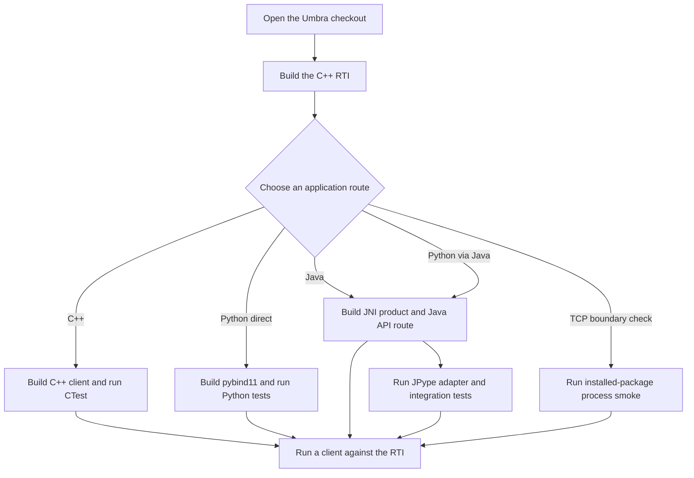
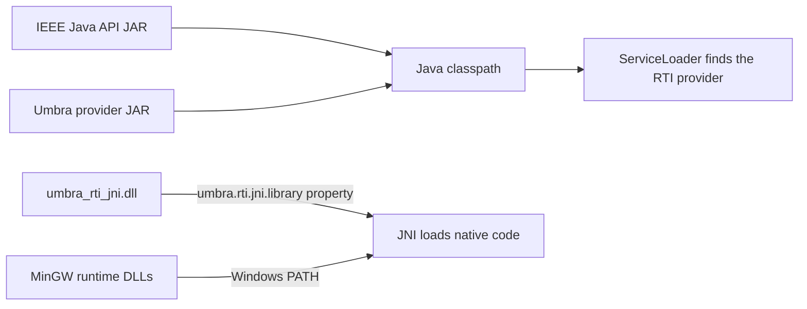

# Umbra Junior First-Build Guide: Windows and MinGW

This guide takes a junior from the source checkout through the C++ RTI, its
tests, and the C++, Java/JNI, and Python client routes. VS Code is optional:
the build uses CMake, CTest, Java, and Python commands. Choose your terminal:

- **PowerShell:** jump to the [PowerShell route](#powershell-route).
- **Git Bash:** jump to the [Git Bash route](#git-bash-route).

Open either terminal at the repository root. Docker is not part of this native
Windows/MinGW workflow.

## Routes at a glance

```text
C++ application -> C++ RTI library
Python application -> pybind11 extension -> C++ RTI library
Java application -> Java provider -> JNI bridge -> C++ RTI library
Python application -> JPype -> Java provider
                                (Umbra's provider then uses JNI -> C++)
```

The paths differ in how the client reaches the provider: pybind11 calls the
C++ implementation directly, Java uses the JNI bridge, and JPype calls through
a Java provider. The later run steps show each client in turn.

## Shell commands side by side

Use the matching column for the terminal you opened. The 🟦 and 🟩 labels are
used throughout these guides to make shell-specific commands easy to spot.

| Task | 🟦 PowerShell | 🟩 Git Bash |
| --- | --- | --- |
| Check repository root | `Test-Path CMakePresets.json` | `test -f CMakePresets.json` |
| Configure C++ | `cmake --preset mingw-default -B out/cpp` | `cmake --preset mingw-default -B out/cpp` |
| Build C++ | `cmake --build out/cpp --parallel 1` | `cmake --build out/cpp --parallel 1` |
| Run the focused header test | `ctest --test-dir out/cpp -R 'umbra\.ieee1516_2025\.headers' --output-on-failure` | `ctest --test-dir out/cpp -R 'umbra\.ieee1516_2025\.headers' --output-on-failure` |
| Create a Python environment | `python -m venv out/venv` | `python -m venv out/venv` |
| Activate the environment | `. .\out\venv\Scripts\Activate.ps1` | `source out/venv/Scripts/activate` |

The table shows the common commands without extra formatting. Follow the
[PowerShell route](#powershell-route) or [Git Bash route](#git-bash-route)
below for the full steps, shell-specific path setup, and pass checks.

## Choose a route

The default C++ RTI is an **in-process library**. Umbra also has a distinct
process-boundary route: clients can select a `tcp://host:port` endpoint through
the official 2025 `RtiConfiguration`. This is Umbra's framed TCP protocol, not
gRPC. Cross-process client/server behavior is exercised by package smoke tests,
but the server process is currently a private test fixture; there is not yet a
supported, installed RTI server product for juniors to deploy.

```mermaid
flowchart LR
    C[C++ application] --> L[Umbra C++ RTI library]
    P[Python application] --> N[pybind11 extension] --> L
    J[Java application] --> S[ServiceLoader provider] --> I[JNI bridge] --> L
    Y[Python through Java] --> JP[JPype transport] --> S
    L --> T[Configured TCP process endpoint (test fixture only)]
    N --> T
    I --> T
```

| You want to... | Build/run this | First proof it works |
| --- | --- | --- |
| Use the RTI from C++ | C++ library and C++ client/TCK | CTest headers, then native Catch2 or installed-package C++ TCK |
| Use the RTI directly from Python | `umbra-rti-native` pybind11 provider | Python native provider tests and a connection/federation smoke |
| Use the RTI from Java | Java provider JAR + JNI DLL + official Java API JAR | Java surface/native smoke, then optional Java TCK |
| Use a Java RTI from Python | `umbra-rti-jpype` transport | JPype adapter tests; for Umbra, the opt-in Python → Java → JNI integration test |
| Test a client across a process boundary | 2025 `RtiConfiguration.rtiAddress = tcp://host:port` | Installed-package process smoke starts the private service fixture and tests separate client processes |

### Example names for a practice federation

Use these names if you create a matching Death-Star-themed FOM. Federation,
federate, and federate-type names are chosen by the application; object,
attribute, interaction, and parameter names must also be defined in that
FOM.

| HLA item | Example name |
| --- | --- |
| Federation execution | `UmbraDeathStarFederation` |
| Federate names | `DeathStarCommand`, `ImperialTIEFighter`, `RebelProbeDroid` |
| Federate types | `CommandCrew`, `TIEPilot`, `ReconProbe` |
| Object class | `HLAobjectRoot.DeathStar.System` |
| Object attributes | `ReactorStatus`, `ShieldStatus`, `TargetSector` |
| Interaction class | `HLAinteractionRoot.DeathStar.SuperlaserFired` |
| Interaction parameters | `TargetSector`, `FiringSequence` |

The runnable build and smoke steps below use the repository's checked-in
Restaurant FOM. The names in this table are examples for a separate practice
FOM and will not work with Restaurant FOM unless you add matching definitions.

The language bindings share the C++ implementation, but have separate build
steps and runtime dependencies. The TCP process endpoint is another runtime
mode; its installed-package smoke is documented below. Build only the products
your application needs.
The commands below use the 2025 API. The separate 2010 bindings remain a
distinct compatibility stream; see the [native provider guide](../../packages/umbra-rti-native/README.md),
[JNI guide](../../packages/umbra-rti-jni/README.md), and
[Python package map](../../packages/README.md) for their edition-specific
scope and build commands.



## PowerShell route

🟦 **Terminal:** PowerShell at the repository root.

## 1. Install the tools

Use 64-bit Windows and install:

- VS Code (optional; any editor is fine).
- 64-bit GCC/MinGW and Ninja. These commands assume the Scoop `gcc` package.
- CMake 3.23 or newer for C++; use 3.24 or newer for JNI.
- 64-bit JDK 11 or newer, including `java`, `javac`, and `jar`.
- Python 3.11 or newer.

In a PowerShell terminal, install the Scoop tools if needed:

```powershell
scoop install gcc ninja cmake
```

**Pass check:** the command finishes without an error; the version checks
below must find CMake, Ninja, MinGW, Python, and the JDK tools.

If using VS Code, choose **File > Open Folder...** and open the Umbra checkout
(the folder containing `CMakeLists.txt`, `CMakePresets.json`, and `packages`).
Choose **Terminal > New Terminal** and select PowerShell if VS Code opened a
different shell. If using only the command line, open PowerShell and `cd` to
that same repository root. Confirm the terminal is in the right folder:

```powershell
Test-Path CMakePresets.json
```

It should print `True`. VS Code extensions for navigation and editing are
optional: **C/C++** (Microsoft), **CMake Tools** (Microsoft), **Extension Pack
for Java**, and **Python** (Microsoft). You can run every build and test below
without those extensions; CMake and CTest are invoked directly in the terminal.

This checkout path can make some generated C++ object paths too long for
MinGW. Before configuring, map the repository root to a short, unused drive
letter (choose another letter if `U:` is already in use):

```powershell
$repoRoot = (Get-Location).Path
subst U: $repoRoot
Set-Location U:\
Test-Path CMakePresets.json
```

The final check should still print `True`. Use this mapped drive for the
commands below. To remove the mapping after closing build tools, return to the
original repository path with `Set-Location $repoRoot`, then run `subst U: /d`.

Make a short, fresh output directory. The timestamp keeps the path compact to
avoid MinGW object-path length limits while giving each hour a separate build
tree:

```powershell
$runId = Get-Date -Format 'yyMMddHH'
$buildRoot = Join-Path (Get-Location).Path "out\j$runId"
$buildRoot
New-Item -ItemType Directory -Force -Path $buildRoot | Out-Null
Test-Path $buildRoot
```

**Pass check:** `Test-Path` prints `True`; `$buildRoot` is a short path under
`U:\out\j...`.

Set the JDK location. Replace the example with the folder that contains `bin`:

```powershell
$env:JAVA_HOME = 'C:\path\to\jdk'
$env:PATH = "$env:JAVA_HOME\bin;$env:PATH"
```

Check all tools. Each command should print a version (or compiler banner):

```powershell
cmake --version
ninja --version
g++ --version
python --version
java -version
javac -version
jar --version
```

**Pass check:** every command prints a version/banner, and
`Test-Path (Join-Path $env:JAVA_HOME 'bin\javac.exe')` prints `True`.

If `python` is older than 3.11, install/select Python 3.11 and replace `python`
with that launcher (for example `python311`) throughout this guide.

## 2. Configure and build the C++ RTI

The `mingw-default` preset selects Ninja and the repo's Scoop MinGW toolchain.
Configure and build the offline-friendly core profile:

```powershell
$cppBuild = Join-Path $buildRoot 'cpp'
cmake --preset mingw-default -B $cppBuild
if ($LASTEXITCODE -ne 0) { throw 'C++ configure failed.' }
cmake --build $cppBuild --parallel 1
if ($LASTEXITCODE -ne 0) { throw 'C++ RTI build failed.' }
if (-not (Test-Path (Join-Path $cppBuild 'CMakeCache.txt'))) { throw 'C++ configure did not create CMakeCache.txt.' }
Write-Host "C++ build tree ready: $cppBuild"
```

**Pass check:** the build command exits successfully and the expected
`CMakeCache.txt` exists. The RTI is produced as a library for applications to
link/load; it is not a command-line server.

## 3. Build and run the C++ tests

The default profile includes a quick header smoke test. List the registered
tests, then run that focused check:

```powershell
ctest --test-dir $cppBuild -N
ctest --test-dir $cppBuild -R 'umbra\.ieee1516_2025\.headers' --output-on-failure
```

**Pass check:** CTest ends with `100% tests passed` and `0 tests failed` for
the `umbra.ieee1516_2025.headers` check.

For the native behavior suite, configure the larger Catch2 profile. The first
configure can download pinned Catch2 and libxml2 dependencies, so network may
be needed. Build serially to keep memory use predictable on a junior machine:

```powershell
$catch2Build = Join-Path $buildRoot 'catch2'
cmake --preset mingw-catch2 -B $catch2Build
if ($LASTEXITCODE -ne 0) { throw 'Catch2 profile configure failed.' }
cmake --build $catch2Build --parallel 1
if ($LASTEXITCODE -ne 0) { throw 'Catch2 profile build failed.' }
ctest --test-dir $catch2Build -N
ctest --test-dir $catch2Build --output-on-failure --parallel 1 --exclude-regex '_NOT_BUILT-'
```

**Pass check:** the Catch2 build completes and CTest ends with `100% tests
passed` and `0 tests failed`. If the selected profile reports no tests, stop
and review the configure/build output before continuing.

`ctest -N` previews what is registered. The exclude pattern skips optional
package-consumer entries that were not built in this profile. To rerun one
test, select its name or a unique piece of it with `-R`:

```powershell
ctest --test-dir $catch2Build -R 'federation_listing' --output-on-failure
```

**Pass check:** the summary shows the selected test passed. If CTest reports
`No tests were found` or zero matches, choose a name from `ctest -N` instead.

When a test fails, read the first failure and the CTest summary. After editing
code, rebuild the same directory and rerun the focused test before widening
the test selection.

If a machine has the pinned sources cached locally but cannot reach the
download sites, add these cache paths to the configure command (adjust both
paths to directories containing their `CMakeLists.txt` files):

```powershell
cmake --preset mingw-catch2 -B $catch2Build `
  -DFETCHCONTENT_SOURCE_DIR_CATCH2='C:\path\to\catch2' `
  -DFETCHCONTENT_SOURCE_DIR_LIBXML2='C:\path\to\libxml2'
```

## 4. Run a C++ client against the installed package (optional)

This step demonstrates the library from a separate consumer program. It builds
the shared-library profile, installs it under the walkthrough output folder,
then configures the portable C++ TCK against that installation:

```powershell
$sharedBuild = Join-Path $buildRoot 'tck-shared'
cmake --preset mingw-shared -B $sharedBuild
if ($LASTEXITCODE -ne 0) { throw 'Shared RTI configure failed.' }
cmake --build $sharedBuild --parallel 1
if ($LASTEXITCODE -ne 0) { throw 'Shared RTI build failed.' }
$sharedPrefix = Join-Path $buildRoot 'installed-rti'
cmake --install $sharedBuild --prefix $sharedPrefix
if ($LASTEXITCODE -ne 0) { throw 'RTI package installation failed.' }

$cppTckBuild = Join-Path $buildRoot 'cpp-tck'
cmake -S packages/hla-rti-cpp-tck/adapters/current-package `
  -B $cppTckBuild -G Ninja "-DCMAKE_PREFIX_PATH=$sharedPrefix"
if ($LASTEXITCODE -ne 0) { throw 'C++ TCK consumer configure failed.' }
cmake --build $cppTckBuild --target hla_rti_cpp_tck --parallel 1
if ($LASTEXITCODE -ne 0) { throw 'C++ TCK consumer build failed.' }
ctest --test-dir $cppTckBuild --output-on-failure --parallel 1
```

**Pass check:** CTest ends with `100% tests passed` and `0 tests failed`. This
confirms the consumer configured against the installed package prefix.

The TCK is the client process; it loads and calls the installed RTI package.
This step takes longer because it builds the shared profile and consumer.

### Configure a separate-process TCP connection

This is what the client does. The address is part of the standard 2025
`RtiConfiguration`, created in the application and passed to `connect()`.
The client does not start the server by setting this value.

> **Current limitation:** this repository does not package a runnable RTI
> server. Unless your team gives you a compatible service to connect to, the
> TCP client examples cannot connect. The package smoke below is the only
> ready-to-run separate-process demonstration; it launches a private test
> server for you.

1. Start a compatible RTI service that listens on a host and port.
2. Create `RtiConfiguration` in each federate application with that same
   `tcp://host:port` address.
3. Pass the configuration to `connect()` before joining the federation.
4. Check `addressUsed` where the language API exposes it; it should be true
   when the TCP address was selected.

Put the network address in `withRtiAddress()`. `withConfigurationName()` is an
optional client identity; it is not the host, port, or server name.

The address below is an example only. Port `42424` is not started by this
command or by installing Umbra; replace it with the address of a running
service. In each example, `ambassador` and the callback object are the ones
your application already created from its selected provider.

#### C++ client

```cpp
auto configuration = rti1516_2025::RtiConfiguration::createConfiguration()
                         .withConfigurationName(L"umbra-death-star-cpp-client")
                         .withRtiAddress(L"tcp://127.0.0.1:42424");
auto result = ambassador.connect(
    federateAmbassador, rti1516_2025::HLA_EVOKED, configuration);
if (!result.addressUsed) {
  throw std::runtime_error("The RTI did not select the TCP endpoint.");
}
```

#### Python client using the direct C++ binding

The direct Python binding uses the same value object and passes it to the same
`connect()` overload:

```python
from hla.rti1516_2025 import CallbackModel, FederateAmbassador, RtiConfiguration
from umbra._native.rti1516_2025 import UmbraRtiFactory

configuration = (
    RtiConfiguration.createConfiguration()
    .withConfigurationName("umbra-death-star-python-client")
    .withRtiAddress("tcp://127.0.0.1:42424")
)
ambassador = UmbraRtiFactory().getRtiAmbassador()
result = ambassador.connect(
    FederateAmbassador(), CallbackModel.HLA_EVOKED, configuration
)
print(f"TCP address selected: {result.addressUsed}")
```

#### Java client using the JNI provider

```java
RtiConfiguration configuration = RtiConfiguration.createConfiguration()
    .withConfigurationName("umbra-death-star-java-client")
    .withRtiAddress("tcp://127.0.0.1:42424");
ConfigurationResult result = ambassador.connect(
    federateAmbassador, CallbackModel.HLA_EVOKED, configuration);
```

#### Python client using Java through JPype

JPype also passes the Python `RtiConfiguration` to `connect()`. First configure
the JNI provider as shown in the JPype section below, then use:

```python
from hla.rti1516_2025 import CallbackModel, FederateAmbassador, RtiConfiguration
from umbra._java.rti1516_2025 import UmbraJniRtiFactory

configuration = (
    RtiConfiguration.createConfiguration()
    .withConfigurationName("umbra-death-star-jpype-client")
    .withRtiAddress("tcp://127.0.0.1:42424")
)
ambassador = UmbraJniRtiFactory().getRtiAmbassador()
result = ambassador.connect(
    FederateAmbassador(), CallbackModel.HLA_EVOKED, configuration
)
print(f"TCP address selected: {result.addressUsed}")
```

The Java provider configuration controls JVM classpath and factory selection;
it does not choose the TCP endpoint. All four snippets set the same
`RtiConfiguration.rtiAddress` and pass it to `connect()`.

An empty address (the default) or `in-process` selects the ordinary local
runtime. `tcp://host:port` selects the process transport during `connect()`;
changing a configuration object after connecting does not move a live
connection. Use the same address for every federate joining that service.

### Verify the separate-process TCP route

To verify the shipped client transport today, build the shared profile and run
its installed-package smoke:

```powershell
cmake --build $sharedBuild --target umbra_test_installable_package --parallel 1
```

**Pass check:** the target exits with code 0 and reports the separate-process
TCP smoke as passed. If it fails, do not treat the in-process library build as
proof that the process-boundary route works.

That smoke launches the private service probe as a separate process and runs
installed C++ clients against it over TCP. This is the ready-to-run example
of the split-process setup in this checkout. It proves bounded
process-boundary behavior, not a deployable RTI server: the probe is a test
fixture and is not installed. The C++/Python/Java client bindings carry the
same 2025 address configuration, but an application-level server launcher
remains future work.

## 5. Build the Java/JNI provider

The JNI bridge connects Java calls to the C++ RTI. In this same PowerShell
terminal, make MinGW, Java, and Ninja explicit for the bridge helper:

```powershell
$scoopRoot = if ($env:SCOOP) { $env:SCOOP } else { Join-Path $env:USERPROFILE 'scoop' }
$gccBin = Join-Path $scoopRoot 'apps\gcc\current\bin'
$env:PATH = "$gccBin;$env:JAVA_HOME\bin;$env:PATH"
$env:CMAKE_GENERATOR = 'Ninja'
$env:CC = Join-Path $gccBin 'gcc.exe'
$env:CXX = Join-Path $gccBin 'g++.exe'
$jniBuild = Join-Path $buildRoot 'jni-fixture'
```

First use the checked-in fixture to learn the build and loading path:

```powershell
.\packages\umbra-rti-jni\build.ps1 `
  -OutputDirectory $jniBuild `
  -RunSmokeTest
if ($LASTEXITCODE -ne 0) { throw 'JNI fixture build or smoke test failed.' }
foreach ($file in @(
  (Join-Path $jniBuild 'umbra_rti_jni.dll'),
  (Join-Path $jniBuild 'umbra-rti-jni.jar')
)) {
  if (-not (Test-Path -LiteralPath $file -PathType Leaf)) { throw "Expected JNI fixture output missing: $file" }
  Write-Host "OK: $file"
}
```

On success, the output contains `umbra_rti_jni.dll` and
`umbra-rti-jni.jar`. The helper compiles against a small Java API fixture and
runs Java smoke tests. This confirms the bridge builds, loads, and reaches C++;
the fixture is not the official IEEE API and is not for application use.
**Pass check:** the explicit file checks print `OK` for both artifacts and the
helper's smoke tests exit successfully.

This profile also fetches the pinned libxml2 source for FOM validation. For
offline setup with a local source checkout, add
`-Libxml2SourceDirectory 'C:\path\to\libxml2-2.15.3'` to the build command.

For an actual Java application and conformance run, obtain the IEEE
1516.1-2025 Java API JAR through your organization or approved vendor. The
repository does not redistribute it. Use the compiled 2025 API binary JAR, not
the 2010 API, a TCK JAR, or a sources JAR. Build a product directory against
that JAR (use a different output path from the fixture):

```powershell
$javaApiJar = 'C:\path\to\ieee-1516.1-2025-java-api.jar'
$javaProduct = Join-Path $buildRoot 'java-product'
$javaProductBuild = Join-Path $buildRoot 'java-product-build'
$restaurantFom = (Resolve-Path 'third_party/ieee1516.2-2025/resources/examples/RestaurantFOMmodule-2025.xml').Path
if (-not (Test-Path -LiteralPath $javaApiJar -PathType Leaf)) { throw "Java API JAR not found: $javaApiJar" }
$apiEntries = @(jar tf $javaApiJar)
if ($LASTEXITCODE -ne 0 -or $apiEntries -notcontains 'hla/rti1516_2025/RtiFactoryFactory.class') {
  throw 'This does not look like the IEEE 1516.1-2025 Java API JAR; check the vendor artifact and edition.'
}
Write-Host 'API JAR check passed: 2025 RtiFactoryFactory class is present.'

python packages/build_umbra_jni.py `
  --edition 2025 `
  --java-api-jar $javaApiJar `
  --output-directory $javaProduct `
  --build-directory $javaProductBuild `
  --fom-path $restaurantFom `
  --run-smoke-test
if ($LASTEXITCODE -ne 0) { throw 'JNI product build or its artifact/smoke checks failed.' }
```

The product directory contains three different artifacts. You obtain the
official Java API JAR separately and pass it into the build; the builder copies
it into the product directory. Keep their roles distinct:

| Piece | Purpose | How it is supplied |
| --- | --- | --- |
| IEEE Java API JAR | Defines the standard `hla.rti1516_2025` Java interfaces | Supplied with `--java-api-jar $javaApiJar` and copied into `$javaProduct` |
| `umbra-rti-jni.jar` | Registers Umbra's Java provider for `ServiceLoader` | Staged in `$javaProduct` |
| `umbra_rti_jni.dll` | Implements the JNI calls into the C++ RTI | Staged in `$javaProduct`; loaded through `-Dumbra.rti.jni.library=...` |

The Java classpath contains the first two JARs, separated by `;` on Windows.
The DLL is not a JAR and does not go on the classpath. Do not add another
vendor RTI implementation JAR: Umbra's bridge provides the Java provider, and
the C++ RTI is loaded through JNI. The runner sets the classpath and
native-library property for you, equivalent to:



```text
java "-Dumbra.rti.jni.library=<product>\umbra_rti_jni.dll" -cp "<java-api.jar>;<product>\umbra-rti-jni.jar" <smoke-test-class>
```

Windows must also be able to find MinGW's runtime DLL dependencies through
`PATH`; the setup in Step 5 adds the Scoop GCC `bin` folder. Run the staged
Java product in surface mode, then native mode with the example FOM:

```powershell
python (Join-Path $javaProduct 'run.py') --mode surface
if ($LASTEXITCODE -ne 0) { throw 'Java provider discovery failed; do not continue.' }
python (Join-Path $javaProduct 'run.py') --mode native --fom-path $restaurantFom
if ($LASTEXITCODE -ne 0) { throw 'Java-to-JNI native smoke failed; do not continue.' }
```

The surface smoke checks Java provider discovery. Native smoke constructs the
provider and exercises the C++ path. These are smoke tests, not the complete
Java TCK. Treat this as a gate: continue only if the build finishes with exit
code 0, the surface smoke reports success, and the native smoke reports
success. The native smoke proves Java can find the API, discover Umbra's
provider, load the JNI DLL, and reach the C++ implementation.

## 6. Build and run the Java TCK (optional)

Build the portable Java TCK classes against the same official API JAR, then
have the verifier run the TCK with Umbra's JNI provider and capability profile:

```powershell
$javaTckClasses = Join-Path $buildRoot 'java-tck-classes'
python tools/run_java_tck.py build --api-jar $javaApiJar --output-directory $javaTckClasses
if ($LASTEXITCODE -ne 0) { throw 'Java TCK classes did not build.' }
if (-not (Test-Path -LiteralPath $javaTckClasses -PathType Container)) { throw 'Java TCK output directory is missing.' }

.\packages\umbra-rti-jni\verify.ps1 `
  -ArtifactDirectory $javaProduct `
  -JavaApiJar $javaApiJar `
  -RunJavaTck `
  -JavaTckClassesDirectory $javaTckClasses
if ($LASTEXITCODE -ne 0) { throw 'Java TCK verification failed.' }
```

**Pass check:** the TCK classes directory exists and the verifier exits 0 with
no failed checks. The printed profile summary is the record of what the TCK
actually covered.

The Java TCK reports the provider behavior covered by its configured profile;
it is useful for checking supported standard behavior, not a claim that every
IEEE service is implemented.

## Python setup (shared by both routes)

Create an isolated Python environment and install the shared API package:

```powershell
$venvPath = Join-Path $buildRoot 'venv'
python -m venv $venvPath
. (Join-Path $venvPath 'Scripts\Activate.ps1')
python --version
python -m pip install --upgrade pip
if ($LASTEXITCODE -ne 0) { throw 'pip upgrade failed.' }
python -m pip install -e packages/umbra-rti-api
if ($LASTEXITCODE -ne 0) { throw 'Umbra Python API package installation failed.' }
if (-not $env:VIRTUAL_ENV) { throw 'Python virtual environment was not activated.' }
python -c "import hla.rti1516_2025; print('Umbra Python API import: OK')"
if ($LASTEXITCODE -ne 0) { throw 'Umbra Python API import failed.' }
```

**Pass check:** `VIRTUAL_ENV` points into this build's `venv` folder and the
API import prints `Umbra Python API import: OK`.

First-time Python installs need access to the configured package index, unless
the required build wheels and packages are already cached locally.

## Python route: use a Java RTI through JPype

Install the JPype transport only if using the Java/JNI route:

```powershell
python -m pip install -e 'packages/umbra-rti-jpype[jpype]'
if ($LASTEXITCODE -ne 0) { throw 'JPype transport installation failed.' }
```

**Pass check:** pip reports successful installation of `JPype1` and
`umbra-rti-jpype`.

Before moving to Python, confirm these files are present. These checks stop
immediately if a required product artifact is missing:

```powershell
foreach ($file in @(
  (Join-Path $javaProduct 'umbra-rti-jni.jar'),
  (Join-Path $javaProduct 'umbra_rti_jni.dll'),
  (Join-Path $javaProduct (Split-Path $javaApiJar -Leaf))
)) {
  if (-not (Test-Path -LiteralPath $file -PathType Leaf)) { throw "Missing JNI product artifact: $file" }
  Write-Host "OK: $file"
}
```

For Python, configure the adapter before creating the factory. The artifact
directory holds `umbra-rti-jni.jar` and `umbra_rti_jni.dll`; the API JAR is the
separate IEEE JAR you supplied during the product build. The adapter adds both
JARs to JPype's JVM classpath and sets
`-Dumbra.rti.jni.library=<path-to-umbra_rti_jni.dll>` for Java to load the
native library. MinGW's `bin` directory must remain on `PATH` so Windows can
find the DLL's runtime dependencies. You do not need to build a manual
`CLASSPATH` string. Set these variables before Python starts the JVM; JPype
allows only one JVM per process:

```powershell
$env:UMBRA_JNI_BRIDGE_ARTIFACT_DIRECTORY = (Resolve-Path $javaProduct).Path
$env:UMBRA_JNI_JAVA_API_JAR = (Resolve-Path $javaApiJar).Path
if (-not (Test-Path (Join-Path $javaProduct 'umbra-rti-jni.jar'))) { throw 'Umbra provider JAR is missing.' }
if (-not (Test-Path (Join-Path $javaProduct 'umbra_rti_jni.dll'))) { throw 'JNI native DLL is missing.' }
if (-not (Test-Path $env:UMBRA_JNI_JAVA_API_JAR)) { throw 'IEEE Java API JAR is missing.' }

@'
from umbra._java.rti1516_2025 import UmbraJniRtiFactory

factory = UmbraJniRtiFactory()
name, version = factory.rtiName(), factory.rtiVersion()
if name != "Umbra JNI C++ RTI":
    raise RuntimeError(f"Unexpected Java provider: {name}")
print(name, version)
'@ | python -
if ($LASTEXITCODE -ne 0) { throw 'Python could not discover or load the Umbra Java/JNI provider.' }
```

**Pass check:** Python prints `Umbra JNI C++ RTI` plus its version and exits
with code 0. That confirms JPype found Umbra's factory and the JVM loaded the
JNI library.

To run the opt-in end-to-end Python → JPype → Java → JNI → C++ integration
tests, set the switches and run the focused unittest module:

```powershell
python -m pip install -e packages/umbra-rti-test-support
if ($LASTEXITCODE -ne 0) { throw 'Umbra test-support installation failed.' }
$env:UMBRA_ENABLE_JNI_INTEGRATION_TESTS = '1'
$env:UMBRA_JNI_REQUIRE_RUNTIME_SERVICE_COVERAGE = '1'
$env:UMBRA_JNI_BRIDGE_ARTIFACT_DIRECTORY = (Resolve-Path $javaProduct).Path
$env:UMBRA_JNI_JAVA_API_JAR = (Resolve-Path $javaApiJar).Path
python -m unittest packages/umbra-rti-jpype/tests/test_jpype_jni_integration.py
if ($LASTEXITCODE -ne 0) { throw 'Python/JPype/JNI integration tests failed.' }
```

**Pass check:** unittest ends with `OK` and reports no failures or errors.

This opt-in module may build its own C++ bridge as part of setup. It therefore
needs the same Java, CMake, Ninja, MinGW and dependency download access as the
JNI build step.

## Python route: bind directly to C++ with pybind11

The `umbra-rti-native` package imports the C++ provider without starting Java.
Use this when the Python application should call Umbra's C++ RTI directly.
It has separate compiler/Python ABI requirements. The 2025 provider currently
binds factory creation, connect/disconnect, callback enablement/evocation, and
scalar federation create/destroy/list operations. The 2010 provider exposes
additional bounded service slices; neither surface claims full RTI
conformance. See the package README for the current capability list. Use the
shared virtual environment created above:

```powershell
$repoRoot = (Get-Location).Path
$nativeBuild = Join-Path $buildRoot 'python-native'
$toolchain = Join-Path $repoRoot 'cmake\toolchains\mingw-scoop.cmake'
$env:CMAKE_GENERATOR = 'Ninja'

python -m pip install -e packages/umbra-rti-native `
  -C "build-dir=$nativeBuild" `
  -C "cmake.define.CMAKE_TOOLCHAIN_FILE=$toolchain"
if ($LASTEXITCODE -ne 0) { throw 'Native Python extension installation/build failed.' }
python -m pip install -e packages/umbra-rti-test-support
if ($LASTEXITCODE -ne 0) { throw 'Umbra test-support installation failed.' }
@'
import os
from pathlib import Path
gcc_root = Path(os.environ["SCOOP"]) if os.environ.get("SCOOP") else Path.home() / "scoop"
_gcc_dll_directory = os.add_dll_directory(str(gcc_root / "apps" / "gcc" / "current" / "bin"))
from hla.rti1516_2025 import CallbackModel, FederateAmbassador
from umbra._native.rti1516_2025 import UmbraRtiFactory
factory = UmbraRtiFactory()
ambassador = factory.getRtiAmbassador()
ambassador.connect(FederateAmbassador(), CallbackModel.HLA_EVOKED)
print(f"Connected to {factory.rtiName()} {factory.rtiVersion()}")
ambassador.disconnect()
'@ | python -
if ($LASTEXITCODE -ne 0) { throw 'The Python-to-C++ connect/disconnect smoke failed.' }
```

**Pass check:** Python prints `Connected to Umbra ...`, disconnects, and exits
with code 0. Then run the focused tests below.

Run the native provider tests against the installed editable extension:

```powershell
python -m unittest discover `
  -s packages/umbra-rti-native/tests `
  -p 'test_native*.py' `
  -v
if ($LASTEXITCODE -ne 0) { throw 'Native Python binding tests failed.' }
```

**Pass check:** unittest ends with `OK` and no failures or errors.

These tests exercise the native binding directly; they are separate from the
Java/JPype tests below. The 2025 native provider currently supports factory
creation, connect/disconnect, callback enablement/evocation, and scalar
federation create/destroy/list operations. The broader 2010 slices and
remaining explicit capability gaps are documented in the native package
README.

This profile also needs libxml2 and may download it. If you have a local source
cache, add `-C "cmake.define.FETCHCONTENT_SOURCE_DIR_LIBXML2=C:\path\to\libxml2-2.15.3"`
to the install command. Confirm Python is 64-bit and its development files
match MinGW if compilation or linking fails. The package currently targets a
source checkout; it does not promise a standalone redistributable wheel ABI.

## Run the observer and connect it to the Python RTI

There are two useful startup checks. The playtest proves the dashboard starts
and shows synthetic activity; connecting the observer adapter to Umbra proves
the Python binding and RTI callback path. The playtest does not load an RTI,
and the adapter does not create a federation or choose an FOM for your app.

### Start the dashboard without an RTI

From the repository root, run:

```powershell
python tools/observer_playtest.py
```

On first launch, the source-checkout playtest needs Python 3.11+, Node 22.13+
or newer, and network access to install/build its dashboard and private Python
dependencies. It opens the browser when ready. Keep the terminal open and press
Ctrl+C there to stop it. To verify setup and live synthetic events, then exit:

```powershell
python tools/observer_playtest.py --check
if ($LASTEXITCODE -ne 0) { throw 'Observer playtest health check failed.' }
```

**Pass check:** the command prints `Playtest check passed: the server is
healthy and live events are advancing.`

When the normal launch prints `Dashboard ready: http://127.0.0.1:.../`, open
that address. **Pass check:** the `--check` command reports that the server is
healthy and live events are advancing.

This mode needs no C++ build, RTI binding, FOM, or Java. See the detailed
[observer showcase guide](../../packages/umbra-rti-observer/SHOWCASE.md).

### Bind an application to the observer

This path uses the MinGW native extension from the previous section. Install
the observer's web service and Umbra-specific callback adapter into the same
active virtual environment:

```powershell
python -m pip install -e 'packages/umbra-rti-observer[web]'
if ($LASTEXITCODE -ne 0) { throw 'Observer web dependencies failed to install.' }
python -m pip install -e packages/umbra-rti-observer-umbra
if ($LASTEXITCODE -ne 0) { throw 'Umbra observer adapter failed to install.' }
```

**Pass check:** pip finishes both editable installs successfully. The actual
adapter connection is confirmed in the running application when its observer
dashboard shows the adapter-attached status and events from that RTI loop.

Before importing the native module, make MinGW's runtime DLL directory
available to Windows. Keep the `os.add_dll_directory` handle alive for the
whole process:

```python
import os
from pathlib import Path

scoop = Path(os.environ["SCOOP"]) if os.environ.get("SCOOP") else Path.home() / "scoop"
gcc_bin = scoop / "apps" / "gcc" / "current" / "bin"
_gcc_dll_directory = os.add_dll_directory(str(gcc_bin))
```

Put this at the top of the Python application before importing
`umbra._native`. In that application, create the store, native ambassador,
and adapter, then attach it:

```python
from hla.rti1516_2025 import CallbackModel
from umbra._native.rti1516_2025 import UmbraRtiFactory
from umbra_rti_observer import ObserverStore
from umbra_rti_observer.server import create_app
from umbra_rti_observer_umbra import UmbraRtiAdapter

store = ObserverStore()
rti = UmbraRtiFactory().getRtiAmbassador()
adapter = UmbraRtiAdapter(
    rti,
    callback_model=CallbackModel.HLA_EVOKED,
    source="umbra-native",
)
store.attach_adapter(adapter)  # The adapter connects and supplies its callback.

# Your application still loads the FOM, joins the federation, and subscribes
# to the objects/interactions it wants to observe through `rti`.
app = create_app(store)
```

Serve `app` from this same process so it uses the same in-memory `store`; a
separate `python -m umbra_rti_observer` process would have a different store.
Run the web server alongside the application's RTI loop. With
`HLA_EVOKED`, keep pumping callbacks on the thread that owns the ambassador:

```python
while application_is_running:
    rti.evokeMultipleCallbacks(0.0, 0.01)
```

Do not put a blocking `uvicorn.run(app, ...)` on that callback-pump thread. Run
Uvicorn on a separate thread or use the application's existing async/server
arrangement while keeping the RTI pump active. On shutdown, detach the adapter
(`store.detach_adapter(adapter)`) to disconnect and release its callback sink.
The adapter does not join the federation or subscribe to classes for the
application.

For the full package boundary, event flow, and current adapter coverage, read
the [observer junior guide](../../packages/umbra-rti-observer/JUNIOR-GUIDE.md)
and [Umbra adapter guide](../../packages/umbra-rti-observer-umbra/README.md).
**Pass check:** while your application is running, the observer page opens from
that same process and shows adapter events. If the synthetic playtest works
but your page shows no adapter events, debug the application callback loop,
not the playtest.

## Troubleshooting and diagnostic steps

| Symptom | What to check |
| --- | --- |
| `Test-Path CMakePresets.json` prints `False` | In VS Code, open the repository root folder, not `cpp`, `packages`, or a parent folder. |
| JNI cannot find `JNI::JNI` | Use CMake 3.24 or newer. |
| CMake selected Visual Studio or `cl.exe` | Set `CMAKE_GENERATOR`, `CC`, and `CXX` as in step 5, then use a fresh build directory. |
| CMake cannot find JNI | `JAVA_HOME` must point at the JDK root; confirm `javac` and `jar` work in this terminal. |
| CMake cannot download libxml2 or Catch2 | Retry with network access or provide/use a local dependency cache. |
| PowerShell blocks `Activate.ps1` | Run `Set-ExecutionPolicy -Scope Process -ExecutionPolicy Bypass` in that terminal, then activate again. |
| CMake warns that an object path may exceed 250 characters, or MinGW reports a missing `.obj.d` file | Before configuring, map the checkout to an unused short drive and build from it: `subst U: (Get-Location).Path`, then `Set-Location U:\`. |
| Java or Python cannot load the DLL | Use 64-bit Java, Python, and MinGW; keep MinGW's `bin` folder on `PATH`. |
| Python says it cannot find a MinGW DLL when importing `_native` | Call `os.add_dll_directory(gcc_bin)` before the native import and keep the returned handle alive. |
| Observer dashboard is empty | The playtest uses synthetic data; for RTI data, attach `UmbraRtiAdapter` to the same ambassador/store used by the served app, then join and subscribe in application code. |
| Java compiles but does not find an RTI provider | Use the staged product runner or include both the official API JAR and bridge JAR on the Java classpath. |
| Build fails after switching compilers | Configure into a fresh output directory because CMake caches the compiler. |

### Debugging sequence

Work out which stage failed before changing anything: configure, compile,
test, start the provider, or connect the client. Then use the matching check:

| Failed stage | First diagnostic |
| --- | --- |
| CMake configure | Recheck tool versions and the selected preset; use a fresh build directory after changing compilers. |
| Compile | Rebuild only that profile with `cmake --build $cppBuild --verbose --parallel 1` and read the first compiler error. |
| C++ test | Rerun the failing test with `ctest --test-dir $cppBuild --rerun-failed --output-on-failure --verbose`; if it was not registered as failed, select it with `-R 'part-of-test-name'`. |
| Python import/test | Confirm the virtual environment is active, then run the failing module with `python -X faulthandler -m unittest packages/umbra-rti-native/tests/test_native.py -v` (replace the file path for a different test). |
| Java/JNI launch | Confirm `java`, `javac`, `JAVA_HOME`, the API JAR, bridge JAR, native DLL, and MinGW `bin` path all belong to the same 64-bit setup. |
| TCP connect | Confirm a compatible service is listening at that address. The repository's ready-to-run service is test-only and starts through the process smoke above. |

When asking for help, include the section number, the exact command, the first
error message, and the final CTest/build summary. Include the output of
`cmake --version`, `g++ --version`, `python --version`, and `java -version`
when the failure crosses toolchains. Do not paste a whole build log unless
asked; the first error and the failed command usually identify the next check.

For more detail, see the [C++ build](../../README.md#build-and-test),
[Python and Java package map](../../packages/README.md), [JNI bridge](../../packages/umbra-rti-jni/README.md),
[Java TCK](../../packages/hla-rti-java-tck/README.md), and
[JPype adapter](../../packages/umbra-rti-jpype/README.md).

## Git Bash route

🟩 **Terminal:** Git Bash at the repository root. This route uses the same
native Windows MinGW, CMake, Java, and Python toolchain as PowerShell.

Open Git Bash at the Umbra repository root. Check that the repository files
are visible:

```bash
test -f CMakePresets.json && echo "Umbra repository root: OK"
```

VS Code is optional. In VS Code, open the repository folder and select
**Terminal > New Terminal**, then choose Git Bash. Docker is not required.

## 1. Check the Windows tools

Install Scoop packages from PowerShell if they are missing:

```bash
powershell.exe -NoProfile -Command "scoop install gcc ninja cmake"
```

Set the Windows Scoop location and put its MinGW compiler first on `PATH`.
Adjust `JAVA_HOME` to the JDK directory on your machine:

```bash
SCOOP_WIN="$(cygpath -w "${SCOOP:-$HOME/scoop}")"
export SCOOP="$SCOOP_WIN"
GCC_BIN="$(cygpath -u "$SCOOP_WIN")/apps/gcc/current/bin"

JAVA_HOME_WIN='C:\path\to\jdk'
export JAVA_HOME="$JAVA_HOME_WIN"
JDK_BIN="$(cygpath -u "$JAVA_HOME")/bin"
export PATH="$GCC_BIN:$JDK_BIN:$PATH"
export CMAKE_GENERATOR=Ninja
export CC="$(cygpath -w "$GCC_BIN/gcc.exe")"
export CXX="$(cygpath -w "$GCC_BIN/g++.exe")"

cmake --version
ninja --version
g++ --version
python --version
java -version
javac -version
jar --version
command -v cmake ninja g++ python java javac jar >/dev/null || exit 1
```

**Pass check:** all seven version commands succeed and Git Bash resolves the
Windows toolchain executables.

Use 64-bit Python 3.11 or newer and a 64-bit JDK. The CMake preset reads the
Windows `SCOOP` variable and selects the Scoop MinGW compiler.

## 2. Use a short build path

Long checkout paths can exceed MinGW's generated object-path limit. Map the
repository to an unused drive letter once, then build under that drive. Keep
the original path so you can remove the mapping when finished:

```bash
ORIGINAL_REPO="$PWD"
REPO_WIN="$(cygpath -w "$ORIGINAL_REPO")"
powershell.exe -NoProfile -Command "subst U: '$REPO_WIN'"
cd /u
test -f CMakePresets.json && echo "Short build path: OK"

RUN_ID="$(date +%y%m%d%H)"
BUILD_ROOT="$PWD/out/j$RUN_ID"
mkdir -p "$BUILD_ROOT"
test -d "$BUILD_ROOT" || { echo "Build folder was not created: $BUILD_ROOT" >&2; exit 1; }
```

**Pass check:** the short path check prints `Short build path: OK` and
`$BUILD_ROOT` exists.

If `U:` is already in use, replace it with another unused drive letter in both
commands. Git Bash exposes a mapped `U:` drive as `/u`.

## 3. Build the C++ RTI and run its tests

Start with the quick, offline-friendly C++ profile:

```bash
CPP_BUILD="$BUILD_ROOT/cpp"
cmake --preset mingw-default -B "$CPP_BUILD" || exit $?
cmake --build "$CPP_BUILD" --parallel 1 || exit $?
test -f "$CPP_BUILD/CMakeCache.txt" || { echo 'CMakeCache.txt missing; configure failed.' >&2; exit 1; }
ctest --test-dir "$CPP_BUILD" -N
ctest --test-dir "$CPP_BUILD" \
  -R 'umbra\.ieee1516_2025\.headers' --output-on-failure
```

**Pass check:** `CMakeCache.txt` exists and CTest ends with `100% tests
passed` and `0 tests failed` for the header smoke.

For the larger Catch2 behavior suite, dependencies may need package-index or
download access:

```bash
CATCH2_BUILD="$BUILD_ROOT/catch2"
cmake --preset mingw-catch2 -B "$CATCH2_BUILD" || exit $?
cmake --build "$CATCH2_BUILD" --parallel 1 || exit $?
ctest --test-dir "$CATCH2_BUILD" -N
ctest --test-dir "$CATCH2_BUILD" --output-on-failure \
  --parallel 1 --exclude-regex '_NOT_BUILT-'
```

**Pass check:** the Catch2 build completes and CTest ends with `100% tests
passed` and `0 tests failed`. Stop if the profile registers no tests.

To rerun one case, use a distinctive part of its CTest name:

```bash
ctest --test-dir "$CATCH2_BUILD" -R 'federation_listing' --output-on-failure
```

**Pass check:** the summary shows the selected test passed. If there are zero
matches, choose a registered name from the preceding `ctest -N` output.

## 4. Build and test the installed C++ package

This builds the shared-library profile, installs it into the output folder,
and runs the portable C++ TCK as an installed-package client:

```bash
SHARED_BUILD="$BUILD_ROOT/shared"
cmake --preset mingw-shared -B "$SHARED_BUILD" || exit $?
cmake --build "$SHARED_BUILD" --parallel 1 || exit $?
SHARED_PREFIX="$BUILD_ROOT/installed-rti"
cmake --install "$SHARED_BUILD" --prefix "$SHARED_PREFIX" || exit $?

CPP_TCK_BUILD="$BUILD_ROOT/cpp-tck"
cmake -S packages/hla-rti-cpp-tck/adapters/current-package \
  -B "$CPP_TCK_BUILD" -G Ninja \
  "-DCMAKE_PREFIX_PATH=$SHARED_PREFIX" || exit $?
cmake --build "$CPP_TCK_BUILD" --target hla_rti_cpp_tck --parallel 1 || exit $?
ctest --test-dir "$CPP_TCK_BUILD" --output-on-failure --parallel 1
```

**Pass check:** CTest ends with `100% tests passed` and `0 tests failed`; the
consumer has linked against the installed package.

The installed-package profile also has a separate-process TCP smoke. It starts
a private test service; Umbra does not yet ship a deployable RTI server:

```bash
cmake --build "$SHARED_BUILD" \
  --target umbra_test_installable_package --parallel 1 || exit $?
```

**Pass check:** the command reports the separate-process TCP smoke passed and
exits with code 0.

## 5. Build the Java/JNI product

The official 1516.1-2025 Java API JAR must be provided by your organization or
vendor. Set its path and choose separate product/build output folders:

```bash
JAVA_API_JAR='/c/path/to/ieee-1516.1-2025-java-api.jar'
JAVA_PRODUCT="$BUILD_ROOT/java-product"
JAVA_PRODUCT_BUILD="$BUILD_ROOT/java-product-build"
RESTAURANT_FOM="$PWD/third_party/ieee1516.2-2025/resources/examples/RestaurantFOMmodule-2025.xml"
if test ! -f "$JAVA_API_JAR"; then
  echo "Java API JAR not found: $JAVA_API_JAR" >&2
  exit 1
fi
if ! jar tf "$JAVA_API_JAR" | grep -Fx 'hla/rti1516_2025/RtiFactoryFactory.class'; then
  echo 'Wrong or incomplete Java API JAR; expected the IEEE 1516.1-2025 API.' >&2
  exit 1
fi

python packages/build_umbra_jni.py \
  --edition 2025 \
  --java-api-jar "$JAVA_API_JAR" \
  --output-directory "$JAVA_PRODUCT" \
  --build-directory "$JAVA_PRODUCT_BUILD" \
  --fom-path "$RESTAURANT_FOM" \
  --run-smoke-test || exit $?

API_JAR_NAME="$(basename "$JAVA_API_JAR")"
for file in \
  "$JAVA_PRODUCT/$API_JAR_NAME" \
  "$JAVA_PRODUCT/umbra-rti-jni.jar" \
  "$JAVA_PRODUCT/umbra_rti_jni.dll"; do
  if test ! -f "$file"; then
    echo "Missing JNI product artifact: $file" >&2
    exit 1
  fi
  echo "OK: $file"
done

if ! jar tf "$JAVA_API_JAR" | grep -Fx 'hla/rti1516_2025/RtiFactoryFactory.class'; then
  echo 'Staged Java API JAR is missing the required 2025 factory class.' >&2
  exit 1
fi
if ! jar tf "$JAVA_PRODUCT/umbra-rti-jni.jar" | grep -Fx 'META-INF/services/hla.rti1516_2025.RtiFactory'; then
  echo 'Umbra provider JAR is missing its ServiceLoader registration.' >&2
  exit 1
fi
if ! jar tf "$JAVA_PRODUCT/umbra-rti-jni.jar" | grep -Fx 'org/umbra/jni/rti1516_2025/NativeRtiFactory.class'; then
  echo 'Umbra provider JAR is missing NativeRtiFactory.' >&2
  exit 1
fi

python "$JAVA_PRODUCT/run.py" --mode surface || exit $?
python "$JAVA_PRODUCT/run.py" --mode native --fom-path "$RESTAURANT_FOM" || exit $?
```

The Java API JAR is not distributed with this repository. The builder copies
it to the product directory beside the provider JAR and native DLL. The checks
above confirm the API class, Umbra service descriptor, provider class, and
three staged files. Continue only when `--run-smoke-test`, surface mode, and
native mode all exit successfully; these checks are not the full Java TCK.

To build and run the optional Java TCK:

```bash
JAVA_TCK_CLASSES="$BUILD_ROOT/java-tck-classes"
python tools/run_java_tck.py build \
  --api-jar "$JAVA_API_JAR" \
  --output-directory "$JAVA_TCK_CLASSES" || exit $?
test -d "$JAVA_TCK_CLASSES" || { echo 'Java TCK classes directory was not created.' >&2; exit 1; }

powershell.exe -NoProfile -ExecutionPolicy Bypass \
  -File packages/umbra-rti-jni/verify.ps1 \
  -ArtifactDirectory "$(cygpath -w "$JAVA_PRODUCT")" \
  -JavaApiJar "$(cygpath -w "$JAVA_API_JAR")" \
  -RunJavaTck \
  -JavaTckClassesDirectory "$(cygpath -w "$JAVA_TCK_CLASSES")" || exit $?
```

**Pass check:** the TCK build creates `$JAVA_TCK_CLASSES` and the verifier
exits successfully with its summary showing no failed checks.

## 6. Set up Python

Create and activate a Python virtual environment from Git Bash:

```bash
VENV="$BUILD_ROOT/venv"
python -m venv "$VENV"
source "$VENV/Scripts/activate"
python --version
python -m pip install --upgrade pip || exit $?
python -m pip install -e packages/umbra-rti-api || exit $?
test -n "$VIRTUAL_ENV" || { echo 'Virtual environment is not active.' >&2; exit 1; }
python -c "import hla.rti1516_2025; print('Umbra Python API import: OK')" || exit $?
```

**Pass check:** `VIRTUAL_ENV` points into the walkthrough's `venv` folder and
the API import prints `Umbra Python API import: OK`.

First-time installs need access to the configured package index unless the
required packages are already cached.

### Python directly through C++/pybind11

The editable native provider builds against the active Windows MinGW toolchain:

```bash
NATIVE_BUILD="$BUILD_ROOT/python-native"
TOOLCHAIN_WIN="$(cygpath -w "$PWD/cmake/toolchains/mingw-scoop.cmake")"
python -m pip install -e packages/umbra-rti-native \
  -C "build-dir=$NATIVE_BUILD" \
  -C "cmake.define.CMAKE_TOOLCHAIN_FILE=$TOOLCHAIN_WIN" || exit $?
python -m pip install -e packages/umbra-rti-test-support || exit $?
```

Before importing the native module, keep MinGW's DLL directory registered for
the life of the Python process:

```bash
python - <<'PY'
import os
from pathlib import Path

gcc_root = Path(os.environ["SCOOP"])
_gcc_dll_directory = os.add_dll_directory(
    str(gcc_root / "apps" / "gcc" / "current" / "bin")
)
from hla.rti1516_2025 import CallbackModel, FederateAmbassador
from umbra._native.rti1516_2025 import UmbraRtiFactory

factory = UmbraRtiFactory()
ambassador = factory.getRtiAmbassador()
ambassador.connect(FederateAmbassador(), CallbackModel.HLA_EVOKED)
print(f"Connected to {factory.rtiName()} {factory.rtiVersion()}")
ambassador.disconnect()
PY
if test "$?" -ne 0; then
  echo 'Python-to-C++ connect/disconnect smoke failed.' >&2
  exit 1
fi

python -m unittest discover \
  -s packages/umbra-rti-native/tests -p 'test_native*.py' -v || exit $?
```

**Pass check:** the native probe prints its connection line and exits 0;
unittest ends with `OK` and no failures or errors.

### Python through Java/JPype

Install the Java transport. In this route, Python does not construct a manual
`CLASSPATH`: `UmbraJniRtiFactory` passes the API JAR and bridge JAR to JPype as
the JVM classpath, and points the JVM's `umbra.rti.jni.library` property at the
native DLL. Set the two paths before constructing the factory because JPype
starts one JVM per Python process. The DLL's MinGW runtime dependencies still
need the Scoop GCC `bin` directory on `PATH`.

```bash
python -m pip install -e 'packages/umbra-rti-jpype[jpype]' || exit $?
export UMBRA_JNI_BRIDGE_ARTIFACT_DIRECTORY="$(cygpath -w "$JAVA_PRODUCT")"
export UMBRA_JNI_JAVA_API_JAR="$(cygpath -w "$JAVA_API_JAR")"
for file in "$JAVA_PRODUCT/umbra-rti-jni.jar" \
  "$JAVA_PRODUCT/umbra_rti_jni.dll" "$JAVA_API_JAR"; do
  if test ! -f "$file"; then
    echo "Missing Python/JNI input: $file" >&2
    exit 1
  fi
  echo "OK: $file"
done

python - <<'PY'
from umbra._java.rti1516_2025 import UmbraJniRtiFactory

factory = UmbraJniRtiFactory()
name, version = factory.rtiName(), factory.rtiVersion()
if name != "Umbra JNI C++ RTI":
    raise RuntimeError(f"Unexpected Java provider: {name}")
print(name, version)
PY
if test "$?" -ne 0; then
  echo 'Python could not discover or load the Umbra Java/JNI provider.' >&2
  exit 1
fi
```

**Pass check:** Python prints `Umbra JNI C++ RTI` plus its version and exits
with code 0. That confirms JPype found Umbra's factory and the JVM loaded the
JNI library.

For the opt-in end-to-end Python → JPype → Java → JNI → C++ integration test:

```bash
python -m pip install -e packages/umbra-rti-test-support || exit $?
export UMBRA_ENABLE_JNI_INTEGRATION_TESTS=1
export UMBRA_JNI_REQUIRE_RUNTIME_SERVICE_COVERAGE=1
python -m unittest \
  packages/umbra-rti-jpype/tests/test_jpype_jni_integration.py || exit $?
```

**Pass check:** unittest ends with `OK` and reports no failures or errors.

## 7. Start the observer playtest

The playtest runs without an RTI and displays synthetic traffic. Install its
web dependencies and start it from the same active virtual environment:

```bash
python -m pip install -e 'packages/umbra-rti-observer[web]' || exit $?
python -m pip install -e packages/umbra-rti-observer-umbra || exit $?
python tools/observer_playtest.py || exit $?
```

When the terminal prints `Dashboard ready: http://127.0.0.1:.../`, open that
address. In a second Git Bash terminal, run the health check below.

```bash
python tools/observer_playtest.py --check || exit $?
```

**Pass check:** it prints `Playtest check passed: the server is healthy and
live events are advancing.`

To connect an application to the observer, run the observer web app in the
same process as that application's RTI loop and attach `UmbraRtiAdapter` to
its ambassador and store. See the [observer junior guide](../../packages/umbra-rti-observer/JUNIOR-GUIDE.md)
for the application code. The playtest itself does not attach an RTI.

## Troubleshooting from Git Bash

Check which compiler Git Bash will find and make CMake show its compile command:

```bash
command -v g++
cmake --build "$CPP_BUILD" --verbose --parallel 1
ctest --test-dir "$CPP_BUILD" --rerun-failed --output-on-failure --verbose
```

Use the same fixes as the [PowerShell guide](FIRST-BUILD-WINDOWS-MINGW.md):
select the repository root, use a fresh build directory after changing
compilers, shorten long checkout paths, and make sure all toolchains are
64-bit. When asking for help, include the failed command, first error, and
final build or CTest summary.

To remove the temporary drive mapping after leaving it:

```bash
cd "$ORIGINAL_REPO"
powershell.exe -NoProfile -Command "subst U: /d"
```

## Final practice scenario: Death Star cantina

This is the end-to-end exercise for the earlier build routes. It reuses the
repository's supplied [2025 Restaurant example FOM](../../third_party/ieee1516.2-2025/resources/examples/RestaurantFOMmodule-2025.xml);
no second or hand-written FOM is needed. The example FOM describes a restaurant, so the Star Wars theme comes
from the federation, federate, object-instance, and attribute values while
the class and interaction names stay exactly as the FOM defines them.

### Use this FOM in every client

PowerShell:

```powershell
$scenarioFom = (Resolve-Path 'third_party/ieee1516.2-2025/resources/examples/RestaurantFOMmodule-2025.xml').Path
$momRunId = Get-Date -Format 'yyMMddHHmmss'
$momReports = Join-Path $buildRoot "mom-reports\$momRunId"
New-Item -ItemType Directory -Force -Path $momReports | Out-Null
$env:UMBRA_SCENARIO_FOM = $scenarioFom
$env:UMBRA_MOM_REPORTS = $momReports
if (-not (Test-Path $env:UMBRA_SCENARIO_FOM -PathType Leaf)) { throw 'Scenario FOM is missing.' }
if (-not (Test-Path $env:UMBRA_MOM_REPORTS -PathType Container)) { throw 'MOM report directory is missing.' }
```

Git Bash:

```bash
SCENARIO_FOM="$PWD/third_party/ieee1516.2-2025/resources/examples/RestaurantFOMmodule-2025.xml"
MOM_RUN_ID="$(date +%y%m%d%H%M%S)"
MOM_REPORTS="$BUILD_ROOT/mom-reports/$MOM_RUN_ID"
mkdir -p "$MOM_REPORTS"
export UMBRA_SCENARIO_FOM="$(cygpath -w "$SCENARIO_FOM")"
export UMBRA_MOM_REPORTS="$(cygpath -w "$MOM_REPORTS")"
test -f "$UMBRA_SCENARIO_FOM" && test -d "$UMBRA_MOM_REPORTS" || exit 1
```

**Pass check:** both FOM and MOM-report-directory checks succeed. Pass this
same absolute FOM path to each language's `createFederationExecution`; use the
`HLAinteger64Time` implementation named by this FOM. The standard MIM supplies
the `HLAmanager` MOM classes; do not add another FOM just to get those classes.
The C++ app reads the path as `std::filesystem::path{std::getenv("UMBRA_SCENARIO_FOM")}`;
Java reads it with `Path.of(System.getenv("UMBRA_SCENARIO_FOM"))` and converts
it to the URL/path form required by its Java API overload; Python/JPype passes
`os.environ["UMBRA_SCENARIO_FOM"]` to `createFederationExecution`.

### Scenario names and FOM elements

| Scenario role | Use this name or FOM element |
| --- | --- |
| Federation | `UmbraDeathStarCantina` |
| Publisher federate | `DeathStarCommand` |
| Observer federate | `RebelProbeDroid` |
| Server object class | `HLAobjectRoot.Employee.Server` |
| Object instance name | `DeathStarCantinaServer` |
| Object attribute | `Name`, with the value `Grand Moff Tarkin` encoded as `HLAunicodeString` |
| Interaction | `HLAinteractionRoot.CustomerTransactions.CustomerSeated` (no parameters in this FOM) |
| Logical time | `HLAinteger64Time`, measured in seconds by the example FOM |

Run both federates in the same application process for this exercise. Umbra's
default route is an in-process RTI library. The separate-process TCP endpoint
is currently exercised through a private test fixture; Umbra does not yet ship
a deployable RTI server for two independent application processes.

### Exercise the object, interaction, and time paths

Use the same service order in C++, Java/JNI, and Python through JPype:

1. Create the federation as `UmbraDeathStarCantina`, loading `scenarioFom` and
   selecting `HLAinteger64Time`.
2. Connect and join `DeathStarCommand` and `RebelProbeDroid` with
   `HLA_EVOKED` callbacks. Keep each federate ambassador alive for the whole
   join.
3. Have `RebelProbeDroid` subscribe to `HLAobjectRoot.Employee.Server` and
   `HLAinteractionRoot.CustomerTransactions.CustomerSeated` before the
   publisher registers or sends anything. Have the publisher publish the
   `CustomerSeated` interaction.
4. Have `DeathStarCommand` publish the server's `Name` attribute, reserve the
   instance name `DeathStarCantinaServer`, and wait for the name-reservation
   callback before registering it.
5. Register the object using that reserved name, encode
   `Grand Moff Tarkin` with the API's `HLAunicodeString` encoder, and update
   that attribute.
6. Drain `RebelProbeDroid` callbacks. It should discover
   `DeathStarCantinaServer` and reflect the `Name` value.
7. Enable time regulation on the publisher and time-constrained service on the
   observer. Use a positive lookahead, and wait for the corresponding enabled
   callbacks before advancing. Send the parameterless
   `CustomerSeated` interaction at logical time 5, request advances through 5,
   and keep evoking callbacks until each requested advance is granted.
8. Confirm the observer receives `CustomerSeated` with a timestamp of 5 only
   as the time-managed callback sequence advances. Then resign both federates
   and destroy the federation.

The C++ RTI, Java/JNI provider, and Python-through-JPype route expose these
object, interaction, and time services. The direct Python-to-C++ pybind11 2025
provider is currently limited to connection, callback control, and scalar
federation create/destroy/list; it cannot complete this full scenario yet. Use
Python through JPype for the full Python version, and use the direct binding's
existing smoke and tests to verify its supported slice.

### Probe the 2025 MOM while the scenario is joined

Set a writable report directory when connecting each client. This is Umbra's
implementation-specific `RtiConfiguration` additional setting. If omitted,
Umbra uses a temporary directory; setting it explicitly makes the report files
easy to find after the exercise.

C++:

```cpp
auto momReports = std::filesystem::path{std::getenv("UMBRA_MOM_REPORTS")};
auto configuration = rti1516_2025::RtiConfiguration::createConfiguration();
configuration.withAdditionalSettings(
    L"serviceReportDirectory=" + momReports.wstring());
rti->connect(federateAmbassador, rti1516_2025::HLA_EVOKED, configuration);
```

Java/JNI:

```java
String momReports = System.getenv("UMBRA_MOM_REPORTS");
RtiConfiguration configuration = RtiConfiguration.createConfiguration()
    .withAdditionalSettings("serviceReportDirectory=" + momReports);
rti.connect(federateAmbassador, CallbackModel.HLA_EVOKED, configuration);
```

Python through JPype:

```python
import os

mom_reports = os.environ["UMBRA_MOM_REPORTS"]
configuration = RtiConfiguration.createConfiguration().withAdditionalSettings(
    f"serviceReportDirectory={mom_reports}"
)
rti.connect(federate_ambassador, CallbackModel.HLA_EVOKED, configuration=configuration)
```

After both federates have joined, let `RebelProbeDroid` look up and subscribe
to the RTI-owned joined-federate MOM class
`HLAobjectRoot.HLAmanager.HLAfederate`, requesting these attributes:

- `HLAfederateName` to identify the reflected member.
- `HLAreportServiceFile` to learn that member's absolute service-report path.

This is ordinary object management: use `getObjectClassHandle`,
`getAttributeHandle`, and `subscribeObjectClassAttributes`, then read the
`discoverObjectInstance` and `reflectAttributeValues` callbacks. There is no
separate vendor-only MOM query API.

Drain callbacks, select the reflection whose `HLAfederateName` is
`DeathStarCommand`, and decode both attributes as `HLAunicodeString`. Request
the current `HLAreportServiceFile` value once more and confirm the path is
unchanged. The path belongs to that joined-federate lifetime. The RTI, rather
than either application federate, owns and produces this MOM instance.

The report file can be checked from either terminal. PowerShell:

```powershell
$report = Get-ChildItem -LiteralPath $momReports -Filter 'umbra-service-report-UmbraDeathStarCantina-DeathStarCommand-*.log' |
  Select-Object -First 1
if (-not $report) { throw 'No MOM service-report file was created for DeathStarCommand.' }
$records = Select-String -LiteralPath $report.FullName -Pattern 'DeathStarCommand','UmbraDeathStarCantina'
if (-not $records) { throw 'MOM report does not contain the expected federation/federate names.' }
$records
```

Git Bash:

```bash
MOM_FILE="$(find "$MOM_REPORTS" -maxdepth 1 -type f \
  -name 'umbra-service-report-UmbraDeathStarCantina-DeathStarCommand-*.log' \
  -print -quit)"
test -n "$MOM_FILE" && test -s "$MOM_FILE" || {
  echo 'No MOM service-report file was created for DeathStarCommand.' >&2
  exit 1
}
grep -E 'DeathStarCommand|UmbraDeathStarCantina' "$MOM_FILE"
```

**Pass check:** the observer receives the RTI-owned MOM object's name and
report-file attributes, and the matching nonempty `.log` file contains the
federation and federate names. The MOM file is a service-report stream; it is
not a replacement for observing the MOM object callbacks.

If you built the optional Catch2 profile above, use this focused checked
reference for the same MOM subscription, discovery, reflection, and stable
report-path behavior. The [Catch2 reference case](../../cpp/tests/joined_federate_mom_report_file_catch2.cpp)
shows the assertions:

```powershell
ctest --test-dir $catch2Build -N -R 'joined_federate_mom_report_file'
ctest --test-dir $catch2Build -R 'joined_federate_mom_report_file' --output-on-failure
```

Git Bash:

```bash
ctest --test-dir "$CATCH2_BUILD" -N -R 'joined_federate_mom_report_file'
ctest --test-dir "$CATCH2_BUILD" -R 'joined_federate_mom_report_file' --output-on-failure
```

**Pass check:** `ctest -N` lists the MOM case, then CTest reports that selected
case passed. If the list is empty, build the Catch2 profile; an unbuilt test is
not evidence that MOM is unsupported. This focused case is a verification
reference for the MOM probe; the capstone scenario itself still uses your
C++, Java/JNI, or Python/JPype application clients.
